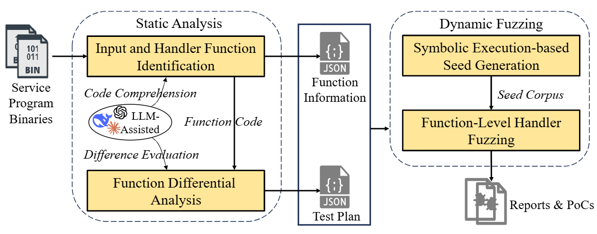

# DiffFuzz
Homology-aware function-level fuzzing of wireless router firmware.

DiffFuzz is a homology-aware, function-level fuzzing approach for wireless router firmware. It directly targets service handler functions that process user requests and avoids redundant testing across homologous firmware images, addressing the limits of existing techniques: ignored firmware similarity, high false-positive rates, reliance on rehosting, and inefficient exploration. It combines LLM-assisted static analysis, symbolic execution-based seed generation, and automated harness construction. Across 18 firmware images, DiffFuzz found 632 vulnerabilities versus Mango’s 97. On six AFL++-supported images, it found 166 vulnerabilities, covering all 11 of that baseline’s. It also uncovered 292 previously unknown flaws, 61 of which received CVE IDs (33 Critical, 25 High, 3 Medium).

# Note
We are sorry that some READMEs or comments are in Chinese only. Please read in a web page translator or similar tool if you cannot read Chinese.

# Paper
It is published online in Computers & Security: https://doi.org/10.1016/j.cose.2026.105227 or you can download the author version at https://zyingp.github.io/files/26-DiffFuzz.pdf
Please help to cite our paper if you find it useful.

# Alternative download place
zenodo https://zenodo.org/records/22031773
