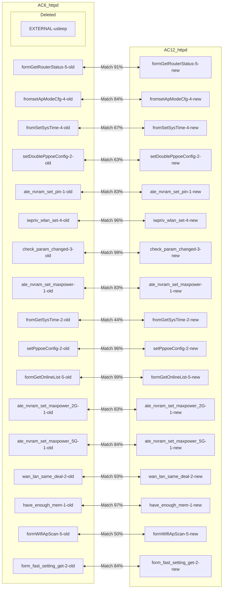
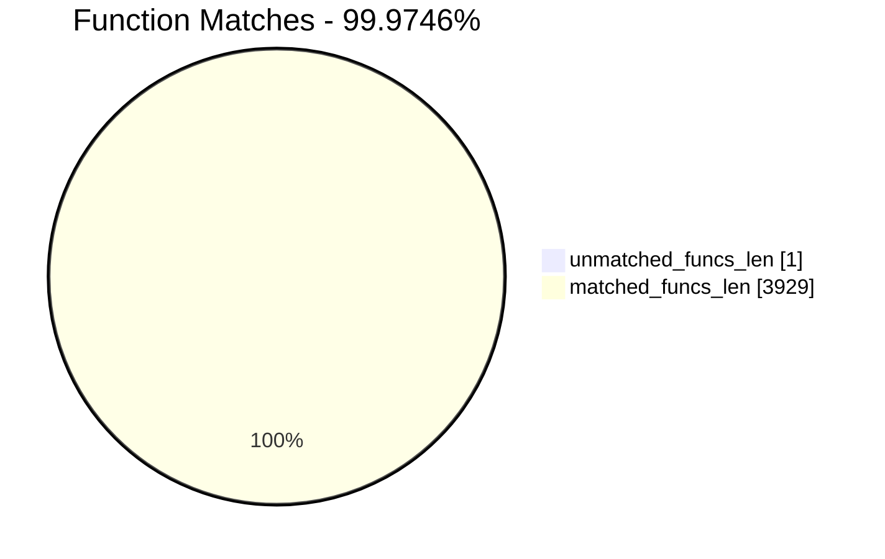
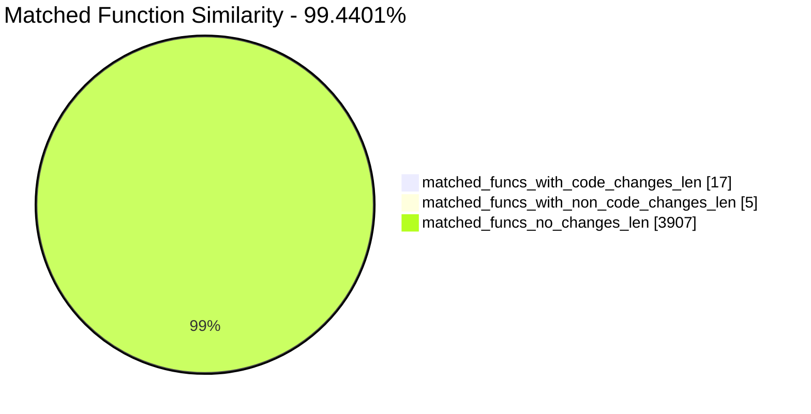
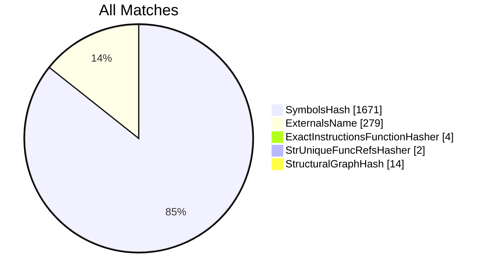
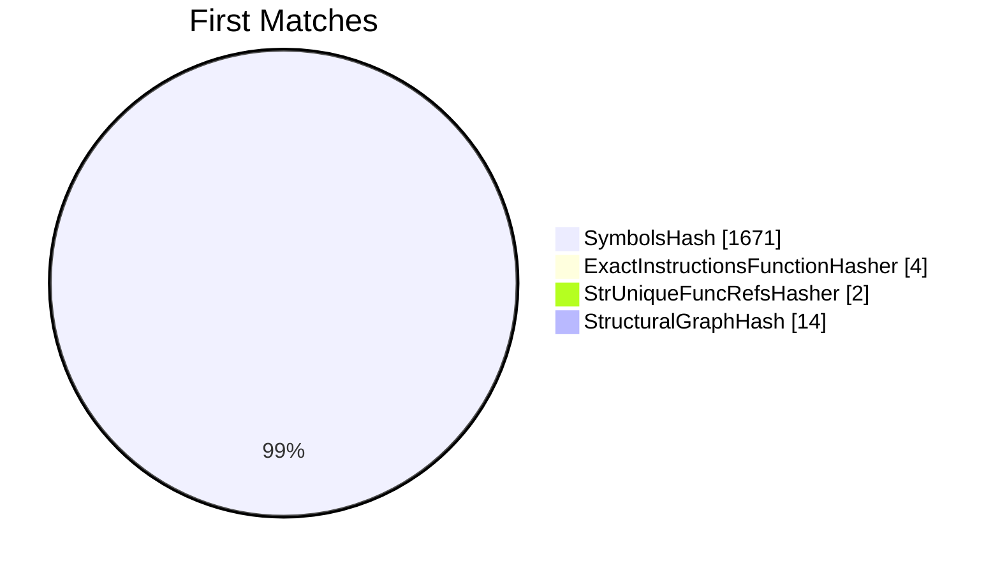
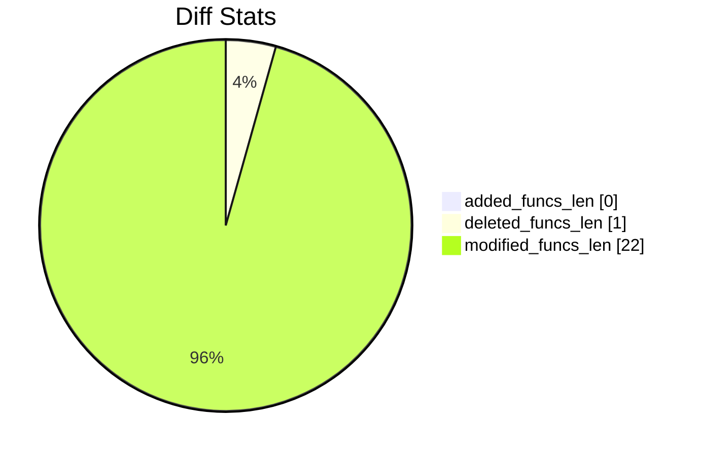
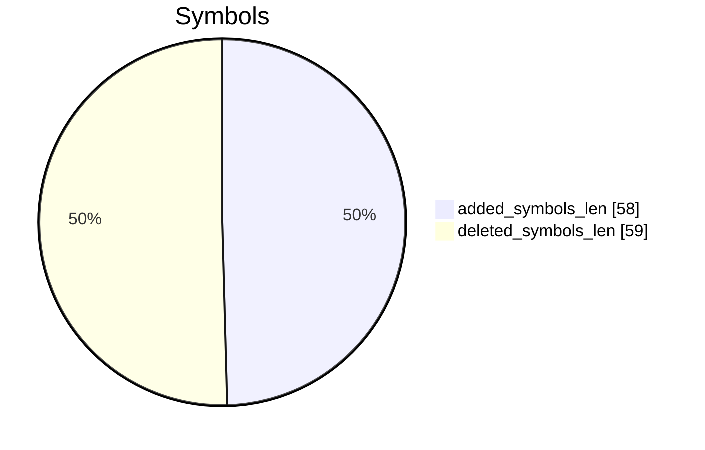
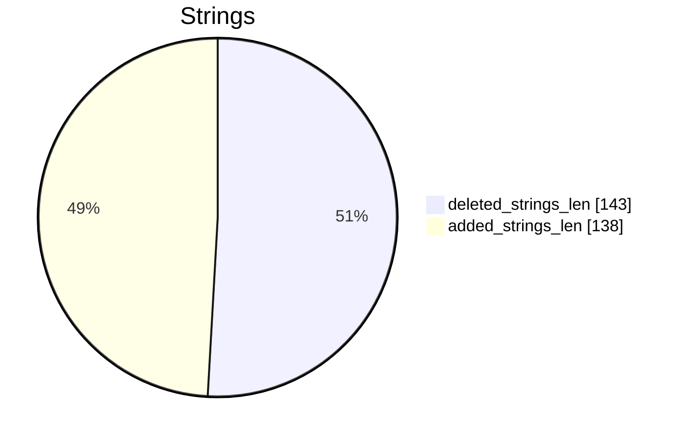

# AC6_httpd-AC12_httpd Diff

# TOC

* [Visual Chart Diff](#visual-chart-diff)
* [Metadata](#metadata)
	* [Ghidra Diff Engine](#ghidra-diff-engine)
		* [Command Line](#command-line)
	* [Binary Metadata Diff](#binary-metadata-diff)
	* [Program Options](#program-options)
	* [Diff Stats](#diff-stats)
	* [Strings](#strings)
* [Deleted](#deleted)
	* [<EXTERNAL>::usleep](#externalusleep)
* [Added](#added)
* [Modified](#modified)
	* [formGetRouterStatus](#formgetrouterstatus)
	* [fromsetApModeCfg](#fromsetapmodecfg)
	* [fromSetSysTime](#fromsetsystime)
	* [setDoublePppoeConfig](#setdoublepppoeconfig)
	* [ate_nvram_set_pin](#ate_nvram_set_pin)
	* [iwpriv_wlan_set](#iwpriv_wlan_set)
	* [check_param_changed](#check_param_changed)
	* [ate_nvram_set_maxpower](#ate_nvram_set_maxpower)
	* [fromGetSysTime](#fromgetsystime)
	* [setPppoeConfig](#setpppoeconfig)
	* [formGetOnlineList](#formgetonlinelist)
	* [ate_nvram_set_maxpower_2G](#ate_nvram_set_maxpower_2g)
	* [ate_nvram_set_maxpower_5G](#ate_nvram_set_maxpower_5g)
	* [wan_lan_same_deal](#wan_lan_same_deal)
	* [have_enough_mem](#have_enough_mem)
	* [formWifiApScan](#formwifiapscan)
	* [form_fast_setting_get](#form_fast_setting_get)
* [Modified (No Code Changes)](#modified-no-code-changes)
	* [set_cfm_mib](#set_cfm_mib)
	* [cJSON_AddItemToObject](#cjson_additemtoobject)
	* [setWanValue](#setwanvalue)
	* [cJSON_CreateString](#cjson_createstring)

# Visual Chart Diff










# Metadata

## Ghidra Diff Engine

### Command Line

#### Captured Command Line


```
ghidriff --project-location ghidra_projects --project-name ghidriff --symbols-path symbols --threaded --log-level INFO --file-log-level INFO --log-path ghidriff.log --min-func-len 10 --gdt [] --bsim --max-ram-percent 60.0 --max-section-funcs 200 AC6_httpd AC12_httpd
```


#### Verbose Args


<details>

```
--old ['./Tenda_httpd/AC6_httpd'] --new [['./Tenda_httpd/AC9_httpd', './Tenda_httpd/AC12_httpd']] --engine VersionTrackingDiff --output-path ./Tenda_httpd/112ghidra --summary Treu --project-location ghidra_projects --project-name ghidriff --symbols-path symbols --threaded True --force-analysis False --force-diff False --no-symbols False --log-level INFO --file-log-level INFO --log-path ghidriff.log --va False --min-func-len 10 --use-calling-counts False --gdt [] --bsim True --bsim-full False --max-ram-percent 60.0 --print-flags False --jvm-args None --side-by-side False --max-section-funcs 200 --md-title None
```


</details>

## Binary Metadata Diff


```diff
--- AC6_httpd Meta
+++ AC12_httpd Meta
@@ -1,177 +1,177 @@
-Program Name: AC6_httpd
+Program Name: AC12_httpd
 Language ID: MIPS:LE:32:default (1.8)
 Compiler ID: default
 Processor: MIPS
 Endian: Little
 Address Size: 32
-Minimum Address: 003ff000
+Minimum Address: 00400000
 Maximum Address: _elfSectionHeaders::00000757
-# of Bytes: 2129469
-# of Memory Blocks: 50
-# of Instructions: 254926
-# of Defined Data: 17472
-# of Functions: 1966
-# of Symbols: 24878
-# of Data Types: 930
+# of Bytes: 2121791
+# of Memory Blocks: 48
+# of Instructions: 254274
+# of Defined Data: 17453
+# of Functions: 1964
+# of Symbols: 24851
+# of Data Types: 927
 # of Data Type Categories: 118
 Analyzed: true
 Created With Ghidra Version: 11.1.2
 DWARF Loaded: true
-Date Created: Tue May 13 16:43:25 CST 2025
+Date Created: Tue May 13 16:43:27 CST 2025
 ELF File Type: executable
-ELF Original Image Base: 0x3ff000
+ELF Original Image Base: 0x400000
 ELF Prelinked: false
 ELF Source File [   0]: initfini.c
 ELF Source File [   1]: crtstuff.c
 ELF Source File [   2]: crtstuff.c
 ELF Source File [   3]: initfini.c
 ELF Source File [   4]: asp.c
 ELF Source File [   5]: balloc.c
 ELF Source File [   6]: base64.c
 ELF Source File [   7]: cgi.c
 ELF Source File [   8]: default.c
 ELF Source File [   9]: ejlex.c
 ELF Source File [  10]: ejparse.c
 ELF Source File [  11]: form.c
 ELF Source File [  12]: h.c
 ELF Source File [  13]: handler.c
 ELF Source File [  14]: uemf.h
 ELF Source File [  15]: misc.c
 ELF Source File [  16]: page.c
 ELF Source File [  17]: ringq.c
 ELF Source File [  18]: sock.c
 ELF Source File [  19]: sockGen.c
 ELF Source File [  20]: sslSocket.c
 ELF Source File [  21]: matrix_ssl.c
 ELF Source File [  22]: security.c
 ELF Source File [  23]: sym.c
 ELF Source File [  24]: uemf.c
 ELF Source File [  25]: url.c
 ELF Source File [  26]: value.c
 ELF Source File [  27]: md5c.c
 ELF Source File [  28]: um.c
 ELF Source File [  29]: umui.c
 ELF Source File [  30]: websda.c
 ELF Source File [  31]: emfdb.c
 ELF Source File [  32]: webs.c
 ELF Source File [  33]: websuemf.c
 ELF Source File [  34]: main.c
 ELF Source File [  35]: ../../../../infra/pal/list.h
 ELF Source File [  36]: /home/work/workspace/AC6V2.0/prod/httpd/11ac/cgi/sysCurrentInfor.c
 ELF Source File [  37]: /home/work/workspace/AC6V2.0/prod/httpd/11ac/cgi/controlCfm.c
 ELF Source File [  38]: /home/work/workspace/AC6V2.0/prod/httpd/11ac/cgi/networkCfm.c
 ELF Source File [  39]: /home/work/workspace/AC6V2.0/prod/httpd/11ac/cgi/sysSafe.c
 ELF Source File [  40]: /home/work/workspace/AC6V2.0/prod/httpd/11ac/cgi/Dhcp.c
 ELF Source File [  41]: /home/work/workspace/AC6V2.0/prod/httpd/11ac/cgi/upload.c
 ELF Source File [  42]: /home/work/workspace/AC6V2.0/prod/httpd/11ac/cgi/cJSON.c
 ELF Source File [  43]: /home/work/workspace/AC6V2.0/prod/httpd/11ac/cgi/Form_define.c
 ELF Source File [  44]: /home/work/workspace/AC6V2.0/prod/httpd/11ac/cgi/system_reboot.c
 ELF Source File [  45]: /home/work/workspace/AC6V2.0/prod/httpd/11ac/cgi/mtenda.c
 ELF Source File [  46]: /home/work/workspace/AC6V2.0/prod/httpd/11ac/cgi/Form_public.c
 ELF Source File [  47]: /home/work/workspace/AC6V2.0/prod/httpd/11ac/cgi/index.c
 ELF Source File [  48]: /home/work/workspace/AC6V2.0/prod/httpd/11ac/cgi/wizard.c
 ELF Source File [  49]: /home/work/workspace/AC6V2.0/prod/httpd/11ac/cgi/lan.c
 ELF Source File [  50]: /home/work/workspace/AC6V2.0/prod/httpd/11ac/cgi/../../../../infra/pal/list.h
 ELF Source File [  51]: /home/work/workspace/AC6V2.0/prod/httpd/11ac/cgi/fast_setting.c
 ELF Source File [  52]: /home/work/workspace/AC6V2.0/prod/httpd/11ac/cgi/usb_cgi.c
 ELF Source File [  53]: /home/work/workspace/AC6V2.0/infra/pal/list.h
 ELF Source File [  54]: /home/work/workspace/AC6V2.0/prod/httpd/11ac/cgi/webip_lan.c
 ELF Source File [  55]: /home/work/workspace/AC6V2.0/prod/httpd/11ac/cgi/wan_policy.c
 ELF Source File [  56]: /home/work/workspace/AC6V2.0/prod/httpd/11ac/cgi/multiWan_setting.c
 ELF Source File [  57]: /home/work/workspace/AC6V2.0/prod/httpd/11ac/cgi/webip_wan.c
 ELF Source File [  58]: /home/work/workspace/AC6V2.0/prod/httpd/11ac/cgi/nat_dmz.c
 ELF Source File [  59]: /home/work/workspace/AC6V2.0/prod/httpd/11ac/cgi/arp.c
 ELF Source File [  60]: /home/work/workspace/AC6V2.0/prod/httpd/11ac/cgi/nat_virtualser.c
 ELF Source File [  61]: /home/work/workspace/AC6V2.0/prod/httpd/11ac/cgi/nat_static.c
 ELF Source File [  62]: /home/work/workspace/AC6V2.0/prod/httpd/11ac/cgi/nat_set.c
 ELF Source File [  63]: /home/work/workspace/AC6V2.0/prod/httpd/11ac/cgi/ddns_config.c
 ELF Source File [  64]: /home/work/workspace/AC6V2.0/prod/httpd/11ac/cgi/routing_table.c
 ELF Source File [  65]: /home/work/workspace/AC6V2.0/prod/httpd/11ac/cgi/routing_static.c
 ELF Source File [  66]: /home/work/workspace/AC6V2.0/prod/httpd/11ac/cgi/system_log.c
 ELF Source File [  67]: /home/work/workspace/AC6V2.0/prod/httpd/11ac/cgi/log_addsetting.c
 ELF Source File [  68]: /home/work/workspace/AC6V2.0/prod/httpd/11ac/cgi/system_restore.c
 ELF Source File [  69]: /home/work/workspace/AC6V2.0/prod/httpd/11ac/cgi/system_password.c
 ELF Source File [  70]: /home/work/workspace/AC6V2.0/prod/httpd/11ac/cgi/system_baseuser.c
 ELF Source File [  71]: /home/work/workspace/AC6V2.0/prod/httpd/11ac/cgi/system_upgrade.c
 ELF Source File [  72]: /home/work/workspace/AC6V2.0/prod/httpd/11ac/cgi/cmd.c
 ELF Source File [  73]: /home/work/workspace/AC6V2.0/prod/httpd/11ac/cgi/utf_gbl_encode.c
 ELF Source File [  74]: /home/work/workspace/AC6V2.0/prod/httpd/11ac/cgi/qos_rule.c
 ELF Source File [  75]: /home/work/workspace/AC6V2.0/prod/httpd/11ac/cgi/auto_qos_cgi.c
 ELF Source File [  76]: /home/work/workspace/AC6V2.0/prod/httpd/11ac/cgi/cgi_utils.c
 ELF Source File [  77]: /home/work/workspace/AC6V2.0/prod/httpd/11ac/cgi/pacontrol.c
 ELF Source File [  78]: /home/work/workspace/AC6V2.0/prod/httpd/11ac/cgi/upnp_config.c
 ELF Source File [  79]: /home/work/workspace/AC6V2.0/prod/httpd/11ac/cgi/lan_dhcps.c
 ELF Source File [  80]: /home/work/workspace/AC6V2.0/prod/httpd/11ac/cgi/lan_dhcp_clients.c
 ELF Source File [  81]: /home/work/workspace/AC6V2.0/prod/httpd/11ac/cgi/system_hostname.c
 ELF Source File [  82]: /home/work/workspace/AC6V2.0/prod/httpd/11ac/cgi/dns_safesecond.c
 ELF Source File [  83]: /home/work/workspace/AC6V2.0/prod/httpd/11ac/cgi/sched_wifi_check.c
 ELF Source File [  84]: /home/work/workspace/AC6V2.0/prod/httpd/11ac/cgi/sched_led_check.c
 ELF Source File [  85]: /home/work/workspace/AC6V2.0/prod/httpd/11ac/cgi/electronic_bulletin.c
 ELF Source File [  86]: /home/work/workspace/AC6V2.0/prod/httpd/11ac/cgi/switch_portVLAN.c
 ELF Source File [  87]: /home/work/workspace/AC6V2.0/prod/httpd/11ac/cgi/wifi.c
 ELF Source File [  88]: /home/work/workspace/AC6V2.0/prod/httpd/11ac/cgi/behaviormanager_demo.c
 ELF Source File [  89]: /home/work/workspace/AC6V2.0/prod/httpd/11ac/cgi/safe_demo.c
 ELF Source File [  90]: /home/work/workspace/AC6V2.0/prod/httpd/11ac/cgi/ucloud_v2.c
 ELF Source File [  91]: /home/work/workspace/AC6V2.0/prod/httpd/11ac/cgi/alischedule.c
 ELF Source File [  92]: /home/work/workspace/AC6V2.0/prod/httpd/11ac/cgi/apclient.c
 ELF Source File [  93]: /home/work/workspace/AC6V2.0/prod/httpd/11ac/cgi/iptv.c
 ELF Source File [  94]: /home/work/workspace/AC6V2.0/prod/httpd/11ac/cgi/reboot_timer.c
 ELF Source File [  95]: /home/work/workspace/AC6V2.0/prod/httpd/11ac/cgi/smart_power_management_cgi.c
 ELF Source File [  96]: /home/work/workspace/AC6V2.0/prod/httpd/11ac/cgi/guest_ip_confilct.c
 ELF Source File [  97]: /home/work/workspace/AC6V2.0/prod/httpd/11ac/cgi/vpn.c
 ELF Source File [  98]: /home/work/workspace/AC6V2.0/prod/httpd/11ac/cgi/wan_err_info.c
 ELF Source File [  99]: /home/work/workspace/AC6V2.0/prod/httpd/11ac/cgi/cgi_common.c
 ELF Source File [ 100]: /home/work/workspace/AC6V2.0/prod/httpd/11ac/cgi/cgi_mac_filter.c
 ELF Source File [ 101]: /home/work/workspace/AC6V2.0/prod/httpd/11ac/cgi/cgi_advertisement.c
 ELF Source File [ 102]: matrixSsl.c
 ELF Source File [ 103]: sslDecode.c
 ELF Source File [ 104]: sslEncode.c
 ELF Source File [ 105]: sslv3.c
 ELF Source File [ 106]: linux.c
 ELF Source File [ 107]: md5.c
 ELF Source File [ 108]: mpi.c
 ELF Source File [ 109]: sha1.c
 ELF Source File [ 110]: rsaPki.c
 ELF Source File [ 111]: x509.c
 ELF Source File [ 112]: cipherSuite.c
 ELF Source File [ 113]: arc4.c
 ELF Source File [ 114]: base64.c
 ELF Source File [ 115]: des3.c
 ELF Source File [ 116]: rsa.c
 ELF Source File [ 117]: asn1.c
 ELF Source File [ 118]: libgcc2.c
 ELF Source File [ 119]: adddf3.c
 ELF Source File [ 120]: divdf3.c
 ELF Source File [ 121]: gedf2.c
 ELF Source File [ 122]: ledf2.c
 ELF Source File [ 123]: muldf3.c
 ELF Source File [ 124]: subdf3.c
 ELF Source File [ 125]: fixdfsi.c
 ELF Source File [ 126]: floatsidf.c
 ELF Source File [ 127]: floatunsidf.c
 ELF Source File [ 128]: extendsfdf2.c
 ELF Source File [ 129]: 
 Elf Comment[0]: GCC: (GNU) 3.3.2
 Elf Comment[1]: GCC: (Realtek MSDK-4.4.7 Build 2001) 4.4.7
 Executable Format: Executable and Linking Format (ELF)
-Executable Location: /root/FHFuzz/static_analysis/diff/Tenda_httpd/AC6_httpd
-Executable MD5: 6bbbe9d79eed77c2b21108d6bc60e46a
-Executable SHA256: 2b6bbc43b4a718af5533ea75e177ee6f9f8fb265beabaa95973faf474b3ce869
-FSRL: file:///root/FHFuzz/static_analysis/diff/Tenda_httpd/AC6_httpd?MD5=6bbbe9d79eed77c2b21108d6bc60e46a
+Executable Location: /root/FHFuzz/static_analysis/diff/Tenda_httpd/AC12_httpd
+Executable MD5: eef92bf72be49feab9e4fff22bbf86cf
+Executable SHA256: 5c6330ab898620f25009d1dc5fa4046e2ca7c3beacf3cdbbf9b12a4e028b5661
+FSRL: file:///root/FHFuzz/static_analysis/diff/Tenda_httpd/AC12_httpd?MD5=eef92bf72be49feab9e4fff22bbf86cf
 GNU DebugLink: httpd.debug
 Preferred Root Namespace Category: 
 Relocatable: false
 Required Library [    0]: libCfm.so
 Required Library [    1]: libcommon.so
 Required Library [    2]: libChipApi.so
 Required Library [    3]: libvos_util.so
 Required Library [    4]: libz.so
 Required Library [    5]: libpthread.so.0
 Required Library [    6]: libapmib.so
 Required Library [    7]: librtlWifiSrc.so
 Required Library [    8]: libtpi.so
 Required Library [    9]: libm.so.0
 Required Library [   10]: libucapi.so
 Required Library [   11]: libgcc_s.so.1
 Required Library [   12]: libc.so.0
 Should Ask To Analyze: false

```


## Program Options


<details>
<summary>Ghidra AC6_httpd Decompiler Options</summary>


|Decompiler Option|Value|
| :---: | :---: |
|Prototype Evaluation|__stdcall|

</details>


<details>
<summary>Ghidra AC6_httpd Specification extensions Options</summary>


|Specification extensions Option|Value|
| :---: | :---: |
|FormatVersion|0|
|VersionCounter|0|

</details>


<details>
<summary>Ghidra AC6_httpd Analyzers Options</summary>


|Analyzers Option|Value|
| :---: | :---: |
|ASCII Strings|true|
|ASCII Strings.Create Strings Containing Existing Strings|true|
|ASCII Strings.Create Strings Containing References|true|
|ASCII Strings.Force Model Reload|false|
|ASCII Strings.Minimum String Length|LEN_5|
|ASCII Strings.Model File|StringModel.sng|
|ASCII Strings.Require Null Termination for String|true|
|ASCII Strings.Search Only in Accessible Memory Blocks|true|
|ASCII Strings.String Start Alignment|ALIGN_1|
|ASCII Strings.String end alignment|4|
|Aggressive Instruction Finder|false|
|Aggressive Instruction Finder.Create Analysis Bookmarks|true|
|Apply Data Archives|true|
|Apply Data Archives.Archive Chooser|[Auto-Detect]|
|Apply Data Archives.Create Analysis Bookmarks|true|
|Apply Data Archives.GDT User File Archive Path|None|
|Apply Data Archives.User Project Archive Path|None|
|Call Convention ID|true|
|Call Convention ID.Analysis Decompiler Timeout (sec)|60|
|Call-Fixup Installer|true|
|Condense Filler Bytes|false|
|Condense Filler Bytes.Filler Value|Auto|
|Condense Filler Bytes.Minimum number of sequential bytes|1|
|Create Address Tables|true|
|Create Address Tables.Allow Offcut References|false|
|Create Address Tables.Auto Label Table|false|
|Create Address Tables.Create Analysis Bookmarks|true|
|Create Address Tables.Maxmimum Pointer Distance|16777215|
|Create Address Tables.Minimum Pointer Address|4132|
|Create Address Tables.Minimum Table Size|3|
|Create Address Tables.Pointer Alignment|1|
|Create Address Tables.Relocation Table Guide|true|
|Create Address Tables.Table Alignment|4|
|DWARF|true|
|DWARF.Add Inlined Functions Comments|false|
|DWARF.Add Lexical Block Comments|false|
|DWARF.Create Function Signatures|true|
|DWARF.Import Data Types|true|
|DWARF.Import Functions|true|
|DWARF.Import Local Variable Info|true|
|DWARF.Output DWARF DIE Info|false|
|DWARF.Output Source Info|false|
|DWARF.Output Source Line Info|false|
|DWARF.Try To Pack Structs|true|
|Data Reference|true|
|Data Reference.Address Table Alignment|1|
|Data Reference.Address Table Minimum Size|3|
|Data Reference.Align End of Strings|false|
|Data Reference.Ascii String References|true|
|Data Reference.Create Address Tables|false|
|Data Reference.Minimum String Length|5|
|Data Reference.References to Pointers|true|
|Data Reference.Relocation Table Guide|true|
|Data Reference.Respect Execute Flag|true|
|Data Reference.Subroutine References|true|
|Data Reference.Switch Table References|false|
|Data Reference.Unicode String References|true|
|Decompiler Parameter ID|true|
|Decompiler Parameter ID.Analysis Clear Level|ANALYSIS|
|Decompiler Parameter ID.Analysis Decompiler Timeout (sec)|60|
|Decompiler Parameter ID.Commit Data Types|true|
|Decompiler Parameter ID.Commit Void Return Values|false|
|Decompiler Parameter ID.Prototype Evaluation|__stdcall|
|Decompiler Switch Analysis|true|
|Decompiler Switch Analysis.Analysis Decompiler Timeout (sec)|60|
|Demangler GNU|true|
|Demangler GNU.Apply Function Calling Conventions|true|
|Demangler GNU.Apply Function Signatures|true|
|Demangler GNU.Demangle Only Known Mangled Symbols|false|
|Demangler GNU.Demangler Format|AUTO|
|Demangler GNU.Use Deprecated Demangler|false|
|Disassemble Entry Points|true|
|Disassemble Entry Points.Respect Execute Flag|true|
|ELF Scalar Operand References|false|
|ELF Scalar Operand References.Relocation Table Guide|true|
|Embedded Media|true|
|Embedded Media.Create Analysis Bookmarks|true|
|External Entry References|true|
|External Symbol Resolver|true|
|Function Start Search|true|
|Function Start Search.Bookmark Functions|false|
|Function Start Search.Search Data Blocks|false|
|GCC Exception Handlers|true|
|GCC Exception Handlers.Create Try Catch Comments|true|
|MIPS Constant Reference Analyzer|true|
|MIPS Constant Reference Analyzer.Assume T9 set to Function entry|true|
|MIPS Constant Reference Analyzer.Attempt to recover switch tables|false|
|MIPS Constant Reference Analyzer.Create Data from pointer|false|
|MIPS Constant Reference Analyzer.Function parameter/return Pointer analysis|true|
|MIPS Constant Reference Analyzer.Mark dual instruction references|false|
|MIPS Constant Reference Analyzer.Max Threads|2|
|MIPS Constant Reference Analyzer.Min absolute reference|4|
|MIPS Constant Reference Analyzer.Recover global GP register writes|true|
|MIPS Constant Reference Analyzer.Require pointer param data type|false|
|MIPS Constant Reference Analyzer.Speculative reference max|256|
|MIPS Constant Reference Analyzer.Speculative reference min|512|
|MIPS Constant Reference Analyzer.Stored Value Pointer analysis|true|
|MIPS Constant Reference Analyzer.Trust values read from writable memory|true|
|MIPS Symbol|true|
|MIPS UnAlligned Instruction Fix|true|
|Non-Returning Functions - Discovered|true|
|Non-Returning Functions - Discovered.Create Analysis Bookmarks|true|
|Non-Returning Functions - Discovered.Function Non-return Threshold|3|
|Non-Returning Functions - Discovered.Repair Flow Damage|true|
|Non-Returning Functions - Known|true|
|Non-Returning Functions - Known.Create Analysis Bookmarks|true|
|Reference|true|
|Reference.Address Table Alignment|1|
|Reference.Address Table Minimum Size|3|
|Reference.Align End of Strings|false|
|Reference.Ascii String References|true|
|Reference.Create Address Tables|false|
|Reference.Minimum String Length|5|
|Reference.References to Pointers|true|
|Reference.Relocation Table Guide|true|
|Reference.Respect Execute Flag|true|
|Reference.Subroutine References|true|
|Reference.Switch Table References|false|
|Reference.Unicode String References|true|
|Shared Return Calls|true|
|Shared Return Calls.Allow Conditional Jumps|false|
|Shared Return Calls.Assume Contiguous Functions Only|false|
|Stack|true|
|Stack.Create Local Variables|true|
|Stack.Create Param Variables|true|
|Stack.useNewFunctionStackAnalysis|true|
|Subroutine References|true|
|Subroutine References.Create Thunks Early|true|
|Variadic Function Signature Override|false|
|Variadic Function Signature Override.Create Analysis Bookmarks|false|

</details>


<details>
<summary>Ghidra AC12_httpd Decompiler Options</summary>


|Decompiler Option|Value|
| :---: | :---: |
|Prototype Evaluation|__stdcall|

</details>


<details>
<summary>Ghidra AC12_httpd Specification extensions Options</summary>


|Specification extensions Option|Value|
| :---: | :---: |
|FormatVersion|0|
|VersionCounter|0|

</details>


<details>
<summary>Ghidra AC12_httpd Analyzers Options</summary>


|Analyzers Option|Value|
| :---: | :---: |
|ASCII Strings|true|
|ASCII Strings.Create Strings Containing Existing Strings|true|
|ASCII Strings.Create Strings Containing References|true|
|ASCII Strings.Force Model Reload|false|
|ASCII Strings.Minimum String Length|LEN_5|
|ASCII Strings.Model File|StringModel.sng|
|ASCII Strings.Require Null Termination for String|true|
|ASCII Strings.Search Only in Accessible Memory Blocks|true|
|ASCII Strings.String Start Alignment|ALIGN_1|
|ASCII Strings.String end alignment|4|
|Aggressive Instruction Finder|false|
|Aggressive Instruction Finder.Create Analysis Bookmarks|true|
|Apply Data Archives|true|
|Apply Data Archives.Archive Chooser|[Auto-Detect]|
|Apply Data Archives.Create Analysis Bookmarks|true|
|Apply Data Archives.GDT User File Archive Path|None|
|Apply Data Archives.User Project Archive Path|None|
|Call Convention ID|true|
|Call Convention ID.Analysis Decompiler Timeout (sec)|60|
|Call-Fixup Installer|true|
|Condense Filler Bytes|false|
|Condense Filler Bytes.Filler Value|Auto|
|Condense Filler Bytes.Minimum number of sequential bytes|1|
|Create Address Tables|true|
|Create Address Tables.Allow Offcut References|false|
|Create Address Tables.Auto Label Table|false|
|Create Address Tables.Create Analysis Bookmarks|true|
|Create Address Tables.Maxmimum Pointer Distance|16777215|
|Create Address Tables.Minimum Pointer Address|4132|
|Create Address Tables.Minimum Table Size|3|
|Create Address Tables.Pointer Alignment|1|
|Create Address Tables.Relocation Table Guide|true|
|Create Address Tables.Table Alignment|4|
|DWARF|true|
|DWARF.Add Inlined Functions Comments|false|
|DWARF.Add Lexical Block Comments|false|
|DWARF.Create Function Signatures|true|
|DWARF.Import Data Types|true|
|DWARF.Import Functions|true|
|DWARF.Import Local Variable Info|true|
|DWARF.Output DWARF DIE Info|false|
|DWARF.Output Source Info|false|
|DWARF.Output Source Line Info|false|
|DWARF.Try To Pack Structs|true|
|Data Reference|true|
|Data Reference.Address Table Alignment|1|
|Data Reference.Address Table Minimum Size|3|
|Data Reference.Align End of Strings|false|
|Data Reference.Ascii String References|true|
|Data Reference.Create Address Tables|false|
|Data Reference.Minimum String Length|5|
|Data Reference.References to Pointers|true|
|Data Reference.Relocation Table Guide|true|
|Data Reference.Respect Execute Flag|true|
|Data Reference.Subroutine References|true|
|Data Reference.Switch Table References|false|
|Data Reference.Unicode String References|true|
|Decompiler Parameter ID|true|
|Decompiler Parameter ID.Analysis Clear Level|ANALYSIS|
|Decompiler Parameter ID.Analysis Decompiler Timeout (sec)|60|
|Decompiler Parameter ID.Commit Data Types|true|
|Decompiler Parameter ID.Commit Void Return Values|false|
|Decompiler Parameter ID.Prototype Evaluation|__stdcall|
|Decompiler Switch Analysis|true|
|Decompiler Switch Analysis.Analysis Decompiler Timeout (sec)|60|
|Demangler GNU|true|
|Demangler GNU.Apply Function Calling Conventions|true|
|Demangler GNU.Apply Function Signatures|true|
|Demangler GNU.Demangle Only Known Mangled Symbols|false|
|Demangler GNU.Demangler Format|AUTO|
|Demangler GNU.Use Deprecated Demangler|false|
|Disassemble Entry Points|true|
|Disassemble Entry Points.Respect Execute Flag|true|
|ELF Scalar Operand References|false|
|ELF Scalar Operand References.Relocation Table Guide|true|
|Embedded Media|true|
|Embedded Media.Create Analysis Bookmarks|true|
|External Entry References|true|
|External Symbol Resolver|true|
|Function Start Search|true|
|Function Start Search.Bookmark Functions|false|
|Function Start Search.Search Data Blocks|false|
|GCC Exception Handlers|true|
|GCC Exception Handlers.Create Try Catch Comments|true|
|MIPS Constant Reference Analyzer|true|
|MIPS Constant Reference Analyzer.Assume T9 set to Function entry|true|
|MIPS Constant Reference Analyzer.Attempt to recover switch tables|false|
|MIPS Constant Reference Analyzer.Create Data from pointer|false|
|MIPS Constant Reference Analyzer.Function parameter/return Pointer analysis|true|
|MIPS Constant Reference Analyzer.Mark dual instruction references|false|
|MIPS Constant Reference Analyzer.Max Threads|2|
|MIPS Constant Reference Analyzer.Min absolute reference|4|
|MIPS Constant Reference Analyzer.Recover global GP register writes|true|
|MIPS Constant Reference Analyzer.Require pointer param data type|false|
|MIPS Constant Reference Analyzer.Speculative reference max|256|
|MIPS Constant Reference Analyzer.Speculative reference min|512|
|MIPS Constant Reference Analyzer.Stored Value Pointer analysis|true|
|MIPS Constant Reference Analyzer.Trust values read from writable memory|true|
|MIPS Symbol|true|
|MIPS UnAlligned Instruction Fix|true|
|Non-Returning Functions - Discovered|true|
|Non-Returning Functions - Discovered.Create Analysis Bookmarks|true|
|Non-Returning Functions - Discovered.Function Non-return Threshold|3|
|Non-Returning Functions - Discovered.Repair Flow Damage|true|
|Non-Returning Functions - Known|true|
|Non-Returning Functions - Known.Create Analysis Bookmarks|true|
|Reference|true|
|Reference.Address Table Alignment|1|
|Reference.Address Table Minimum Size|3|
|Reference.Align End of Strings|false|
|Reference.Ascii String References|true|
|Reference.Create Address Tables|false|
|Reference.Minimum String Length|5|
|Reference.References to Pointers|true|
|Reference.Relocation Table Guide|true|
|Reference.Respect Execute Flag|true|
|Reference.Subroutine References|true|
|Reference.Switch Table References|false|
|Reference.Unicode String References|true|
|Shared Return Calls|true|
|Shared Return Calls.Allow Conditional Jumps|false|
|Shared Return Calls.Assume Contiguous Functions Only|false|
|Stack|true|
|Stack.Create Local Variables|true|
|Stack.Create Param Variables|true|
|Stack.useNewFunctionStackAnalysis|true|
|Subroutine References|true|
|Subroutine References.Create Thunks Early|true|
|Variadic Function Signature Override|false|
|Variadic Function Signature Override.Create Analysis Bookmarks|false|

</details>

## Diff Stats


|Stat|Value|
| :---: | :---: |
|added_funcs_len|0|
|deleted_funcs_len|1|
|modified_funcs_len|22|
|added_symbols_len|58|
|deleted_symbols_len|59|
|diff_time|23.268104076385498|
|deleted_strings_len|143|
|added_strings_len|138|
|match_types|Counter({'SymbolsHash': 1671, 'ExternalsName': 279, 'StructuralGraphHash': 14, 'ExactInstructionsFunctionHasher': 4, 'StrUniqueFuncRefsHasher': 2})|
|items_to_process|140|
|diff_types|Counter({'address': 22, 'length': 18, 'code': 17, 'called': 8, 'refcount': 4, 'sig': 2, 'calling': 1})|
|unmatched_funcs_len|1|
|total_funcs_len|3930|
|matched_funcs_len|3929|
|matched_funcs_with_code_changes_len|17|
|matched_funcs_with_non_code_changes_len|5|
|matched_funcs_no_changes_len|3907|
|match_func_similarity_percent|99.4401%|
|func_match_overall_percent|99.9746%|
|first_matches|Counter({'SymbolsHash': 1671, 'StructuralGraphHash': 14, 'ExactInstructionsFunctionHasher': 4, 'StrUniqueFuncRefsHasher': 2})|













## Strings




### Strings Diff


```diff
--- deleted strings
+++ added strings
@@ -1,143 +1,138 @@
-__FUNCTION__.10180
-__FUNCTION__.12612
-__FUNCTION__.6429
-__FUNCTION__.6454
-__FUNCTION__.6466
-__FUNCTION__.6515
-__FUNCTION__.6541
-__FUNCTION__.6592
-__FUNCTION__.6633
-__FUNCTION__.6665
-__FUNCTION__.6722
-__FUNCTION__.6740
-__FUNCTION__.6748
-__FUNCTION__.7081
-__FUNCTION__.7207
-__FUNCTION__.7217
-__FUNCTION__.7280
-__FUNCTION__.7287
-__FUNCTION__.7492
-__FUNCTION__.7657
-__FUNCTION__.7712
-__FUNCTION__.7731
-__FUNCTION__.7793
-__FUNCTION__.8100
-__FUNCTION__.8144
-__FUNCTION__.8225
-__FUNCTION__.8231
-__FUNCTION__.8345
-__FUNCTION__.8430
-__FUNCTION__.8490
-__FUNCTION__.8544
-__FUNCTION__.8597
-__FUNCTION__.8642
-__FUNCTION__.8672
-__FUNCTION__.9836
-__FUNCTION__.9860
-__func__.10026
-__func__.10075
-__func__.10113
-__func__.10179
-__func__.10188
-__func__.10229
-__func__.10274
-__func__.10379
-__func__.10421
-__func__.10483
-__func__.10568
-__func__.10636
-__func__.10658
-__func__.10703
-__func__.10732
-__func__.10823
-__func__.10874
-__func__.10891
-__func__.10980
-__func__.10984
-__func__.11096
-__func__.11151
-__func__.11174
-__func__.11219
-__func__.11286
-__func__.11363
-__func__.11424
-__func__.11451
-__func__.11484
-__func__.11486
-__func__.11545
-__func__.11672
-__func__.11683
-__func__.11724
-__func__.11744
-__func__.11789
-__func__.11809
-__func__.11890
-__func__.12013
-__func__.12040
-__func__.12088
-__func__.12110
-__func__.12221
-__func__.12234
-__func__.12253
-__func__.12296
-__func__.12398
-__func__.12477
-__func__.12501
-__func__.12536
-__func__.12624
-__func__.12667
-__func__.12734
-__func__.12754
-__func__.12777
-__func__.12811
-__func__.12844
-__func__.12860
-__func__.12887
-__func__.12918
-__func__.12956
-__func__.13003
-__func__.13123
-__func__.13349
-__func__.13418
-__func__.2596
-__func__.2657
-__func__.6207
-__func__.6892
-__func__.6972
-__func__.7734
-__func__.7781
-__func__.7838
-__func__.7843
-__func__.7877
-__func__.7911
-__func__.8003
-__func__.8047
-__func__.8048
-__func__.8112
-__func__.8283
-__func__.8407
-__func__.8423
-__func__.8490
-__func__.8552
-__func__.8710
-__func__.8745
-__func__.9132
-__func__.9140
-__func__.9296
-__func__.9359
-__func__.9417
-__func__.9529
-__func__.9754
-__func__.9771
-__func__.9840
-__func__.9867
-__func__.9925
-__func__.9927
-__func__.9985
-s_/js/macro_config.js
-s_11:10:31
-s_Aug
-s_countryCode
-s_nextzone_=_%s
-s_ppoe.ac
-s_rm_-rf_/tmp/core-*
+__FUNCTION__.10168
+__FUNCTION__.12611
+__FUNCTION__.6425
+__FUNCTION__.6453
+__FUNCTION__.6465
+__FUNCTION__.6514
+__FUNCTION__.6540
+__FUNCTION__.6588
+__FUNCTION__.6623
+__FUNCTION__.6651
+__FUNCTION__.6705
+__FUNCTION__.6723
+__FUNCTION__.6731
+__FUNCTION__.7080
+__FUNCTION__.7190
+__FUNCTION__.7200
+__FUNCTION__.7263
+__FUNCTION__.7270
+__FUNCTION__.7475
+__FUNCTION__.7656
+__FUNCTION__.7695
+__FUNCTION__.7714
+__FUNCTION__.7792
+__FUNCTION__.8099
+__FUNCTION__.8143
+__FUNCTION__.8223
+__FUNCTION__.8230
+__FUNCTION__.8344
+__FUNCTION__.8429
+__FUNCTION__.8489
+__FUNCTION__.8543
+__FUNCTION__.8596
+__FUNCTION__.8641
+__FUNCTION__.8671
+__FUNCTION__.9835
+__FUNCTION__.9859
+__func__.10025
+__func__.10074
+__func__.10112
+__func__.10178
+__func__.10187
+__func__.10228
+__func__.10272
+__func__.10378
+__func__.10420
+__func__.10471
+__func__.10567
+__func__.10635
+__func__.10657
+__func__.10702
+__func__.10731
+__func__.10822
+__func__.10862
+__func__.10890
+__func__.10979
+__func__.10983
+__func__.11095
+__func__.11150
+__func__.11173
+__func__.11218
+__func__.11285
+__func__.11362
+__func__.11423
+__func__.11450
+__func__.11483
+__func__.11485
+__func__.11544
+__func__.11671
+__func__.11682
+__func__.11723
+__func__.11743
+__func__.11788
+__func__.11807
+__func__.11889
+__func__.12012
+__func__.12039
+__func__.12087
+__func__.12098
+__func__.12220
+__func__.12233
+__func__.12252
+__func__.12295
+__func__.12397
+__func__.12476
+__func__.12500
+__func__.12535
+__func__.12623
+__func__.12666
+__func__.12733
+__func__.12753
+__func__.12776
+__func__.12810
+__func__.12840
+__func__.12843
+__func__.12886
+__func__.12917
+__func__.12955
+__func__.13002
+__func__.13103
+__func__.13329
+__func__.13398
+__func__.2595
+__func__.2656
+__func__.6206
+__func__.6875
+__func__.6955
+__func__.7733
+__func__.7764
+__func__.7826
+__func__.7837
+__func__.7876
+__func__.7910
+__func__.8002
+__func__.8030
+__func__.8046
+__func__.8111
+__func__.8282
+__func__.8406
+__func__.8422
+__func__.8489
+__func__.8551
+__func__.8709
+__func__.8744
+__func__.9131
+__func__.9139
+__func__.9295
+__func__.9358
+__func__.9416
+__func__.9528
+__func__.9753
+__func__.9770
+__func__.9839
+__func__.9866
+__func__.9924
+__func__.9926
+__func__.9984
+s_18:06:41
+s_Sep

```


### String References

#### Old


|String|Ref Count|Ref Func|
| :---: | :---: | :---: |
|__func__.7843|1|ate_iwpriv_set|
|__FUNCTION__.7207|1|ate_Tenda_mfg_check_usb|
|__func__.12844|2|volidate_wpapsk_key|
|__func__.9529|10|get_online_dev_list|
|__FUNCTION__.7492|1|ate_Tenda_mfg_LanWanInfo|
|__func__.11486|1|formWifiStatistic|
|__FUNCTION__.7280|1|ate_Tenda_mfg_reboot|
|__func__.12667|1|parse_ssid_from_file|
|__func__.11545|1|formWifiDhcpGuestGet|
|__func__.7877|11|fromAdvSetLanip|
|__func__.12860|1|formSetQosBand|
|__func__.11744|1|formsetNotUpgrade|
|__FUNCTION__.8144|6|_query_upgrade_|
|s_countryCode_0050ec18|1|form_fast_setting_get|
|__func__.12624|1|set_cn_ssid_ori_encode|
|__FUNCTION__.7217|1|ate_Tenda_mfg_check_usb3|
|__func__.7838|4|get_idle_rule_id|
|__func__.11683|1|formWifiStatus|
|__func__.10188|2|parse_macfilter_rule|
|__FUNCTION__.8672|2|send_login_sta_update|
|__func__.9985|2|set_macfilter_rules|
|__func__.11363|4|get_delete_pos|
|__FUNCTION__.8597|1|cloudv2_manage|
|__func__.10568|4|get_macfilter_rule_index|
|__FUNCTION__.8490|1|setbasic|
|s_11:10:31_0050813c|1|get_compile_date_time|
|__func__.12040|2|formWifiWpsOOB|
|__func__.10891|5|delete_id_from_rule_list_id|
|__func__.11151|3|get_device_name|
|__FUNCTION__.6454|1|formSetIptv|
|__FUNCTION__.7793|1|formSetRebootTimer|
|__FUNCTION__.6541|3|ali_get_statistic_info|
|__func__.7911|5|set_wl_guest_iplist|
|__func__.10732|9|formGetSystemStatus|
|__func__.9296|4|get_local_host_info|
|__func__.9840|5|formSetMacFilterCfg|
|__FUNCTION__.12612|1|set_value_by_def|
|__func__.11424|2|get_black_num|
|__func__.11724|2|formWifiWpsGet|
|__func__.8048|1|ate_rtl_cmd_process_check|
|__FUNCTION__.6466|3|ali_talking_with_kernel|
|__func__.11219|3|is_mac_existed_in_rule_list|
|__func__.11451|1|formWifiPowerGet|
|__FUNCTION__.7287|1|ate_Tenda_mfg_default|
|__func__.9927|3|set_macfilter_mode|
|s_ppoe.ac_00510540|2|setPppoeConfig,setDoublePppoeConfig|
|__FUNCTION__.6429|1|change_wifi_ssid|
|__func__.10636|1|set_macfilter_rule_to_list|
|__func__.11096|3|set_device_name|
|__func__.13418|1|formGetHomeLink|
|__func__.12088|2|formWifiWpsSet|
|__func__.13003|1|volidate_wds_maclist|
|__func__.9359|3|get_macfilter_mode|
|__FUNCTION__.6722|1|ate_nvram_set_country|
|__func__.12754|1|volidate_range|
|__func__.12887|2|volidate_ip|
|__func__.11484|3|check_mac_in_blacklist|
|__func__.10421|9|formAddMacfilterRule|
|__func__.8283|1|webCgiGetUploadFile|
|__FUNCTION__.6740|1|ate_nvram_set_profile|
|__FUNCTION__.8544|2|setaccount|
|__func__.8710|2|get_panic_file|
|__func__.12398|4|get_wifi_ifname|
|__func__.12477|1|get_ssid_num_by_mode|
|__func__.10075|2|unset_macfilter_rules|
|s_nextzone_=_%s_0051a5f8|1|fromGetSysTime|
|__func__.8552|1|uploadPolicy|
|s_/js/macro_config.js_00507d5c|1|R7WebsSecurityHandler|
|__func__.11890|3|wps_restore_mib_default_value|
|__func__.7734|4|setQosMiblist|
|__FUNCTION__.6665|1|ate_nvram_set_maxpower_5G|
|__func__.8423|5|upgrade|
|__func__.10823|3|delete_macfilter_rule_by_mac|
|__func__.12501|1|get_all_ssid_on_off|
|__func__.12536|1|set_all_ssid_on_off|
|__func__.10113|5|unset_wireless_macfilter_rules|
|__func__.11789|2|formWifiWpsStart|
|__func__.10179|1|formWifiBasicSet|
|__func__.11672|1|check_mac_in_parentctrl_list|
|__FUNCTION__.10180|1|exchange_wan_action|
|__func__.10229|2|set_macfilter_list_id|
|__func__.6207|1|initWebs|
|s_rm_-rf_/tmp/core-*_00509590|1|have_enough_mem|
|__FUNCTION__.6633|1|ate_nvram_set_maxpower_2G|
|__FUNCTION__.6515|1|get_online_ip_count|
|__func__.12221|1|init_global_wifi_buf|
|__func__.9867|3|formWifiMultiSsid|
|__func__.8003|7|unset_wl_guest_list|
|__FUNCTION__.7731|1|ate_wlctrl_get|
|__func__.10874|1|check_param_changed|
|__func__.9132|8|formGetMacFilterCfg|
|__func__.10658|2|add_id_to_rule_list_id|
|__func__.11174|1|formWifiRadioGet|
|__func__.8407|1|have_enough_mem|
|__FUNCTION__.6592|1|ate_nvram_set_maxpower|
|__func__.10379|1|formGetWanStatistic|
|__FUNCTION__.8225|1|form_fast_setting_wifi_set|
|__FUNCTION__.9860|1|saveParentControlInfo|
|__func__.7781|1|iwpriv_wlan_set|
|__func__.12734|1|volidate_choice|
|__func__.10483|1|formWanInfoGet|
|__func__.9417|5|get_macfilter_rule|
|__FUNCTION__.8231|1|prod_new_ack|
|__func__.12956|1|validate_hwaddr|
|__FUNCTION__.7657|1|get_online_ip_info|
|__func__.12777|2|volidate_name|
|__func__.13349|3|check_vendor_from_offline_list|
|__FUNCTION__.8345|1|check_pptp_user_if_login|
|__func__.12811|2|volidate_wep_key|
|__func__.9140|1|UploadWebsite|
|__func__.6892|8|ate_rtl_set_prod_arg|
|__func__.10984|6|formGetMacfilterRuleList|
|__func__.2657|4|parse_response_string|
|__func__.2596|5|get_advertise_url_from_cloud|
|__func__.12296|1|set_idx_to_mib|
|__func__.10026|3|set_macfilter_rules_by_one|
|__func__.10274|1|formSetParentControlEnable|
|__func__.12918|1|volidate_wpa_key|
|__func__.12234|1|get_mib_2cJSONString|
|__func__.8745|1|get_log_file|
|__func__.8112|1|formAdvGetLanIp|
|__func__.12013|1|wps_restore_nvram_default_value|
|__FUNCTION__.7712|1|ate_wlctrl_set|
|__FUNCTION__.6748|1|ate_nvram_set_test|
|__func__.9925|1|formWifiBasicGet|
|__FUNCTION__.8642|1|ucloud_v2_init|
|__func__.9754|4|is_lan_host|
|__func__.13123|5|formGetParentCtrlList|
|__func__.10980|4|formWifiMacFilterGet|
|__func__.11809|5|formGetRouterStatus|
|__FUNCTION__.8100|3|_query_version_|
|__FUNCTION__.9836|1|do_wifi_handle|
|__func__.10703|7|formDelMacfilterRule|
|__FUNCTION__.8430|1|_cgi_query_uc_account_|
|__FUNCTION__.7081|1|wan_lan_same_deal|
|s_Aug_9_2018_0050c11c|1|aspTendaGetStatus|
|__func__.12110|5|formGetOnlineList|
|__func__.8047|2|is_wan_onlined|
|__func__.6972|8|ate_rtl_set_hw_wlan|
|__func__.11286|5|update_mac_filter_enable_flag|
|__func__.8490|1|UploadCfg|
|__func__.12253|1|get_index_mib_2cJSONString|
|__func__.9771|1|string_replace|

#### New


|String|Ref Count|Ref Func|
| :---: | :---: | :---: |
|__func__.11095|3|set_device_name|
|__func__.9984|2|set_macfilter_rules|
|__func__.11723|2|formWifiWpsGet|
|__FUNCTION__.7714|1|ate_wlctrl_get|
|__func__.13329|3|check_vendor_from_offline_list|
|__FUNCTION__.7270|1|ate_Tenda_mfg_default|
|__func__.12295|1|set_idx_to_mib|
|__func__.10822|3|delete_macfilter_rule_by_mac|
|__FUNCTION__.12611|1|set_value_by_def|
|__func__.9416|5|get_macfilter_rule|
|__func__.10471|1|formWanInfoGet|
|__func__.6875|8|ate_rtl_set_prod_arg|
|__func__.12535|1|set_all_ssid_on_off|
|__FUNCTION__.8671|2|send_login_sta_update|
|__FUNCTION__.8641|1|ucloud_v2_init|
|__func__.11682|1|formWifiStatus|
|__func__.9866|3|formWifiMultiSsid|
|__func__.10228|2|set_macfilter_list_id|
|__func__.11173|1|formWifiRadioGet|
|__func__.2595|5|get_advertise_url_from_cloud|
|__FUNCTION__.8143|6|_query_upgrade_|
|__func__.9139|1|UploadWebsite|
|__func__.11218|3|is_mac_existed_in_rule_list|
|__func__.10731|9|formGetSystemStatus|
|__func__.8046|2|is_wan_onlined|
|__FUNCTION__.7656|1|get_online_ip_info|
|__func__.9924|1|formWifiBasicGet|
|__func__.12955|1|validate_hwaddr|
|__FUNCTION__.8099|3|_query_version_|
|__func__.12012|1|wps_restore_nvram_default_value|
|__func__.9753|4|is_lan_host|
|__func__.13002|1|volidate_wds_maclist|
|__func__.10187|2|parse_macfilter_rule|
|__func__.11485|1|formWifiStatistic|
|__func__.10702|7|formDelMacfilterRule|
|__func__.12666|1|parse_ssid_from_file|
|__func__.12252|1|get_index_mib_2cJSONString|
|__func__.12397|4|get_wifi_ifname|
|__func__.10657|2|add_id_to_rule_list_id|
|__func__.9839|5|formSetMacFilterCfg|
|__func__.12886|2|volidate_ip|
|s_Sep_6_2017_0050b68c|1|aspTendaGetStatus|
|__func__.8002|7|unset_wl_guest_list|
|__func__.12776|2|volidate_name|
|__func__.7826|1|ate_iwpriv_set|
|__func__.10378|1|formGetWanStatistic|
|__FUNCTION__.8429|1|_cgi_query_uc_account_|
|__func__.11743|1|formsetNotUpgrade|
|__func__.7910|5|set_wl_guest_iplist|
|__func__.12039|2|formWifiWpsOOB|
|__func__.13103|5|formGetParentCtrlList|
|__func__.7837|4|get_idle_rule_id|
|__FUNCTION__.10168|1|exchange_wan_action|
|__FUNCTION__.6514|1|get_online_ip_count|
|__func__.8489|1|UploadCfg|
|__func__.6206|1|initWebs|
|__func__.11150|3|get_device_name|
|__func__.7764|1|iwpriv_wlan_set|
|__FUNCTION__.7475|1|ate_Tenda_mfg_LanWanInfo|
|__FUNCTION__.6453|1|formSetIptv|
|__FUNCTION__.6425|1|change_wifi_ssid|
|__func__.12500|1|get_all_ssid_on_off|
|__func__.12623|1|set_cn_ssid_ori_encode|
|__func__.9528|10|get_online_dev_list|
|__func__.12917|1|volidate_wpa_key|
|__func__.8709|2|get_panic_file|
|__func__.12843|2|volidate_wpapsk_key|
|__FUNCTION__.6723|1|ate_nvram_set_profile|
|__func__.11362|4|get_delete_pos|
|__FUNCTION__.8230|1|prod_new_ack|
|__func__.11889|3|wps_restore_mib_default_value|
|__func__.11285|5|update_mac_filter_enable_flag|
|__FUNCTION__.7792|1|formSetRebootTimer|
|__func__.10862|1|check_param_changed|
|__func__.11544|1|formWifiDhcpGuestGet|
|__func__.10635|1|set_macfilter_rule_to_list|
|__func__.12753|1|volidate_range|
|__FUNCTION__.8344|1|check_pptp_user_if_login|
|__func__.9295|4|get_local_host_info|
|__func__.6955|8|ate_rtl_set_hw_wlan|
|__func__.10567|4|get_macfilter_rule_index|
|__func__.2656|4|parse_response_string|
|__FUNCTION__.6651|1|ate_nvram_set_maxpower_5G|
|__func__.12220|1|init_global_wifi_buf|
|__func__.10112|5|unset_wireless_macfilter_rules|
|__FUNCTION__.7263|1|ate_Tenda_mfg_reboot|
|__func__.11483|3|check_mac_in_blacklist|
|__func__.12233|1|get_mib_2cJSONString|
|__FUNCTION__.7080|1|wan_lan_same_deal|
|__FUNCTION__.8543|2|setaccount|
|__FUNCTION__.8223|1|form_fast_setting_wifi_set|
|__func__.8551|1|uploadPolicy|
|__func__.8406|1|have_enough_mem|
|__func__.12733|1|volidate_choice|
|__func__.8282|1|webCgiGetUploadFile|
|__func__.12476|1|get_ssid_num_by_mode|
|__func__.8744|1|get_log_file|
|__func__.10025|3|set_macfilter_rules_by_one|
|__func__.9358|3|get_macfilter_mode|
|__FUNCTION__.8489|1|setbasic|
|__func__.11423|2|get_black_num|
|__FUNCTION__.6588|1|ate_nvram_set_maxpower|
|__func__.11788|2|formWifiWpsStart|
|__FUNCTION__.6705|1|ate_nvram_set_country|
|__FUNCTION__.7695|1|ate_wlctrl_set|
|__func__.10178|1|formWifiBasicSet|
|__func__.10272|9|reload_macfilter_rules_to_wireless|
|__func__.8111|1|formAdvGetLanIp|
|__FUNCTION__.9835|1|do_wifi_handle|
|__func__.11671|1|check_mac_in_parentctrl_list|
|__FUNCTION__.9859|1|saveParentControlInfo|
|__func__.11450|1|formWifiPowerGet|
|__FUNCTION__.7190|1|ate_Tenda_mfg_check_usb|
|__func__.7876|11|fromAdvSetLanip|
|__func__.12840|1|formSetQosBand|
|__func__.8422|5|upgrade|
|__func__.12098|5|formGetOnlineList|
|__func__.11807|5|formGetRouterStatus|
|__FUNCTION__.8596|1|cloudv2_manage|
|s_18:06:41_005076bc|1|get_compile_date_time|
|__func__.10890|5|delete_id_from_rule_list_id|
|__FUNCTION__.6731|1|ate_nvram_set_test|
|__func__.9770|1|string_replace|
|__FUNCTION__.6540|3|ali_get_statistic_info|
|__func__.9926|3|set_macfilter_mode|
|__func__.7733|4|setQosMiblist|
|__func__.10420|9|formAddMacfilterRule|
|__func__.12087|2|formWifiWpsSet|
|__func__.10074|2|unset_macfilter_rules|
|__func__.10979|4|formWifiMacFilterGet|
|__func__.8030|1|fromSetIpMacBind|
|__func__.9131|8|formGetMacFilterCfg|
|__func__.12810|2|volidate_wep_key|
|__func__.13398|1|formGetHomeLink|
|__FUNCTION__.6623|1|ate_nvram_set_maxpower_2G|
|__FUNCTION__.7200|1|ate_Tenda_mfg_check_usb3|
|__func__.10983|6|formGetMacfilterRuleList|
|__FUNCTION__.6465|3|ali_talking_with_kernel|

# Deleted

## <EXTERNAL>::usleep

### Function Meta


|Key|AC6_httpd|
| :---: | :---: |
|name|usleep|
|fullname|<EXTERNAL>::usleep|
|refcount|1|
|length|0|
|called||
|calling||
|paramcount|1|
|address|EXTERNAL:0000000f|
|sig|int usleep(__useconds_t __useconds)|
|sym_type|Function|
|sym_source|IMPORTED|
|external|True|


*No code available for <EXTERNAL>::usleep*
# Added

# Modified


*Modified functions contain code changes*
## formGetRouterStatus

### Match Info


|Key|AC6_httpd - AC12_httpd|
| :---: | :---: |
|diff_type|code,length,address|
|ratio|0.83|
|i_ratio|0.45|
|m_ratio|0.47|
|b_ratio|0.91|
|match_types|SymbolsHash|

### Function Meta Diff


|Key|AC6_httpd|AC12_httpd|
| :---: | :---: | :---: |
|name|formGetRouterStatus|formGetRouterStatus|
|fullname|formGetRouterStatus|formGetRouterStatus|
|refcount|4|4|
|`length`|6248|5984|
|called|<details><summary>Expand for full list:<br><EXTERNAL>::GetValue<br><EXTERNAL>::atoi<br><EXTERNAL>::free<br><EXTERNAL>::getIfIp<br><EXTERNAL>::getLanIfName<br><EXTERNAL>::malloc<br><EXTERNAL>::memcpy<br><EXTERNAL>::memset<br><EXTERNAL>::ntohl<br><EXTERNAL>::printf<br><EXTERNAL>::sprintf</summary><EXTERNAL>::strcat<br><EXTERNAL>::strcmp<br><EXTERNAL>::strlen<br><EXTERNAL>::tpi_get_online_mac_info<br>__floatsidf<br>cJSON_AddItemToObject<br>cJSON_CreateNumber<br>cJSON_CreateObject<br>cJSON_CreateString<br>cJSON_Delete<br>cJSON_Print<br>check_all_phy_link<br>check_mac_in_blacklist<br>getIfMac<br>get_black_num<br>get_device_info<br>get_work_mode<br>is_lan_host<br>strtoupper<br>wanErrGetInfo<br>websDone<br>websTransfer<br>websWrite<br>write_online_upgrade_info<br>write_wan_infos</details>|<details><summary>Expand for full list:<br><EXTERNAL>::GetValue<br><EXTERNAL>::atoi<br><EXTERNAL>::free<br><EXTERNAL>::getIfIp<br><EXTERNAL>::getLanIfName<br><EXTERNAL>::malloc<br><EXTERNAL>::memcpy<br><EXTERNAL>::memset<br><EXTERNAL>::ntohl<br><EXTERNAL>::printf<br><EXTERNAL>::sprintf</summary><EXTERNAL>::strcat<br><EXTERNAL>::strcmp<br><EXTERNAL>::strlen<br><EXTERNAL>::tpi_get_online_mac_info<br>__floatsidf<br>cJSON_AddItemToObject<br>cJSON_CreateNumber<br>cJSON_CreateObject<br>cJSON_CreateString<br>cJSON_Delete<br>cJSON_Print<br>check_all_phy_link<br>check_mac_in_blacklist<br>getIfMac<br>get_black_num<br>get_device_info<br>get_work_mode<br>is_lan_host<br>strtoupper<br>wanErrGetInfo<br>websDone<br>websTransfer<br>websWrite<br>write_online_upgrade_info<br>write_wan_infos</details>|
|calling|formDefineTendDa|formDefineTendDa|
|paramcount|5|5|
|`address`|0046ca14|0046c9a4|
|sig|undefined __stdcall formGetRouterStatus(double param_1, int * param_2, undefined4 param_3, undefined4 param_4, undefined1 * param_5)|undefined __stdcall formGetRouterStatus(double param_1, int * param_2, undefined4 param_3, undefined4 param_4, undefined1 * param_5)|
|sym_type|Function|Function|
|sym_source|IMPORTED|IMPORTED|
|external|False|False|

### formGetRouterStatus Diff


```diff
--- formGetRouterStatus
+++ formGetRouterStatus
@@ -1,414 +1,405 @@
 
 void formGetRouterStatus(double param_1,int *param_2,undefined4 param_3,undefined4 param_4,
                         undefined1 *param_5)
 
 {
   undefined4 *puVar1;
   bool bVar2;
   void *__ptr;
   int iVar3;
   int iVar4;
   void *pvVar5;
   undefined3 extraout_var;
   uint uVar6;
   undefined4 uVar7;
   size_t sVar8;
   char *pcVar9;
   size_t *__ptr_00;
   size_t *psVar10;
   undefined8 uVar11;
-  void *local_938;
-  int local_92c;
-  uint local_910;
-  undefined4 *local_8fc;
-  undefined auStack_8f8 [128];
-  char acStack_878 [1024];
-  char acStack_478 [256];
+  void *local_838;
+  int local_82c;
+  uint local_810;
+  undefined4 *local_7fc;
+  undefined auStack_7f8 [128];
+  char acStack_778 [1024];
   uint local_378;
   int local_374;
   undefined auStack_370 [128];
   char acStack_2f0 [164];
   size_t local_24c;
   undefined4 local_248;
   undefined4 local_244;
   undefined4 local_240;
   undefined4 local_23c;
   undefined4 local_238;
   undefined4 local_234;
   undefined4 local_230;
   undefined auStack_22c [256];
   undefined4 local_12c;
   undefined4 local_128;
   undefined4 local_124;
   undefined4 local_120;
   undefined4 local_11c;
   undefined4 local_118;
   undefined4 local_114;
   undefined4 local_110;
   undefined4 local_10c;
   undefined4 local_108;
   undefined4 local_104;
   undefined4 local_100;
   undefined4 local_fc;
   undefined4 local_f8;
   undefined4 local_f4;
   undefined4 local_f0;
   undefined4 local_ec;
   undefined4 local_e8;
   undefined4 local_e4;
   undefined4 local_e0;
   undefined4 local_dc;
   undefined4 local_d8;
   undefined4 local_d4;
   undefined4 local_d0;
   undefined4 local_cc;
   undefined4 local_c8;
   undefined4 local_c4;
   undefined4 local_c0;
   undefined4 local_bc;
   undefined4 local_b8;
   undefined4 local_b4;
   undefined4 local_b0;
   undefined4 local_ac;
   uint32_t local_a8;
   undefined4 local_a4;
   undefined4 local_a0;
   undefined4 local_9c;
   undefined4 local_98;
   undefined4 local_94;
   undefined4 local_90;
   undefined4 local_8c;
   undefined4 local_88;
   undefined4 local_84;
   undefined4 local_80;
   undefined4 local_7c;
   undefined4 local_78;
   undefined4 local_74;
   undefined4 local_70;
   undefined4 local_6c;
   undefined4 local_68;
   undefined4 local_64;
   undefined4 local_60;
   undefined4 local_5c;
   undefined4 local_58;
   undefined4 local_54;
   undefined4 local_50;
   undefined4 local_4c;
   undefined4 local_48;
   undefined4 local_44;
   undefined4 local_40;
   undefined4 local_3c;
   undefined4 local_38;
   undefined4 local_34;
   undefined4 local_30;
   undefined4 local_2c;
   undefined4 local_28;
   undefined4 local_24;
   undefined4 local_20;
   undefined4 local_1c;
   undefined4 local_18;
   
-  local_8fc = (undefined4 *)0x0;
-  memset(auStack_8f8,0,0x80);
-  memset(acStack_878,0,0x400);
-  memset(acStack_478,0,0x100);
-  local_910 = 0;
+  local_7fc = (undefined4 *)0x0;
+  memset(auStack_7f8,0,0x80);
+  memset(acStack_778,0,0x400);
+  local_810 = 0;
   local_378 = 0;
   local_374 = 0;
-  local_938 = (void *)0x0;
+  local_838 = (void *)0x0;
   local_24c = 0;
   local_248 = 0;
   local_244 = 0;
   local_240 = 0;
   local_23c = 0;
   local_238 = 0;
   local_234 = 0;
   local_230 = 0;
   memset(auStack_22c,0,0x100);
   local_12c = 0;
   local_128 = 0;
   local_124 = 0;
   local_120 = 0;
   local_11c = 0;
   local_118 = 0;
   local_114 = 0;
   local_110 = 0;
   local_10c = 0;
   local_108 = 0;
   local_104 = 0;
   local_100 = 0;
   local_fc = 0;
   local_f8 = 0;
   local_f4 = 0;
   local_f0 = 0;
   local_ec = 0;
   local_e8 = 0;
   local_e4 = 0;
   local_e0 = 0;
   local_dc = 0;
   local_d8 = 0;
   local_d4 = 0;
   local_d0 = 0;
   local_cc = 0;
   local_c8 = 0;
   local_c4 = 0;
   local_c0 = 0;
   local_bc = 0;
   local_b8 = 0;
   local_b4 = 0;
   local_b0 = 0;
   local_ac = 0;
   local_a8 = 0;
   local_a4 = 0;
   local_a0 = 0;
   local_9c = 0;
   local_98 = 0;
   local_94 = 0;
   local_90 = 0;
   local_8c = 0;
   local_88 = 0;
   local_84 = 0;
   local_80 = 0;
   local_7c = 0;
   local_78 = 0;
   local_74 = 0;
   local_70 = 0;
   local_6c = 0;
   __ptr = malloc(0x5000);
   if (__ptr == (void *)0x0) {
     psVar10 = (size_t *)0x1;
     sprintf((char *)&local_24c,"{\"errCode\":%d}");
     websTransfer(param_2,&local_24c,psVar10,param_5);
   }
   else {
     tpi_get_online_mac_info(__ptr,0x5000,&local_374);
     if (0 < local_374) {
-      local_938 = __ptr;
+      local_838 = __ptr;
     }
     get_work_mode(&local_d8);
     if (local_374 != 0) {
-      for (local_92c = 0; local_92c < local_374; local_92c = local_92c + 1) {
-        local_a8 = ntohl(*(uint32_t *)((int)local_938 + local_92c * 0x161 + 0x155));
+      for (local_82c = 0; local_82c < local_374; local_82c = local_82c + 1) {
+        local_a8 = ntohl(*(uint32_t *)((int)local_838 + local_82c * 0x161 + 0x155));
         pcVar9 = (char *)(local_a8 >> 8 & 0xff);
         sprintf((char *)&local_c8,"%u.%u.%u.%u",local_a8 & 0xff,pcVar9,local_a8 >> 0x10 & 0xff,
                 local_a8 >> 0x18);
         local_64 = 0;
         local_60 = 0;
         local_5c = 0;
         local_58 = 0;
         iVar3 = GetValue("cgi_debug",&local_64);
         if ((iVar3 != 0) && (iVar3 = strcmp("on",(char *)&local_64), iVar3 == 0)) {
           pcVar9 = "formGetRouterStatus";
           printf("%s[%s:%s:%d] %s___ip is: %s___\n\x1b[0m",debug_color[3],&DAT_0,
-                 "formGetRouterStatus",0x8c8,debug_color[1],&local_c8);
+                 "formGetRouterStatus",0x8c7,debug_color[1],&local_c8);
         }
-        iVar3 = is_lan_host(*(uint32_t *)((int)local_938 + local_92c * 0x161 + 0x155));
+        iVar3 = is_lan_host(*(uint32_t *)((int)local_838 + local_82c * 0x161 + 0x155));
         local_54 = 0;
         local_50 = 0;
         local_4c = 0;
         local_48 = 0;
         iVar4 = GetValue("cgi_debug",&local_54);
         if ((iVar4 != 0) && (iVar4 = strcmp("on",(char *)&local_54), iVar4 == 0)) {
           pcVar9 = "formGetRouterStatus";
           printf("%s[%s:%s:%d] %s___ip is: %s___\n\x1b[0m",debug_color[3],&DAT_0,
-                 "formGetRouterStatus",0x8ca,debug_color[1],&local_c8);
+                 "formGetRouterStatus",0x8c9,debug_color[1],&local_c8);
         }
         iVar4 = strcmp((char *)&local_d8,"ap");
         if (((iVar4 != 0) || (iVar4 = strcmp((char *)(param_2 + 0xc),(char *)&local_c8), iVar4 == 0)
-            ) || (*(char *)((int)local_938 + local_92c * 0x161) == '\x02')) {
+            ) || (*(char *)((int)local_838 + local_82c * 0x161) == '\x02')) {
           local_44 = 0;
           local_40 = 0;
           local_3c = 0;
           local_38 = 0;
           iVar4 = GetValue("cgi_debug",&local_44);
           if ((iVar4 != 0) && (iVar4 = strcmp("on",(char *)&local_44), iVar4 == 0)) {
             pcVar9 = "formGetRouterStatus";
             printf("%s[%s:%s:%d] %s___ip is: %s___\n\x1b[0m",debug_color[3],&DAT_0,
-                   "formGetRouterStatus",0x8d0,debug_color[1],&local_c8);
+                   "formGetRouterStatus",0x8cf,debug_color[1],&local_c8);
           }
           if ((iVar3 != 1) ||
-             (iVar4 = check_mac_in_blacklist((char *)((int)local_938 + local_92c * 0x161 + 3)),
+             (iVar4 = check_mac_in_blacklist((char *)((int)local_838 + local_82c * 0x161 + 3)),
              iVar4 == 0)) {
             local_34 = 0;
             local_30 = 0;
             local_2c = 0;
             local_28 = 0;
             iVar4 = GetValue("cgi_debug",&local_34);
             if ((iVar4 != 0) && (iVar4 = strcmp("on",(char *)&local_34), iVar4 == 0)) {
               pcVar9 = "formGetRouterStatus";
               printf("%s[%s:%s:%d] %s___ip is: %s___\n\x1b[0m",debug_color[3],&DAT_0,
-                     "formGetRouterStatus",0x8d7,debug_color[1],&local_c8);
+                     "formGetRouterStatus",0x8d6,debug_color[1],&local_c8);
             }
             iVar4 = strcmp((char *)&local_d8,"ap");
             if (((iVar4 == 0) || (iVar3 != 2)) ||
-               (*(int *)((int)local_938 + local_92c * 0x161 + 0x155) == 0)) {
+               (*(int *)((int)local_838 + local_82c * 0x161 + 0x155) == 0)) {
               local_24 = 0;
               local_20 = 0;
               local_1c = 0;
               local_18 = 0;
-              iVar4 = GetValue("cgi_debug",&local_24);
-              if ((iVar4 != 0) && (iVar4 = strcmp("on",(char *)&local_24), iVar4 == 0)) {
+              iVar3 = GetValue("cgi_debug",&local_24);
+              if ((iVar3 != 0) && (iVar3 = strcmp("on",(char *)&local_24), iVar3 == 0)) {
                 pcVar9 = "formGetRouterStatus";
                 printf("%s[%s:%s:%d] %s___ip is: %s___\n\x1b[0m",debug_color[3],&DAT_0,
-                       "formGetRouterStatus",0x8e0,debug_color[1],&local_c8);
+                       "formGetRouterStatus",0x8df,debug_color[1],&local_c8);
               }
-              if ((iVar3 != 0) || (*(char *)((int)local_938 + local_92c * 0x161) == '\x02')) {
-                local_910 = local_910 + 1;
-              }
+              local_810 = local_810 + 1;
             }
           }
         }
         param_5 = pcVar9;
       }
     }
-    local_8fc = (undefined4 *)cJSON_CreateObject();
+    local_7fc = (undefined4 *)cJSON_CreateObject();
     local_68 = 0;
     GetValue("wans.flag",&local_68);
     iVar3 = atoi((char *)&local_68);
     iVar3 = wanErrGetInfo(iVar3);
     GetValue("wl2g.public.enable",&local_a4);
     GetValue("wl5g.public.enable",&local_a0);
     iVar4 = atoi((char *)&local_a0);
-    puVar1 = local_8fc;
+    puVar1 = local_7fc;
     if (iVar4 == 0) {
       pvVar5 = cJSON_CreateString("0");
       cJSON_AddItemToObject((int)puVar1,"wl5gEn",(int)pvVar5);
-      puVar1 = local_8fc;
+      puVar1 = local_7fc;
       pvVar5 = cJSON_CreateString("");
       cJSON_AddItemToObject((int)puVar1,"wl5gName",(int)pvVar5);
     }
     else {
       memset(&local_9c,0,0x20);
       memset(&local_7c,0,0x10);
       GetValue("wl5g.ssid0.ssid",&local_9c);
       GetValue("wl5g.ssid0.security",&local_7c);
       iVar4 = strcmp((char *)&local_7c,"none");
       if (iVar4 == 0) {
         memcpy(&local_7c,&DAT_1,2);
       }
       else {
         memcpy(&local_7c,&DAT_2,2);
       }
-      puVar1 = local_8fc;
+      puVar1 = local_7fc;
       pvVar5 = cJSON_CreateString("1");
       cJSON_AddItemToObject((int)puVar1,"wl5gEn",(int)pvVar5);
-      puVar1 = local_8fc;
+      puVar1 = local_7fc;
       pvVar5 = cJSON_CreateString((char *)&local_9c);
       cJSON_AddItemToObject((int)puVar1,"wl5gName",(int)pvVar5);
     }
     iVar4 = atoi((char *)&local_a4);
-    puVar1 = local_8fc;
+    puVar1 = local_7fc;
     if (iVar4 == 0) {
       pvVar5 = cJSON_CreateString("0");
       cJSON_AddItemToObject((int)puVar1,"wl24gEn",(int)pvVar5);
-      puVar1 = local_8fc;
+      puVar1 = local_7fc;
       pvVar5 = cJSON_CreateString("");
       cJSON_AddItemToObject((int)puVar1,"wl24gName",(int)pvVar5);
     }
     else {
       memset(&local_9c,0,0x20);
       memset(&local_7c,0,0x10);
       GetValue("wl2g.ssid0.ssid",&local_9c);
       GetValue("wl2g.ssid0.security",&local_7c);
       iVar4 = strcmp((char *)&local_7c,"none");
       if (iVar4 == 0) {
         memcpy(&local_7c,&DAT_1,2);
       }
       else {
         memcpy(&local_7c,&DAT_2,2);
       }
-      puVar1 = local_8fc;
+      puVar1 = local_7fc;
       pvVar5 = cJSON_CreateString("1");
       cJSON_AddItemToObject((int)puVar1,"wl24gEn",(int)pvVar5);
-      puVar1 = local_8fc;
+      puVar1 = local_7fc;
       pvVar5 = cJSON_CreateString((char *)&local_9c);
       cJSON_AddItemToObject((int)puVar1,"wl24gName",(int)pvVar5);
     }
-    for (local_92c = 0; puVar1 = local_8fc, local_92c < 5; local_92c = local_92c + 1) {
-      bVar2 = check_all_phy_link(local_92c);
-      if (local_92c == 0) {
+    for (local_82c = 0; puVar1 = local_7fc, local_82c < 5; local_82c = local_82c + 1) {
+      bVar2 = check_all_phy_link(local_82c);
+      if (local_82c == 0) {
         sprintf((char *)&local_11c,"%d",CONCAT31(extraout_var,bVar2));
 LAB_3:
         strcat((char *)&local_118,(char *)&local_11c);
       }
-      else if (local_92c != 1) {
+      else if (local_82c != 1) {
         sprintf((char *)&local_11c,"|%d",CONCAT31(extraout_var,bVar2));
         goto LAB_3;
       }
     }
     pvVar5 = cJSON_CreateString((char *)&local_118);
     cJSON_AddItemToObject((int)puVar1,"lineup",(int)pvVar5);
-    puVar1 = local_8fc;
-    uVar11 = __floatsidf(local_910);
+    puVar1 = local_7fc;
+    uVar11 = __floatsidf(local_810);
     pvVar5 = cJSON_CreateNumber((uint)uVar11,(uint)((ulonglong)uVar11 >> 0x20));
     cJSON_AddItemToObject((int)puVar1,"clientNum",(int)pvVar5);
     uVar6 = get_black_num((int *)&local_378);
-    puVar1 = local_8fc;
+    puVar1 = local_7fc;
     uVar11 = __floatsidf(uVar6);
     pvVar5 = cJSON_CreateNumber((uint)uVar11,(uint)((ulonglong)uVar11 >> 0x20));
     cJSON_AddItemToObject((int)puVar1,"blackNum",(int)pvVar5);
-    puVar1 = local_8fc;
+    puVar1 = local_7fc;
     uVar11 = __floatsidf(local_378);
     pvVar5 = cJSON_CreateNumber((uint)uVar11,(uint)((ulonglong)uVar11 >> 0x20));
     cJSON_AddItemToObject((int)puVar1,"listNum",(int)pvVar5);
     memset(auStack_370,0,0x124);
     get_device_info(0,auStack_370);
-    puVar1 = local_8fc;
+    puVar1 = local_7fc;
     pvVar5 = cJSON_CreateString(acStack_2f0);
     cJSON_AddItemToObject((int)puVar1,"deviceName",(int)pvVar5);
-    memset(acStack_878,0,0x400);
+    memset(acStack_778,0,0x400);
     uVar7 = getLanIfName();
-    iVar4 = getIfIp(uVar7,acStack_878);
-    puVar1 = local_8fc;
+    iVar4 = getIfIp(uVar7,acStack_778);
+    puVar1 = local_7fc;
     if (iVar4 < 0) {
       pvVar5 = cJSON_CreateString("");
       cJSON_AddItemToObject((int)puVar1,"lanIP",(int)pvVar5);
     }
     else {
-      pvVar5 = cJSON_CreateString(acStack_878);
+      pvVar5 = cJSON_CreateString(acStack_778);
       cJSON_AddItemToObject((int)puVar1,"lanIP",(int)pvVar5);
     }
-    memset(acStack_878,0,0x400);
-    iVar4 = GetValue("lan.macaddr",acStack_878);
-    if ((iVar4 == 0) || (sVar8 = strlen(acStack_878), sVar8 < 6)) {
-      memset(acStack_878,0,0x400);
+    memset(acStack_778,0,0x400);
+    iVar4 = GetValue("lan.macaddr",acStack_778);
+    if ((iVar4 == 0) || (sVar8 = strlen(acStack_778), sVar8 < 6)) {
+      memset(acStack_778,0,0x400);
       pcVar9 = (char *)getLanIfName();
-      iVar4 = getIfMac(pcVar9,acStack_878);
+      iVar4 = getIfMac(pcVar9,acStack_778);
       if (iVar4 == 0) {
-        strtoupper(acStack_878,(undefined *)&local_f8);
+        strtoupper(acStack_778,(undefined *)&local_f8);
       }
       else {
         memcpy(&local_f8,"00:00:00:00:00:00",0x12);
       }
     }
     else {
-      strtoupper(acStack_878,(undefined *)&local_f8);
-    }
-    puVar1 = local_8fc;
+      strtoupper(acStack_778,(undefined *)&local_f8);
+    }
+    puVar1 = local_7fc;
     pvVar5 = cJSON_CreateString((char *)&local_f8);
     cJSON_AddItemToObject((int)puVar1,"lanMAC",(int)pvVar5);
-    puVar1 = local_8fc;
+    puVar1 = local_7fc;
     pvVar5 = cJSON_CreateString((char *)&local_d8);
     cJSON_AddItemToObject((int)puVar1,"workMode",(int)pvVar5);
     sprintf((char *)&local_12c,"%d",iVar3);
-    puVar1 = local_8fc;
-    pvVar5 = cJSON_CreateString((char *)&local_12c);
-    cJSON_AddItemToObject((int)puVar1,"apStatus",(int)pvVar5);
-    memset(acStack_478,0,0x100);
-    GetValue("wl5g.public.country",acStack_478);
-    puVar1 = local_8fc;
-    psVar10 = (size_t *)cJSON_CreateString(acStack_478);
-    cJSON_AddItemToObject((int)puVar1,"countryCode",(int)psVar10);
-    write_wan_infos((int *)&local_8fc);
-    write_online_upgrade_info((int *)&local_8fc);
-    __ptr_00 = (size_t *)cJSON_Print(param_1,(int)local_8fc);
-    cJSON_Delete(local_8fc);
+    puVar1 = local_7fc;
+    psVar10 = (size_t *)cJSON_CreateString((char *)&local_12c);
+    cJSON_AddItemToObject((int)puVar1,"apStatus",(int)psVar10);
+    write_wan_infos((int *)&local_7fc);
+    write_online_upgrade_info((int *)&local_7fc);
+    __ptr_00 = (size_t *)cJSON_Print(param_1,(int)local_7fc);
+    cJSON_Delete(local_7fc);
     websWrite((int)param_2,(size_t *)"HTTP/1.0 200 OK\r\n\r\n",psVar10,param_5);
     websWrite((int)param_2,(size_t *)&DAT_4,__ptr_00,param_5);
     free(__ptr_00);
     free(__ptr);
     websDone(param_2,200);
   }
   return;
 }
 

```


## fromsetApModeCfg

### Match Info


|Key|AC6_httpd - AC12_httpd|
| :---: | :---: |
|diff_type|code,length,address|
|ratio|0.99|
|i_ratio|0.3|
|m_ratio|0.99|
|b_ratio|0.84|
|match_types|SymbolsHash|

### Function Meta Diff


|Key|AC6_httpd|AC12_httpd|
| :---: | :---: | :---: |
|name|fromsetApModeCfg|fromsetApModeCfg|
|fullname|fromsetApModeCfg|fromsetApModeCfg|
|refcount|4|4|
|`length`|1452|1416|
|called|<EXTERNAL>::CommitSyncCfm<br><EXTERNAL>::GetValue<br><EXTERNAL>::SetValue<br><EXTERNAL>::memcpy<br><EXTERNAL>::memset<br><EXTERNAL>::sprintf<br><EXTERNAL>::strcmp<br><EXTERNAL>::tpi_systool_reboot<br>websGetVar<br>websTransfer|<EXTERNAL>::CommitSyncCfm<br><EXTERNAL>::GetValue<br><EXTERNAL>::SetValue<br><EXTERNAL>::memcpy<br><EXTERNAL>::memset<br><EXTERNAL>::sprintf<br><EXTERNAL>::strcmp<br><EXTERNAL>::tpi_systool_reboot<br>websGetVar<br>websTransfer|
|calling|formDefineTendDa|formDefineTendDa|
|paramcount|4|4|
|`address`|004c20fc|004c16fc|
|sig|undefined __stdcall fromsetApModeCfg(int * param_1, undefined4 param_2, undefined4 param_3, undefined4 param_4)|undefined __stdcall fromsetApModeCfg(int * param_1, undefined4 param_2, undefined4 param_3, undefined4 param_4)|
|sym_type|Function|Function|
|sym_source|IMPORTED|IMPORTED|
|external|False|False|

### fromsetApModeCfg Diff


```diff
--- fromsetApModeCfg
+++ fromsetApModeCfg
@@ -1,82 +1,81 @@
 
 void fromsetApModeCfg(int *param_1,undefined4 param_2,undefined4 param_3,undefined4 param_4)
 
 {
   char *__s1;
   int iVar1;
   size_t *local_230;
   undefined4 local_228;
   undefined4 local_224;
   undefined4 local_220;
   undefined4 local_21c;
   undefined4 local_218;
   undefined4 local_214;
   undefined4 local_210;
   undefined4 local_20c;
   undefined auStack_208 [256];
   size_t asStack_108 [64];
   
   local_228 = 0;
   local_224 = 0;
   local_220 = 0;
   local_21c = 0;
   local_218 = 0;
   local_214 = 0;
   local_210 = 0;
   local_20c = 0;
   memset(auStack_208,0,0x100);
   local_230 = (size_t *)0x1;
   memset(asStack_108,0,0x100);
   __s1 = websGetVar((int)param_1,"apModeEn","false");
   GetValue("sys.workmode",&local_228);
   iVar1 = strcmp(__s1,"true");
   if (iVar1 == 0) {
     memcpy(&local_218,&DAT_0,3);
   }
   else {
     iVar1 = strcmp(__s1,"false");
     if (iVar1 == 0) {
       memcpy(&local_218,"router",7);
     }
   }
   iVar1 = strcmp((char *)&local_228,(char *)&local_218);
   if (iVar1 != 0) {
     iVar1 = strcmp(__s1,"true");
     if (iVar1 == 0) {
       SetValue("wans.location","0 0 0 0 0");
       SetValue("sys.workmode",&DAT_0);
       SetValue("wl2g.public.mode",&DAT_0);
       SetValue("wl5g.public.mode",&DAT_0);
-      SetValue("dhcps.en",&DAT_1);
       SetValue("wans.flag",&DAT_1);
       SetValue("iptv.enable",&DAT_2);
       SetValue("iptv.stb.enable",&DAT_2);
       SetValue("igmp.enable",&DAT_2);
       SetValue("wl.guest.dhcps_enable",&DAT_2);
       SetValue("wl5g.ssid1.enable",&DAT_2);
       SetValue("wl2g.ssid1.enable",&DAT_2);
       SetValue("wl2g.ssid1.guest_enable",&DAT_2);
       SetValue("wl5g.ssid1.guest_enable",&DAT_2);
     }
     else {
       iVar1 = strcmp(__s1,"false");
       if (iVar1 == 0) {
         SetValue("wans.location","1 0 0 0 0");
         SetValue("sys.workmode","router");
         SetValue("dhcps.en",&DAT_1);
         SetValue("vpn.ser.pptpwanid",&DAT_1);
         SetValue("vpn.cli.pptpwanid",&DAT_1);
         SetValue("vpn.cli.l2tpwanid",&DAT_1);
       }
     }
     iVar1 = CommitSyncCfm();
     local_230 = (size_t *)(uint)(iVar1 == 0);
     if (local_230 == (size_t *)0x0) {
       tpi_systool_reboot();
     }
   }
   sprintf((char *)asStack_108,"{\"errCode\":%d}");
   websTransfer(param_1,asStack_108,local_230,param_4);
   return;
 }
 

```


## fromSetSysTime

### Match Info


|Key|AC6_httpd - AC12_httpd|
| :---: | :---: |
|diff_type|code,length,sig,address,called|
|ratio|0.39|
|i_ratio|0.24|
|m_ratio|0.73|
|b_ratio|0.67|
|match_types|SymbolsHash|

### Function Meta Diff


|Key|AC6_httpd|AC12_httpd|
| :---: | :---: | :---: |
|name|fromSetSysTime|fromSetSysTime|
|fullname|fromSetSysTime|fromSetSysTime|
|refcount|4|4|
|`length`|2120|1820|
|`called`|<details><summary>Expand for full list:<br><EXTERNAL>::CommitCfm<br><EXTERNAL>::GetValue<br><EXTERNAL>::SetValue<br><EXTERNAL>::atoi<br><EXTERNAL>::memcpy<br><EXTERNAL>::memset<br><EXTERNAL>::mktime<br><EXTERNAL>::puts<br><EXTERNAL>::send_msg_to_netctrl<br><EXTERNAL>::settimeofday<br><EXTERNAL>::sprintf</summary><EXTERNAL>::sscanf<br><EXTERNAL>::strchr<br><EXTERNAL>::strcmp<br><EXTERNAL>::strcpy<br>websGetVar<br>websTransfer</details>|<details><summary>Expand for full list:<br><EXTERNAL>::CommitCfm<br><EXTERNAL>::GetValue<br><EXTERNAL>::SetValue<br><EXTERNAL>::atoi<br><EXTERNAL>::memset<br><EXTERNAL>::mktime<br><EXTERNAL>::puts<br><EXTERNAL>::send_msg_to_netctrl<br><EXTERNAL>::settimeofday<br><EXTERNAL>::sprintf<br><EXTERNAL>::sscanf</summary><EXTERNAL>::strcmp<br><EXTERNAL>::strcpy<br>websGetVar<br>websTransfer</details>|
|calling|formDefineTendDa|formDefineTendDa|
|paramcount|4|4|
|`address`|004a8514|004a7e24|
|`sig`|undefined __stdcall fromSetSysTime(int * param_1, undefined4 param_2, undefined4 param_3, undefined2 * param_4)|undefined __stdcall fromSetSysTime(int * param_1, undefined4 param_2, undefined4 param_3, char * param_4)|
|sym_type|Function|Function|
|sym_source|IMPORTED|IMPORTED|
|external|False|False|

### fromSetSysTime Called Diff


```diff
--- fromSetSysTime called
+++ fromSetSysTime called
@@ -5 +4,0 @@
-<EXTERNAL>::memcpy
@@ -13 +11,0 @@
-<EXTERNAL>::strchr
```


### fromSetSysTime Diff


```diff
--- fromSetSysTime
+++ fromSetSysTime
@@ -1,171 +1,127 @@
 
-void fromSetSysTime(int *param_1,undefined4 param_2,undefined4 param_3,undefined2 *param_4)
+void fromSetSysTime(int *param_1,undefined4 param_2,undefined4 param_3,char *param_4)
 
 {
   char *pcVar1;
   int iVar2;
   char *__nptr;
   char *__src;
-  char *pcVar3;
-  time_t tVar4;
-  size_t *local_2e8;
-  size_t asStack_2e0 [64];
-  undefined4 local_1e0;
-  undefined4 local_1dc;
-  undefined4 local_1d8;
-  undefined4 local_1d4;
-  int local_1d0;
-  int local_1cc;
-  int local_1c8;
-  char acStack_1c4 [256];
-  int local_c4;
-  undefined2 local_c0;
-  undefined2 local_be;
-  undefined2 local_bc;
-  undefined2 local_ba;
-  undefined2 local_b8;
-  undefined2 local_b6;
-  undefined2 local_b4;
-  undefined2 local_b2;
-  undefined2 local_b0;
-  undefined2 local_ae;
-  undefined2 local_ac;
-  undefined2 local_aa;
-  undefined2 local_a8;
-  undefined2 local_a6;
-  undefined2 local_a4;
-  undefined2 local_a2;
-  undefined4 local_a0;
+  time_t tVar3;
+  size_t *local_2c4;
+  size_t asStack_2bc [64];
+  undefined4 local_1bc;
+  undefined4 local_1b8;
+  undefined4 local_1b4;
+  undefined4 local_1b0;
+  int local_1ac;
+  int local_1a8;
+  int local_1a4;
+  char acStack_1a0 [260];
   undefined4 local_9c;
   undefined4 local_98;
   undefined4 local_94;
   undefined4 local_90;
   undefined4 local_8c;
-  char acStack_88 [12];
-  undefined2 auStack_7c [6];
-  char acStack_70 [12];
-  char acStack_64 [12];
-  char acStack_58 [12];
-  char acStack_4c [12];
-  timeval local_40;
-  tm local_38;
+  undefined4 local_88;
+  char acStack_84 [12];
+  char acStack_78 [12];
+  char acStack_6c [12];
+  char acStack_60 [12];
+  char acStack_54 [12];
+  char acStack_48 [12];
+  timeval local_3c;
+  tm local_34;
   
-  local_2e8 = (size_t *)0x0;
-  memset(asStack_2e0,0,0x100);
-  local_1e0 = 0;
-  local_1dc = 0;
-  local_1d8 = 0;
-  local_1d4 = 0;
-  memset(&local_1d0,0,0x110);
+  local_2c4 = (size_t *)0x0;
+  memset(asStack_2bc,0,0x100);
+  local_1bc = 0;
+  local_1b8 = 0;
+  local_1b4 = 0;
+  local_1b0 = 0;
+  memset(&local_1ac,0,0x110);
   pcVar1 = websGetVar((int)param_1,"timeType",&DAT_0);
   iVar2 = strcmp(pcVar1,"sync");
   if (iVar2 == 0) {
-    local_c0 = 0x30;
-    local_be = 0;
-    local_bc = 0;
-    local_ba = 0;
-    local_b8 = 0;
-    local_b6 = 0;
-    local_b4 = 0;
-    local_b2 = 0;
-    local_b0 = 0x30;
-    local_ae = 0;
-    local_ac = 0;
-    local_aa = 0;
-    local_a8 = 0;
-    local_a6 = 0;
-    local_a4 = 0;
-    local_a2 = 0;
-    local_a0 = 0;
     local_9c = 0;
     local_98 = 0;
     local_94 = 0;
     local_90 = 0;
     local_8c = 0;
+    local_88 = 0;
     pcVar1 = websGetVar((int)param_1,"timeZone",&DAT_1);
     __nptr = websGetVar((int)param_1,"timePeriod",&DAT_1);
     __src = websGetVar((int)param_1,"ntpServer","time.windows.com");
-    pcVar3 = strchr(pcVar1,0x3a);
-    if (pcVar3 == (char *)0x0) {
-      strcpy((char *)&local_c0,pcVar1);
-      memcpy(&local_b0,&DAT_2,2);
-    }
-    else {
-      param_4 = &local_b0;
-      sscanf(pcVar1,"%[^:]:%s",&local_c0);
-    }
-    SetValue("sys.timesyn",&DAT_3);
-    SetValue("sys.timemode",&DAT_4);
-    SetValue("sys.timezone",&local_c0);
-    SetValue("sys.timenextzone",&local_b0);
+    SetValue("sys.timesyn",&DAT_2);
+    SetValue("sys.timemode",&DAT_3);
+    SetValue("sys.timezone",pcVar1);
+    SetValue("sys.timenextzone",&DAT_4);
     SetValue("sys.timefixper",__nptr);
     SetValue("sys.timentpserver",__src);
     iVar2 = CommitCfm();
     if (iVar2 == 0) {
-      local_2e8 = (size_t *)0x1;
+      local_2c4 = (size_t *)0x1;
     }
     else {
-      GetValue("sys.timesyn",&local_a0);
-      iVar2 = atoi((char *)&local_a0);
+      GetValue("sys.timesyn",&local_9c);
+      iVar2 = atoi((char *)&local_9c);
       if (iVar2 == 1) {
-        local_1d0 = atoi((char *)&local_a0);
-        local_1cc = atoi(pcVar1);
-        local_c4 = atoi((char *)&local_b0);
-        local_1c8 = atoi(__nptr);
-        strcpy(acStack_1c4,__src);
-        sprintf((char *)&local_98,"op=%d",3);
-        send_msg_to_netctrl(0x18,&local_98);
+        local_1ac = atoi((char *)&local_9c);
+        local_1a8 = atoi(pcVar1);
+        local_1a4 = atoi(__nptr);
+        strcpy(acStack_1a0,__src);
+        sprintf((char *)&local_94,"op=%d",3);
+        send_msg_to_netctrl(0x18,&local_94);
       }
       else {
-        sprintf((char *)&local_98,"op=%d",2);
-        send_msg_to_netctrl(0x18,&local_98);
+        sprintf((char *)&local_94,"op=%d",2);
+        send_msg_to_netctrl(0x18,&local_94);
       }
     }
   }
   else {
     iVar2 = strcmp(pcVar1,"manual");
     if (iVar2 == 0) {
       pcVar1 = websGetVar((int)param_1,"time",&DAT_1);
-      param_4 = auStack_7c;
-      sscanf(pcVar1,"%[^-]-%[^-]-%[^ ] %[^:]:%[^:]:%s",acStack_88,param_4,acStack_70,acStack_64,
-             acStack_58,acStack_4c);
-      local_38.tm_year = atoi(acStack_88);
-      local_38.tm_year = local_38.tm_year + -0x76c;
-      local_38.tm_mon = atoi((char *)auStack_7c);
-      local_38.tm_mon = local_38.tm_mon + -1;
-      local_38.tm_mday = atoi(acStack_70);
-      local_38.tm_hour = atoi(acStack_64);
-      local_38.tm_min = atoi(acStack_58);
-      local_38.tm_sec = atoi(acStack_4c);
-      tVar4 = mktime(&local_38);
-      if (tVar4 < 0xb) {
-        local_2e8 = (size_t *)0x1;
+      param_4 = acStack_78;
+      sscanf(pcVar1,"%[^-]-%[^-]-%[^ ] %[^:]:%[^:]:%s",acStack_84,param_4,acStack_6c,acStack_60,
+             acStack_54,acStack_48);
+      local_34.tm_year = atoi(acStack_84);
+      local_34.tm_year = local_34.tm_year + -0x76c;
+      local_34.tm_mon = atoi(acStack_78);
+      local_34.tm_mon = local_34.tm_mon + -1;
+      local_34.tm_mday = atoi(acStack_6c);
+      local_34.tm_hour = atoi(acStack_60);
+      local_34.tm_min = atoi(acStack_54);
+      local_34.tm_sec = atoi(acStack_48);
+      tVar3 = mktime(&local_34);
+      if (tVar3 < 0xb) {
+        local_2c4 = (size_t *)0x1;
       }
       else {
-        local_40.tv_usec = 0;
-        local_40.tv_sec = tVar4;
-        iVar2 = settimeofday(&local_40,(timezone *)0x0);
+        local_3c.tv_usec = 0;
+        local_3c.tv_sec = tVar3;
+        iVar2 = settimeofday(&local_3c,(timezone *)0x0);
         if (iVar2 < 0) {
           puts("Set   system   datatime   error!");
-          local_2e8 = (size_t *)0x1;
+          local_2c4 = (size_t *)0x1;
         }
         else {
-          SetValue("sys.timesyn",&DAT_2);
+          SetValue("sys.timesyn",&DAT_4);
           SetValue("sys.timemode",&DAT_5);
           iVar2 = CommitCfm();
           if (iVar2 == 0) {
-            local_2e8 = (size_t *)0x1;
+            local_2c4 = (size_t *)0x1;
           }
           else {
-            sprintf((char *)&local_1e0,"op=%d",2);
-            send_msg_to_netctrl(0x18,&local_1e0);
+            sprintf((char *)&local_1bc,"op=%d",2);
+            send_msg_to_netctrl(0x18,&local_1bc);
           }
         }
       }
     }
   }
-  sprintf((char *)asStack_2e0,"{\"errCode\":%d}");
-  websTransfer(param_1,asStack_2e0,local_2e8,param_4);
+  sprintf((char *)asStack_2bc,"{\"errCode\":%d}");
+  websTransfer(param_1,asStack_2bc,local_2c4,param_4);
   return;
 }
 

```


## setDoublePppoeConfig

### Match Info


|Key|AC6_httpd - AC12_httpd|
| :---: | :---: |
|diff_type|code,length,address,called|
|ratio|0.2|
|i_ratio|0.37|
|m_ratio|0.58|
|b_ratio|0.63|
|match_types|SymbolsHash|

### Function Meta Diff


|Key|AC6_httpd|AC12_httpd|
| :---: | :---: | :---: |
|name|setDoublePppoeConfig|setDoublePppoeConfig|
|fullname|setDoublePppoeConfig|setDoublePppoeConfig|
|refcount|5|5|
|`length`|2092|1652|
|`called`|<EXTERNAL>::GetValue<br><EXTERNAL>::memset<br><EXTERNAL>::sprintf<br><EXTERNAL>::strcmp<br><EXTERNAL>::strlen<br><EXTERNAL>::strncmp<br>guest_ip_check<br>setWanValue<br>websGetVar|<EXTERNAL>::memset<br><EXTERNAL>::strcmp<br><EXTERNAL>::strlen<br>guest_ip_check<br>setWanValue<br>websGetVar|
|calling|formWanInfoSet<br>form_fast_setting_internet_set|formWanInfoSet<br>form_fast_setting_internet_set|
|paramcount|2|2|
|`address`|004844f0|00483fd8|
|sig|undefined __stdcall setDoublePppoeConfig(int param_1, undefined4 param_2)|undefined __stdcall setDoublePppoeConfig(int param_1, undefined4 param_2)|
|sym_type|Function|Function|
|sym_source|IMPORTED|IMPORTED|
|external|False|False|

### setDoublePppoeConfig Called Diff


```diff
--- setDoublePppoeConfig called
+++ setDoublePppoeConfig called
@@ -1 +0,0 @@
-<EXTERNAL>::GetValue
@@ -3 +1,0 @@
-<EXTERNAL>::sprintf
@@ -6 +3,0 @@
-<EXTERNAL>::strncmp
```


### setDoublePppoeConfig Diff


```diff
--- setDoublePppoeConfig
+++ setDoublePppoeConfig
@@ -1,86 +1,67 @@
 
 void setDoublePppoeConfig(int param_1,undefined4 param_2)
 
 {
-  char *__s2;
-  char *__s2_00;
+  undefined1 *puVar1;
+  undefined1 *puVar2;
   char *__s1;
-  undefined1 *puVar1;
-  char *pcVar2;
-  char *pcVar3;
-  undefined1 *puVar4;
+  undefined1 *puVar3;
+  char *pcVar4;
+  char *pcVar5;
+  undefined1 *puVar6;
   char *__s;
   char *__s_00;
-  int iVar5;
-  size_t sVar6;
-  char acStack_308 [256];
-  char acStack_208 [256];
-  char acStack_108 [256];
+  size_t sVar7;
+  int iVar8;
+  undefined auStack_108 [256];
   
-  memset(acStack_308,0,0x100);
-  memset(acStack_208,0,0x100);
-  memset(acStack_108,0,0x100);
-  __s2 = websGetVar(param_1,"adslUser",&DAT_0);
-  __s2_00 = websGetVar(param_1,"adslPwd",&DAT_0);
+  memset(auStack_108,0,0x100);
+  puVar1 = websGetVar(param_1,"adslUser",&DAT_0);
+  puVar2 = websGetVar(param_1,"adslPwd",&DAT_0);
   __s1 = websGetVar(param_1,"vpnWanType",&DAT_1);
   websGetVar(param_1,"vpnServer",&DAT_0);
-  puVar1 = websGetVar(param_1,"dnsAuto",&DAT_1);
-  pcVar2 = websGetVar(param_1,"staticIp",&DAT_0);
-  pcVar3 = websGetVar(param_1,"mask",&DAT_0);
-  puVar4 = websGetVar(param_1,"gateway",&DAT_0);
+  puVar3 = websGetVar(param_1,"dnsAuto",&DAT_1);
+  pcVar4 = websGetVar(param_1,"staticIp",&DAT_0);
+  pcVar5 = websGetVar(param_1,"mask",&DAT_0);
+  puVar6 = websGetVar(param_1,"gateway",&DAT_0);
   __s = websGetVar(param_1,"dns1",&DAT_2);
   __s_00 = websGetVar(param_1,"dns2",&DAT_2);
-  memset(acStack_308,0,0x100);
-  sprintf(acStack_308,"wan%d.ppoe.userid",param_2);
-  GetValue(acStack_308,acStack_208);
-  memset(acStack_308,0,0x100);
-  sprintf(acStack_308,"wan%d.ppoe.pwd",param_2);
-  GetValue(acStack_308,acStack_108);
-  iVar5 = strncmp(acStack_208,__s2,0x100);
-  if (iVar5 == 0) {
-    iVar5 = strncmp(acStack_108,__s2_00,0x100);
-    if (iVar5 != 0) goto LAB_3;
+  setWanValue(param_2,0x50fab4,0x50f880);
+  setWanValue(param_2,0x50fa50,(int)puVar1);
+  setWanValue(param_2,0x50fa5c,(int)puVar2);
+  setWanValue(param_2,0x50fa24,0x50f88c);
+  setWanValue(param_2,0x50fac8,(int)__s1);
+  setWanValue(param_2,0x50fad4,0x50f88c);
+  setWanValue(param_2,0x50fae0,0x50f88c);
+  setWanValue(param_2,0x50faec,0x50f88c);
+  setWanValue(param_2,0x50fafc,0x50f88c);
+  setWanValue(param_2,0x50fb08,0x50f88c);
+  setWanValue(param_2,0x50fb14,0x50f88c);
+  setWanValue(param_2,0x50fa68,(int)puVar3);
+  sVar7 = strlen(__s);
+  if (sVar7 < 7) {
+    sVar7 = strlen(__s_00);
+    if (sVar7 < 7) goto LAB_3;
+  }
+  setWanValue(param_2,0x50fa78,(int)__s);
+  setWanValue(param_2,0x50fa88,(int)__s_00);
+LAB_3:
+  iVar8 = strcmp(__s1,"0");
+  if (iVar8 == 0) {
+    setWanValue(param_2,0x50f9b8,(int)pcVar4);
+    setWanValue(param_2,0x50f980,(int)pcVar5);
+    setWanValue(param_2,0x50f988,(int)puVar6);
+    setWanValue(param_2,0x50f884,(int)__s);
+    setWanValue(param_2,0x50f890,(int)__s_00);
+    guest_ip_check(pcVar4,pcVar5,0);
   }
   else {
-LAB_3:
-    setWanValue(param_2,0x510534,0x51039c);
-    setWanValue(param_2,0x510540,0x51039c);
-  }
-  setWanValue(param_2,0x5105cc,0x510390);
-  setWanValue(param_2,0x510568,(int)__s2);
-  setWanValue(param_2,0x510574,(int)__s2_00);
-  setWanValue(param_2,0x5105e0,(int)__s1);
-  setWanValue(param_2,0x5105ec,0x51039c);
-  setWanValue(param_2,0x5105f8,0x51039c);
-  setWanValue(param_2,0x510604,0x51039c);
-  setWanValue(param_2,0x510614,0x51039c);
-  setWanValue(param_2,0x510620,0x51039c);
-  setWanValue(param_2,0x51062c,0x51039c);
-  setWanValue(param_2,0x510580,(int)puVar1);
-  sVar6 = strlen(__s);
-  if (sVar6 < 7) {
-    sVar6 = strlen(__s_00);
-    if (sVar6 < 7) goto LAB_4;
-  }
-  setWanValue(param_2,0x510590,(int)__s);
-  setWanValue(param_2,0x5105a0,(int)__s_00);
-LAB_4:
-  iVar5 = strcmp(__s1,"0");
-  if (iVar5 == 0) {
-    setWanValue(param_2,0x5104c8,(int)pcVar2);
-    setWanValue(param_2,0x510490,(int)pcVar3);
-    setWanValue(param_2,0x510498,(int)puVar4);
-    setWanValue(param_2,0x510394,(int)__s);
-    setWanValue(param_2,0x5103a0,(int)__s_00);
-    guest_ip_check(pcVar2,pcVar3,0);
-  }
-  else {
-    setWanValue(param_2,0x5104c8,0x51039c);
-    setWanValue(param_2,0x510490,0x51039c);
-    setWanValue(param_2,0x510498,0x51039c);
-    setWanValue(param_2,0x510394,0x51039c);
-    setWanValue(param_2,0x5103a0,0x51039c);
+    setWanValue(param_2,0x50f9b8,0x50f88c);
+    setWanValue(param_2,0x50f980,0x50f88c);
+    setWanValue(param_2,0x50f988,0x50f88c);
+    setWanValue(param_2,0x50f884,0x50f88c);
+    setWanValue(param_2,0x50f890,0x50f88c);
   }
   return;
 }
 

```


## ate_nvram_set_pin

### Match Info


|Key|AC6_httpd - AC12_httpd|
| :---: | :---: |
|diff_type|code,length,sig,address|
|ratio|0.58|
|i_ratio|0.71|
|m_ratio|0.96|
|b_ratio|0.83|
|match_types|SymbolsHash|

### Function Meta Diff


|Key|AC6_httpd|AC12_httpd|
| :---: | :---: | :---: |
|name|ate_nvram_set_pin|ate_nvram_set_pin|
|fullname|ate_nvram_set_pin|ate_nvram_set_pin|
|refcount|3|3|
|`length`|216|200|
|called|<EXTERNAL>::printf<br>ate_envram_set_common|<EXTERNAL>::printf<br>ate_envram_set_common|
|calling|||
|paramcount|1|1|
|`address`|0047a584|0047a324|
|`sig`|undefined4 __stdcall ate_nvram_set_pin(char * param_1)|bool __stdcall ate_nvram_set_pin(char * param_1)|
|sym_type|Function|Function|
|sym_source|IMPORTED|IMPORTED|
|external|False|False|

### ate_nvram_set_pin Diff


```diff
--- ate_nvram_set_pin
+++ ate_nvram_set_pin
@@ -1,18 +1,12 @@
 
-undefined4 ate_nvram_set_pin(char *param_1)
+bool ate_nvram_set_pin(char *param_1)
 
 {
   int iVar1;
-  undefined4 uVar2;
   
   printf("%s : %d\n","ate_nvram_set_pin",0x261);
   printf("PIN=%s\n",param_1);
-  if ((*param_1 == '\0') || (iVar1 = ate_envram_set_common("wps_device_pin",param_1), iVar1 == 0)) {
-    uVar2 = 0;
-  }
-  else {
-    uVar2 = 1;
-  }
-  return uVar2;
+  iVar1 = ate_envram_set_common("wps_device_pin",param_1);
+  return iVar1 != 0;
 }
 

```


## iwpriv_wlan_set

### Match Info


|Key|AC6_httpd - AC12_httpd|
| :---: | :---: |
|diff_type|code,length,address,called|
|ratio|0.75|
|i_ratio|0.59|
|m_ratio|0.97|
|b_ratio|0.96|
|match_types|SymbolsHash|

### Function Meta Diff


|Key|AC6_httpd|AC12_httpd|
| :---: | :---: | :---: |
|name|iwpriv_wlan_set|iwpriv_wlan_set|
|fullname|iwpriv_wlan_set|iwpriv_wlan_set|
|refcount|3|3|
|`length`|952|928|
|`called`|<EXTERNAL>::doSystemCmd<br><EXTERNAL>::printf<br><EXTERNAL>::strcpy<br><EXTERNAL>::strlen<br><EXTERNAL>::strstr<br><EXTERNAL>::usleep<br>MP_get_ext|<EXTERNAL>::doSystemCmd<br><EXTERNAL>::printf<br><EXTERNAL>::strcmp<br><EXTERNAL>::strcpy<br><EXTERNAL>::strlen<br><EXTERNAL>::strstr<br>MP_get_ext|
|calling|ate_iwpriv_set|ate_iwpriv_set|
|paramcount|4|4|
|`address`|00480658|00480174|
|sig|undefined4 __stdcall iwpriv_wlan_set(int param_1, char * param_2, char * param_3, char * param_4)|undefined4 __stdcall iwpriv_wlan_set(int param_1, char * param_2, char * param_3, char * param_4)|
|sym_type|Function|Function|
|sym_source|IMPORTED|IMPORTED|
|external|False|False|

### iwpriv_wlan_set Called Diff


```diff
--- iwpriv_wlan_set called
+++ iwpriv_wlan_set called
@@ -2,0 +3 @@
+<EXTERNAL>::strcmp
@@ -6 +6,0 @@
-<EXTERNAL>::usleep
```


### iwpriv_wlan_set Diff


```diff
--- iwpriv_wlan_set
+++ iwpriv_wlan_set
@@ -1,90 +1,89 @@
 
 undefined4 iwpriv_wlan_set(int param_1,char *param_2,char *param_3,char *param_4)
 
 {
   undefined4 uVar1;
   char *pcVar2;
   size_t sVar3;
-  char *pcVar4;
+  int iVar4;
   undefined4 local_5c [4];
   undefined4 local_4c;
   undefined4 local_48;
   undefined4 local_44;
   undefined4 local_40;
   undefined4 local_3c;
   undefined4 local_38;
   undefined4 local_34;
   undefined4 local_30;
   undefined4 local_2c;
   undefined4 local_28;
   undefined4 local_24;
   undefined4 local_20;
   undefined4 local_1c;
   undefined4 local_18;
   undefined4 local_14;
   undefined4 local_10;
   
   local_5c[0] = 0x6e616c77;
   local_5c[1] = 0x30;
   local_5c[2] = 0;
   local_5c[3] = 0;
   local_4c = 0x6e616c77;
   local_48 = 0x31;
   local_44 = 0;
   local_40 = 0;
   local_3c = 0;
   local_38 = 0;
   local_34 = 0;
   local_30 = 0;
   local_2c = 0;
   local_28 = 0;
   local_24 = 0;
   local_20 = 0;
   local_1c = 0;
   local_18 = 0;
   local_14 = 0;
   local_10 = 0;
   if (param_3 == (char *)0x0) {
     uVar1 = 1;
   }
   else {
     pcVar2 = strstr(param_3,param_2);
     if (pcVar2 == (char *)0x0) {
-      printf("[%s:%d]Don\'t find iwpriv wlan!\n","iwpriv_wlan_set",0x86f);
+      printf("[%s:%d]Don\'t find iwpriv wlan!\n","iwpriv_wlan_set",0x84f);
       uVar1 = 1;
     }
     else {
       sVar3 = strlen(param_2);
       pcVar2 = pcVar2 + sVar3 + 1;
-      pcVar4 = strstr(pcVar2,"mp_query");
-      if (pcVar4 == (char *)0x0) {
-        pcVar4 = strstr(pcVar2,"mp_ther");
-        if (pcVar4 == (char *)0x0) {
-          pcVar2 = strstr(pcVar2,"mp_tssi");
-          if (pcVar2 == (char *)0x0) {
-            doSystemCmd(param_3);
-            usleep(2000);
-          }
-          else {
+      iVar4 = strcmp(pcVar2,"mp_query");
+      if (iVar4 == 0) {
+        MP_get_ext((char *)(local_5c + param_1 * 4),param_3,0x8b6d);
+        printf("---mp_query=%s\n",param_3);
+        strcpy(param_4,param_3);
+      }
+      else {
+        iVar4 = strcmp(pcVar2,"mp_ther");
+        if (iVar4 == 0) {
+          MP_get_ext((char *)(local_5c + param_1 * 4),param_3,0x8b77);
+          printf("---mp_ther=%s\n",param_3);
+          strcpy(param_4,param_3);
+        }
+        else {
+          iVar4 = strcmp(pcVar2,"mp_tssi");
+          if (iVar4 == 0) {
             MP_get_ext((char *)(local_5c + param_1 * 4),param_3,0x8b6f);
             printf("---mp_tssi=%s\n",param_3);
             strcpy(param_4,param_3);
           }
+          else {
+            doSystemCmd(param_3);
+          }
         }
-        else {
-          MP_get_ext((char *)(local_5c + param_1 * 4),param_3,0x8b77);
-          printf("---mp_ther=%s\n",param_3);
-          strcpy(param_4,param_3);
-        }
-      }
-      else {
-        MP_get_ext((char *)(local_5c + param_1 * 4),param_3,0x8b6d);
-        printf("---mp_query=%s\n",param_3);
-        strcpy(param_4,param_3);
       }
       uVar1 = 0;
     }
   }
   return uVar1;
 }
 

```


## check_param_changed

### Match Info


|Key|AC6_httpd - AC12_httpd|
| :---: | :---: |
|diff_type|code,length,address|
|ratio|0.49|
|i_ratio|0.21|
|m_ratio|0.99|
|b_ratio|0.98|
|match_types|SymbolsHash|

### Function Meta Diff


|Key|AC6_httpd|AC12_httpd|
| :---: | :---: | :---: |
|name|check_param_changed|check_param_changed|
|fullname|check_param_changed|check_param_changed|
|refcount|2|2|
|`length`|3372|3348|
|called|<EXTERNAL>::GetValue<br><EXTERNAL>::atoi<br><EXTERNAL>::memset<br><EXTERNAL>::printf<br><EXTERNAL>::sprintf<br><EXTERNAL>::strcpy<br><EXTERNAL>::strncmp<br>getIpMac<br>websGetVar|<EXTERNAL>::GetValue<br><EXTERNAL>::atoi<br><EXTERNAL>::memset<br><EXTERNAL>::printf<br><EXTERNAL>::sprintf<br><EXTERNAL>::strcpy<br><EXTERNAL>::strncmp<br>getIpMac<br>websGetVar|
|calling|fromAdvSetMacMtuWan|fromAdvSetMacMtuWan|
|paramcount|3|3|
|`address`|0048b520|0048ae50|
|sig|undefined4 __stdcall check_param_changed(int param_1, int param_2, char * param_3)|undefined4 __stdcall check_param_changed(int param_1, int param_2, char * param_3)|
|sym_type|Function|Function|
|sym_source|IMPORTED|IMPORTED|
|external|False|False|

### check_param_changed Diff


```diff
--- check_param_changed
+++ check_param_changed
@@ -1,168 +1,174 @@
 
 undefined4 check_param_changed(int param_1,int param_2,char *param_3)
 
 {
   int iVar1;
   char *pcVar2;
-  undefined4 local_144;
-  undefined4 local_140;
-  undefined4 local_13c;
-  undefined4 local_138;
-  undefined4 local_134;
-  undefined4 local_130;
-  undefined4 local_12c;
-  undefined4 local_128;
-  undefined4 local_124;
-  char acStack_120 [256];
+  undefined4 local_54;
+  undefined4 local_50;
+  undefined4 local_4c;
+  undefined4 local_48;
+  undefined4 local_44;
+  undefined4 local_40;
+  undefined4 local_3c;
+  undefined4 local_38;
+  undefined4 local_34;
+  undefined4 local_30;
+  undefined4 local_2c;
+  undefined4 local_28;
+  undefined4 local_24;
   undefined4 local_20;
   undefined4 local_1c;
   undefined4 local_18;
   undefined4 local_14;
   
-  local_140 = 0;
-  local_13c = 0;
-  local_138 = 0;
-  local_134 = 0;
-  local_130 = 0;
-  local_12c = 0;
-  local_128 = 0;
-  local_124 = 0;
-  memset(acStack_120,0,0x100);
+  local_50 = 0;
+  local_4c = 0;
+  local_48 = 0;
+  local_44 = 0;
+  local_40 = 0;
+  local_3c = 0;
+  local_38 = 0;
+  local_34 = 0;
+  local_30 = 0;
+  local_2c = 0;
+  local_28 = 0;
+  local_24 = 0;
   local_20 = 0;
   local_1c = 0;
   local_18 = 0;
   local_14 = 0;
-  local_144 = 0;
-  sprintf((char *)&local_140,"wan%d.connecttype",param_2);
-  GetValue(&local_140,param_3);
+  local_54 = 0;
+  sprintf((char *)&local_50,"wan%d.connecttype",param_2);
+  GetValue(&local_50,param_3);
   iVar1 = atoi(param_3);
   if (param_3 == (char *)0x0) {
-    printf("[%s---%d]: wan_param is null!\n","check_param_changed",0x6f9);
-    local_144 = 0;
+    printf("[%s---%d]: wan_param is null!\n","check_param_changed",0x6e2);
+    local_54 = 0;
   }
   else {
     if (param_2 == 1) {
       pcVar2 = websGetVar(param_1,"wanMTU",&DAT_0);
       strcpy(param_3 + 0x10,pcVar2);
       pcVar2 = websGetVar(param_1,"wanSpeed",&DAT_1);
       strcpy(param_3 + 0x18,pcVar2);
       pcVar2 = websGetVar(param_1,"cloneType",&DAT_1);
       strcpy(param_3 + 0x20,pcVar2);
       pcVar2 = websGetVar(param_1,"mac",&DAT_0);
       strcpy(param_3 + 0x4c,pcVar2);
     }
     else {
       pcVar2 = websGetVar(param_1,"wanMTU2",&DAT_0);
       strcpy(param_3 + 0x10,pcVar2);
       pcVar2 = websGetVar(param_1,"wanSpeed2",&DAT_1);
       strcpy(param_3 + 0x18,pcVar2);
       pcVar2 = websGetVar(param_1,"cloneType2",&DAT_1);
       strcpy(param_3 + 0x20,pcVar2);
       pcVar2 = websGetVar(param_1,"mac2",&DAT_0);
       strcpy(param_3 + 0x4c,pcVar2);
     }
     switch(iVar1) {
     case 0:
-      memset(&local_140,0,0x20);
-      memset(acStack_120,0,0x100);
-      sprintf((char *)&local_140,"wan%d.dynamicMTU",param_2);
-      GetValue(&local_140,acStack_120);
-      iVar1 = strncmp(acStack_120,param_3 + 0x10,0x100);
+      memset(&local_50,0,0x20);
+      memset(&local_30,0,0x10);
+      sprintf((char *)&local_50,"wan%d.dynamicMTU",param_2);
+      GetValue(&local_50,&local_30);
+      iVar1 = strncmp((char *)&local_30,param_3 + 0x10,0x10);
       if (iVar1 != 0) {
-        local_144 = 1;
+        local_54 = 1;
       }
       break;
     case 1:
-      memset(&local_140,0,0x20);
-      memset(acStack_120,0,0x100);
-      sprintf((char *)&local_140,"wan%d.staticMTU",param_2);
-      GetValue(&local_140,acStack_120);
-      iVar1 = strncmp(acStack_120,param_3 + 0x10,0x100);
+      memset(&local_50,0,0x20);
+      memset(&local_30,0,0x10);
+      sprintf((char *)&local_50,"wan%d.staticMTU",param_2);
+      GetValue(&local_50,&local_30);
+      iVar1 = strncmp((char *)&local_30,param_3 + 0x10,0x10);
       if (iVar1 != 0) {
-        local_144 = 1;
+        local_54 = 1;
       }
       break;
     case 2:
-      memset(&local_140,0,0x20);
-      memset(acStack_120,0,0x100);
-      sprintf((char *)&local_140,"wan%d.ppoe.mtu",param_2);
-      GetValue(&local_140,acStack_120);
-      iVar1 = strncmp(acStack_120,param_3 + 0x10,0x100);
+      memset(&local_50,0,0x20);
+      memset(&local_30,0,0x10);
+      sprintf((char *)&local_50,"wan%d.ppoe.mtu",param_2);
+      GetValue(&local_50,&local_30);
+      iVar1 = strncmp((char *)&local_30,param_3 + 0x10,0x10);
       if (iVar1 != 0) {
-        local_144 = 1;
+        local_54 = 1;
       }
       break;
     case 3:
-      memset(&local_140,0,0x20);
-      memset(acStack_120,0,0x100);
-      sprintf((char *)&local_140,"wan%d.pptp.mtu",param_2);
-      GetValue(&local_140,acStack_120);
-      iVar1 = strncmp(acStack_120,param_3 + 0x10,0x100);
+      memset(&local_50,0,0x20);
+      memset(&local_30,0,0x10);
+      sprintf((char *)&local_50,"wan%d.pptp.mtu",param_2);
+      GetValue(&local_50,&local_30);
+      iVar1 = strncmp((char *)&local_30,param_3 + 0x10,0x10);
       if (iVar1 != 0) {
-        local_144 = 1;
+        local_54 = 1;
       }
       break;
     case 4:
-      memset(&local_140,0,0x20);
-      memset(acStack_120,0,0x100);
-      sprintf((char *)&local_140,"wan%d.l2tp.mtu",param_2);
-      GetValue(&local_140,acStack_120);
-      iVar1 = strncmp(acStack_120,param_3 + 0x10,0x100);
+      memset(&local_50,0,0x20);
+      memset(&local_30,0,0x10);
+      sprintf((char *)&local_50,"wan%d.l2tp.mtu",param_2);
+      GetValue(&local_50,&local_30);
+      iVar1 = strncmp((char *)&local_30,param_3 + 0x10,0x10);
       if (iVar1 != 0) {
-        local_144 = 1;
+        local_54 = 1;
       }
       break;
     case 5:
-      memset(&local_140,0,0x20);
-      memset(acStack_120,0,0x100);
-      sprintf((char *)&local_140,"wan%d.ppoe.mtu",param_2);
-      GetValue(&local_140,acStack_120);
-      iVar1 = strncmp(acStack_120,param_3 + 0x10,0x100);
+      memset(&local_50,0,0x20);
+      memset(&local_30,0,0x10);
+      sprintf((char *)&local_50,"wan%d.ppoe.mtu",param_2);
+      GetValue(&local_50,&local_30);
+      iVar1 = strncmp((char *)&local_30,param_3 + 0x10,0x10);
       if (iVar1 != 0) {
-        local_144 = 1;
+        local_54 = 1;
       }
     }
-    memset(&local_140,0,0x20);
-    memset(acStack_120,0,0x100);
-    sprintf((char *)&local_140,"wan%d.param",param_2);
-    GetValue(&local_140,acStack_120);
-    iVar1 = strncmp(acStack_120,param_3 + 0x18,0x100);
+    memset(&local_50,0,0x20);
+    memset(&local_30,0,0x10);
+    sprintf((char *)&local_50,"wan%d.param",param_2);
+    GetValue(&local_50,&local_30);
+    iVar1 = strncmp((char *)&local_30,param_3 + 0x18,0x10);
     if (iVar1 != 0) {
-      local_144 = 1;
+      local_54 = 1;
     }
-    memset(&local_140,0,0x20);
-    sprintf((char *)&local_140,"wan%d.mac.clone.type",param_2);
-    GetValue(&local_140,&local_20);
+    memset(&local_50,0,0x20);
+    sprintf((char *)&local_50,"wan%d.mac.clone.type",param_2);
+    GetValue(&local_50,&local_20);
     iVar1 = strncmp((char *)&local_20,param_3 + 0x20,0x10);
     if (iVar1 != 0) {
-      local_144 = 1;
+      local_54 = 1;
     }
     iVar1 = strncmp((char *)&local_20,"1",0x10);
     if (iVar1 == 0) {
       getIpMac((char *)(param_1 + 0x30),param_3 + 0x3a);
-      memset(&local_140,0,0x20);
-      memset(acStack_120,0,0x100);
-      sprintf((char *)&local_140,"wan%d.macaddr",param_2);
-      GetValue(&local_140,acStack_120);
-      iVar1 = strncmp(acStack_120,param_3 + 0x3a,0x100);
+      memset(&local_50,0,0x20);
+      memset(&local_30,0,0x10);
+      sprintf((char *)&local_50,"wan%d.macaddr",param_2);
+      GetValue(&local_50,&local_30);
+      iVar1 = strncmp((char *)&local_30,param_3 + 0x3a,0x10);
       if (iVar1 != 0) {
-        local_144 = 1;
+        local_54 = 1;
       }
     }
     else {
       iVar1 = strncmp((char *)&local_20,"2",0x10);
       if (iVar1 == 0) {
-        memset(&local_140,0,0x20);
-        memset(acStack_120,0,0x100);
-        sprintf((char *)&local_140,"wan%d.macaddr",param_2);
-        GetValue(&local_140,acStack_120);
-        iVar1 = strncmp(acStack_120,param_3 + 0x4c,0x100);
+        memset(&local_50,0,0x20);
+        memset(&local_30,0,0x10);
+        sprintf((char *)&local_50,"wan%d.macaddr",param_2);
+        GetValue(&local_50,&local_30);
+        iVar1 = strncmp((char *)&local_30,param_3 + 0x4c,0x10);
         if (iVar1 != 0) {
-          local_144 = 1;
+          local_54 = 1;
         }
       }
     }
   }
-  return local_144;
+  return local_54;
 }
 

```


## ate_nvram_set_maxpower

### Match Info


|Key|AC6_httpd - AC12_httpd|
| :---: | :---: |
|diff_type|code,length,address,called|
|ratio|0.89|
|i_ratio|0.42|
|m_ratio|0.83|
|b_ratio|0.83|
|match_types|SymbolsHash|

### Function Meta Diff


|Key|AC6_httpd|AC12_httpd|
| :---: | :---: | :---: |
|name|ate_nvram_set_maxpower|ate_nvram_set_maxpower|
|fullname|ate_nvram_set_maxpower|ate_nvram_set_maxpower|
|refcount|3|3|
|`length`|872|616|
|`called`|<EXTERNAL>::memcpy<br><EXTERNAL>::memset<br><EXTERNAL>::printf<br><EXTERNAL>::puts<br><EXTERNAL>::strcmp<br>ate_envram_set_common<br>set_cfm_mib|<EXTERNAL>::printf<br><EXTERNAL>::puts<br><EXTERNAL>::strcmp<br>ate_envram_set_common|
|calling|||
|paramcount|1|1|
|`address`|0047b034|0047adc4|
|sig|undefined4 __stdcall ate_nvram_set_maxpower(char * param_1)|undefined4 __stdcall ate_nvram_set_maxpower(char * param_1)|
|sym_type|Function|Function|
|sym_source|IMPORTED|IMPORTED|
|external|False|False|

### ate_nvram_set_maxpower Called Diff


```diff
--- ate_nvram_set_maxpower called
+++ ate_nvram_set_maxpower called
@@ -1,2 +0,0 @@
-<EXTERNAL>::memcpy
-<EXTERNAL>::memset
@@ -7 +4,0 @@
-set_cfm_mib
```


### ate_nvram_set_maxpower Diff


```diff
--- ate_nvram_set_maxpower
+++ ate_nvram_set_maxpower
@@ -1,58 +1,49 @@
 
 undefined4 ate_nvram_set_maxpower(char *param_1)
 
 {
   bool bVar1;
   undefined4 uVar2;
   int iVar3;
-  undefined auStack_100c [4100];
   
-  printf("%s : %d\n","ate_nvram_set_maxpower",0x315);
+  printf("%s : %d\n","ate_nvram_set_maxpower",0x313);
   bVar1 = true;
-  memset(auStack_100c,0,0x1000);
   if (*param_1 == '\0') {
     uVar2 = 0;
   }
   else {
     iVar3 = strcmp(param_1,"0");
     if (iVar3 == 0) {
-      memcpy(auStack_100c,&DAT_0,4);
       puts("low power");
     }
     else {
       iVar3 = strcmp(param_1,"1");
       if (iVar3 == 0) {
-        memcpy(auStack_100c,"middle",7);
         bVar1 = false;
         puts("middle power");
       }
       else {
         iVar3 = strcmp(param_1,"2");
         if (iVar3 != 0) {
           printf("error maxpower %s \n",param_1);
           return 1;
         }
-        memcpy(auStack_100c,&DAT_1,5);
         puts("high power");
       }
     }
     iVar3 = ate_envram_set_common("wl2g.power",param_1);
     if (iVar3 == 0) {
       if ((bVar1) && (iVar3 = ate_envram_set_common("wl5g.power",param_1), iVar3 != 0)) {
         printf("5G modified failed! [maxpower=%s]\n",param_1);
         return 1;
-      }
-      set_cfm_mib(0x50f4f8,(int)auStack_100c);
-      if (bVar1) {
-        set_cfm_mib(0x50f50c,(int)auStack_100c);
       }
       uVar2 = 0;
     }
     else {
       printf("2.4G modified failed! [maxpower=%s]\n",param_1);
       uVar2 = 1;
     }
   }
   return uVar2;
 }
 

```


## fromGetSysTime

### Match Info


|Key|AC6_httpd - AC12_httpd|
| :---: | :---: |
|diff_type|code,length,address,called|
|ratio|0.37|
|i_ratio|0.56|
|m_ratio|0.8|
|b_ratio|0.44|
|match_types|SymbolsHash|

### Function Meta Diff


|Key|AC6_httpd|AC12_httpd|
| :---: | :---: | :---: |
|name|fromGetSysTime|fromGetSysTime|
|fullname|fromGetSysTime|fromGetSysTime|
|refcount|4|4|
|`length`|1588|1272|
|`called`|<details><summary>Expand for full list:<br><EXTERNAL>::GetValue<br><EXTERNAL>::free<br><EXTERNAL>::localtime<br><EXTERNAL>::memcpy<br><EXTERNAL>::memset<br><EXTERNAL>::printf<br><EXTERNAL>::sprintf<br><EXTERNAL>::strcmp<br><EXTERNAL>::strcpy<br><EXTERNAL>::time<br>cJSON_AddItemToObject</summary>cJSON_CreateObject<br>cJSON_CreateString<br>cJSON_Delete<br>cJSON_Print<br>websDone<br>websWrite</details>|<details><summary>Expand for full list:<br><EXTERNAL>::GetValue<br><EXTERNAL>::free<br><EXTERNAL>::localtime<br><EXTERNAL>::memset<br><EXTERNAL>::sprintf<br><EXTERNAL>::strcmp<br><EXTERNAL>::strcpy<br><EXTERNAL>::time<br>cJSON_AddItemToObject<br>cJSON_CreateObject<br>cJSON_CreateString</summary>cJSON_Delete<br>cJSON_Print<br>websDone<br>websWrite</details>|
|calling|formDefineTendDa|formDefineTendDa|
|paramcount|2|2|
|`address`|004a8d5c|004a8540|
|sig|undefined __stdcall fromGetSysTime(double param_1, int * param_2)|undefined __stdcall fromGetSysTime(double param_1, int * param_2)|
|sym_type|Function|Function|
|sym_source|IMPORTED|IMPORTED|
|external|False|False|

### fromGetSysTime Called Diff


```diff
--- fromGetSysTime called
+++ fromGetSysTime called
@@ -4 +3,0 @@
-<EXTERNAL>::memcpy
@@ -6 +4,0 @@
-<EXTERNAL>::printf
```


### fromGetSysTime Diff


```diff
--- fromGetSysTime
+++ fromGetSysTime
@@ -1,119 +1,92 @@
 
 void fromGetSysTime(double param_1,int *param_2)
 
 {
-  int iVar1;
-  tm *ptVar2;
-  undefined4 *puVar3;
+  tm *ptVar1;
+  undefined4 *puVar2;
+  int iVar3;
   void *pvVar4;
   char *__src;
   size_t *psVar5;
   size_t *__ptr;
-  undefined4 local_16c;
-  undefined4 local_168;
-  undefined4 local_164;
-  undefined4 local_160;
-  int local_15c;
-  undefined4 local_158;
-  undefined4 local_154;
-  undefined4 local_150;
   undefined4 local_14c;
   undefined4 local_148;
   undefined4 local_144;
   undefined4 local_140;
-  undefined4 local_13c;
+  time_t tStack_13c;
   undefined4 local_138;
   undefined4 local_134;
   undefined4 local_130;
   undefined4 local_12c;
-  char acStack_128 [256];
-  undefined4 local_28;
-  undefined4 local_24;
-  undefined4 local_20;
-  undefined4 local_1c;
-  undefined4 local_18;
-  undefined4 local_14;
-  undefined4 local_10;
-  undefined4 local_c;
+  undefined4 local_128;
+  undefined4 local_124;
+  undefined4 local_120;
+  undefined4 local_11c;
+  undefined4 local_118;
+  undefined4 local_114;
+  undefined4 local_110;
+  undefined4 local_10c;
+  char acStack_108 [256];
   
-  local_16c = 0;
-  local_168 = 0;
-  local_164 = 0;
-  local_160 = 0;
-  local_158 = 0;
-  local_154 = 0;
-  local_150 = 0;
   local_14c = 0;
   local_148 = 0;
   local_144 = 0;
   local_140 = 0;
-  local_13c = 0;
   local_138 = 0;
   local_134 = 0;
   local_130 = 0;
   local_12c = 0;
-  memset(acStack_128,0,0x100);
-  local_28 = 0;
-  local_24 = 0;
-  local_20 = 0;
-  local_1c = 0;
-  local_18 = 0;
-  local_14 = 0;
-  local_10 = 0;
-  local_c = 0;
-  GetValue("sys.timezone",&local_148);
-  GetValue("sys.timenextzone",&local_18);
-  time(&local_15c);
-  iVar1 = strcmp((char *)&local_18,"10");
-  if (iVar1 == 0) {
-    local_15c = local_15c + -600;
-    printf("nextzone = %s \n",&local_18);
-  }
-  ptVar2 = localtime(&local_15c);
-  GetValue("sys.timemode",&local_16c);
-  puVar3 = (undefined4 *)cJSON_CreateObject();
-  iVar1 = strcmp((char *)&local_16c,"hand");
-  if (iVar1 == 0) {
+  local_128 = 0;
+  local_124 = 0;
+  local_120 = 0;
+  local_11c = 0;
+  local_118 = 0;
+  local_114 = 0;
+  local_110 = 0;
+  local_10c = 0;
+  memset(acStack_108,0,0x100);
+  time(&tStack_13c);
+  ptVar1 = localtime(&tStack_13c);
+  GetValue("sys.timemode",&local_14c);
+  puVar2 = (undefined4 *)cJSON_CreateObject();
+  iVar3 = strcmp((char *)&local_14c,"hand");
+  if (iVar3 == 0) {
     pvVar4 = cJSON_CreateString("manual");
-    cJSON_AddItemToObject((int)puVar3,"timeType",(int)pvVar4);
+    cJSON_AddItemToObject((int)puVar2,"timeType",(int)pvVar4);
   }
   else {
     pvVar4 = cJSON_CreateString("sync");
-    cJSON_AddItemToObject((int)puVar3,"timeType",(int)pvVar4);
+    cJSON_AddItemToObject((int)puVar2,"timeType",(int)pvVar4);
   }
-  iVar1 = strcmp((char *)&local_18,(char *)&DAT_0);
-  if ((iVar1 == 0) || ((char)local_18 == '\0')) {
-    memcpy(&local_18,&DAT_1,3);
-  }
-  sprintf((char *)&local_28,"%s:%s",&local_148,&local_18);
-  pvVar4 = cJSON_CreateString((char *)&local_28);
-  cJSON_AddItemToObject((int)puVar3,"timeZone",(int)pvVar4);
-  GetValue("sys.timefixper",&local_138);
+  GetValue("sys.timezone",&local_128);
+  pvVar4 = cJSON_CreateString((char *)&local_128);
+  cJSON_AddItemToObject((int)puVar2,"timeZone",(int)pvVar4);
+  GetValue("sys.timefixper",&local_118);
+  pvVar4 = cJSON_CreateString((char *)&local_118);
+  cJSON_AddItemToObject((int)puVar2,"timePeriod",(int)pvVar4);
+  GetValue("sys.timentpserver",acStack_108);
+  pvVar4 = cJSON_CreateString(acStack_108);
+  cJSON_AddItemToObject((int)puVar2,"ntpServer",(int)pvVar4);
+  iVar3 = ptVar1->tm_mon + 1;
+  sprintf((char *)&local_138,"%d-%02d-%02d %02d:%02d:%02d",ptVar1->tm_year + 0x76c,iVar3,
+          ptVar1->tm_mday,ptVar1->tm_hour,ptVar1->tm_min,ptVar1->tm_sec);
   pvVar4 = cJSON_CreateString((char *)&local_138);
-  cJSON_AddItemToObject((int)puVar3,"timePeriod",(int)pvVar4);
-  GetValue("sys.timentpserver",acStack_128);
-  pvVar4 = cJSON_CreateString(acStack_128);
-  cJSON_AddItemToObject((int)puVar3,"ntpServer",(int)pvVar4);
-  iVar1 = ptVar2->tm_mon + 1;
-  sprintf((char *)&local_158,"%d-%02d-%02d %02d:%02d:%02d",ptVar2->tm_year + 0x76c,iVar1,
-          ptVar2->tm_mday,ptVar2->tm_hour,ptVar2->tm_min,ptVar2->tm_sec);
-  pvVar4 = cJSON_CreateString((char *)&local_158);
-  cJSON_AddItemToObject((int)puVar3,"time",(int)pvVar4);
-  if (ptVar2->tm_year + 0x76c < 0x7d1) {
+  cJSON_AddItemToObject((int)puVar2,"time",(int)pvVar4);
+  if (ptVar1->tm_year + 0x76c < 0x7d1) {
     __src = "false";
   }
   else {
     __src = "true";
   }
-  strcpy((char *)&local_158,__src);
-  psVar5 = (size_t *)cJSON_CreateString((char *)&local_158);
-  cJSON_AddItemToObject((int)puVar3,"isSyncInternetTime",(int)psVar5);
-  __ptr = (size_t *)cJSON_Print(param_1,(int)puVar3);
-  cJSON_Delete(puVar3);
-  websWrite((int)param_2,(size_t *)"HTTP/1.0 200 OK\r\n\r\n",psVar5,iVar1);
-  websWrite((int)param_2,(size_t *)&DAT_2,__ptr,iVar1);
+  strcpy((char *)&local_138,__src);
+  psVar5 = (size_t *)cJSON_CreateString((char *)&local_138);
+  cJSON_AddItemToObject((int)puVar2,"isSyncInternetTime",(int)psVar5);
+  __ptr = (size_t *)cJSON_Print(param_1,(int)puVar2);
+  cJSON_Delete(puVar2);
+  websWrite((int)param_2,(size_t *)"HTTP/1.0 200 OK\r\n\r\n",psVar5,iVar3);
+  websWrite((int)param_2,(size_t *)&DAT_0,__ptr,iVar3);
   free(__ptr);
   websDone(param_2,200);
   return;
 }
 

```


## setPppoeConfig

### Match Info


|Key|AC6_httpd - AC12_httpd|
| :---: | :---: |
|diff_type|code,length,address|
|ratio|0.9|
|i_ratio|0.41|
|m_ratio|0.99|
|b_ratio|0.96|
|match_types|SymbolsHash|

### Function Meta Diff


|Key|AC6_httpd|AC12_httpd|
| :---: | :---: | :---: |
|name|setPppoeConfig|setPppoeConfig|
|fullname|setPppoeConfig|setPppoeConfig|
|refcount|5|5|
|`length`|2292|2252|
|called|<EXTERNAL>::GetValue<br><EXTERNAL>::SetValue<br><EXTERNAL>::UnSetValue<br><EXTERNAL>::memset<br><EXTERNAL>::sprintf<br><EXTERNAL>::strlen<br><EXTERNAL>::strncmp<br>setWanValue<br>websGetVar|<EXTERNAL>::GetValue<br><EXTERNAL>::SetValue<br><EXTERNAL>::UnSetValue<br><EXTERNAL>::memset<br><EXTERNAL>::sprintf<br><EXTERNAL>::strlen<br><EXTERNAL>::strncmp<br>setWanValue<br>websGetVar|
|calling|formWanInfoSet<br>form_fast_setting_internet_set|formWanInfoSet<br>form_fast_setting_internet_set|
|paramcount|2|2|
|`address`|00483bfc|0048370c|
|sig|undefined __stdcall setPppoeConfig(int param_1, int param_2)|undefined __stdcall setPppoeConfig(int param_1, int param_2)|
|sym_type|Function|Function|
|sym_source|IMPORTED|IMPORTED|
|external|False|False|

### setPppoeConfig Diff


```diff
--- setPppoeConfig
+++ setPppoeConfig
@@ -1,88 +1,87 @@
 
 void setPppoeConfig(int param_1,int param_2)
 
 {
   int iVar1;
   size_t sVar2;
   char *local_320;
   char *local_31c;
   undefined1 *local_318;
   char *local_314;
   char *local_310;
   char acStack_30c [256];
   char acStack_20c [256];
   char acStack_10c [260];
   
   local_310 = (char *)0x0;
   local_314 = (char *)0x0;
   local_318 = (undefined1 *)0x0;
   local_31c = (char *)0x0;
   local_320 = (char *)0x0;
   memset(acStack_30c,0,0x100);
   memset(acStack_20c,0,0x100);
   memset(acStack_10c,0,0x100);
   if (param_2 == 1) {
     local_310 = websGetVar(param_1,"adslUser",&DAT_0);
     local_314 = websGetVar(param_1,"adslPwd",&DAT_0);
     local_318 = websGetVar(param_1,"dnsAuto",&DAT_1);
     local_31c = websGetVar(param_1,"dns1",&DAT_0);
     local_320 = websGetVar(param_1,"dns2",&DAT_0);
     memset(acStack_30c,0,0x100);
     sprintf(acStack_30c,"wan%d.ppoe.userid",1);
     GetValue(acStack_30c,acStack_20c);
     memset(acStack_30c,0,0x100);
     sprintf(acStack_30c,"wan%d.ppoe.pwd",1);
     GetValue(acStack_30c,acStack_10c);
     iVar1 = strncmp(acStack_20c,local_310,0x100);
     if ((iVar1 == 0) && (iVar1 = strncmp(acStack_10c,local_314,0x100), iVar1 == 0)) {
-      setWanValue(1,0x510520,0x51042c);
+      setWanValue(1,0x50fa10,0x50f91c);
     }
     else {
       memset(acStack_30c,0,0x100);
       sprintf(acStack_30c,"wan%d.pppoe.encrypt.type",1);
       UnSetValue(acStack_30c);
-      setWanValue(1,0x510520,0x510390);
-      setWanValue(1,0x510534,0x51039c);
-      setWanValue(1,0x510540,0x51039c);
+      setWanValue(1,0x50fa10,0x50f880);
+      setWanValue(1,0x50fa24,0x50f88c);
     }
     SetValue("wl.wisp.access_mode","pppoe");
     SetValue("wl.wisp.ip",&DAT_0);
     SetValue("wl.wisp.mask",&DAT_0);
     SetValue("wl.wisp.gateway",&DAT_0);
     SetValue("wl.wisp.dns1",&DAT_0);
     SetValue("wl.wisp.dns2",&DAT_0);
     memset(acStack_30c,0,0x100);
     sprintf(acStack_30c,"wan%d.ppoe.double.access",1);
     SetValue(acStack_30c,&DAT_2);
   }
   else if (param_2 == 2) {
     local_310 = websGetVar(param_1,"adslUser2",&DAT_0);
     local_314 = websGetVar(param_1,"adslPwd2",&DAT_0);
     local_318 = websGetVar(param_1,"dnsAuto2",&DAT_1);
     local_31c = websGetVar(param_1,"dns12",&DAT_0);
     local_320 = websGetVar(param_1,"dns22",&DAT_0);
     memset(acStack_30c,0,0x100);
     sprintf(acStack_30c,"wan%d.ppoe.userid",2);
     GetValue(acStack_30c,acStack_20c);
     memset(acStack_30c,0,0x100);
     sprintf(acStack_30c,"wan%d.ppoe.pwd",2);
     GetValue(acStack_30c,acStack_10c);
     iVar1 = strncmp(acStack_20c,local_310,0x100);
     if ((iVar1 != 0) || (iVar1 = strncmp(acStack_10c,local_314,0x100), iVar1 != 0)) {
       memset(acStack_30c,0,0x100);
       sprintf(acStack_30c,"wan%d.pppoe.encrypt.type",2);
       UnSetValue(acStack_30c);
     }
   }
-  setWanValue(param_2,0x510568,(int)local_310);
-  setWanValue(param_2,0x510574,(int)local_314);
-  setWanValue(param_2,0x510580,(int)local_318);
+  setWanValue(param_2,0x50fa50,(int)local_310);
+  setWanValue(param_2,0x50fa5c,(int)local_314);
+  setWanValue(param_2,0x50fa68,(int)local_318);
   sVar2 = strlen(local_31c);
   if ((sVar2 < 7) && (sVar2 = strlen(local_320), sVar2 < 7)) {
     return;
   }
-  setWanValue(param_2,0x510590,(int)local_31c);
-  setWanValue(param_2,0x5105a0,(int)local_320);
+  setWanValue(param_2,0x50fa78,(int)local_31c);
+  setWanValue(param_2,0x50fa88,(int)local_320);
   return;
 }
 

```


## formGetOnlineList

### Match Info


|Key|AC6_httpd - AC12_httpd|
| :---: | :---: |
|diff_type|code,length,address|
|ratio|0.98|
|i_ratio|0.59|
|m_ratio|0.94|
|b_ratio|0.99|
|match_types|SymbolsHash|

### Function Meta Diff


|Key|AC6_httpd|AC12_httpd|
| :---: | :---: | :---: |
|name|formGetOnlineList|formGetOnlineList|
|fullname|formGetOnlineList|formGetOnlineList|
|refcount|4|4|
|`length`|5792|5708|
|called|<details><summary>Expand for full list:<br><EXTERNAL>::GetValue<br><EXTERNAL>::free<br><EXTERNAL>::get_statistic_info<br><EXTERNAL>::hw_nat_config<br><EXTERNAL>::malloc<br><EXTERNAL>::memset<br><EXTERNAL>::ntohl<br><EXTERNAL>::printf<br><EXTERNAL>::sprintf<br><EXTERNAL>::strcmp<br><EXTERNAL>::strcpy</summary><EXTERNAL>::tpi_get_online_mac_info<br>__floatsidf<br>cJSON_AddItemToArray<br>cJSON_AddItemToObject<br>cJSON_CreateArray<br>cJSON_CreateNumber<br>cJSON_CreateObject<br>cJSON_CreateString<br>cJSON_Delete<br>cJSON_Print<br>check_mac_in_blacklist<br>clac_client_rate<br>find_onlineip_client<br>get_black_num<br>get_macfilter_mode<br>get_work_mode<br>is_lan_host<br>websDone<br>websTransfer<br>websWrite</details>|<details><summary>Expand for full list:<br><EXTERNAL>::GetValue<br><EXTERNAL>::free<br><EXTERNAL>::get_statistic_info<br><EXTERNAL>::hw_nat_config<br><EXTERNAL>::malloc<br><EXTERNAL>::memset<br><EXTERNAL>::ntohl<br><EXTERNAL>::printf<br><EXTERNAL>::sprintf<br><EXTERNAL>::strcmp<br><EXTERNAL>::strcpy</summary><EXTERNAL>::tpi_get_online_mac_info<br>__floatsidf<br>cJSON_AddItemToArray<br>cJSON_AddItemToObject<br>cJSON_CreateArray<br>cJSON_CreateNumber<br>cJSON_CreateObject<br>cJSON_CreateString<br>cJSON_Delete<br>cJSON_Print<br>check_mac_in_blacklist<br>clac_client_rate<br>find_onlineip_client<br>get_black_num<br>get_macfilter_mode<br>get_work_mode<br>is_lan_host<br>websDone<br>websTransfer<br>websWrite</details>|
|calling|formDefineTendDa|formDefineTendDa|
|paramcount|5|5|
|`address`|0046e27c|0046e104|
|sig|undefined __stdcall formGetOnlineList(double param_1, int * param_2, undefined4 param_3, undefined4 param_4, undefined1 * param_5)|undefined __stdcall formGetOnlineList(double param_1, int * param_2, undefined4 param_3, undefined4 param_4, undefined1 * param_5)|
|sym_type|Function|Function|
|sym_source|IMPORTED|IMPORTED|
|external|False|False|

### formGetOnlineList Diff


```diff
--- formGetOnlineList
+++ formGetOnlineList
@@ -1,395 +1,394 @@
 
 void formGetOnlineList(double param_1,int *param_2,undefined4 param_3,undefined4 param_4,
                       undefined1 *param_5)
 
 {
   void *__ptr;
   undefined4 *puVar1;
   void *pvVar2;
   void *pvVar3;
   char *pcVar4;
   int iVar5;
   int iVar6;
   void *pvVar7;
   uint uVar8;
   size_t *__ptr_00;
   size_t *psVar9;
   undefined8 uVar10;
   void *local_ab4;
   uint local_a80;
   undefined4 local_a64;
   undefined4 local_a60;
   undefined4 local_a5c;
   undefined4 local_a58;
   undefined4 local_a54;
   undefined4 local_a50;
   undefined4 local_a4c;
   undefined4 local_a48;
   uint local_a44;
   uint local_a40;
   undefined4 local_a3c;
   undefined4 local_a38;
   undefined4 local_a34;
   undefined4 local_a30;
   undefined4 local_a2c;
   undefined4 local_a28;
   undefined4 local_a24;
   undefined4 local_a20;
   uint32_t local_a1c;
   int local_a18;
   int local_a14;
   uint local_a10;
   int local_a0c;
   uint local_a08;
   uint local_a04;
   undefined auStack_a00 [128];
   undefined auStack_980 [1024];
   undefined auStack_580 [64];
   undefined4 local_540;
   undefined4 local_53c;
   undefined4 local_538;
   undefined4 local_534;
   undefined4 local_530;
   undefined4 local_52c;
   undefined4 local_528;
   undefined4 local_524;
   undefined4 local_520;
   undefined4 local_51c;
   undefined4 local_518;
   undefined4 local_514;
   undefined auStack_510 [128];
   undefined4 local_490;
   undefined4 local_48c;
   undefined4 local_488;
   undefined4 local_484;
   undefined4 local_480;
   undefined4 local_47c;
   undefined4 local_478;
   undefined4 local_474;
   undefined4 local_470;
   undefined4 local_46c;
   undefined auStack_468 [120];
   undefined auStack_3f0 [512];
   undefined4 local_1f0;
   undefined4 local_1ec;
   undefined4 local_1e8;
   undefined4 local_1e4;
   undefined4 local_1e0;
   undefined4 local_1dc;
   undefined4 local_1d8;
   undefined4 local_1d4;
   undefined4 local_1d0;
   undefined4 local_1cc;
   undefined4 local_1c8;
   undefined4 local_1c4;
   undefined4 local_1c0;
   undefined4 local_1bc;
   undefined4 local_1b8;
   undefined4 local_1b4;
   size_t local_8c;
   undefined4 local_88;
   undefined4 local_84;
   undefined4 local_80;
   undefined4 local_7c;
   undefined4 local_78;
   undefined4 local_74;
   undefined4 local_70;
   undefined4 local_6c;
   undefined4 local_68;
   undefined4 local_64;
   undefined4 local_60;
   undefined4 local_5c;
   undefined4 local_58;
   undefined4 local_54;
   undefined4 local_50;
   undefined4 local_4c;
   undefined4 local_48;
   undefined4 local_44;
   undefined4 local_40;
   undefined4 local_3c;
   undefined4 local_38;
   undefined4 local_34;
   undefined4 local_30;
   undefined4 local_2c;
   undefined4 local_28;
   undefined4 local_24;
   undefined4 local_20;
   undefined4 local_1c;
   undefined4 local_18;
   undefined4 local_14;
   undefined4 local_10;
   
   local_a64 = 0;
   local_a60 = 0;
   local_a5c = 0;
   local_a58 = 0;
   local_a54 = 0;
   local_a50 = 0;
   local_a4c = 0;
   local_a48 = 0;
   local_a44 = 0;
   local_a40 = 0;
   local_a3c = 0;
   local_a38 = 0;
   local_a34 = 0;
   local_a30 = 0;
   local_a2c = 0;
   local_a28 = 0;
   local_a24 = 0;
   local_a20 = 0;
   local_a1c = 0;
   local_a18 = 0;
   local_a14 = 0;
   local_a10 = 0;
   local_a0c = 0;
   local_a08 = 0;
   memset(auStack_a00,0,0x80);
   memset(auStack_980,0,0x400);
   memset(auStack_580,0,0x40);
   local_540 = 0;
   local_53c = 0;
   local_538 = 0;
   local_534 = 0;
   local_530 = 0;
   local_52c = 0;
   local_528 = 0;
   local_524 = 0;
   local_520 = 0;
   local_51c = 0;
   local_518 = 0;
   local_514 = 0;
   memset(auStack_510,0,0x80);
   local_490 = 0;
   local_48c = 0;
   local_488 = 0;
   local_484 = 0;
   local_480 = 0;
   local_47c = 0;
   local_478 = 0;
   local_474 = 0;
   local_470 = 0;
   local_46c = 0;
   memset(auStack_468,0,0x78);
   memset(auStack_3f0,0,0x200);
   local_1f0 = 0;
   local_1ec = 0;
   local_1e8 = 0;
   local_1e4 = 0;
   local_1e0 = 0;
   local_1dc = 0;
   local_1d8 = 0;
   local_1d4 = 0;
   local_1d0 = 0;
   local_1cc = 0;
   local_1c8 = 0;
   local_1c4 = 0;
   local_1c0 = 0;
   local_1bc = 0;
   local_1b8 = 0;
   local_1b4 = 0;
   local_ab4 = (void *)0x0;
   local_8c = 0;
   local_88 = 0;
   local_84 = 0;
   local_80 = 0;
   local_7c = 0;
   local_78 = 0;
   local_74 = 0;
   local_70 = 0;
   local_6c = 0;
   local_68 = 0;
   local_64 = 0;
   local_60 = 0;
   hw_nat_config(0);
   __ptr = malloc(0x5000);
   if (__ptr == (void *)0x0) {
     psVar9 = (size_t *)0x1;
     sprintf((char *)&local_8c,"{\"errCode\":%d}");
     websTransfer(param_2,&local_8c,psVar9,param_5);
   }
   else {
     puVar1 = (undefined4 *)cJSON_CreateArray();
     get_black_num((int *)&local_a04);
     pvVar2 = cJSON_CreateObject();
     cJSON_AddItemToArray((int)puVar1,(int)pvVar2);
     uVar10 = __floatsidf(local_a04);
     pvVar3 = cJSON_CreateNumber((uint)uVar10,(uint)((ulonglong)uVar10 >> 0x20));
     cJSON_AddItemToObject((int)pvVar2,"blackNum",(int)pvVar3);
     get_macfilter_mode((char *)&local_6c);
     pvVar3 = cJSON_CreateString((char *)&local_6c);
     cJSON_AddItemToObject((int)pvVar2,"macFilterType",(int)pvVar3);
     pvVar3 = cJSON_CreateString((char *)(param_2 + 0xc));
     cJSON_AddItemToObject((int)pvVar2,"localhostIP",(int)pvVar3);
     tpi_get_online_mac_info(__ptr,0x5000,&local_a44);
     if (local_a44 != 0) {
       local_ab4 = __ptr;
     }
     psVar9 = &local_a40;
     get_statistic_info(&local_a18,&local_a10);
     get_work_mode(&local_540);
     if (local_a44 != 0) {
       for (local_a80 = 0; local_a80 < local_a44; local_a80 = local_a80 + 1) {
         local_a1c = ntohl(*(uint32_t *)((int)local_ab4 + local_a80 * 0x161 + 0x155));
         psVar9 = (size_t *)(local_a1c & 0xff);
         pcVar4 = (char *)(local_a1c >> 8 & 0xff);
         sprintf((char *)&local_a3c,"%u.%u.%u.%u",psVar9,pcVar4,local_a1c >> 0x10 & 0xff,
                 local_a1c >> 0x18);
         local_5c = 0;
         local_58 = 0;
         local_54 = 0;
         local_50 = 0;
         iVar5 = GetValue("cgi_debug",&local_5c);
         if ((iVar5 != 0) && (iVar5 = strcmp("on",(char *)&local_5c), iVar5 == 0)) {
           psVar9 = (size_t *)&DAT_0;
           pcVar4 = "formGetOnlineList";
           printf("%s[%s:%s:%d] %s___ip is: %s___\n\x1b[0m",debug_color[3],&DAT_0,
-                 "formGetOnlineList",0x9e9,debug_color[1],&local_a3c);
+                 "formGetOnlineList",0x9df,debug_color[1],&local_a3c);
         }
         iVar5 = is_lan_host(*(uint32_t *)((int)local_ab4 + local_a80 * 0x161 + 0x155));
         local_4c = 0;
         local_48 = 0;
         local_44 = 0;
         local_40 = 0;
         iVar6 = GetValue("cgi_debug",&local_4c);
         if ((iVar6 != 0) && (iVar6 = strcmp("on",(char *)&local_4c), iVar6 == 0)) {
           psVar9 = (size_t *)&DAT_0;
           pcVar4 = "formGetOnlineList";
           printf("%s[%s:%s:%d] %s___ip is: %s___\n\x1b[0m",debug_color[3],&DAT_0,
-                 "formGetOnlineList",0x9eb,debug_color[1],&local_a3c);
+                 "formGetOnlineList",0x9e1,debug_color[1],&local_a3c);
         }
         iVar6 = strcmp((char *)&local_540,"ap");
         if (((iVar6 != 0) ||
             (iVar6 = strcmp((char *)(param_2 + 0xc),(char *)&local_a3c), iVar6 == 0)) ||
            (*(char *)((int)local_ab4 + local_a80 * 0x161) == '\x02')) {
           local_3c = 0;
           local_38 = 0;
           local_34 = 0;
           local_30 = 0;
           iVar6 = GetValue("cgi_debug",&local_3c);
           if ((iVar6 != 0) && (iVar6 = strcmp("on",(char *)&local_3c), iVar6 == 0)) {
             psVar9 = (size_t *)&DAT_0;
             pcVar4 = "formGetOnlineList";
             printf("%s[%s:%s:%d] %s___ip is: %s___\n\x1b[0m",debug_color[3],&DAT_0,
-                   "formGetOnlineList",0x9f1,debug_color[1],&local_a3c);
+                   "formGetOnlineList",0x9e7,debug_color[1],&local_a3c);
           }
-          if (((iVar5 != 1) ||
-              (iVar6 = check_mac_in_blacklist((char *)((int)local_ab4 + local_a80 * 0x161 + 3)),
-              iVar6 == 0)) &&
-             ((iVar5 != 0 || (*(char *)((int)local_ab4 + local_a80 * 0x161) == '\x02')))) {
+          if ((iVar5 != 1) ||
+             (iVar6 = check_mac_in_blacklist((char *)((int)local_ab4 + local_a80 * 0x161 + 3)),
+             iVar6 == 0)) {
             local_2c = 0;
             local_28 = 0;
             local_24 = 0;
             local_20 = 0;
             iVar6 = GetValue("cgi_debug",&local_2c);
             if ((iVar6 != 0) && (iVar6 = strcmp("on",(char *)&local_2c), iVar6 == 0)) {
               psVar9 = (size_t *)&DAT_0;
               pcVar4 = "formGetOnlineList";
               printf("%s[%s:%s:%d] %s___ip is: %s___\n\x1b[0m",debug_color[3],&DAT_0,
-                     "formGetOnlineList",0x9fd,debug_color[1],&local_a3c);
+                     "formGetOnlineList",0x9ee,debug_color[1],&local_a3c);
             }
             iVar6 = strcmp((char *)&local_540,"ap");
             if (((iVar6 == 0) || (iVar5 != 2)) ||
                (*(int *)((int)local_ab4 + local_a80 * 0x161 + 0x155) == 0)) {
               local_1c = 0;
               local_18 = 0;
               local_14 = 0;
               local_10 = 0;
               iVar5 = GetValue("cgi_debug",&local_1c);
               if ((iVar5 != 0) && (iVar5 = strcmp("on",(char *)&local_1c), iVar5 == 0)) {
                 pcVar4 = "formGetOnlineList";
                 printf("%s[%s:%s:%d] %s___ip is: %s___\n\x1b[0m",debug_color[3],&DAT_0,
-                       "formGetOnlineList",0xa06,debug_color[1],&local_a3c);
+                       "formGetOnlineList",0x9f7,debug_color[1],&local_a3c);
               }
               strcpy((char *)&local_a64,(char *)((int)local_ab4 + local_a80 * 0x161 + 3));
               pvVar3 = cJSON_CreateObject();
               cJSON_AddItemToArray((int)puVar1,(int)pvVar3);
               pvVar7 = cJSON_CreateString((char *)&local_a64);
               cJSON_AddItemToObject((int)pvVar3,"deviceId",(int)pvVar7);
               pvVar7 = cJSON_CreateString((char *)&local_a3c);
               cJSON_AddItemToObject((int)pvVar3,"ip",(int)pvVar7);
               iVar5 = strcmp((char *)(param_2 + 0xc),(char *)&local_a3c);
               if (iVar5 == 0) {
                 pvVar7 = cJSON_CreateString((char *)((int)local_ab4 + local_a80 * 0x161 + 0x35));
                 cJSON_AddItemToObject((int)pvVar2,"localhostName",(int)pvVar7);
                 pvVar7 = cJSON_CreateString((char *)&local_a64);
                 cJSON_AddItemToObject((int)pvVar2,"localhostMac",(int)pvVar7);
               }
               pvVar7 = cJSON_CreateString((char *)((int)local_ab4 + local_a80 * 0x161 + 0x35));
               cJSON_AddItemToObject((int)pvVar3,"devName",(int)pvVar7);
               if (*(char *)((int)local_ab4 + local_a80 * 0x161) == '\x02') {
                 pvVar7 = cJSON_CreateString("true");
                 cJSON_AddItemToObject((int)pvVar2,"isWirelessConnect",(int)pvVar7);
                 if (*(char *)((int)local_ab4 + local_a80 * 0x161 + 1) == '\x01') {
                   pvVar7 = cJSON_CreateString("1");
                   cJSON_AddItemToObject((int)pvVar3,"line",(int)pvVar7);
                 }
                 else {
                   pvVar7 = cJSON_CreateString("2");
                   cJSON_AddItemToObject((int)pvVar3,"line",(int)pvVar7);
                 }
               }
               else {
                 pvVar7 = cJSON_CreateString("false");
                 cJSON_AddItemToObject((int)pvVar2,"isWirelessConnect",(int)pvVar7);
                 pvVar7 = cJSON_CreateString("0");
                 cJSON_AddItemToObject((int)pvVar3,"line",(int)pvVar7);
               }
               iVar5 = find_onlineip_client(local_a40,(int *)&local_a08,&local_a64);
               if ((iVar5 == 0) || (local_a40 <= local_a08)) {
                 pvVar7 = cJSON_CreateString("0");
                 cJSON_AddItemToObject((int)pvVar3,"uploadSpeed",(int)pvVar7);
                 pvVar7 = cJSON_CreateString("0");
                 cJSON_AddItemToObject((int)pvVar3,"downloadSpeed",(int)pvVar7);
               }
               else {
                 pcVar4 = (char *)&local_46c;
                 clac_client_rate(&local_470,(undefined4 *)pcVar4,local_a08,pcVar4,local_a18,
                                  local_a14,local_a10,local_a0c);
                 sprintf((char *)&local_480,"%d",local_46c);
                 sprintf((char *)&local_490,"%d",local_470);
                 pvVar7 = cJSON_CreateString((char *)&local_480);
                 cJSON_AddItemToObject((int)pvVar3,"uploadSpeed",(int)pvVar7);
                 pvVar7 = cJSON_CreateString((char *)&local_490);
                 cJSON_AddItemToObject((int)pvVar3,"downloadSpeed",(int)pvVar7);
               }
               pvVar7 = cJSON_CreateString((char *)((int)local_ab4 + local_a80 * 0x161 + 0x135));
               cJSON_AddItemToObject((int)pvVar3,"linkType",(int)pvVar7);
               uVar8 = check_mac_in_blacklist((char *)&local_a64);
               uVar10 = __floatsidf(uVar8);
               pvVar7 = cJSON_CreateNumber((uint)uVar10,(uint)((ulonglong)uVar10 >> 0x20));
               cJSON_AddItemToObject((int)pvVar3,"black",(int)pvVar7);
               iVar5 = is_lan_host(*(uint32_t *)((int)local_ab4 + local_a80 * 0x161 + 0x155));
               iVar6 = strcmp((char *)&local_540,"ap");
               if ((iVar6 == 0) || (iVar6 = strcmp((char *)&local_540,"client+ap"), iVar6 == 0)) {
                 psVar9 = (size_t *)cJSON_CreateString("false");
                 cJSON_AddItemToObject((int)pvVar3,"isGuestClient",(int)psVar9);
               }
               else if (iVar5 == 0) {
                 psVar9 = (size_t *)cJSON_CreateString("true");
                 cJSON_AddItemToObject((int)pvVar3,"isGuestClient",(int)psVar9);
               }
               else {
                 psVar9 = (size_t *)cJSON_CreateString("false");
                 cJSON_AddItemToObject((int)pvVar3,"isGuestClient",(int)psVar9);
               }
             }
           }
         }
         param_5 = pcVar4;
       }
     }
     if (ip_info != (users_info *)0x0) {
       free(ip_info);
       ip_info = (users_info *)0x0;
     }
     __ptr_00 = (size_t *)cJSON_Print(param_1,(int)puVar1);
     cJSON_Delete(puVar1);
     websWrite((int)param_2,(size_t *)"HTTP/1.0 200 OK\r\n\r\n",psVar9,param_5);
     websWrite((int)param_2,(size_t *)&DAT_1,__ptr_00,param_5);
     free(__ptr_00);
     free(__ptr);
     websDone(param_2,200);
   }
   return;
 }
 

```


## ate_nvram_set_maxpower_2G

### Match Info


|Key|AC6_httpd - AC12_httpd|
| :---: | :---: |
|diff_type|code,length,address,called|
|ratio|0.9|
|i_ratio|0.41|
|m_ratio|0.75|
|b_ratio|0.83|
|match_types|SymbolsHash|

### Function Meta Diff


|Key|AC6_httpd|AC12_httpd|
| :---: | :---: | :---: |
|name|ate_nvram_set_maxpower_2G|ate_nvram_set_maxpower_2G|
|fullname|ate_nvram_set_maxpower_2G|ate_nvram_set_maxpower_2G|
|refcount|3|3|
|`length`|712|504|
|`called`|<EXTERNAL>::memcpy<br><EXTERNAL>::memset<br><EXTERNAL>::printf<br><EXTERNAL>::puts<br><EXTERNAL>::strcmp<br>ate_envram_set_common<br>set_cfm_mib|<EXTERNAL>::printf<br><EXTERNAL>::puts<br><EXTERNAL>::strcmp<br>ate_envram_set_common|
|calling|||
|paramcount|1|1|
|`address`|0047b39c|0047b02c|
|sig|undefined4 __stdcall ate_nvram_set_maxpower_2G(char * param_1)|undefined4 __stdcall ate_nvram_set_maxpower_2G(char * param_1)|
|sym_type|Function|Function|
|sym_source|IMPORTED|IMPORTED|
|external|False|False|

### ate_nvram_set_maxpower_2G Called Diff


```diff
--- ate_nvram_set_maxpower_2G called
+++ ate_nvram_set_maxpower_2G called
@@ -1,2 +0,0 @@
-<EXTERNAL>::memcpy
-<EXTERNAL>::memset
@@ -7 +4,0 @@
-set_cfm_mib
```


### ate_nvram_set_maxpower_2G Diff


```diff
--- ate_nvram_set_maxpower_2G
+++ ate_nvram_set_maxpower_2G
@@ -1,48 +1,42 @@
 
 undefined4 ate_nvram_set_maxpower_2G(char *param_1)
 
 {
   undefined4 uVar1;
   int iVar2;
-  undefined auStack_1008 [4096];
   
-  printf("%s : %d\n","ate_nvram_set_maxpower_2G",0x34a);
-  memset(auStack_1008,0,0x1000);
+  printf("%s : %d\n","ate_nvram_set_maxpower_2G",0x33f);
   if (*param_1 == '\0') {
     uVar1 = 0;
   }
   else {
     iVar2 = strcmp(param_1,"0");
     if (iVar2 == 0) {
-      memcpy(auStack_1008,&DAT_0,4);
       puts("low power");
     }
     else {
       iVar2 = strcmp(param_1,"1");
       if (iVar2 == 0) {
-        memcpy(auStack_1008,"middle",7);
         puts("middle power");
       }
       else {
         iVar2 = strcmp(param_1,"2");
         if (iVar2 != 0) {
           printf("error maxpower %s \n",param_1);
           return 1;
         }
-        memcpy(auStack_1008,&DAT_1,5);
         puts("high power");
       }
     }
     iVar2 = ate_envram_set_common("wl2g.power",param_1);
     if (iVar2 == 0) {
-      set_cfm_mib(0x50f4f8,(int)auStack_1008);
       uVar1 = 0;
     }
     else {
       printf("2.4G modified failed! [maxpower=%s]\n",param_1);
       uVar1 = 1;
     }
   }
   return uVar1;
 }
 

```


## ate_nvram_set_maxpower_5G

### Match Info


|Key|AC6_httpd - AC12_httpd|
| :---: | :---: |
|diff_type|code,length,address,called|
|ratio|0.9|
|i_ratio|0.41|
|m_ratio|0.84|
|b_ratio|0.84|
|match_types|SymbolsHash|

### Function Meta Diff


|Key|AC6_httpd|AC12_httpd|
| :---: | :---: | :---: |
|name|ate_nvram_set_maxpower_5G|ate_nvram_set_maxpower_5G|
|fullname|ate_nvram_set_maxpower_5G|ate_nvram_set_maxpower_5G|
|refcount|3|3|
|`length`|592|428|
|`called`|<EXTERNAL>::memcpy<br><EXTERNAL>::memset<br><EXTERNAL>::printf<br><EXTERNAL>::puts<br><EXTERNAL>::strcmp<br>ate_envram_set_common<br>set_cfm_mib|<EXTERNAL>::printf<br><EXTERNAL>::puts<br><EXTERNAL>::strcmp<br>ate_envram_set_common|
|calling|||
|paramcount|1|1|
|`address`|0047b664|0047b224|
|sig|undefined4 __stdcall ate_nvram_set_maxpower_5G(char * param_1)|undefined4 __stdcall ate_nvram_set_maxpower_5G(char * param_1)|
|sym_type|Function|Function|
|sym_source|IMPORTED|IMPORTED|
|external|False|False|

### ate_nvram_set_maxpower_5G Called Diff


```diff
--- ate_nvram_set_maxpower_5G called
+++ ate_nvram_set_maxpower_5G called
@@ -1,2 +0,0 @@
-<EXTERNAL>::memcpy
-<EXTERNAL>::memset
@@ -7 +4,0 @@
-set_cfm_mib
```


### ate_nvram_set_maxpower_5G Diff


```diff
--- ate_nvram_set_maxpower_5G
+++ ate_nvram_set_maxpower_5G
@@ -1,41 +1,36 @@
 
 undefined4 ate_nvram_set_maxpower_5G(char *param_1)
 
 {
   undefined4 uVar1;
   int iVar2;
-  undefined auStack_1008 [4096];
   
-  printf("%s : %d\n","ate_nvram_set_maxpower_5G",0x374);
-  memset(auStack_1008,0,0x1000);
+  printf("%s : %d\n","ate_nvram_set_maxpower_5G",0x362);
   if (*param_1 == '\0') {
     uVar1 = 0;
   }
   else {
     iVar2 = strcmp(param_1,"0");
     if (iVar2 == 0) {
-      memcpy(auStack_1008,&DAT_0,4);
       puts("low power");
     }
     else {
       iVar2 = strcmp(param_1,"2");
       if (iVar2 != 0) {
         printf("error maxpower %s \n",param_1);
         return 1;
       }
-      memcpy(auStack_1008,&DAT_1,5);
       puts("high power");
     }
     iVar2 = ate_envram_set_common("wl5g.power",param_1);
     if (iVar2 == 0) {
-      set_cfm_mib(0x50f50c,(int)auStack_1008);
       uVar1 = 0;
     }
     else {
       printf("5G modified failed! [maxpower=%s]\n",param_1);
       uVar1 = 1;
     }
   }
   return uVar1;
 }
 

```


## wan_lan_same_deal

### Match Info


|Key|AC6_httpd - AC12_httpd|
| :---: | :---: |
|diff_type|code,length,address,called|
|ratio|1.0|
|i_ratio|0.73|
|m_ratio|0.99|
|b_ratio|0.93|
|match_types|SymbolsHash|

### Function Meta Diff


|Key|AC6_httpd|AC12_httpd|
| :---: | :---: | :---: |
|name|wan_lan_same_deal|wan_lan_same_deal|
|fullname|wan_lan_same_deal|wan_lan_same_deal|
|refcount|4|4|
|`length`|1764|1728|
|`called`|<details><summary>Expand for full list:<br><EXTERNAL>::CommitCfm<br><EXTERNAL>::GetValue<br><EXTERNAL>::SetValue<br><EXTERNAL>::doSystemCmd<br><EXTERNAL>::memset<br><EXTERNAL>::printf<br><EXTERNAL>::send_msg_to_netctrl<br><EXTERNAL>::sprintf<br><EXTERNAL>::sscanf<br><EXTERNAL>::strcmp<br><EXTERNAL>::strcpy</summary>check_ip_conflict<br>set_wl_guest_qos_list</details>|<details><summary>Expand for full list:<br><EXTERNAL>::CommitCfm<br><EXTERNAL>::GetValue<br><EXTERNAL>::SetValue<br><EXTERNAL>::memset<br><EXTERNAL>::printf<br><EXTERNAL>::send_msg_to_netctrl<br><EXTERNAL>::sprintf<br><EXTERNAL>::sscanf<br><EXTERNAL>::strcmp<br><EXTERNAL>::strcpy<br>check_ip_conflict</summary>set_wl_guest_qos_list</details>|
|calling|guest_ip_check|guest_ip_check|
|paramcount|2|2|
|`address`|004d8af0|004d80c0|
|sig|undefined4 __stdcall wan_lan_same_deal(uint * param_1, uint param_2)|undefined4 __stdcall wan_lan_same_deal(uint * param_1, uint param_2)|
|sym_type|Function|Function|
|sym_source|IMPORTED|IMPORTED|
|external|False|False|

### wan_lan_same_deal Called Diff


```diff
--- wan_lan_same_deal called
+++ wan_lan_same_deal called
@@ -4 +3,0 @@
-<EXTERNAL>::doSystemCmd
```


### wan_lan_same_deal Diff


```diff
--- wan_lan_same_deal
+++ wan_lan_same_deal
@@ -1,196 +1,195 @@
 
 undefined4 wan_lan_same_deal(uint *param_1,uint param_2)
 
 {
   bool bVar1;
   undefined4 uVar2;
   uint uVar3;
   int iVar4;
   int local_20c;
   undefined4 local_204;
   undefined4 local_200;
   undefined4 local_1fc;
   undefined4 local_1f8;
   undefined4 local_1f4;
   undefined4 local_1f0;
   undefined4 local_1ec;
   undefined4 local_1e8;
   undefined4 local_1e4;
   undefined4 local_1e0;
   undefined4 local_1dc;
   undefined4 local_1d8;
   undefined4 local_1d4;
   undefined4 local_1d0;
   undefined4 local_1cc;
   undefined4 local_1c8;
   undefined4 local_1c4;
   undefined4 local_1c0;
   undefined4 local_1bc;
   undefined4 local_1b8;
   undefined4 local_1b4;
   undefined4 local_1b0;
   undefined4 local_1ac;
   undefined4 local_1a8;
   undefined4 local_1a4;
   undefined4 local_1a0;
   undefined4 local_19c;
   undefined4 local_198;
   undefined4 local_194;
   undefined4 local_190;
   undefined4 local_18c;
   undefined4 local_188;
   undefined4 local_184;
   undefined4 local_180;
   undefined4 local_17c;
   undefined4 local_178;
   undefined4 local_174;
   undefined4 local_170;
   undefined4 local_16c;
   undefined4 local_168;
   undefined4 local_164;
   undefined4 local_160;
   undefined4 local_15c;
   undefined4 local_158;
   undefined4 local_154;
   undefined4 local_150;
   undefined4 local_14c;
   undefined4 local_148;
   undefined4 local_144;
   undefined4 local_140;
   undefined4 local_13c;
   undefined4 local_138;
   undefined4 local_134;
   undefined4 local_130;
   undefined4 local_12c;
   undefined4 local_128;
   undefined4 local_124;
   undefined4 local_120;
   undefined4 local_11c;
   undefined4 local_118;
   undefined4 local_114;
   undefined4 local_110;
   undefined4 local_10c;
   char acStack_108 [256];
   
   local_204 = 0;
   local_200 = 0;
   local_1fc = 0;
   local_1f8 = 0;
   local_1f4 = 0;
   local_1f0 = 0;
   local_1ec = 0;
   local_1e8 = 0;
   bVar1 = false;
   local_1e4 = 0;
   local_1e0 = 0;
   local_1dc = 0;
   local_1d8 = 0;
   local_1d4 = 0;
   local_1d0 = 0;
   local_1cc = 0;
   local_1c8 = 0;
   local_1c4 = 0;
   local_1c0 = 0;
   local_1bc = 0;
   local_1b8 = 0;
   local_1b4 = 0;
   local_1b0 = 0;
   local_1ac = 0;
   local_1a8 = 0;
   local_1a4 = 0;
   local_1a0 = 0;
   local_19c = 0;
   local_198 = 0;
   local_194 = 0;
   local_190 = 0;
   local_18c = 0;
   local_188 = 0;
   local_184 = 0;
   local_180 = 0;
   local_17c = 0;
   local_178 = 0;
   local_174 = 0;
   local_170 = 0;
   local_16c = 0;
   local_168 = 0;
   local_164 = 0;
   local_160 = 0;
   local_15c = 0;
   local_158 = 0;
   local_154 = 0;
   local_150 = 0;
   local_14c = 0;
   local_148 = 0;
   local_144 = 0;
   local_140 = 0;
   local_13c = 0;
   local_138 = 0;
   local_134 = 0;
   local_130 = 0;
   local_12c = 0;
   local_128 = 0;
   local_124 = 0;
   local_120 = 0;
   local_11c = 0;
   local_118 = 0;
   local_114 = 0;
   local_110 = 0;
   local_10c = 0;
   memset(acStack_108,0,0x100);
   if (((param_1 == (uint *)0x0) || ((int)param_2 < 0)) || (5 < (int)param_2)) {
     uVar2 = 0;
   }
   else {
     for (local_20c = 0; local_20c < 6; local_20c = local_20c + 1) {
       memset(&local_204,0,0x20);
       uVar3 = check_ip_conflict(param_1,(char *)&local_204,param_2);
       if (uVar3 == 2) {
         sscanf((char *)&local_204,"%[^.].%[^.].%[^.].%s",&local_164,(int)&local_160 + 1,
                (int)&local_15c + 2,(int)&local_158 + 3);
         GetValue("wl.guest.dhcps_ipstart",&local_1a4);
         sscanf((char *)&local_1a4,"%[^.].%[^.].%[^.].%s",&local_150,(int)&local_14c + 1,
                (int)&local_148 + 2,(int)&local_144 + 3);
         GetValue("wl.guest.dhcps_ipend",&local_184);
         sscanf((char *)&local_184,"%[^.].%[^.].%[^.].%s",&local_13c,(int)&local_138 + 1,
                (int)&local_134 + 2,(int)&local_130 + 3);
         sprintf((char *)&local_1e4,"%s.%s.%s.%s",&local_164,(int)&local_160 + 1,(int)&local_15c + 2,
                 (int)&local_144 + 3);
         sprintf((char *)&local_1c4,"%s.%s.%s.%s",&local_164,(int)&local_160 + 1,(int)&local_15c + 2,
                 (int)&local_130 + 3);
         SetValue("wl.guest.dhcps_ip",&local_204);
         SetValue("wl.guest.dhcps_dns1",&local_204);
         SetValue("wl.guest.dhcps_ipstart",&local_1e4);
         SetValue("wl.guest.dhcps_ipend",&local_1c4);
         GetValue("wl.guest.down_speed",&local_128);
         set_wl_guest_qos_list("128000",&local_128);
         printf("[GUEST_IP_CONFILCT_DEBUG]:%s,%d--guest_ip=%s!\n","wan_lan_same_deal",0x29a,
                &local_204);
         strcpy((char *)((int)param_1 + 0x13a),(char *)&local_204);
         iVar4 = strcmp((char *)(param_1 + 0x4e),"1");
         if (iVar4 == 0) {
-          doSystemCmd("cfm Post netctrl %d?op=%d",0xf,6);
           sprintf(acStack_108,"op=%d, wl_rate=%d",3,0x1d);
           send_msg_to_netctrl(0x13,acStack_108);
           sprintf(acStack_108,"op=%d",9);
           send_msg_to_netctrl(0x13,acStack_108);
         }
         bVar1 = true;
       }
       else if (uVar3 == 5) {
         SetValue("d.lan.ip",&local_204);
         sprintf(acStack_108,"op=%d",3);
         send_msg_to_netctrl(0x35,acStack_108);
         bVar1 = true;
       }
     }
     if (bVar1) {
       CommitCfm();
       uVar2 = 1;
     }
     else {
       uVar2 = 0;
     }
   }
   return uVar2;
 }
 

```


## have_enough_mem

### Match Info


|Key|AC6_httpd - AC12_httpd|
| :---: | :---: |
|diff_type|code,length,address|
|ratio|0.91|
|i_ratio|0.7|
|m_ratio|0.97|
|b_ratio|0.97|
|match_types|SymbolsHash|

### Function Meta Diff


|Key|AC6_httpd|AC12_httpd|
| :---: | :---: | :---: |
|name|have_enough_mem|have_enough_mem|
|fullname|have_enough_mem|have_enough_mem|
|refcount|4|4|
|`length`|488|460|
|called|<EXTERNAL>::doSystemCmd<br><EXTERNAL>::memset<br><EXTERNAL>::printf<br><EXTERNAL>::sleep<br><EXTERNAL>::sysinfo|<EXTERNAL>::doSystemCmd<br><EXTERNAL>::memset<br><EXTERNAL>::printf<br><EXTERNAL>::sleep<br><EXTERNAL>::sysinfo|
|calling|webCgiGetUploadFile|webCgiGetUploadFile|
|paramcount|1|1|
|`address`|004445b4|00444564|
|sig|bool __stdcall have_enough_mem(int param_1)|bool __stdcall have_enough_mem(int param_1)|
|sym_type|Function|Function|
|sym_source|IMPORTED|IMPORTED|
|external|False|False|

### have_enough_mem Diff


```diff
--- have_enough_mem
+++ have_enough_mem
@@ -1,21 +1,20 @@
 
 bool have_enough_mem(int param_1)
 
 {
   sysinfo sStack_48;
   
   memset(&sStack_48,0,0x40);
-  doSystemCmd("rm -rf /tmp/core-*");
   doSystemCmd("killall -9 smbd");
   doSystemCmd("killall -9 nmbd");
   doSystemCmd("killall -9 stupid-ftpd");
   doSystemCmd("killall -9 minidlna");
   doSystemCmd(&DAT_0);
   doSystemCmd("echo 3 > /proc/sys/vm/drop_caches");
   doSystemCmd("echo 1024 > /proc/sys/vm/min_free_kbytes");
   sleep(1);
   sysinfo(&sStack_48);
-  printf("%s %d: current remain memory is %ld\n","have_enough_mem",0x288,sStack_48.freeram);
+  printf("%s %d: current remain memory is %ld\n","have_enough_mem",0x287,sStack_48.freeram);
   return param_1 + 0x300000 < (int)sStack_48.freeram;
 }
 

```


## formWifiApScan

### Match Info


|Key|AC6_httpd - AC12_httpd|
| :---: | :---: |
|diff_type|code,length,address|
|ratio|0.6|
|i_ratio|0.31|
|m_ratio|0.57|
|b_ratio|0.5|
|match_types|SymbolsHash|

### Function Meta Diff


|Key|AC6_httpd|AC12_httpd|
| :---: | :---: | :---: |
|name|formWifiApScan|formWifiApScan|
|fullname|formWifiApScan|formWifiApScan|
|refcount|4|4|
|`length`|3776|3600|
|called|<details><summary>Expand for full list:<br><EXTERNAL>::GetValue<br><EXTERNAL>::doSystemCmd<br><EXTERNAL>::free<br><EXTERNAL>::get_eth_name<br><EXTERNAL>::memcpy<br><EXTERNAL>::memset<br><EXTERNAL>::strcmp<br><EXTERNAL>::strcpy<br><EXTERNAL>::strlen<br><EXTERNAL>::tpi_do_scan<br>cJSON_AddItemToArray</summary>cJSON_AddItemToObject<br>cJSON_CreateArray<br>cJSON_CreateObject<br>cJSON_CreateString<br>cJSON_Object_2String_apscan<br>is_now_channles_in_country<br>websDone<br>websLongWrite<br>websWrite</details>|<details><summary>Expand for full list:<br><EXTERNAL>::GetValue<br><EXTERNAL>::doSystemCmd<br><EXTERNAL>::free<br><EXTERNAL>::get_eth_name<br><EXTERNAL>::memcpy<br><EXTERNAL>::memset<br><EXTERNAL>::strcmp<br><EXTERNAL>::strcpy<br><EXTERNAL>::strlen<br><EXTERNAL>::tpi_do_scan<br>cJSON_AddItemToArray</summary>cJSON_AddItemToObject<br>cJSON_CreateArray<br>cJSON_CreateObject<br>cJSON_CreateString<br>cJSON_Object_2String_apscan<br>is_now_channles_in_country<br>websDone<br>websLongWrite<br>websWrite</details>|
|calling|formDefineTendDa|formDefineTendDa|
|paramcount|5|5|
|`address`|004b1914|004b0fc4|
|sig|undefined __stdcall formWifiApScan(double param_1, int * param_2, undefined4 param_3, undefined4 param_4, undefined4 param_5)|undefined __stdcall formWifiApScan(double param_1, int * param_2, undefined4 param_3, undefined4 param_4, undefined4 param_5)|
|sym_type|Function|Function|
|sym_source|IMPORTED|IMPORTED|
|external|False|False|

### formWifiApScan Diff


```diff
--- formWifiApScan
+++ formWifiApScan
@@ -1,196 +1,196 @@
 
 void formWifiApScan(double param_1,int *param_2,undefined4 param_3,undefined4 param_4,
                    undefined4 param_5)
 
 {
   bool bVar1;
   char *pcVar2;
   int iVar3;
   undefined4 *puVar4;
   void *pvVar5;
   void *pvVar6;
   size_t *psVar7;
-  int local_ab98;
-  int local_ab8c;
-  undefined4 local_ab84;
-  undefined4 local_ab80;
-  undefined4 local_ab7c;
-  undefined4 local_ab78;
-  undefined4 local_ab74;
-  undefined4 local_ab70;
-  int local_ab6c;
-  char acStack_ab68 [49];
-  char acStack_ab37 [18];
-  char acStack_ab25 [8];
-  char acStack_ab1d [8];
-  char acStack_ab15 [8];
-  char acStack_ab0d [64];
-  char acStack_aacd [8];
-  char acStack_aac5 [21725];
-  undefined4 local_55e8;
-  undefined4 local_55e4;
-  undefined4 local_55e0;
-  undefined4 local_55dc;
-  undefined4 local_55d8;
-  undefined4 local_55d4;
-  int local_55d0;
-  char acStack_55cc [49];
-  char acStack_559b [18];
-  char acStack_5589 [8];
-  char acStack_5581 [8];
-  char acStack_5579 [8];
-  char acStack_5571 [64];
-  char acStack_5531 [8];
-  char acStack_5529 [21725];
+  int local_9b98;
+  int local_9b8c;
+  undefined4 local_9b84;
+  undefined4 local_9b80;
+  undefined4 local_9b7c;
+  undefined4 local_9b78;
+  undefined4 local_9b74;
+  undefined4 local_9b70;
+  int local_9b6c;
+  char acStack_9b68 [33];
+  char acStack_9b47 [18];
+  char acStack_9b35 [8];
+  char acStack_9b2d [8];
+  char acStack_9b25 [8];
+  char acStack_9b1d [64];
+  char acStack_9add [8];
+  char acStack_9ad5 [19693];
+  undefined4 local_4de8;
+  undefined4 local_4de4;
+  undefined4 local_4de0;
+  undefined4 local_4ddc;
+  undefined4 local_4dd8;
+  undefined4 local_4dd4;
+  int local_4dd0;
+  char acStack_4dcc [33];
+  char acStack_4dab [18];
+  char acStack_4d99 [8];
+  char acStack_4d91 [8];
+  char acStack_4d89 [8];
+  char acStack_4d81 [64];
+  char acStack_4d41 [8];
+  char acStack_4d39 [19693];
   undefined4 local_4c;
   undefined4 local_48;
   undefined4 local_44;
   undefined4 local_40;
   undefined4 local_3c;
   undefined4 local_38;
   undefined4 local_34;
   undefined4 local_30;
   undefined4 local_2c;
   undefined4 local_28;
   undefined4 local_24;
   undefined4 local_20;
   undefined4 local_1c;
   undefined4 local_18;
   undefined4 local_14;
   undefined4 local_10;
   
   bVar1 = false;
-  local_ab84 = 0;
-  local_ab80 = 0;
-  local_ab7c = 0;
-  local_ab78 = 0;
-  local_ab74 = 0;
-  local_ab70 = 0;
-  local_ab6c = 0;
-  memset(acStack_ab68,0,0x5580);
-  local_55e8 = 0;
-  local_55e4 = 0;
-  local_55e0 = 0;
-  local_55dc = 0;
-  local_55d8 = 0;
-  local_55d4 = 0;
-  local_55d0 = 0;
-  memset(acStack_55cc,0,0x5580);
+  local_9b84 = 0;
+  local_9b80 = 0;
+  local_9b7c = 0;
+  local_9b78 = 0;
+  local_9b74 = 0;
+  local_9b70 = 0;
+  local_9b6c = 0;
+  memset(acStack_9b68,0,0x4d80);
+  local_4de8 = 0;
+  local_4de4 = 0;
+  local_4de0 = 0;
+  local_4ddc = 0;
+  local_4dd8 = 0;
+  local_4dd4 = 0;
+  local_4dd0 = 0;
+  memset(acStack_4dcc,0,0x4d80);
   local_4c = 0;
   local_48 = 0;
   local_44 = 0;
   local_40 = 0;
   local_3c = 0;
   local_38 = 0;
   local_34 = 0;
   local_30 = 0;
   GetValue("wl2g.public.country",&local_4c);
   GetValue("wl5g.public.country",&local_3c);
   pcVar2 = (char *)get_eth_name(0x17);
-  strcpy((char *)&local_ab84,pcVar2);
+  strcpy((char *)&local_9b84,pcVar2);
   pcVar2 = (char *)get_eth_name(0x1b);
-  strcpy((char *)&local_55e8,pcVar2);
+  strcpy((char *)&local_4de8,pcVar2);
   local_2c = 0;
   local_28 = 0;
   local_24 = 0;
   local_20 = 0;
   local_1c = 0;
   local_18 = 0;
   local_14 = 0;
   local_10 = 0;
   GetValue("wl2g.public.enable",&local_2c);
   GetValue("wl5g.public.enable",&local_1c);
   doSystemCmd("rm %s","/var/sta_encode_ssid_cache");
   iVar3 = strcmp((char *)&local_2c,"1");
   if (iVar3 == 0) {
     param_5 = 0x80;
-    tpi_do_scan(&local_ab84,&local_ab6c,acStack_ab68);
+    tpi_do_scan(&local_9b84,&local_9b6c,acStack_9b68);
   }
   iVar3 = strcmp((char *)&local_1c,"1");
   if (iVar3 == 0) {
     param_5 = 0x80;
-    tpi_do_scan(&local_55e8,&local_55d0,acStack_55cc);
+    tpi_do_scan(&local_4de8,&local_4dd0,acStack_4dcc);
   }
   puVar4 = (undefined4 *)cJSON_CreateArray();
-  for (local_ab8c = 0; local_ab8c < local_ab6c; local_ab8c = local_ab8c + 1) {
+  for (local_9b8c = 0; local_9b8c < local_9b6c; local_9b8c = local_9b8c + 1) {
     bVar1 = true;
-    iVar3 = strcmp(acStack_ab0d + local_ab8c * 0xab,"wep");
+    iVar3 = strcmp(acStack_9b1d + local_9b8c * 0x9b,"wep");
     if (iVar3 != 0) {
-      iVar3 = strcmp(acStack_ab0d + local_ab8c * 0xab,"unkown");
+      iVar3 = strcmp(acStack_9b1d + local_9b8c * 0x9b,"unkown");
       if (iVar3 != 0) {
-        pcVar2 = is_now_channles_in_country((char *)&local_4c,0x18,acStack_ab25 + local_ab8c * 0xab)
+        pcVar2 = is_now_channles_in_country((char *)&local_4c,0x18,acStack_9b35 + local_9b8c * 0x9b)
         ;
         if (pcVar2 != (char *)0x0) {
           pvVar5 = cJSON_CreateObject();
           cJSON_AddItemToArray((int)puVar4,(int)pvVar5);
-          pvVar6 = cJSON_CreateString(acStack_ab68 + local_ab8c * 0xab);
+          pvVar6 = cJSON_CreateString(acStack_9b68 + local_9b8c * 0x9b);
           cJSON_AddItemToObject((int)pvVar5,"ssid",(int)pvVar6);
-          pvVar6 = cJSON_CreateString(acStack_ab37 + local_ab8c * 0xab);
+          pvVar6 = cJSON_CreateString(acStack_9b47 + local_9b8c * 0x9b);
           cJSON_AddItemToObject((int)pvVar5,"mac",(int)pvVar6);
-          pvVar6 = cJSON_CreateString(acStack_ab25 + local_ab8c * 0xab);
+          pvVar6 = cJSON_CreateString(acStack_9b35 + local_9b8c * 0x9b);
           cJSON_AddItemToObject((int)pvVar5,"channel",(int)pvVar6);
-          pvVar6 = cJSON_CreateString(acStack_ab1d + local_ab8c * 0xab);
+          pvVar6 = cJSON_CreateString(acStack_9b2d + local_9b8c * 0x9b);
           cJSON_AddItemToObject((int)pvVar5,"nctrlsb",(int)pvVar6);
-          pvVar6 = cJSON_CreateString(acStack_aacd + local_ab8c * 0xab);
+          pvVar6 = cJSON_CreateString(acStack_9add + local_9b8c * 0x9b);
           cJSON_AddItemToObject((int)pvVar5,"bandwidth",(int)pvVar6);
-          pvVar6 = cJSON_CreateString(acStack_ab0d + local_ab8c * 0xab);
+          pvVar6 = cJSON_CreateString(acStack_9b1d + local_9b8c * 0x9b);
           cJSON_AddItemToObject((int)pvVar5,"security",(int)pvVar6);
-          pvVar6 = cJSON_CreateString(acStack_ab15 + local_ab8c * 0xab);
+          pvVar6 = cJSON_CreateString(acStack_9b25 + local_9b8c * 0x9b);
           cJSON_AddItemToObject((int)pvVar5,"signal",(int)pvVar6);
-          pvVar6 = cJSON_CreateString(acStack_aac5 + local_ab8c * 0xab);
+          pvVar6 = cJSON_CreateString(acStack_9ad5 + local_9b8c * 0x9b);
           cJSON_AddItemToObject((int)pvVar5,"nettype",(int)pvVar6);
           pvVar6 = cJSON_CreateString("0");
           cJSON_AddItemToObject((int)pvVar5,"wifi_chkHz",(int)pvVar6);
         }
       }
     }
   }
-  for (local_ab98 = 0; local_ab98 < local_55d0; local_ab98 = local_ab98 + 1) {
+  for (local_9b98 = 0; local_9b98 < local_4dd0; local_9b98 = local_9b98 + 1) {
     bVar1 = true;
-    iVar3 = strcmp(acStack_5571 + local_ab98 * 0xab,"wep");
+    iVar3 = strcmp(acStack_4d81 + local_9b98 * 0x9b,"wep");
     if (iVar3 != 0) {
-      iVar3 = strcmp(acStack_5571 + local_ab98 * 0xab,"unkown");
+      iVar3 = strcmp(acStack_4d81 + local_9b98 * 0x9b,"unkown");
       if (iVar3 != 0) {
-        pcVar2 = is_now_channles_in_country((char *)&local_3c,5,acStack_5589 + local_ab98 * 0xab);
+        pcVar2 = is_now_channles_in_country((char *)&local_3c,5,acStack_4d99 + local_9b98 * 0x9b);
         if (pcVar2 != (char *)0x0) {
           pvVar5 = cJSON_CreateObject();
           cJSON_AddItemToArray((int)puVar4,(int)pvVar5);
-          pvVar6 = cJSON_CreateString(acStack_55cc + local_ab98 * 0xab);
+          pvVar6 = cJSON_CreateString(acStack_4dcc + local_9b98 * 0x9b);
           cJSON_AddItemToObject((int)pvVar5,"ssid",(int)pvVar6);
-          pvVar6 = cJSON_CreateString(acStack_559b + local_ab98 * 0xab);
+          pvVar6 = cJSON_CreateString(acStack_4dab + local_9b98 * 0x9b);
           cJSON_AddItemToObject((int)pvVar5,"mac",(int)pvVar6);
-          pvVar6 = cJSON_CreateString(acStack_5589 + local_ab98 * 0xab);
+          pvVar6 = cJSON_CreateString(acStack_4d99 + local_9b98 * 0x9b);
           cJSON_AddItemToObject((int)pvVar5,"channel",(int)pvVar6);
-          pvVar6 = cJSON_CreateString(acStack_5581 + local_ab98 * 0xab);
+          pvVar6 = cJSON_CreateString(acStack_4d91 + local_9b98 * 0x9b);
           cJSON_AddItemToObject((int)pvVar5,"nctrlsb",(int)pvVar6);
-          pvVar6 = cJSON_CreateString(acStack_5531 + local_ab98 * 0xab);
+          pvVar6 = cJSON_CreateString(acStack_4d41 + local_9b98 * 0x9b);
           cJSON_AddItemToObject((int)pvVar5,"bandwidth",(int)pvVar6);
-          pvVar6 = cJSON_CreateString(acStack_5571 + local_ab98 * 0xab);
+          pvVar6 = cJSON_CreateString(acStack_4d81 + local_9b98 * 0x9b);
           cJSON_AddItemToObject((int)pvVar5,"security",(int)pvVar6);
-          pvVar6 = cJSON_CreateString(acStack_5579 + local_ab98 * 0xab);
+          pvVar6 = cJSON_CreateString(acStack_4d89 + local_9b98 * 0x9b);
           cJSON_AddItemToObject((int)pvVar5,"signal",(int)pvVar6);
-          pvVar6 = cJSON_CreateString(acStack_5529 + local_ab98 * 0xab);
+          pvVar6 = cJSON_CreateString(acStack_4d39 + local_9b98 * 0x9b);
           cJSON_AddItemToObject((int)pvVar5,"nettype",(int)pvVar6);
           pvVar6 = cJSON_CreateString("1");
           cJSON_AddItemToObject((int)pvVar5,"wifi_chkHz",(int)pvVar6);
         }
       }
     }
   }
   pcVar2 = (char *)cJSON_Object_2String_apscan(param_1,puVar4);
   if (!bVar1) {
     memcpy(pcVar2,&DAT_0,1);
   }
   psVar7 = (size_t *)strlen(pcVar2);
   websWrite((int)param_2,
             (size_t *)
             "HTTP/1.1 200 OK\r\nContent-Length:%d\r\nContent-type: text/plain; charset=utf-8\r\nPragma: no-cache\r\nCache-Control: no-cache\r\n\r\n"
             ,psVar7,param_5);
   websLongWrite((int)param_2,pcVar2,psVar7,param_5);
   websDone(param_2,200);
   if (pcVar2 != (char *)0x0) {
     free(pcVar2);
   }
   return;
 }
 

```


## form_fast_setting_get

### Match Info


|Key|AC6_httpd - AC12_httpd|
| :---: | :---: |
|diff_type|code,length,address|
|ratio|0.96|
|i_ratio|0.36|
|m_ratio|0.98|
|b_ratio|0.84|
|match_types|SymbolsHash|

### Function Meta Diff


|Key|AC6_httpd|AC12_httpd|
| :---: | :---: | :---: |
|name|form_fast_setting_get|form_fast_setting_get|
|fullname|form_fast_setting_get|form_fast_setting_get|
|refcount|4|4|
|`length`|3740|3604|
|called|<details><summary>Expand for full list:<br><EXTERNAL>::GetValue<br><EXTERNAL>::__GetPortLink<br><EXTERNAL>::free<br><EXTERNAL>::get_uptime<br><EXTERNAL>::memset<br><EXTERNAL>::printf<br><EXTERNAL>::puts<br><EXTERNAL>::sleep<br><EXTERNAL>::strcmp<br><EXTERNAL>::wanid_to_sw_port<br>GetEthFacMac</summary>__floatsidf<br>cJSON_AddItemToObject<br>cJSON_CreateNumber<br>cJSON_CreateObject<br>cJSON_CreateString<br>cJSON_Delete<br>cJSON_Print<br>check_wan_type<br>getIpMac<br>websTransfer</details>|<details><summary>Expand for full list:<br><EXTERNAL>::GetValue<br><EXTERNAL>::__GetPortLink<br><EXTERNAL>::free<br><EXTERNAL>::get_uptime<br><EXTERNAL>::memset<br><EXTERNAL>::printf<br><EXTERNAL>::puts<br><EXTERNAL>::sleep<br><EXTERNAL>::strcmp<br><EXTERNAL>::wanid_to_sw_port<br>GetEthFacMac</summary>__floatsidf<br>cJSON_AddItemToObject<br>cJSON_CreateNumber<br>cJSON_CreateObject<br>cJSON_CreateString<br>cJSON_Delete<br>cJSON_Print<br>check_wan_type<br>getIpMac<br>websTransfer</details>|
|calling|formDefineTendDa|formDefineTendDa|
|paramcount|2|2|
|`address`|00475c48|00475a78|
|sig|undefined __stdcall form_fast_setting_get(double param_1, int * param_2)|undefined __stdcall form_fast_setting_get(double param_1, int * param_2)|
|sym_type|Function|Function|
|sym_source|IMPORTED|IMPORTED|
|external|False|False|

### form_fast_setting_get Diff


```diff
--- form_fast_setting_get
+++ form_fast_setting_get
@@ -1,196 +1,192 @@
 
 void form_fast_setting_get(double param_1,int *param_2)
 
 {
   undefined4 *puVar1;
   undefined4 uVar2;
   int iVar3;
   uint uVar4;
   void *pvVar5;
   int iVar6;
   size_t *psVar7;
   size_t *__ptr;
   undefined8 uVar8;
   int local_180;
   char acStack_170 [256];
   undefined4 local_70;
   undefined4 local_6c;
   undefined4 local_68;
   undefined4 local_64;
   undefined4 local_60;
   undefined4 local_5c;
   undefined4 local_58;
   undefined4 local_54;
   undefined4 local_50;
   undefined4 local_4c;
   undefined4 local_48;
   undefined4 local_44;
   undefined4 local_40;
   undefined4 local_3c;
   undefined4 local_38;
   undefined4 local_34;
   undefined4 local_30;
   undefined4 local_2c;
   undefined4 local_28;
   undefined4 local_24;
   undefined4 local_20;
   undefined4 local_1c;
   undefined4 local_18;
   undefined4 local_14;
   undefined4 local_10;
   undefined4 local_c;
   
   memset(acStack_170,0,0x100);
   local_70 = 0;
   local_6c = 0;
   local_68 = 0;
   local_64 = 0;
   local_60 = 0;
   local_5c = 0;
   local_58 = 0;
   local_54 = 0;
   local_50 = 0;
   local_4c = 0;
   local_48 = 0;
   local_44 = 0;
   local_40 = 0;
   local_3c = 0;
   local_38 = 0;
   local_34 = 0;
   local_30 = 0;
   local_2c = 0;
   local_28 = 0;
   local_24 = 0;
   local_20 = 0;
   local_1c = 0;
   local_18 = 0;
   local_14 = 0;
   local_10 = 0;
   local_c = 0;
   local_180 = 0;
   puVar1 = (undefined4 *)cJSON_CreateObject();
   uVar2 = wanid_to_sw_port(1);
   iVar3 = __GetPortLink(uVar2);
   if (iVar3 == 0) {
-    fistTime_7945 = 0;
+    fistTime_7944 = 0;
     sleep(1);
   }
   else {
     local_180 = get_uptime();
-    if (fistTime_7945 == 0) {
-      fistTime_7945 = local_180;
+    if (fistTime_7944 == 0) {
+      fistTime_7944 = local_180;
     }
   }
   wanType = check_wan_type();
   if (wanType != -1) {
     net = 1;
   }
   uVar2 = wanid_to_sw_port(1);
   uVar4 = __GetPortLink(uVar2);
   uVar8 = __floatsidf(uVar4);
   pvVar5 = cJSON_CreateNumber((uint)uVar8,(uint)((ulonglong)uVar8 >> 0x20));
   cJSON_AddItemToObject((int)puVar1,"line",(int)pvVar5);
   GetValue("wl2g.public.country",&local_70);
   iVar3 = net;
-  printf("sysTime:%d fistTime:%d  net:%d\n",local_180,fistTime_7945);
+  printf("sysTime:%d fistTime:%d  net:%d\n",local_180,fistTime_7944);
   iVar6 = strcmp((char *)&local_70,"RU");
   if (iVar6 == 0) {
     puts("++++++++++RU++++++++++");
     pvVar5 = cJSON_CreateNumber(0,0xc0000000);
     cJSON_AddItemToObject((int)puVar1,"wanType",(int)pvVar5);
     pvVar5 = cJSON_CreateNumber(0,0x3ff00000);
     cJSON_AddItemToObject((int)puVar1,"net",(int)pvVar5);
     pvVar5 = cJSON_CreateNumber(0,0);
     cJSON_AddItemToObject((int)puVar1,"outType",(int)pvVar5);
     pvVar5 = cJSON_CreateString("0");
     cJSON_AddItemToObject((int)puVar1,"timeout",(int)pvVar5);
   }
-  else if ((net == 1) || (local_180 - fistTime_7945 < 0x1e)) {
+  else if ((net == 1) || (local_180 - fistTime_7944 < 0x1e)) {
     puts("##########check ok or not timeout ##########");
     uVar8 = __floatsidf(wanType);
     pvVar5 = cJSON_CreateNumber((uint)uVar8,(uint)((ulonglong)uVar8 >> 0x20));
     cJSON_AddItemToObject((int)puVar1,"wanType",(int)pvVar5);
     uVar8 = __floatsidf(net);
     pvVar5 = cJSON_CreateNumber((uint)uVar8,(uint)((ulonglong)uVar8 >> 0x20));
     cJSON_AddItemToObject((int)puVar1,"net",(int)pvVar5);
     pvVar5 = cJSON_CreateNumber(0,0x3ff00000);
     cJSON_AddItemToObject((int)puVar1,"outType",(int)pvVar5);
     pvVar5 = cJSON_CreateString("0");
     cJSON_AddItemToObject((int)puVar1,"timeout",(int)pvVar5);
   }
   else {
     puts("~~~~~~~~~~ check time out ~~~~~~~~~~");
     pvVar5 = cJSON_CreateNumber(0,0xc0000000);
     cJSON_AddItemToObject((int)puVar1,"wanType",(int)pvVar5);
     pvVar5 = cJSON_CreateNumber(0,0x3ff00000);
     cJSON_AddItemToObject((int)puVar1,"net",(int)pvVar5);
     pvVar5 = cJSON_CreateNumber(0,0);
     cJSON_AddItemToObject((int)puVar1,"outType",(int)pvVar5);
     pvVar5 = cJSON_CreateString("1");
     cJSON_AddItemToObject((int)puVar1,"timeout",(int)pvVar5);
   }
   memset(acStack_170,0,0x100);
   GetValue("lan.ip",acStack_170);
   pvVar5 = cJSON_CreateString(acStack_170);
   cJSON_AddItemToObject((int)puVar1,"lanIp",(int)pvVar5);
   memset(acStack_170,0,0x100);
   GetValue("lan.mask",acStack_170);
   pvVar5 = cJSON_CreateString(acStack_170);
   cJSON_AddItemToObject((int)puVar1,"lanMask",(int)pvVar5);
   memset(acStack_170,0,0x100);
   GetValue("wan1.ppoe.userid",acStack_170);
   pvVar5 = cJSON_CreateString(acStack_170);
   cJSON_AddItemToObject((int)puVar1,"adslUser",(int)pvVar5);
   memset(acStack_170,0,0x100);
   GetValue("wan1.ppoe.pwd",acStack_170);
   pvVar5 = cJSON_CreateString(acStack_170);
   cJSON_AddItemToObject((int)puVar1,"adslPwd",(int)pvVar5);
   memset(acStack_170,0,0x100);
   GetValue("wl2g.ssid0.ssid",acStack_170);
   pvVar5 = cJSON_CreateString(acStack_170);
   cJSON_AddItemToObject((int)puVar1,"ssid",(int)pvVar5);
   memset(acStack_170,0,0x100);
   GetValue("wl2g.ssid0.wpapsk_psk",acStack_170);
   pvVar5 = cJSON_CreateString(acStack_170);
   cJSON_AddItemToObject((int)puVar1,"wrlPassword",(int)pvVar5);
   pvVar5 = cJSON_CreateString((char *)&local_70);
   cJSON_AddItemToObject((int)puVar1,"country",(int)pvVar5);
   memset(acStack_170,0,0x100);
   GetValue("wl2g.public.power",acStack_170);
   iVar6 = strcmp(acStack_170,"high");
   if (iVar6 == 0) {
     pvVar5 = cJSON_CreateString("high");
     cJSON_AddItemToObject((int)puVar1,"power",(int)pvVar5);
   }
   else {
     pvVar5 = cJSON_CreateString("low");
     cJSON_AddItemToObject((int)puVar1,"power",(int)pvVar5);
   }
   memset(acStack_170,0,0x100);
   GetValue("wan1.mac.clone.type",acStack_170);
   pvVar5 = cJSON_CreateString(acStack_170);
   cJSON_AddItemToObject((int)puVar1,"cloneType",(int)pvVar5);
   memset(acStack_170,0,0x100);
   GetValue("wan1.macaddr",acStack_170);
   pvVar5 = cJSON_CreateString(acStack_170);
   cJSON_AddItemToObject((int)puVar1,"mac",(int)pvVar5);
   memset(acStack_170,0,0x100);
   getIpMac((char *)(param_2 + 0xc),acStack_170);
   pvVar5 = cJSON_CreateString(acStack_170);
   cJSON_AddItemToObject((int)puVar1,"deviceMac",(int)pvVar5);
   memset(acStack_170,0,0x100);
   GetEthFacMac(1,acStack_170);
-  pvVar5 = cJSON_CreateString(acStack_170);
-  cJSON_AddItemToObject((int)puVar1,"defMac",(int)pvVar5);
-  memset(acStack_170,0,0x100);
-  GetValue("wl5g.public.country",acStack_170);
   psVar7 = (size_t *)cJSON_CreateString(acStack_170);
-  cJSON_AddItemToObject((int)puVar1,"countryCode",(int)psVar7);
+  cJSON_AddItemToObject((int)puVar1,"defMac",(int)psVar7);
   __ptr = (size_t *)cJSON_Print(param_1,(int)puVar1);
   cJSON_Delete(puVar1);
   websTransfer(param_2,__ptr,psVar7,iVar3);
   printf("json string: %s \n\n",__ptr);
   free(__ptr);
   return;
 }
 

```


# Modified (No Code Changes)


*Slightly modified functions have no code changes, rather differnces in:*
- refcount
- length
- called
- calling
- name
- fullname

## set_cfm_mib

### Match Info


|Key|AC6_httpd - AC12_httpd|
| :---: | :---: |
|diff_type|refcount,address,calling|
|ratio|1.0|
|i_ratio|0.87|
|m_ratio|1.0|
|b_ratio|1.0|
|match_types|SymbolsHash|

### Function Meta Diff


|Key|AC6_httpd|AC12_httpd|
| :---: | :---: | :---: |
|name|set_cfm_mib|set_cfm_mib|
|fullname|set_cfm_mib|set_cfm_mib|
|`refcount`|8|4|
|length|120|120|
|called|<EXTERNAL>::SetValue|<EXTERNAL>::SetValue|
|`calling`|ate_nvram_set_maxpower<br>ate_nvram_set_maxpower_2G<br>ate_nvram_set_maxpower_5G<br>rtl_ate_set_apmib|rtl_ate_set_apmib|
|paramcount|2|2|
|`address`|00479d90|00479b30|
|sig|undefined4 __stdcall set_cfm_mib(int param_1, int param_2)|undefined4 __stdcall set_cfm_mib(int param_1, int param_2)|
|sym_type|Function|Function|
|sym_source|IMPORTED|IMPORTED|
|external|False|False|

### set_cfm_mib Calling Diff


```diff
--- set_cfm_mib calling
+++ set_cfm_mib calling
@@ -1,3 +0,0 @@
-ate_nvram_set_maxpower
-ate_nvram_set_maxpower_2G
-ate_nvram_set_maxpower_5G
```


## cJSON_AddItemToObject

### Match Info


|Key|AC6_httpd - AC12_httpd|
| :---: | :---: |
|diff_type|refcount,address|
|ratio|1.0|
|i_ratio|0.89|
|m_ratio|1.0|
|b_ratio|1.0|
|match_types|SymbolsHash|

### Function Meta Diff


|Key|AC6_httpd|AC12_httpd|
| :---: | :---: | :---: |
|name|cJSON_AddItemToObject|cJSON_AddItemToObject|
|fullname|cJSON_AddItemToObject|cJSON_AddItemToObject|
|`refcount`|774|772|
|length|212|212|
|called|<EXTERNAL>::free<br>cJSON_AddItemToArray<br>cJSON_strdup|<EXTERNAL>::free<br>cJSON_AddItemToArray<br>cJSON_strdup|
|calling|<details><summary>Expand for full list:<br>GetParentControlInfo<br>assembleChannelList2JsonArray<br>cJSON_AddItemReferenceToObject<br>formAdvGetLanIp<br>formGetAdvanceStatus<br>formGetAutoQosInfo<br>formGetBandWidthSpeed<br>formGetBlackAllInfo<br>formGetDdosDefenceList<br>formGetDeviceDetail<br>formGetDhcpServer</summary>formGetFirewallCfg<br>formGetHomeLink<br>formGetIptv<br>formGetMacFilterCfg<br>formGetMacfilterRuleList<br>formGetOnlineList<br>formGetPPTPClient<br>formGetPPTPServer<br>formGetParentCtrlList<br>formGetPortStatus<br>formGetQosBand<br>formGetRebootTimer<br>formGetRouteStatic<br>formGetRouterStatus<br>formGetSafeWanWebMan<br>formGetSchedLed<br>formGetSysInfo<br>formGetSysLog<br>formGetSysStatus<br>formGetSysToolDDNS<br>formGetSystemSet<br>formGetSystemStatus<br>formGetUpnpLists<br>formGetVirtualSer<br>formGetVpnStatus<br>formGetWanConnectStatus<br>formGetWanParameter<br>formGetWanStatistic<br>formGetWifiWps<br>formWifiAntijamGet<br>formWifiApScan<br>formWifiBasicGet<br>formWifiBeamformingGet<br>formWifiDhcpGuestLists<br>formWifiMacFilterGet<br>formWifiMultiSsid<br>formWifiPowerGet<br>formWifiRadioGet<br>formWifiStatistic<br>formWifiStatus<br>formWifiWpsGet<br>form_SyncAccount_get<br>form_fast_setting_get<br>form_fast_setting_pppoe_get<br>form_usb_get<br>formgetPptpOnlineClient<br>fromAdvGetMacMtuWan<br>fromGetIpMacBind<br>fromGetSysTime<br>fromGetWifiGusetBasic<br>fromGetWirelessRepeat<br>fromGetWrlStatus<br>fromSysToolGetUpgrade<br>fromgetApModeCfg<br>getAdvanceStatus<br>getDnsCheck<br>getParentControlAllInfo<br>getRebootStatus<br>getSchedWifi<br>getSmartPowerManagement<br>get_client_list<br>get_index_mib_2cJSONString<br>get_mib_2cJSONString<br>get_sta_info_2cJSONArray<br>initWifiMacFilter<br>mDMZGetCfg<br>prod_new_ack<br>prod_new_up_ack<br>prod_new_ver_ack<br>queryaccount<br>querybasic<br>setaccount<br>setbasic<br>write_online_upgrade_info<br>write_wan_infos</details>|<details><summary>Expand for full list:<br>GetParentControlInfo<br>assembleChannelList2JsonArray<br>cJSON_AddItemReferenceToObject<br>formAdvGetLanIp<br>formGetAdvanceStatus<br>formGetAutoQosInfo<br>formGetBandWidthSpeed<br>formGetBlackAllInfo<br>formGetDdosDefenceList<br>formGetDeviceDetail<br>formGetDhcpServer</summary>formGetFirewallCfg<br>formGetHomeLink<br>formGetIptv<br>formGetMacFilterCfg<br>formGetMacfilterRuleList<br>formGetOnlineList<br>formGetPPTPClient<br>formGetPPTPServer<br>formGetParentCtrlList<br>formGetPortStatus<br>formGetQosBand<br>formGetRebootTimer<br>formGetRouteStatic<br>formGetRouterStatus<br>formGetSafeWanWebMan<br>formGetSchedLed<br>formGetSysInfo<br>formGetSysLog<br>formGetSysStatus<br>formGetSysToolDDNS<br>formGetSystemSet<br>formGetSystemStatus<br>formGetUpnpLists<br>formGetVirtualSer<br>formGetVpnStatus<br>formGetWanConnectStatus<br>formGetWanParameter<br>formGetWanStatistic<br>formGetWifiWps<br>formWifiAntijamGet<br>formWifiApScan<br>formWifiBasicGet<br>formWifiBeamformingGet<br>formWifiDhcpGuestLists<br>formWifiMacFilterGet<br>formWifiMultiSsid<br>formWifiPowerGet<br>formWifiRadioGet<br>formWifiStatistic<br>formWifiStatus<br>formWifiWpsGet<br>form_SyncAccount_get<br>form_fast_setting_get<br>form_fast_setting_pppoe_get<br>form_usb_get<br>formgetPptpOnlineClient<br>fromAdvGetMacMtuWan<br>fromGetIpMacBind<br>fromGetSysTime<br>fromGetWifiGusetBasic<br>fromGetWirelessRepeat<br>fromGetWrlStatus<br>fromSysToolGetUpgrade<br>fromgetApModeCfg<br>getAdvanceStatus<br>getDnsCheck<br>getParentControlAllInfo<br>getRebootStatus<br>getSchedWifi<br>getSmartPowerManagement<br>get_client_list<br>get_index_mib_2cJSONString<br>get_mib_2cJSONString<br>get_sta_info_2cJSONArray<br>initWifiMacFilter<br>mDMZGetCfg<br>prod_new_ack<br>prod_new_up_ack<br>prod_new_ver_ack<br>queryaccount<br>querybasic<br>setaccount<br>setbasic<br>write_online_upgrade_info<br>write_wan_infos</details>|
|paramcount|3|3|
|`address`|0044c584|0044c514|
|sig|undefined __stdcall cJSON_AddItemToObject(int param_1, char * param_2, int param_3)|undefined __stdcall cJSON_AddItemToObject(int param_1, char * param_2, int param_3)|
|sym_type|Function|Function|
|sym_source|IMPORTED|IMPORTED|
|external|False|False|

## setWanValue

### Match Info


|Key|AC6_httpd - AC12_httpd|
| :---: | :---: |
|diff_type|refcount,address|
|ratio|1.0|
|i_ratio|0.85|
|m_ratio|1.0|
|b_ratio|1.0|
|match_types|SymbolsHash|

### Function Meta Diff


|Key|AC6_httpd|AC12_httpd|
| :---: | :---: | :---: |
|name|setWanValue|setWanValue|
|fullname|setWanValue|setWanValue|
|`refcount`|105|103|
|length|264|264|
|called|<EXTERNAL>::SetValue<br><EXTERNAL>::memset<br><EXTERNAL>::sprintf|<EXTERNAL>::SetValue<br><EXTERNAL>::memset<br><EXTERNAL>::sprintf|
|calling|formWanInfoSet<br>form_fast_setting_internet_set<br>setDhcpConfig<br>setDoubleL2tpConfig<br>setDoublePppoeConfig<br>setDoublePptpConfig<br>setPppoeConfig<br>setStaticConfig<br>setWanDownrate|formWanInfoSet<br>form_fast_setting_internet_set<br>setDhcpConfig<br>setDoubleL2tpConfig<br>setDoublePppoeConfig<br>setDoublePptpConfig<br>setPppoeConfig<br>setStaticConfig<br>setWanDownrate|
|paramcount|3|3|
|`address`|004832e8|00482df8|
|sig|undefined4 __stdcall setWanValue(undefined4 param_1, int param_2, int param_3)|undefined4 __stdcall setWanValue(undefined4 param_1, int param_2, int param_3)|
|sym_type|Function|Function|
|sym_source|IMPORTED|IMPORTED|
|external|False|False|

## cJSON_CreateString

### Match Info


|Key|AC6_httpd - AC12_httpd|
| :---: | :---: |
|diff_type|refcount,address|
|ratio|1.0|
|i_ratio|0.9|
|m_ratio|1.0|
|b_ratio|1.0|
|match_types|SymbolsHash|

### Function Meta Diff


|Key|AC6_httpd|AC12_httpd|
| :---: | :---: | :---: |
|name|cJSON_CreateString|cJSON_CreateString|
|fullname|cJSON_CreateString|cJSON_CreateString|
|`refcount`|676|674|
|length|156|156|
|called|cJSON_New_Item<br>cJSON_strdup|cJSON_New_Item<br>cJSON_strdup|
|calling|<details><summary>Expand for full list:<br>GetParentControlInfo<br>cJSON_CreateStringArray<br>formAdvGetLanIp<br>formGetAdvanceStatus<br>formGetAutoQosInfo<br>formGetBandWidthSpeed<br>formGetBlackAllInfo<br>formGetDdosDefenceList<br>formGetDeviceDetail<br>formGetDhcpServer<br>formGetFirewallCfg</summary>formGetHomeLink<br>formGetIptv<br>formGetMacFilterCfg<br>formGetMacfilterRuleList<br>formGetOnlineList<br>formGetPPTPClient<br>formGetPPTPServer<br>formGetParentCtrlList<br>formGetPortStatus<br>formGetQosBand<br>formGetRebootTimer<br>formGetRouteStatic<br>formGetRouterStatus<br>formGetSafeWanWebMan<br>formGetSchedLed<br>formGetSysInfo<br>formGetSysLog<br>formGetSysStatus<br>formGetSysToolDDNS<br>formGetSystemSet<br>formGetSystemStatus<br>formGetUpnpLists<br>formGetVirtualSer<br>formGetVpnStatus<br>formGetWanParameter<br>formGetWanStatistic<br>formGetWifiWps<br>formWifiAntijamGet<br>formWifiApScan<br>formWifiBasicGet<br>formWifiBeamformingGet<br>formWifiDhcpGuestLists<br>formWifiMacFilterGet<br>formWifiMultiSsid<br>formWifiPowerGet<br>formWifiStatistic<br>formWifiStatus<br>formWifiWpsGet<br>form_SyncAccount_get<br>form_fast_setting_get<br>formgetPptpOnlineClient<br>fromAdvGetMacMtuWan<br>fromGetIpMacBind<br>fromGetSysTime<br>fromGetWifiGusetBasic<br>fromGetWirelessRepeat<br>fromGetWrlStatus<br>fromSysToolGetUpgrade<br>fromgetApModeCfg<br>getAdvanceStatus<br>getDnsCheck<br>getParentControlAllInfo<br>getRebootStatus<br>getSchedWifi<br>getSmartPowerManagement<br>get_client_list<br>get_index_mib_2cJSONString<br>get_mib_2cJSONString<br>get_sta_info_2cJSONArray<br>initWifiMacFilter<br>mDMZGetCfg<br>queryaccount<br>querybasic<br>write_online_upgrade_info<br>write_wan_infos</details>|<details><summary>Expand for full list:<br>GetParentControlInfo<br>cJSON_CreateStringArray<br>formAdvGetLanIp<br>formGetAdvanceStatus<br>formGetAutoQosInfo<br>formGetBandWidthSpeed<br>formGetBlackAllInfo<br>formGetDdosDefenceList<br>formGetDeviceDetail<br>formGetDhcpServer<br>formGetFirewallCfg</summary>formGetHomeLink<br>formGetIptv<br>formGetMacFilterCfg<br>formGetMacfilterRuleList<br>formGetOnlineList<br>formGetPPTPClient<br>formGetPPTPServer<br>formGetParentCtrlList<br>formGetPortStatus<br>formGetQosBand<br>formGetRebootTimer<br>formGetRouteStatic<br>formGetRouterStatus<br>formGetSafeWanWebMan<br>formGetSchedLed<br>formGetSysInfo<br>formGetSysLog<br>formGetSysStatus<br>formGetSysToolDDNS<br>formGetSystemSet<br>formGetSystemStatus<br>formGetUpnpLists<br>formGetVirtualSer<br>formGetVpnStatus<br>formGetWanParameter<br>formGetWanStatistic<br>formGetWifiWps<br>formWifiAntijamGet<br>formWifiApScan<br>formWifiBasicGet<br>formWifiBeamformingGet<br>formWifiDhcpGuestLists<br>formWifiMacFilterGet<br>formWifiMultiSsid<br>formWifiPowerGet<br>formWifiStatistic<br>formWifiStatus<br>formWifiWpsGet<br>form_SyncAccount_get<br>form_fast_setting_get<br>formgetPptpOnlineClient<br>fromAdvGetMacMtuWan<br>fromGetIpMacBind<br>fromGetSysTime<br>fromGetWifiGusetBasic<br>fromGetWirelessRepeat<br>fromGetWrlStatus<br>fromSysToolGetUpgrade<br>fromgetApModeCfg<br>getAdvanceStatus<br>getDnsCheck<br>getParentControlAllInfo<br>getRebootStatus<br>getSchedWifi<br>getSmartPowerManagement<br>get_client_list<br>get_index_mib_2cJSONString<br>get_mib_2cJSONString<br>get_sta_info_2cJSONArray<br>initWifiMacFilter<br>mDMZGetCfg<br>queryaccount<br>querybasic<br>write_online_upgrade_info<br>write_wan_infos</details>|
|paramcount|1|1|
|`address`|0044cee8|0044ce78|
|sig|void * __stdcall cJSON_CreateString(char * param_1)|void * __stdcall cJSON_CreateString(char * param_1)|
|sym_type|Function|Function|
|sym_source|IMPORTED|IMPORTED|
|external|False|False|


<sub>Generated with `ghidriff` version: 0.7.2 on 2025-05-13T16:50:22</sub>