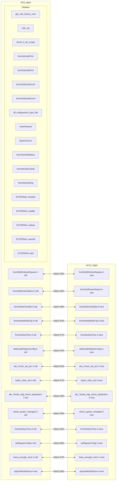
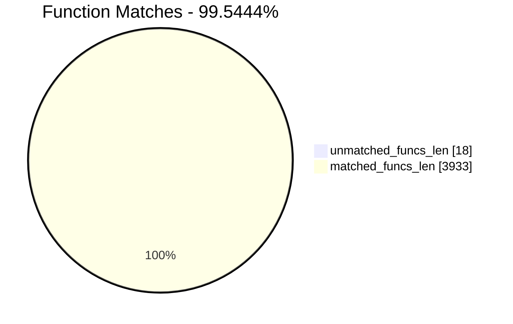
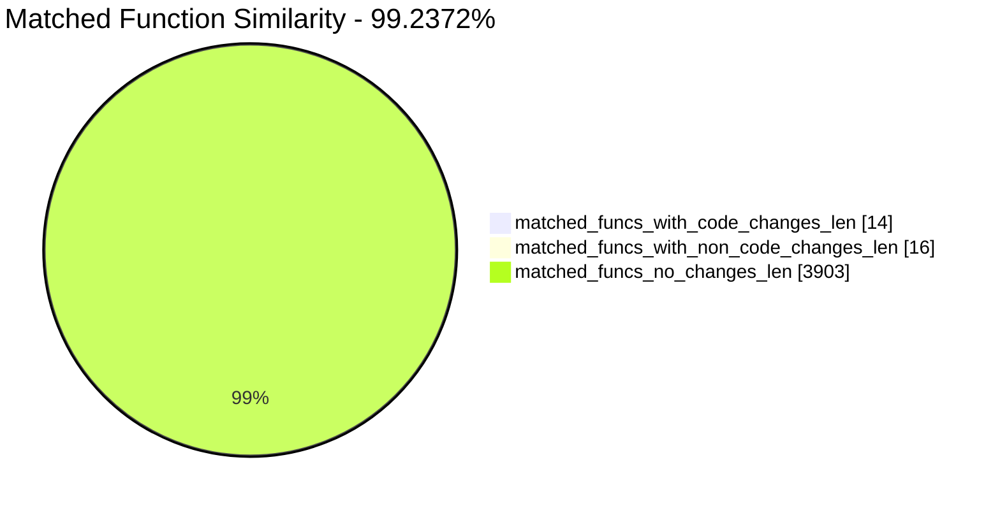
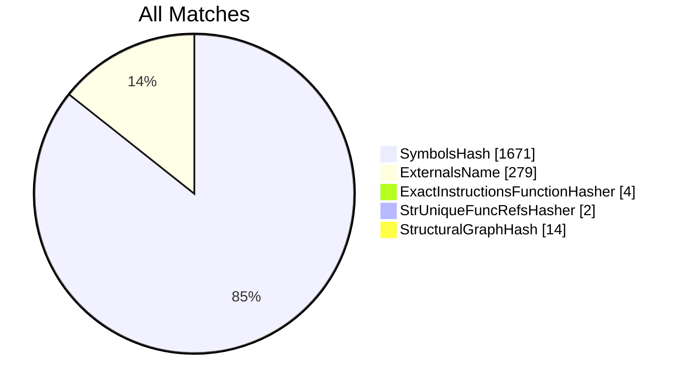
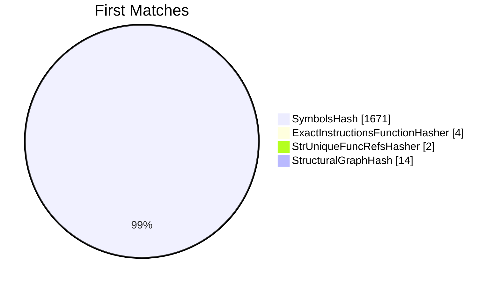
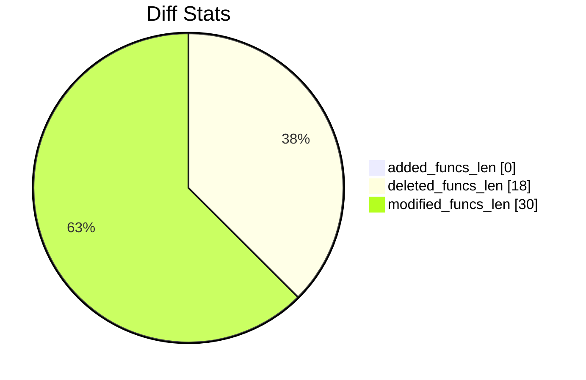
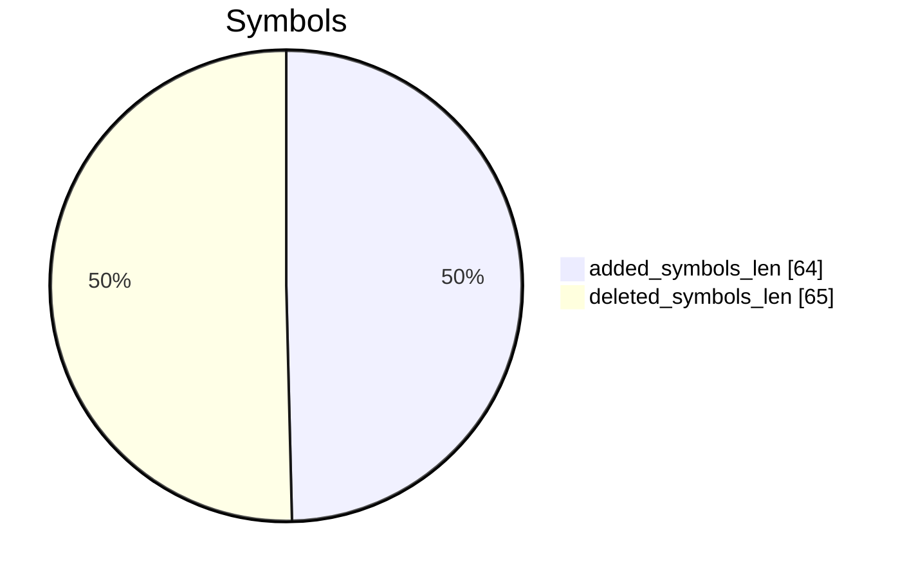
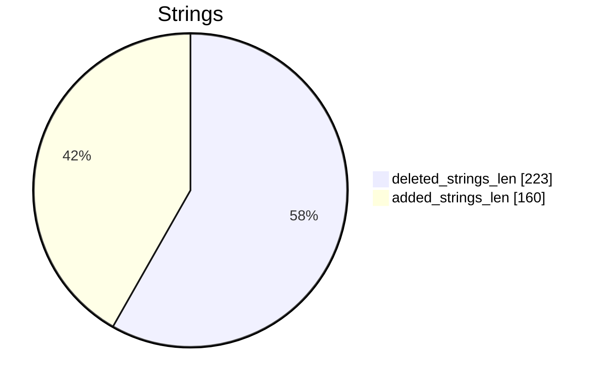

# AC9_httpd-AC12_httpd Diff

# TOC

* [Visual Chart Diff](#visual-chart-diff)
* [Metadata](#metadata)
	* [Ghidra Diff Engine](#ghidra-diff-engine)
		* [Command Line](#command-line)
	* [Binary Metadata Diff](#binary-metadata-diff)
	* [Program Options](#program-options)
	* [Diff Stats](#diff-stats)
	* [Strings](#strings)
* [Deleted](#deleted)
	* [get_usb_device_num](#get_usb_device_num)
	* [Usb_Up](#usb_up)
	* [check_if_dir_empty](#check_if_dir_empty)
	* [formSetUsbPrint](#formsetusbprint)
	* [formGetUsbPrint](#formgetusbprint)
	* [formSetSambaConf](#formsetsambaconf)
	* [formGetSambaConf](#formgetsambaconf)
	* [fill_smbpasswd_input_file](#fill_smbpasswd_input_file)
	* [writePasswd](#writepasswd)
	* [SpecChConv](#specchconv)
	* [formGetUSBStatus](#formgetusbstatus)
	* [formsetUsbUnload](#formsetusbunload)
	* [formGetUsbCfg](#formgetusbcfg)
	* [<EXTERNAL>::closedir](#externalclosedir)
	* [<EXTERNAL>::readdir](#externalreaddir)
	* [<EXTERNAL>::usleep](#externalusleep)
	* [<EXTERNAL>::opendir](#externalopendir)
	* [<EXTERNAL>::atof](#externalatof)
* [Added](#added)
* [Modified](#modified)
	* [fromSetWirelessRepeat](#fromsetwirelessrepeat)
	* [formGetRouterStatus](#formgetrouterstatus)
	* [formDefineTendDa](#formdefinetendda)
	* [fromsetApModeCfg](#fromsetapmodecfg)
	* [fromSetSysTime](#fromsetsystime)
	* [setDoublePppoeConfig](#setdoublepppoeconfig)
	* [ate_nvram_set_pin](#ate_nvram_set_pin)
	* [iwpriv_wlan_set](#iwpriv_wlan_set)
	* [ate_Tenda_mfg_check_wpsbutton](#ate_tenda_mfg_check_wpsbutton)
	* [check_param_changed](#check_param_changed)
	* [fromGetSysTime](#fromgetsystime)
	* [setPppoeConfig](#setpppoeconfig)
	* [have_enough_mem](#have_enough_mem)
	* [aspGetModeShow](#aspgetmodeshow)
* [Modified (No Code Changes)](#modified-no-code-changes)
	* [cJSON_CreateObject](#cjson_createobject)
	* [websTransfer](#webstransfer)
	* [cJSON_AddItemToArray](#cjson_additemtoarray)
	* [websFormDefine](#websformdefine)
	* [__ledf2](#__ledf2)
	* [cJSON_CreateArray](#cjson_createarray)
	* [cJSON_Object_2String](#cjson_object_2string)
	* [cJSON_AddItemToObject](#cjson_additemtoobject)
	* [cJSON_Print](#cjson_print)
	* [setWanValue](#setwanvalue)
	* [cJSON_CreateString](#cjson_createstring)
	* [websGetVar](#websgetvar)
	* [cJSON_Delete](#cjson_delete)
	* [websDone](#websdone)
	* [websWrite](#webswrite)

# Visual Chart Diff










# Metadata

## Ghidra Diff Engine

### Command Line

#### Captured Command Line


```
ghidriff --project-location ghidra_projects --project-name ghidriff --symbols-path symbols --threaded --log-level INFO --file-log-level INFO --log-path ghidriff.log --min-func-len 10 --gdt [] --bsim --max-ram-percent 60.0 --max-section-funcs 200 AC9_httpd AC12_httpd
```


#### Verbose Args


<details>

```
--old ['./Tenda_httpd/AC6_httpd'] --new [['./Tenda_httpd/AC9_httpd', './Tenda_httpd/AC12_httpd']] --engine VersionTrackingDiff --output-path ./Tenda_httpd/112ghidra --summary Treu --project-location ghidra_projects --project-name ghidriff --symbols-path symbols --threaded True --force-analysis False --force-diff False --no-symbols False --log-level INFO --file-log-level INFO --log-path ghidriff.log --va False --min-func-len 10 --use-calling-counts False --gdt [] --bsim True --bsim-full False --max-ram-percent 60.0 --print-flags False --jvm-args None --side-by-side False --max-section-funcs 200 --md-title None
```


</details>

## Binary Metadata Diff


```diff
--- AC9_httpd Meta
+++ AC12_httpd Meta
@@ -1,178 +1,177 @@
-Program Name: AC9_httpd
+Program Name: AC12_httpd
 Language ID: MIPS:LE:32:default (1.8)
 Compiler ID: default
 Processor: MIPS
 Endian: Little
 Address Size: 32
 Minimum Address: 00400000
 Maximum Address: _elfSectionHeaders::00000757
-# of Bytes: 2148436
+# of Bytes: 2121791
 # of Memory Blocks: 48
-# of Instructions: 257313
-# of Defined Data: 17677
-# of Functions: 1987
-# of Symbols: 25124
-# of Data Types: 940
-# of Data Type Categories: 120
+# of Instructions: 254274
+# of Defined Data: 17453
+# of Functions: 1964
+# of Symbols: 24851
+# of Data Types: 927
+# of Data Type Categories: 118
 Analyzed: true
 Created With Ghidra Version: 11.1.2
 DWARF Loaded: true
-Date Created: Tue May 13 16:43:26 CST 2025
+Date Created: Tue May 13 16:43:27 CST 2025
 ELF File Type: executable
 ELF Original Image Base: 0x400000
 ELF Prelinked: false
 ELF Source File [   0]: initfini.c
 ELF Source File [   1]: crtstuff.c
 ELF Source File [   2]: crtstuff.c
 ELF Source File [   3]: initfini.c
 ELF Source File [   4]: asp.c
 ELF Source File [   5]: balloc.c
 ELF Source File [   6]: base64.c
 ELF Source File [   7]: cgi.c
 ELF Source File [   8]: default.c
 ELF Source File [   9]: ejlex.c
 ELF Source File [  10]: ejparse.c
 ELF Source File [  11]: form.c
 ELF Source File [  12]: h.c
 ELF Source File [  13]: handler.c
 ELF Source File [  14]: uemf.h
 ELF Source File [  15]: misc.c
 ELF Source File [  16]: page.c
 ELF Source File [  17]: ringq.c
 ELF Source File [  18]: sock.c
 ELF Source File [  19]: sockGen.c
 ELF Source File [  20]: sslSocket.c
 ELF Source File [  21]: matrix_ssl.c
 ELF Source File [  22]: security.c
 ELF Source File [  23]: sym.c
 ELF Source File [  24]: uemf.c
 ELF Source File [  25]: url.c
 ELF Source File [  26]: value.c
 ELF Source File [  27]: md5c.c
 ELF Source File [  28]: um.c
 ELF Source File [  29]: umui.c
 ELF Source File [  30]: websda.c
 ELF Source File [  31]: emfdb.c
 ELF Source File [  32]: webs.c
 ELF Source File [  33]: websuemf.c
 ELF Source File [  34]: main.c
 ELF Source File [  35]: ../../../../infra/pal/list.h
 ELF Source File [  36]: /home/work/workspace/AC6V2.0/prod/httpd/11ac/cgi/sysCurrentInfor.c
 ELF Source File [  37]: /home/work/workspace/AC6V2.0/prod/httpd/11ac/cgi/controlCfm.c
 ELF Source File [  38]: /home/work/workspace/AC6V2.0/prod/httpd/11ac/cgi/networkCfm.c
 ELF Source File [  39]: /home/work/workspace/AC6V2.0/prod/httpd/11ac/cgi/sysSafe.c
 ELF Source File [  40]: /home/work/workspace/AC6V2.0/prod/httpd/11ac/cgi/Dhcp.c
 ELF Source File [  41]: /home/work/workspace/AC6V2.0/prod/httpd/11ac/cgi/upload.c
 ELF Source File [  42]: /home/work/workspace/AC6V2.0/prod/httpd/11ac/cgi/cJSON.c
 ELF Source File [  43]: /home/work/workspace/AC6V2.0/prod/httpd/11ac/cgi/Form_define.c
 ELF Source File [  44]: /home/work/workspace/AC6V2.0/prod/httpd/11ac/cgi/system_reboot.c
 ELF Source File [  45]: /home/work/workspace/AC6V2.0/prod/httpd/11ac/cgi/mtenda.c
 ELF Source File [  46]: /home/work/workspace/AC6V2.0/prod/httpd/11ac/cgi/Form_public.c
 ELF Source File [  47]: /home/work/workspace/AC6V2.0/prod/httpd/11ac/cgi/index.c
 ELF Source File [  48]: /home/work/workspace/AC6V2.0/prod/httpd/11ac/cgi/wizard.c
 ELF Source File [  49]: /home/work/workspace/AC6V2.0/prod/httpd/11ac/cgi/lan.c
 ELF Source File [  50]: /home/work/workspace/AC6V2.0/prod/httpd/11ac/cgi/../../../../infra/pal/list.h
 ELF Source File [  51]: /home/work/workspace/AC6V2.0/prod/httpd/11ac/cgi/fast_setting.c
 ELF Source File [  52]: /home/work/workspace/AC6V2.0/prod/httpd/11ac/cgi/usb_cgi.c
 ELF Source File [  53]: /home/work/workspace/AC6V2.0/infra/pal/list.h
 ELF Source File [  54]: /home/work/workspace/AC6V2.0/prod/httpd/11ac/cgi/webip_lan.c
 ELF Source File [  55]: /home/work/workspace/AC6V2.0/prod/httpd/11ac/cgi/wan_policy.c
 ELF Source File [  56]: /home/work/workspace/AC6V2.0/prod/httpd/11ac/cgi/multiWan_setting.c
 ELF Source File [  57]: /home/work/workspace/AC6V2.0/prod/httpd/11ac/cgi/webip_wan.c
 ELF Source File [  58]: /home/work/workspace/AC6V2.0/prod/httpd/11ac/cgi/nat_dmz.c
 ELF Source File [  59]: /home/work/workspace/AC6V2.0/prod/httpd/11ac/cgi/arp.c
 ELF Source File [  60]: /home/work/workspace/AC6V2.0/prod/httpd/11ac/cgi/nat_virtualser.c
 ELF Source File [  61]: /home/work/workspace/AC6V2.0/prod/httpd/11ac/cgi/nat_static.c
 ELF Source File [  62]: /home/work/workspace/AC6V2.0/prod/httpd/11ac/cgi/nat_set.c
 ELF Source File [  63]: /home/work/workspace/AC6V2.0/prod/httpd/11ac/cgi/ddns_config.c
 ELF Source File [  64]: /home/work/workspace/AC6V2.0/prod/httpd/11ac/cgi/routing_table.c
 ELF Source File [  65]: /home/work/workspace/AC6V2.0/prod/httpd/11ac/cgi/routing_static.c
 ELF Source File [  66]: /home/work/workspace/AC6V2.0/prod/httpd/11ac/cgi/system_log.c
 ELF Source File [  67]: /home/work/workspace/AC6V2.0/prod/httpd/11ac/cgi/log_addsetting.c
 ELF Source File [  68]: /home/work/workspace/AC6V2.0/prod/httpd/11ac/cgi/system_restore.c
 ELF Source File [  69]: /home/work/workspace/AC6V2.0/prod/httpd/11ac/cgi/system_password.c
 ELF Source File [  70]: /home/work/workspace/AC6V2.0/prod/httpd/11ac/cgi/system_baseuser.c
 ELF Source File [  71]: /home/work/workspace/AC6V2.0/prod/httpd/11ac/cgi/system_upgrade.c
 ELF Source File [  72]: /home/work/workspace/AC6V2.0/prod/httpd/11ac/cgi/cmd.c
 ELF Source File [  73]: /home/work/workspace/AC6V2.0/prod/httpd/11ac/cgi/utf_gbl_encode.c
 ELF Source File [  74]: /home/work/workspace/AC6V2.0/prod/httpd/11ac/cgi/qos_rule.c
 ELF Source File [  75]: /home/work/workspace/AC6V2.0/prod/httpd/11ac/cgi/auto_qos_cgi.c
 ELF Source File [  76]: /home/work/workspace/AC6V2.0/prod/httpd/11ac/cgi/cgi_utils.c
 ELF Source File [  77]: /home/work/workspace/AC6V2.0/prod/httpd/11ac/cgi/pacontrol.c
 ELF Source File [  78]: /home/work/workspace/AC6V2.0/prod/httpd/11ac/cgi/upnp_config.c
 ELF Source File [  79]: /home/work/workspace/AC6V2.0/prod/httpd/11ac/cgi/lan_dhcps.c
 ELF Source File [  80]: /home/work/workspace/AC6V2.0/prod/httpd/11ac/cgi/lan_dhcp_clients.c
 ELF Source File [  81]: /home/work/workspace/AC6V2.0/prod/httpd/11ac/cgi/system_hostname.c
 ELF Source File [  82]: /home/work/workspace/AC6V2.0/prod/httpd/11ac/cgi/dns_safesecond.c
 ELF Source File [  83]: /home/work/workspace/AC6V2.0/prod/httpd/11ac/cgi/sched_wifi_check.c
 ELF Source File [  84]: /home/work/workspace/AC6V2.0/prod/httpd/11ac/cgi/sched_led_check.c
 ELF Source File [  85]: /home/work/workspace/AC6V2.0/prod/httpd/11ac/cgi/electronic_bulletin.c
 ELF Source File [  86]: /home/work/workspace/AC6V2.0/prod/httpd/11ac/cgi/switch_portVLAN.c
 ELF Source File [  87]: /home/work/workspace/AC6V2.0/prod/httpd/11ac/cgi/wifi.c
-ELF Source File [  88]: /home/work/workspace/AC6V2.0/prod/httpd/11ac/cgi/usb.c
-ELF Source File [  89]: /home/work/workspace/AC6V2.0/prod/httpd/11ac/cgi/behaviormanager_demo.c
-ELF Source File [  90]: /home/work/workspace/AC6V2.0/prod/httpd/11ac/cgi/safe_demo.c
-ELF Source File [  91]: /home/work/workspace/AC6V2.0/prod/httpd/11ac/cgi/ucloud_v2.c
-ELF Source File [  92]: /home/work/workspace/AC6V2.0/prod/httpd/11ac/cgi/alischedule.c
-ELF Source File [  93]: /home/work/workspace/AC6V2.0/prod/httpd/11ac/cgi/apclient.c
-ELF Source File [  94]: /home/work/workspace/AC6V2.0/prod/httpd/11ac/cgi/iptv.c
-ELF Source File [  95]: /home/work/workspace/AC6V2.0/prod/httpd/11ac/cgi/reboot_timer.c
-ELF Source File [  96]: /home/work/workspace/AC6V2.0/prod/httpd/11ac/cgi/smart_power_management_cgi.c
-ELF Source File [  97]: /home/work/workspace/AC6V2.0/prod/httpd/11ac/cgi/guest_ip_confilct.c
-ELF Source File [  98]: /home/work/workspace/AC6V2.0/prod/httpd/11ac/cgi/vpn.c
-ELF Source File [  99]: /home/work/workspace/AC6V2.0/prod/httpd/11ac/cgi/wan_err_info.c
-ELF Source File [ 100]: /home/work/workspace/AC6V2.0/prod/httpd/11ac/cgi/cgi_common.c
-ELF Source File [ 101]: /home/work/workspace/AC6V2.0/prod/httpd/11ac/cgi/cgi_mac_filter.c
-ELF Source File [ 102]: /home/work/workspace/AC6V2.0/prod/httpd/11ac/cgi/cgi_advertisement.c
-ELF Source File [ 103]: matrixSsl.c
-ELF Source File [ 104]: sslDecode.c
-ELF Source File [ 105]: sslEncode.c
-ELF Source File [ 106]: sslv3.c
-ELF Source File [ 107]: linux.c
-ELF Source File [ 108]: md5.c
-ELF Source File [ 109]: mpi.c
-ELF Source File [ 110]: sha1.c
-ELF Source File [ 111]: rsaPki.c
-ELF Source File [ 112]: x509.c
-ELF Source File [ 113]: cipherSuite.c
-ELF Source File [ 114]: arc4.c
-ELF Source File [ 115]: base64.c
-ELF Source File [ 116]: des3.c
-ELF Source File [ 117]: rsa.c
-ELF Source File [ 118]: asn1.c
-ELF Source File [ 119]: libgcc2.c
-ELF Source File [ 120]: adddf3.c
-ELF Source File [ 121]: divdf3.c
-ELF Source File [ 122]: gedf2.c
-ELF Source File [ 123]: ledf2.c
-ELF Source File [ 124]: muldf3.c
-ELF Source File [ 125]: subdf3.c
-ELF Source File [ 126]: fixdfsi.c
-ELF Source File [ 127]: floatsidf.c
-ELF Source File [ 128]: floatunsidf.c
-ELF Source File [ 129]: extendsfdf2.c
-ELF Source File [ 130]: 
+ELF Source File [  88]: /home/work/workspace/AC6V2.0/prod/httpd/11ac/cgi/behaviormanager_demo.c
+ELF Source File [  89]: /home/work/workspace/AC6V2.0/prod/httpd/11ac/cgi/safe_demo.c
+ELF Source File [  90]: /home/work/workspace/AC6V2.0/prod/httpd/11ac/cgi/ucloud_v2.c
+ELF Source File [  91]: /home/work/workspace/AC6V2.0/prod/httpd/11ac/cgi/alischedule.c
+ELF Source File [  92]: /home/work/workspace/AC6V2.0/prod/httpd/11ac/cgi/apclient.c
+ELF Source File [  93]: /home/work/workspace/AC6V2.0/prod/httpd/11ac/cgi/iptv.c
+ELF Source File [  94]: /home/work/workspace/AC6V2.0/prod/httpd/11ac/cgi/reboot_timer.c
+ELF Source File [  95]: /home/work/workspace/AC6V2.0/prod/httpd/11ac/cgi/smart_power_management_cgi.c
+ELF Source File [  96]: /home/work/workspace/AC6V2.0/prod/httpd/11ac/cgi/guest_ip_confilct.c
+ELF Source File [  97]: /home/work/workspace/AC6V2.0/prod/httpd/11ac/cgi/vpn.c
+ELF Source File [  98]: /home/work/workspace/AC6V2.0/prod/httpd/11ac/cgi/wan_err_info.c
+ELF Source File [  99]: /home/work/workspace/AC6V2.0/prod/httpd/11ac/cgi/cgi_common.c
+ELF Source File [ 100]: /home/work/workspace/AC6V2.0/prod/httpd/11ac/cgi/cgi_mac_filter.c
+ELF Source File [ 101]: /home/work/workspace/AC6V2.0/prod/httpd/11ac/cgi/cgi_advertisement.c
+ELF Source File [ 102]: matrixSsl.c
+ELF Source File [ 103]: sslDecode.c
+ELF Source File [ 104]: sslEncode.c
+ELF Source File [ 105]: sslv3.c
+ELF Source File [ 106]: linux.c
+ELF Source File [ 107]: md5.c
+ELF Source File [ 108]: mpi.c
+ELF Source File [ 109]: sha1.c
+ELF Source File [ 110]: rsaPki.c
+ELF Source File [ 111]: x509.c
+ELF Source File [ 112]: cipherSuite.c
+ELF Source File [ 113]: arc4.c
+ELF Source File [ 114]: base64.c
+ELF Source File [ 115]: des3.c
+ELF Source File [ 116]: rsa.c
+ELF Source File [ 117]: asn1.c
+ELF Source File [ 118]: libgcc2.c
+ELF Source File [ 119]: adddf3.c
+ELF Source File [ 120]: divdf3.c
+ELF Source File [ 121]: gedf2.c
+ELF Source File [ 122]: ledf2.c
+ELF Source File [ 123]: muldf3.c
+ELF Source File [ 124]: subdf3.c
+ELF Source File [ 125]: fixdfsi.c
+ELF Source File [ 126]: floatsidf.c
+ELF Source File [ 127]: floatunsidf.c
+ELF Source File [ 128]: extendsfdf2.c
+ELF Source File [ 129]: 
 Elf Comment[0]: GCC: (GNU) 3.3.2
 Elf Comment[1]: GCC: (Realtek MSDK-4.4.7 Build 2001) 4.4.7
 Executable Format: Executable and Linking Format (ELF)
-Executable Location: /root/FHFuzz/static_analysis/diff/Tenda_httpd/AC9_httpd
-Executable MD5: 8bcc3eee1768591e050db8ff4eff7da1
-Executable SHA256: 329d918f05c1a76bf41074eba35553b2517f2054c1c10ab8c41ac2e037e12c6f
-FSRL: file:///root/FHFuzz/static_analysis/diff/Tenda_httpd/AC9_httpd?MD5=8bcc3eee1768591e050db8ff4eff7da1
+Executable Location: /root/FHFuzz/static_analysis/diff/Tenda_httpd/AC12_httpd
+Executable MD5: eef92bf72be49feab9e4fff22bbf86cf
+Executable SHA256: 5c6330ab898620f25009d1dc5fa4046e2ca7c3beacf3cdbbf9b12a4e028b5661
+FSRL: file:///root/FHFuzz/static_analysis/diff/Tenda_httpd/AC12_httpd?MD5=eef92bf72be49feab9e4fff22bbf86cf
 GNU DebugLink: httpd.debug
 Preferred Root Namespace Category: 
 Relocatable: false
 Required Library [    0]: libCfm.so
 Required Library [    1]: libcommon.so
 Required Library [    2]: libChipApi.so
 Required Library [    3]: libvos_util.so
 Required Library [    4]: libz.so
 Required Library [    5]: libpthread.so.0
 Required Library [    6]: libapmib.so
 Required Library [    7]: librtlWifiSrc.so
 Required Library [    8]: libtpi.so
 Required Library [    9]: libm.so.0
 Required Library [   10]: libucapi.so
 Required Library [   11]: libgcc_s.so.1
 Required Library [   12]: libc.so.0
 Should Ask To Analyze: false

```


## Program Options


<details>
<summary>Ghidra AC9_httpd Decompiler Options</summary>


|Decompiler Option|Value|
| :---: | :---: |
|Prototype Evaluation|__stdcall|

</details>


<details>
<summary>Ghidra AC9_httpd Specification extensions Options</summary>


|Specification extensions Option|Value|
| :---: | :---: |
|FormatVersion|0|
|VersionCounter|0|

</details>


<details>
<summary>Ghidra AC9_httpd Analyzers Options</summary>


|Analyzers Option|Value|
| :---: | :---: |
|ASCII Strings|true|
|ASCII Strings.Create Strings Containing Existing Strings|true|
|ASCII Strings.Create Strings Containing References|true|
|ASCII Strings.Force Model Reload|false|
|ASCII Strings.Minimum String Length|LEN_5|
|ASCII Strings.Model File|StringModel.sng|
|ASCII Strings.Require Null Termination for String|true|
|ASCII Strings.Search Only in Accessible Memory Blocks|true|
|ASCII Strings.String Start Alignment|ALIGN_1|
|ASCII Strings.String end alignment|4|
|Aggressive Instruction Finder|false|
|Aggressive Instruction Finder.Create Analysis Bookmarks|true|
|Apply Data Archives|true|
|Apply Data Archives.Archive Chooser|[Auto-Detect]|
|Apply Data Archives.Create Analysis Bookmarks|true|
|Apply Data Archives.GDT User File Archive Path|None|
|Apply Data Archives.User Project Archive Path|None|
|Call Convention ID|true|
|Call Convention ID.Analysis Decompiler Timeout (sec)|60|
|Call-Fixup Installer|true|
|Condense Filler Bytes|false|
|Condense Filler Bytes.Filler Value|Auto|
|Condense Filler Bytes.Minimum number of sequential bytes|1|
|Create Address Tables|true|
|Create Address Tables.Allow Offcut References|false|
|Create Address Tables.Auto Label Table|false|
|Create Address Tables.Create Analysis Bookmarks|true|
|Create Address Tables.Maxmimum Pointer Distance|16777215|
|Create Address Tables.Minimum Pointer Address|4132|
|Create Address Tables.Minimum Table Size|3|
|Create Address Tables.Pointer Alignment|1|
|Create Address Tables.Relocation Table Guide|true|
|Create Address Tables.Table Alignment|4|
|DWARF|true|
|DWARF.Add Inlined Functions Comments|false|
|DWARF.Add Lexical Block Comments|false|
|DWARF.Create Function Signatures|true|
|DWARF.Import Data Types|true|
|DWARF.Import Functions|true|
|DWARF.Import Local Variable Info|true|
|DWARF.Output DWARF DIE Info|false|
|DWARF.Output Source Info|false|
|DWARF.Output Source Line Info|false|
|DWARF.Try To Pack Structs|true|
|Data Reference|true|
|Data Reference.Address Table Alignment|1|
|Data Reference.Address Table Minimum Size|3|
|Data Reference.Align End of Strings|false|
|Data Reference.Ascii String References|true|
|Data Reference.Create Address Tables|false|
|Data Reference.Minimum String Length|5|
|Data Reference.References to Pointers|true|
|Data Reference.Relocation Table Guide|true|
|Data Reference.Respect Execute Flag|true|
|Data Reference.Subroutine References|true|
|Data Reference.Switch Table References|false|
|Data Reference.Unicode String References|true|
|Decompiler Parameter ID|true|
|Decompiler Parameter ID.Analysis Clear Level|ANALYSIS|
|Decompiler Parameter ID.Analysis Decompiler Timeout (sec)|60|
|Decompiler Parameter ID.Commit Data Types|true|
|Decompiler Parameter ID.Commit Void Return Values|false|
|Decompiler Parameter ID.Prototype Evaluation|__stdcall|
|Decompiler Switch Analysis|true|
|Decompiler Switch Analysis.Analysis Decompiler Timeout (sec)|60|
|Demangler GNU|true|
|Demangler GNU.Apply Function Calling Conventions|true|
|Demangler GNU.Apply Function Signatures|true|
|Demangler GNU.Demangle Only Known Mangled Symbols|false|
|Demangler GNU.Demangler Format|AUTO|
|Demangler GNU.Use Deprecated Demangler|false|
|Disassemble Entry Points|true|
|Disassemble Entry Points.Respect Execute Flag|true|
|ELF Scalar Operand References|false|
|ELF Scalar Operand References.Relocation Table Guide|true|
|Embedded Media|true|
|Embedded Media.Create Analysis Bookmarks|true|
|External Entry References|true|
|External Symbol Resolver|true|
|Function Start Search|true|
|Function Start Search.Bookmark Functions|false|
|Function Start Search.Search Data Blocks|false|
|GCC Exception Handlers|true|
|GCC Exception Handlers.Create Try Catch Comments|true|
|MIPS Constant Reference Analyzer|true|
|MIPS Constant Reference Analyzer.Assume T9 set to Function entry|true|
|MIPS Constant Reference Analyzer.Attempt to recover switch tables|false|
|MIPS Constant Reference Analyzer.Create Data from pointer|false|
|MIPS Constant Reference Analyzer.Function parameter/return Pointer analysis|true|
|MIPS Constant Reference Analyzer.Mark dual instruction references|false|
|MIPS Constant Reference Analyzer.Max Threads|2|
|MIPS Constant Reference Analyzer.Min absolute reference|4|
|MIPS Constant Reference Analyzer.Recover global GP register writes|true|
|MIPS Constant Reference Analyzer.Require pointer param data type|false|
|MIPS Constant Reference Analyzer.Speculative reference max|256|
|MIPS Constant Reference Analyzer.Speculative reference min|512|
|MIPS Constant Reference Analyzer.Stored Value Pointer analysis|true|
|MIPS Constant Reference Analyzer.Trust values read from writable memory|true|
|MIPS Symbol|true|
|MIPS UnAlligned Instruction Fix|true|
|Non-Returning Functions - Discovered|true|
|Non-Returning Functions - Discovered.Create Analysis Bookmarks|true|
|Non-Returning Functions - Discovered.Function Non-return Threshold|3|
|Non-Returning Functions - Discovered.Repair Flow Damage|true|
|Non-Returning Functions - Known|true|
|Non-Returning Functions - Known.Create Analysis Bookmarks|true|
|Reference|true|
|Reference.Address Table Alignment|1|
|Reference.Address Table Minimum Size|3|
|Reference.Align End of Strings|false|
|Reference.Ascii String References|true|
|Reference.Create Address Tables|false|
|Reference.Minimum String Length|5|
|Reference.References to Pointers|true|
|Reference.Relocation Table Guide|true|
|Reference.Respect Execute Flag|true|
|Reference.Subroutine References|true|
|Reference.Switch Table References|false|
|Reference.Unicode String References|true|
|Shared Return Calls|true|
|Shared Return Calls.Allow Conditional Jumps|false|
|Shared Return Calls.Assume Contiguous Functions Only|false|
|Stack|true|
|Stack.Create Local Variables|true|
|Stack.Create Param Variables|true|
|Stack.useNewFunctionStackAnalysis|true|
|Subroutine References|true|
|Subroutine References.Create Thunks Early|true|
|Variadic Function Signature Override|false|
|Variadic Function Signature Override.Create Analysis Bookmarks|false|

</details>


<details>
<summary>Ghidra AC12_httpd Decompiler Options</summary>


|Decompiler Option|Value|
| :---: | :---: |
|Prototype Evaluation|__stdcall|

</details>


<details>
<summary>Ghidra AC12_httpd Specification extensions Options</summary>


|Specification extensions Option|Value|
| :---: | :---: |
|FormatVersion|0|
|VersionCounter|0|

</details>


<details>
<summary>Ghidra AC12_httpd Analyzers Options</summary>


|Analyzers Option|Value|
| :---: | :---: |
|ASCII Strings|true|
|ASCII Strings.Create Strings Containing Existing Strings|true|
|ASCII Strings.Create Strings Containing References|true|
|ASCII Strings.Force Model Reload|false|
|ASCII Strings.Minimum String Length|LEN_5|
|ASCII Strings.Model File|StringModel.sng|
|ASCII Strings.Require Null Termination for String|true|
|ASCII Strings.Search Only in Accessible Memory Blocks|true|
|ASCII Strings.String Start Alignment|ALIGN_1|
|ASCII Strings.String end alignment|4|
|Aggressive Instruction Finder|false|
|Aggressive Instruction Finder.Create Analysis Bookmarks|true|
|Apply Data Archives|true|
|Apply Data Archives.Archive Chooser|[Auto-Detect]|
|Apply Data Archives.Create Analysis Bookmarks|true|
|Apply Data Archives.GDT User File Archive Path|None|
|Apply Data Archives.User Project Archive Path|None|
|Call Convention ID|true|
|Call Convention ID.Analysis Decompiler Timeout (sec)|60|
|Call-Fixup Installer|true|
|Condense Filler Bytes|false|
|Condense Filler Bytes.Filler Value|Auto|
|Condense Filler Bytes.Minimum number of sequential bytes|1|
|Create Address Tables|true|
|Create Address Tables.Allow Offcut References|false|
|Create Address Tables.Auto Label Table|false|
|Create Address Tables.Create Analysis Bookmarks|true|
|Create Address Tables.Maxmimum Pointer Distance|16777215|
|Create Address Tables.Minimum Pointer Address|4132|
|Create Address Tables.Minimum Table Size|3|
|Create Address Tables.Pointer Alignment|1|
|Create Address Tables.Relocation Table Guide|true|
|Create Address Tables.Table Alignment|4|
|DWARF|true|
|DWARF.Add Inlined Functions Comments|false|
|DWARF.Add Lexical Block Comments|false|
|DWARF.Create Function Signatures|true|
|DWARF.Import Data Types|true|
|DWARF.Import Functions|true|
|DWARF.Import Local Variable Info|true|
|DWARF.Output DWARF DIE Info|false|
|DWARF.Output Source Info|false|
|DWARF.Output Source Line Info|false|
|DWARF.Try To Pack Structs|true|
|Data Reference|true|
|Data Reference.Address Table Alignment|1|
|Data Reference.Address Table Minimum Size|3|
|Data Reference.Align End of Strings|false|
|Data Reference.Ascii String References|true|
|Data Reference.Create Address Tables|false|
|Data Reference.Minimum String Length|5|
|Data Reference.References to Pointers|true|
|Data Reference.Relocation Table Guide|true|
|Data Reference.Respect Execute Flag|true|
|Data Reference.Subroutine References|true|
|Data Reference.Switch Table References|false|
|Data Reference.Unicode String References|true|
|Decompiler Parameter ID|true|
|Decompiler Parameter ID.Analysis Clear Level|ANALYSIS|
|Decompiler Parameter ID.Analysis Decompiler Timeout (sec)|60|
|Decompiler Parameter ID.Commit Data Types|true|
|Decompiler Parameter ID.Commit Void Return Values|false|
|Decompiler Parameter ID.Prototype Evaluation|__stdcall|
|Decompiler Switch Analysis|true|
|Decompiler Switch Analysis.Analysis Decompiler Timeout (sec)|60|
|Demangler GNU|true|
|Demangler GNU.Apply Function Calling Conventions|true|
|Demangler GNU.Apply Function Signatures|true|
|Demangler GNU.Demangle Only Known Mangled Symbols|false|
|Demangler GNU.Demangler Format|AUTO|
|Demangler GNU.Use Deprecated Demangler|false|
|Disassemble Entry Points|true|
|Disassemble Entry Points.Respect Execute Flag|true|
|ELF Scalar Operand References|false|
|ELF Scalar Operand References.Relocation Table Guide|true|
|Embedded Media|true|
|Embedded Media.Create Analysis Bookmarks|true|
|External Entry References|true|
|External Symbol Resolver|true|
|Function Start Search|true|
|Function Start Search.Bookmark Functions|false|
|Function Start Search.Search Data Blocks|false|
|GCC Exception Handlers|true|
|GCC Exception Handlers.Create Try Catch Comments|true|
|MIPS Constant Reference Analyzer|true|
|MIPS Constant Reference Analyzer.Assume T9 set to Function entry|true|
|MIPS Constant Reference Analyzer.Attempt to recover switch tables|false|
|MIPS Constant Reference Analyzer.Create Data from pointer|false|
|MIPS Constant Reference Analyzer.Function parameter/return Pointer analysis|true|
|MIPS Constant Reference Analyzer.Mark dual instruction references|false|
|MIPS Constant Reference Analyzer.Max Threads|2|
|MIPS Constant Reference Analyzer.Min absolute reference|4|
|MIPS Constant Reference Analyzer.Recover global GP register writes|true|
|MIPS Constant Reference Analyzer.Require pointer param data type|false|
|MIPS Constant Reference Analyzer.Speculative reference max|256|
|MIPS Constant Reference Analyzer.Speculative reference min|512|
|MIPS Constant Reference Analyzer.Stored Value Pointer analysis|true|
|MIPS Constant Reference Analyzer.Trust values read from writable memory|true|
|MIPS Symbol|true|
|MIPS UnAlligned Instruction Fix|true|
|Non-Returning Functions - Discovered|true|
|Non-Returning Functions - Discovered.Create Analysis Bookmarks|true|
|Non-Returning Functions - Discovered.Function Non-return Threshold|3|
|Non-Returning Functions - Discovered.Repair Flow Damage|true|
|Non-Returning Functions - Known|true|
|Non-Returning Functions - Known.Create Analysis Bookmarks|true|
|Reference|true|
|Reference.Address Table Alignment|1|
|Reference.Address Table Minimum Size|3|
|Reference.Align End of Strings|false|
|Reference.Ascii String References|true|
|Reference.Create Address Tables|false|
|Reference.Minimum String Length|5|
|Reference.References to Pointers|true|
|Reference.Relocation Table Guide|true|
|Reference.Respect Execute Flag|true|
|Reference.Subroutine References|true|
|Reference.Switch Table References|false|
|Reference.Unicode String References|true|
|Shared Return Calls|true|
|Shared Return Calls.Allow Conditional Jumps|false|
|Shared Return Calls.Assume Contiguous Functions Only|false|
|Stack|true|
|Stack.Create Local Variables|true|
|Stack.Create Param Variables|true|
|Stack.useNewFunctionStackAnalysis|true|
|Subroutine References|true|
|Subroutine References.Create Thunks Early|true|
|Variadic Function Signature Override|false|
|Variadic Function Signature Override.Create Analysis Bookmarks|false|

</details>

## Diff Stats


|Stat|Value|
| :---: | :---: |
|added_funcs_len|0|
|deleted_funcs_len|18|
|modified_funcs_len|30|
|added_symbols_len|64|
|deleted_symbols_len|65|
|diff_time|38.521085262298584|
|deleted_strings_len|223|
|added_strings_len|160|
|match_types|Counter({'SymbolsHash': 1671, 'ExternalsName': 279, 'StructuralGraphHash': 14, 'ExactInstructionsFunctionHasher': 4, 'StrUniqueFuncRefsHasher': 2})|
|items_to_process|177|
|diff_types|Counter({'address': 30, 'length': 15, 'refcount': 15, 'code': 14, 'calling': 13, 'called': 7, 'sig': 2})|
|unmatched_funcs_len|18|
|total_funcs_len|3951|
|matched_funcs_len|3933|
|matched_funcs_with_code_changes_len|14|
|matched_funcs_with_non_code_changes_len|16|
|matched_funcs_no_changes_len|3903|
|match_func_similarity_percent|99.2372%|
|func_match_overall_percent|99.5444%|
|first_matches|Counter({'SymbolsHash': 1671, 'StructuralGraphHash': 14, 'ExactInstructionsFunctionHasher': 4, 'StrUniqueFuncRefsHasher': 2})|













## Strings




### Strings Diff


```diff
--- deleted strings
+++ added strings
@@ -1,223 +1,160 @@
-__FUNCTION__.10290
-__FUNCTION__.12722
-__FUNCTION__.4017
-__FUNCTION__.4067
-__FUNCTION__.4137
-__FUNCTION__.4522
-__FUNCTION__.4633
-__FUNCTION__.4682
-__FUNCTION__.4846
-__FUNCTION__.6429
-__FUNCTION__.6466
-__FUNCTION__.6478
-__FUNCTION__.6527
-__FUNCTION__.6553
-__FUNCTION__.6592
-__FUNCTION__.6627
-__FUNCTION__.6655
-__FUNCTION__.6709
-__FUNCTION__.6727
-__FUNCTION__.6735
-__FUNCTION__.7093
-__FUNCTION__.7194
-__FUNCTION__.7204
-__FUNCTION__.7266
-__FUNCTION__.7273
-__FUNCTION__.7478
-__FUNCTION__.7698
-__FUNCTION__.7717
-__FUNCTION__.7767
-__FUNCTION__.7903
-__FUNCTION__.8210
-__FUNCTION__.8254
-__FUNCTION__.8334
-__FUNCTION__.8341
-__FUNCTION__.8456
-__FUNCTION__.8540
-__FUNCTION__.8600
-__FUNCTION__.8654
-__FUNCTION__.8707
-__FUNCTION__.8752
-__FUNCTION__.8782
-__FUNCTION__.9946
-__FUNCTION__.9970
-__PRETTY_FUNCTION__.4286
-__PRETTY_FUNCTION__.4310
-__PRETTY_FUNCTION__.4328
-__PRETTY_FUNCTION__.4349
-__PRETTY_FUNCTION__.4382
-__PRETTY_FUNCTION__.4414
-__PRETTY_FUNCTION__.4456
-__PRETTY_FUNCTION__.4758
-__PRETTY_FUNCTION__.4809
-__PRETTY_FUNCTION__.4845
-__func__.10035
-__func__.10037
-__func__.10095
-__func__.10136
-__func__.10185
-__func__.10223
-__func__.10289
-__func__.10298
-__func__.10339
-__func__.10383
-__func__.10384
-__func__.10490
-__func__.10531
-__func__.10593
-__func__.10678
-__func__.10746
-__func__.10768
-__func__.10813
-__func__.10843
-__func__.10933
-__func__.10984
-__func__.11001
-__func__.11090
-__func__.11094
-__func__.11206
-__func__.11261
-__func__.11284
-__func__.11329
-__func__.11396
-__func__.11473
-__func__.11535
-__func__.11561
-__func__.11595
-__func__.11596
-__func__.11655
-__func__.11793
-__func__.11805
-__func__.11834
-__func__.11877
-__func__.11899
-__func__.11941
-__func__.12000
-__func__.12123
-__func__.12150
-__func__.12198
-__func__.12236
-__func__.12331
-__func__.12344
-__func__.12363
-__func__.12406
-__func__.12508
-__func__.12587
-__func__.12611
-__func__.12646
-__func__.12734
-__func__.12777
-__func__.12844
-__func__.12864
-__func__.12887
-__func__.12921
-__func__.12954
-__func__.12978
-__func__.12997
-__func__.13028
-__func__.13066
-__func__.13113
-__func__.13241
-__func__.13467
-__func__.13536
-__func__.2608
-__func__.2669
-__func__.6219
-__func__.6265
-__func__.6360
-__func__.6879
-__func__.6959
-__func__.7767
-__func__.7829
-__func__.7844
-__func__.7948
-__func__.7987
-__func__.8021
-__func__.8034
-__func__.8113
-__func__.8141
-__func__.8157
-__func__.8222
-__func__.8393
-__func__.8517
-__func__.8533
-__func__.8600
-__func__.8662
-__func__.8820
-__func__.8855
-__func__.9242
-__func__.9250
-__func__.9369
-__func__.9406
-__func__.9469
-__func__.9527
-__func__.9639
-__func__.9864
-__func__.9881
-__func__.9950
-__func__.9977
-s_%[^:]:%[^*]*%s
-s_%[^;];%[^;];%[^_]
-s_%s_%d:_getWanIfName_return_NULL
-s_*******_unlink_/tmp/smbpasswd_is
-s_/js/macro_config.js
-s_/tmp/UDiskname
-s_/tmp/smbpasswd
-s_/tmp/usb/PrinterName
-s_/tmp/usb/UsbVolumeInfo
-s_/var/etc/upan
-s_10:27:30
-s_Feb
-s_GetPrinterCfg
-s_GetSambaCfg
-s_GetUSBStatus
-s_GetUsbCfg
-s_SetPrinterCfg
-s_SetSambaCfg
-s_V15.03.06.42
-s_admin
-s_busybox_deluser_%s
-s_cfm_post_netctrl_%d?op=%d,string
-s_devId
-s_diskList
-s_diskName
-s_dlna.en
-s_fileCode
-s_fileshare
-s_ftpLink
-s_guestaccess
-s_guestpwd
-s_guestuser
-s_hasusb
-s_insmod_/lib/modules/2.6.36.4brcm
-s_internetLink
-s_internetPort
-s_memoryTotal
-s_memoryUnUse
-s_ppoe.ac
-s_premitEn
-s_printer
-s_printerEn
-s_rm_-rf_/tmp/core-*
-s_setUsbUnload
-s_smbpasswd_-a_%s_-s_<_/tmp/smbpas
-s_usb.ftp.charset
-s_usb.ftp.guest.acess
-s_usb.ftp.guest.pwd
-s_usb.ftp.guest.user
-s_usb.ftp.port
-s_usb.ftp.pwd
-s_usb.ftp.remote.acess
-s_usb.ftp.remote.port
-s_usb.ippd.enable
-s_usb.samba.enable
-s_usb.samba.guest.acess
-s_usb.samba.guest.pwd
-s_usb.samba.guest.user
-s_usb.samba.pwd
-s_usb.samba.user
-s_usbList
-s_usbName
-s_usbNum
-s_usb_total=%s,usb_usable=%s
-s_{"printerEn":"%d","printerName":
+__FUNCTION__.10168
+__FUNCTION__.12611
+__FUNCTION__.4005
+__FUNCTION__.4055
+__FUNCTION__.4125
+__FUNCTION__.4510
+__FUNCTION__.4621
+__FUNCTION__.4670
+__FUNCTION__.4834
+__FUNCTION__.6425
+__FUNCTION__.6453
+__FUNCTION__.6465
+__FUNCTION__.6514
+__FUNCTION__.6540
+__FUNCTION__.6588
+__FUNCTION__.6623
+__FUNCTION__.6651
+__FUNCTION__.6705
+__FUNCTION__.6723
+__FUNCTION__.6731
+__FUNCTION__.7080
+__FUNCTION__.7190
+__FUNCTION__.7200
+__FUNCTION__.7263
+__FUNCTION__.7270
+__FUNCTION__.7475
+__FUNCTION__.7656
+__FUNCTION__.7695
+__FUNCTION__.7714
+__FUNCTION__.7792
+__FUNCTION__.8099
+__FUNCTION__.8143
+__FUNCTION__.8223
+__FUNCTION__.8230
+__FUNCTION__.8344
+__FUNCTION__.8429
+__FUNCTION__.8489
+__FUNCTION__.8543
+__FUNCTION__.8596
+__FUNCTION__.8641
+__FUNCTION__.8671
+__FUNCTION__.9835
+__FUNCTION__.9859
+__PRETTY_FUNCTION__.4274
+__PRETTY_FUNCTION__.4298
+__PRETTY_FUNCTION__.4316
+__PRETTY_FUNCTION__.4337
+__PRETTY_FUNCTION__.4370
+__PRETTY_FUNCTION__.4402
+__PRETTY_FUNCTION__.4444
+__PRETTY_FUNCTION__.4746
+__PRETTY_FUNCTION__.4797
+__PRETTY_FUNCTION__.4833
+__func__.10025
+__func__.10074
+__func__.10112
+__func__.10178
+__func__.10187
+__func__.10228
+__func__.10272
+__func__.10273
+__func__.10378
+__func__.10420
+__func__.10471
+__func__.10567
+__func__.10635
+__func__.10657
+__func__.10702
+__func__.10731
+__func__.10822
+__func__.10862
+__func__.10890
+__func__.10979
+__func__.10983
+__func__.11095
+__func__.11150
+__func__.11173
+__func__.11218
+__func__.11285
+__func__.11362
+__func__.11423
+__func__.11450
+__func__.11483
+__func__.11485
+__func__.11544
+__func__.11671
+__func__.11682
+__func__.11723
+__func__.11743
+__func__.11788
+__func__.11807
+__func__.11889
+__func__.12012
+__func__.12039
+__func__.12087
+__func__.12098
+__func__.12220
+__func__.12233
+__func__.12252
+__func__.12295
+__func__.12397
+__func__.12476
+__func__.12500
+__func__.12535
+__func__.12623
+__func__.12666
+__func__.12733
+__func__.12753
+__func__.12776
+__func__.12810
+__func__.12840
+__func__.12843
+__func__.12886
+__func__.12917
+__func__.12955
+__func__.13002
+__func__.13103
+__func__.13329
+__func__.13398
+__func__.2595
+__func__.2656
+__func__.6206
+__func__.6253
+__func__.6348
+__func__.6875
+__func__.6955
+__func__.7733
+__func__.7764
+__func__.7826
+__func__.7837
+__func__.7876
+__func__.7910
+__func__.8002
+__func__.8030
+__func__.8031
+__func__.8046
+__func__.8111
+__func__.8282
+__func__.8406
+__func__.8422
+__func__.8489
+__func__.8551
+__func__.8709
+__func__.8744
+__func__.9131
+__func__.9139
+__func__.9295
+__func__.9358
+__func__.9416
+__func__.9528
+__func__.9753
+__func__.9770
+__func__.9839
+__func__.9866
+__func__.9924
+__func__.9926
+__func__.9984
+s_18:06:41
+s_Sep
+s_V15.03.06.23

```


### String References

#### Old


|String|Ref Count|Ref Func|
| :---: | :---: | :---: |
|__func__.12997|2|volidate_ip|
|__func__.9639|10|get_online_dev_list|
|__FUNCTION__.7698|1|ate_wlctrl_set|
|__func__.10843|9|formGetSystemStatus|
|s_usb.samba.guest.acess_005203d4|2|formSetSambaConf,formGetSambaConf|
|__func__.10035|1|formWifiBasicGet|
|__func__.7844|4|setQosMiblist|
|__FUNCTION__.8210|3|_query_version_|
|s_GetSambaCfg_0050d2dc|1|formDefineTendDa|
|s_usb.ftp.port_005204a4|1|formGetSambaConf|
|__FUNCTION__.8782|2|send_login_sta_update|
|__func__.12611|1|get_all_ssid_on_off|
|__func__.10339|2|set_macfilter_list_id|
|__func__.7767|1|iwpriv_wlan_set|
|__func__.11261|3|get_device_name|
|__func__.10223|5|unset_wireless_macfilter_rules|
|s_guestaccess_0052033c|2|formSetSambaConf,formGetSambaConf|
|__func__.11805|1|check_mac_in_parentctrl_list|
|__FUNCTION__.7093|1|wan_lan_same_deal|
|s_%s_%d:_getWanIfName_return_NULL_005204e4|1|formGetSambaConf|
|__func__.10037|3|set_macfilter_mode|
|__func__.10298|2|parse_macfilter_rule|
|s_GetUsbCfg_0050d2f8|1|formDefineTendDa|
|__FUNCTION__.8334|1|form_fast_setting_wifi_set|
|s_SetPrinterCfg_0050d2b0|1|formDefineTendDa|
|s_Feb_6_2018_0050e8bc|1|aspTendaGetStatus|
|s_fileshare_00520628|2|formGetUSBStatus|
|__func__.8820|2|get_panic_file|
|__FUNCTION__.8600|1|setbasic|
|s_busybox_deluser_%s_0052039c|1|formSetSambaConf|
|__func__.10531|9|formAddMacfilterRule|
|__FUNCTION__.6466|1|formSetIptv|
|__func__.11899|2|formWifiWpsStart|
|s_usb.ftp.pwd_005203ec|1|formSetSambaConf|
|__FUNCTION__.8456|1|check_pptp_user_if_login|
|s_insmod_/lib/modules/2.6.36.4brcm_0051fde4|1|fromSetWirelessRepeat|
|__func__.12864|1|volidate_range|
|__func__.9864|4|is_lan_host|
|__PRETTY_FUNCTION__.4414|1|ip_addr_is_valid|
|__func__.9527|5|get_macfilter_rule|
|__PRETTY_FUNCTION__.4328|2|save_value|
|__FUNCTION__.10290|1|exchange_wan_action|
|__PRETTY_FUNCTION__.4382|2|check_number_range|
|__FUNCTION__.4633|1|get_str_after_delimiter|
|__FUNCTION__.9970|1|saveParentControlInfo|
|__func__.6879|8|ate_rtl_set_prod_arg|
|s_%[^;];%[^;];%[^_]_00520680|1|formGetUsbCfg|
|s_/tmp/usb/PrinterName_00520298|1|formGetUsbPrint|
|__func__.12000|3|wps_restore_mib_default_value|
|s_usb.ftp.guest.acess_00520420|1|formSetSambaConf|
|__func__.7829|1|ate_iwpriv_set|
|__func__.8662|1|uploadPolicy|
|__FUNCTION__.6553|3|ali_get_statistic_info|
|__FUNCTION__.6735|1|ate_nvram_set_test|
|__FUNCTION__.4137|1|bm_alloc_buff|
|__func__.11595|3|check_mac_in_blacklist|
|__FUNCTION__.7717|1|ate_wlctrl_get|
|s_premitEn_005202f0|2|formSetSambaConf,formGetSambaConf|
|__func__.10768|2|add_id_to_rule_list_id|
|s_diskName_005206e4|1|formGetUsbCfg|
|__FUNCTION__.8254|6|_query_upgrade_|
|s_usb.ftp.remote.acess_00520434|3|formGetUSBStatus,formSetSambaConf,formGetSambaConf|
|s_V15.03.06.42_0050e7f8|1|aspTendaGetStatus|
|__FUNCTION__.6627|1|ate_nvram_set_maxpower_2G|
|__FUNCTION__.8707|1|cloudv2_manage|
|s_*******_unlink_/tmp/smbpasswd_is_00520550|1|fill_smbpasswd_input_file|
|__func__.11396|5|update_mac_filter_enable_flag|
|__FUNCTION__.4522|2|cgi_del_much_rule|
|__func__.6959|8|ate_rtl_set_hw_wlan|
|__func__.12198|2|formWifiWpsSet|
|__func__.11094|6|formGetMacfilterRuleList|
|__func__.9369|1|formGetSambaConf|
|__func__.12734|1|set_cn_ssid_ori_encode|
|__PRETTY_FUNCTION__.4349|1|save_value_array|
|__PRETTY_FUNCTION__.4286|1|cgi_request_str2num|
|__func__.13241|5|formGetParentCtrlList|
|__FUNCTION__.6655|1|ate_nvram_set_maxpower_5G|
|__func__.12777|1|parse_ssid_from_file|
|__func__.11793|1|formWifiStatus|
|__func__.9406|4|get_local_host_info|
|__FUNCTION__.7478|1|ate_Tenda_mfg_LanWanInfo|
|__PRETTY_FUNCTION__.4809|2|validate_ip_mask|
|s_memoryTotal_005206fc|1|formGetUsbCfg|
|__FUNCTION__.7903|1|formSetRebootTimer|
|__func__.11206|3|set_device_name|
|s_usb.ftp.guest.user_005203f8|1|formSetSambaConf|
|s_{"printerEn":"%d","printerName":_005202b4|1|formGetUsbPrint|
|__func__.10095|2|set_macfilter_rules|
|s_diskList_005206a4|1|formGetUsbCfg|
|__func__.10746|1|set_macfilter_rule_to_list|
|__func__.10984|1|check_param_changed|
|s_usb.samba.enable_00520470|1|formSetSambaConf|
|__func__.12921|2|volidate_wep_key|
|__func__.10678|4|get_macfilter_rule_index|
|__FUNCTION__.7767|1|get_online_ip_info|
|__func__.12406|1|set_idx_to_mib|
|__FUNCTION__.4017|1|bm_get_id_list|
|__func__.13066|1|validate_hwaddr|
|s_%[^:]:%[^*]*%s_005206b0|1|formGetUsbCfg|
|s_/tmp/UDiskname_0051fad8|1|Usb_Up|
|__func__.6219|1|initWebs|
|__func__.10593|1|formWanInfoGet|
|s_devId_0052069c|1|formGetUsbCfg|
|__FUNCTION__.7266|1|ate_Tenda_mfg_reboot|
|__func__.12123|1|wps_restore_nvram_default_value|
|s_usb.ftp.remote.port_0052044c|2|formSetSambaConf,formGetSambaConf|
|__func__.9977|3|formWifiMultiSsid|
|__func__.8855|1|get_log_file|
|__func__.10813|7|formDelMacfilterRule|
|__func__.12844|1|volidate_choice|
|__func__.7948|4|get_idle_rule_id|
|__func__.10289|1|formWifiBasicSet|
|__func__.12344|1|get_mib_2cJSONString|
|s_/var/etc/upan_00520634|1|formGetUSBStatus|
|__FUNCTION__.6478|3|ali_talking_with_kernel|
|__func__.11090|4|formWifiMacFilterGet|
|s_internetPort_005202fc|2|formSetSambaConf,formGetSambaConf|
|__func__.13028|1|volidate_wpa_key|
|__func__.8533|5|upgrade|
|__func__.10384|1|formSetParentControlEnable|
|__func__.8222|1|formAdvGetLanIp|
|__FUNCTION__.9946|1|do_wifi_handle|
|__func__.9469|3|get_macfilter_mode|
|__func__.8600|1|UploadCfg|
|__FUNCTION__.7194|1|ate_Tenda_mfg_check_usb|
|__func__.13536|1|formGetHomeLink|
|__func__.10490|1|formGetWanStatistic|
|__func__.10136|3|set_macfilter_rules_by_one|
|__PRETTY_FUNCTION__.4845|4|ip_pool_check|
|__func__.9881|1|string_replace|
|__func__.8113|7|unset_wl_guest_list|
|__func__.12150|2|formWifiWpsOOB|
|s_SetSambaCfg_0050d2d0|1|formDefineTendDa|
|__func__.12508|4|get_wifi_ifname|
|s_usb.samba.user_0052057c|1|writePasswd|
|__func__.11596|1|formWifiStatistic|
|__FUNCTION__.6727|1|ate_nvram_set_profile|
|__FUNCTION__.7204|1|ate_Tenda_mfg_check_usb3|
|__func__.12236|5|formGetOnlineList|
|__func__.11834|2|formWifiWpsGet|
|__FUNCTION__.6527|1|get_online_ip_count|
|__func__.12363|1|get_index_mib_2cJSONString|
|s_usbList_00520660|1|formGetUsbCfg|
|s_usbName_0052031c|1|formSetSambaConf|
|s_GetUSBStatus_0050d2a0|1|formDefineTendDa|
|__FUNCTION__.8341|1|prod_new_ack|
|__FUNCTION__.8540|1|_cgi_query_uc_account_|
|s_usb.samba.pwd_005203b0|3|writePasswd,formSetSambaConf,formGetSambaConf|
|__func__.13467|3|check_vendor_from_offline_list|
|__func__.12954|2|volidate_wpapsk_key|
|s_guestuser_00520330|2|formSetSambaConf,formGetSambaConf|
|s_cfm_post_netctrl_%d?op=%d,string_00520358|2|formSetSambaConf,formsetUsbUnload|
|s_ppoe.ac_00512c80|2|setPppoeConfig,setDoublePppoeConfig|
|__FUNCTION__.6429|1|change_wifi_ssid|
|s_dlna.en_00520614|1|formGetUSBStatus|
|__PRETTY_FUNCTION__.4310|2|get_value_f|
|__func__.8517|1|have_enough_mem|
|__func__.12887|2|volidate_name|
|__FUNCTION__.4846|1|ip_pool_check|
|s_memoryUnUse_005206f0|1|formGetUsbCfg|
|s_printer_00520620|2|formGetUSBStatus|
|s_guestpwd_00520324|2|formSetSambaConf,formGetSambaConf|
|s_usb_total=%s,usb_usable=%s_005206c8|1|formGetUsbCfg|
|__func__.7987|11|fromAdvSetLanip|
|s_usb.ippd.enable_00520248|3|formGetUsbPrint,formGetUSBStatus,formSetUsbPrint|
|s_/tmp/smbpasswd_00520540|2|fill_smbpasswd_input_file|
|__func__.8021|5|set_wl_guest_iplist|
|__func__.9950|5|formSetMacFilterCfg|
|s_/js/macro_config.js_0050a49c|1|R7WebsSecurityHandler|
|__func__.11877|1|formsetNotUpgrade|
|s_setUsbUnload_0050d2e8|1|formDefineTendDa|
|__FUNCTION__.6709|1|ate_nvram_set_country|
|s_/tmp/usb/UsbVolumeInfo_00520668|1|formGetUsbCfg|
|s_usbNum_00510808|1|formGetRouterStatus|
|__func__.11655|1|formWifiDhcpGuestGet|
|__func__.2669|4|parse_response_string|
|s_hasusb_00520644|2|formGetUSBStatus|
|__func__.12978|1|formSetQosBand|
|s_smbpasswd_-a_%s_-s_<_/tmp/smbpas_0052058c|1|writePasswd|
|s_printerEn_00520238|1|formSetUsbPrint|
|__func__.12646|1|set_all_ssid_on_off|
|__func__.11001|5|delete_id_from_rule_list_id|
|s_rm_-rf_/tmp/core-*_0050bcd0|1|have_enough_mem|
|__func__.6360|1|CreateDhcps2ConfigFile|
|__func__.9242|8|formGetMacFilterCfg|
|__func__.12331|1|init_global_wifi_buf|
|__PRETTY_FUNCTION__.4456|3|cgi_detect_field_sameness|
|s_usb.samba.guest.user_00520384|3|formSetSambaConf,formGetSambaConf|
|s_ftpLink_00520514|1|formGetSambaConf|
|s_GetPrinterCfg_0050d2c0|1|formDefineTendDa|
|__func__.13113|1|volidate_wds_maclist|
|__func__.8393|1|webCgiGetUploadFile|
|__FUNCTION__.7273|1|ate_Tenda_mfg_default|
|__FUNCTION__.6592|1|ate_nvram_set_maxpower|
|__func__.8141|1|fromSetIpMacBind|
|__func__.11561|1|formWifiPowerGet|
|__FUNCTION__.8752|1|ucloud_v2_init|
|__func__.11329|3|is_mac_existed_in_rule_list|
|__func__.11284|1|formWifiRadioGet|
|__func__.8157|2|is_wan_onlined|
|__func__.9250|1|UploadWebsite|
|__func__.11941|5|formGetRouterStatus|
|__FUNCTION__.12722|1|set_value_by_def|
|s_admin_005202e8|3|writePasswd,formSetSambaConf|
|__func__.10383|9|reload_macfilter_rules_to_wireless|
|s_usb.ftp.guest.pwd_0052040c|1|formSetSambaConf|
|s_internetLink_0052051c|1|formGetSambaConf|
|__FUNCTION__.4682|1|get_netmask_by_num|
|s_usb.samba.guest.pwd_005203c0|2|formSetSambaConf,formGetSambaConf|
|s_fileCode_00520348|2|formSetSambaConf,formGetSambaConf|
|__func__.8034|1|ate_rtl_cmd_process_check|
|__func__.10933|3|delete_macfilter_rule_by_mac|
|__func__.12587|1|get_ssid_num_by_mode|
|__PRETTY_FUNCTION__.4758|2|check_reserve_network|
|__func__.11535|2|get_black_num|
|__func__.10185|2|unset_macfilter_rules|
|s_usb.ftp.charset_00520460|2|formSetSambaConf,formGetSambaConf|
|__func__.2608|5|get_advertise_url_from_cloud|
|__FUNCTION__.8654|2|setaccount|
|__func__.6265|1|CreateDhcpsConfigFile|
|s_10:27:30_0050a87c|1|get_compile_date_time|
|__FUNCTION__.4067|1|mac_str2num|
|__func__.11473|4|get_delete_pos|

#### New


|String|Ref Count|Ref Func|
| :---: | :---: | :---: |
|__func__.11095|3|set_device_name|
|__func__.9984|2|set_macfilter_rules|
|__func__.11723|2|formWifiWpsGet|
|__FUNCTION__.7714|1|ate_wlctrl_get|
|__func__.13329|3|check_vendor_from_offline_list|
|__FUNCTION__.7270|1|ate_Tenda_mfg_default|
|__func__.12295|1|set_idx_to_mib|
|__func__.10822|3|delete_macfilter_rule_by_mac|
|__FUNCTION__.12611|1|set_value_by_def|
|__func__.9416|5|get_macfilter_rule|
|__func__.10471|1|formWanInfoGet|
|__func__.6875|8|ate_rtl_set_prod_arg|
|__func__.12535|1|set_all_ssid_on_off|
|__FUNCTION__.8671|2|send_login_sta_update|
|__FUNCTION__.8641|1|ucloud_v2_init|
|__func__.11682|1|formWifiStatus|
|__func__.9866|3|formWifiMultiSsid|
|__func__.10228|2|set_macfilter_list_id|
|__func__.11173|1|formWifiRadioGet|
|__func__.2595|5|get_advertise_url_from_cloud|
|__FUNCTION__.8143|6|_query_upgrade_|
|__func__.9139|1|UploadWebsite|
|__PRETTY_FUNCTION__.4370|2|check_number_range|
|__func__.11218|3|is_mac_existed_in_rule_list|
|__func__.6253|1|CreateDhcpsConfigFile|
|__func__.10731|9|formGetSystemStatus|
|__func__.8046|2|is_wan_onlined|
|__FUNCTION__.7656|1|get_online_ip_info|
|__func__.9924|1|formWifiBasicGet|
|__func__.12955|1|validate_hwaddr|
|__FUNCTION__.8099|3|_query_version_|
|__func__.12012|1|wps_restore_nvram_default_value|
|__func__.9753|4|is_lan_host|
|__func__.13002|1|volidate_wds_maclist|
|__func__.10187|2|parse_macfilter_rule|
|__func__.11485|1|formWifiStatistic|
|__func__.10702|7|formDelMacfilterRule|
|__func__.12666|1|parse_ssid_from_file|
|__func__.12252|1|get_index_mib_2cJSONString|
|__func__.12397|4|get_wifi_ifname|
|__func__.10657|2|add_id_to_rule_list_id|
|__func__.9839|5|formSetMacFilterCfg|
|__func__.12886|2|volidate_ip|
|s_Sep_6_2017_0050b68c|1|aspTendaGetStatus|
|__func__.8002|7|unset_wl_guest_list|
|__func__.12776|2|volidate_name|
|__func__.7826|1|ate_iwpriv_set|
|__func__.10378|1|formGetWanStatistic|
|__FUNCTION__.8429|1|_cgi_query_uc_account_|
|s_V15.03.06.23_0050b5c8|1|aspTendaGetStatus|
|__func__.11743|1|formsetNotUpgrade|
|__func__.7910|5|set_wl_guest_iplist|
|__FUNCTION__.4621|1|get_str_after_delimiter|
|__func__.12039|2|formWifiWpsOOB|
|__func__.13103|5|formGetParentCtrlList|
|__func__.7837|4|get_idle_rule_id|
|__FUNCTION__.10168|1|exchange_wan_action|
|__FUNCTION__.6514|1|get_online_ip_count|
|__func__.8489|1|UploadCfg|
|__func__.6206|1|initWebs|
|__func__.11150|3|get_device_name|
|__FUNCTION__.4125|1|bm_alloc_buff|
|__func__.7764|1|iwpriv_wlan_set|
|__FUNCTION__.7475|1|ate_Tenda_mfg_LanWanInfo|
|__FUNCTION__.6453|1|formSetIptv|
|__FUNCTION__.6425|1|change_wifi_ssid|
|__func__.10273|1|formSetParentControlEnable|
|__func__.12500|1|get_all_ssid_on_off|
|__func__.12623|1|set_cn_ssid_ori_encode|
|__func__.9528|10|get_online_dev_list|
|__func__.6348|1|CreateDhcps2ConfigFile|
|__FUNCTION__.4005|1|bm_get_id_list|
|__func__.12917|1|volidate_wpa_key|
|__func__.8709|2|get_panic_file|
|__PRETTY_FUNCTION__.4316|2|save_value|
|__func__.12843|2|volidate_wpapsk_key|
|__FUNCTION__.6723|1|ate_nvram_set_profile|
|__func__.11362|4|get_delete_pos|
|__FUNCTION__.8230|1|prod_new_ack|
|__func__.11889|3|wps_restore_mib_default_value|
|__func__.11285|5|update_mac_filter_enable_flag|
|__FUNCTION__.7792|1|formSetRebootTimer|
|__func__.10862|1|check_param_changed|
|__func__.11544|1|formWifiDhcpGuestGet|
|__func__.10635|1|set_macfilter_rule_to_list|
|__func__.12753|1|volidate_range|
|__PRETTY_FUNCTION__.4833|4|ip_pool_check|
|__PRETTY_FUNCTION__.4402|1|ip_addr_is_valid|
|__FUNCTION__.8344|1|check_pptp_user_if_login|
|__PRETTY_FUNCTION__.4298|2|get_value_f|
|__func__.9295|4|get_local_host_info|
|__func__.6955|8|ate_rtl_set_hw_wlan|
|__func__.10567|4|get_macfilter_rule_index|
|__PRETTY_FUNCTION__.4746|2|check_reserve_network|
|__func__.2656|4|parse_response_string|
|__FUNCTION__.6651|1|ate_nvram_set_maxpower_5G|
|__func__.12220|1|init_global_wifi_buf|
|__func__.10112|5|unset_wireless_macfilter_rules|
|__PRETTY_FUNCTION__.4337|1|save_value_array|
|__FUNCTION__.7263|1|ate_Tenda_mfg_reboot|
|__func__.11483|3|check_mac_in_blacklist|
|__func__.12233|1|get_mib_2cJSONString|
|__FUNCTION__.7080|1|wan_lan_same_deal|
|__FUNCTION__.8543|2|setaccount|
|__FUNCTION__.8223|1|form_fast_setting_wifi_set|
|__func__.8551|1|uploadPolicy|
|__func__.8406|1|have_enough_mem|
|__func__.12733|1|volidate_choice|
|__func__.8282|1|webCgiGetUploadFile|
|__func__.8031|1|ate_rtl_cmd_process_check|
|__func__.12476|1|get_ssid_num_by_mode|
|__func__.8744|1|get_log_file|
|__func__.10025|3|set_macfilter_rules_by_one|
|__func__.9358|3|get_macfilter_mode|
|__FUNCTION__.8489|1|setbasic|
|__func__.11423|2|get_black_num|
|__FUNCTION__.6588|1|ate_nvram_set_maxpower|
|__func__.11788|2|formWifiWpsStart|
|__FUNCTION__.6705|1|ate_nvram_set_country|
|__FUNCTION__.7695|1|ate_wlctrl_set|
|__func__.10178|1|formWifiBasicSet|
|__func__.10272|9|reload_macfilter_rules_to_wireless|
|__func__.8111|1|formAdvGetLanIp|
|__FUNCTION__.9835|1|do_wifi_handle|
|__func__.11671|1|check_mac_in_parentctrl_list|
|__FUNCTION__.9859|1|saveParentControlInfo|
|__func__.11450|1|formWifiPowerGet|
|__FUNCTION__.7190|1|ate_Tenda_mfg_check_usb|
|__func__.7876|11|fromAdvSetLanip|
|__PRETTY_FUNCTION__.4797|2|validate_ip_mask|
|__func__.12840|1|formSetQosBand|
|__func__.8422|5|upgrade|
|__func__.12098|5|formGetOnlineList|
|__func__.11807|5|formGetRouterStatus|
|__FUNCTION__.8596|1|cloudv2_manage|
|s_18:06:41_005076bc|1|get_compile_date_time|
|__FUNCTION__.4670|1|get_netmask_by_num|
|__func__.10890|5|delete_id_from_rule_list_id|
|__FUNCTION__.6731|1|ate_nvram_set_test|
|__func__.9770|1|string_replace|
|__FUNCTION__.6540|3|ali_get_statistic_info|
|__func__.9926|3|set_macfilter_mode|
|__FUNCTION__.4510|2|cgi_del_much_rule|
|__PRETTY_FUNCTION__.4444|3|cgi_detect_field_sameness|
|__func__.7733|4|setQosMiblist|
|__func__.10420|9|formAddMacfilterRule|
|__PRETTY_FUNCTION__.4274|1|cgi_request_str2num|
|__func__.12087|2|formWifiWpsSet|
|__func__.10074|2|unset_macfilter_rules|
|__func__.10979|4|formWifiMacFilterGet|
|__FUNCTION__.4055|1|mac_str2num|
|__func__.8030|1|fromSetIpMacBind|
|__func__.9131|8|formGetMacFilterCfg|
|__func__.12810|2|volidate_wep_key|
|__func__.13398|1|formGetHomeLink|
|__FUNCTION__.6623|1|ate_nvram_set_maxpower_2G|
|__FUNCTION__.7200|1|ate_Tenda_mfg_check_usb3|
|__FUNCTION__.4834|1|ip_pool_check|
|__func__.10983|6|formGetMacfilterRuleList|
|__FUNCTION__.6465|3|ali_talking_with_kernel|

# Deleted

## get_usb_device_num

### Function Meta


|Key|AC9_httpd|
| :---: | :---: |
|name|get_usb_device_num|
|fullname|get_usb_device_num|
|refcount|4|
|length|336|
|called|<EXTERNAL>::fclose<br><EXTERNAL>::feof<br><EXTERNAL>::fgets<br><EXTERNAL>::fopen<br><EXTERNAL>::memset|
|calling|formGetRouterStatus|
|paramcount|0|
|address|0046c51c|
|sig|int __stdcall get_usb_device_num(void)|
|sym_type|Function|
|sym_source|IMPORTED|
|external|False|


```diff
--- get_usb_device_num
+++ get_usb_device_num
@@ -1,28 +0,0 @@
-
-int get_usb_device_num(void)
-
-{
-  FILE *__stream;
-  int iVar1;
-  char *pcVar2;
-  int local_110;
-  char acStack_108 [256];
-  
-  local_110 = 0;
-  memset(acStack_108,0,0x100);
-  __stream = fopen("/tmp/usb/UsbVolumeInfo","r");
-  if (__stream != (FILE *)0x0) {
-    while ((iVar1 = feof(__stream), iVar1 == 0 &&
-           (pcVar2 = fgets(acStack_108,0x100,__stream), pcVar2 != (char *)0x0))) {
-      local_110 = local_110 + 1;
-    }
-  }
-  if (__stream != (FILE *)0x0) {
-    fclose(__stream);
-  }
-  if (2 < local_110) {
-    local_110 = 2;
-  }
-  return local_110;
-}
-

```


## Usb_Up

### Function Meta


|Key|AC9_httpd|
| :---: | :---: |
|name|Usb_Up|
|fullname|Usb_Up|
|refcount|2|
|length|312|
|called|<EXTERNAL>::doSystemCmd<br><EXTERNAL>::fclose<br><EXTERNAL>::feof<br><EXTERNAL>::fgets<br><EXTERNAL>::fopen|
|calling|fromSetWirelessRepeat|
|paramcount|0|
|address|004c203c|
|sig|undefined __stdcall Usb_Up(void)|
|sym_type|Function|
|sym_source|IMPORTED|
|external|False|


```diff
--- Usb_Up
+++ Usb_Up
@@ -1,24 +0,0 @@
-
-void Usb_Up(void)
-
-{
-  FILE *__stream;
-  int iVar1;
-  undefined4 local_14;
-  undefined4 local_10;
-  
-  local_14 = 0;
-  local_10 = 0;
-  __stream = fopen("/tmp/UDiskname","r+");
-  if (__stream != (FILE *)0x0) {
-    while (iVar1 = feof(__stream), iVar1 == 0) {
-      fgets((char *)&local_14,8,__stream);
-      if ((char)local_14 != '\0') {
-        doSystemCmd("cfm post netctrl %d?op=%d,string_info=%s",0x33,1,&local_14);
-      }
-    }
-    fclose(__stream);
-  }
-  return;
-}
-

```


## check_if_dir_empty

### Function Meta


|Key|AC9_httpd|
| :---: | :---: |
|name|check_if_dir_empty|
|fullname|check_if_dir_empty|
|refcount|4|
|length|292|
|called|<EXTERNAL>::closedir<br><EXTERNAL>::opendir<br><EXTERNAL>::readdir<br><EXTERNAL>::strcmp|
|calling|formGetUSBStatus|
|paramcount|1|
|address|004c7b10|
|sig|undefined4 __stdcall check_if_dir_empty(char * param_1)|
|sym_type|Function|
|sym_source|IMPORTED|
|external|False|


```diff
--- check_if_dir_empty
+++ check_if_dir_empty
@@ -1,24 +0,0 @@
-
-undefined4 check_if_dir_empty(char *param_1)
-
-{
-  DIR *__dirp;
-  int iVar1;
-  dirent *pdVar2;
-  undefined4 local_18;
-  
-  local_18 = 0;
-  __dirp = opendir(param_1);
-  if (__dirp != (DIR *)0x0) {
-    do {
-      pdVar2 = readdir(__dirp);
-      if (pdVar2 == (dirent *)0x0) goto LAB_004c7c00;
-      iVar1 = strcmp(pdVar2->d_name,".");
-    } while ((iVar1 == 0) || (iVar1 = strcmp(pdVar2->d_name,".."), iVar1 == 0));
-    local_18 = 1;
-LAB_004c7c00:
-    closedir(__dirp);
-  }
-  return local_18;
-}
-

```


## formSetUsbPrint

### Function Meta


|Key|AC9_httpd|
| :---: | :---: |
|name|formSetUsbPrint|
|fullname|formSetUsbPrint|
|refcount|4|
|length|456|
|called|<EXTERNAL>::CommitCfm<br><EXTERNAL>::SetValue<br><EXTERNAL>::atoi<br><EXTERNAL>::doSystemCmd<br><EXTERNAL>::memset<br>websDone<br>websGetVar<br>websWrite|
|calling|formDefineTendDa|
|paramcount|4|
|address|004c7c34|
|sig|undefined __stdcall formSetUsbPrint(int * param_1, undefined4 param_2, undefined4 param_3, undefined4 param_4)|
|sym_type|Function|
|sym_source|IMPORTED|
|external|False|


```diff
--- formSetUsbPrint
+++ formSetUsbPrint
@@ -1,30 +0,0 @@
-
-void formSetUsbPrint(int *param_1,undefined4 param_2,undefined4 param_3,undefined4 param_4)
-
-{
-  char *__nptr;
-  int iVar1;
-  size_t *psVar2;
-  undefined auStack_8c [64];
-  undefined auStack_4c [68];
-  
-  memset(auStack_8c,0,0x40);
-  memset(auStack_4c,0,0x40);
-  __nptr = websGetVar((int)param_1,"printerEn",&DAT_00520244);
-  SetValue("usb.ippd.enable",__nptr);
-  iVar1 = atoi(__nptr);
-  if (iVar1 == 1) {
-    psVar2 = (size_t *)0x1;
-    doSystemCmd("cfm post netctrl %d?op=%d",0x30);
-  }
-  else {
-    psVar2 = (size_t *)0x2;
-    doSystemCmd("cfm post netctrl %d?op=%d",0x30);
-  }
-  CommitCfm();
-  websWrite((int)param_1,(size_t *)"HTTP/1.0 200 OK\r\n\r\n",psVar2,param_4);
-  websWrite((int)param_1,(size_t *)"{\"errCode\":0}",psVar2,param_4);
-  websDone(param_1,200);
-  return;
-}
-

```


## formGetUsbPrint

### Function Meta


|Key|AC9_httpd|
| :---: | :---: |
|name|formGetUsbPrint|
|fullname|formGetUsbPrint|
|refcount|4|
|length|548|
|called|<EXTERNAL>::GetValue<br><EXTERNAL>::atoi<br><EXTERNAL>::fclose<br><EXTERNAL>::fgets<br><EXTERNAL>::fopen<br><EXTERNAL>::memset<br><EXTERNAL>::strlen<br>websDone<br>websWrite|
|calling|formDefineTendDa|
|paramcount|4|
|address|004c7dfc|
|sig|undefined __stdcall formGetUsbPrint(int * param_1, undefined4 param_2, undefined4 param_3, undefined4 param_4)|
|sym_type|Function|
|sym_source|IMPORTED|
|external|False|


```diff
--- formGetUsbPrint
+++ formGetUsbPrint
@@ -1,34 +0,0 @@
-
-void formGetUsbPrint(int *param_1,undefined4 param_2,undefined4 param_3,undefined4 param_4)
-
-{
-  FILE *__stream;
-  size_t sVar1;
-  char *pcVar2;
-  size_t *psVar3;
-  FILE *pFVar4;
-  char acStack_c8 [63];
-  char acStack_89 [129];
-  
-  memset(acStack_c8,0,0x40);
-  pFVar4 = (FILE *)0x80;
-  memset(acStack_89 + 1,0,0x80);
-  __stream = fopen("/tmp/usb/PrinterName","r");
-  if (__stream != (FILE *)0x0) {
-    while (pFVar4 = __stream, pcVar2 = fgets(acStack_89 + 1,0x80,__stream), pcVar2 != (char *)0x0) {
-      sVar1 = strlen(acStack_89 + 1);
-      if (acStack_89[sVar1] == '\n') {
-        acStack_89[sVar1] = '\0';
-      }
-    }
-    fclose(__stream);
-  }
-  GetValue("usb.ippd.enable",acStack_c8);
-  websWrite((int)param_1,(size_t *)"HTTP/1.0 200 OK\r\n\r\n",(size_t *)pFVar4,param_4);
-  psVar3 = (size_t *)atoi(acStack_c8);
-  websWrite((int)param_1,(size_t *)"{\"printerEn\":\"%d\",\"printerName\":\"%s\"}",psVar3,
-            acStack_89 + 1);
-  websDone(param_1,200);
-  return;
-}
-

```


## formSetSambaConf

### Function Meta


|Key|AC9_httpd|
| :---: | :---: |
|name|formSetSambaConf|
|fullname|formSetSambaConf|
|refcount|4|
|length|1308|
|called|<EXTERNAL>::CommitCfm<br><EXTERNAL>::GetValue<br><EXTERNAL>::SetValue<br><EXTERNAL>::doSystemCmd<br><EXTERNAL>::memset<br><EXTERNAL>::strcmp<br>websDone<br>websGetVar<br>websWrite|
|calling|formDefineTendDa|
|paramcount|4|
|address|004c8020|
|sig|undefined __stdcall formSetSambaConf(int * param_1, undefined4 param_2, undefined4 param_3, undefined4 param_4)|
|sym_type|Function|
|sym_source|IMPORTED|
|external|False|


```diff
--- formSetSambaConf
+++ formSetSambaConf
@@ -1,62 +0,0 @@
-
-void formSetSambaConf(int *param_1,undefined4 param_2,undefined4 param_3,undefined4 param_4)
-
-{
-  undefined1 *puVar1;
-  undefined1 *puVar2;
-  undefined1 *puVar3;
-  char *__s1;
-  undefined1 *puVar4;
-  undefined1 *puVar5;
-  undefined1 *puVar6;
-  undefined1 *puVar7;
-  undefined1 *puVar8;
-  int iVar9;
-  size_t *psVar10;
-  char local_4c [68];
-  
-  memset(local_4c,0,0x40);
-  puVar1 = websGetVar((int)param_1,"password","admin");
-  puVar2 = websGetVar((int)param_1,"premitEn",&DAT_00520244);
-  puVar3 = websGetVar((int)param_1,"internetPort",&DAT_0052030c);
-  __s1 = websGetVar((int)param_1,"action",&DAT_00520318);
-  puVar4 = websGetVar((int)param_1,"usbName",&DAT_00520318);
-  puVar5 = websGetVar((int)param_1,"guestpwd",&DAT_00520318);
-  puVar6 = websGetVar((int)param_1,"guestuser",&DAT_00520318);
-  puVar7 = websGetVar((int)param_1,"guestaccess",&DAT_00520318);
-  puVar8 = websGetVar((int)param_1,"fileCode",&DAT_00520318);
-  iVar9 = strcmp(__s1,"del");
-  if (iVar9 == 0) {
-    psVar10 = (size_t *)0x3;
-    doSystemCmd("cfm post netctrl %d?op=%d,string_info=%s",0x33);
-    websWrite((int)param_1,(size_t *)"HTTP/1.0 200 OK\r\n\r\n",psVar10,puVar4);
-    websWrite((int)param_1,(size_t *)"{\"errCode\":0}",psVar10,puVar4);
-    websDone(param_1,200);
-  }
-  else {
-    GetValue("usb.samba.guest.user",local_4c);
-    if (local_4c[0] != '\0') {
-      doSystemCmd("busybox deluser %s",local_4c);
-    }
-    SetValue("usb.samba.pwd",puVar1);
-    SetValue("usb.samba.guest.user",puVar6);
-    SetValue("usb.samba.guest.pwd",puVar5);
-    SetValue("usb.samba.guest.acess",puVar7);
-    SetValue("usb.ftp.pwd",puVar1);
-    SetValue("usb.ftp.guest.user",puVar6);
-    SetValue("usb.ftp.guest.pwd",puVar5);
-    SetValue("usb.ftp.guest.acess",puVar7);
-    SetValue("usb.ftp.remote.acess",puVar2);
-    SetValue("usb.ftp.remote.port",puVar3);
-    SetValue("usb.ftp.charset",puVar8);
-    GetValue("usb.samba.enable",local_4c);
-    psVar10 = (size_t *)0x5;
-    doSystemCmd("cfm post netctrl %d?op=%d",0x33);
-    CommitCfm();
-    websWrite((int)param_1,(size_t *)"HTTP/1.0 200 OK\r\n\r\n",psVar10,param_4);
-    websWrite((int)param_1,(size_t *)"{\"errCode\":0}",psVar10,param_4);
-    websDone(param_1,200);
-  }
-  return;
-}
-

```


## formGetSambaConf

### Function Meta


|Key|AC9_httpd|
| :---: | :---: |
|name|formGetSambaConf|
|fullname|formGetSambaConf|
|refcount|4|
|length|2468|
|called|<details><summary>Expand for full list:<br><EXTERNAL>::GetValue<br><EXTERNAL>::atoi<br><EXTERNAL>::free<br><EXTERNAL>::getIfIp<br><EXTERNAL>::getLanIfName<br><EXTERNAL>::getWanIfName<br><EXTERNAL>::memset<br><EXTERNAL>::printf<br><EXTERNAL>::strcmp<br><EXTERNAL>::tpi_wifi_get_ifname<br>cJSON_AddItemToObject</summary>cJSON_CreateObject<br>cJSON_CreateString<br>cJSON_Object_2String<br>websDone<br>websWrite</details>|
|calling|formDefineTendDa|
|paramcount|5|
|address|004c853c|
|sig|undefined __stdcall formGetSambaConf(double param_1, int * param_2, undefined4 param_3, undefined4 param_4, undefined4 param_5)|
|sym_type|Function|
|sym_source|IMPORTED|
|external|False|


```diff
--- formGetSambaConf
+++ formGetSambaConf
@@ -1,189 +0,0 @@
-
-void formGetSambaConf(double param_1,int *param_2,undefined4 param_3,undefined4 param_4,
-                     undefined4 param_5)
-
-{
-  int iVar1;
-  int iVar2;
-  undefined4 uVar3;
-  undefined4 *puVar4;
-  void *pvVar5;
-  size_t *psVar6;
-  size_t *__ptr;
-  char acStack_240 [64];
-  char acStack_200 [64];
-  undefined4 local_1c0;
-  undefined4 local_1bc;
-  undefined4 local_1b8;
-  undefined4 local_1b4;
-  char acStack_1b0 [64];
-  char acStack_170 [64];
-  char acStack_130 [64];
-  undefined4 local_f0;
-  undefined4 local_ec;
-  undefined4 local_e8;
-  undefined4 local_e4;
-  undefined4 local_e0;
-  undefined4 local_dc;
-  undefined4 local_d8;
-  undefined4 local_d4;
-  undefined4 local_d0;
-  undefined4 local_cc;
-  undefined4 local_c8;
-  undefined4 local_c4;
-  undefined4 local_c0;
-  undefined4 local_bc;
-  undefined4 local_b8;
-  undefined4 local_b4;
-  undefined4 local_b0;
-  undefined4 local_ac;
-  undefined4 local_a8;
-  undefined4 local_a4;
-  undefined4 local_a0;
-  undefined4 local_9c;
-  undefined4 local_98;
-  undefined4 local_94;
-  undefined4 local_90;
-  undefined4 local_8c;
-  undefined4 local_88;
-  undefined4 local_84;
-  undefined4 local_80;
-  undefined4 local_7c;
-  undefined4 local_78;
-  undefined4 local_74;
-  undefined4 local_70;
-  undefined4 local_6c;
-  undefined4 local_68;
-  undefined4 local_64;
-  undefined4 local_60;
-  undefined4 local_5c;
-  undefined4 local_58;
-  undefined4 local_54;
-  undefined auStack_50 [68];
-  
-  memset(acStack_240,0,0x40);
-  memset(acStack_200,0,0x40);
-  local_1c0 = 0;
-  local_1bc = 0;
-  local_1b8 = 0;
-  local_1b4 = 0;
-  memset(acStack_1b0,0,0x40);
-  memset(acStack_170,0,0x40);
-  memset(acStack_130,0,0x40);
-  local_f0 = 0;
-  local_ec = 0;
-  local_e8 = 0;
-  local_e4 = 0;
-  local_e0 = 0;
-  local_dc = 0;
-  local_d8 = 0;
-  local_d4 = 0;
-  local_d0 = 0;
-  local_cc = 0;
-  local_c8 = 0;
-  local_c4 = 0;
-  local_c0 = 0;
-  local_bc = 0;
-  local_b8 = 0;
-  local_b4 = 0;
-  local_b0 = 0;
-  local_ac = 0;
-  local_a8 = 0;
-  local_a4 = 0;
-  local_a0 = 0;
-  local_9c = 0;
-  local_98 = 0;
-  local_94 = 0;
-  local_90 = 0;
-  local_8c = 0;
-  local_88 = 0;
-  local_84 = 0;
-  local_80 = 0;
-  local_7c = 0;
-  local_78 = 0;
-  local_74 = 0;
-  local_70 = 0;
-  local_6c = 0;
-  local_68 = 0;
-  local_64 = 0;
-  local_60 = 0;
-  local_5c = 0;
-  local_58 = 0;
-  local_54 = 0;
-  memset(auStack_50,0,0x40);
-  GetValue("wan1.connecttype",&local_80);
-  GetValue("sys.mode",&local_d0);
-  GetValue("usb.ftp.port",&local_c0);
-  GetValue("usb.ftp.remote.acess",&local_1c0);
-  GetValue("usb.ftp.remote.port",&local_b0);
-  GetValue("usb.ftp.charset",&local_e0);
-  GetValue("wl2g.public.mode",&local_a0);
-  GetValue("wl5g.public.mode",&local_90);
-  iVar1 = strcmp((char *)&local_a0,"wisp");
-  if (iVar1 == 0) {
-    tpi_wifi_get_ifname(0x18,4,auStack_50);
-    getIfIp(auStack_50,acStack_200);
-  }
-  else {
-    iVar1 = strcmp((char *)&local_90,"wisp");
-    if (iVar1 == 0) {
-      tpi_wifi_get_ifname(5,4,auStack_50);
-      getIfIp(auStack_50,acStack_200);
-    }
-    else {
-      iVar1 = atoi((char *)&local_d0);
-      iVar2 = atoi((char *)&local_80);
-      iVar1 = getWanIfName(1,iVar1,iVar2);
-      if (iVar1 == 0) {
-        printf("%s %d: getWanIfName return NULL\n","formGetSambaConf",0xfd);
-      }
-      else {
-        getIfIp(iVar1,acStack_200);
-      }
-    }
-  }
-  GetValue("extra_chkHz",&local_70);
-  iVar1 = atoi((char *)&local_70);
-  if (iVar1 == 0) {
-    GetValue("wl2g.public.mode",&local_60);
-  }
-  else {
-    GetValue("wl5g.public.mode",&local_60);
-  }
-  uVar3 = getLanIfName();
-  getIfIp(uVar3,acStack_240);
-  puVar4 = (undefined4 *)cJSON_CreateObject();
-  GetValue("usb.samba.pwd",acStack_1b0);
-  GetValue("usb.samba.guest.user",acStack_170);
-  GetValue("usb.samba.guest.pwd",acStack_130);
-  GetValue("usb.samba.guest.acess",&local_f0);
-  pvVar5 = cJSON_CreateString(acStack_1b0);
-  cJSON_AddItemToObject((int)puVar4,"password",(int)pvVar5);
-  pvVar5 = cJSON_CreateString(acStack_240);
-  cJSON_AddItemToObject((int)puVar4,"ftpLink",(int)pvVar5);
-  pvVar5 = cJSON_CreateString((char *)&local_1c0);
-  cJSON_AddItemToObject((int)puVar4,"premitEn",(int)pvVar5);
-  pvVar5 = cJSON_CreateString(acStack_200);
-  cJSON_AddItemToObject((int)puVar4,"internetLink",(int)pvVar5);
-  pvVar5 = cJSON_CreateString((char *)&local_c0);
-  cJSON_AddItemToObject((int)puVar4,"outPort",(int)pvVar5);
-  pvVar5 = cJSON_CreateString((char *)&local_60);
-  cJSON_AddItemToObject((int)puVar4,"wl_mode",(int)pvVar5);
-  pvVar5 = cJSON_CreateString((char *)&local_b0);
-  cJSON_AddItemToObject((int)puVar4,"internetPort",(int)pvVar5);
-  pvVar5 = cJSON_CreateString((char *)&local_e0);
-  cJSON_AddItemToObject((int)puVar4,"fileCode",(int)pvVar5);
-  pvVar5 = cJSON_CreateString(acStack_170);
-  cJSON_AddItemToObject((int)puVar4,"guestuser",(int)pvVar5);
-  pvVar5 = cJSON_CreateString(acStack_130);
-  cJSON_AddItemToObject((int)puVar4,"guestpwd",(int)pvVar5);
-  psVar6 = (size_t *)cJSON_CreateString((char *)&local_f0);
-  cJSON_AddItemToObject((int)puVar4,"guestaccess",(int)psVar6);
-  __ptr = (size_t *)cJSON_Object_2String(param_1,puVar4);
-  websWrite((int)param_2,(size_t *)"HTTP/1.0 200 OK\r\n\r\n",psVar6,param_5);
-  websWrite((int)param_2,(size_t *)&DAT_0052053c,__ptr,param_5);
-  free(__ptr);
-  websDone(param_2,200);
-  return;
-}
-

```


## fill_smbpasswd_input_file

### Function Meta


|Key|AC9_httpd|
| :---: | :---: |
|name|fill_smbpasswd_input_file|
|fullname|fill_smbpasswd_input_file|
|refcount|4|
|length|420|
|called|<EXTERNAL>::close<br><EXTERNAL>::open<br><EXTERNAL>::puts<br><EXTERNAL>::strlen<br><EXTERNAL>::unlink<br><EXTERNAL>::write|
|calling|writePasswd|
|paramcount|1|
|address|004c8ee0|
|sig|undefined4 __stdcall fill_smbpasswd_input_file(char * param_1)|
|sym_type|Function|
|sym_source|IMPORTED|
|external|False|


```diff
--- fill_smbpasswd_input_file
+++ fill_smbpasswd_input_file
@@ -1,31 +0,0 @@
-
-undefined4 fill_smbpasswd_input_file(char *param_1)
-
-{
-  int iVar1;
-  size_t sVar2;
-  undefined4 uVar3;
-  
-  iVar1 = unlink("/tmp/smbpasswd");
-  if (iVar1 == -1) {
-    puts("******* unlink /tmp/smbpasswd is fail ");
-  }
-  iVar1 = open("/tmp/smbpasswd",0x312);
-  if ((iVar1 < 1) || (param_1 == (char *)0x0)) {
-    if (iVar1 == 0) {
-      close(0);
-    }
-    uVar3 = 0;
-  }
-  else {
-    sVar2 = strlen(param_1);
-    write(iVar1,param_1,sVar2);
-    write(iVar1,&DAT_00520578,1);
-    sVar2 = strlen(param_1);
-    write(iVar1,param_1,sVar2);
-    close(iVar1);
-    uVar3 = 1;
-  }
-  return uVar3;
-}
-

```


## writePasswd

### Function Meta


|Key|AC9_httpd|
| :---: | :---: |
|name|writePasswd|
|fullname|writePasswd|
|refcount|2|
|length|596|
|called|<EXTERNAL>::GetValue<br><EXTERNAL>::memcpy<br><EXTERNAL>::memset<br><EXTERNAL>::sprintf<br><EXTERNAL>::strlen<br><EXTERNAL>::strncpy<br><EXTERNAL>::system<br>fill_smbpasswd_input_file|
|calling||
|paramcount|0|
|address|004c9084|
|sig|undefined4 __stdcall writePasswd(void)|
|sym_type|Function|
|sym_source|IMPORTED|
|external|False|


```diff
--- writePasswd
+++ writePasswd
@@ -1,32 +0,0 @@
-
-undefined4 writePasswd(void)
-
-{
-  size_t __n;
-  char local_414 [256];
-  char local_314 [256];
-  char acStack_214 [256];
-  char acStack_114 [264];
-  
-  memset(local_414,0,0x100);
-  memset(local_314,0,0x100);
-  memset(acStack_214,0,0x100);
-  memset(acStack_114,0,0x100);
-  GetValue("usb.samba.user",local_414);
-  GetValue("usb.samba.pwd",local_314);
-  if (local_414[0] == '\0') {
-    memcpy(local_414,"admin",5);
-  }
-  if (local_314[0] == '\0') {
-    memcpy(acStack_214,"admin",5);
-  }
-  else {
-    __n = strlen(local_314);
-    strncpy(acStack_214,local_314,__n);
-  }
-  fill_smbpasswd_input_file(acStack_214);
-  sprintf(acStack_114,"smbpasswd -a %s -s < /tmp/smbpasswd",local_414);
-  system(acStack_114);
-  return 0;
-}
-

```


## SpecChConv

### Function Meta


|Key|AC9_httpd|
| :---: | :---: |
|name|SpecChConv|
|fullname|SpecChConv|
|refcount|2|
|length|580|
|called|<EXTERNAL>::memset<br><EXTERNAL>::strchr<br><EXTERNAL>::strcpy<br><EXTERNAL>::strlen|
|calling||
|paramcount|1|
|address|004c92d8|
|sig|undefined4 __stdcall SpecChConv(char * param_1)|
|sym_type|Function|
|sym_source|IMPORTED|
|external|False|


```diff
--- SpecChConv
+++ SpecChConv
@@ -1,39 +0,0 @@
-
-undefined4 SpecChConv(char *param_1)
-
-{
-  char *pcVar1;
-  size_t sVar2;
-  uint local_878;
-  char acStack_874 [1024];
-  undefined2 local_474;
-  undefined local_472;
-  undefined auStack_471 [97];
-  char acStack_410 [1028];
-  
-  local_878 = 0;
-  memset(acStack_874,0,0x400);
-  local_474 = 0x6027;
-  local_472 = 0;
-  memset(auStack_471,0,0x61);
-  memset(acStack_410,0,0x400);
-  strcpy(acStack_410,param_1);
-  while( true ) {
-    sVar2 = strlen(param_1);
-    if (sVar2 <= local_878) break;
-    pcVar1 = strchr((char *)&local_474,(int)acStack_410[local_878]);
-    if (pcVar1 == (char *)0x0) {
-      sVar2 = strlen(acStack_874);
-      acStack_874[sVar2] = acStack_410[local_878];
-    }
-    else {
-      sVar2 = strlen(acStack_874);
-      acStack_874[sVar2] = '\\';
-      acStack_874[sVar2 + 1] = acStack_410[local_878];
-    }
-    local_878 = local_878 + 1;
-  }
-  strcpy(param_1,acStack_874);
-  return 0;
-}
-

```


## formGetUSBStatus

### Function Meta


|Key|AC9_httpd|
| :---: | :---: |
|name|formGetUSBStatus|
|fullname|formGetUSBStatus|
|refcount|4|
|length|996|
|called|<EXTERNAL>::GetValue<br><EXTERNAL>::strcmp<br>cJSON_AddItemToObject<br>cJSON_CreateObject<br>cJSON_CreateString<br>cJSON_Object_2String<br>check_if_dir_empty<br>websTransfer|
|calling|formDefineTendDa|
|paramcount|5|
|address|004c951c|
|sig|undefined __stdcall formGetUSBStatus(double param_1, int * param_2, undefined4 param_3, undefined4 param_4, undefined4 param_5)|
|sym_type|Function|
|sym_source|IMPORTED|
|external|False|


```diff
--- formGetUSBStatus
+++ formGetUSBStatus
@@ -1,68 +0,0 @@
-
-void formGetUSBStatus(double param_1,int *param_2,undefined4 param_3,undefined4 param_4,
-                     undefined4 param_5)
-
-{
-  undefined4 *puVar1;
-  int iVar2;
-  void *pvVar3;
-  size_t *psVar4;
-  size_t *psVar5;
-  undefined4 local_20;
-  undefined4 local_1c;
-  undefined4 local_18;
-  undefined4 local_14;
-  undefined4 local_10;
-  undefined4 local_c;
-  
-  local_20 = 0;
-  local_1c = 0;
-  local_18 = 0;
-  local_14 = 0;
-  local_10 = 0;
-  local_c = 0;
-  puVar1 = (undefined4 *)cJSON_CreateObject();
-  GetValue("usb.ippd.enable",&local_20);
-  GetValue("usb.ftp.remote.acess",&local_18);
-  GetValue("dlna.en",&local_10);
-  iVar2 = strcmp((char *)&local_20,"1");
-  if (iVar2 == 0) {
-    pvVar3 = cJSON_CreateString("1");
-    cJSON_AddItemToObject((int)puVar1,"printer",(int)pvVar3);
-  }
-  else {
-    pvVar3 = cJSON_CreateString("0");
-    cJSON_AddItemToObject((int)puVar1,"printer",(int)pvVar3);
-  }
-  iVar2 = strcmp((char *)&local_18,"1");
-  if (iVar2 == 0) {
-    pvVar3 = cJSON_CreateString("1");
-    cJSON_AddItemToObject((int)puVar1,"fileshare",(int)pvVar3);
-  }
-  else {
-    pvVar3 = cJSON_CreateString("0");
-    cJSON_AddItemToObject((int)puVar1,"fileshare",(int)pvVar3);
-  }
-  iVar2 = check_if_dir_empty("/var/etc/upan");
-  if (iVar2 == 0) {
-    pvVar3 = cJSON_CreateString("0");
-    cJSON_AddItemToObject((int)puVar1,"hasusb",(int)pvVar3);
-  }
-  else {
-    pvVar3 = cJSON_CreateString("1");
-    cJSON_AddItemToObject((int)puVar1,"hasusb",(int)pvVar3);
-  }
-  iVar2 = strcmp((char *)&local_10,"1");
-  if (iVar2 == 0) {
-    psVar4 = (size_t *)cJSON_CreateString("1");
-    cJSON_AddItemToObject((int)puVar1,"dlna",(int)psVar4);
-  }
-  else {
-    psVar4 = (size_t *)cJSON_CreateString("0");
-    cJSON_AddItemToObject((int)puVar1,"dlna",(int)psVar4);
-  }
-  psVar5 = (size_t *)cJSON_Object_2String(param_1,puVar1);
-  websTransfer(param_2,psVar5,psVar4,param_5);
-  return;
-}
-

```


## formsetUsbUnload

### Function Meta


|Key|AC9_httpd|
| :---: | :---: |
|name|formsetUsbUnload|
|fullname|formsetUsbUnload|
|refcount|4|
|length|248|
|called|<EXTERNAL>::doSystemCmd<br>websDone<br>websGetVar<br>websWrite|
|calling|formDefineTendDa|
|paramcount|1|
|address|004c9900|
|sig|undefined __stdcall formsetUsbUnload(int * param_1)|
|sym_type|Function|
|sym_source|IMPORTED|
|external|False|


```diff
--- formsetUsbUnload
+++ formsetUsbUnload
@@ -1,16 +0,0 @@
-
-void formsetUsbUnload(int *param_1)
-
-{
-  undefined1 *puVar1;
-  size_t *psVar2;
-  
-  puVar1 = websGetVar((int)param_1,"deviceName",&DAT_00520318);
-  psVar2 = (size_t *)0x3;
-  doSystemCmd("cfm post netctrl %d?op=%d,string_info=%s",0x33);
-  websWrite((int)param_1,(size_t *)"HTTP/1.0 200 OK\r\n\r\n",psVar2,puVar1);
-  websWrite((int)param_1,(size_t *)"{\"errCode\":0}",psVar2,puVar1);
-  websDone(param_1,200);
-  return;
-}
-

```


## formGetUsbCfg

### Function Meta


|Key|AC9_httpd|
| :---: | :---: |
|name|formGetUsbCfg|
|fullname|formGetUsbCfg|
|refcount|4|
|length|1876|
|called|<details><summary>Expand for full list:<br><EXTERNAL>::atof<br><EXTERNAL>::fclose<br><EXTERNAL>::feof<br><EXTERNAL>::fgets<br><EXTERNAL>::fopen<br><EXTERNAL>::free<br><EXTERNAL>::memset<br><EXTERNAL>::perror<br><EXTERNAL>::printf<br><EXTERNAL>::sprintf<br><EXTERNAL>::sscanf</summary><EXTERNAL>::strchr<br>__ledf2<br>cJSON_AddItemToArray<br>cJSON_AddItemToObject<br>cJSON_CreateArray<br>cJSON_CreateObject<br>cJSON_CreateString<br>cJSON_Delete<br>cJSON_Print<br>websDone<br>websWrite</details>|
|calling|formDefineTendDa|
|paramcount|5|
|address|004c99f8|
|sig|undefined __stdcall formGetUsbCfg(double param_1, int * param_2, undefined4 param_3, undefined4 param_4, undefined4 * param_5)|
|sym_type|Function|
|sym_source|IMPORTED|
|external|False|


```diff
--- formGetUsbCfg
+++ formGetUsbCfg
@@ -1,127 +0,0 @@
-
-void formGetUsbCfg(double param_1,int *param_2,undefined4 param_3,undefined4 param_4,
-                  undefined4 *param_5)
-
-{
-  undefined4 *puVar1;
-  FILE *pFVar2;
-  FILE *__stream;
-  void *pvVar3;
-  void *pvVar4;
-  FILE *pFVar5;
-  code *pcVar6;
-  int iVar7;
-  char *pcVar8;
-  size_t *__ptr;
-  undefined4 *puVar9;
-  FILE *pFVar10;
-  char *local_a70;
-  char *local_a68;
-  int local_a64;
-  int local_a60;
-  char acStack_a40 [1024];
-  char acStack_640 [256];
-  undefined4 local_540;
-  undefined4 local_53c;
-  undefined4 local_538;
-  undefined4 local_534;
-  char acStack_530 [1024];
-  undefined4 auStack_130 [64];
-  undefined4 local_30;
-  undefined4 local_2c;
-  undefined4 local_28;
-  undefined4 local_24;
-  undefined4 local_20;
-  undefined4 local_1c;
-  undefined4 local_18;
-  undefined4 local_14;
-  
-  local_a60 = 0;
-  local_a64 = 0;
-  memset(acStack_a40,0,0x400);
-  memset(acStack_640,0,0x100);
-  local_540 = 0;
-  local_53c = 0;
-  local_538 = 0;
-  local_534 = 0;
-  memset(acStack_530,0,0x400);
-  memset(auStack_130,0,0x100);
-  local_30 = 0;
-  local_2c = 0;
-  local_28 = 0;
-  local_24 = 0;
-  local_20 = 0;
-  local_1c = 0;
-  local_18 = 0;
-  local_14 = 0;
-  puVar1 = (undefined4 *)cJSON_CreateObject();
-  pFVar2 = (FILE *)cJSON_CreateArray();
-  pFVar10 = pFVar2;
-  cJSON_AddItemToObject((int)puVar1,"usbList",(int)pFVar2);
-  __stream = fopen("/tmp/usb/UsbVolumeInfo","r");
-  if (__stream == (FILE *)0x0) {
-    perror((char *)fopen);
-  }
-  else {
-    for (; ((iVar7 = feof(__stream), iVar7 == 0 &&
-            (pFVar10 = __stream, pcVar8 = fgets(acStack_a40,0x400,__stream), pcVar8 != (char *)0x0))
-           && (local_a60 < 2)); local_a60 = local_a60 + 1) {
-      param_5 = &local_540;
-      sscanf(acStack_a40,"%[^;];%[^;];%[^\n]\n",acStack_640,param_5,acStack_530);
-      pvVar3 = cJSON_CreateObject();
-      cJSON_AddItemToArray((int)pFVar2,(int)pvVar3);
-      pvVar4 = cJSON_CreateString(acStack_640);
-      cJSON_AddItemToObject((int)pvVar3,"devName",(int)pvVar4);
-      pvVar4 = cJSON_CreateString((char *)&local_540);
-      cJSON_AddItemToObject((int)pvVar3,"devId",(int)pvVar4);
-      pFVar5 = (FILE *)cJSON_CreateArray();
-      pFVar10 = pFVar5;
-      cJSON_AddItemToObject((int)pvVar3,"diskList",(int)pFVar5);
-      local_a70 = strchr(acStack_530,0x7e);
-      local_a68 = acStack_530;
-      while ((local_a70 != (char *)0x0 && (local_a64 < 8))) {
-        *local_a70 = '\0';
-        pcVar8 = local_a70 + 1;
-        puVar9 = auStack_130;
-        sscanf(local_a68,"%[^:]:%[^*]*%s",puVar9,&local_30,&local_20);
-        local_a70 = strchr(pcVar8,0x7e);
-        pcVar6 = atof;
-        atof((char *)&local_30);
-        param_5 = (undefined4 *)0x3ee4f8b5;
-        pFVar10 = (FILE *)0x88e368f1;
-        iVar7 = __ledf2((uint)pcVar6,(uint)puVar9,0x88e368f1,0x3ee4f8b5);
-        local_a68 = pcVar8;
-        if (-1 < iVar7) {
-          pcVar6 = atof;
-          atof((char *)&local_20);
-          sprintf((char *)&local_20,"%.6f",pcVar6,puVar9);
-          pcVar6 = atof;
-          atof((char *)&local_30);
-          sprintf((char *)&local_30,"%.6f",pcVar6);
-          printf("usb_total=%s,usb_usable=%s\n",&local_30,&local_20);
-          pvVar3 = cJSON_CreateObject();
-          cJSON_AddItemToArray((int)pFVar5,(int)pvVar3);
-          pvVar4 = cJSON_CreateString((char *)auStack_130);
-          cJSON_AddItemToObject((int)pvVar3,"diskName",(int)pvVar4);
-          pvVar4 = cJSON_CreateString((char *)&local_20);
-          cJSON_AddItemToObject((int)pvVar3,"memoryUnUse",(int)pvVar4);
-          pFVar10 = (FILE *)cJSON_CreateString((char *)&local_30);
-          cJSON_AddItemToObject((int)pvVar3,"memoryTotal",(int)pFVar10);
-          local_a64 = local_a64 + 1;
-          param_5 = puVar9;
-        }
-      }
-    }
-  }
-  __ptr = (size_t *)cJSON_Print(param_1,(int)puVar1);
-  cJSON_Delete(puVar1);
-  websWrite((int)param_2,(size_t *)"HTTP/1.0 200 OK\r\n\r\n",(size_t *)pFVar10,param_5);
-  websWrite((int)param_2,(size_t *)&DAT_0052053c,__ptr,param_5);
-  free(__ptr);
-  websDone(param_2,200);
-  if (__stream != (FILE *)0x0) {
-    fclose(__stream);
-  }
-  return;
-}
-

```


## <EXTERNAL>::closedir

### Function Meta


|Key|AC9_httpd|
| :---: | :---: |
|name|closedir|
|fullname|<EXTERNAL>::closedir|
|refcount|1|
|length|0|
|called||
|calling||
|paramcount|1|
|address|EXTERNAL:000000cd|
|sig|int closedir(DIR * __dirp)|
|sym_type|Function|
|sym_source|IMPORTED|
|external|True|


*No code available for <EXTERNAL>::closedir*
## <EXTERNAL>::readdir

### Function Meta


|Key|AC9_httpd|
| :---: | :---: |
|name|readdir|
|fullname|<EXTERNAL>::readdir|
|refcount|1|
|length|0|
|called||
|calling||
|paramcount|1|
|address|EXTERNAL:000000f2|
|sig|dirent * readdir(DIR * __dirp)|
|sym_type|Function|
|sym_source|IMPORTED|
|external|True|


*No code available for <EXTERNAL>::readdir*
## <EXTERNAL>::usleep

### Function Meta


|Key|AC9_httpd|
| :---: | :---: |
|name|usleep|
|fullname|<EXTERNAL>::usleep|
|refcount|1|
|length|0|
|called||
|calling||
|paramcount|1|
|address|EXTERNAL:0000000f|
|sig|int usleep(__useconds_t __useconds)|
|sym_type|Function|
|sym_source|IMPORTED|
|external|True|


*No code available for <EXTERNAL>::usleep*
## <EXTERNAL>::opendir

### Function Meta


|Key|AC9_httpd|
| :---: | :---: |
|name|opendir|
|fullname|<EXTERNAL>::opendir|
|refcount|1|
|length|0|
|called||
|calling||
|paramcount|1|
|address|EXTERNAL:0000011c|
|sig|DIR * opendir(char * __name)|
|sym_type|Function|
|sym_source|IMPORTED|
|external|True|


*No code available for <EXTERNAL>::opendir*
## <EXTERNAL>::atof

### Function Meta


|Key|AC9_httpd|
| :---: | :---: |
|name|atof|
|fullname|<EXTERNAL>::atof|
|refcount|1|
|length|0|
|called||
|calling||
|paramcount|1|
|address|EXTERNAL:00000044|
|sig|double atof(char * __nptr)|
|sym_type|Function|
|sym_source|IMPORTED|
|external|True|


*No code available for <EXTERNAL>::atof*
# Added

# Modified


*Modified functions contain code changes*
## fromSetWirelessRepeat

### Match Info


|Key|AC9_httpd - AC12_httpd|
| :---: | :---: |
|diff_type|code,length,address,called|
|ratio|0.98|
|i_ratio|0.39|
|m_ratio|0.99|
|b_ratio|0.99|
|match_types|SymbolsHash|

### Function Meta Diff


|Key|AC9_httpd|AC12_httpd|
| :---: | :---: | :---: |
|name|fromSetWirelessRepeat|fromSetWirelessRepeat|
|fullname|fromSetWirelessRepeat|fromSetWirelessRepeat|
|refcount|4|4|
|`length`|10028|9920|
|`called`|<details><summary>Expand for full list:<br><EXTERNAL>::CommitSyncCfm<br><EXTERNAL>::GetValue<br><EXTERNAL>::SetValue<br><EXTERNAL>::atoi<br><EXTERNAL>::doSystemCmd<br><EXTERNAL>::memcmp<br><EXTERNAL>::memcpy<br><EXTERNAL>::memset<br><EXTERNAL>::send_msg_to_netctrl<br><EXTERNAL>::sprintf<br><EXTERNAL>::strcmp</summary><EXTERNAL>::strcpy<br><EXTERNAL>::strlen<br><EXTERNAL>::sys_pktc_disable<br><EXTERNAL>::tpi_systool_reboot<br><EXTERNAL>::tpi_wifi_get_ifname<br>Usb_Up<br>set_cn_ssid_ori_encode<br>set_idx_to_mib<br>websGetVar<br>websGetVarWithValidate<br>websTransfer</details>|<details><summary>Expand for full list:<br><EXTERNAL>::CommitSyncCfm<br><EXTERNAL>::GetValue<br><EXTERNAL>::SetValue<br><EXTERNAL>::atoi<br><EXTERNAL>::doSystemCmd<br><EXTERNAL>::memcmp<br><EXTERNAL>::memcpy<br><EXTERNAL>::memset<br><EXTERNAL>::send_msg_to_netctrl<br><EXTERNAL>::sprintf<br><EXTERNAL>::strcmp</summary><EXTERNAL>::strcpy<br><EXTERNAL>::strlen<br><EXTERNAL>::sys_pktc_disable<br><EXTERNAL>::tpi_systool_reboot<br><EXTERNAL>::tpi_wifi_get_ifname<br>set_cn_ssid_ori_encode<br>set_idx_to_mib<br>websGetVar<br>websGetVarWithValidate<br>websTransfer</details>|
|calling|formDefineTendDa|formDefineTendDa|
|paramcount|4|4|
|`address`|004c293c|004c1ea0|
|sig|undefined __stdcall fromSetWirelessRepeat(int * param_1, undefined4 param_2, undefined4 param_3, undefined * param_4)|undefined __stdcall fromSetWirelessRepeat(int * param_1, undefined4 param_2, undefined4 param_3, undefined * param_4)|
|sym_type|Function|Function|
|sym_source|IMPORTED|IMPORTED|
|external|False|False|

### fromSetWirelessRepeat Called Diff


```diff
--- fromSetWirelessRepeat called
+++ fromSetWirelessRepeat called
@@ -17 +16,0 @@
-Usb_Up
```


### fromSetWirelessRepeat Diff


```diff
--- fromSetWirelessRepeat
+++ fromSetWirelessRepeat
@@ -1,527 +1,523 @@
 
-/* WARNING: Removing unreachable block (ram,0x004c4f84) */
+/* WARNING: Removing unreachable block (ram,0x004c447c) */
 
 void fromSetWirelessRepeat(int *param_1,undefined4 param_2,undefined4 param_3,undefined *param_4)
 
 {
   undefined1 *puVar1;
   char *__s2;
   undefined1 *puVar2;
   int iVar3;
   char *pcVar4;
   undefined1 *puVar5;
   undefined1 *puVar6;
   undefined1 *puVar7;
   char *pcVar8;
   char *pcVar9;
   size_t sVar10;
   size_t *psVar11;
   undefined *puVar12;
   uint local_640;
   size_t *local_63c;
   char *local_61c;
   undefined4 local_614;
   undefined4 local_610;
   undefined4 local_60c;
   undefined4 local_608;
   undefined4 local_604;
   undefined4 local_600;
   undefined4 local_5fc;
   undefined4 local_5f8;
   undefined4 local_5f4;
   undefined4 local_5f0;
   char acStack_5ec [256];
   size_t asStack_4ec [64];
   undefined4 local_3ec;
   undefined4 local_3e8;
   undefined4 local_3e4;
   undefined4 local_3e0;
   undefined4 local_3dc;
   undefined4 local_3d8;
   undefined4 local_3d4;
   undefined4 local_3d0;
   undefined4 local_3cc;
   undefined4 local_3c8;
   undefined4 local_3c4;
   undefined4 local_3c0;
   undefined4 local_3bc;
   undefined4 local_3b8;
   undefined4 local_3b4;
   undefined4 local_3b0;
   undefined auStack_3ac [512];
   undefined4 local_1ac;
   undefined4 local_1a8;
   undefined4 local_1a4;
   undefined4 local_1a0;
   undefined4 local_19c;
   undefined4 local_198;
   undefined4 local_194;
   undefined4 local_190;
   undefined4 local_18c;
   undefined4 local_188;
   undefined4 local_184;
   undefined4 local_180;
   undefined4 local_17c;
   undefined auStack_178 [8];
   undefined auStack_170 [16];
   char acStack_160 [16];
   undefined auStack_150 [8];
   undefined auStack_148 [16];
   char acStack_138 [16];
   char acStack_128 [32];
   undefined4 local_108;
   undefined4 local_104;
   undefined4 local_100;
   undefined4 local_fc;
   undefined4 local_f8;
   undefined4 local_f4;
   undefined4 local_f0;
   undefined4 local_ec;
   
   local_614 = 0;
   local_610 = 0;
   local_60c = 0;
   local_608 = 0;
   local_604 = 0;
   local_600 = 0;
   local_5fc = 0;
   local_5f8 = 0;
   local_5f4 = 0;
   local_5f0 = 0;
   memset(acStack_5ec,0,0x100);
   memset(asStack_4ec,0,0x100);
   local_3ec = 0;
   local_3e8 = 0;
   local_3e4 = 0;
   local_3e0 = 0;
   local_3dc = 0;
   local_3d8 = 0;
   local_3d4 = 0;
   local_3d0 = 0;
   local_3cc = 0;
   local_3c8 = 0;
   local_3c4 = 0;
   local_3c0 = 0;
   local_3bc = 0;
   local_3b8 = 0;
   local_3b4 = 0;
   local_3b0 = 0;
   memset(auStack_3ac,0,0x204);
   local_1ac = 0x100;
   puVar12 = auStack_3ac;
   local_63c = (size_t *)0x0;
   puVar1 = websGetVar((int)param_1,"mac",&DAT_0);
   local_61c = websGetVar((int)param_1,"wifi_chkHz",&DAT_1);
   __s2 = websGetVar((int)param_1,"wl_mode",&DAT_2);
   puVar2 = websGetVar((int)param_1,"handset",&DAT_1);
   GetValue("wl2g.public.mode",&local_614);
   GetValue("wl5g.public.mode",&local_604);
   GetValue("wl2g.ssid1.enable",&local_3ec);
   GetValue("wl5g.ssid1.enable",&local_3dc);
   iVar3 = strcmp("ap",__s2);
   if (iVar3 == 0) {
     local_108 = 0;
     local_104 = 0;
     local_100 = 0;
     local_fc = 0;
     local_f8 = 0;
     local_f4 = 0;
     local_f0 = 0;
     local_ec = 0;
     SetValue("sys.workmode",&local_108);
     GetValue("wl.bcm11ac",acStack_128);
     iVar3 = strcmp("0",acStack_128);
     if (iVar3 == 0) {
       local_61c = "0";
     }
     else {
       iVar3 = strcmp("1",acStack_128);
       if (iVar3 == 0) {
         local_61c = "1";
       }
     }
     iVar3 = strcmp((char *)&local_108,"ap");
     if (iVar3 == 0) {
       SetValue("sys.workmode",&DAT_2);
     }
     else {
       SetValue("sys.workmode","router");
     }
   }
   else {
     iVar3 = strcmp("wds",__s2);
     if (iVar3 != 0) {
       SetValue("sys.workmode",__s2);
     }
     SetValue("dhcps.en",&DAT_3);
   }
   iVar3 = strcmp((char *)&local_614,"ap");
   if (((iVar3 == 0) && (iVar3 = strcmp((char *)&local_604,"ap"), iVar3 == 0)) &&
      (iVar3 = strcmp(__s2,"ap"), iVar3 == 0)) {
     local_63c = (size_t *)0x0;
     goto LAB_4;
   }
   strcmp(__s2,"apclient");
   local_1a8 = 0;
   local_1a4 = 0;
   local_1a0 = 0;
   local_19c = 0;
   iVar3 = strcmp((char *)&local_614,"wisp");
   if ((iVar3 == 0) || (iVar3 = strcmp((char *)&local_604,"wisp"), iVar3 == 0)) {
     memcpy(&local_1a8,&DAT_5,5);
   }
   else {
     iVar3 = strcmp((char *)&local_614,"apclient");
     if ((iVar3 == 0) || (iVar3 = strcmp((char *)&local_604,"apclient"), iVar3 == 0)) {
       memcpy(&local_1a8,"apclient",9);
     }
     else {
       memcpy(&local_1a8,&DAT_2,3);
     }
   }
   iVar3 = strcmp((char *)&local_1a8,__s2);
   local_640 = (uint)(iVar3 != 0);
   iVar3 = atoi(local_61c);
   if (iVar3 == 0) {
     GetValue("wl5g.public.mode",g_work_mode_str);
     SetValue("extra_chkHz",local_61c);
     iVar3 = strcmp(__s2,"ap");
     if (iVar3 == 0) {
       SetValue("wl2g.public.mode",&DAT_2);
       SetValue("wl5g.public.mode",&DAT_2);
     }
     else {
       SetValue("wl.guest.dhcps_enable",&DAT_1);
       iVar3 = strcmp((char *)&local_3ec,"1");
       if (iVar3 != 0) {
         SetValue("wl2g.ssid1.enable",&DAT_1);
       }
       iVar3 = strcmp((char *)&local_3dc,"1");
       if (iVar3 != 0) {
         SetValue("wl5g.ssid1.enable",&DAT_1);
       }
       SetValue("wl.bcm11ac",local_61c);
       SetValue("wl2g.extra.mac",puVar1);
       SetValue("extra_hand",puVar2);
       tpi_wifi_get_ifname(0x18,4,&local_3bc);
       SetValue("wl2g.extra.ifname",&local_3bc);
       iVar3 = strcmp(__s2,"wisp");
       if (iVar3 == 0) {
         SetValue("wl.wisp.ifname",&local_3bc);
       }
       iVar3 = strcmp(__s2,"apclient");
       if (iVar3 != 0) {
         strcmp(__s2,"wisp");
       }
       iVar3 = strcmp(g_work_mode_str,"ap");
       if (iVar3 != 0) {
         SetValue("wl5g.public.mode",&DAT_2);
       }
       SetValue("wl2g.public.mode",__s2);
       memset(&local_3cc,0,0x10);
       sprintf((char *)&local_3cc,"wan%d_err_check",1);
       SetValue(&local_3cc,&DAT_1);
       memset(&local_3cc,0,0x10);
       sprintf((char *)&local_3cc,"wan%d_isonln",1);
       SetValue(&local_3cc,&DAT_1);
       memset(&local_3cc,0,0x10);
       sprintf((char *)&local_3cc,"wan%d_check",1);
       SetValue(&local_3cc,&DAT_1);
       pcVar4 = websGetVar((int)param_1,"ssid",&DAT_0);
       set_cn_ssid_ori_encode(local_61c,pcVar4);
       SetValue("wl2g.extra.ssid",pcVar4);
       iVar3 = strcmp(__s2,"wisp");
       if (iVar3 == 0) {
         SetValue("wan1.connecttype",&DAT_1);
         SetValue("wl.wisp.access_mode",&DAT_6);
         GetValue("wan1.dynamicMTU",auStack_178);
         SetValue("wl.wisp.mtu",auStack_178);
       }
       pcVar4 = websGetVarWithValidate((int)param_1,"security",9);
       if (pcVar4 == (char *)0x0) {
         local_63c = (size_t *)0x1;
         goto LAB_4;
       }
       SetValue("wl2g.extra.security",pcVar4);
       iVar3 = strcmp(pcVar4,"none");
       if (iVar3 != 0) {
         iVar3 = strcmp(pcVar4,"wep");
         if (iVar3 == 0) {
           puVar1 = websGetVar((int)param_1,"wepauth","shared");
           puVar2 = websGetVar((int)param_1,"wepkey",&DAT_3);
           pcVar4 = websGetVar((int)param_1,"wepkey1",&DAT_0);
           puVar5 = websGetVar((int)param_1,"wepkey2",&DAT_0);
           puVar6 = websGetVar((int)param_1,"wepkey3",&DAT_0);
           puVar7 = websGetVar((int)param_1,"wepkey4",&DAT_0);
           if (*pcVar4 == '\0') {
             local_63c = (size_t *)0x1;
             goto LAB_4;
           }
           SetValue("wl2g.extra.wep_type",puVar1);
           SetValue("wl2g.extra.wep_key",puVar2);
           SetValue("wl2g.extra.wep_key1",pcVar4);
           SetValue("wl2g.extra.wep_key2",puVar5);
           SetValue("wl2g.extra.wep_key3",puVar6);
           SetValue("wl2g.extra.wep_key4",puVar7);
         }
         else {
           iVar3 = strcmp(pcVar4,"wpapsk");
           if (iVar3 != 0) {
             local_63c = (size_t *)0x1;
             goto LAB_4;
           }
           pcVar4 = websGetVar((int)param_1,"wpapsk_type","wpa&wpa2");
           pcVar8 = websGetVar((int)param_1,"wpapsk_crypto",&DAT_7);
           pcVar9 = websGetVar((int)param_1,"wpapsk_key",&DAT_0);
           if ((*pcVar9 == '\0') && (sVar10 = strlen(pcVar9), sVar10 < 8)) {
             local_63c = (size_t *)0x1;
             goto LAB_4;
           }
           iVar3 = strcmp(pcVar4,"wpa");
           if (iVar3 == 0) {
             memcpy(auStack_170,&DAT_8,4);
           }
           else {
             iVar3 = strcmp(pcVar4,"wpa2");
             if (iVar3 == 0) {
               memcpy(auStack_170,&DAT_9,5);
             }
             else {
               memcpy(auStack_170,"psk psk2",9);
             }
           }
           iVar3 = strcmp(pcVar8,"tkip&aes");
           if (iVar3 == 0) {
             memcpy(acStack_160,"tkip+aes",9);
           }
           else {
             strcpy(acStack_160,pcVar8);
           }
           SetValue("wl2g.extra.wpapsk_type",auStack_170);
           SetValue("wl2g.extra.wpapsk_crypto",acStack_160);
           SetValue("wl2g.extra.wpapsk_psk",pcVar9);
         }
       }
     }
   }
   else {
     iVar3 = atoi(local_61c);
     if (iVar3 == 1) {
       GetValue("wl2g.public.mode",g_work_mode_str);
       SetValue("extra_chkHz",local_61c);
       iVar3 = strcmp(__s2,"ap");
       if (iVar3 == 0) {
         SetValue("wl2g.public.mode",&DAT_2);
         SetValue("wl5g.public.mode",&DAT_2);
       }
       else {
         SetValue("wl.guest.dhcps_enable",&DAT_1);
         iVar3 = strcmp((char *)&local_3ec,"1");
         if (iVar3 != 0) {
           SetValue("wl2g.ssid1.enable",&DAT_1);
         }
         iVar3 = strcmp((char *)&local_3dc,"1");
         if (iVar3 != 0) {
           SetValue("wl5g.ssid1.enable",&DAT_1);
         }
         SetValue("wl.bcm11ac",local_61c);
         SetValue("wl5g.extra.mac",puVar1);
         SetValue("extra_hand",puVar2);
         tpi_wifi_get_ifname(5,4,&local_3bc);
         SetValue("wl5g.extra.ifname",&local_3bc);
         iVar3 = strcmp(__s2,"wisp");
         if (iVar3 == 0) {
           SetValue("wl.wisp.ifname",&local_3bc);
         }
         iVar3 = strcmp(__s2,"apclient");
         if (iVar3 != 0) {
           strcmp(__s2,"wisp");
         }
         iVar3 = strcmp(g_work_mode_str,"ap");
         if (iVar3 != 0) {
           SetValue("wl2g.public.mode",&DAT_2);
         }
         SetValue("wl5g.public.mode",__s2);
         memset(&local_3cc,0,0x10);
         sprintf((char *)&local_3cc,"wan%d_err_check",1);
         SetValue(&local_3cc,&DAT_1);
         memset(&local_3cc,0,0x10);
         sprintf((char *)&local_3cc,"wan%d_isonln",1);
         SetValue(&local_3cc,&DAT_1);
         memset(&local_3cc,0,0x10);
         sprintf((char *)&local_3cc,"wan%d_check",1);
         SetValue(&local_3cc,&DAT_1);
         pcVar4 = websGetVar((int)param_1,"ssid",&DAT_0);
         set_cn_ssid_ori_encode(local_61c,pcVar4);
         SetValue("wl5g.extra.ssid",pcVar4);
         iVar3 = strcmp(__s2,"wisp");
         if (iVar3 == 0) {
           SetValue("wan1.connecttype",&DAT_1);
           SetValue("wl.wisp.access_mode",&DAT_6);
           GetValue("wan1.dynamicMTU",auStack_150);
           SetValue("wl.wisp.mtu",auStack_150);
         }
         pcVar4 = websGetVarWithValidate((int)param_1,"security",9);
         if (pcVar4 == (char *)0x0) {
           local_63c = (size_t *)0x1;
           goto LAB_4;
         }
         SetValue("wl5g.extra.security",pcVar4);
         iVar3 = strcmp(pcVar4,"none");
         if (iVar3 != 0) {
           iVar3 = strcmp(pcVar4,"wep");
           if (iVar3 == 0) {
             puVar1 = websGetVar((int)param_1,"wepauth","shared");
             puVar2 = websGetVar((int)param_1,"wepkey",&DAT_3);
             pcVar4 = websGetVar((int)param_1,"wepkey1",&DAT_0);
             puVar5 = websGetVar((int)param_1,"wepkey2",&DAT_0);
             puVar6 = websGetVar((int)param_1,"wepkey3",&DAT_0);
             puVar7 = websGetVar((int)param_1,"wepkey4",&DAT_0);
             if (*pcVar4 == '\0') {
               local_63c = (size_t *)0x1;
               goto LAB_4;
             }
             SetValue("wl5g.extra.wep_type",puVar1);
             SetValue("wl5g.extra.wep_key",puVar2);
             SetValue("wl5g.extra.wep_key1",pcVar4);
             SetValue("wl5g.extra.wep_key2",puVar5);
             SetValue("wl5g.extra.wep_key3",puVar6);
             SetValue("wl5g.extra.wep_key4",puVar7);
           }
           else {
             iVar3 = strcmp(pcVar4,"wpapsk");
             if (iVar3 != 0) {
               local_63c = (size_t *)0x1;
               goto LAB_4;
             }
             pcVar4 = websGetVar((int)param_1,"wpapsk_type","wpa&wpa2");
             pcVar8 = websGetVar((int)param_1,"wpapsk_crypto",&DAT_7);
             pcVar9 = websGetVar((int)param_1,"wpapsk_key",&DAT_0);
             if ((*pcVar9 == '\0') && (sVar10 = strlen(pcVar9), sVar10 < 8)) {
               local_63c = (size_t *)0x1;
               goto LAB_4;
             }
             iVar3 = strcmp(pcVar4,"wpa");
             if (iVar3 == 0) {
               memcpy(auStack_148,&DAT_8,4);
             }
             else {
               iVar3 = strcmp(pcVar4,"wpa2");
               if (iVar3 == 0) {
                 memcpy(auStack_148,&DAT_9,5);
               }
               else {
                 memcpy(auStack_148,"psk psk2",9);
               }
             }
             iVar3 = strcmp(pcVar8,"tkip&aes");
             if (iVar3 == 0) {
               memcpy(acStack_138,"tkip+aes",9);
             }
             else {
               strcpy(acStack_138,pcVar8);
             }
             SetValue("wl5g.extra.wpapsk_type",auStack_148);
             SetValue("wl5g.extra.wpapsk_crypto",acStack_138);
             SetValue("wl5g.extra.wpapsk_psk",pcVar9);
           }
         }
       }
     }
   }
   GetValue("wl2g.public.mode",acStack_5ec);
   iVar3 = strcmp(acStack_5ec,"ap");
   if (iVar3 != 0) {
-    set_idx_to_mib("wl2g.ssidxx.wps_enable",0x51d560,0,(int)puVar12);
-    set_idx_to_mib("wl5g.ssidxx.wps_enable",0x51d560,0,(int)puVar12);
-    set_idx_to_mib("wl2g.ssidxx.enable",0x51d560,1,(int)puVar12);
+    set_idx_to_mib("wl2g.ssidxx.wps_enable",0x51a2e0,0,(int)puVar12);
+    set_idx_to_mib("wl5g.ssidxx.wps_enable",0x51a2e0,0,(int)puVar12);
+    set_idx_to_mib("wl2g.ssidxx.enable",0x51a2e0,1,(int)puVar12);
     param_4 = puVar12;
-    set_idx_to_mib("wl5g.ssidxx.enable",0x51d560,1,(int)puVar12);
+    set_idx_to_mib("wl5g.ssidxx.enable",0x51a2e0,1,(int)puVar12);
     SetValue("wl.guest.dhcps_enable",&DAT_1);
   }
   GetValue("wl5g.public.mode",acStack_5ec);
   iVar3 = strcmp(acStack_5ec,"ap");
   if (iVar3 != 0) {
-    set_idx_to_mib("wl2g.ssidxx.wps_enable",0x51d560,0,(int)puVar12);
-    set_idx_to_mib("wl5g.ssidxx.wps_enable",0x51d560,0,(int)puVar12);
-    set_idx_to_mib("wl2g.ssidxx.enable",0x51d560,1,(int)puVar12);
-    set_idx_to_mib("wl5g.ssidxx.enable",0x51d560,1,(int)puVar12);
+    set_idx_to_mib("wl2g.ssidxx.wps_enable",0x51a2e0,0,(int)puVar12);
+    set_idx_to_mib("wl5g.ssidxx.wps_enable",0x51a2e0,0,(int)puVar12);
+    set_idx_to_mib("wl2g.ssidxx.enable",0x51a2e0,1,(int)puVar12);
+    set_idx_to_mib("wl5g.ssidxx.enable",0x51a2e0,1,(int)puVar12);
     SetValue("wl.guest.dhcps_enable",&DAT_1);
     param_4 = puVar12;
   }
   local_198 = 0;
   local_194 = 0;
   local_190 = 0;
   local_18c = 0;
   GetValue("sys.sched.wifi.enable",&local_198);
   iVar3 = strcmp((char *)&local_198,"1");
   if (iVar3 == 0) {
     SetValue("sys.sched.wifi.enable",&DAT_1);
     SetValue("nkgw.wlan.listnum",&DAT_1);
     memset(&local_108,0,0x100);
     sprintf((char *)&local_108,"op=%d",2);
     send_msg_to_netctrl(0x27,&local_108);
   }
   local_188 = 0;
   local_184 = 0;
   local_180 = 0;
   local_17c = 0;
   GetValue("sys.powersleep.enable",&local_188);
   iVar3 = strcmp((char *)&local_188,"1");
   if (iVar3 == 0) {
     SetValue("sys.powersleep.enable",&DAT_1);
     doSystemCmd("cfm post netctrl %d",0x27);
-    Usb_Up();
-    doSystemCmd("insmod /lib/modules/2.6.36.4brcmarm/kernel/drivers/usb/host/ohci-hcd.ko");
-    doSystemCmd("insmod /lib/modules/2.6.36.4brcmarm/kernel/drivers/usb/host/ehci-hcd.ko");
-    doSystemCmd("insmod /lib/modules/2.6.36.4brcmarm/kernel/drivers/usb/host/xhci-hcd.ko");
   }
   iVar3 = strcmp((char *)&local_1a8,"apclient");
   if ((iVar3 == 0) || (iVar3 = strcmp(__s2,"apclient"), iVar3 == 0)) {
     SetValue("dhcps.en",&DAT_3);
   }
   iVar3 = strcmp(__s2,"wisp");
   if (iVar3 == 0) {
     SetValue("wan1.ppoe.double.access",&DAT_1);
   }
   GetValue("wl2g.public.mode",&local_614);
   GetValue("wl5g.public.mode",&local_604);
   iVar3 = strcmp((char *)&local_614,"wisp");
   if ((iVar3 == 0) || (iVar3 = strcmp((char *)&local_604,"wisp"), iVar3 == 0)) {
     SetValue("vpn.ser.pptpwanid",&DAT_10);
     SetValue("vpn.cli.pptpwanid",&DAT_10);
     SetValue("vpn.cli.l2tpwanid",&DAT_10);
   }
   else {
     SetValue("vpn.ser.pptpwanid",&DAT_3);
     SetValue("vpn.cli.pptpwanid",&DAT_3);
     SetValue("vpn.cli.l2tpwanid",&DAT_3);
   }
   iVar3 = memcmp(&local_614,"apclient",8);
   if ((iVar3 == 0) || (iVar3 = memcmp(&local_604,"apclient",8), iVar3 == 0)) {
     sys_pktc_disable(1);
   }
   else {
     sys_pktc_disable(0);
   }
   SetValue("wans.flag",&DAT_3);
   SetValue("wans.location","1 0 0 0 0");
   SetValue("iptv.enable",&DAT_1);
   SetValue("iptv.stb.enable",&DAT_1);
   SetValue("igmp.enable",&DAT_1);
   iVar3 = CommitSyncCfm();
   if (iVar3 == 0) {
     local_63c = (size_t *)0x1;
   }
 LAB_4:
   doSystemCmd("echo \"0 0\" > /etc/conntime1");
   psVar11 = local_63c;
   sprintf((char *)asStack_4ec,"{\"errCode\":%d}");
   websTransfer(param_1,asStack_4ec,psVar11,param_4);
   if ((local_63c == (size_t *)0x0) && ((local_640 == 1 || (iVar3 = strcmp(__s2,"ap"), iVar3 != 0))))
   {
     tpi_systool_reboot();
   }
   return;
 }
 

```


## formGetRouterStatus

### Match Info


|Key|AC9_httpd - AC12_httpd|
| :---: | :---: |
|diff_type|code,length,address,called|
|ratio|0.99|
|i_ratio|0.67|
|m_ratio|0.99|
|b_ratio|0.95|
|match_types|SymbolsHash|

### Function Meta Diff


|Key|AC9_httpd|AC12_httpd|
| :---: | :---: | :---: |
|name|formGetRouterStatus|formGetRouterStatus|
|fullname|formGetRouterStatus|formGetRouterStatus|
|refcount|4|4|
|`length`|6116|5984|
|`called`|<details><summary>Expand for full list:<br><EXTERNAL>::GetValue<br><EXTERNAL>::atoi<br><EXTERNAL>::free<br><EXTERNAL>::getIfIp<br><EXTERNAL>::getLanIfName<br><EXTERNAL>::malloc<br><EXTERNAL>::memcpy<br><EXTERNAL>::memset<br><EXTERNAL>::ntohl<br><EXTERNAL>::printf<br><EXTERNAL>::sprintf</summary><EXTERNAL>::strcat<br><EXTERNAL>::strcmp<br><EXTERNAL>::strlen<br><EXTERNAL>::tpi_get_online_mac_info<br>__floatsidf<br>cJSON_AddItemToObject<br>cJSON_CreateNumber<br>cJSON_CreateObject<br>cJSON_CreateString<br>cJSON_Delete<br>cJSON_Print<br>check_all_phy_link<br>check_mac_in_blacklist<br>getIfMac<br>get_black_num<br>get_device_info<br>get_usb_device_num<br>get_work_mode<br>is_lan_host<br>strtoupper<br>wanErrGetInfo<br>websDone<br>websTransfer<br>websWrite<br>write_online_upgrade_info<br>write_wan_infos</details>|<details><summary>Expand for full list:<br><EXTERNAL>::GetValue<br><EXTERNAL>::atoi<br><EXTERNAL>::free<br><EXTERNAL>::getIfIp<br><EXTERNAL>::getLanIfName<br><EXTERNAL>::malloc<br><EXTERNAL>::memcpy<br><EXTERNAL>::memset<br><EXTERNAL>::ntohl<br><EXTERNAL>::printf<br><EXTERNAL>::sprintf</summary><EXTERNAL>::strcat<br><EXTERNAL>::strcmp<br><EXTERNAL>::strlen<br><EXTERNAL>::tpi_get_online_mac_info<br>__floatsidf<br>cJSON_AddItemToObject<br>cJSON_CreateNumber<br>cJSON_CreateObject<br>cJSON_CreateString<br>cJSON_Delete<br>cJSON_Print<br>check_all_phy_link<br>check_mac_in_blacklist<br>getIfMac<br>get_black_num<br>get_device_info<br>get_work_mode<br>is_lan_host<br>strtoupper<br>wanErrGetInfo<br>websDone<br>websTransfer<br>websWrite<br>write_online_upgrade_info<br>write_wan_infos</details>|
|calling|formDefineTendDa|formDefineTendDa|
|paramcount|5|5|
|`address`|0046ce44|0046c9a4|
|sig|undefined __stdcall formGetRouterStatus(double param_1, int * param_2, undefined4 param_3, undefined4 param_4, undefined1 * param_5)|undefined __stdcall formGetRouterStatus(double param_1, int * param_2, undefined4 param_3, undefined4 param_4, undefined1 * param_5)|
|sym_type|Function|Function|
|sym_source|IMPORTED|IMPORTED|
|external|False|False|

### formGetRouterStatus Called Diff


```diff
--- formGetRouterStatus called
+++ formGetRouterStatus called
@@ -28 +27,0 @@
-get_usb_device_num
```


### formGetRouterStatus Diff


```diff
--- formGetRouterStatus
+++ formGetRouterStatus
@@ -1,410 +1,405 @@
 
 void formGetRouterStatus(double param_1,int *param_2,undefined4 param_3,undefined4 param_4,
                         undefined1 *param_5)
 
 {
   undefined4 *puVar1;
   bool bVar2;
   void *__ptr;
   int iVar3;
   int iVar4;
   void *pvVar5;
   undefined3 extraout_var;
   uint uVar6;
   undefined4 uVar7;
   size_t sVar8;
   char *pcVar9;
   size_t *__ptr_00;
   size_t *psVar10;
   undefined8 uVar11;
   void *local_838;
   int local_82c;
   uint local_810;
   undefined4 *local_7fc;
   undefined auStack_7f8 [128];
   char acStack_778 [1024];
   uint local_378;
   int local_374;
   undefined auStack_370 [128];
   char acStack_2f0 [164];
   size_t local_24c;
   undefined4 local_248;
   undefined4 local_244;
   undefined4 local_240;
   undefined4 local_23c;
   undefined4 local_238;
   undefined4 local_234;
   undefined4 local_230;
   undefined auStack_22c [256];
   undefined4 local_12c;
   undefined4 local_128;
   undefined4 local_124;
   undefined4 local_120;
   undefined4 local_11c;
   undefined4 local_118;
   undefined4 local_114;
   undefined4 local_110;
   undefined4 local_10c;
   undefined4 local_108;
   undefined4 local_104;
   undefined4 local_100;
   undefined4 local_fc;
   undefined4 local_f8;
   undefined4 local_f4;
   undefined4 local_f0;
   undefined4 local_ec;
   undefined4 local_e8;
   undefined4 local_e4;
   undefined4 local_e0;
   undefined4 local_dc;
   undefined4 local_d8;
   undefined4 local_d4;
   undefined4 local_d0;
   undefined4 local_cc;
   undefined4 local_c8;
   undefined4 local_c4;
   undefined4 local_c0;
   undefined4 local_bc;
   undefined4 local_b8;
   undefined4 local_b4;
   undefined4 local_b0;
   undefined4 local_ac;
   uint32_t local_a8;
   undefined4 local_a4;
   undefined4 local_a0;
   undefined4 local_9c;
   undefined4 local_98;
   undefined4 local_94;
   undefined4 local_90;
   undefined4 local_8c;
   undefined4 local_88;
   undefined4 local_84;
   undefined4 local_80;
   undefined4 local_7c;
   undefined4 local_78;
   undefined4 local_74;
   undefined4 local_70;
   undefined4 local_6c;
   undefined4 local_68;
   undefined4 local_64;
   undefined4 local_60;
   undefined4 local_5c;
   undefined4 local_58;
   undefined4 local_54;
   undefined4 local_50;
   undefined4 local_4c;
   undefined4 local_48;
   undefined4 local_44;
   undefined4 local_40;
   undefined4 local_3c;
   undefined4 local_38;
   undefined4 local_34;
   undefined4 local_30;
   undefined4 local_2c;
   undefined4 local_28;
   undefined4 local_24;
   undefined4 local_20;
   undefined4 local_1c;
   undefined4 local_18;
   
   local_7fc = (undefined4 *)0x0;
   memset(auStack_7f8,0,0x80);
   memset(acStack_778,0,0x400);
   local_810 = 0;
   local_378 = 0;
   local_374 = 0;
   local_838 = (void *)0x0;
   local_24c = 0;
   local_248 = 0;
   local_244 = 0;
   local_240 = 0;
   local_23c = 0;
   local_238 = 0;
   local_234 = 0;
   local_230 = 0;
   memset(auStack_22c,0,0x100);
   local_12c = 0;
   local_128 = 0;
   local_124 = 0;
   local_120 = 0;
   local_11c = 0;
   local_118 = 0;
   local_114 = 0;
   local_110 = 0;
   local_10c = 0;
   local_108 = 0;
   local_104 = 0;
   local_100 = 0;
   local_fc = 0;
   local_f8 = 0;
   local_f4 = 0;
   local_f0 = 0;
   local_ec = 0;
   local_e8 = 0;
   local_e4 = 0;
   local_e0 = 0;
   local_dc = 0;
   local_d8 = 0;
   local_d4 = 0;
   local_d0 = 0;
   local_cc = 0;
   local_c8 = 0;
   local_c4 = 0;
   local_c0 = 0;
   local_bc = 0;
   local_b8 = 0;
   local_b4 = 0;
   local_b0 = 0;
   local_ac = 0;
   local_a8 = 0;
   local_a4 = 0;
   local_a0 = 0;
   local_9c = 0;
   local_98 = 0;
   local_94 = 0;
   local_90 = 0;
   local_8c = 0;
   local_88 = 0;
   local_84 = 0;
   local_80 = 0;
   local_7c = 0;
   local_78 = 0;
   local_74 = 0;
   local_70 = 0;
   local_6c = 0;
   __ptr = malloc(0x5000);
   if (__ptr == (void *)0x0) {
     psVar10 = (size_t *)0x1;
     sprintf((char *)&local_24c,"{\"errCode\":%d}");
     websTransfer(param_2,&local_24c,psVar10,param_5);
   }
   else {
     tpi_get_online_mac_info(__ptr,0x5000,&local_374);
     if (0 < local_374) {
       local_838 = __ptr;
     }
     get_work_mode(&local_d8);
     if (local_374 != 0) {
       for (local_82c = 0; local_82c < local_374; local_82c = local_82c + 1) {
         local_a8 = ntohl(*(uint32_t *)((int)local_838 + local_82c * 0x161 + 0x155));
         pcVar9 = (char *)(local_a8 >> 8 & 0xff);
         sprintf((char *)&local_c8,"%u.%u.%u.%u",local_a8 & 0xff,pcVar9,local_a8 >> 0x10 & 0xff,
                 local_a8 >> 0x18);
         local_64 = 0;
         local_60 = 0;
         local_5c = 0;
         local_58 = 0;
         iVar3 = GetValue("cgi_debug",&local_64);
         if ((iVar3 != 0) && (iVar3 = strcmp("on",(char *)&local_64), iVar3 == 0)) {
           pcVar9 = "formGetRouterStatus";
           printf("%s[%s:%s:%d] %s___ip is: %s___\n\x1b[0m",debug_color[3],&DAT_0,
                  "formGetRouterStatus",0x8c7,debug_color[1],&local_c8);
         }
         iVar3 = is_lan_host(*(uint32_t *)((int)local_838 + local_82c * 0x161 + 0x155));
         local_54 = 0;
         local_50 = 0;
         local_4c = 0;
         local_48 = 0;
         iVar4 = GetValue("cgi_debug",&local_54);
         if ((iVar4 != 0) && (iVar4 = strcmp("on",(char *)&local_54), iVar4 == 0)) {
           pcVar9 = "formGetRouterStatus";
           printf("%s[%s:%s:%d] %s___ip is: %s___\n\x1b[0m",debug_color[3],&DAT_0,
                  "formGetRouterStatus",0x8c9,debug_color[1],&local_c8);
         }
         iVar4 = strcmp((char *)&local_d8,"ap");
         if (((iVar4 != 0) || (iVar4 = strcmp((char *)(param_2 + 0xc),(char *)&local_c8), iVar4 == 0)
             ) || (*(char *)((int)local_838 + local_82c * 0x161) == '\x02')) {
           local_44 = 0;
           local_40 = 0;
           local_3c = 0;
           local_38 = 0;
           iVar4 = GetValue("cgi_debug",&local_44);
           if ((iVar4 != 0) && (iVar4 = strcmp("on",(char *)&local_44), iVar4 == 0)) {
             pcVar9 = "formGetRouterStatus";
             printf("%s[%s:%s:%d] %s___ip is: %s___\n\x1b[0m",debug_color[3],&DAT_0,
                    "formGetRouterStatus",0x8cf,debug_color[1],&local_c8);
           }
           if ((iVar3 != 1) ||
              (iVar4 = check_mac_in_blacklist((char *)((int)local_838 + local_82c * 0x161 + 3)),
              iVar4 == 0)) {
             local_34 = 0;
             local_30 = 0;
             local_2c = 0;
             local_28 = 0;
             iVar4 = GetValue("cgi_debug",&local_34);
             if ((iVar4 != 0) && (iVar4 = strcmp("on",(char *)&local_34), iVar4 == 0)) {
               pcVar9 = "formGetRouterStatus";
               printf("%s[%s:%s:%d] %s___ip is: %s___\n\x1b[0m",debug_color[3],&DAT_0,
                      "formGetRouterStatus",0x8d6,debug_color[1],&local_c8);
             }
             iVar4 = strcmp((char *)&local_d8,"ap");
             if (((iVar4 == 0) || (iVar3 != 2)) ||
                (*(int *)((int)local_838 + local_82c * 0x161 + 0x155) == 0)) {
               local_24 = 0;
               local_20 = 0;
               local_1c = 0;
               local_18 = 0;
               iVar3 = GetValue("cgi_debug",&local_24);
               if ((iVar3 != 0) && (iVar3 = strcmp("on",(char *)&local_24), iVar3 == 0)) {
                 pcVar9 = "formGetRouterStatus";
                 printf("%s[%s:%s:%d] %s___ip is: %s___\n\x1b[0m",debug_color[3],&DAT_0,
                        "formGetRouterStatus",0x8df,debug_color[1],&local_c8);
               }
               local_810 = local_810 + 1;
             }
           }
         }
         param_5 = pcVar9;
       }
     }
     local_7fc = (undefined4 *)cJSON_CreateObject();
     local_68 = 0;
     GetValue("wans.flag",&local_68);
     iVar3 = atoi((char *)&local_68);
     iVar3 = wanErrGetInfo(iVar3);
     GetValue("wl2g.public.enable",&local_a4);
     GetValue("wl5g.public.enable",&local_a0);
     iVar4 = atoi((char *)&local_a0);
     puVar1 = local_7fc;
     if (iVar4 == 0) {
       pvVar5 = cJSON_CreateString("0");
       cJSON_AddItemToObject((int)puVar1,"wl5gEn",(int)pvVar5);
       puVar1 = local_7fc;
       pvVar5 = cJSON_CreateString("");
       cJSON_AddItemToObject((int)puVar1,"wl5gName",(int)pvVar5);
     }
     else {
       memset(&local_9c,0,0x20);
       memset(&local_7c,0,0x10);
       GetValue("wl5g.ssid0.ssid",&local_9c);
       GetValue("wl5g.ssid0.security",&local_7c);
       iVar4 = strcmp((char *)&local_7c,"none");
       if (iVar4 == 0) {
         memcpy(&local_7c,&DAT_1,2);
       }
       else {
         memcpy(&local_7c,&DAT_2,2);
       }
       puVar1 = local_7fc;
       pvVar5 = cJSON_CreateString("1");
       cJSON_AddItemToObject((int)puVar1,"wl5gEn",(int)pvVar5);
       puVar1 = local_7fc;
       pvVar5 = cJSON_CreateString((char *)&local_9c);
       cJSON_AddItemToObject((int)puVar1,"wl5gName",(int)pvVar5);
     }
     iVar4 = atoi((char *)&local_a4);
     puVar1 = local_7fc;
     if (iVar4 == 0) {
       pvVar5 = cJSON_CreateString("0");
       cJSON_AddItemToObject((int)puVar1,"wl24gEn",(int)pvVar5);
       puVar1 = local_7fc;
       pvVar5 = cJSON_CreateString("");
       cJSON_AddItemToObject((int)puVar1,"wl24gName",(int)pvVar5);
     }
     else {
       memset(&local_9c,0,0x20);
       memset(&local_7c,0,0x10);
       GetValue("wl2g.ssid0.ssid",&local_9c);
       GetValue("wl2g.ssid0.security",&local_7c);
       iVar4 = strcmp((char *)&local_7c,"none");
       if (iVar4 == 0) {
         memcpy(&local_7c,&DAT_1,2);
       }
       else {
         memcpy(&local_7c,&DAT_2,2);
       }
       puVar1 = local_7fc;
       pvVar5 = cJSON_CreateString("1");
       cJSON_AddItemToObject((int)puVar1,"wl24gEn",(int)pvVar5);
       puVar1 = local_7fc;
       pvVar5 = cJSON_CreateString((char *)&local_9c);
       cJSON_AddItemToObject((int)puVar1,"wl24gName",(int)pvVar5);
     }
     for (local_82c = 0; puVar1 = local_7fc, local_82c < 5; local_82c = local_82c + 1) {
       bVar2 = check_all_phy_link(local_82c);
       if (local_82c == 0) {
         sprintf((char *)&local_11c,"%d",CONCAT31(extraout_var,bVar2));
 LAB_3:
         strcat((char *)&local_118,(char *)&local_11c);
       }
       else if (local_82c != 1) {
         sprintf((char *)&local_11c,"|%d",CONCAT31(extraout_var,bVar2));
         goto LAB_3;
       }
     }
     pvVar5 = cJSON_CreateString((char *)&local_118);
     cJSON_AddItemToObject((int)puVar1,"lineup",(int)pvVar5);
-    iVar4 = get_usb_device_num();
-    sprintf((char *)&local_6c,"%d",iVar4);
-    puVar1 = local_7fc;
-    pvVar5 = cJSON_CreateString((char *)&local_6c);
-    cJSON_AddItemToObject((int)puVar1,"usbNum",(int)pvVar5);
     puVar1 = local_7fc;
     uVar11 = __floatsidf(local_810);
     pvVar5 = cJSON_CreateNumber((uint)uVar11,(uint)((ulonglong)uVar11 >> 0x20));
     cJSON_AddItemToObject((int)puVar1,"clientNum",(int)pvVar5);
     uVar6 = get_black_num((int *)&local_378);
     puVar1 = local_7fc;
     uVar11 = __floatsidf(uVar6);
     pvVar5 = cJSON_CreateNumber((uint)uVar11,(uint)((ulonglong)uVar11 >> 0x20));
     cJSON_AddItemToObject((int)puVar1,"blackNum",(int)pvVar5);
     puVar1 = local_7fc;
     uVar11 = __floatsidf(local_378);
     pvVar5 = cJSON_CreateNumber((uint)uVar11,(uint)((ulonglong)uVar11 >> 0x20));
     cJSON_AddItemToObject((int)puVar1,"listNum",(int)pvVar5);
     memset(auStack_370,0,0x124);
     get_device_info(0,auStack_370);
     puVar1 = local_7fc;
     pvVar5 = cJSON_CreateString(acStack_2f0);
     cJSON_AddItemToObject((int)puVar1,"deviceName",(int)pvVar5);
     memset(acStack_778,0,0x400);
     uVar7 = getLanIfName();
     iVar4 = getIfIp(uVar7,acStack_778);
     puVar1 = local_7fc;
     if (iVar4 < 0) {
       pvVar5 = cJSON_CreateString("");
       cJSON_AddItemToObject((int)puVar1,"lanIP",(int)pvVar5);
     }
     else {
       pvVar5 = cJSON_CreateString(acStack_778);
       cJSON_AddItemToObject((int)puVar1,"lanIP",(int)pvVar5);
     }
     memset(acStack_778,0,0x400);
     iVar4 = GetValue("lan.macaddr",acStack_778);
     if ((iVar4 == 0) || (sVar8 = strlen(acStack_778), sVar8 < 6)) {
       memset(acStack_778,0,0x400);
       pcVar9 = (char *)getLanIfName();
       iVar4 = getIfMac(pcVar9,acStack_778);
       if (iVar4 == 0) {
         strtoupper(acStack_778,(undefined *)&local_f8);
       }
       else {
         memcpy(&local_f8,"00:00:00:00:00:00",0x12);
       }
     }
     else {
       strtoupper(acStack_778,(undefined *)&local_f8);
     }
     puVar1 = local_7fc;
     pvVar5 = cJSON_CreateString((char *)&local_f8);
     cJSON_AddItemToObject((int)puVar1,"lanMAC",(int)pvVar5);
     puVar1 = local_7fc;
     pvVar5 = cJSON_CreateString((char *)&local_d8);
     cJSON_AddItemToObject((int)puVar1,"workMode",(int)pvVar5);
     sprintf((char *)&local_12c,"%d",iVar3);
     puVar1 = local_7fc;
     psVar10 = (size_t *)cJSON_CreateString((char *)&local_12c);
     cJSON_AddItemToObject((int)puVar1,"apStatus",(int)psVar10);
     write_wan_infos((int *)&local_7fc);
     write_online_upgrade_info((int *)&local_7fc);
     __ptr_00 = (size_t *)cJSON_Print(param_1,(int)local_7fc);
     cJSON_Delete(local_7fc);
     websWrite((int)param_2,(size_t *)"HTTP/1.0 200 OK\r\n\r\n",psVar10,param_5);
     websWrite((int)param_2,(size_t *)&DAT_4,__ptr_00,param_5);
     free(__ptr_00);
     free(__ptr);
     websDone(param_2,200);
   }
   return;
 }
 

```


## formDefineTendDa

### Match Info


|Key|AC9_httpd - AC12_httpd|
| :---: | :---: |
|diff_type|code,length,address,called|
|ratio|0.97|
|i_ratio|0.19|
|m_ratio|0.98|
|b_ratio|0.98|
|match_types|SymbolsHash|

### Function Meta Diff


|Key|AC9_httpd|AC12_httpd|
| :---: | :---: | :---: |
|name|formDefineTendDa|formDefineTendDa|
|fullname|formDefineTendDa|formDefineTendDa|
|refcount|4|4|
|`length`|6136|5912|
|`called`|<details><summary>Expand for full list:<br>GetParentControlInfo<br>GetProduct<br>SetWebIpAccess<br>SysToolpassword<br>TendaAte<br>TendaTelnet<br>addWifiMacFilter<br>add_white_node<br>aspGetCfm<br>aspGetCharset<br>aspGetMaxNatNum</summary>aspGetModeShow<br>aspGetPortShow<br>aspGetWanNum<br>aspGetfilterMaxNum<br>aspGetifnlist<br>aspNatSet<br>aspTendaGetDhcpClients<br>aspTendaGetLongString<br>aspTendaGetStatus<br>asp_error_message<br>asp_error_redirect_url<br>aspmGetIPRate<br>aspmGetRouteTable<br>delParentControlOneInfo<br>delWifiMacFilter<br>formAddMacfilterRule<br>formAdvGetLanIp<br>formAliScheduleStatus<br>formBulletinSet<br>formDefineUcloudv2<br>formDelMacfilterRule<br>formExit<br>formGetAdvanceStatus<br>formGetAllWanInfo<br>formGetAutoQosInfo<br>formGetBandWidthSpeed<br>formGetDdosDefenceList<br>formGetDeviceDetail<br>formGetDhcpServer<br>formGetFirewallCfg<br>formGetHomeLink<br>formGetIptv<br>formGetMacFilterCfg<br>formGetMacfilterRuleList<br>formGetOnlineList<br>formGetPPTPClient<br>formGetPPTPServer<br>formGetParentCtrlList<br>formGetPortStatus<br>formGetQosBand<br>formGetRebootTimer<br>formGetRouteStatic<br>formGetRouterStatus<br>formGetSafeWanWebMan<br>formGetSambaConf<br>formGetSchedLed<br>formGetSysInfo<br>formGetSysLog<br>formGetSysStatus<br>formGetSysToolDDNS<br>formGetSystemSet<br>formGetSystemStatus<br>formGetUSBStatus<br>formGetUpnpLists<br>formGetUsbCfg<br>formGetUsbPrint<br>formGetVirtualSer<br>formGetVpnStatus<br>formGetWanConnectStatus<br>formGetWanNum<br>formGetWanParameter<br>formGetWanStatistic<br>formGetWanStatus<br>formGetWifiWps<br>formMfgTest<br>formNatSet<br>formNotNowUpgrade<br>formQuickIndex<br>formSetAutoQosInfo<br>formSetCfm<br>formSetClientState<br>formSetDeviceName<br>formSetFirewallCfg<br>formSetIptv<br>formSetMacFilterCfg<br>formSetPPTPClient<br>formSetPPTPServer<br>formSetPPTPUserList<br>formSetParentControlEnable<br>formSetQosBand<br>formSetRebootTimer<br>formSetSafeWanWebMan<br>formSetSambaConf<br>formSetSchedLed<br>formSetSpeedWan<br>formSetSysToolDDNS<br>formSetUpnp<br>formSetUsbPrint<br>formSetVirtualSer<br>formSetWifiWps<br>formStartWifiWps<br>formTendaGetDhcpClients<br>formTendaGetGuestDhcpClients<br>formTendaModelStatus<br>formWanParameterSetting<br>formWifiAntijamGet<br>formWifiAntijamSet<br>formWifiApScan<br>formWifiBasicGet<br>formWifiBasicSet<br>formWifiBeamformingGet<br>formWifiBeamformingSet<br>formWifiClientList<br>formWifiClientListAll<br>formWifiConfigGet<br>formWifiDhcpGuestGet<br>formWifiDhcpGuestLists<br>formWifiDhcpGuestSet<br>formWifiMacFilterGet<br>formWifiMacFilterSet<br>formWifiMultiSsid<br>formWifiPowerGet<br>formWifiPowerSet<br>formWifiRadioGet<br>formWifiRadioSet<br>formWifiStatistic<br>formWifiStatisticClear<br>formWifiStatus<br>formWifiWpsOOB<br>formWifiWpsStart<br>formWriteFacMac<br>form_SyncAccount_get<br>form_fast_setting_get<br>form_fast_setting_internet_set<br>form_fast_setting_pppoe_get<br>form_fast_setting_pppoe_set<br>form_fast_setting_wifi_set<br>form_usb_get<br>formgetPptpOnlineClient<br>formsetNotUpgrade<br>formsetUsbUnload<br>fromAddressNat<br>fromAdvGetMacMtuWan<br>fromAdvSetLanip<br>fromAdvSetMacMtuWan<br>fromAdvSetPortVlan<br>fromDhcpListClient<br>fromDhcpSetSer<br>fromGetIpMacBind<br>fromGetSysTime<br>fromGetWifiGusetBasic<br>fromGetWirelessRepeat<br>fromGetWrlStatus<br>fromLogsSetting<br>fromNatStaticSetting<br>fromSetIpMacBind<br>fromSetRouteStatic<br>fromSetSysTime<br>fromSetWifiGusetBasic<br>fromSetWirelessRepeat<br>fromSysStatusHandle<br>fromSysToolBaseUser<br>fromSysToolChangePwd<br>fromSysToolGetUpgrade<br>fromSysToolReboot<br>fromSysToolRestoreSet<br>fromSysToolSetUpgrade<br>fromSysToolSysLog<br>fromSysToolTime<br>fromWanPolicy<br>fromWizardHandle<br>fromgetApModeCfg<br>fromsetApModeCfg<br>getAdvanceStatus<br>getDnsCheck<br>getParentControlAllInfo<br>getRebootStatus<br>getSchedWifi<br>getSmartPowerManagement<br>initWifiMacFilter<br>mDMZGetCfg<br>mDMZSetCfg<br>mNatGetStatic<br>saveParentControlInfo<br>setDnsCheck<br>setSchedWifi<br>setSmartPowerManagement<br>updateUrlLog<br>websAspDefine<br>websFormDefine</details>|<details><summary>Expand for full list:<br>GetParentControlInfo<br>GetProduct<br>SetWebIpAccess<br>SysToolpassword<br>TendaAte<br>TendaTelnet<br>addWifiMacFilter<br>add_white_node<br>aspGetCfm<br>aspGetCharset<br>aspGetMaxNatNum</summary>aspGetModeShow<br>aspGetPortShow<br>aspGetWanNum<br>aspGetfilterMaxNum<br>aspGetifnlist<br>aspNatSet<br>aspTendaGetDhcpClients<br>aspTendaGetLongString<br>aspTendaGetStatus<br>asp_error_message<br>asp_error_redirect_url<br>aspmGetIPRate<br>aspmGetRouteTable<br>delParentControlOneInfo<br>delWifiMacFilter<br>formAddMacfilterRule<br>formAdvGetLanIp<br>formAliScheduleStatus<br>formBulletinSet<br>formDefineUcloudv2<br>formDelMacfilterRule<br>formExit<br>formGetAdvanceStatus<br>formGetAllWanInfo<br>formGetAutoQosInfo<br>formGetBandWidthSpeed<br>formGetDdosDefenceList<br>formGetDeviceDetail<br>formGetDhcpServer<br>formGetFirewallCfg<br>formGetHomeLink<br>formGetIptv<br>formGetMacFilterCfg<br>formGetMacfilterRuleList<br>formGetOnlineList<br>formGetPPTPClient<br>formGetPPTPServer<br>formGetParentCtrlList<br>formGetPortStatus<br>formGetQosBand<br>formGetRebootTimer<br>formGetRouteStatic<br>formGetRouterStatus<br>formGetSafeWanWebMan<br>formGetSchedLed<br>formGetSysInfo<br>formGetSysLog<br>formGetSysStatus<br>formGetSysToolDDNS<br>formGetSystemSet<br>formGetSystemStatus<br>formGetUpnpLists<br>formGetVirtualSer<br>formGetVpnStatus<br>formGetWanConnectStatus<br>formGetWanNum<br>formGetWanParameter<br>formGetWanStatistic<br>formGetWanStatus<br>formGetWifiWps<br>formMfgTest<br>formNatSet<br>formNotNowUpgrade<br>formQuickIndex<br>formSetAutoQosInfo<br>formSetCfm<br>formSetClientState<br>formSetDeviceName<br>formSetFirewallCfg<br>formSetIptv<br>formSetMacFilterCfg<br>formSetPPTPClient<br>formSetPPTPServer<br>formSetPPTPUserList<br>formSetParentControlEnable<br>formSetQosBand<br>formSetRebootTimer<br>formSetSafeWanWebMan<br>formSetSchedLed<br>formSetSpeedWan<br>formSetSysToolDDNS<br>formSetUpnp<br>formSetVirtualSer<br>formSetWifiWps<br>formStartWifiWps<br>formTendaGetDhcpClients<br>formTendaGetGuestDhcpClients<br>formTendaModelStatus<br>formWanParameterSetting<br>formWifiAntijamGet<br>formWifiAntijamSet<br>formWifiApScan<br>formWifiBasicGet<br>formWifiBasicSet<br>formWifiBeamformingGet<br>formWifiBeamformingSet<br>formWifiClientList<br>formWifiClientListAll<br>formWifiConfigGet<br>formWifiDhcpGuestGet<br>formWifiDhcpGuestLists<br>formWifiDhcpGuestSet<br>formWifiMacFilterGet<br>formWifiMacFilterSet<br>formWifiMultiSsid<br>formWifiPowerGet<br>formWifiPowerSet<br>formWifiRadioGet<br>formWifiRadioSet<br>formWifiStatistic<br>formWifiStatisticClear<br>formWifiStatus<br>formWifiWpsOOB<br>formWifiWpsStart<br>formWriteFacMac<br>form_SyncAccount_get<br>form_fast_setting_get<br>form_fast_setting_internet_set<br>form_fast_setting_pppoe_get<br>form_fast_setting_pppoe_set<br>form_fast_setting_wifi_set<br>form_usb_get<br>formgetPptpOnlineClient<br>formsetNotUpgrade<br>fromAddressNat<br>fromAdvGetMacMtuWan<br>fromAdvSetLanip<br>fromAdvSetMacMtuWan<br>fromAdvSetPortVlan<br>fromDhcpListClient<br>fromDhcpSetSer<br>fromGetIpMacBind<br>fromGetSysTime<br>fromGetWifiGusetBasic<br>fromGetWirelessRepeat<br>fromGetWrlStatus<br>fromLogsSetting<br>fromNatStaticSetting<br>fromSetIpMacBind<br>fromSetRouteStatic<br>fromSetSysTime<br>fromSetWifiGusetBasic<br>fromSetWirelessRepeat<br>fromSysStatusHandle<br>fromSysToolBaseUser<br>fromSysToolChangePwd<br>fromSysToolGetUpgrade<br>fromSysToolReboot<br>fromSysToolRestoreSet<br>fromSysToolSetUpgrade<br>fromSysToolSysLog<br>fromSysToolTime<br>fromWanPolicy<br>fromWizardHandle<br>fromgetApModeCfg<br>fromsetApModeCfg<br>getAdvanceStatus<br>getDnsCheck<br>getParentControlAllInfo<br>getRebootStatus<br>getSchedWifi<br>getSmartPowerManagement<br>initWifiMacFilter<br>mDMZGetCfg<br>mDMZSetCfg<br>mNatGetStatic<br>saveParentControlInfo<br>setDnsCheck<br>setSchedWifi<br>setSmartPowerManagement<br>updateUrlLog<br>websAspDefine<br>websFormDefine</details>|
|calling|initWebs|initWebs|
|paramcount|0|0|
|`address`|0044d990|0044d720|
|sig|undefined __stdcall formDefineTendDa(void)|undefined __stdcall formDefineTendDa(void)|
|sym_type|Function|Function|
|sym_source|IMPORTED|IMPORTED|
|external|False|False|

### formDefineTendDa Called Diff


```diff
--- formDefineTendDa called
+++ formDefineTendDa called
@@ -56 +55,0 @@
-formGetSambaConf
@@ -64 +62,0 @@
-formGetUSBStatus
@@ -66,2 +63,0 @@
-formGetUsbCfg
-formGetUsbPrint
@@ -94 +89,0 @@
-formSetSambaConf
@@ -99 +93,0 @@
-formSetUsbPrint
@@ -142 +135,0 @@
-formsetUsbUnload
```


### formDefineTendDa Diff


```diff
--- formDefineTendDa
+++ formDefineTendDa
@@ -1,197 +1,190 @@
 
 void formDefineTendDa(void)
 
 {
-  websAspDefine((bType *)0x50c940,aspTendaGetLongString);
+  websAspDefine((bType *)0x509770,aspTendaGetLongString);
   websAspDefine((bType *)"aspTendaGetStatus",aspTendaGetStatus);
   websFormDefine((bType *)"updateUrlLog",(int)updateUrlLog);
   websFormDefine((bType *)"SysStatusHandle",(int)fromSysStatusHandle);
   websFormDefine((bType *)"GetWanStatus",(int)formGetWanStatus);
   websFormDefine((bType *)"GetSysInfo",(int)formGetSysInfo);
   websFormDefine((bType *)"GetWanStatistic",(int)formGetWanStatistic);
   websFormDefine((bType *)"GetAllWanInfo",(int)formGetAllWanInfo);
   websFormDefine((bType *)"GetWanNum",(int)formGetWanNum);
   websAspDefine((bType *)"aspGetWanNum",aspGetWanNum);
   websFormDefine((bType *)"getPortStatus",(int)formGetPortStatus);
   websFormDefine((bType *)"GetSystemStatus",(int)formGetSystemStatus);
   websFormDefine((bType *)"GetRouterStatus",(int)formGetRouterStatus);
   websFormDefine((bType *)"setNotUpgrade",(int)formsetNotUpgrade);
   websAspDefine((bType *)"aspGetCharset",aspGetCharset);
   websFormDefine((bType *)"WizardHandle",(int)fromWizardHandle);
   websFormDefine((bType *)"fast_setting_get",(int)form_fast_setting_get);
   websFormDefine((bType *)"fast_setting_pppoe_get",(int)form_fast_setting_pppoe_get);
   websFormDefine((bType *)"fast_setting_wifi_set",(int)form_fast_setting_wifi_set);
   websFormDefine((bType *)"fast_setting_pppoe_set",(int)form_fast_setting_pppoe_set);
   websFormDefine((bType *)"getWanConnectStatus",(int)formGetWanConnectStatus);
   websFormDefine((bType *)"getProduct",(int)GetProduct);
   websFormDefine((bType *)"fast_setting_internet_set",(int)form_fast_setting_internet_set);
   websFormDefine((bType *)"getSyncAccount",(int)form_SyncAccount_get);
   websFormDefine((bType *)"usb_get",(int)form_usb_get);
   websFormDefine((bType *)"SysToolpassword",(int)SysToolpassword);
   formDefineUcloudv2();
   websFormDefine((bType *)"notNowUpgrade",(int)formNotNowUpgrade);
   websFormDefine((bType *)"getHomeLink",(int)formGetHomeLink);
   websFormDefine((bType *)"AdvGetMacMtuWan",(int)fromAdvGetMacMtuWan);
   websFormDefine((bType *)"AdvSetMacMtuWan",(int)fromAdvSetMacMtuWan);
   websFormDefine((bType *)"AdvGetLanIp",(int)formAdvGetLanIp);
   websFormDefine((bType *)"AdvSetLanip",(int)fromAdvSetLanip);
   websFormDefine((bType *)"SetWebIpAccess",(int)SetWebIpAccess);
   websFormDefine((bType *)"WanPolicy",(int)fromWanPolicy);
   websFormDefine((bType *)"SetRemoteWebCfg",(int)formSetSafeWanWebMan);
   websFormDefine((bType *)"GetRemoteWebCfg",(int)formGetSafeWanWebMan);
   websFormDefine((bType *)"WanParameterSetting",(int)formWanParameterSetting);
   websFormDefine((bType *)"getWanParameters",(int)formGetWanParameter);
   websFormDefine((bType *)"getAdvanceStatus",(int)getAdvanceStatus);
   websFormDefine((bType *)"openDnsCheck",(int)setDnsCheck);
   websFormDefine((bType *)"initDnsCheck",(int)getDnsCheck);
   websFormDefine((bType *)"InsertWhite",(int)add_white_node);
   websFormDefine((bType *)"PowerSaveGet",(int)getSmartPowerManagement);
   websFormDefine((bType *)"PowerSaveSet",(int)setSmartPowerManagement);
   websFormDefine((bType *)"initSchedWifi",(int)getSchedWifi);
   websFormDefine((bType *)"openSchedWifi",(int)setSchedWifi);
   websFormDefine((bType *)"GetLEDCfg",(int)formGetSchedLed);
   websFormDefine((bType *)"SetLEDCfg",(int)formSetSchedLed);
   websFormDefine((bType *)"GetParentControlInfo",(int)GetParentControlInfo);
   websFormDefine((bType *)"saveParentControlInfo",(int)saveParentControlInfo);
   websFormDefine((bType *)"GetDhcpServer",(int)formGetDhcpServer);
   websFormDefine((bType *)"DhcpSetSer",(int)fromDhcpSetSer);
   websAspDefine((bType *)"TendaGetDhcpClients",aspTendaGetDhcpClients);
   websFormDefine((bType *)"DhcpListClient",(int)fromDhcpListClient);
   websFormDefine((bType *)"ajaxTendaGetDhcpClients",(int)formTendaGetDhcpClients);
   websAspDefine((bType *)"TendaGetDhcpClients",aspTendaGetDhcpClients);
   websFormDefine((bType *)"getOnlineList",(int)formGetOnlineList);
   websFormDefine((bType *)"GetAdvanceStatus",(int)formGetAdvanceStatus);
   websFormDefine((bType *)"SetVirtualServerCfg",(int)formSetVirtualSer);
   websFormDefine((bType *)"GetVirtualServerCfg",(int)formGetVirtualSer);
   websFormDefine((bType *)"SetDMZCfg",(int)mDMZSetCfg);
   websFormDefine((bType *)"GetDMZCfg",(int)mDMZGetCfg);
   websFormDefine((bType *)"GetUpnpCfg",(int)formGetUpnpLists);
   websFormDefine((bType *)"SetUpnpCfg",(int)formSetUpnp);
   websFormDefine((bType *)"NatStaticSetting",(int)fromNatStaticSetting);
   websFormDefine((bType *)"SetDDNSCfg",(int)formSetSysToolDDNS);
   websFormDefine((bType *)"GetDDNSCfg",(int)formGetSysToolDDNS);
   websAspDefine((bType *)"mGetRouteTable",aspmGetRouteTable);
   websFormDefine((bType *)"GetStaticRouteCfg",(int)formGetRouteStatic);
   websFormDefine((bType *)"SetStaticRouteCfg",(int)fromSetRouteStatic);
   websFormDefine((bType *)"addressNat",(int)fromAddressNat);
   websAspDefine((bType *)"mNatGetStatic",mNatGetStatic);
   websAspDefine((bType *)"asp_error_message",asp_error_message);
   websAspDefine((bType *)"asp_error_redirect_url",asp_error_redirect_url);
   websAspDefine((bType *)"mGetIPRate",aspmGetIPRate);
   websFormDefine((bType *)"AdvSetPortVlan",(int)fromAdvSetPortVlan);
   websFormDefine((bType *)"BulletinSet",(int)formBulletinSet);
   websFormDefine((bType *)"AdvSetNat",(int)formNatSet);
   websAspDefine((bType *)"NatSet",aspNatSet);
   websFormDefine((bType *)"getMacFilterCfg",(int)formGetMacFilterCfg);
   websFormDefine((bType *)"setMacFilterCfg",(int)formSetMacFilterCfg);
   websFormDefine((bType *)"parentControlEn",(int)formSetParentControlEnable);
   websFormDefine((bType *)"GetParentCtrlList",(int)formGetParentCtrlList);
   websFormDefine((bType *)"SetNetControlList",(int)formSetQosBand);
   websFormDefine((bType *)"GetNetControlList",(int)formGetQosBand);
   websFormDefine((bType *)"GetDeviceDetail",(int)formGetDeviceDetail);
   websFormDefine((bType *)"SetClientState",(int)formSetClientState);
   websFormDefine((bType *)"SetOnlineDevName",(int)formSetDeviceName);
   websFormDefine((bType *)"GetSystemSet",(int)formGetSystemSet);
   websFormDefine((bType *)"SetSpeedWan",(int)formSetSpeedWan);
   websFormDefine((bType *)"getParentalRuleList",(int)getParentControlAllInfo);
   websFormDefine((bType *)"delParentalRule",(int)delParentControlOneInfo);
   websFormDefine((bType *)"setBlackRule",(int)formAddMacfilterRule);
   websFormDefine((bType *)"delBlackRule",(int)formDelMacfilterRule);
   websFormDefine((bType *)"getBlackRuleList",(int)formGetMacfilterRuleList);
   websFormDefine((bType *)"SetIPTVCfg",(int)formSetIptv);
   websFormDefine((bType *)"GetIPTVCfg",(int)formGetIptv);
   websFormDefine((bType *)"SetFirewallCfg",(int)formSetFirewallCfg);
   websFormDefine((bType *)"GetFirewallCfg",(int)formGetFirewallCfg);
   websFormDefine((bType *)"GetDdosDefenceList",(int)formGetDdosDefenceList);
   websFormDefine((bType *)"initAutoQos",(int)formGetAutoQosInfo);
   websFormDefine((bType *)"saveAutoQos",(int)formSetAutoQosInfo);
   websFormDefine((bType *)"getQosSpeed",(int)formGetBandWidthSpeed);
   websFormDefine((bType *)"GetSySLogCfg",(int)formGetSysLog);
   websFormDefine((bType *)"SysToolSysLog",(int)fromSysToolSysLog);
   websFormDefine((bType *)"LogsSetting",(int)fromLogsSetting);
   websFormDefine((bType *)"SysToolTime",(int)fromSysToolTime);
   websFormDefine((bType *)"SysToolReboot",(int)fromSysToolReboot);
   websFormDefine((bType *)"telnet",(int)TendaTelnet);
   websFormDefine((bType *)"SysToolRestoreSet",(int)fromSysToolRestoreSet);
   websFormDefine((bType *)"SysToolChangePwd",(int)fromSysToolChangePwd);
   websFormDefine((bType *)"SysToolBaseUser",(int)fromSysToolBaseUser);
   websFormDefine((bType *)"SysToolGetUpgrade",(int)fromSysToolGetUpgrade);
   websFormDefine((bType *)"SysToolSetUpgrade",(int)fromSysToolSetUpgrade);
   websFormDefine((bType *)"GetIpMacBind",(int)fromGetIpMacBind);
   websFormDefine((bType *)"SetIpMacBind",(int)fromSetIpMacBind);
   websFormDefine((bType *)"WifiMultiSsid",(int)formWifiMultiSsid);
   websFormDefine((bType *)"WifiBasicGet",(int)formWifiBasicGet);
   websFormDefine((bType *)"WifiBasicSet",(int)formWifiBasicSet);
   websFormDefine((bType *)"WifiApScan",(int)formWifiApScan);
   websFormDefine((bType *)"WifiBeamformingGet",(int)formWifiBeamformingGet);
   websFormDefine((bType *)"WifiBeamformingSet",(int)formWifiBeamformingSet);
   websFormDefine((bType *)"WifiAntijamGet",(int)formWifiAntijamGet);
   websFormDefine((bType *)"WifiAntijamSet",(int)formWifiAntijamSet);
   websFormDefine((bType *)"WifiClientList",(int)formWifiClientList);
   websFormDefine((bType *)"WifiClientListAll",(int)formWifiClientListAll);
   websFormDefine((bType *)"WifiMacFilterGet",(int)formWifiMacFilterGet);
   websFormDefine((bType *)"WifiMacFilterSet",(int)formWifiMacFilterSet);
   websFormDefine((bType *)"initWifiMacFilter",(int)initWifiMacFilter);
   websFormDefine((bType *)"addWifiMacFilter",(int)addWifiMacFilter);
   websFormDefine((bType *)"delWifiMacFilter",(int)delWifiMacFilter);
   websFormDefine((bType *)"WifiRadioGet",(int)formWifiRadioGet);
   websFormDefine((bType *)"WifiRadioSet",(int)formWifiRadioSet);
   websFormDefine((bType *)"WifiPowerGet",(int)formWifiPowerGet);
   websFormDefine((bType *)"WifiPowerSet",(int)formWifiPowerSet);
   websFormDefine((bType *)"WifiStatistic",(int)formWifiStatistic);
   websFormDefine((bType *)"WifiStatisticClear",(int)formWifiStatisticClear);
   websFormDefine((bType *)"WifiDhcpGuestGet",(int)formWifiDhcpGuestGet);
   websFormDefine((bType *)"WifiDhcpGuestLists",(int)formWifiDhcpGuestLists);
   websFormDefine((bType *)"WifiDhcpGuestSet",(int)formWifiDhcpGuestSet);
   websFormDefine((bType *)"WifiStatus",(int)formWifiStatus);
   websFormDefine((bType *)"getAliWifiScheduled",(int)formAliScheduleStatus);
   websFormDefine((bType *)"WifiWpsStart",(int)formWifiWpsStart);
   websFormDefine((bType *)"WifiWpsOOB",(int)formWifiWpsOOB);
   websFormDefine((bType *)"WifiConfigGet",(int)formWifiConfigGet);
   websFormDefine((bType *)"WifiWpsGet",(int)formGetWifiWps);
   websFormDefine((bType *)"WifiWpsSet",(int)formSetWifiWps);
   websFormDefine((bType *)"WifiWpsStart",(int)formStartWifiWps);
-  websFormDefine((bType *)"GetUSBStatus",(int)formGetUSBStatus);
-  websFormDefine((bType *)"SetPrinterCfg",(int)formSetUsbPrint);
-  websFormDefine((bType *)"GetPrinterCfg",(int)formGetUsbPrint);
-  websFormDefine((bType *)"SetSambaCfg",(int)formSetSambaConf);
-  websFormDefine((bType *)"GetSambaCfg",(int)formGetSambaConf);
-  websFormDefine((bType *)"setUsbUnload",(int)formsetUsbUnload);
-  websFormDefine((bType *)"GetUsbCfg",(int)formGetUsbCfg);
   websFormDefine((bType *)&DAT_0,(int)TendaAte);
   websFormDefine((bType *)"WriteFacMac",(int)formWriteFacMac);
   websFormDefine((bType *)"MfgTest",(int)formMfgTest);
   websFormDefine((bType *)"TendaModelStatus",(int)formTendaModelStatus);
   websAspDefine((bType *)"GetPortShow",aspGetPortShow);
   websAspDefine((bType *)"getcfm",aspGetCfm);
   websFormDefine((bType *)"setcfm",(int)formSetCfm);
   websAspDefine((bType *)"getfilterMaxNum",aspGetfilterMaxNum);
   websAspDefine((bType *)"getModeShow",aspGetModeShow);
   websFormDefine((bType *)"ajaxTendaGetGuestDhcpClients",(int)formTendaGetGuestDhcpClients);
   websAspDefine((bType *)"getMaxNatNum",aspGetMaxNatNum);
   websFormDefine((bType *)"QuickIndex",(int)formQuickIndex);
   websAspDefine((bType *)"getifnlist",aspGetifnlist);
   websFormDefine((bType *)"SetSysAutoRebbotCfg",(int)formSetRebootTimer);
   websFormDefine((bType *)"GetSysAutoRebbotCfg",(int)formGetRebootTimer);
   websFormDefine((bType *)"SetSysTimeCfg",(int)fromSetSysTime);
   websFormDefine((bType *)"GetSysTimeCfg",(int)fromGetSysTime);
   websFormDefine((bType *)"setApModeCfg",(int)fromsetApModeCfg);
   websFormDefine((bType *)"getApModeCfg",(int)fromgetApModeCfg);
   websFormDefine((bType *)"WifiExtraSet",(int)fromSetWirelessRepeat);
   websFormDefine((bType *)"WifiExtraGet",(int)fromGetWirelessRepeat);
   websFormDefine((bType *)"WifiGuestSet",(int)fromSetWifiGusetBasic);
   websFormDefine((bType *)"WifiGuestGet",(int)fromGetWifiGusetBasic);
   websFormDefine((bType *)"GetWrlStatus",(int)fromGetWrlStatus);
   websFormDefine((bType *)"SetPptpServerCfg",(int)formSetPPTPServer);
   websFormDefine((bType *)"GetPptpServerCfg",(int)formGetPPTPServer);
   websFormDefine((bType *)"getPptpOnlineClient",(int)formgetPptpOnlineClient);
   websFormDefine((bType *)"setPptpUserList",(int)formSetPPTPUserList);
   websFormDefine((bType *)"SetPptpClientCfg",(int)formSetPPTPClient);
   websFormDefine((bType *)"GetPptpClientCfg",(int)formGetPPTPClient);
   websFormDefine((bType *)"GetVpnStatus",(int)formGetVpnStatus);
   websFormDefine((bType *)"GetSysStatus",(int)formGetSysStatus);
-  websFormDefine((bType *)"getRebootStatus",0x450cd0);
+  websFormDefine((bType *)"getRebootStatus",0x450980);
   websFormDefine((bType *)&DAT_1,(int)formExit);
   return;
 }
 

```


## fromsetApModeCfg

### Match Info


|Key|AC9_httpd - AC12_httpd|
| :---: | :---: |
|diff_type|code,length,address|
|ratio|0.99|
|i_ratio|0.28|
|m_ratio|0.99|
|b_ratio|0.84|
|match_types|SymbolsHash|

### Function Meta Diff


|Key|AC9_httpd|AC12_httpd|
| :---: | :---: | :---: |
|name|fromsetApModeCfg|fromsetApModeCfg|
|fullname|fromsetApModeCfg|fromsetApModeCfg|
|refcount|4|4|
|`length`|1452|1416|
|called|<EXTERNAL>::CommitSyncCfm<br><EXTERNAL>::GetValue<br><EXTERNAL>::SetValue<br><EXTERNAL>::memcpy<br><EXTERNAL>::memset<br><EXTERNAL>::sprintf<br><EXTERNAL>::strcmp<br><EXTERNAL>::tpi_systool_reboot<br>websGetVar<br>websTransfer|<EXTERNAL>::CommitSyncCfm<br><EXTERNAL>::GetValue<br><EXTERNAL>::SetValue<br><EXTERNAL>::memcpy<br><EXTERNAL>::memset<br><EXTERNAL>::sprintf<br><EXTERNAL>::strcmp<br><EXTERNAL>::tpi_systool_reboot<br>websGetVar<br>websTransfer|
|calling|formDefineTendDa|formDefineTendDa|
|paramcount|4|4|
|`address`|004c2174|004c16fc|
|sig|undefined __stdcall fromsetApModeCfg(int * param_1, undefined4 param_2, undefined4 param_3, undefined4 param_4)|undefined __stdcall fromsetApModeCfg(int * param_1, undefined4 param_2, undefined4 param_3, undefined4 param_4)|
|sym_type|Function|Function|
|sym_source|IMPORTED|IMPORTED|
|external|False|False|

### fromsetApModeCfg Diff


```diff
--- fromsetApModeCfg
+++ fromsetApModeCfg
@@ -1,82 +1,81 @@
 
 void fromsetApModeCfg(int *param_1,undefined4 param_2,undefined4 param_3,undefined4 param_4)
 
 {
   char *__s1;
   int iVar1;
   size_t *local_230;
   undefined4 local_228;
   undefined4 local_224;
   undefined4 local_220;
   undefined4 local_21c;
   undefined4 local_218;
   undefined4 local_214;
   undefined4 local_210;
   undefined4 local_20c;
   undefined auStack_208 [256];
   size_t asStack_108 [64];
   
   local_228 = 0;
   local_224 = 0;
   local_220 = 0;
   local_21c = 0;
   local_218 = 0;
   local_214 = 0;
   local_210 = 0;
   local_20c = 0;
   memset(auStack_208,0,0x100);
   local_230 = (size_t *)0x1;
   memset(asStack_108,0,0x100);
   __s1 = websGetVar((int)param_1,"apModeEn","false");
   GetValue("sys.workmode",&local_228);
   iVar1 = strcmp(__s1,"true");
   if (iVar1 == 0) {
     memcpy(&local_218,&DAT_0,3);
   }
   else {
     iVar1 = strcmp(__s1,"false");
     if (iVar1 == 0) {
       memcpy(&local_218,"router",7);
     }
   }
   iVar1 = strcmp((char *)&local_228,(char *)&local_218);
   if (iVar1 != 0) {
     iVar1 = strcmp(__s1,"true");
     if (iVar1 == 0) {
       SetValue("wans.location","0 0 0 0 0");
       SetValue("sys.workmode",&DAT_0);
       SetValue("wl2g.public.mode",&DAT_0);
       SetValue("wl5g.public.mode",&DAT_0);
-      SetValue("dhcps.en",&DAT_1);
       SetValue("wans.flag",&DAT_1);
       SetValue("iptv.enable",&DAT_2);
       SetValue("iptv.stb.enable",&DAT_2);
       SetValue("igmp.enable",&DAT_2);
       SetValue("wl.guest.dhcps_enable",&DAT_2);
       SetValue("wl5g.ssid1.enable",&DAT_2);
       SetValue("wl2g.ssid1.enable",&DAT_2);
       SetValue("wl2g.ssid1.guest_enable",&DAT_2);
       SetValue("wl5g.ssid1.guest_enable",&DAT_2);
     }
     else {
       iVar1 = strcmp(__s1,"false");
       if (iVar1 == 0) {
         SetValue("wans.location","1 0 0 0 0");
         SetValue("sys.workmode","router");
         SetValue("dhcps.en",&DAT_1);
         SetValue("vpn.ser.pptpwanid",&DAT_1);
         SetValue("vpn.cli.pptpwanid",&DAT_1);
         SetValue("vpn.cli.l2tpwanid",&DAT_1);
       }
     }
     iVar1 = CommitSyncCfm();
     local_230 = (size_t *)(uint)(iVar1 == 0);
     if (local_230 == (size_t *)0x0) {
       tpi_systool_reboot();
     }
   }
   sprintf((char *)asStack_108,"{\"errCode\":%d}");
   websTransfer(param_1,asStack_108,local_230,param_4);
   return;
 }
 

```


## fromSetSysTime

### Match Info


|Key|AC9_httpd - AC12_httpd|
| :---: | :---: |
|diff_type|code,length,sig,address,called|
|ratio|0.39|
|i_ratio|0.22|
|m_ratio|0.73|
|b_ratio|0.67|
|match_types|SymbolsHash|

### Function Meta Diff


|Key|AC9_httpd|AC12_httpd|
| :---: | :---: | :---: |
|name|fromSetSysTime|fromSetSysTime|
|fullname|fromSetSysTime|fromSetSysTime|
|refcount|4|4|
|`length`|2120|1820|
|`called`|<details><summary>Expand for full list:<br><EXTERNAL>::CommitCfm<br><EXTERNAL>::GetValue<br><EXTERNAL>::SetValue<br><EXTERNAL>::atoi<br><EXTERNAL>::memcpy<br><EXTERNAL>::memset<br><EXTERNAL>::mktime<br><EXTERNAL>::puts<br><EXTERNAL>::send_msg_to_netctrl<br><EXTERNAL>::settimeofday<br><EXTERNAL>::sprintf</summary><EXTERNAL>::sscanf<br><EXTERNAL>::strchr<br><EXTERNAL>::strcmp<br><EXTERNAL>::strcpy<br>websGetVar<br>websTransfer</details>|<details><summary>Expand for full list:<br><EXTERNAL>::CommitCfm<br><EXTERNAL>::GetValue<br><EXTERNAL>::SetValue<br><EXTERNAL>::atoi<br><EXTERNAL>::memset<br><EXTERNAL>::mktime<br><EXTERNAL>::puts<br><EXTERNAL>::send_msg_to_netctrl<br><EXTERNAL>::settimeofday<br><EXTERNAL>::sprintf<br><EXTERNAL>::sscanf</summary><EXTERNAL>::strcmp<br><EXTERNAL>::strcpy<br>websGetVar<br>websTransfer</details>|
|calling|formDefineTendDa|formDefineTendDa|
|paramcount|4|4|
|`address`|004a8564|004a7e24|
|`sig`|undefined __stdcall fromSetSysTime(int * param_1, undefined4 param_2, undefined4 param_3, undefined2 * param_4)|undefined __stdcall fromSetSysTime(int * param_1, undefined4 param_2, undefined4 param_3, char * param_4)|
|sym_type|Function|Function|
|sym_source|IMPORTED|IMPORTED|
|external|False|False|

### fromSetSysTime Called Diff


```diff
--- fromSetSysTime called
+++ fromSetSysTime called
@@ -5 +4,0 @@
-<EXTERNAL>::memcpy
@@ -13 +11,0 @@
-<EXTERNAL>::strchr
```


### fromSetSysTime Diff


```diff
--- fromSetSysTime
+++ fromSetSysTime
@@ -1,171 +1,127 @@
 
-void fromSetSysTime(int *param_1,undefined4 param_2,undefined4 param_3,undefined2 *param_4)
+void fromSetSysTime(int *param_1,undefined4 param_2,undefined4 param_3,char *param_4)
 
 {
   char *pcVar1;
   int iVar2;
   char *__nptr;
   char *__src;
-  char *pcVar3;
-  time_t tVar4;
-  size_t *local_2e8;
-  size_t asStack_2e0 [64];
-  undefined4 local_1e0;
-  undefined4 local_1dc;
-  undefined4 local_1d8;
-  undefined4 local_1d4;
-  int local_1d0;
-  int local_1cc;
-  int local_1c8;
-  char acStack_1c4 [256];
-  int local_c4;
-  undefined2 local_c0;
-  undefined2 local_be;
-  undefined2 local_bc;
-  undefined2 local_ba;
-  undefined2 local_b8;
-  undefined2 local_b6;
-  undefined2 local_b4;
-  undefined2 local_b2;
-  undefined2 local_b0;
-  undefined2 local_ae;
-  undefined2 local_ac;
-  undefined2 local_aa;
-  undefined2 local_a8;
-  undefined2 local_a6;
-  undefined2 local_a4;
-  undefined2 local_a2;
-  undefined4 local_a0;
+  time_t tVar3;
+  size_t *local_2c4;
+  size_t asStack_2bc [64];
+  undefined4 local_1bc;
+  undefined4 local_1b8;
+  undefined4 local_1b4;
+  undefined4 local_1b0;
+  int local_1ac;
+  int local_1a8;
+  int local_1a4;
+  char acStack_1a0 [260];
   undefined4 local_9c;
   undefined4 local_98;
   undefined4 local_94;
   undefined4 local_90;
   undefined4 local_8c;
-  char acStack_88 [12];
-  undefined2 auStack_7c [6];
-  char acStack_70 [12];
-  char acStack_64 [12];
-  char acStack_58 [12];
-  char acStack_4c [12];
-  timeval local_40;
-  tm local_38;
+  undefined4 local_88;
+  char acStack_84 [12];
+  char acStack_78 [12];
+  char acStack_6c [12];
+  char acStack_60 [12];
+  char acStack_54 [12];
+  char acStack_48 [12];
+  timeval local_3c;
+  tm local_34;
   
-  local_2e8 = (size_t *)0x0;
-  memset(asStack_2e0,0,0x100);
-  local_1e0 = 0;
-  local_1dc = 0;
-  local_1d8 = 0;
-  local_1d4 = 0;
-  memset(&local_1d0,0,0x110);
+  local_2c4 = (size_t *)0x0;
+  memset(asStack_2bc,0,0x100);
+  local_1bc = 0;
+  local_1b8 = 0;
+  local_1b4 = 0;
+  local_1b0 = 0;
+  memset(&local_1ac,0,0x110);
   pcVar1 = websGetVar((int)param_1,"timeType",&DAT_0);
   iVar2 = strcmp(pcVar1,"sync");
   if (iVar2 == 0) {
-    local_c0 = 0x30;
-    local_be = 0;
-    local_bc = 0;
-    local_ba = 0;
-    local_b8 = 0;
-    local_b6 = 0;
-    local_b4 = 0;
-    local_b2 = 0;
-    local_b0 = 0x30;
-    local_ae = 0;
-    local_ac = 0;
-    local_aa = 0;
-    local_a8 = 0;
-    local_a6 = 0;
-    local_a4 = 0;
-    local_a2 = 0;
-    local_a0 = 0;
     local_9c = 0;
     local_98 = 0;
     local_94 = 0;
     local_90 = 0;
     local_8c = 0;
+    local_88 = 0;
     pcVar1 = websGetVar((int)param_1,"timeZone",&DAT_1);
     __nptr = websGetVar((int)param_1,"timePeriod",&DAT_1);
     __src = websGetVar((int)param_1,"ntpServer","time.windows.com");
-    pcVar3 = strchr(pcVar1,0x3a);
-    if (pcVar3 == (char *)0x0) {
-      strcpy((char *)&local_c0,pcVar1);
-      memcpy(&local_b0,&DAT_2,2);
-    }
-    else {
-      param_4 = &local_b0;
-      sscanf(pcVar1,"%[^:]:%s",&local_c0);
-    }
-    SetValue("sys.timesyn",&DAT_3);
-    SetValue("sys.timemode",&DAT_4);
-    SetValue("sys.timezone",&local_c0);
-    SetValue("sys.timenextzone",&local_b0);
+    SetValue("sys.timesyn",&DAT_2);
+    SetValue("sys.timemode",&DAT_3);
+    SetValue("sys.timezone",pcVar1);
+    SetValue("sys.timenextzone",&DAT_4);
     SetValue("sys.timefixper",__nptr);
     SetValue("sys.timentpserver",__src);
     iVar2 = CommitCfm();
     if (iVar2 == 0) {
-      local_2e8 = (size_t *)0x1;
+      local_2c4 = (size_t *)0x1;
     }
     else {
-      GetValue("sys.timesyn",&local_a0);
-      iVar2 = atoi((char *)&local_a0);
+      GetValue("sys.timesyn",&local_9c);
+      iVar2 = atoi((char *)&local_9c);
       if (iVar2 == 1) {
-        local_1d0 = atoi((char *)&local_a0);
-        local_1cc = atoi(pcVar1);
-        local_c4 = atoi((char *)&local_b0);
-        local_1c8 = atoi(__nptr);
-        strcpy(acStack_1c4,__src);
-        sprintf((char *)&local_98,"op=%d",3);
-        send_msg_to_netctrl(0x18,&local_98);
+        local_1ac = atoi((char *)&local_9c);
+        local_1a8 = atoi(pcVar1);
+        local_1a4 = atoi(__nptr);
+        strcpy(acStack_1a0,__src);
+        sprintf((char *)&local_94,"op=%d",3);
+        send_msg_to_netctrl(0x18,&local_94);
       }
       else {
-        sprintf((char *)&local_98,"op=%d",2);
-        send_msg_to_netctrl(0x18,&local_98);
+        sprintf((char *)&local_94,"op=%d",2);
+        send_msg_to_netctrl(0x18,&local_94);
       }
     }
   }
   else {
     iVar2 = strcmp(pcVar1,"manual");
     if (iVar2 == 0) {
       pcVar1 = websGetVar((int)param_1,"time",&DAT_1);
-      param_4 = auStack_7c;
-      sscanf(pcVar1,"%[^-]-%[^-]-%[^ ] %[^:]:%[^:]:%s",acStack_88,param_4,acStack_70,acStack_64,
-             acStack_58,acStack_4c);
-      local_38.tm_year = atoi(acStack_88);
-      local_38.tm_year = local_38.tm_year + -0x76c;
-      local_38.tm_mon = atoi((char *)auStack_7c);
-      local_38.tm_mon = local_38.tm_mon + -1;
-      local_38.tm_mday = atoi(acStack_70);
-      local_38.tm_hour = atoi(acStack_64);
-      local_38.tm_min = atoi(acStack_58);
-      local_38.tm_sec = atoi(acStack_4c);
-      tVar4 = mktime(&local_38);
-      if (tVar4 < 0xb) {
-        local_2e8 = (size_t *)0x1;
+      param_4 = acStack_78;
+      sscanf(pcVar1,"%[^-]-%[^-]-%[^ ] %[^:]:%[^:]:%s",acStack_84,param_4,acStack_6c,acStack_60,
+             acStack_54,acStack_48);
+      local_34.tm_year = atoi(acStack_84);
+      local_34.tm_year = local_34.tm_year + -0x76c;
+      local_34.tm_mon = atoi(acStack_78);
+      local_34.tm_mon = local_34.tm_mon + -1;
+      local_34.tm_mday = atoi(acStack_6c);
+      local_34.tm_hour = atoi(acStack_60);
+      local_34.tm_min = atoi(acStack_54);
+      local_34.tm_sec = atoi(acStack_48);
+      tVar3 = mktime(&local_34);
+      if (tVar3 < 0xb) {
+        local_2c4 = (size_t *)0x1;
       }
       else {
-        local_40.tv_usec = 0;
-        local_40.tv_sec = tVar4;
-        iVar2 = settimeofday(&local_40,(timezone *)0x0);
+        local_3c.tv_usec = 0;
+        local_3c.tv_sec = tVar3;
+        iVar2 = settimeofday(&local_3c,(timezone *)0x0);
         if (iVar2 < 0) {
           puts("Set   system   datatime   error!");
-          local_2e8 = (size_t *)0x1;
+          local_2c4 = (size_t *)0x1;
         }
         else {
-          SetValue("sys.timesyn",&DAT_2);
+          SetValue("sys.timesyn",&DAT_4);
           SetValue("sys.timemode",&DAT_5);
           iVar2 = CommitCfm();
           if (iVar2 == 0) {
-            local_2e8 = (size_t *)0x1;
+            local_2c4 = (size_t *)0x1;
           }
           else {
-            sprintf((char *)&local_1e0,"op=%d",2);
-            send_msg_to_netctrl(0x18,&local_1e0);
+            sprintf((char *)&local_1bc,"op=%d",2);
+            send_msg_to_netctrl(0x18,&local_1bc);
           }
         }
       }
     }
   }
-  sprintf((char *)asStack_2e0,"{\"errCode\":%d}");
-  websTransfer(param_1,asStack_2e0,local_2e8,param_4);
+  sprintf((char *)asStack_2bc,"{\"errCode\":%d}");
+  websTransfer(param_1,asStack_2bc,local_2c4,param_4);
   return;
 }
 

```


## setDoublePppoeConfig

### Match Info


|Key|AC9_httpd - AC12_httpd|
| :---: | :---: |
|diff_type|code,length,address,called|
|ratio|0.2|
|i_ratio|0.25|
|m_ratio|0.58|
|b_ratio|0.63|
|match_types|SymbolsHash|

### Function Meta Diff


|Key|AC9_httpd|AC12_httpd|
| :---: | :---: | :---: |
|name|setDoublePppoeConfig|setDoublePppoeConfig|
|fullname|setDoublePppoeConfig|setDoublePppoeConfig|
|refcount|5|5|
|`length`|2092|1652|
|`called`|<EXTERNAL>::GetValue<br><EXTERNAL>::memset<br><EXTERNAL>::sprintf<br><EXTERNAL>::strcmp<br><EXTERNAL>::strlen<br><EXTERNAL>::strncmp<br>guest_ip_check<br>setWanValue<br>websGetVar|<EXTERNAL>::memset<br><EXTERNAL>::strcmp<br><EXTERNAL>::strlen<br>guest_ip_check<br>setWanValue<br>websGetVar|
|calling|formWanInfoSet<br>form_fast_setting_internet_set|formWanInfoSet<br>form_fast_setting_internet_set|
|paramcount|2|2|
|`address`|00484540|00483fd8|
|sig|undefined __stdcall setDoublePppoeConfig(int param_1, undefined4 param_2)|undefined __stdcall setDoublePppoeConfig(int param_1, undefined4 param_2)|
|sym_type|Function|Function|
|sym_source|IMPORTED|IMPORTED|
|external|False|False|

### setDoublePppoeConfig Called Diff


```diff
--- setDoublePppoeConfig called
+++ setDoublePppoeConfig called
@@ -1 +0,0 @@
-<EXTERNAL>::GetValue
@@ -3 +1,0 @@
-<EXTERNAL>::sprintf
@@ -6 +3,0 @@
-<EXTERNAL>::strncmp
```


### setDoublePppoeConfig Diff


```diff
--- setDoublePppoeConfig
+++ setDoublePppoeConfig
@@ -1,86 +1,67 @@
 
 void setDoublePppoeConfig(int param_1,undefined4 param_2)
 
 {
-  char *__s2;
-  char *__s2_00;
+  undefined1 *puVar1;
+  undefined1 *puVar2;
   char *__s1;
-  undefined1 *puVar1;
-  char *pcVar2;
-  char *pcVar3;
-  undefined1 *puVar4;
+  undefined1 *puVar3;
+  char *pcVar4;
+  char *pcVar5;
+  undefined1 *puVar6;
   char *__s;
   char *__s_00;
-  int iVar5;
-  size_t sVar6;
-  char acStack_308 [256];
-  char acStack_208 [256];
-  char acStack_108 [256];
+  size_t sVar7;
+  int iVar8;
+  undefined auStack_108 [256];
   
-  memset(acStack_308,0,0x100);
-  memset(acStack_208,0,0x100);
-  memset(acStack_108,0,0x100);
-  __s2 = websGetVar(param_1,"adslUser",&DAT_0);
-  __s2_00 = websGetVar(param_1,"adslPwd",&DAT_0);
+  memset(auStack_108,0,0x100);
+  puVar1 = websGetVar(param_1,"adslUser",&DAT_0);
+  puVar2 = websGetVar(param_1,"adslPwd",&DAT_0);
   __s1 = websGetVar(param_1,"vpnWanType",&DAT_1);
   websGetVar(param_1,"vpnServer",&DAT_0);
-  puVar1 = websGetVar(param_1,"dnsAuto",&DAT_1);
-  pcVar2 = websGetVar(param_1,"staticIp",&DAT_0);
-  pcVar3 = websGetVar(param_1,"mask",&DAT_0);
-  puVar4 = websGetVar(param_1,"gateway",&DAT_0);
+  puVar3 = websGetVar(param_1,"dnsAuto",&DAT_1);
+  pcVar4 = websGetVar(param_1,"staticIp",&DAT_0);
+  pcVar5 = websGetVar(param_1,"mask",&DAT_0);
+  puVar6 = websGetVar(param_1,"gateway",&DAT_0);
   __s = websGetVar(param_1,"dns1",&DAT_2);
   __s_00 = websGetVar(param_1,"dns2",&DAT_2);
-  memset(acStack_308,0,0x100);
-  sprintf(acStack_308,"wan%d.ppoe.userid",param_2);
-  GetValue(acStack_308,acStack_208);
-  memset(acStack_308,0,0x100);
-  sprintf(acStack_308,"wan%d.ppoe.pwd",param_2);
-  GetValue(acStack_308,acStack_108);
-  iVar5 = strncmp(acStack_208,__s2,0x100);
-  if (iVar5 == 0) {
-    iVar5 = strncmp(acStack_108,__s2_00,0x100);
-    if (iVar5 != 0) goto LAB_3;
+  setWanValue(param_2,0x50fab4,0x50f880);
+  setWanValue(param_2,0x50fa50,(int)puVar1);
+  setWanValue(param_2,0x50fa5c,(int)puVar2);
+  setWanValue(param_2,0x50fa24,0x50f88c);
+  setWanValue(param_2,0x50fac8,(int)__s1);
+  setWanValue(param_2,0x50fad4,0x50f88c);
+  setWanValue(param_2,0x50fae0,0x50f88c);
+  setWanValue(param_2,0x50faec,0x50f88c);
+  setWanValue(param_2,0x50fafc,0x50f88c);
+  setWanValue(param_2,0x50fb08,0x50f88c);
+  setWanValue(param_2,0x50fb14,0x50f88c);
+  setWanValue(param_2,0x50fa68,(int)puVar3);
+  sVar7 = strlen(__s);
+  if (sVar7 < 7) {
+    sVar7 = strlen(__s_00);
+    if (sVar7 < 7) goto LAB_3;
+  }
+  setWanValue(param_2,0x50fa78,(int)__s);
+  setWanValue(param_2,0x50fa88,(int)__s_00);
+LAB_3:
+  iVar8 = strcmp(__s1,"0");
+  if (iVar8 == 0) {
+    setWanValue(param_2,0x50f9b8,(int)pcVar4);
+    setWanValue(param_2,0x50f980,(int)pcVar5);
+    setWanValue(param_2,0x50f988,(int)puVar6);
+    setWanValue(param_2,0x50f884,(int)__s);
+    setWanValue(param_2,0x50f890,(int)__s_00);
+    guest_ip_check(pcVar4,pcVar5,0);
   }
   else {
-LAB_3:
-    setWanValue(param_2,0x512c74,0x512adc);
-    setWanValue(param_2,0x512c80,0x512adc);
-  }
-  setWanValue(param_2,0x512d0c,0x512ad0);
-  setWanValue(param_2,0x512ca8,(int)__s2);
-  setWanValue(param_2,0x512cb4,(int)__s2_00);
-  setWanValue(param_2,0x512d20,(int)__s1);
-  setWanValue(param_2,0x512d2c,0x512adc);
-  setWanValue(param_2,0x512d38,0x512adc);
-  setWanValue(param_2,0x512d44,0x512adc);
-  setWanValue(param_2,0x512d54,0x512adc);
-  setWanValue(param_2,0x512d60,0x512adc);
-  setWanValue(param_2,0x512d6c,0x512adc);
-  setWanValue(param_2,0x512cc0,(int)puVar1);
-  sVar6 = strlen(__s);
-  if (sVar6 < 7) {
-    sVar6 = strlen(__s_00);
-    if (sVar6 < 7) goto LAB_4;
-  }
-  setWanValue(param_2,0x512cd0,(int)__s);
-  setWanValue(param_2,0x512ce0,(int)__s_00);
-LAB_4:
-  iVar5 = strcmp(__s1,"0");
-  if (iVar5 == 0) {
-    setWanValue(param_2,0x512c08,(int)pcVar2);
-    setWanValue(param_2,0x512bd0,(int)pcVar3);
-    setWanValue(param_2,0x512bd8,(int)puVar4);
-    setWanValue(param_2,0x512ad4,(int)__s);
-    setWanValue(param_2,0x512ae0,(int)__s_00);
-    guest_ip_check(pcVar2,pcVar3,0);
-  }
-  else {
-    setWanValue(param_2,0x512c08,0x512adc);
-    setWanValue(param_2,0x512bd0,0x512adc);
-    setWanValue(param_2,0x512bd8,0x512adc);
-    setWanValue(param_2,0x512ad4,0x512adc);
-    setWanValue(param_2,0x512ae0,0x512adc);
+    setWanValue(param_2,0x50f9b8,0x50f88c);
+    setWanValue(param_2,0x50f980,0x50f88c);
+    setWanValue(param_2,0x50f988,0x50f88c);
+    setWanValue(param_2,0x50f884,0x50f88c);
+    setWanValue(param_2,0x50f890,0x50f88c);
   }
   return;
 }
 

```


## ate_nvram_set_pin

### Match Info


|Key|AC9_httpd - AC12_httpd|
| :---: | :---: |
|diff_type|code,length,sig,address|
|ratio|0.58|
|i_ratio|0.69|
|m_ratio|0.96|
|b_ratio|0.83|
|match_types|SymbolsHash|

### Function Meta Diff


|Key|AC9_httpd|AC12_httpd|
| :---: | :---: | :---: |
|name|ate_nvram_set_pin|ate_nvram_set_pin|
|fullname|ate_nvram_set_pin|ate_nvram_set_pin|
|refcount|3|3|
|`length`|216|200|
|called|<EXTERNAL>::printf<br>ate_envram_set_common|<EXTERNAL>::printf<br>ate_envram_set_common|
|calling|||
|paramcount|1|1|
|`address`|0047a844|0047a324|
|`sig`|undefined4 __stdcall ate_nvram_set_pin(char * param_1)|bool __stdcall ate_nvram_set_pin(char * param_1)|
|sym_type|Function|Function|
|sym_source|IMPORTED|IMPORTED|
|external|False|False|

### ate_nvram_set_pin Diff


```diff
--- ate_nvram_set_pin
+++ ate_nvram_set_pin
@@ -1,18 +1,12 @@
 
-undefined4 ate_nvram_set_pin(char *param_1)
+bool ate_nvram_set_pin(char *param_1)
 
 {
   int iVar1;
-  undefined4 uVar2;
   
   printf("%s : %d\n","ate_nvram_set_pin",0x261);
   printf("PIN=%s\n",param_1);
-  if ((*param_1 == '\0') || (iVar1 = ate_envram_set_common("wps_device_pin",param_1), iVar1 == 0)) {
-    uVar2 = 0;
-  }
-  else {
-    uVar2 = 1;
-  }
-  return uVar2;
+  iVar1 = ate_envram_set_common("wps_device_pin",param_1);
+  return iVar1 != 0;
 }
 

```


## iwpriv_wlan_set

### Match Info


|Key|AC9_httpd - AC12_httpd|
| :---: | :---: |
|diff_type|code,length,address,called|
|ratio|0.98|
|i_ratio|0.57|
|m_ratio|0.99|
|b_ratio|0.97|
|match_types|SymbolsHash|

### Function Meta Diff


|Key|AC9_httpd|AC12_httpd|
| :---: | :---: | :---: |
|name|iwpriv_wlan_set|iwpriv_wlan_set|
|fullname|iwpriv_wlan_set|iwpriv_wlan_set|
|refcount|3|3|
|`length`|952|928|
|`called`|<EXTERNAL>::doSystemCmd<br><EXTERNAL>::printf<br><EXTERNAL>::strcmp<br><EXTERNAL>::strcpy<br><EXTERNAL>::strlen<br><EXTERNAL>::strstr<br><EXTERNAL>::usleep<br>MP_get_ext|<EXTERNAL>::doSystemCmd<br><EXTERNAL>::printf<br><EXTERNAL>::strcmp<br><EXTERNAL>::strcpy<br><EXTERNAL>::strlen<br><EXTERNAL>::strstr<br>MP_get_ext|
|calling|ate_iwpriv_set|ate_iwpriv_set|
|paramcount|4|4|
|`address`|004806a0|00480174|
|sig|undefined4 __stdcall iwpriv_wlan_set(int param_1, char * param_2, char * param_3, char * param_4)|undefined4 __stdcall iwpriv_wlan_set(int param_1, char * param_2, char * param_3, char * param_4)|
|sym_type|Function|Function|
|sym_source|IMPORTED|IMPORTED|
|external|False|False|

### iwpriv_wlan_set Called Diff


```diff
--- iwpriv_wlan_set called
+++ iwpriv_wlan_set called
@@ -7 +6,0 @@
-<EXTERNAL>::usleep
```


### iwpriv_wlan_set Diff


```diff
--- iwpriv_wlan_set
+++ iwpriv_wlan_set
@@ -1,90 +1,89 @@
 
 undefined4 iwpriv_wlan_set(int param_1,char *param_2,char *param_3,char *param_4)
 
 {
   undefined4 uVar1;
   char *pcVar2;
   size_t sVar3;
   int iVar4;
   undefined4 local_5c [4];
   undefined4 local_4c;
   undefined4 local_48;
   undefined4 local_44;
   undefined4 local_40;
   undefined4 local_3c;
   undefined4 local_38;
   undefined4 local_34;
   undefined4 local_30;
   undefined4 local_2c;
   undefined4 local_28;
   undefined4 local_24;
   undefined4 local_20;
   undefined4 local_1c;
   undefined4 local_18;
   undefined4 local_14;
   undefined4 local_10;
   
   local_5c[0] = 0x6e616c77;
   local_5c[1] = 0x30;
   local_5c[2] = 0;
   local_5c[3] = 0;
   local_4c = 0x6e616c77;
   local_48 = 0x31;
   local_44 = 0;
   local_40 = 0;
   local_3c = 0;
   local_38 = 0;
   local_34 = 0;
   local_30 = 0;
   local_2c = 0;
   local_28 = 0;
   local_24 = 0;
   local_20 = 0;
   local_1c = 0;
   local_18 = 0;
   local_14 = 0;
   local_10 = 0;
   if (param_3 == (char *)0x0) {
     uVar1 = 1;
   }
   else {
     pcVar2 = strstr(param_3,param_2);
     if (pcVar2 == (char *)0x0) {
-      printf("[%s:%d]Don\'t find iwpriv wlan!\n","iwpriv_wlan_set",0x859);
+      printf("[%s:%d]Don\'t find iwpriv wlan!\n","iwpriv_wlan_set",0x84f);
       uVar1 = 1;
     }
     else {
       sVar3 = strlen(param_2);
       pcVar2 = pcVar2 + sVar3 + 1;
       iVar4 = strcmp(pcVar2,"mp_query");
       if (iVar4 == 0) {
         MP_get_ext((char *)(local_5c + param_1 * 4),param_3,0x8b6d);
         printf("---mp_query=%s\n",param_3);
         strcpy(param_4,param_3);
       }
       else {
         iVar4 = strcmp(pcVar2,"mp_ther");
         if (iVar4 == 0) {
           MP_get_ext((char *)(local_5c + param_1 * 4),param_3,0x8b77);
           printf("---mp_ther=%s\n",param_3);
           strcpy(param_4,param_3);
         }
         else {
           iVar4 = strcmp(pcVar2,"mp_tssi");
           if (iVar4 == 0) {
             MP_get_ext((char *)(local_5c + param_1 * 4),param_3,0x8b6f);
             printf("---mp_tssi=%s\n",param_3);
             strcpy(param_4,param_3);
           }
           else {
             doSystemCmd(param_3);
-            usleep(2000);
           }
         }
       }
       uVar1 = 0;
     }
   }
   return uVar1;
 }
 

```


## ate_Tenda_mfg_check_wpsbutton

### Match Info


|Key|AC9_httpd - AC12_httpd|
| :---: | :---: |
|diff_type|code,length,address|
|ratio|0.92|
|i_ratio|0.79|
|m_ratio|0.99|
|b_ratio|0.99|
|match_types|SymbolsHash|

### Function Meta Diff


|Key|AC9_httpd|AC12_httpd|
| :---: | :---: | :---: |
|name|ate_Tenda_mfg_check_wpsbutton|ate_Tenda_mfg_check_wpsbutton|
|fullname|ate_Tenda_mfg_check_wpsbutton|ate_Tenda_mfg_check_wpsbutton|
|refcount|3|3|
|`length`|176|180|
|called|<EXTERNAL>::Get_Mfg_Button_Test_Result<br><EXTERNAL>::memcpy|<EXTERNAL>::Get_Mfg_Button_Test_Result<br><EXTERNAL>::memcpy|
|calling|||
|paramcount|2|2|
|`address`|0047e830|0047e300|
|sig|bool __stdcall ate_Tenda_mfg_check_wpsbutton(undefined4 param_1, void * param_2)|bool __stdcall ate_Tenda_mfg_check_wpsbutton(undefined4 param_1, void * param_2)|
|sym_type|Function|Function|
|sym_source|IMPORTED|IMPORTED|
|external|False|False|

### ate_Tenda_mfg_check_wpsbutton Diff


```diff
--- ate_Tenda_mfg_check_wpsbutton
+++ ate_Tenda_mfg_check_wpsbutton
@@ -1,16 +1,16 @@
 
 bool ate_Tenda_mfg_check_wpsbutton(undefined4 param_1,void *param_2)
 
 {
   bool bVar1;
   uint local_c;
   
   local_c = 0;
   Get_Mfg_Button_Test_Result(&local_c);
-  bVar1 = (local_c & 4) == 0;
+  bVar1 = (local_c & 1) == 0;
   if (!bVar1) {
     memcpy(param_2,"success",8);
   }
   return bVar1;
 }
 

```


## check_param_changed

### Match Info


|Key|AC9_httpd - AC12_httpd|
| :---: | :---: |
|diff_type|code,length,address|
|ratio|0.49|
|i_ratio|0.19|
|m_ratio|0.99|
|b_ratio|0.98|
|match_types|SymbolsHash|

### Function Meta Diff


|Key|AC9_httpd|AC12_httpd|
| :---: | :---: | :---: |
|name|check_param_changed|check_param_changed|
|fullname|check_param_changed|check_param_changed|
|refcount|2|2|
|`length`|3372|3348|
|called|<EXTERNAL>::GetValue<br><EXTERNAL>::atoi<br><EXTERNAL>::memset<br><EXTERNAL>::printf<br><EXTERNAL>::sprintf<br><EXTERNAL>::strcpy<br><EXTERNAL>::strncmp<br>getIpMac<br>websGetVar|<EXTERNAL>::GetValue<br><EXTERNAL>::atoi<br><EXTERNAL>::memset<br><EXTERNAL>::printf<br><EXTERNAL>::sprintf<br><EXTERNAL>::strcpy<br><EXTERNAL>::strncmp<br>getIpMac<br>websGetVar|
|calling|fromAdvSetMacMtuWan|fromAdvSetMacMtuWan|
|paramcount|3|3|
|`address`|0048b570|0048ae50|
|sig|undefined4 __stdcall check_param_changed(int param_1, int param_2, char * param_3)|undefined4 __stdcall check_param_changed(int param_1, int param_2, char * param_3)|
|sym_type|Function|Function|
|sym_source|IMPORTED|IMPORTED|
|external|False|False|

### check_param_changed Diff


```diff
--- check_param_changed
+++ check_param_changed
@@ -1,168 +1,174 @@
 
 undefined4 check_param_changed(int param_1,int param_2,char *param_3)
 
 {
   int iVar1;
   char *pcVar2;
-  undefined4 local_144;
-  undefined4 local_140;
-  undefined4 local_13c;
-  undefined4 local_138;
-  undefined4 local_134;
-  undefined4 local_130;
-  undefined4 local_12c;
-  undefined4 local_128;
-  undefined4 local_124;
-  char acStack_120 [256];
+  undefined4 local_54;
+  undefined4 local_50;
+  undefined4 local_4c;
+  undefined4 local_48;
+  undefined4 local_44;
+  undefined4 local_40;
+  undefined4 local_3c;
+  undefined4 local_38;
+  undefined4 local_34;
+  undefined4 local_30;
+  undefined4 local_2c;
+  undefined4 local_28;
+  undefined4 local_24;
   undefined4 local_20;
   undefined4 local_1c;
   undefined4 local_18;
   undefined4 local_14;
   
-  local_140 = 0;
-  local_13c = 0;
-  local_138 = 0;
-  local_134 = 0;
-  local_130 = 0;
-  local_12c = 0;
-  local_128 = 0;
-  local_124 = 0;
-  memset(acStack_120,0,0x100);
+  local_50 = 0;
+  local_4c = 0;
+  local_48 = 0;
+  local_44 = 0;
+  local_40 = 0;
+  local_3c = 0;
+  local_38 = 0;
+  local_34 = 0;
+  local_30 = 0;
+  local_2c = 0;
+  local_28 = 0;
+  local_24 = 0;
   local_20 = 0;
   local_1c = 0;
   local_18 = 0;
   local_14 = 0;
-  local_144 = 0;
-  sprintf((char *)&local_140,"wan%d.connecttype",param_2);
-  GetValue(&local_140,param_3);
+  local_54 = 0;
+  sprintf((char *)&local_50,"wan%d.connecttype",param_2);
+  GetValue(&local_50,param_3);
   iVar1 = atoi(param_3);
   if (param_3 == (char *)0x0) {
-    printf("[%s---%d]: wan_param is null!\n","check_param_changed",0x6f9);
-    local_144 = 0;
+    printf("[%s---%d]: wan_param is null!\n","check_param_changed",0x6e2);
+    local_54 = 0;
   }
   else {
     if (param_2 == 1) {
       pcVar2 = websGetVar(param_1,"wanMTU",&DAT_0);
       strcpy(param_3 + 0x10,pcVar2);
       pcVar2 = websGetVar(param_1,"wanSpeed",&DAT_1);
       strcpy(param_3 + 0x18,pcVar2);
       pcVar2 = websGetVar(param_1,"cloneType",&DAT_1);
       strcpy(param_3 + 0x20,pcVar2);
       pcVar2 = websGetVar(param_1,"mac",&DAT_0);
       strcpy(param_3 + 0x4c,pcVar2);
     }
     else {
       pcVar2 = websGetVar(param_1,"wanMTU2",&DAT_0);
       strcpy(param_3 + 0x10,pcVar2);
       pcVar2 = websGetVar(param_1,"wanSpeed2",&DAT_1);
       strcpy(param_3 + 0x18,pcVar2);
       pcVar2 = websGetVar(param_1,"cloneType2",&DAT_1);
       strcpy(param_3 + 0x20,pcVar2);
       pcVar2 = websGetVar(param_1,"mac2",&DAT_0);
       strcpy(param_3 + 0x4c,pcVar2);
     }
     switch(iVar1) {
     case 0:
-      memset(&local_140,0,0x20);
-      memset(acStack_120,0,0x100);
-      sprintf((char *)&local_140,"wan%d.dynamicMTU",param_2);
-      GetValue(&local_140,acStack_120);
-      iVar1 = strncmp(acStack_120,param_3 + 0x10,0x100);
+      memset(&local_50,0,0x20);
+      memset(&local_30,0,0x10);
+      sprintf((char *)&local_50,"wan%d.dynamicMTU",param_2);
+      GetValue(&local_50,&local_30);
+      iVar1 = strncmp((char *)&local_30,param_3 + 0x10,0x10);
       if (iVar1 != 0) {
-        local_144 = 1;
+        local_54 = 1;
       }
       break;
     case 1:
-      memset(&local_140,0,0x20);
-      memset(acStack_120,0,0x100);
-      sprintf((char *)&local_140,"wan%d.staticMTU",param_2);
-      GetValue(&local_140,acStack_120);
-      iVar1 = strncmp(acStack_120,param_3 + 0x10,0x100);
+      memset(&local_50,0,0x20);
+      memset(&local_30,0,0x10);
+      sprintf((char *)&local_50,"wan%d.staticMTU",param_2);
+      GetValue(&local_50,&local_30);
+      iVar1 = strncmp((char *)&local_30,param_3 + 0x10,0x10);
       if (iVar1 != 0) {
-        local_144 = 1;
+        local_54 = 1;
       }
       break;
     case 2:
-      memset(&local_140,0,0x20);
-      memset(acStack_120,0,0x100);
-      sprintf((char *)&local_140,"wan%d.ppoe.mtu",param_2);
-      GetValue(&local_140,acStack_120);
-      iVar1 = strncmp(acStack_120,param_3 + 0x10,0x100);
+      memset(&local_50,0,0x20);
+      memset(&local_30,0,0x10);
+      sprintf((char *)&local_50,"wan%d.ppoe.mtu",param_2);
+      GetValue(&local_50,&local_30);
+      iVar1 = strncmp((char *)&local_30,param_3 + 0x10,0x10);
       if (iVar1 != 0) {
-        local_144 = 1;
+        local_54 = 1;
       }
       break;
     case 3:
-      memset(&local_140,0,0x20);
-      memset(acStack_120,0,0x100);
-      sprintf((char *)&local_140,"wan%d.pptp.mtu",param_2);
-      GetValue(&local_140,acStack_120);
-      iVar1 = strncmp(acStack_120,param_3 + 0x10,0x100);
+      memset(&local_50,0,0x20);
+      memset(&local_30,0,0x10);
+      sprintf((char *)&local_50,"wan%d.pptp.mtu",param_2);
+      GetValue(&local_50,&local_30);
+      iVar1 = strncmp((char *)&local_30,param_3 + 0x10,0x10);
       if (iVar1 != 0) {
-        local_144 = 1;
+        local_54 = 1;
       }
       break;
     case 4:
-      memset(&local_140,0,0x20);
-      memset(acStack_120,0,0x100);
-      sprintf((char *)&local_140,"wan%d.l2tp.mtu",param_2);
-      GetValue(&local_140,acStack_120);
-      iVar1 = strncmp(acStack_120,param_3 + 0x10,0x100);
+      memset(&local_50,0,0x20);
+      memset(&local_30,0,0x10);
+      sprintf((char *)&local_50,"wan%d.l2tp.mtu",param_2);
+      GetValue(&local_50,&local_30);
+      iVar1 = strncmp((char *)&local_30,param_3 + 0x10,0x10);
       if (iVar1 != 0) {
-        local_144 = 1;
+        local_54 = 1;
       }
       break;
     case 5:
-      memset(&local_140,0,0x20);
-      memset(acStack_120,0,0x100);
-      sprintf((char *)&local_140,"wan%d.ppoe.mtu",param_2);
-      GetValue(&local_140,acStack_120);
-      iVar1 = strncmp(acStack_120,param_3 + 0x10,0x100);
+      memset(&local_50,0,0x20);
+      memset(&local_30,0,0x10);
+      sprintf((char *)&local_50,"wan%d.ppoe.mtu",param_2);
+      GetValue(&local_50,&local_30);
+      iVar1 = strncmp((char *)&local_30,param_3 + 0x10,0x10);
       if (iVar1 != 0) {
-        local_144 = 1;
+        local_54 = 1;
       }
     }
-    memset(&local_140,0,0x20);
-    memset(acStack_120,0,0x100);
-    sprintf((char *)&local_140,"wan%d.param",param_2);
-    GetValue(&local_140,acStack_120);
-    iVar1 = strncmp(acStack_120,param_3 + 0x18,0x100);
+    memset(&local_50,0,0x20);
+    memset(&local_30,0,0x10);
+    sprintf((char *)&local_50,"wan%d.param",param_2);
+    GetValue(&local_50,&local_30);
+    iVar1 = strncmp((char *)&local_30,param_3 + 0x18,0x10);
     if (iVar1 != 0) {
-      local_144 = 1;
+      local_54 = 1;
     }
-    memset(&local_140,0,0x20);
-    sprintf((char *)&local_140,"wan%d.mac.clone.type",param_2);
-    GetValue(&local_140,&local_20);
+    memset(&local_50,0,0x20);
+    sprintf((char *)&local_50,"wan%d.mac.clone.type",param_2);
+    GetValue(&local_50,&local_20);
     iVar1 = strncmp((char *)&local_20,param_3 + 0x20,0x10);
     if (iVar1 != 0) {
-      local_144 = 1;
+      local_54 = 1;
     }
     iVar1 = strncmp((char *)&local_20,"1",0x10);
     if (iVar1 == 0) {
       getIpMac((char *)(param_1 + 0x30),param_3 + 0x3a);
-      memset(&local_140,0,0x20);
-      memset(acStack_120,0,0x100);
-      sprintf((char *)&local_140,"wan%d.macaddr",param_2);
-      GetValue(&local_140,acStack_120);
-      iVar1 = strncmp(acStack_120,param_3 + 0x3a,0x100);
+      memset(&local_50,0,0x20);
+      memset(&local_30,0,0x10);
+      sprintf((char *)&local_50,"wan%d.macaddr",param_2);
+      GetValue(&local_50,&local_30);
+      iVar1 = strncmp((char *)&local_30,param_3 + 0x3a,0x10);
       if (iVar1 != 0) {
-        local_144 = 1;
+        local_54 = 1;
       }
     }
     else {
       iVar1 = strncmp((char *)&local_20,"2",0x10);
       if (iVar1 == 0) {
-        memset(&local_140,0,0x20);
-        memset(acStack_120,0,0x100);
-        sprintf((char *)&local_140,"wan%d.macaddr",param_2);
-        GetValue(&local_140,acStack_120);
-        iVar1 = strncmp(acStack_120,param_3 + 0x4c,0x100);
+        memset(&local_50,0,0x20);
+        memset(&local_30,0,0x10);
+        sprintf((char *)&local_50,"wan%d.macaddr",param_2);
+        GetValue(&local_50,&local_30);
+        iVar1 = strncmp((char *)&local_30,param_3 + 0x4c,0x10);
         if (iVar1 != 0) {
-          local_144 = 1;
+          local_54 = 1;
         }
       }
     }
   }
-  return local_144;
+  return local_54;
 }
 

```


## fromGetSysTime

### Match Info


|Key|AC9_httpd - AC12_httpd|
| :---: | :---: |
|diff_type|code,length,address,called|
|ratio|0.55|
|i_ratio|0.53|
|m_ratio|0.92|
|b_ratio|0.66|
|match_types|SymbolsHash|

### Function Meta Diff


|Key|AC9_httpd|AC12_httpd|
| :---: | :---: | :---: |
|name|fromGetSysTime|fromGetSysTime|
|fullname|fromGetSysTime|fromGetSysTime|
|refcount|4|4|
|`length`|1492|1272|
|`called`|<details><summary>Expand for full list:<br><EXTERNAL>::GetValue<br><EXTERNAL>::free<br><EXTERNAL>::localtime<br><EXTERNAL>::memcpy<br><EXTERNAL>::memset<br><EXTERNAL>::sprintf<br><EXTERNAL>::strcmp<br><EXTERNAL>::strcpy<br><EXTERNAL>::time<br>cJSON_AddItemToObject<br>cJSON_CreateObject</summary>cJSON_CreateString<br>cJSON_Delete<br>cJSON_Print<br>websDone<br>websWrite</details>|<details><summary>Expand for full list:<br><EXTERNAL>::GetValue<br><EXTERNAL>::free<br><EXTERNAL>::localtime<br><EXTERNAL>::memset<br><EXTERNAL>::sprintf<br><EXTERNAL>::strcmp<br><EXTERNAL>::strcpy<br><EXTERNAL>::time<br>cJSON_AddItemToObject<br>cJSON_CreateObject<br>cJSON_CreateString</summary>cJSON_Delete<br>cJSON_Print<br>websDone<br>websWrite</details>|
|calling|formDefineTendDa|formDefineTendDa|
|paramcount|2|2|
|`address`|004a8dac|004a8540|
|sig|undefined __stdcall fromGetSysTime(double param_1, int * param_2)|undefined __stdcall fromGetSysTime(double param_1, int * param_2)|
|sym_type|Function|Function|
|sym_source|IMPORTED|IMPORTED|
|external|False|False|

### fromGetSysTime Called Diff


```diff
--- fromGetSysTime called
+++ fromGetSysTime called
@@ -4 +3,0 @@
-<EXTERNAL>::memcpy
```


### fromGetSysTime Diff


```diff
--- fromGetSysTime
+++ fromGetSysTime
@@ -1,114 +1,92 @@
 
 void fromGetSysTime(double param_1,int *param_2)
 
 {
   tm *ptVar1;
   undefined4 *puVar2;
   int iVar3;
   void *pvVar4;
   char *__src;
   size_t *psVar5;
   size_t *__ptr;
-  undefined4 local_16c;
-  undefined4 local_168;
-  undefined4 local_164;
-  undefined4 local_160;
-  time_t tStack_15c;
-  undefined4 local_158;
-  undefined4 local_154;
-  undefined4 local_150;
   undefined4 local_14c;
   undefined4 local_148;
   undefined4 local_144;
   undefined4 local_140;
-  undefined4 local_13c;
+  time_t tStack_13c;
   undefined4 local_138;
   undefined4 local_134;
   undefined4 local_130;
   undefined4 local_12c;
-  char acStack_128 [256];
-  undefined4 local_28;
-  undefined4 local_24;
-  undefined4 local_20;
-  undefined4 local_1c;
-  undefined4 local_18;
-  undefined4 local_14;
-  undefined4 local_10;
-  undefined4 local_c;
+  undefined4 local_128;
+  undefined4 local_124;
+  undefined4 local_120;
+  undefined4 local_11c;
+  undefined4 local_118;
+  undefined4 local_114;
+  undefined4 local_110;
+  undefined4 local_10c;
+  char acStack_108 [256];
   
-  local_16c = 0;
-  local_168 = 0;
-  local_164 = 0;
-  local_160 = 0;
-  local_158 = 0;
-  local_154 = 0;
-  local_150 = 0;
   local_14c = 0;
   local_148 = 0;
   local_144 = 0;
   local_140 = 0;
-  local_13c = 0;
   local_138 = 0;
   local_134 = 0;
   local_130 = 0;
   local_12c = 0;
-  memset(acStack_128,0,0x100);
-  local_28 = 0;
-  local_24 = 0;
-  local_20 = 0;
-  local_1c = 0;
-  local_18 = 0;
-  local_14 = 0;
-  local_10 = 0;
-  local_c = 0;
-  time(&tStack_15c);
-  ptVar1 = localtime(&tStack_15c);
-  GetValue("sys.timemode",&local_16c);
+  local_128 = 0;
+  local_124 = 0;
+  local_120 = 0;
+  local_11c = 0;
+  local_118 = 0;
+  local_114 = 0;
+  local_110 = 0;
+  local_10c = 0;
+  memset(acStack_108,0,0x100);
+  time(&tStack_13c);
+  ptVar1 = localtime(&tStack_13c);
+  GetValue("sys.timemode",&local_14c);
   puVar2 = (undefined4 *)cJSON_CreateObject();
-  iVar3 = strcmp((char *)&local_16c,"hand");
+  iVar3 = strcmp((char *)&local_14c,"hand");
   if (iVar3 == 0) {
     pvVar4 = cJSON_CreateString("manual");
     cJSON_AddItemToObject((int)puVar2,"timeType",(int)pvVar4);
   }
   else {
     pvVar4 = cJSON_CreateString("sync");
     cJSON_AddItemToObject((int)puVar2,"timeType",(int)pvVar4);
   }
-  GetValue("sys.timezone",&local_148);
-  GetValue("sys.timenextzone",&local_18);
-  iVar3 = strcmp((char *)&local_18,(char *)&DAT_0);
-  if ((iVar3 == 0) || ((char)local_18 == '\0')) {
-    memcpy(&local_18,&DAT_1,3);
-  }
-  sprintf((char *)&local_28,"%s:%s",&local_148,&local_18);
-  pvVar4 = cJSON_CreateString((char *)&local_28);
+  GetValue("sys.timezone",&local_128);
+  pvVar4 = cJSON_CreateString((char *)&local_128);
   cJSON_AddItemToObject((int)puVar2,"timeZone",(int)pvVar4);
-  GetValue("sys.timefixper",&local_138);
-  pvVar4 = cJSON_CreateString((char *)&local_138);
+  GetValue("sys.timefixper",&local_118);
+  pvVar4 = cJSON_CreateString((char *)&local_118);
   cJSON_AddItemToObject((int)puVar2,"timePeriod",(int)pvVar4);
-  GetValue("sys.timentpserver",acStack_128);
-  pvVar4 = cJSON_CreateString(acStack_128);
+  GetValue("sys.timentpserver",acStack_108);
+  pvVar4 = cJSON_CreateString(acStack_108);
   cJSON_AddItemToObject((int)puVar2,"ntpServer",(int)pvVar4);
   iVar3 = ptVar1->tm_mon + 1;
-  sprintf((char *)&local_158,"%d-%02d-%02d %02d:%02d:%02d",ptVar1->tm_year + 0x76c,iVar3,
+  sprintf((char *)&local_138,"%d-%02d-%02d %02d:%02d:%02d",ptVar1->tm_year + 0x76c,iVar3,
           ptVar1->tm_mday,ptVar1->tm_hour,ptVar1->tm_min,ptVar1->tm_sec);
-  pvVar4 = cJSON_CreateString((char *)&local_158);
+  pvVar4 = cJSON_CreateString((char *)&local_138);
   cJSON_AddItemToObject((int)puVar2,"time",(int)pvVar4);
   if (ptVar1->tm_year + 0x76c < 0x7d1) {
     __src = "false";
   }
   else {
     __src = "true";
   }
-  strcpy((char *)&local_158,__src);
-  psVar5 = (size_t *)cJSON_CreateString((char *)&local_158);
+  strcpy((char *)&local_138,__src);
+  psVar5 = (size_t *)cJSON_CreateString((char *)&local_138);
   cJSON_AddItemToObject((int)puVar2,"isSyncInternetTime",(int)psVar5);
   __ptr = (size_t *)cJSON_Print(param_1,(int)puVar2);
   cJSON_Delete(puVar2);
   websWrite((int)param_2,(size_t *)"HTTP/1.0 200 OK\r\n\r\n",psVar5,iVar3);
-  websWrite((int)param_2,(size_t *)&DAT_2,__ptr,iVar3);
+  websWrite((int)param_2,(size_t *)&DAT_0,__ptr,iVar3);
   free(__ptr);
   websDone(param_2,200);
   return;
 }
 

```


## setPppoeConfig

### Match Info


|Key|AC9_httpd - AC12_httpd|
| :---: | :---: |
|diff_type|code,length,address|
|ratio|0.9|
|i_ratio|0.36|
|m_ratio|0.99|
|b_ratio|0.96|
|match_types|SymbolsHash|

### Function Meta Diff


|Key|AC9_httpd|AC12_httpd|
| :---: | :---: | :---: |
|name|setPppoeConfig|setPppoeConfig|
|fullname|setPppoeConfig|setPppoeConfig|
|refcount|5|5|
|`length`|2292|2252|
|called|<EXTERNAL>::GetValue<br><EXTERNAL>::SetValue<br><EXTERNAL>::UnSetValue<br><EXTERNAL>::memset<br><EXTERNAL>::sprintf<br><EXTERNAL>::strlen<br><EXTERNAL>::strncmp<br>setWanValue<br>websGetVar|<EXTERNAL>::GetValue<br><EXTERNAL>::SetValue<br><EXTERNAL>::UnSetValue<br><EXTERNAL>::memset<br><EXTERNAL>::sprintf<br><EXTERNAL>::strlen<br><EXTERNAL>::strncmp<br>setWanValue<br>websGetVar|
|calling|formWanInfoSet<br>form_fast_setting_internet_set|formWanInfoSet<br>form_fast_setting_internet_set|
|paramcount|2|2|
|`address`|00483c4c|0048370c|
|sig|undefined __stdcall setPppoeConfig(int param_1, int param_2)|undefined __stdcall setPppoeConfig(int param_1, int param_2)|
|sym_type|Function|Function|
|sym_source|IMPORTED|IMPORTED|
|external|False|False|

### setPppoeConfig Diff


```diff
--- setPppoeConfig
+++ setPppoeConfig
@@ -1,88 +1,87 @@
 
 void setPppoeConfig(int param_1,int param_2)
 
 {
   int iVar1;
   size_t sVar2;
   char *local_320;
   char *local_31c;
   undefined1 *local_318;
   char *local_314;
   char *local_310;
   char acStack_30c [256];
   char acStack_20c [256];
   char acStack_10c [260];
   
   local_310 = (char *)0x0;
   local_314 = (char *)0x0;
   local_318 = (undefined1 *)0x0;
   local_31c = (char *)0x0;
   local_320 = (char *)0x0;
   memset(acStack_30c,0,0x100);
   memset(acStack_20c,0,0x100);
   memset(acStack_10c,0,0x100);
   if (param_2 == 1) {
     local_310 = websGetVar(param_1,"adslUser",&DAT_0);
     local_314 = websGetVar(param_1,"adslPwd",&DAT_0);
     local_318 = websGetVar(param_1,"dnsAuto",&DAT_1);
     local_31c = websGetVar(param_1,"dns1",&DAT_0);
     local_320 = websGetVar(param_1,"dns2",&DAT_0);
     memset(acStack_30c,0,0x100);
     sprintf(acStack_30c,"wan%d.ppoe.userid",1);
     GetValue(acStack_30c,acStack_20c);
     memset(acStack_30c,0,0x100);
     sprintf(acStack_30c,"wan%d.ppoe.pwd",1);
     GetValue(acStack_30c,acStack_10c);
     iVar1 = strncmp(acStack_20c,local_310,0x100);
     if ((iVar1 == 0) && (iVar1 = strncmp(acStack_10c,local_314,0x100), iVar1 == 0)) {
-      setWanValue(1,0x512c60,0x512b6c);
+      setWanValue(1,0x50fa10,0x50f91c);
     }
     else {
       memset(acStack_30c,0,0x100);
       sprintf(acStack_30c,"wan%d.pppoe.encrypt.type",1);
       UnSetValue(acStack_30c);
-      setWanValue(1,0x512c60,0x512ad0);
-      setWanValue(1,0x512c74,0x512adc);
-      setWanValue(1,0x512c80,0x512adc);
+      setWanValue(1,0x50fa10,0x50f880);
+      setWanValue(1,0x50fa24,0x50f88c);
     }
     SetValue("wl.wisp.access_mode","pppoe");
     SetValue("wl.wisp.ip",&DAT_0);
     SetValue("wl.wisp.mask",&DAT_0);
     SetValue("wl.wisp.gateway",&DAT_0);
     SetValue("wl.wisp.dns1",&DAT_0);
     SetValue("wl.wisp.dns2",&DAT_0);
     memset(acStack_30c,0,0x100);
     sprintf(acStack_30c,"wan%d.ppoe.double.access",1);
     SetValue(acStack_30c,&DAT_2);
   }
   else if (param_2 == 2) {
     local_310 = websGetVar(param_1,"adslUser2",&DAT_0);
     local_314 = websGetVar(param_1,"adslPwd2",&DAT_0);
     local_318 = websGetVar(param_1,"dnsAuto2",&DAT_1);
     local_31c = websGetVar(param_1,"dns12",&DAT_0);
     local_320 = websGetVar(param_1,"dns22",&DAT_0);
     memset(acStack_30c,0,0x100);
     sprintf(acStack_30c,"wan%d.ppoe.userid",2);
     GetValue(acStack_30c,acStack_20c);
     memset(acStack_30c,0,0x100);
     sprintf(acStack_30c,"wan%d.ppoe.pwd",2);
     GetValue(acStack_30c,acStack_10c);
     iVar1 = strncmp(acStack_20c,local_310,0x100);
     if ((iVar1 != 0) || (iVar1 = strncmp(acStack_10c,local_314,0x100), iVar1 != 0)) {
       memset(acStack_30c,0,0x100);
       sprintf(acStack_30c,"wan%d.pppoe.encrypt.type",2);
       UnSetValue(acStack_30c);
     }
   }
-  setWanValue(param_2,0x512ca8,(int)local_310);
-  setWanValue(param_2,0x512cb4,(int)local_314);
-  setWanValue(param_2,0x512cc0,(int)local_318);
+  setWanValue(param_2,0x50fa50,(int)local_310);
+  setWanValue(param_2,0x50fa5c,(int)local_314);
+  setWanValue(param_2,0x50fa68,(int)local_318);
   sVar2 = strlen(local_31c);
   if ((sVar2 < 7) && (sVar2 = strlen(local_320), sVar2 < 7)) {
     return;
   }
-  setWanValue(param_2,0x512cd0,(int)local_31c);
-  setWanValue(param_2,0x512ce0,(int)local_320);
+  setWanValue(param_2,0x50fa78,(int)local_31c);
+  setWanValue(param_2,0x50fa88,(int)local_320);
   return;
 }
 

```


## have_enough_mem

### Match Info


|Key|AC9_httpd - AC12_httpd|
| :---: | :---: |
|diff_type|code,length,address|
|ratio|0.91|
|i_ratio|0.69|
|m_ratio|0.97|
|b_ratio|0.97|
|match_types|SymbolsHash|

### Function Meta Diff


|Key|AC9_httpd|AC12_httpd|
| :---: | :---: | :---: |
|name|have_enough_mem|have_enough_mem|
|fullname|have_enough_mem|have_enough_mem|
|refcount|4|4|
|`length`|488|460|
|called|<EXTERNAL>::doSystemCmd<br><EXTERNAL>::memset<br><EXTERNAL>::printf<br><EXTERNAL>::sleep<br><EXTERNAL>::sysinfo|<EXTERNAL>::doSystemCmd<br><EXTERNAL>::memset<br><EXTERNAL>::printf<br><EXTERNAL>::sleep<br><EXTERNAL>::sysinfo|
|calling|webCgiGetUploadFile|webCgiGetUploadFile|
|paramcount|1|1|
|`address`|004447b4|00444564|
|sig|bool __stdcall have_enough_mem(int param_1)|bool __stdcall have_enough_mem(int param_1)|
|sym_type|Function|Function|
|sym_source|IMPORTED|IMPORTED|
|external|False|False|

### have_enough_mem Diff


```diff
--- have_enough_mem
+++ have_enough_mem
@@ -1,21 +1,20 @@
 
 bool have_enough_mem(int param_1)
 
 {
   sysinfo sStack_48;
   
   memset(&sStack_48,0,0x40);
-  doSystemCmd("rm -rf /tmp/core-*");
   doSystemCmd("killall -9 smbd");
   doSystemCmd("killall -9 nmbd");
   doSystemCmd("killall -9 stupid-ftpd");
   doSystemCmd("killall -9 minidlna");
   doSystemCmd(&DAT_0);
   doSystemCmd("echo 3 > /proc/sys/vm/drop_caches");
   doSystemCmd("echo 1024 > /proc/sys/vm/min_free_kbytes");
   sleep(1);
   sysinfo(&sStack_48);
-  printf("%s %d: current remain memory is %ld\n","have_enough_mem",0x288,sStack_48.freeram);
+  printf("%s %d: current remain memory is %ld\n","have_enough_mem",0x287,sStack_48.freeram);
   return param_1 + 0x300000 < (int)sStack_48.freeram;
 }
 

```


## aspGetModeShow

### Match Info


|Key|AC9_httpd - AC12_httpd|
| :---: | :---: |
|diff_type|code,length,address|
|ratio|0.99|
|i_ratio|0.05|
|m_ratio|0.96|
|b_ratio|0.96|
|match_types|SymbolsHash|

### Function Meta Diff


|Key|AC9_httpd|AC12_httpd|
| :---: | :---: | :---: |
|name|aspGetModeShow|aspGetModeShow|
|fullname|aspGetModeShow|aspGetModeShow|
|refcount|4|4|
|`length`|3996|3988|
|called|<EXTERNAL>::puts<br><EXTERNAL>::strcmp<br>ejArgs<br>websWrite|<EXTERNAL>::puts<br><EXTERNAL>::strcmp<br>ejArgs<br>websWrite|
|calling|formDefineTendDa|formDefineTendDa|
|paramcount|4|4|
|`address`|00451270|00450f20|
|sig|undefined __stdcall aspGetModeShow(undefined4 param_1, int param_2, undefined4 param_3, int param_4)|undefined __stdcall aspGetModeShow(undefined4 param_1, int param_2, undefined4 param_3, int param_4)|
|sym_type|Function|Function|
|sym_source|IMPORTED|IMPORTED|
|external|False|False|

### aspGetModeShow Diff


```diff
--- aspGetModeShow
+++ aspGetModeShow
@@ -1,421 +1,421 @@
 
 void aspGetModeShow(undefined4 param_1,int param_2,undefined4 param_3,int param_4)
 
 {
   int iVar1;
   size_t *psVar2;
   char **ppcVar3;
   size_t *local_10;
   char *local_c;
   
   local_c = (char *)0x0;
   local_10 = (size_t *)0xffffffff;
   ppcVar3 = &local_c;
   psVar2 = (size_t *)&DAT_0;
   ejArgs(param_3,param_4,"%s",(int *)ppcVar3);
   if (*local_c == '\0') {
     websWrite(param_2,(size_t *)&DAT_1,psVar2,ppcVar3);
   }
   else {
     iVar1 = strcmp(local_c,"multi_wan");
     if (iVar1 == 0) {
       local_10 = (size_t *)0x1;
     }
     else {
       iVar1 = strcmp(local_c,"parent_control");
       if (iVar1 == 0) {
         local_10 = (size_t *)0x0;
       }
       else {
         iVar1 = strcmp(local_c,"ppoesv");
         if (iVar1 == 0) {
           local_10 = (size_t *)0x0;
         }
         else {
           iVar1 = strcmp(local_c,"webauth");
           if (iVar1 == 0) {
             local_10 = (size_t *)0x0;
           }
           else {
             iVar1 = strcmp(local_c,"vpn");
             if (iVar1 == 0) {
               local_10 = (size_t *)0x1;
             }
             else {
               iVar1 = strcmp(local_c,"GMAC");
               if (iVar1 == 0) {
                 local_10 = (size_t *)0x1;
               }
               else {
                 iVar1 = strcmp(local_c,"natSessionLimit");
                 if (iVar1 == 0) {
                   local_10 = (size_t *)0x0;
                 }
                 else {
                   iVar1 = strcmp(local_c,"safeAttack");
                   if (iVar1 == 0) {
                     local_10 = (size_t *)0x1;
                   }
                   else {
                     iVar1 = strcmp(local_c,"safe_arp");
                     if (iVar1 == 0) {
                       local_10 = (size_t *)0x0;
                     }
                     else {
                       iVar1 = strcmp(local_c,"ssl");
                       if (iVar1 == 0) {
                         local_10 = (size_t *)0x1;
                       }
                       else {
                         iVar1 = strcmp(local_c,"lan_access");
                         if (iVar1 == 0) {
                           local_10 = (size_t *)0x0;
                         }
                         else {
                           iVar1 = strcmp(local_c,"wan_access");
                           if (iVar1 == 0) {
                             local_10 = (size_t *)0x1;
                           }
                           else {
                             iVar1 = strcmp(local_c,"cfg_wan");
                             if (iVar1 == 0) {
                               local_10 = (size_t *)0x1;
                             }
                             else {
                               iVar1 = strcmp(local_c,"cfg_mirror");
                               if (iVar1 == 0) {
                                 local_10 = (size_t *)0x0;
                               }
                               else {
                                 iVar1 = strcmp(local_c,"cfg_port");
                                 if (iVar1 == 0) {
                                   local_10 = (size_t *)0x1;
                                 }
                                 else {
                                   iVar1 = strcmp(local_c,"url");
                                   if (iVar1 == 0) {
                                     puts("udefine\t url");
                                     local_10 = (size_t *)0x0;
                                   }
                                   else {
                                     iVar1 = strcmp(local_c,"url_class");
                                     if (iVar1 == 0) {
                                       local_10 = (size_t *)0x0;
                                     }
                                     else {
                                       iVar1 = strcmp(local_c,"filter_layer7");
                                       if (iVar1 == 0) {
                                         local_10 = (size_t *)0x0;
                                       }
                                       else {
                                         iVar1 = strcmp(local_c,"filter_im");
                                         if (iVar1 == 0) {
                                           local_10 = (size_t *)0x0;
                                         }
                                         else {
                                           iVar1 = strcmp(local_c,"turbo_qos");
                                           if (iVar1 == 0) {
                                             local_10 = (size_t *)0x0;
                                           }
                                           else {
                                             iVar1 = strcmp(local_c,"qos_priority");
                                             if (iVar1 == 0) {
                                               local_10 = (size_t *)0x0;
                                             }
                                             else {
                                               iVar1 = strcmp(local_c,"notification");
                                               if (iVar1 == 0) {
                                                 local_10 = (size_t *)0x0;
                                               }
                                               else {
                                                 iVar1 = strcmp(local_c,"p2p_NAT");
                                                 if (iVar1 == 0) {
                                                   local_10 = (size_t *)0x0;
                                                 }
                                                 else {
                                                   iVar1 = strcmp(local_c,"ddns_ddns");
                                                   if (iVar1 == 0) {
                                                     local_10 = (size_t *)0x1;
                                                   }
                                                   else {
                                                     iVar1 = strcmp(local_c,"ddns_3322");
                                                     if (iVar1 == 0) {
                                                       local_10 = (size_t *)0x1;
                                                     }
                                                     else {
                                                       iVar1 = strcmp(local_c,"ddns_88ip");
                                                       if (iVar1 == 0) {
                                                         local_10 = (size_t *)0x1;
                                                       }
                                                       else {
                                                         iVar1 = strcmp(local_c,"ddns_GNWAY");
                                                         if (iVar1 == 0) {
                                                           local_10 = (size_t *)0x0;
                                                         }
                                                         else {
                                                           iVar1 = strcmp(local_c,"ddns_oray");
                                                           if (iVar1 == 0) {
                                                             local_10 = (size_t *)0x1;
                                                           }
                                                           else {
                                                             iVar1 = strcmp(local_c,"ddns_noip");
                                                             if (iVar1 == 0) {
                                                               local_10 = (size_t *)0x1;
                                                             }
                                                             else {
                                                               iVar1 = strcmp(local_c,"ddns_dyn");
                                                               if (iVar1 == 0) {
                                                                 local_10 = (size_t *)0x1;
                                                               }
                                                               else {
                                                                 iVar1 = strcmp(local_c,
                                                   "update_layer7");
                                                   if (iVar1 == 0) {
                                                     local_10 = (size_t *)0x0;
                                                   }
                                                   else {
                                                     iVar1 = strcmp(local_c,"cfg_dsl");
                                                     if (iVar1 == 0) {
                                                       local_10 = (size_t *)0x0;
                                                     }
                                                     else {
                                                       iVar1 = strcmp(local_c,"dsl_annex_a");
                                                       if (iVar1 == 0) {
                                                         local_10 = (size_t *)0x0;
                                                       }
                                                       else {
                                                         iVar1 = strcmp(local_c,"dsl_annex_b");
                                                         if (iVar1 == 0) {
                                                           local_10 = (size_t *)0x0;
                                                         }
                                                         else {
                                                           iVar1 = strcmp(local_c,"cfg_wifi");
                                                           if (iVar1 == 0) {
                                                             local_10 = (size_t *)0x1;
                                                           }
                                                           else {
                                                             iVar1 = strcmp(local_c,"wifi_auth_1x");
                                                             if (iVar1 == 0) {
                                                               local_10 = (size_t *)0x1;
                                                             }
                                                             else {
                                                               iVar1 = strcmp(local_c,"wifi_auth_wps"
                                                                             );
                                                               if (iVar1 == 0) {
                                                                 local_10 = (size_t *)0x1;
                                                               }
                                                               else {
                                                                 iVar1 = strcmp(local_c,
                                                   "wifi_auth_wds");
                                                   if (iVar1 == 0) {
                                                     local_10 = (size_t *)0x0;
                                                   }
                                                   else {
                                                     iVar1 = strcmp(local_c,"wifi_auth_apClient");
                                                     if (iVar1 == 0) {
                                                       local_10 = (size_t *)0x0;
                                                     }
                                                     else {
                                                       iVar1 = strcmp(local_c,"wifi_tempNetwork");
                                                       if (iVar1 == 0) {
                                                         local_10 = (size_t *)0x0;
                                                       }
                                                       else {
                                                         iVar1 = strcmp(local_c,"wifi_guest");
                                                         if (iVar1 == 0) {
                                                           local_10 = (size_t *)0x1;
                                                         }
                                                         else {
                                                           iVar1 = strcmp(local_c,"cfg_tr069");
                                                           if (iVar1 == 0) {
                                                             local_10 = (size_t *)0x0;
                                                           }
                                                           else {
                                                             iVar1 = strcmp(local_c,"cfg_ipv6");
                                                             if (iVar1 == 0) {
                                                               local_10 = (size_t *)0x0;
                                                             }
                                                             else {
                                                               iVar1 = strcmp(local_c,"wan_ipoe");
                                                               if (iVar1 == 0) {
                                                                 local_10 = (size_t *)0x0;
                                                               }
                                                               else {
                                                                 iVar1 = strcmp(local_c,"wan_ipoa");
                                                                 if (iVar1 == 0) {
                                                                   local_10 = (size_t *)0x0;
                                                                 }
                                                                 else {
                                                                   iVar1 = strcmp(local_c,"wan_ppoa")
                                                                   ;
                                                                   if (iVar1 == 0) {
                                                                     local_10 = (size_t *)0x0;
                                                                   }
                                                                   else {
                                                                     iVar1 = strcmp(local_c,
                                                   "wan_ppoe");
                                                   if (iVar1 == 0) {
                                                     local_10 = (size_t *)0x1;
                                                   }
                                                   else {
                                                     iVar1 = strcmp(local_c,"wan_static");
                                                     if (iVar1 == 0) {
                                                       local_10 = (size_t *)0x1;
                                                     }
                                                     else {
                                                       iVar1 = strcmp(local_c,"wan_dhcp");
                                                       if (iVar1 == 0) {
                                                         local_10 = (size_t *)0x1;
                                                       }
                                                       else {
                                                         iVar1 = strcmp(local_c,"wan_pptp");
                                                         if (iVar1 == 0) {
                                                           local_10 = (size_t *)0x1;
                                                         }
                                                         else {
                                                           iVar1 = strcmp(local_c,"wan_l2tp");
                                                           if (iVar1 == 0) {
                                                             local_10 = (size_t *)0x1;
                                                           }
                                                           else {
                                                             iVar1 = strcmp(local_c,"wan_double_pptp"
                                                                           );
                                                             if (iVar1 == 0) {
                                                               local_10 = (size_t *)0x1;
                                                             }
                                                             else {
                                                               iVar1 = strcmp(local_c,
                                                   "wan_double_l2tp");
                                                   if (iVar1 == 0) {
                                                     local_10 = (size_t *)0x1;
                                                   }
                                                   else {
                                                     iVar1 = strcmp(local_c,"wan_double_ppoe");
                                                     if (iVar1 == 0) {
                                                       local_10 = (size_t *)0x1;
                                                     }
                                                     else {
                                                       iVar1 = strcmp(local_c,"pppoeserver");
                                                       if (iVar1 == 0) {
                                                         local_10 = (size_t *)0x0;
                                                       }
                                                       else {
                                                         iVar1 = strcmp(local_c,"arpgateway");
                                                         if (iVar1 == 0) {
                                                           local_10 = (size_t *)0x0;
                                                         }
                                                         else {
                                                           iVar1 = strcmp(local_c,"emailcc");
                                                           if (iVar1 == 0) {
                                                             local_10 = (size_t *)0x0;
                                                           }
                                                           else {
                                                             iVar1 = strcmp(local_c,"ipsec");
                                                             if (iVar1 == 0) {
                                                               local_10 = (size_t *)0x0;
                                                             }
                                                             else {
                                                               iVar1 = strcmp(local_c,"ftpserver");
                                                               if (iVar1 == 0) {
-                                                                local_10 = (size_t *)0x1;
+                                                                local_10 = (size_t *)0x0;
                                                               }
                                                               else {
                                                                 iVar1 = strcmp(local_c,"usb");
                                                                 if (iVar1 == 0) {
-                                                                  local_10 = (size_t *)0x1;
+                                                                  local_10 = (size_t *)0x0;
                                                                 }
                                                                 else {
                                                                   iVar1 = strcmp(local_c,"ippd");
                                                                   if (iVar1 == 0) {
-                                                                    local_10 = (size_t *)0x0;
+                                                                    local_10 = (size_t *)0x1;
                                                                   }
                                                                   else {
                                                                     iVar1 = strcmp(local_c,"samba");
                                                                     if (iVar1 == 0) {
-                                                                      local_10 = (size_t *)0x1;
+                                                                      local_10 = (size_t *)0x0;
                                                                     }
                                                                     else {
                                                                       iVar1 = strcmp(local_c,
                                                   "bt_client");
                                                   if (iVar1 == 0) {
                                                     local_10 = (size_t *)0x0;
                                                   }
                                                   else {
                                                     iVar1 = strcmp(local_c,"multi_lan");
                                                     if (iVar1 == 0) {
                                                       local_10 = (size_t *)0x0;
                                                     }
                                                     else {
                                                       iVar1 = strcmp(local_c,"lan_vlan");
                                                       if (iVar1 == 0) {
                                                         local_10 = (size_t *)0x0;
                                                       }
                                                     }
                                                   }
                                                   }
                                                   }
                                                   }
                                                   }
                                                   }
                                                   }
                                                   }
                                                   }
                                                   }
                                                   }
                                                   }
                                                   }
                                                   }
                                                   }
                                                   }
                                                   }
                                                   }
                                                   }
                                                   }
                                                   }
                                                   }
                                                   }
                                                   }
                                                   }
                                                   }
                                                   }
                                                   }
                                                   }
                                                   }
                                                   }
                                                   }
                                                   }
                                                   }
                                                   }
                                                   }
                                                   }
                                                   }
                                                   }
                                                   }
                                                 }
                                               }
                                             }
                                           }
                                         }
                                       }
                                     }
                                   }
                                 }
                               }
                             }
                           }
                         }
                       }
                     }
                   }
                 }
               }
             }
           }
         }
       }
     }
     websWrite(param_2,(size_t *)&DAT_2,local_10,ppcVar3);
   }
   return;
 }
 

```


# Modified (No Code Changes)


*Slightly modified functions have no code changes, rather differnces in:*
- refcount
- length
- called
- calling
- name
- fullname

## cJSON_CreateObject

### Match Info


|Key|AC9_httpd - AC12_httpd|
| :---: | :---: |
|diff_type|refcount,address,calling|
|ratio|1.0|
|i_ratio|0.89|
|m_ratio|1.0|
|b_ratio|1.0|
|match_types|SymbolsHash|

### Function Meta Diff


|Key|AC9_httpd|AC12_httpd|
| :---: | :---: | :---: |
|name|cJSON_CreateObject|cJSON_CreateObject|
|fullname|cJSON_CreateObject|cJSON_CreateObject|
|`refcount`|118|113|
|length|112|112|
|called|cJSON_New_Item|cJSON_New_Item|
|`calling`|<details><summary>Expand for full list:<br>GetParentControlInfo<br>formAdvGetLanIp<br>formGetAdvanceStatus<br>formGetAutoQosInfo<br>formGetBandWidthSpeed<br>formGetBlackAllInfo<br>formGetDdosDefenceList<br>formGetDeviceDetail<br>formGetDhcpServer<br>formGetFirewallCfg<br>formGetHomeLink</summary>formGetIptv<br>formGetMacFilterCfg<br>formGetMacfilterRuleList<br>formGetOnlineList<br>formGetPPTPClient<br>formGetPPTPServer<br>formGetParentCtrlList<br>formGetPortStatus<br>formGetQosBand<br>formGetRebootTimer<br>formGetRouteStatic<br>formGetRouterStatus<br>formGetSafeWanWebMan<br>formGetSambaConf<br>formGetSchedLed<br>formGetSysInfo<br>formGetSysLog<br>formGetSysStatus<br>formGetSysToolDDNS<br>formGetSystemSet<br>formGetSystemStatus<br>formGetUSBStatus<br>formGetUpnpLists<br>formGetUsbCfg<br>formGetVirtualSer<br>formGetVpnStatus<br>formGetWanConnectStatus<br>formGetWanParameter<br>formGetWanStatistic<br>formGetWifiWps<br>formWifiAntijamGet<br>formWifiApScan<br>formWifiBasicGet<br>formWifiBeamformingGet<br>formWifiConfigGet<br>formWifiDhcpGuestGet<br>formWifiDhcpGuestLists<br>formWifiMacFilterGet<br>formWifiMultiSsid<br>formWifiPowerGet<br>formWifiRadioGet<br>formWifiStatistic<br>formWifiStatus<br>formWifiWpsGet<br>form_SyncAccount_get<br>form_fast_setting_get<br>form_fast_setting_pppoe_get<br>form_usb_get<br>formgetPptpOnlineClient<br>fromAdvGetMacMtuWan<br>fromGetIpMacBind<br>fromGetSysTime<br>fromGetWifiGusetBasic<br>fromGetWirelessRepeat<br>fromGetWrlStatus<br>fromSysToolGetUpgrade<br>fromgetApModeCfg<br>getAdvanceStatus<br>getDnsCheck<br>getParentControlAllInfo<br>getRebootStatus<br>getSchedWifi<br>getSmartPowerManagement<br>get_client_list<br>get_sta_info_2cJSONArray<br>initWifiMacFilter<br>mDMZGetCfg<br>prod_new_ack<br>prod_new_up_ack<br>prod_new_ver_ack<br>queryaccount<br>querybasic<br>setaccount<br>setbasic<br>write_online_upgrade_info<br>write_wan_infos</details>|<details><summary>Expand for full list:<br>GetParentControlInfo<br>formAdvGetLanIp<br>formGetAdvanceStatus<br>formGetAutoQosInfo<br>formGetBandWidthSpeed<br>formGetBlackAllInfo<br>formGetDdosDefenceList<br>formGetDeviceDetail<br>formGetDhcpServer<br>formGetFirewallCfg<br>formGetHomeLink</summary>formGetIptv<br>formGetMacFilterCfg<br>formGetMacfilterRuleList<br>formGetOnlineList<br>formGetPPTPClient<br>formGetPPTPServer<br>formGetParentCtrlList<br>formGetPortStatus<br>formGetQosBand<br>formGetRebootTimer<br>formGetRouteStatic<br>formGetRouterStatus<br>formGetSafeWanWebMan<br>formGetSchedLed<br>formGetSysInfo<br>formGetSysLog<br>formGetSysStatus<br>formGetSysToolDDNS<br>formGetSystemSet<br>formGetSystemStatus<br>formGetUpnpLists<br>formGetVirtualSer<br>formGetVpnStatus<br>formGetWanConnectStatus<br>formGetWanParameter<br>formGetWanStatistic<br>formGetWifiWps<br>formWifiAntijamGet<br>formWifiApScan<br>formWifiBasicGet<br>formWifiBeamformingGet<br>formWifiConfigGet<br>formWifiDhcpGuestGet<br>formWifiDhcpGuestLists<br>formWifiMacFilterGet<br>formWifiMultiSsid<br>formWifiPowerGet<br>formWifiRadioGet<br>formWifiStatistic<br>formWifiStatus<br>formWifiWpsGet<br>form_SyncAccount_get<br>form_fast_setting_get<br>form_fast_setting_pppoe_get<br>form_usb_get<br>formgetPptpOnlineClient<br>fromAdvGetMacMtuWan<br>fromGetIpMacBind<br>fromGetSysTime<br>fromGetWifiGusetBasic<br>fromGetWirelessRepeat<br>fromGetWrlStatus<br>fromSysToolGetUpgrade<br>fromgetApModeCfg<br>getAdvanceStatus<br>getDnsCheck<br>getParentControlAllInfo<br>getRebootStatus<br>getSchedWifi<br>getSmartPowerManagement<br>get_client_list<br>get_sta_info_2cJSONArray<br>initWifiMacFilter<br>mDMZGetCfg<br>prod_new_ack<br>prod_new_up_ack<br>prod_new_ver_ack<br>queryaccount<br>querybasic<br>setaccount<br>setbasic<br>write_online_upgrade_info<br>write_wan_infos</details>|
|paramcount|0|0|
|`address`|0044d1f4|0044cf84|
|sig|void * __stdcall cJSON_CreateObject(void)|void * __stdcall cJSON_CreateObject(void)|
|sym_type|Function|Function|
|sym_source|IMPORTED|IMPORTED|
|external|False|False|

### cJSON_CreateObject Calling Diff


```diff
--- cJSON_CreateObject calling
+++ cJSON_CreateObject calling
@@ -25 +24,0 @@
-formGetSambaConf
@@ -33 +31,0 @@
-formGetUSBStatus
@@ -35 +32,0 @@
-formGetUsbCfg
```


## websTransfer

### Match Info


|Key|AC9_httpd - AC12_httpd|
| :---: | :---: |
|diff_type|refcount,address,calling|
|ratio|1.0|
|i_ratio|0.88|
|m_ratio|1.0|
|b_ratio|1.0|
|match_types|SymbolsHash|

### Function Meta Diff


|Key|AC9_httpd|AC12_httpd|
| :---: | :---: | :---: |
|name|websTransfer|websTransfer|
|fullname|websTransfer|websTransfer|
|`refcount`|101|100|
|length|160|160|
|called|websDone<br>websWrite|websDone<br>websWrite|
|`calling`|<details><summary>Expand for full list:<br>GetParentControlInfo<br>GetProduct<br>addWifiMacFilter<br>delParentControlOneInfo<br>delWifiMacFilter<br>formAddMacfilterRule<br>formAliScheduleStatus<br>formDelMacfilterRule<br>formGetDeviceDetail<br>formGetOnlineList<br>formGetParentCtrlList</summary>formGetQosBand<br>formGetRouterStatus<br>formGetSafeWanWebMan<br>formGetSchedLed<br>formGetSysToolDDNS<br>formGetUSBStatus<br>formGetUpnpLists<br>formGetWanConnectStatus<br>formGetWifiWps<br>formSetAutoQosInfo<br>formSetClientState<br>formSetDeviceName<br>formSetMacFilterCfg<br>formSetParentControlEnable<br>formSetQosBand<br>formSetSafeWanWebMan<br>formSetSpeedWan<br>formSetSysToolDDNS<br>formSetUpnp<br>formSetWifiWps<br>formStartWifiWps<br>formWifiAntijamSet<br>formWifiBasicGet<br>formWifiBasicSet<br>formWifiBeamformingSet<br>formWifiClientList<br>formWifiClientListAll<br>formWifiConfigGet<br>formWifiDhcpGuestGet<br>formWifiDhcpGuestLists<br>formWifiDhcpGuestSet<br>formWifiMacFilterGet<br>formWifiMacFilterSet<br>formWifiMultiSsid<br>formWifiPowerGet<br>formWifiPowerSet<br>formWifiRadioGet<br>formWifiRadioSet<br>formWifiStatistic<br>formWifiStatisticClear<br>formWifiStatus<br>formWifiWpsGet<br>formWifiWpsOOB<br>formWifiWpsSet<br>formWifiWpsStart<br>form_SyncAccount_get<br>form_fast_setting_get<br>form_fast_setting_internet_set<br>form_fast_setting_pppoe_get<br>form_fast_setting_pppoe_set<br>form_fast_setting_wifi_set<br>form_usb_get<br>formsetNotUpgrade<br>fromAdvSetLanip<br>fromAdvSetMacMtuWan<br>fromDhcpSetSer<br>fromGetWirelessRepeat<br>fromSetIpMacBind<br>fromSetSysTime<br>fromSetWifiGusetBasic<br>fromSetWirelessRepeat<br>fromsetApModeCfg<br>getSchedWifi<br>getSmartPowerManagement<br>mDMZSetCfg</details>|<details><summary>Expand for full list:<br>GetParentControlInfo<br>GetProduct<br>addWifiMacFilter<br>delParentControlOneInfo<br>delWifiMacFilter<br>formAddMacfilterRule<br>formAliScheduleStatus<br>formDelMacfilterRule<br>formGetDeviceDetail<br>formGetOnlineList<br>formGetParentCtrlList</summary>formGetQosBand<br>formGetRouterStatus<br>formGetSafeWanWebMan<br>formGetSchedLed<br>formGetSysToolDDNS<br>formGetUpnpLists<br>formGetWanConnectStatus<br>formGetWifiWps<br>formSetAutoQosInfo<br>formSetClientState<br>formSetDeviceName<br>formSetMacFilterCfg<br>formSetParentControlEnable<br>formSetQosBand<br>formSetSafeWanWebMan<br>formSetSpeedWan<br>formSetSysToolDDNS<br>formSetUpnp<br>formSetWifiWps<br>formStartWifiWps<br>formWifiAntijamSet<br>formWifiBasicGet<br>formWifiBasicSet<br>formWifiBeamformingSet<br>formWifiClientList<br>formWifiClientListAll<br>formWifiConfigGet<br>formWifiDhcpGuestGet<br>formWifiDhcpGuestLists<br>formWifiDhcpGuestSet<br>formWifiMacFilterGet<br>formWifiMacFilterSet<br>formWifiMultiSsid<br>formWifiPowerGet<br>formWifiPowerSet<br>formWifiRadioGet<br>formWifiRadioSet<br>formWifiStatistic<br>formWifiStatisticClear<br>formWifiStatus<br>formWifiWpsGet<br>formWifiWpsOOB<br>formWifiWpsSet<br>formWifiWpsStart<br>form_SyncAccount_get<br>form_fast_setting_get<br>form_fast_setting_internet_set<br>form_fast_setting_pppoe_get<br>form_fast_setting_pppoe_set<br>form_fast_setting_wifi_set<br>form_usb_get<br>formsetNotUpgrade<br>fromAdvSetLanip<br>fromAdvSetMacMtuWan<br>fromDhcpSetSer<br>fromGetWirelessRepeat<br>fromSetIpMacBind<br>fromSetSysTime<br>fromSetWifiGusetBasic<br>fromSetWirelessRepeat<br>fromsetApModeCfg<br>getSchedWifi<br>getSmartPowerManagement<br>mDMZSetCfg</details>|
|paramcount|4|4|
|`address`|004bce44|004bc504|
|sig|undefined __stdcall websTransfer(int * param_1, size_t * param_2, size_t * param_3, undefined4 param_4)|undefined __stdcall websTransfer(int * param_1, size_t * param_2, size_t * param_3, undefined4 param_4)|
|sym_type|Function|Function|
|sym_source|IMPORTED|IMPORTED|
|external|False|False|

### websTransfer Calling Diff


```diff
--- websTransfer calling
+++ websTransfer calling
@@ -17 +16,0 @@
-formGetUSBStatus
```


## cJSON_AddItemToArray

### Match Info


|Key|AC9_httpd - AC12_httpd|
| :---: | :---: |
|diff_type|refcount,address,calling|
|ratio|1.0|
|i_ratio|0.84|
|m_ratio|1.0|
|b_ratio|1.0|
|match_types|SymbolsHash|

### Function Meta Diff


|Key|AC9_httpd|AC12_httpd|
| :---: | :---: | :---: |
|name|cJSON_AddItemToArray|cJSON_AddItemToArray|
|fullname|cJSON_AddItemToArray|cJSON_AddItemToArray|
|`refcount`|46|44|
|length|204|204|
|called|suffix_object|suffix_object|
|`calling`|<details><summary>Expand for full list:<br>cJSON_AddItemReferenceToArray<br>cJSON_AddItemToObject<br>formGetBlackAllInfo<br>formGetMacFilterCfg<br>formGetMacfilterRuleList<br>formGetOnlineList<br>formGetPPTPServer<br>formGetParentCtrlList<br>formGetPortStatus<br>formGetQosBand<br>formGetRouteStatic</summary>formGetSystemStatus<br>formGetUpnpLists<br>formGetUsbCfg<br>formGetVirtualSer<br>formGetWanParameter<br>formGetWanStatistic<br>formWifiApScan<br>formWifiDhcpGuestLists<br>formWifiStatistic<br>formgetPptpOnlineClient<br>fromAdvGetMacMtuWan<br>fromGetIpMacBind<br>getDnsCheck<br>getParentControlAllInfo<br>get_client_list<br>get_sta_info_2cJSONArray<br>initWifiMacFilter<br>write_wan_infos</details>|<details><summary>Expand for full list:<br>cJSON_AddItemReferenceToArray<br>cJSON_AddItemToObject<br>formGetBlackAllInfo<br>formGetMacFilterCfg<br>formGetMacfilterRuleList<br>formGetOnlineList<br>formGetPPTPServer<br>formGetParentCtrlList<br>formGetPortStatus<br>formGetQosBand<br>formGetRouteStatic</summary>formGetSystemStatus<br>formGetUpnpLists<br>formGetVirtualSer<br>formGetWanParameter<br>formGetWanStatistic<br>formWifiApScan<br>formWifiDhcpGuestLists<br>formWifiStatistic<br>formgetPptpOnlineClient<br>fromAdvGetMacMtuWan<br>fromGetIpMacBind<br>getDnsCheck<br>getParentControlAllInfo<br>get_client_list<br>get_sta_info_2cJSONArray<br>initWifiMacFilter<br>write_wan_infos</details>|
|paramcount|2|2|
|`address`|0044c6b8|0044c448|
|sig|undefined __stdcall cJSON_AddItemToArray(int param_1, int param_2)|undefined __stdcall cJSON_AddItemToArray(int param_1, int param_2)|
|sym_type|Function|Function|
|sym_source|IMPORTED|IMPORTED|
|external|False|False|

### cJSON_AddItemToArray Calling Diff


```diff
--- cJSON_AddItemToArray calling
+++ cJSON_AddItemToArray calling
@@ -14 +13,0 @@
-formGetUsbCfg
```


## websFormDefine

### Match Info


|Key|AC9_httpd - AC12_httpd|
| :---: | :---: |
|diff_type|refcount,address|
|ratio|1.0|
|i_ratio|0.88|
|m_ratio|1.0|
|b_ratio|1.0|
|match_types|SymbolsHash|

### Function Meta Diff


|Key|AC9_httpd|AC12_httpd|
| :---: | :---: | :---: |
|name|websFormDefine|websFormDefine|
|fullname|websFormDefine|websFormDefine|
|`refcount`|184|177|
|length|200|200|
|called|symEnter<br>valueInteger|symEnter<br>valueInteger|
|calling|formDefineTendDa<br>formDefineUcloudv2<br>formDefineUserMgmt|formDefineTendDa<br>formDefineUcloudv2<br>formDefineUserMgmt|
|paramcount|2|2|
|`address`|00416784|00416564|
|sig|undefined4 __stdcall websFormDefine(bType * param_1, int param_2)|undefined4 __stdcall websFormDefine(bType * param_1, int param_2)|
|sym_type|Function|Function|
|sym_source|IMPORTED|IMPORTED|
|external|False|False|

## __ledf2

### Match Info


|Key|AC9_httpd - AC12_httpd|
| :---: | :---: |
|diff_type|refcount,address,calling|
|ratio|1.0|
|i_ratio|0.66|
|m_ratio|1.0|
|b_ratio|1.0|
|match_types|SymbolsHash|

### Function Meta Diff


|Key|AC9_httpd|AC12_httpd|
| :---: | :---: | :---: |
|name|__ledf2|__ledf2|
|fullname|__ledf2|__ledf2|
|`refcount`|10|9|
|length|260|260|
|called|||
|`calling`|formGetUsbCfg<br>formatDataSize<br>print_number|formatDataSize<br>print_number|
|paramcount|4|4|
|`address`|005057b0|00502660|
|sig|undefined4 __stdcall __ledf2(uint param_1, uint param_2, uint param_3, uint param_4)|undefined4 __stdcall __ledf2(uint param_1, uint param_2, uint param_3, uint param_4)|
|sym_type|Function|Function|
|sym_source|IMPORTED|IMPORTED|
|external|False|False|

### __ledf2 Calling Diff


```diff
--- __ledf2 calling
+++ __ledf2 calling
@@ -1 +0,0 @@
-formGetUsbCfg
```


## cJSON_CreateArray

### Match Info


|Key|AC9_httpd - AC12_httpd|
| :---: | :---: |
|diff_type|refcount,address,calling|
|ratio|1.0|
|i_ratio|0.89|
|m_ratio|1.0|
|b_ratio|1.0|
|match_types|SymbolsHash|

### Function Meta Diff


|Key|AC9_httpd|AC12_httpd|
| :---: | :---: | :---: |
|name|cJSON_CreateArray|cJSON_CreateArray|
|fullname|cJSON_CreateArray|cJSON_CreateArray|
|`refcount`|42|40|
|length|112|112|
|called|cJSON_New_Item|cJSON_New_Item|
|`calling`|<details><summary>Expand for full list:<br>cJSON_CreateDoubleArray<br>cJSON_CreateFloatArray<br>cJSON_CreateIntArray<br>cJSON_CreateStringArray<br>formGetBlackAllInfo<br>formGetMacFilterCfg<br>formGetMacfilterRuleList<br>formGetOnlineList<br>formGetPPTPServer<br>formGetParentCtrlList<br>formGetPortStatus</summary>formGetQosBand<br>formGetRouteStatic<br>formGetSystemStatus<br>formGetUpnpLists<br>formGetUsbCfg<br>formGetVirtualSer<br>formGetWanParameter<br>formGetWanStatistic<br>formWifiApScan<br>formWifiClientList<br>formWifiClientListAll<br>formWifiDhcpGuestLists<br>formWifiRadioGet<br>formWifiStatistic<br>formgetPptpOnlineClient<br>fromAdvGetMacMtuWan<br>fromGetIpMacBind<br>getDnsCheck<br>getParentControlAllInfo<br>initWifiMacFilter<br>write_wan_infos</details>|<details><summary>Expand for full list:<br>cJSON_CreateDoubleArray<br>cJSON_CreateFloatArray<br>cJSON_CreateIntArray<br>cJSON_CreateStringArray<br>formGetBlackAllInfo<br>formGetMacFilterCfg<br>formGetMacfilterRuleList<br>formGetOnlineList<br>formGetPPTPServer<br>formGetParentCtrlList<br>formGetPortStatus</summary>formGetQosBand<br>formGetRouteStatic<br>formGetSystemStatus<br>formGetUpnpLists<br>formGetVirtualSer<br>formGetWanParameter<br>formGetWanStatistic<br>formWifiApScan<br>formWifiClientList<br>formWifiClientListAll<br>formWifiDhcpGuestLists<br>formWifiRadioGet<br>formWifiStatistic<br>formgetPptpOnlineClient<br>fromAdvGetMacMtuWan<br>fromGetIpMacBind<br>getDnsCheck<br>getParentControlAllInfo<br>initWifiMacFilter<br>write_wan_infos</details>|
|paramcount|0|0|
|`address`|0044d184|0044cf14|
|sig|void * __stdcall cJSON_CreateArray(void)|void * __stdcall cJSON_CreateArray(void)|
|sym_type|Function|Function|
|sym_source|IMPORTED|IMPORTED|
|external|False|False|

### cJSON_CreateArray Calling Diff


```diff
--- cJSON_CreateArray calling
+++ cJSON_CreateArray calling
@@ -16 +15,0 @@
-formGetUsbCfg
```


## cJSON_Object_2String

### Match Info


|Key|AC9_httpd - AC12_httpd|
| :---: | :---: |
|diff_type|refcount,address,calling|
|ratio|1.0|
|i_ratio|0.79|
|m_ratio|1.0|
|b_ratio|1.0|
|match_types|SymbolsHash|

### Function Meta Diff


|Key|AC9_httpd|AC12_httpd|
| :---: | :---: | :---: |
|name|cJSON_Object_2String|cJSON_Object_2String|
|fullname|cJSON_Object_2String|cJSON_Object_2String|
|`refcount`|28|26|
|length|252|252|
|called|<EXTERNAL>::free<br><EXTERNAL>::puts<br><EXTERNAL>::strlen<br><EXTERNAL>::strncpy<br>cJSON_Delete<br>cJSON_Print|<EXTERNAL>::free<br><EXTERNAL>::puts<br><EXTERNAL>::strlen<br><EXTERNAL>::strncpy<br>cJSON_Delete<br>cJSON_Print|
|`calling`|<details><summary>Expand for full list:<br>GetParentControlInfo<br>formGetSafeWanWebMan<br>formGetSambaConf<br>formGetSchedLed<br>formGetSysLog<br>formGetSysToolDDNS<br>formGetUSBStatus<br>formGetWifiWps<br>formWifiBasicGet<br>formWifiClientList<br>formWifiClientListAll</summary>formWifiConfigGet<br>formWifiDhcpGuestGet<br>formWifiDhcpGuestLists<br>formWifiMacFilterGet<br>formWifiMultiSsid<br>formWifiPowerGet<br>formWifiRadioGet<br>formWifiStatistic<br>formWifiStatus<br>formWifiWpsGet<br>fromGetWirelessRepeat<br>getSchedWifi<br>getSmartPowerManagement</details>|<details><summary>Expand for full list:<br>GetParentControlInfo<br>formGetSafeWanWebMan<br>formGetSchedLed<br>formGetSysLog<br>formGetSysToolDDNS<br>formGetWifiWps<br>formWifiBasicGet<br>formWifiClientList<br>formWifiClientListAll<br>formWifiConfigGet<br>formWifiDhcpGuestGet</summary>formWifiDhcpGuestLists<br>formWifiMacFilterGet<br>formWifiMultiSsid<br>formWifiPowerGet<br>formWifiRadioGet<br>formWifiStatistic<br>formWifiStatus<br>formWifiWpsGet<br>fromGetWirelessRepeat<br>getSchedWifi<br>getSmartPowerManagement</details>|
|paramcount|2|2|
|`address`|004bccd0|004bc390|
|sig|char * __stdcall cJSON_Object_2String(double param_1, undefined4 * param_2)|char * __stdcall cJSON_Object_2String(double param_1, undefined4 * param_2)|
|sym_type|Function|Function|
|sym_source|IMPORTED|IMPORTED|
|external|False|False|

### cJSON_Object_2String Calling Diff


```diff
--- cJSON_Object_2String calling
+++ cJSON_Object_2String calling
@@ -3 +2,0 @@
-formGetSambaConf
@@ -7 +5,0 @@
-formGetUSBStatus
```


## cJSON_AddItemToObject

### Match Info


|Key|AC9_httpd - AC12_httpd|
| :---: | :---: |
|diff_type|refcount,address,calling|
|ratio|1.0|
|i_ratio|0.89|
|m_ratio|1.0|
|b_ratio|1.0|
|match_types|SymbolsHash|

### Function Meta Diff


|Key|AC9_httpd|AC12_httpd|
| :---: | :---: | :---: |
|name|cJSON_AddItemToObject|cJSON_AddItemToObject|
|fullname|cJSON_AddItemToObject|cJSON_AddItemToObject|
|`refcount`|799|772|
|length|212|212|
|called|<EXTERNAL>::free<br>cJSON_AddItemToArray<br>cJSON_strdup|<EXTERNAL>::free<br>cJSON_AddItemToArray<br>cJSON_strdup|
|`calling`|<details><summary>Expand for full list:<br>GetParentControlInfo<br>assembleChannelList2JsonArray<br>cJSON_AddItemReferenceToObject<br>formAdvGetLanIp<br>formGetAdvanceStatus<br>formGetAutoQosInfo<br>formGetBandWidthSpeed<br>formGetBlackAllInfo<br>formGetDdosDefenceList<br>formGetDeviceDetail<br>formGetDhcpServer</summary>formGetFirewallCfg<br>formGetHomeLink<br>formGetIptv<br>formGetMacFilterCfg<br>formGetMacfilterRuleList<br>formGetOnlineList<br>formGetPPTPClient<br>formGetPPTPServer<br>formGetParentCtrlList<br>formGetPortStatus<br>formGetQosBand<br>formGetRebootTimer<br>formGetRouteStatic<br>formGetRouterStatus<br>formGetSafeWanWebMan<br>formGetSambaConf<br>formGetSchedLed<br>formGetSysInfo<br>formGetSysLog<br>formGetSysStatus<br>formGetSysToolDDNS<br>formGetSystemSet<br>formGetSystemStatus<br>formGetUSBStatus<br>formGetUpnpLists<br>formGetUsbCfg<br>formGetVirtualSer<br>formGetVpnStatus<br>formGetWanConnectStatus<br>formGetWanParameter<br>formGetWanStatistic<br>formGetWifiWps<br>formWifiAntijamGet<br>formWifiApScan<br>formWifiBasicGet<br>formWifiBeamformingGet<br>formWifiDhcpGuestLists<br>formWifiMacFilterGet<br>formWifiMultiSsid<br>formWifiPowerGet<br>formWifiRadioGet<br>formWifiStatistic<br>formWifiStatus<br>formWifiWpsGet<br>form_SyncAccount_get<br>form_fast_setting_get<br>form_fast_setting_pppoe_get<br>form_usb_get<br>formgetPptpOnlineClient<br>fromAdvGetMacMtuWan<br>fromGetIpMacBind<br>fromGetSysTime<br>fromGetWifiGusetBasic<br>fromGetWirelessRepeat<br>fromGetWrlStatus<br>fromSysToolGetUpgrade<br>fromgetApModeCfg<br>getAdvanceStatus<br>getDnsCheck<br>getParentControlAllInfo<br>getRebootStatus<br>getSchedWifi<br>getSmartPowerManagement<br>get_client_list<br>get_index_mib_2cJSONString<br>get_mib_2cJSONString<br>get_sta_info_2cJSONArray<br>initWifiMacFilter<br>mDMZGetCfg<br>prod_new_ack<br>prod_new_up_ack<br>prod_new_ver_ack<br>queryaccount<br>querybasic<br>setaccount<br>setbasic<br>write_online_upgrade_info<br>write_wan_infos</details>|<details><summary>Expand for full list:<br>GetParentControlInfo<br>assembleChannelList2JsonArray<br>cJSON_AddItemReferenceToObject<br>formAdvGetLanIp<br>formGetAdvanceStatus<br>formGetAutoQosInfo<br>formGetBandWidthSpeed<br>formGetBlackAllInfo<br>formGetDdosDefenceList<br>formGetDeviceDetail<br>formGetDhcpServer</summary>formGetFirewallCfg<br>formGetHomeLink<br>formGetIptv<br>formGetMacFilterCfg<br>formGetMacfilterRuleList<br>formGetOnlineList<br>formGetPPTPClient<br>formGetPPTPServer<br>formGetParentCtrlList<br>formGetPortStatus<br>formGetQosBand<br>formGetRebootTimer<br>formGetRouteStatic<br>formGetRouterStatus<br>formGetSafeWanWebMan<br>formGetSchedLed<br>formGetSysInfo<br>formGetSysLog<br>formGetSysStatus<br>formGetSysToolDDNS<br>formGetSystemSet<br>formGetSystemStatus<br>formGetUpnpLists<br>formGetVirtualSer<br>formGetVpnStatus<br>formGetWanConnectStatus<br>formGetWanParameter<br>formGetWanStatistic<br>formGetWifiWps<br>formWifiAntijamGet<br>formWifiApScan<br>formWifiBasicGet<br>formWifiBeamformingGet<br>formWifiDhcpGuestLists<br>formWifiMacFilterGet<br>formWifiMultiSsid<br>formWifiPowerGet<br>formWifiRadioGet<br>formWifiStatistic<br>formWifiStatus<br>formWifiWpsGet<br>form_SyncAccount_get<br>form_fast_setting_get<br>form_fast_setting_pppoe_get<br>form_usb_get<br>formgetPptpOnlineClient<br>fromAdvGetMacMtuWan<br>fromGetIpMacBind<br>fromGetSysTime<br>fromGetWifiGusetBasic<br>fromGetWirelessRepeat<br>fromGetWrlStatus<br>fromSysToolGetUpgrade<br>fromgetApModeCfg<br>getAdvanceStatus<br>getDnsCheck<br>getParentControlAllInfo<br>getRebootStatus<br>getSchedWifi<br>getSmartPowerManagement<br>get_client_list<br>get_index_mib_2cJSONString<br>get_mib_2cJSONString<br>get_sta_info_2cJSONArray<br>initWifiMacFilter<br>mDMZGetCfg<br>prod_new_ack<br>prod_new_up_ack<br>prod_new_ver_ack<br>queryaccount<br>querybasic<br>setaccount<br>setbasic<br>write_online_upgrade_info<br>write_wan_infos</details>|
|paramcount|3|3|
|`address`|0044c784|0044c514|
|sig|undefined __stdcall cJSON_AddItemToObject(int param_1, char * param_2, int param_3)|undefined __stdcall cJSON_AddItemToObject(int param_1, char * param_2, int param_3)|
|sym_type|Function|Function|
|sym_source|IMPORTED|IMPORTED|
|external|False|False|

### cJSON_AddItemToObject Calling Diff


```diff
--- cJSON_AddItemToObject calling
+++ cJSON_AddItemToObject calling
@@ -27 +26,0 @@
-formGetSambaConf
@@ -35 +33,0 @@
-formGetUSBStatus
@@ -37 +34,0 @@
-formGetUsbCfg
```


## cJSON_Print

### Match Info


|Key|AC9_httpd - AC12_httpd|
| :---: | :---: |
|diff_type|refcount,address,calling|
|ratio|1.0|
|i_ratio|0.92|
|m_ratio|1.0|
|b_ratio|1.0|
|match_types|SymbolsHash|

### Function Meta Diff


|Key|AC9_httpd|AC12_httpd|
| :---: | :---: | :---: |
|name|cJSON_Print|cJSON_Print|
|fullname|cJSON_Print|cJSON_Print|
|`refcount`|61|60|
|length|96|96|
|called|print_value|print_value|
|`calling`|<details><summary>Expand for full list:<br>cJSON_Object_2String<br>cJSON_Object_2String_apscan<br>formAdvGetLanIp<br>formGetAdvanceStatus<br>formGetAutoQosInfo<br>formGetBandWidthSpeed<br>formGetBlackAllInfo<br>formGetDdosDefenceList<br>formGetDeviceDetail<br>formGetDhcpServer<br>formGetFirewallCfg</summary>formGetHomeLink<br>formGetIptv<br>formGetMacFilterCfg<br>formGetMacfilterRuleList<br>formGetOnlineList<br>formGetPPTPClient<br>formGetPPTPServer<br>formGetParentCtrlList<br>formGetPortStatus<br>formGetQosBand<br>formGetRebootTimer<br>formGetRouteStatic<br>formGetRouterStatus<br>formGetSysInfo<br>formGetSysStatus<br>formGetSystemSet<br>formGetSystemStatus<br>formGetUpnpLists<br>formGetUsbCfg<br>formGetVirtualSer<br>formGetVpnStatus<br>formGetWanConnectStatus<br>formGetWanParameter<br>formGetWanStatistic<br>formWifiAntijamGet<br>formWifiBeamformingGet<br>form_SyncAccount_get<br>form_fast_setting_get<br>form_fast_setting_pppoe_get<br>form_usb_get<br>formgetPptpOnlineClient<br>fromAdvGetMacMtuWan<br>fromGetIpMacBind<br>fromGetSysTime<br>fromGetWifiGusetBasic<br>fromGetWrlStatus<br>fromSysToolGetUpgrade<br>fromgetApModeCfg<br>getAdvanceStatus<br>getParentControlAllInfo<br>getRebootStatus<br>mDMZGetCfg<br>prod_new_ack<br>queryaccount<br>querybasic<br>setaccount<br>setbasic</details>|<details><summary>Expand for full list:<br>cJSON_Object_2String<br>cJSON_Object_2String_apscan<br>formAdvGetLanIp<br>formGetAdvanceStatus<br>formGetAutoQosInfo<br>formGetBandWidthSpeed<br>formGetBlackAllInfo<br>formGetDdosDefenceList<br>formGetDeviceDetail<br>formGetDhcpServer<br>formGetFirewallCfg</summary>formGetHomeLink<br>formGetIptv<br>formGetMacFilterCfg<br>formGetMacfilterRuleList<br>formGetOnlineList<br>formGetPPTPClient<br>formGetPPTPServer<br>formGetParentCtrlList<br>formGetPortStatus<br>formGetQosBand<br>formGetRebootTimer<br>formGetRouteStatic<br>formGetRouterStatus<br>formGetSysInfo<br>formGetSysStatus<br>formGetSystemSet<br>formGetSystemStatus<br>formGetUpnpLists<br>formGetVirtualSer<br>formGetVpnStatus<br>formGetWanConnectStatus<br>formGetWanParameter<br>formGetWanStatistic<br>formWifiAntijamGet<br>formWifiBeamformingGet<br>form_SyncAccount_get<br>form_fast_setting_get<br>form_fast_setting_pppoe_get<br>form_usb_get<br>formgetPptpOnlineClient<br>fromAdvGetMacMtuWan<br>fromGetIpMacBind<br>fromGetSysTime<br>fromGetWifiGusetBasic<br>fromGetWrlStatus<br>fromSysToolGetUpgrade<br>fromgetApModeCfg<br>getAdvanceStatus<br>getParentControlAllInfo<br>getRebootStatus<br>mDMZGetCfg<br>prod_new_ack<br>queryaccount<br>querybasic<br>setaccount<br>setbasic</details>|
|paramcount|2|2|
|`address`|0044ac80|0044aa10|
|sig|undefined __stdcall cJSON_Print(double param_1, int param_2)|undefined __stdcall cJSON_Print(double param_1, int param_2)|
|sym_type|Function|Function|
|sym_source|IMPORTED|IMPORTED|
|external|False|False|

### cJSON_Print Calling Diff


```diff
--- cJSON_Print calling
+++ cJSON_Print calling
@@ -30 +29,0 @@
-formGetUsbCfg
```


## setWanValue

### Match Info


|Key|AC9_httpd - AC12_httpd|
| :---: | :---: |
|diff_type|refcount,address|
|ratio|1.0|
|i_ratio|0.85|
|m_ratio|1.0|
|b_ratio|1.0|
|match_types|SymbolsHash|

### Function Meta Diff


|Key|AC9_httpd|AC12_httpd|
| :---: | :---: | :---: |
|name|setWanValue|setWanValue|
|fullname|setWanValue|setWanValue|
|`refcount`|105|103|
|length|264|264|
|called|<EXTERNAL>::SetValue<br><EXTERNAL>::memset<br><EXTERNAL>::sprintf|<EXTERNAL>::SetValue<br><EXTERNAL>::memset<br><EXTERNAL>::sprintf|
|calling|formWanInfoSet<br>form_fast_setting_internet_set<br>setDhcpConfig<br>setDoubleL2tpConfig<br>setDoublePppoeConfig<br>setDoublePptpConfig<br>setPppoeConfig<br>setStaticConfig<br>setWanDownrate|formWanInfoSet<br>form_fast_setting_internet_set<br>setDhcpConfig<br>setDoubleL2tpConfig<br>setDoublePppoeConfig<br>setDoublePptpConfig<br>setPppoeConfig<br>setStaticConfig<br>setWanDownrate|
|paramcount|3|3|
|`address`|00483338|00482df8|
|sig|undefined4 __stdcall setWanValue(undefined4 param_1, int param_2, int param_3)|undefined4 __stdcall setWanValue(undefined4 param_1, int param_2, int param_3)|
|sym_type|Function|Function|
|sym_source|IMPORTED|IMPORTED|
|external|False|False|

## cJSON_CreateString

### Match Info


|Key|AC9_httpd - AC12_httpd|
| :---: | :---: |
|diff_type|refcount,address,calling|
|ratio|1.0|
|i_ratio|0.9|
|m_ratio|1.0|
|b_ratio|1.0|
|match_types|SymbolsHash|

### Function Meta Diff


|Key|AC9_httpd|AC12_httpd|
| :---: | :---: | :---: |
|name|cJSON_CreateString|cJSON_CreateString|
|fullname|cJSON_CreateString|cJSON_CreateString|
|`refcount`|699|674|
|length|156|156|
|called|cJSON_New_Item<br>cJSON_strdup|cJSON_New_Item<br>cJSON_strdup|
|`calling`|<details><summary>Expand for full list:<br>GetParentControlInfo<br>cJSON_CreateStringArray<br>formAdvGetLanIp<br>formGetAdvanceStatus<br>formGetAutoQosInfo<br>formGetBandWidthSpeed<br>formGetBlackAllInfo<br>formGetDdosDefenceList<br>formGetDeviceDetail<br>formGetDhcpServer<br>formGetFirewallCfg</summary>formGetHomeLink<br>formGetIptv<br>formGetMacFilterCfg<br>formGetMacfilterRuleList<br>formGetOnlineList<br>formGetPPTPClient<br>formGetPPTPServer<br>formGetParentCtrlList<br>formGetPortStatus<br>formGetQosBand<br>formGetRebootTimer<br>formGetRouteStatic<br>formGetRouterStatus<br>formGetSafeWanWebMan<br>formGetSambaConf<br>formGetSchedLed<br>formGetSysInfo<br>formGetSysLog<br>formGetSysStatus<br>formGetSysToolDDNS<br>formGetSystemSet<br>formGetSystemStatus<br>formGetUSBStatus<br>formGetUpnpLists<br>formGetUsbCfg<br>formGetVirtualSer<br>formGetVpnStatus<br>formGetWanParameter<br>formGetWanStatistic<br>formGetWifiWps<br>formWifiAntijamGet<br>formWifiApScan<br>formWifiBasicGet<br>formWifiBeamformingGet<br>formWifiDhcpGuestLists<br>formWifiMacFilterGet<br>formWifiMultiSsid<br>formWifiPowerGet<br>formWifiStatistic<br>formWifiStatus<br>formWifiWpsGet<br>form_SyncAccount_get<br>form_fast_setting_get<br>formgetPptpOnlineClient<br>fromAdvGetMacMtuWan<br>fromGetIpMacBind<br>fromGetSysTime<br>fromGetWifiGusetBasic<br>fromGetWirelessRepeat<br>fromGetWrlStatus<br>fromSysToolGetUpgrade<br>fromgetApModeCfg<br>getAdvanceStatus<br>getDnsCheck<br>getParentControlAllInfo<br>getRebootStatus<br>getSchedWifi<br>getSmartPowerManagement<br>get_client_list<br>get_index_mib_2cJSONString<br>get_mib_2cJSONString<br>get_sta_info_2cJSONArray<br>initWifiMacFilter<br>mDMZGetCfg<br>queryaccount<br>querybasic<br>write_online_upgrade_info<br>write_wan_infos</details>|<details><summary>Expand for full list:<br>GetParentControlInfo<br>cJSON_CreateStringArray<br>formAdvGetLanIp<br>formGetAdvanceStatus<br>formGetAutoQosInfo<br>formGetBandWidthSpeed<br>formGetBlackAllInfo<br>formGetDdosDefenceList<br>formGetDeviceDetail<br>formGetDhcpServer<br>formGetFirewallCfg</summary>formGetHomeLink<br>formGetIptv<br>formGetMacFilterCfg<br>formGetMacfilterRuleList<br>formGetOnlineList<br>formGetPPTPClient<br>formGetPPTPServer<br>formGetParentCtrlList<br>formGetPortStatus<br>formGetQosBand<br>formGetRebootTimer<br>formGetRouteStatic<br>formGetRouterStatus<br>formGetSafeWanWebMan<br>formGetSchedLed<br>formGetSysInfo<br>formGetSysLog<br>formGetSysStatus<br>formGetSysToolDDNS<br>formGetSystemSet<br>formGetSystemStatus<br>formGetUpnpLists<br>formGetVirtualSer<br>formGetVpnStatus<br>formGetWanParameter<br>formGetWanStatistic<br>formGetWifiWps<br>formWifiAntijamGet<br>formWifiApScan<br>formWifiBasicGet<br>formWifiBeamformingGet<br>formWifiDhcpGuestLists<br>formWifiMacFilterGet<br>formWifiMultiSsid<br>formWifiPowerGet<br>formWifiStatistic<br>formWifiStatus<br>formWifiWpsGet<br>form_SyncAccount_get<br>form_fast_setting_get<br>formgetPptpOnlineClient<br>fromAdvGetMacMtuWan<br>fromGetIpMacBind<br>fromGetSysTime<br>fromGetWifiGusetBasic<br>fromGetWirelessRepeat<br>fromGetWrlStatus<br>fromSysToolGetUpgrade<br>fromgetApModeCfg<br>getAdvanceStatus<br>getDnsCheck<br>getParentControlAllInfo<br>getRebootStatus<br>getSchedWifi<br>getSmartPowerManagement<br>get_client_list<br>get_index_mib_2cJSONString<br>get_mib_2cJSONString<br>get_sta_info_2cJSONArray<br>initWifiMacFilter<br>mDMZGetCfg<br>queryaccount<br>querybasic<br>write_online_upgrade_info<br>write_wan_infos</details>|
|paramcount|1|1|
|`address`|0044d0e8|0044ce78|
|sig|void * __stdcall cJSON_CreateString(char * param_1)|void * __stdcall cJSON_CreateString(char * param_1)|
|sym_type|Function|Function|
|sym_source|IMPORTED|IMPORTED|
|external|False|False|

### cJSON_CreateString Calling Diff


```diff
--- cJSON_CreateString calling
+++ cJSON_CreateString calling
@@ -26 +25,0 @@
-formGetSambaConf
@@ -34 +32,0 @@
-formGetUSBStatus
@@ -36 +33,0 @@
-formGetUsbCfg
```


## websGetVar

### Match Info


|Key|AC9_httpd - AC12_httpd|
| :---: | :---: |
|diff_type|refcount,address,calling|
|ratio|1.0|
|i_ratio|0.82|
|m_ratio|1.0|
|b_ratio|1.0|
|match_types|SymbolsHash|

### Function Meta Diff


|Key|AC9_httpd|AC12_httpd|
| :---: | :---: | :---: |
|name|websGetVar|websGetVar|
|fullname|websGetVar|websGetVar|
|`refcount`|494|483|
|length|196|196|
|called|symLookup|symLookup|
|`calling`|<details><summary>Expand for full list:<br>GetParentControlInfo<br>R7WebsSecurityHandler<br>SetWebIpAccess<br>addWifiMacFilter<br>add_white_node<br>cgi_set_arp_info<br>cgi_set_ddos_fence<br>cgi_set_ip_opt<br>check_param_changed<br>cloudv2<br>cloudv2_manage</summary>cloudv2_olupgrade<br>cloudv2_wansta<br>delParentControlOneInfo<br>delWifiMacFilter<br>formAddAccessLimit<br>formAddGroup<br>formAddMacfilterRule<br>formAddUser<br>formBehaviorManager<br>formBulletinSet<br>formDelMacfilterRule<br>formDeleteAccessLimit<br>formDeleteGroup<br>formDeleteUser<br>formDisplayUser<br>formGetDeviceDetail<br>formGetWanStatus<br>formLoadUserManagement<br>formNatSet<br>formNotNowUpgrade<br>formQuickIndex<br>formSafeDemo<br>formSaveUserManagement<br>formSetAutoQosInfo<br>formSetCfm<br>formSetClientState<br>formSetDeviceName<br>formSetFirewallCfg<br>formSetIptv<br>formSetMacFilterCfg<br>formSetPPTPClient<br>formSetPPTPServer<br>formSetPPTPUserList<br>formSetParentControlEnable<br>formSetQosBand<br>formSetRebootTimer<br>formSetSafeWanWebMan<br>formSetSambaConf<br>formSetSchedLed<br>formSetSpeedWan<br>formSetSysToolDDNS<br>formSetUpnp<br>formSetUsbPrint<br>formSetVirtualSer<br>formSetWifiWps<br>formStartWifiWps<br>formWanInfoSet<br>formWanParameterSetting<br>formWifiAntijamSet<br>formWifiBasicSet<br>formWifiBeamformingSet<br>formWifiClientList<br>formWifiClientListAll<br>formWifiConfigGet<br>formWifiMacFilterGet<br>formWifiMacFilterSet<br>formWifiMultiSsid<br>formWifiPowerSet<br>formWifiRadioSet<br>formWifiStatistic<br>formWifiWpsOOB<br>formWifiWpsSet<br>formWifiWpsStart<br>formWriteFacMac<br>form_fast_setting_internet_set<br>form_fast_setting_pppoe_set<br>form_fast_setting_wifi_set<br>formexeCommand<br>formsetNotUpgrade<br>formsetUsbUnload<br>fromAddressNat<br>fromAdvSetLanip<br>fromAdvSetPortVlan<br>fromDhcpListClient<br>fromDhcpSetSer<br>fromGstDhcpSetSer<br>fromLogsSetting<br>fromNatStaticSetting<br>fromSetIpBind<br>fromSetIpMacBind<br>fromSetRouteStatic<br>fromSetSysTime<br>fromSetWifiGusetBasic<br>fromSetWirelessRepeat<br>fromSysStatusHandle<br>fromSysToolBaseUser<br>fromSysToolChangePwd<br>fromSysToolTime<br>fromWanPolicy<br>fromWizardHandle<br>fromsetApModeCfg<br>getRebootStatus<br>mDMZSetCfg<br>saveParentControlInfo<br>setDhcpConfig<br>setDnsCheck<br>setDoubleL2tpConfig<br>setDoublePppoeConfig<br>setDoublePptpConfig<br>setPppoeConfig<br>setSchedWifi<br>setSmartPowerManagement<br>setStaticConfig<br>setWanDownrate<br>setWifiGusetBasic<br>setaccount<br>setbasic<br>websCompareVar<br>websGetVarWithValidate<br>websRedirect<br>websRedirectOpCookie<br>websSetEnv<br>wl_guest_conf_change</details>|<details><summary>Expand for full list:<br>GetParentControlInfo<br>R7WebsSecurityHandler<br>SetWebIpAccess<br>addWifiMacFilter<br>add_white_node<br>cgi_set_arp_info<br>cgi_set_ddos_fence<br>cgi_set_ip_opt<br>check_param_changed<br>cloudv2<br>cloudv2_manage</summary>cloudv2_olupgrade<br>cloudv2_wansta<br>delParentControlOneInfo<br>delWifiMacFilter<br>formAddAccessLimit<br>formAddGroup<br>formAddMacfilterRule<br>formAddUser<br>formBehaviorManager<br>formBulletinSet<br>formDelMacfilterRule<br>formDeleteAccessLimit<br>formDeleteGroup<br>formDeleteUser<br>formDisplayUser<br>formGetDeviceDetail<br>formGetWanStatus<br>formLoadUserManagement<br>formNatSet<br>formNotNowUpgrade<br>formQuickIndex<br>formSafeDemo<br>formSaveUserManagement<br>formSetAutoQosInfo<br>formSetCfm<br>formSetClientState<br>formSetDeviceName<br>formSetFirewallCfg<br>formSetIptv<br>formSetMacFilterCfg<br>formSetPPTPClient<br>formSetPPTPServer<br>formSetPPTPUserList<br>formSetParentControlEnable<br>formSetQosBand<br>formSetRebootTimer<br>formSetSafeWanWebMan<br>formSetSchedLed<br>formSetSpeedWan<br>formSetSysToolDDNS<br>formSetUpnp<br>formSetVirtualSer<br>formSetWifiWps<br>formStartWifiWps<br>formWanInfoSet<br>formWanParameterSetting<br>formWifiAntijamSet<br>formWifiBasicSet<br>formWifiBeamformingSet<br>formWifiClientList<br>formWifiClientListAll<br>formWifiConfigGet<br>formWifiMacFilterGet<br>formWifiMacFilterSet<br>formWifiMultiSsid<br>formWifiPowerSet<br>formWifiRadioSet<br>formWifiStatistic<br>formWifiWpsOOB<br>formWifiWpsSet<br>formWifiWpsStart<br>formWriteFacMac<br>form_fast_setting_internet_set<br>form_fast_setting_pppoe_set<br>form_fast_setting_wifi_set<br>formexeCommand<br>formsetNotUpgrade<br>fromAddressNat<br>fromAdvSetLanip<br>fromAdvSetPortVlan<br>fromDhcpListClient<br>fromDhcpSetSer<br>fromGstDhcpSetSer<br>fromLogsSetting<br>fromNatStaticSetting<br>fromSetIpBind<br>fromSetIpMacBind<br>fromSetRouteStatic<br>fromSetSysTime<br>fromSetWifiGusetBasic<br>fromSetWirelessRepeat<br>fromSysStatusHandle<br>fromSysToolBaseUser<br>fromSysToolChangePwd<br>fromSysToolTime<br>fromWanPolicy<br>fromWizardHandle<br>fromsetApModeCfg<br>getRebootStatus<br>mDMZSetCfg<br>saveParentControlInfo<br>setDhcpConfig<br>setDnsCheck<br>setDoubleL2tpConfig<br>setDoublePppoeConfig<br>setDoublePptpConfig<br>setPppoeConfig<br>setSchedWifi<br>setSmartPowerManagement<br>setStaticConfig<br>setWanDownrate<br>setWifiGusetBasic<br>setaccount<br>setbasic<br>websCompareVar<br>websGetVarWithValidate<br>websRedirect<br>websRedirectOpCookie<br>websSetEnv<br>wl_guest_conf_change</details>|
|paramcount|3|3|
|`address`|00430468|00430248|
|sig|undefined1 * __stdcall websGetVar(int param_1, char * param_2, undefined1 * param_3)|undefined1 * __stdcall websGetVar(int param_1, char * param_2, undefined1 * param_3)|
|sym_type|Function|Function|
|sym_source|IMPORTED|IMPORTED|
|external|False|False|

### websGetVar Calling Diff


```diff
--- websGetVar calling
+++ websGetVar calling
@@ -49 +48,0 @@
-formSetSambaConf
@@ -54 +52,0 @@
-formSetUsbPrint
@@ -81 +78,0 @@
-formsetUsbUnload
```


## cJSON_Delete

### Match Info


|Key|AC9_httpd - AC12_httpd|
| :---: | :---: |
|diff_type|refcount,address,calling|
|ratio|1.0|
|i_ratio|0.86|
|m_ratio|1.0|
|b_ratio|1.0|
|match_types|SymbolsHash|

### Function Meta Diff


|Key|AC9_httpd|AC12_httpd|
| :---: | :---: | :---: |
|name|cJSON_Delete|cJSON_Delete|
|fullname|cJSON_Delete|cJSON_Delete|
|`refcount`|81|80|
|length|320|320|
|called|<EXTERNAL>::free<br>cJSON_Delete|<EXTERNAL>::free<br>cJSON_Delete|
|`calling`|<details><summary>Expand for full list:<br>_cgi_get_sys_basic_info_<br>_cgi_query_uc_account_<br>_cgi_query_uc_manage_en_<br>_cgi_set_uc_manage_en_<br>_query_version_<br>cJSON_Delete<br>cJSON_DeleteItemFromArray<br>cJSON_DeleteItemFromObject<br>cJSON_Duplicate<br>cJSON_Object_2String<br>cJSON_Object_2String_apscan</summary>cJSON_ParseWithOpts<br>cJSON_ReplaceItemInArray<br>formAdvGetLanIp<br>formGetAdvanceStatus<br>formGetAutoQosInfo<br>formGetBandWidthSpeed<br>formGetBlackAllInfo<br>formGetDdosDefenceList<br>formGetDeviceDetail<br>formGetDhcpServer<br>formGetFirewallCfg<br>formGetHomeLink<br>formGetIptv<br>formGetMacFilterCfg<br>formGetMacfilterRuleList<br>formGetOnlineList<br>formGetPPTPClient<br>formGetPPTPServer<br>formGetParentCtrlList<br>formGetPortStatus<br>formGetQosBand<br>formGetRebootTimer<br>formGetRouteStatic<br>formGetRouterStatus<br>formGetSysInfo<br>formGetSysStatus<br>formGetSystemSet<br>formGetSystemStatus<br>formGetUpnpLists<br>formGetUsbCfg<br>formGetVirtualSer<br>formGetVpnStatus<br>formGetWanConnectStatus<br>formGetWanParameter<br>formGetWanStatistic<br>formWifiAntijamGet<br>formWifiBeamformingGet<br>formWifiMacFilterGet<br>form_SyncAccount_get<br>form_fast_setting_get<br>form_fast_setting_pppoe_get<br>form_usb_get<br>formgetPptpOnlineClient<br>fromAdvGetMacMtuWan<br>fromGetIpMacBind<br>fromGetSysTime<br>fromGetWifiGusetBasic<br>fromGetWrlStatus<br>fromSysToolGetUpgrade<br>fromgetApModeCfg<br>getAdvanceStatus<br>getParentControlAllInfo<br>getRebootStatus<br>mDMZGetCfg<br>parse_response_string<br>prod_new_ack<br>queryaccount<br>querybasic<br>setaccount<br>setbasic</details>|<details><summary>Expand for full list:<br>_cgi_get_sys_basic_info_<br>_cgi_query_uc_account_<br>_cgi_query_uc_manage_en_<br>_cgi_set_uc_manage_en_<br>_query_version_<br>cJSON_Delete<br>cJSON_DeleteItemFromArray<br>cJSON_DeleteItemFromObject<br>cJSON_Duplicate<br>cJSON_Object_2String<br>cJSON_Object_2String_apscan</summary>cJSON_ParseWithOpts<br>cJSON_ReplaceItemInArray<br>formAdvGetLanIp<br>formGetAdvanceStatus<br>formGetAutoQosInfo<br>formGetBandWidthSpeed<br>formGetBlackAllInfo<br>formGetDdosDefenceList<br>formGetDeviceDetail<br>formGetDhcpServer<br>formGetFirewallCfg<br>formGetHomeLink<br>formGetIptv<br>formGetMacFilterCfg<br>formGetMacfilterRuleList<br>formGetOnlineList<br>formGetPPTPClient<br>formGetPPTPServer<br>formGetParentCtrlList<br>formGetPortStatus<br>formGetQosBand<br>formGetRebootTimer<br>formGetRouteStatic<br>formGetRouterStatus<br>formGetSysInfo<br>formGetSysStatus<br>formGetSystemSet<br>formGetSystemStatus<br>formGetUpnpLists<br>formGetVirtualSer<br>formGetVpnStatus<br>formGetWanConnectStatus<br>formGetWanParameter<br>formGetWanStatistic<br>formWifiAntijamGet<br>formWifiBeamformingGet<br>formWifiMacFilterGet<br>form_SyncAccount_get<br>form_fast_setting_get<br>form_fast_setting_pppoe_get<br>form_usb_get<br>formgetPptpOnlineClient<br>fromAdvGetMacMtuWan<br>fromGetIpMacBind<br>fromGetSysTime<br>fromGetWifiGusetBasic<br>fromGetWrlStatus<br>fromSysToolGetUpgrade<br>fromgetApModeCfg<br>getAdvanceStatus<br>getParentControlAllInfo<br>getRebootStatus<br>mDMZGetCfg<br>parse_response_string<br>prod_new_ack<br>queryaccount<br>querybasic<br>setaccount<br>setbasic</details>|
|paramcount|1|1|
|`address`|00449500|00449290|
|sig|undefined __stdcall cJSON_Delete(undefined4 * param_1)|undefined __stdcall cJSON_Delete(undefined4 * param_1)|
|sym_type|Function|Function|
|sym_source|IMPORTED|IMPORTED|
|external|False|False|

### cJSON_Delete Calling Diff


```diff
--- cJSON_Delete calling
+++ cJSON_Delete calling
@@ -41 +40,0 @@
-formGetUsbCfg
```


## websDone

### Match Info


|Key|AC9_httpd - AC12_httpd|
| :---: | :---: |
|diff_type|refcount,address,calling|
|ratio|1.0|
|i_ratio|0.87|
|m_ratio|1.0|
|b_ratio|1.0|
|match_types|SymbolsHash|

### Function Meta Diff


|Key|AC9_httpd|AC12_httpd|
| :---: | :---: | :---: |
|name|websDone|websDone|
|fullname|websDone|websDone|
|`refcount`|151|144|
|length|712|712|
|called|<details><summary>Expand for full list:<br>ringqFlush<br>socketCloseConnection<br>socketCreateHandler<br>socketDeleteHandler<br>socketFlush<br>socketSetBlock<br>websFree<br>websPageClose<br>websSSLFlush<br>websSchedCallBack<br>websSocketEvent</summary>websTimeout<br>websTimeoutCancel</details>|<details><summary>Expand for full list:<br>ringqFlush<br>socketCloseConnection<br>socketCreateHandler<br>socketDeleteHandler<br>socketFlush<br>socketSetBlock<br>websFree<br>websPageClose<br>websSSLFlush<br>websSchedCallBack<br>websSocketEvent</summary>websTimeout<br>websTimeoutCancel</details>|
|`calling`|<details><summary>Expand for full list:<br>DownloadCfg<br>DownloadFlash<br>DownloadLog<br>DownloadWebsite<br>R7WebsSecurityHandler<br>SysToolpassword<br>TendaAte<br>TendaTelnet<br>add_white_node<br>cgi_clear_arp_info<br>cgi_clear_ddos_fence</summary>cgi_clear_ip_opt<br>cgi_get_arp_info<br>cgi_get_ddos_fence<br>cgi_get_ip_opt<br>cgi_set_arp_info<br>cgi_set_ddos_fence<br>cgi_set_ip_opt<br>cloudv2_manage<br>cloudv2_olupgrade<br>cloudv2_wansta<br>file_clear<br>file_option<br>file_show<br>formAddAccessLimit<br>formAddGroup<br>formAddUser<br>formAdvGetLanIp<br>formBehaviorManager<br>formDeleteAccessLimit<br>formDeleteGroup<br>formDeleteUser<br>formDisplayUser<br>formGetAdvanceStatus<br>formGetAllWanInfo<br>formGetAutoQosInfo<br>formGetBandWidthSpeed<br>formGetBlackAllInfo<br>formGetDdosDefenceList<br>formGetDeviceDetail<br>formGetDhcpServer<br>formGetFirewallCfg<br>formGetHomeLink<br>formGetIptv<br>formGetMacFilterCfg<br>formGetMacfilterRuleList<br>formGetOnlineList<br>formGetPPTPClient<br>formGetPPTPServer<br>formGetParentCtrlList<br>formGetPortStatus<br>formGetQosBand<br>formGetRebootTimer<br>formGetRouteStatic<br>formGetRouterStatus<br>formGetSambaConf<br>formGetSysInfo<br>formGetSysLog<br>formGetSysStatus<br>formGetSystemSet<br>formGetSystemStatus<br>formGetUsbCfg<br>formGetUsbPrint<br>formGetVirtualSer<br>formGetVpnStatus<br>formGetWanNum<br>formGetWanParameter<br>formGetWanStatistic<br>formGetWanStatus<br>formLoadUserManagement<br>formMfgTest<br>formNotNowUpgrade<br>formSaveUserManagement<br>formSetFirewallCfg<br>formSetIptv<br>formSetPPTPClient<br>formSetPPTPServer<br>formSetPPTPUserList<br>formSetRebootTimer<br>formSetSambaConf<br>formSetSchedLed<br>formSetUsbPrint<br>formSetVirtualSer<br>formTendaGetDhcpClients<br>formTendaGetGuestDhcpClients<br>formWanParameterSetting<br>formWifiAntijamGet<br>formWifiApScan<br>formWifiBeamformingGet<br>formWriteFacMac<br>formexeCommand<br>formgetPptpOnlineClient<br>formsetUsbUnload<br>fromAdvGetMacMtuWan<br>fromGetIpMacBind<br>fromGetSysTime<br>fromGetWifiGusetBasic<br>fromGetWrlStatus<br>fromSetRouteStatic<br>fromSysStatusHandle<br>fromSysToolGetUpgrade<br>fromSysToolSetUpgrade<br>fromWizardHandle<br>fromgetApModeCfg<br>getAdvanceStatus<br>getDnsCheck<br>getParentControlAllInfo<br>getRebootStatus<br>get_online_ip_info<br>initWifiMacFilter<br>key_clear<br>key_option<br>key_show<br>mDMZGetCfg<br>saveParentControlInfo<br>setDnsCheck<br>setSchedWifi<br>setSmartPowerManagement<br>updateUrlLog<br>websCgiCleanup<br>websDefaultHandler<br>websDefaultWriteEvent<br>websFileDownUpCleanup<br>websGetInput<br>websResponse<br>websResponseOpCookie<br>websTimeout<br>websTransfer<br>write_ddos_fence_info<br>write_ipopt_fence_info</details>|<details><summary>Expand for full list:<br>DownloadCfg<br>DownloadFlash<br>DownloadLog<br>DownloadWebsite<br>R7WebsSecurityHandler<br>SysToolpassword<br>TendaAte<br>TendaTelnet<br>add_white_node<br>cgi_clear_arp_info<br>cgi_clear_ddos_fence</summary>cgi_clear_ip_opt<br>cgi_get_arp_info<br>cgi_get_ddos_fence<br>cgi_get_ip_opt<br>cgi_set_arp_info<br>cgi_set_ddos_fence<br>cgi_set_ip_opt<br>cloudv2_manage<br>cloudv2_olupgrade<br>cloudv2_wansta<br>file_clear<br>file_option<br>file_show<br>formAddAccessLimit<br>formAddGroup<br>formAddUser<br>formAdvGetLanIp<br>formBehaviorManager<br>formDeleteAccessLimit<br>formDeleteGroup<br>formDeleteUser<br>formDisplayUser<br>formGetAdvanceStatus<br>formGetAllWanInfo<br>formGetAutoQosInfo<br>formGetBandWidthSpeed<br>formGetBlackAllInfo<br>formGetDdosDefenceList<br>formGetDeviceDetail<br>formGetDhcpServer<br>formGetFirewallCfg<br>formGetHomeLink<br>formGetIptv<br>formGetMacFilterCfg<br>formGetMacfilterRuleList<br>formGetOnlineList<br>formGetPPTPClient<br>formGetPPTPServer<br>formGetParentCtrlList<br>formGetPortStatus<br>formGetQosBand<br>formGetRebootTimer<br>formGetRouteStatic<br>formGetRouterStatus<br>formGetSysInfo<br>formGetSysLog<br>formGetSysStatus<br>formGetSystemSet<br>formGetSystemStatus<br>formGetVirtualSer<br>formGetVpnStatus<br>formGetWanNum<br>formGetWanParameter<br>formGetWanStatistic<br>formGetWanStatus<br>formLoadUserManagement<br>formMfgTest<br>formNotNowUpgrade<br>formSaveUserManagement<br>formSetFirewallCfg<br>formSetIptv<br>formSetPPTPClient<br>formSetPPTPServer<br>formSetPPTPUserList<br>formSetRebootTimer<br>formSetSchedLed<br>formSetVirtualSer<br>formTendaGetDhcpClients<br>formTendaGetGuestDhcpClients<br>formWanParameterSetting<br>formWifiAntijamGet<br>formWifiApScan<br>formWifiBeamformingGet<br>formWriteFacMac<br>formexeCommand<br>formgetPptpOnlineClient<br>fromAdvGetMacMtuWan<br>fromGetIpMacBind<br>fromGetSysTime<br>fromGetWifiGusetBasic<br>fromGetWrlStatus<br>fromSetRouteStatic<br>fromSysStatusHandle<br>fromSysToolGetUpgrade<br>fromSysToolSetUpgrade<br>fromWizardHandle<br>fromgetApModeCfg<br>getAdvanceStatus<br>getDnsCheck<br>getParentControlAllInfo<br>getRebootStatus<br>get_online_ip_info<br>initWifiMacFilter<br>key_clear<br>key_option<br>key_show<br>mDMZGetCfg<br>saveParentControlInfo<br>setDnsCheck<br>setSchedWifi<br>setSmartPowerManagement<br>updateUrlLog<br>websCgiCleanup<br>websDefaultHandler<br>websDefaultWriteEvent<br>websFileDownUpCleanup<br>websGetInput<br>websResponse<br>websResponseOpCookie<br>websTimeout<br>websTransfer<br>write_ddos_fence_info<br>write_ipopt_fence_info</details>|
|paramcount|2|2|
|`address`|00431868|00431648|
|sig|undefined __stdcall websDone(int * param_1, int param_2)|undefined __stdcall websDone(int * param_1, int param_2)|
|sym_type|Function|Function|
|sym_source|IMPORTED|IMPORTED|
|external|False|False|

### websDone Calling Diff


```diff
--- websDone calling
+++ websDone calling
@@ -56 +55,0 @@
-formGetSambaConf
@@ -62,2 +60,0 @@
-formGetUsbCfg
-formGetUsbPrint
@@ -80 +76,0 @@
-formSetSambaConf
@@ -82 +77,0 @@
-formSetUsbPrint
@@ -93 +87,0 @@
-formsetUsbUnload
```


## websWrite

### Match Info


|Key|AC9_httpd - AC12_httpd|
| :---: | :---: |
|diff_type|refcount,address,calling|
|ratio|1.0|
|i_ratio|0.88|
|m_ratio|1.0|
|b_ratio|1.0|
|match_types|SymbolsHash|

### Function Meta Diff


|Key|AC9_httpd|AC12_httpd|
| :---: | :---: | :---: |
|name|websWrite|websWrite|
|fullname|websWrite|websWrite|
|`refcount`|615|601|
|length|296|296|
|called|<EXTERNAL>::strlen<br>bfree<br>fmtValloc<br>trace<br>websWriteBlock|<EXTERNAL>::strlen<br>bfree<br>fmtValloc<br>trace<br>websWriteBlock|
|`calling`|<details><summary>Expand for full list:<br>DownloadFlash<br>R7WebsSecurityHandler<br>SysToolpassword<br>TendaAte<br>TendaTelnet<br>add_white_node<br>aspGenerateAccessLimitList<br>aspGenerateAccessMethodList<br>aspGenerateGroupList<br>aspGeneratePrivilegeList<br>aspGenerateUserList</summary>aspGetCfm<br>aspGetCharset<br>aspGetMaxNatNum<br>aspGetModeShow<br>aspGetParam<br>aspGetPortShow<br>aspGetWanNum<br>aspGetfilterMaxNum<br>aspGetifnlist<br>aspNatSet<br>aspTendaGetArpBindList<br>aspTendaGetDhcpClients<br>aspTendaGetStatus<br>asp_error_message<br>asp_error_redirect_url<br>aspmGetIPRate<br>aspmGetRouteTable<br>cgi_clear_arp_info<br>cgi_clear_ddos_fence<br>cgi_clear_ip_opt<br>cgi_get_arp_info<br>cgi_get_ddos_fence<br>cgi_get_ip_opt<br>cgi_set_arp_info<br>cgi_set_ddos_fence<br>cgi_set_ip_opt<br>cloudv2_manage<br>cloudv2_olupgrade<br>cloudv2_wansta<br>file_clear<br>file_option<br>file_show<br>formAddAccessLimit<br>formAddGroup<br>formAddUser<br>formAdvGetLanIp<br>formBehaviorManager<br>formDeleteAccessLimit<br>formDeleteGroup<br>formDeleteUser<br>formDisplayUser<br>formGetAdvanceStatus<br>formGetAllWanInfo<br>formGetAutoQosInfo<br>formGetBandWidthSpeed<br>formGetBlackAllInfo<br>formGetDdosDefenceList<br>formGetDeviceDetail<br>formGetDhcpServer<br>formGetFirewallCfg<br>formGetHomeLink<br>formGetIptv<br>formGetMacFilterCfg<br>formGetMacfilterRuleList<br>formGetOnlineList<br>formGetPPTPClient<br>formGetPPTPServer<br>formGetParentCtrlList<br>formGetPortStatus<br>formGetQosBand<br>formGetRebootTimer<br>formGetRouteStatic<br>formGetRouterStatus<br>formGetSambaConf<br>formGetSysInfo<br>formGetSysLog<br>formGetSysStatus<br>formGetSystemSet<br>formGetSystemStatus<br>formGetUsbCfg<br>formGetUsbPrint<br>formGetVirtualSer<br>formGetVpnStatus<br>formGetWanNum<br>formGetWanParameter<br>formGetWanStatistic<br>formGetWanStatus<br>formLoadUserManagement<br>formMfgTest<br>formNotNowUpgrade<br>formSaveUserManagement<br>formSetCfm<br>formSetFirewallCfg<br>formSetIptv<br>formSetPPTPClient<br>formSetPPTPServer<br>formSetPPTPUserList<br>formSetRebootTimer<br>formSetSambaConf<br>formSetSchedLed<br>formSetUsbPrint<br>formSetVirtualSer<br>formTendaGetDhcpClients<br>formTendaGetGuestDhcpClients<br>formTendaModelStatus<br>formWanParameterSetting<br>formWifiAntijamGet<br>formWifiApScan<br>formWifiBeamformingGet<br>formWriteFacMac<br>formexeCommand<br>formgetPptpOnlineClient<br>formsetUsbUnload<br>fromAdvGetMacMtuWan<br>fromGetIpMacBind<br>fromGetSysTime<br>fromGetWifiGusetBasic<br>fromGetWrlStatus<br>fromSetRouteStatic<br>fromSysStatusHandle<br>fromSysToolGetUpgrade<br>fromSysToolSetUpgrade<br>fromWizardHandle<br>fromgetApModeCfg<br>getAdvanceStatus<br>getDnsCheck<br>getParentControlAllInfo<br>getRebootStatus<br>get_online_ip_info<br>initWifiMacFilter<br>key_clear<br>key_option<br>key_show<br>mDMZGetCfg<br>mNatGetStatic<br>saveParentControlInfo<br>setDnsCheck<br>setSchedWifi<br>setSmartPowerManagement<br>updateUrlLog<br>websAspRequest<br>websCgiGatherOutput<br>websDefaultHandler<br>websFooter<br>websHeader<br>websLongWrite<br>websMsgEnd<br>websMsgStart<br>websResponse<br>websResponseDownLoadFile<br>websResponseOpCookie<br>websTransfer<br>write_ddos_fence_info<br>write_ipopt_fence_info<br>write_list_data<br>write_list_data_n</details>|<details><summary>Expand for full list:<br>DownloadFlash<br>R7WebsSecurityHandler<br>SysToolpassword<br>TendaAte<br>TendaTelnet<br>add_white_node<br>aspGenerateAccessLimitList<br>aspGenerateAccessMethodList<br>aspGenerateGroupList<br>aspGeneratePrivilegeList<br>aspGenerateUserList</summary>aspGetCfm<br>aspGetCharset<br>aspGetMaxNatNum<br>aspGetModeShow<br>aspGetParam<br>aspGetPortShow<br>aspGetWanNum<br>aspGetfilterMaxNum<br>aspGetifnlist<br>aspNatSet<br>aspTendaGetArpBindList<br>aspTendaGetDhcpClients<br>aspTendaGetStatus<br>asp_error_message<br>asp_error_redirect_url<br>aspmGetIPRate<br>aspmGetRouteTable<br>cgi_clear_arp_info<br>cgi_clear_ddos_fence<br>cgi_clear_ip_opt<br>cgi_get_arp_info<br>cgi_get_ddos_fence<br>cgi_get_ip_opt<br>cgi_set_arp_info<br>cgi_set_ddos_fence<br>cgi_set_ip_opt<br>cloudv2_manage<br>cloudv2_olupgrade<br>cloudv2_wansta<br>file_clear<br>file_option<br>file_show<br>formAddAccessLimit<br>formAddGroup<br>formAddUser<br>formAdvGetLanIp<br>formBehaviorManager<br>formDeleteAccessLimit<br>formDeleteGroup<br>formDeleteUser<br>formDisplayUser<br>formGetAdvanceStatus<br>formGetAllWanInfo<br>formGetAutoQosInfo<br>formGetBandWidthSpeed<br>formGetBlackAllInfo<br>formGetDdosDefenceList<br>formGetDeviceDetail<br>formGetDhcpServer<br>formGetFirewallCfg<br>formGetHomeLink<br>formGetIptv<br>formGetMacFilterCfg<br>formGetMacfilterRuleList<br>formGetOnlineList<br>formGetPPTPClient<br>formGetPPTPServer<br>formGetParentCtrlList<br>formGetPortStatus<br>formGetQosBand<br>formGetRebootTimer<br>formGetRouteStatic<br>formGetRouterStatus<br>formGetSysInfo<br>formGetSysLog<br>formGetSysStatus<br>formGetSystemSet<br>formGetSystemStatus<br>formGetVirtualSer<br>formGetVpnStatus<br>formGetWanNum<br>formGetWanParameter<br>formGetWanStatistic<br>formGetWanStatus<br>formLoadUserManagement<br>formMfgTest<br>formNotNowUpgrade<br>formSaveUserManagement<br>formSetCfm<br>formSetFirewallCfg<br>formSetIptv<br>formSetPPTPClient<br>formSetPPTPServer<br>formSetPPTPUserList<br>formSetRebootTimer<br>formSetSchedLed<br>formSetVirtualSer<br>formTendaGetDhcpClients<br>formTendaGetGuestDhcpClients<br>formTendaModelStatus<br>formWanParameterSetting<br>formWifiAntijamGet<br>formWifiApScan<br>formWifiBeamformingGet<br>formWriteFacMac<br>formexeCommand<br>formgetPptpOnlineClient<br>fromAdvGetMacMtuWan<br>fromGetIpMacBind<br>fromGetSysTime<br>fromGetWifiGusetBasic<br>fromGetWrlStatus<br>fromSetRouteStatic<br>fromSysStatusHandle<br>fromSysToolGetUpgrade<br>fromSysToolSetUpgrade<br>fromWizardHandle<br>fromgetApModeCfg<br>getAdvanceStatus<br>getDnsCheck<br>getParentControlAllInfo<br>getRebootStatus<br>get_online_ip_info<br>initWifiMacFilter<br>key_clear<br>key_option<br>key_show<br>mDMZGetCfg<br>mNatGetStatic<br>saveParentControlInfo<br>setDnsCheck<br>setSchedWifi<br>setSmartPowerManagement<br>updateUrlLog<br>websAspRequest<br>websCgiGatherOutput<br>websDefaultHandler<br>websFooter<br>websHeader<br>websLongWrite<br>websMsgEnd<br>websMsgStart<br>websResponse<br>websResponseDownLoadFile<br>websResponseOpCookie<br>websTransfer<br>write_ddos_fence_info<br>write_ipopt_fence_info<br>write_list_data<br>write_list_data_n</details>|
|paramcount|4|4|
|`address`|00431104|00430ee4|
|sig|int __stdcall websWrite(int param_1, size_t * param_2, size_t * param_3, undefined4 param_4)|int __stdcall websWrite(int param_1, size_t * param_2, size_t * param_3, undefined4 param_4)|
|sym_type|Function|Function|
|sym_source|IMPORTED|IMPORTED|
|external|False|False|

### websWrite Calling Diff


```diff
--- websWrite calling
+++ websWrite calling
@@ -75 +74,0 @@
-formGetSambaConf
@@ -81,2 +79,0 @@
-formGetUsbCfg
-formGetUsbPrint
@@ -100 +96,0 @@
-formSetSambaConf
@@ -102 +97,0 @@
-formSetUsbPrint
@@ -114 +108,0 @@
-formsetUsbUnload
```


<sub>Generated with `ghidriff` version: 0.7.2 on 2025-05-13T16:49:59</sub>