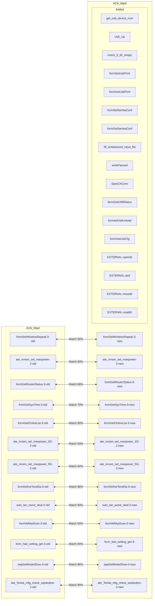
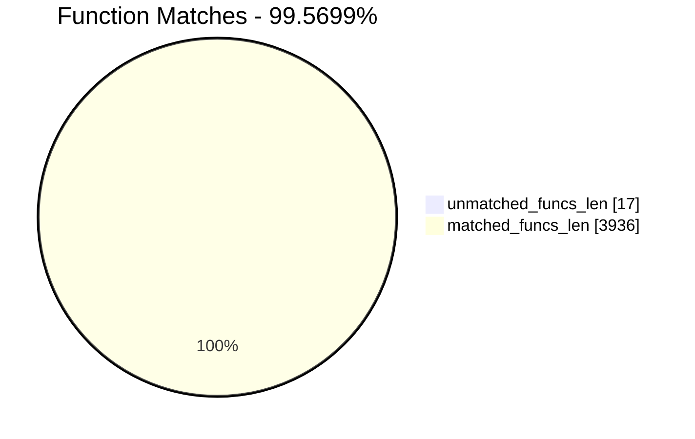
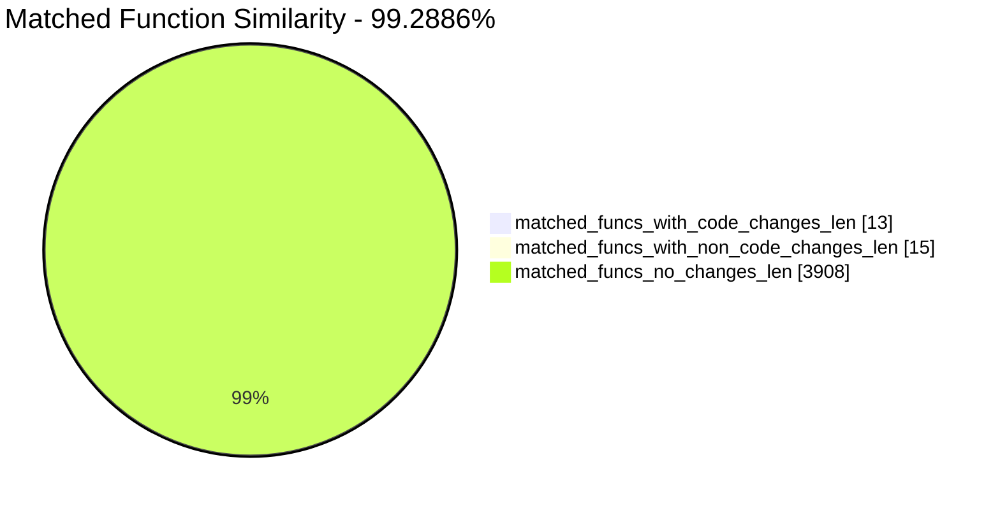
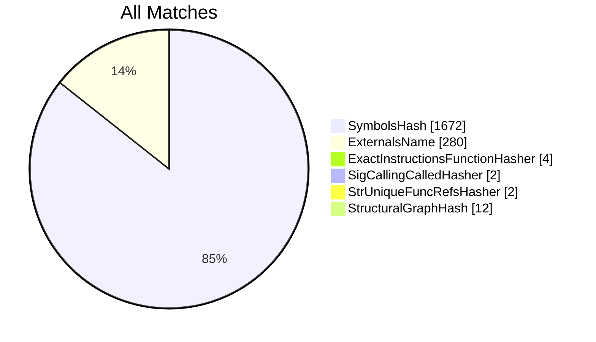
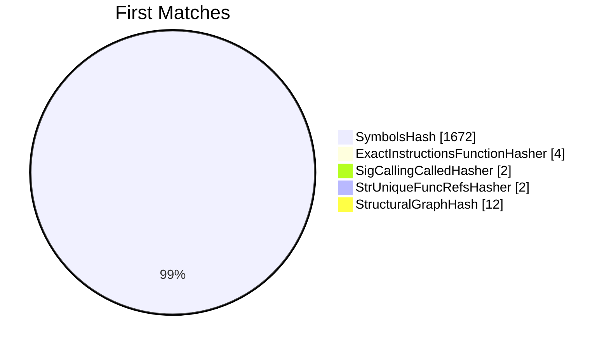
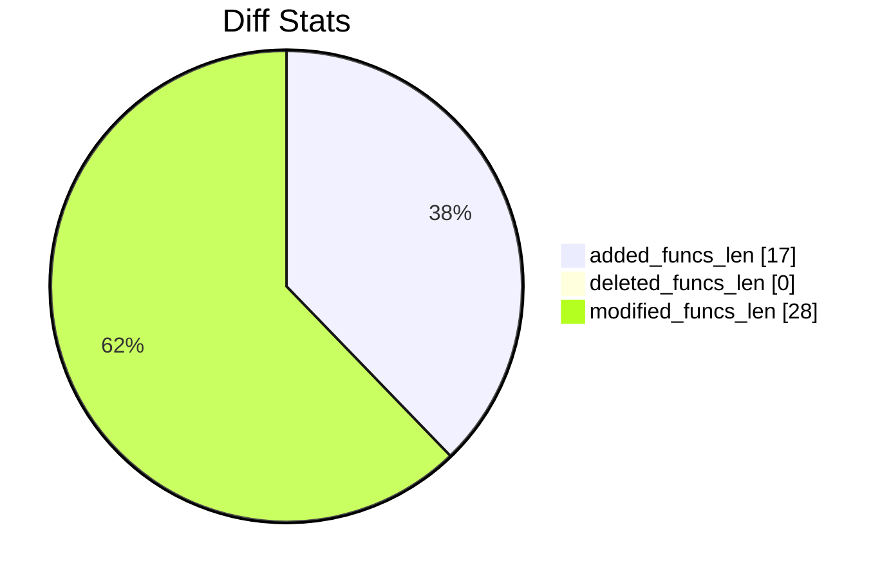
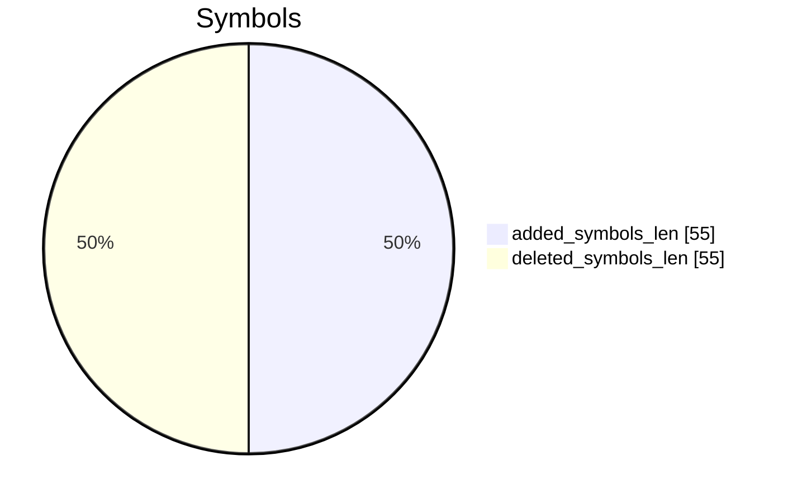
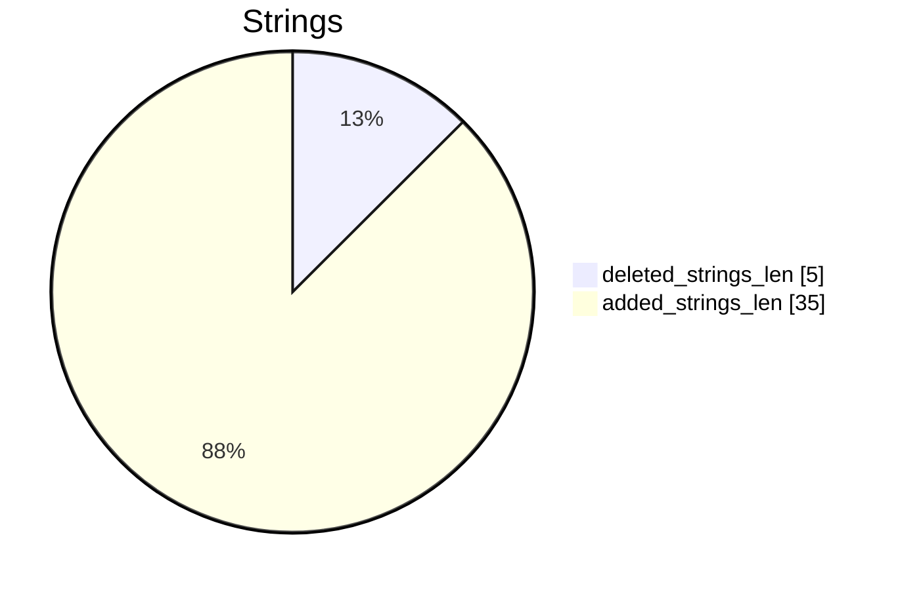

# AC6_httpd-AC9_httpd Diff

# TOC

* [Visual Chart Diff](#visual-chart-diff)
* [Metadata](#metadata)
	* [Ghidra Diff Engine](#ghidra-diff-engine)
		* [Command Line](#command-line)
	* [Binary Metadata Diff](#binary-metadata-diff)
	* [Program Options](#program-options)
	* [Diff Stats](#diff-stats)
	* [Strings](#strings)
* [Deleted](#deleted)
* [Added](#added)
	* [get_usb_device_num](#get_usb_device_num)
	* [Usb_Up](#usb_up)
	* [check_if_dir_empty](#check_if_dir_empty)
	* [formSetUsbPrint](#formsetusbprint)
	* [formGetUsbPrint](#formgetusbprint)
	* [formSetSambaConf](#formsetsambaconf)
	* [formGetSambaConf](#formgetsambaconf)
	* [fill_smbpasswd_input_file](#fill_smbpasswd_input_file)
	* [writePasswd](#writepasswd)
	* [SpecChConv](#specchconv)
	* [formGetUSBStatus](#formgetusbstatus)
	* [formsetUsbUnload](#formsetusbunload)
	* [formGetUsbCfg](#formgetusbcfg)
	* [<EXTERNAL>::opendir](#externalopendir)
	* [<EXTERNAL>::atof](#externalatof)
	* [<EXTERNAL>::closedir](#externalclosedir)
	* [<EXTERNAL>::readdir](#externalreaddir)
* [Modified](#modified)
	* [fromSetWirelessRepeat](#fromsetwirelessrepeat)
	* [ate_nvram_set_maxpower](#ate_nvram_set_maxpower)
	* [formGetRouterStatus](#formgetrouterstatus)
	* [fromGetSysTime](#fromgetsystime)
	* [formGetOnlineList](#formgetonlinelist)
	* [ate_nvram_set_maxpower_2G](#ate_nvram_set_maxpower_2g)
	* [ate_nvram_set_maxpower_5G](#ate_nvram_set_maxpower_5g)
	* [formDefineTendDa](#formdefinetendda)
	* [wan_lan_same_deal](#wan_lan_same_deal)
	* [formWifiApScan](#formwifiapscan)
	* [form_fast_setting_get](#form_fast_setting_get)
	* [aspGetModeShow](#aspgetmodeshow)
	* [ate_Tenda_mfg_check_wpsbutton](#ate_tenda_mfg_check_wpsbutton)
* [Modified (No Code Changes)](#modified-no-code-changes)
	* [set_cfm_mib](#set_cfm_mib)
	* [cJSON_CreateArray](#cjson_createarray)
	* [cJSON_Object_2String](#cjson_object_2string)
	* [cJSON_CreateObject](#cjson_createobject)
	* [websTransfer](#webstransfer)
	* [cJSON_AddItemToArray](#cjson_additemtoarray)
	* [cJSON_AddItemToObject](#cjson_additemtoobject)
	* [__ledf2](#__ledf2)
	* [cJSON_Print](#cjson_print)
	* [websFormDefine](#websformdefine)
	* [cJSON_CreateString](#cjson_createstring)
	* [websGetVar](#websgetvar)
	* [cJSON_Delete](#cjson_delete)
	* [websDone](#websdone)

# Visual Chart Diff










# Metadata

## Ghidra Diff Engine

### Command Line

#### Captured Command Line


```
ghidriff --project-location ghidra_projects --project-name ghidriff --symbols-path symbols --threaded --log-level INFO --file-log-level INFO --log-path ghidriff.log --min-func-len 10 --gdt [] --bsim --max-ram-percent 60.0 --max-section-funcs 200 AC6_httpd AC9_httpd
```


#### Verbose Args


<details>

```
--old ['./AC6_httpd'] --new [['./AC9_httpd']] --engine VersionTrackingDiff --output-path . --summary False --project-location ghidra_projects --project-name ghidriff --symbols-path symbols --threaded True --force-analysis False --force-diff False --no-symbols False --log-level INFO --file-log-level INFO --log-path ghidriff.log --va False --min-func-len 10 --use-calling-counts False --gdt [] --bsim True --bsim-full False --max-ram-percent 60.0 --print-flags False --jvm-args None --side-by-side False --max-section-funcs 200 --md-title None
```


</details>

## Binary Metadata Diff


```diff
--- AC6_httpd Meta
+++ AC9_httpd Meta
@@ -1,177 +1,178 @@
-Program Name: AC6_httpd
+Program Name: AC9_httpd
 Language ID: MIPS:LE:32:default (1.8)
 Compiler ID: default
 Processor: MIPS
 Endian: Little
 Address Size: 32
-Minimum Address: 003ff000
+Minimum Address: 00400000
 Maximum Address: _elfSectionHeaders::00000757
-# of Bytes: 2129469
-# of Memory Blocks: 50
-# of Instructions: 254926
-# of Defined Data: 17323
-# of Functions: 1966
-# of Symbols: 19610
-# of Data Types: 2115
-# of Data Type Categories: 202
+# of Bytes: 2148436
+# of Memory Blocks: 48
+# of Instructions: 257313
+# of Defined Data: 17527
+# of Functions: 1987
+# of Symbols: 19797
+# of Data Types: 2138
+# of Data Type Categories: 205
 Analyzed: true
 Created With Ghidra Version: 11.3.2
 DWARF Loaded: true
-Date Created: Wed Apr 23 15:05:21 CST 2025
+Date Created: Wed Apr 23 15:05:23 CST 2025
 ELF File Type: executable
-ELF Original Image Base: 0x3ff000
+ELF Original Image Base: 0x400000
 ELF Prelinked: false
 ELF Source File [   0]: initfini.c
 ELF Source File [   1]: crtstuff.c
 ELF Source File [   2]: crtstuff.c
 ELF Source File [   3]: initfini.c
 ELF Source File [   4]: asp.c
 ELF Source File [   5]: balloc.c
 ELF Source File [   6]: base64.c
 ELF Source File [   7]: cgi.c
 ELF Source File [   8]: default.c
 ELF Source File [   9]: ejlex.c
 ELF Source File [  10]: ejparse.c
 ELF Source File [  11]: form.c
 ELF Source File [  12]: h.c
 ELF Source File [  13]: handler.c
 ELF Source File [  14]: uemf.h
 ELF Source File [  15]: misc.c
 ELF Source File [  16]: page.c
 ELF Source File [  17]: ringq.c
 ELF Source File [  18]: sock.c
 ELF Source File [  19]: sockGen.c
 ELF Source File [  20]: sslSocket.c
 ELF Source File [  21]: matrix_ssl.c
 ELF Source File [  22]: security.c
 ELF Source File [  23]: sym.c
 ELF Source File [  24]: uemf.c
 ELF Source File [  25]: url.c
 ELF Source File [  26]: value.c
 ELF Source File [  27]: md5c.c
 ELF Source File [  28]: um.c
 ELF Source File [  29]: umui.c
 ELF Source File [  30]: websda.c
 ELF Source File [  31]: emfdb.c
 ELF Source File [  32]: webs.c
 ELF Source File [  33]: websuemf.c
 ELF Source File [  34]: main.c
 ELF Source File [  35]: ../../../../infra/pal/list.h
 ELF Source File [  36]: /home/work/workspace/AC6V2.0/prod/httpd/11ac/cgi/sysCurrentInfor.c
 ELF Source File [  37]: /home/work/workspace/AC6V2.0/prod/httpd/11ac/cgi/controlCfm.c
 ELF Source File [  38]: /home/work/workspace/AC6V2.0/prod/httpd/11ac/cgi/networkCfm.c
 ELF Source File [  39]: /home/work/workspace/AC6V2.0/prod/httpd/11ac/cgi/sysSafe.c
 ELF Source File [  40]: /home/work/workspace/AC6V2.0/prod/httpd/11ac/cgi/Dhcp.c
 ELF Source File [  41]: /home/work/workspace/AC6V2.0/prod/httpd/11ac/cgi/upload.c
 ELF Source File [  42]: /home/work/workspace/AC6V2.0/prod/httpd/11ac/cgi/cJSON.c
 ELF Source File [  43]: /home/work/workspace/AC6V2.0/prod/httpd/11ac/cgi/Form_define.c
 ELF Source File [  44]: /home/work/workspace/AC6V2.0/prod/httpd/11ac/cgi/system_reboot.c
 ELF Source File [  45]: /home/work/workspace/AC6V2.0/prod/httpd/11ac/cgi/mtenda.c
 ELF Source File [  46]: /home/work/workspace/AC6V2.0/prod/httpd/11ac/cgi/Form_public.c
 ELF Source File [  47]: /home/work/workspace/AC6V2.0/prod/httpd/11ac/cgi/index.c
 ELF Source File [  48]: /home/work/workspace/AC6V2.0/prod/httpd/11ac/cgi/wizard.c
 ELF Source File [  49]: /home/work/workspace/AC6V2.0/prod/httpd/11ac/cgi/lan.c
 ELF Source File [  50]: /home/work/workspace/AC6V2.0/prod/httpd/11ac/cgi/../../../../infra/pal/list.h
 ELF Source File [  51]: /home/work/workspace/AC6V2.0/prod/httpd/11ac/cgi/fast_setting.c
 ELF Source File [  52]: /home/work/workspace/AC6V2.0/prod/httpd/11ac/cgi/usb_cgi.c
 ELF Source File [  53]: /home/work/workspace/AC6V2.0/infra/pal/list.h
 ELF Source File [  54]: /home/work/workspace/AC6V2.0/prod/httpd/11ac/cgi/webip_lan.c
 ELF Source File [  55]: /home/work/workspace/AC6V2.0/prod/httpd/11ac/cgi/wan_policy.c
 ELF Source File [  56]: /home/work/workspace/AC6V2.0/prod/httpd/11ac/cgi/multiWan_setting.c
 ELF Source File [  57]: /home/work/workspace/AC6V2.0/prod/httpd/11ac/cgi/webip_wan.c
 ELF Source File [  58]: /home/work/workspace/AC6V2.0/prod/httpd/11ac/cgi/nat_dmz.c
 ELF Source File [  59]: /home/work/workspace/AC6V2.0/prod/httpd/11ac/cgi/arp.c
 ELF Source File [  60]: /home/work/workspace/AC6V2.0/prod/httpd/11ac/cgi/nat_virtualser.c
 ELF Source File [  61]: /home/work/workspace/AC6V2.0/prod/httpd/11ac/cgi/nat_static.c
 ELF Source File [  62]: /home/work/workspace/AC6V2.0/prod/httpd/11ac/cgi/nat_set.c
 ELF Source File [  63]: /home/work/workspace/AC6V2.0/prod/httpd/11ac/cgi/ddns_config.c
 ELF Source File [  64]: /home/work/workspace/AC6V2.0/prod/httpd/11ac/cgi/routing_table.c
 ELF Source File [  65]: /home/work/workspace/AC6V2.0/prod/httpd/11ac/cgi/routing_static.c
 ELF Source File [  66]: /home/work/workspace/AC6V2.0/prod/httpd/11ac/cgi/system_log.c
 ELF Source File [  67]: /home/work/workspace/AC6V2.0/prod/httpd/11ac/cgi/log_addsetting.c
 ELF Source File [  68]: /home/work/workspace/AC6V2.0/prod/httpd/11ac/cgi/system_restore.c
 ELF Source File [  69]: /home/work/workspace/AC6V2.0/prod/httpd/11ac/cgi/system_password.c
 ELF Source File [  70]: /home/work/workspace/AC6V2.0/prod/httpd/11ac/cgi/system_baseuser.c
 ELF Source File [  71]: /home/work/workspace/AC6V2.0/prod/httpd/11ac/cgi/system_upgrade.c
 ELF Source File [  72]: /home/work/workspace/AC6V2.0/prod/httpd/11ac/cgi/cmd.c
 ELF Source File [  73]: /home/work/workspace/AC6V2.0/prod/httpd/11ac/cgi/utf_gbl_encode.c
 ELF Source File [  74]: /home/work/workspace/AC6V2.0/prod/httpd/11ac/cgi/qos_rule.c
 ELF Source File [  75]: /home/work/workspace/AC6V2.0/prod/httpd/11ac/cgi/auto_qos_cgi.c
 ELF Source File [  76]: /home/work/workspace/AC6V2.0/prod/httpd/11ac/cgi/cgi_utils.c
 ELF Source File [  77]: /home/work/workspace/AC6V2.0/prod/httpd/11ac/cgi/pacontrol.c
 ELF Source File [  78]: /home/work/workspace/AC6V2.0/prod/httpd/11ac/cgi/upnp_config.c
 ELF Source File [  79]: /home/work/workspace/AC6V2.0/prod/httpd/11ac/cgi/lan_dhcps.c
 ELF Source File [  80]: /home/work/workspace/AC6V2.0/prod/httpd/11ac/cgi/lan_dhcp_clients.c
 ELF Source File [  81]: /home/work/workspace/AC6V2.0/prod/httpd/11ac/cgi/system_hostname.c
 ELF Source File [  82]: /home/work/workspace/AC6V2.0/prod/httpd/11ac/cgi/dns_safesecond.c
 ELF Source File [  83]: /home/work/workspace/AC6V2.0/prod/httpd/11ac/cgi/sched_wifi_check.c
 ELF Source File [  84]: /home/work/workspace/AC6V2.0/prod/httpd/11ac/cgi/sched_led_check.c
 ELF Source File [  85]: /home/work/workspace/AC6V2.0/prod/httpd/11ac/cgi/electronic_bulletin.c
 ELF Source File [  86]: /home/work/workspace/AC6V2.0/prod/httpd/11ac/cgi/switch_portVLAN.c
 ELF Source File [  87]: /home/work/workspace/AC6V2.0/prod/httpd/11ac/cgi/wifi.c
-ELF Source File [  88]: /home/work/workspace/AC6V2.0/prod/httpd/11ac/cgi/behaviormanager_demo.c
-ELF Source File [  89]: /home/work/workspace/AC6V2.0/prod/httpd/11ac/cgi/safe_demo.c
-ELF Source File [  90]: /home/work/workspace/AC6V2.0/prod/httpd/11ac/cgi/ucloud_v2.c
-ELF Source File [  91]: /home/work/workspace/AC6V2.0/prod/httpd/11ac/cgi/alischedule.c
-ELF Source File [  92]: /home/work/workspace/AC6V2.0/prod/httpd/11ac/cgi/apclient.c
-ELF Source File [  93]: /home/work/workspace/AC6V2.0/prod/httpd/11ac/cgi/iptv.c
-ELF Source File [  94]: /home/work/workspace/AC6V2.0/prod/httpd/11ac/cgi/reboot_timer.c
-ELF Source File [  95]: /home/work/workspace/AC6V2.0/prod/httpd/11ac/cgi/smart_power_management_cgi.c
-ELF Source File [  96]: /home/work/workspace/AC6V2.0/prod/httpd/11ac/cgi/guest_ip_confilct.c
-ELF Source File [  97]: /home/work/workspace/AC6V2.0/prod/httpd/11ac/cgi/vpn.c
-ELF Source File [  98]: /home/work/workspace/AC6V2.0/prod/httpd/11ac/cgi/wan_err_info.c
-ELF Source File [  99]: /home/work/workspace/AC6V2.0/prod/httpd/11ac/cgi/cgi_common.c
-ELF Source File [ 100]: /home/work/workspace/AC6V2.0/prod/httpd/11ac/cgi/cgi_mac_filter.c
-ELF Source File [ 101]: /home/work/workspace/AC6V2.0/prod/httpd/11ac/cgi/cgi_advertisement.c
-ELF Source File [ 102]: matrixSsl.c
-ELF Source File [ 103]: sslDecode.c
-ELF Source File [ 104]: sslEncode.c
-ELF Source File [ 105]: sslv3.c
-ELF Source File [ 106]: linux.c
-ELF Source File [ 107]: md5.c
-ELF Source File [ 108]: mpi.c
-ELF Source File [ 109]: sha1.c
-ELF Source File [ 110]: rsaPki.c
-ELF Source File [ 111]: x509.c
-ELF Source File [ 112]: cipherSuite.c
-ELF Source File [ 113]: arc4.c
-ELF Source File [ 114]: base64.c
-ELF Source File [ 115]: des3.c
-ELF Source File [ 116]: rsa.c
-ELF Source File [ 117]: asn1.c
-ELF Source File [ 118]: libgcc2.c
-ELF Source File [ 119]: adddf3.c
-ELF Source File [ 120]: divdf3.c
-ELF Source File [ 121]: gedf2.c
-ELF Source File [ 122]: ledf2.c
-ELF Source File [ 123]: muldf3.c
-ELF Source File [ 124]: subdf3.c
-ELF Source File [ 125]: fixdfsi.c
-ELF Source File [ 126]: floatsidf.c
-ELF Source File [ 127]: floatunsidf.c
-ELF Source File [ 128]: extendsfdf2.c
-ELF Source File [ 129]: 
+ELF Source File [  88]: /home/work/workspace/AC6V2.0/prod/httpd/11ac/cgi/usb.c
+ELF Source File [  89]: /home/work/workspace/AC6V2.0/prod/httpd/11ac/cgi/behaviormanager_demo.c
+ELF Source File [  90]: /home/work/workspace/AC6V2.0/prod/httpd/11ac/cgi/safe_demo.c
+ELF Source File [  91]: /home/work/workspace/AC6V2.0/prod/httpd/11ac/cgi/ucloud_v2.c
+ELF Source File [  92]: /home/work/workspace/AC6V2.0/prod/httpd/11ac/cgi/alischedule.c
+ELF Source File [  93]: /home/work/workspace/AC6V2.0/prod/httpd/11ac/cgi/apclient.c
+ELF Source File [  94]: /home/work/workspace/AC6V2.0/prod/httpd/11ac/cgi/iptv.c
+ELF Source File [  95]: /home/work/workspace/AC6V2.0/prod/httpd/11ac/cgi/reboot_timer.c
+ELF Source File [  96]: /home/work/workspace/AC6V2.0/prod/httpd/11ac/cgi/smart_power_management_cgi.c
+ELF Source File [  97]: /home/work/workspace/AC6V2.0/prod/httpd/11ac/cgi/guest_ip_confilct.c
+ELF Source File [  98]: /home/work/workspace/AC6V2.0/prod/httpd/11ac/cgi/vpn.c
+ELF Source File [  99]: /home/work/workspace/AC6V2.0/prod/httpd/11ac/cgi/wan_err_info.c
+ELF Source File [ 100]: /home/work/workspace/AC6V2.0/prod/httpd/11ac/cgi/cgi_common.c
+ELF Source File [ 101]: /home/work/workspace/AC6V2.0/prod/httpd/11ac/cgi/cgi_mac_filter.c
+ELF Source File [ 102]: /home/work/workspace/AC6V2.0/prod/httpd/11ac/cgi/cgi_advertisement.c
+ELF Source File [ 103]: matrixSsl.c
+ELF Source File [ 104]: sslDecode.c
+ELF Source File [ 105]: sslEncode.c
+ELF Source File [ 106]: sslv3.c
+ELF Source File [ 107]: linux.c
+ELF Source File [ 108]: md5.c
+ELF Source File [ 109]: mpi.c
+ELF Source File [ 110]: sha1.c
+ELF Source File [ 111]: rsaPki.c
+ELF Source File [ 112]: x509.c
+ELF Source File [ 113]: cipherSuite.c
+ELF Source File [ 114]: arc4.c
+ELF Source File [ 115]: base64.c
+ELF Source File [ 116]: des3.c
+ELF Source File [ 117]: rsa.c
+ELF Source File [ 118]: asn1.c
+ELF Source File [ 119]: libgcc2.c
+ELF Source File [ 120]: adddf3.c
+ELF Source File [ 121]: divdf3.c
+ELF Source File [ 122]: gedf2.c
+ELF Source File [ 123]: ledf2.c
+ELF Source File [ 124]: muldf3.c
+ELF Source File [ 125]: subdf3.c
+ELF Source File [ 126]: fixdfsi.c
+ELF Source File [ 127]: floatsidf.c
+ELF Source File [ 128]: floatunsidf.c
+ELF Source File [ 129]: extendsfdf2.c
+ELF Source File [ 130]: 
 Elf Comment[0]: GCC: (GNU) 3.3.2
 Elf Comment[1]: GCC: (Realtek MSDK-4.4.7 Build 2001) 4.4.7
 Executable Format: Executable and Linking Format (ELF)
-Executable Location: /root/FHFuzz/diff/Tenda_httpd/AC6_httpd
-Executable MD5: 6bbbe9d79eed77c2b21108d6bc60e46a
-Executable SHA256: 2b6bbc43b4a718af5533ea75e177ee6f9f8fb265beabaa95973faf474b3ce869
-FSRL: file:///root/FHFuzz/diff/Tenda_httpd/AC6_httpd?MD5=6bbbe9d79eed77c2b21108d6bc60e46a
+Executable Location: /root/FHFuzz/diff/Tenda_httpd/AC9_httpd
+Executable MD5: 8bcc3eee1768591e050db8ff4eff7da1
+Executable SHA256: 329d918f05c1a76bf41074eba35553b2517f2054c1c10ab8c41ac2e037e12c6f
+FSRL: file:///root/FHFuzz/diff/Tenda_httpd/AC9_httpd?MD5=8bcc3eee1768591e050db8ff4eff7da1
 GNU DebugLink: httpd.debug
 Preferred Root Namespace Category: 
 Relocatable: false
 Required Library [    0]: libCfm.so
 Required Library [    1]: libcommon.so
 Required Library [    2]: libChipApi.so
 Required Library [    3]: libvos_util.so
 Required Library [    4]: libz.so
 Required Library [    5]: libpthread.so.0
 Required Library [    6]: libapmib.so
 Required Library [    7]: librtlWifiSrc.so
 Required Library [    8]: libtpi.so
 Required Library [    9]: libm.so.0
 Required Library [   10]: libucapi.so
 Required Library [   11]: libgcc_s.so.1
 Required Library [   12]: libc.so.0
 Should Ask To Analyze: false

```


## Program Options


<details>
<summary>Ghidra AC6_httpd Decompiler Options</summary>


|Decompiler Option|Value|
| :---: | :---: |
|Prototype Evaluation|__stdcall|

</details>


<details>
<summary>Ghidra AC6_httpd Specification extensions Options</summary>


|Specification extensions Option|Value|
| :---: | :---: |
|FormatVersion|0|
|VersionCounter|0|

</details>


<details>
<summary>Ghidra AC6_httpd Analyzers Options</summary>


|Analyzers Option|Value|
| :---: | :---: |
|ASCII Strings|true|
|ASCII Strings.Create Strings Containing Existing Strings|true|
|ASCII Strings.Create Strings Containing References|true|
|ASCII Strings.Force Model Reload|false|
|ASCII Strings.Minimum String Length|LEN_5|
|ASCII Strings.Model File|StringModel.sng|
|ASCII Strings.Require Null Termination for String|true|
|ASCII Strings.Search Only in Accessible Memory Blocks|true|
|ASCII Strings.String Start Alignment|ALIGN_1|
|ASCII Strings.String end alignment|4|
|Aggressive Instruction Finder|false|
|Aggressive Instruction Finder.Create Analysis Bookmarks|true|
|Apply Data Archives|true|
|Apply Data Archives.Archive Chooser|[Auto-Detect]|
|Apply Data Archives.Create Analysis Bookmarks|true|
|Apply Data Archives.GDT User File Archive Path|None|
|Apply Data Archives.User Project Archive Path|None|
|Call Convention ID|true|
|Call Convention ID.Analysis Decompiler Timeout (sec)|60|
|Call-Fixup Installer|true|
|Condense Filler Bytes|false|
|Condense Filler Bytes.Filler Value|Auto|
|Condense Filler Bytes.Minimum number of sequential bytes|1|
|Create Address Tables|true|
|Create Address Tables.Allow Offcut References|false|
|Create Address Tables.Auto Label Table|false|
|Create Address Tables.Create Analysis Bookmarks|true|
|Create Address Tables.Maxmimum Pointer Distance|16777215|
|Create Address Tables.Minimum Pointer Address|4132|
|Create Address Tables.Minimum Table Size|3|
|Create Address Tables.Pointer Alignment|1|
|Create Address Tables.Relocation Table Guide|true|
|Create Address Tables.Table Alignment|4|
|DWARF|true|
|DWARF.Add Inlined Functions Comments|false|
|DWARF.Add Lexical Block Comments|false|
|DWARF.Create Function Signatures|true|
|DWARF.Default Calling Convention||
|DWARF.Ignore Parameter Storage Info|false|
|DWARF.Import Data Types|true|
|DWARF.Import Functions|true|
|DWARF.Import Local Variable Info|true|
|DWARF.Import Source Line Info|true|
|DWARF.Maximum Source Map Entry Length|2000|
|DWARF.Output DWARF DIE Info|false|
|DWARF.Output Source Info|false|
|DWARF.Try To Pack Structs|true|
|Data Reference|true|
|Data Reference.Address Table Alignment|1|
|Data Reference.Address Table Minimum Size|3|
|Data Reference.Align End of Strings|false|
|Data Reference.Ascii String References|true|
|Data Reference.Create Address Tables|false|
|Data Reference.Minimum String Length|5|
|Data Reference.References to Pointers|true|
|Data Reference.Relocation Table Guide|true|
|Data Reference.Respect Execute Flag|true|
|Data Reference.Subroutine References|true|
|Data Reference.Switch Table References|false|
|Data Reference.Unicode String References|true|
|Decompiler Parameter ID|true|
|Decompiler Parameter ID.Analysis Clear Level|ANALYSIS|
|Decompiler Parameter ID.Analysis Decompiler Timeout (sec)|60|
|Decompiler Parameter ID.Commit Data Types|true|
|Decompiler Parameter ID.Commit Void Return Values|false|
|Decompiler Parameter ID.Prototype Evaluation|__stdcall|
|Decompiler Switch Analysis|true|
|Decompiler Switch Analysis.Analysis Decompiler Timeout (sec)|60|
|Demangler GNU|true|
|Demangler GNU.Apply Function Calling Conventions|true|
|Demangler GNU.Apply Function Signatures|true|
|Demangler GNU.Demangle Only Known Mangled Symbols|false|
|Demangler GNU.Demangler Format|AUTO|
|Demangler GNU.Use Deprecated Demangler|false|
|Demangler GNU.Use Standard Text Replacements|true|
|Disassemble Entry Points|true|
|Disassemble Entry Points.Respect Execute Flag|true|
|ELF Scalar Operand References|false|
|ELF Scalar Operand References.Relocation Table Guide|true|
|Embedded Media|true|
|Embedded Media.Create Analysis Bookmarks|true|
|External Entry References|true|
|External Symbol Resolver|true|
|Function Start Search|true|
|Function Start Search.Bookmark Functions|false|
|Function Start Search.Search Data Blocks|false|
|GCC Exception Handlers|true|
|GCC Exception Handlers.Create Try Catch Comments|true|
|MIPS Constant Reference Analyzer|true|
|MIPS Constant Reference Analyzer.Assume T9 set to Function entry|true|
|MIPS Constant Reference Analyzer.Attempt to recover switch tables|false|
|MIPS Constant Reference Analyzer.Create Data from pointer|false|
|MIPS Constant Reference Analyzer.Function parameter/return Pointer analysis|true|
|MIPS Constant Reference Analyzer.Mark dual instruction references|false|
|MIPS Constant Reference Analyzer.Max Threads|2|
|MIPS Constant Reference Analyzer.Min absolute reference|4|
|MIPS Constant Reference Analyzer.Recover global GP register writes|true|
|MIPS Constant Reference Analyzer.Require pointer param data type|false|
|MIPS Constant Reference Analyzer.Speculative reference max|256|
|MIPS Constant Reference Analyzer.Speculative reference min|1024|
|MIPS Constant Reference Analyzer.Stored Value Pointer analysis|true|
|MIPS Constant Reference Analyzer.Trust values read from writable memory|true|
|MIPS Symbol|true|
|MIPS UnAlligned Instruction Fix|true|
|Non-Returning Functions - Discovered|true|
|Non-Returning Functions - Discovered.Create Analysis Bookmarks|true|
|Non-Returning Functions - Discovered.Function Non-return Threshold|3|
|Non-Returning Functions - Discovered.Repair Flow Damage|true|
|Non-Returning Functions - Known|true|
|Non-Returning Functions - Known.Create Analysis Bookmarks|true|
|Reference|true|
|Reference.Address Table Alignment|1|
|Reference.Address Table Minimum Size|3|
|Reference.Align End of Strings|false|
|Reference.Ascii String References|true|
|Reference.Create Address Tables|false|
|Reference.Minimum String Length|5|
|Reference.References to Pointers|true|
|Reference.Relocation Table Guide|true|
|Reference.Respect Execute Flag|true|
|Reference.Subroutine References|true|
|Reference.Switch Table References|false|
|Reference.Unicode String References|true|
|Shared Return Calls|true|
|Shared Return Calls.Allow Conditional Jumps|false|
|Shared Return Calls.Assume Contiguous Functions Only|false|
|Stack|true|
|Stack.Create Local Variables|true|
|Stack.Create Param Variables|false|
|Stack.useNewFunctionStackAnalysis|true|
|Subroutine References|true|
|Subroutine References.Create Thunks Early|true|
|Variadic Function Signature Override|false|
|Variadic Function Signature Override.Create Analysis Bookmarks|false|

</details>


<details>
<summary>Ghidra AC9_httpd Decompiler Options</summary>


|Decompiler Option|Value|
| :---: | :---: |
|Prototype Evaluation|__stdcall|

</details>


<details>
<summary>Ghidra AC9_httpd Specification extensions Options</summary>


|Specification extensions Option|Value|
| :---: | :---: |
|FormatVersion|0|
|VersionCounter|0|

</details>


<details>
<summary>Ghidra AC9_httpd Analyzers Options</summary>


|Analyzers Option|Value|
| :---: | :---: |
|ASCII Strings|true|
|ASCII Strings.Create Strings Containing Existing Strings|true|
|ASCII Strings.Create Strings Containing References|true|
|ASCII Strings.Force Model Reload|false|
|ASCII Strings.Minimum String Length|LEN_5|
|ASCII Strings.Model File|StringModel.sng|
|ASCII Strings.Require Null Termination for String|true|
|ASCII Strings.Search Only in Accessible Memory Blocks|true|
|ASCII Strings.String Start Alignment|ALIGN_1|
|ASCII Strings.String end alignment|4|
|Aggressive Instruction Finder|false|
|Aggressive Instruction Finder.Create Analysis Bookmarks|true|
|Apply Data Archives|true|
|Apply Data Archives.Archive Chooser|[Auto-Detect]|
|Apply Data Archives.Create Analysis Bookmarks|true|
|Apply Data Archives.GDT User File Archive Path|None|
|Apply Data Archives.User Project Archive Path|None|
|Call Convention ID|true|
|Call Convention ID.Analysis Decompiler Timeout (sec)|60|
|Call-Fixup Installer|true|
|Condense Filler Bytes|false|
|Condense Filler Bytes.Filler Value|Auto|
|Condense Filler Bytes.Minimum number of sequential bytes|1|
|Create Address Tables|true|
|Create Address Tables.Allow Offcut References|false|
|Create Address Tables.Auto Label Table|false|
|Create Address Tables.Create Analysis Bookmarks|true|
|Create Address Tables.Maxmimum Pointer Distance|16777215|
|Create Address Tables.Minimum Pointer Address|4132|
|Create Address Tables.Minimum Table Size|3|
|Create Address Tables.Pointer Alignment|1|
|Create Address Tables.Relocation Table Guide|true|
|Create Address Tables.Table Alignment|4|
|DWARF|true|
|DWARF.Add Inlined Functions Comments|false|
|DWARF.Add Lexical Block Comments|false|
|DWARF.Create Function Signatures|true|
|DWARF.Default Calling Convention||
|DWARF.Ignore Parameter Storage Info|false|
|DWARF.Import Data Types|true|
|DWARF.Import Functions|true|
|DWARF.Import Local Variable Info|true|
|DWARF.Import Source Line Info|true|
|DWARF.Maximum Source Map Entry Length|2000|
|DWARF.Output DWARF DIE Info|false|
|DWARF.Output Source Info|false|
|DWARF.Try To Pack Structs|true|
|Data Reference|true|
|Data Reference.Address Table Alignment|1|
|Data Reference.Address Table Minimum Size|3|
|Data Reference.Align End of Strings|false|
|Data Reference.Ascii String References|true|
|Data Reference.Create Address Tables|false|
|Data Reference.Minimum String Length|5|
|Data Reference.References to Pointers|true|
|Data Reference.Relocation Table Guide|true|
|Data Reference.Respect Execute Flag|true|
|Data Reference.Subroutine References|true|
|Data Reference.Switch Table References|false|
|Data Reference.Unicode String References|true|
|Decompiler Parameter ID|true|
|Decompiler Parameter ID.Analysis Clear Level|ANALYSIS|
|Decompiler Parameter ID.Analysis Decompiler Timeout (sec)|60|
|Decompiler Parameter ID.Commit Data Types|true|
|Decompiler Parameter ID.Commit Void Return Values|false|
|Decompiler Parameter ID.Prototype Evaluation|__stdcall|
|Decompiler Switch Analysis|true|
|Decompiler Switch Analysis.Analysis Decompiler Timeout (sec)|60|
|Demangler GNU|true|
|Demangler GNU.Apply Function Calling Conventions|true|
|Demangler GNU.Apply Function Signatures|true|
|Demangler GNU.Demangle Only Known Mangled Symbols|false|
|Demangler GNU.Demangler Format|AUTO|
|Demangler GNU.Use Deprecated Demangler|false|
|Demangler GNU.Use Standard Text Replacements|true|
|Disassemble Entry Points|true|
|Disassemble Entry Points.Respect Execute Flag|true|
|ELF Scalar Operand References|false|
|ELF Scalar Operand References.Relocation Table Guide|true|
|Embedded Media|true|
|Embedded Media.Create Analysis Bookmarks|true|
|External Entry References|true|
|External Symbol Resolver|true|
|Function Start Search|true|
|Function Start Search.Bookmark Functions|false|
|Function Start Search.Search Data Blocks|false|
|GCC Exception Handlers|true|
|GCC Exception Handlers.Create Try Catch Comments|true|
|MIPS Constant Reference Analyzer|true|
|MIPS Constant Reference Analyzer.Assume T9 set to Function entry|true|
|MIPS Constant Reference Analyzer.Attempt to recover switch tables|false|
|MIPS Constant Reference Analyzer.Create Data from pointer|false|
|MIPS Constant Reference Analyzer.Function parameter/return Pointer analysis|true|
|MIPS Constant Reference Analyzer.Mark dual instruction references|false|
|MIPS Constant Reference Analyzer.Max Threads|2|
|MIPS Constant Reference Analyzer.Min absolute reference|4|
|MIPS Constant Reference Analyzer.Recover global GP register writes|true|
|MIPS Constant Reference Analyzer.Require pointer param data type|false|
|MIPS Constant Reference Analyzer.Speculative reference max|256|
|MIPS Constant Reference Analyzer.Speculative reference min|1024|
|MIPS Constant Reference Analyzer.Stored Value Pointer analysis|true|
|MIPS Constant Reference Analyzer.Trust values read from writable memory|true|
|MIPS Symbol|true|
|MIPS UnAlligned Instruction Fix|true|
|Non-Returning Functions - Discovered|true|
|Non-Returning Functions - Discovered.Create Analysis Bookmarks|true|
|Non-Returning Functions - Discovered.Function Non-return Threshold|3|
|Non-Returning Functions - Discovered.Repair Flow Damage|true|
|Non-Returning Functions - Known|true|
|Non-Returning Functions - Known.Create Analysis Bookmarks|true|
|Reference|true|
|Reference.Address Table Alignment|1|
|Reference.Address Table Minimum Size|3|
|Reference.Align End of Strings|false|
|Reference.Ascii String References|true|
|Reference.Create Address Tables|false|
|Reference.Minimum String Length|5|
|Reference.References to Pointers|true|
|Reference.Relocation Table Guide|true|
|Reference.Respect Execute Flag|true|
|Reference.Subroutine References|true|
|Reference.Switch Table References|false|
|Reference.Unicode String References|true|
|Shared Return Calls|true|
|Shared Return Calls.Allow Conditional Jumps|false|
|Shared Return Calls.Assume Contiguous Functions Only|false|
|Stack|true|
|Stack.Create Local Variables|true|
|Stack.Create Param Variables|false|
|Stack.useNewFunctionStackAnalysis|true|
|Subroutine References|true|
|Subroutine References.Create Thunks Early|true|
|Variadic Function Signature Override|false|
|Variadic Function Signature Override.Create Analysis Bookmarks|false|

</details>

## Diff Stats


|Stat|Value|
| :---: | :---: |
|added_funcs_len|17|
|deleted_funcs_len|0|
|modified_funcs_len|28|
|added_symbols_len|55|
|deleted_symbols_len|55|
|diff_time|36.87617087364197|
|deleted_strings_len|5|
|added_strings_len|35|
|match_types|Counter({'SymbolsHash': 1672, 'ExternalsName': 280, 'StructuralGraphHash': 12, 'ExactInstructionsFunctionHasher': 4, 'SigCallingCalledHasher': 2, 'StrUniqueFuncRefsHasher': 2})|
|items_to_process|155|
|diff_types|Counter({'address': 28, 'refcount': 15, 'calling': 14, 'code': 13, 'length': 13, 'called': 7})|
|unmatched_funcs_len|17|
|total_funcs_len|3953|
|matched_funcs_len|3936|
|matched_funcs_with_code_changes_len|13|
|matched_funcs_with_non_code_changes_len|15|
|matched_funcs_no_changes_len|3908|
|match_func_similarity_percent|99.2886%|
|func_match_overall_percent|99.5699%|
|first_matches|Counter({'SymbolsHash': 1672, 'StructuralGraphHash': 12, 'ExactInstructionsFunctionHasher': 4, 'SigCallingCalledHasher': 2, 'StrUniqueFuncRefsHasher': 2})|













## Strings




### Strings Diff


```diff
--- deleted strings
+++ added strings
@@ -1,5 +1,35 @@
-s_11:10:31
-s_Aug
-s_V15.03.06.23
-s_lineup
-s_nextzone_=_%s
+s_%[^:]:%[^*]*%s
+s_%[^;];%[^;];%[^_]
+s_%s_%d:_getWanIfName_return_NULL
+s_*******_unlink_/tmp/smbpasswd_is
+s_/tmp/UDiskname
+s_/tmp/smbpasswd
+s_/tmp/usb/PrinterName
+s_/tmp/usb/UsbVolumeInfo
+s_10:27:30
+s_Feb
+s_V15.03.06.42
+s_admin
+s_busybox_deluser_%s
+s_cfm_post_netctrl_%d?op=%d,string
+s_dlna.en
+s_insmod_/lib/modules/2.6.36.4brcm
+s_smbpasswd_-a_%s_-s_<_/tmp/smbpas
+s_usb.ftp.charset
+s_usb.ftp.guest.acess
+s_usb.ftp.guest.pwd
+s_usb.ftp.guest.user
+s_usb.ftp.port
+s_usb.ftp.pwd
+s_usb.ftp.remote.acess
+s_usb.ftp.remote.port
+s_usb.ippd.enable
+s_usb.samba.enable
+s_usb.samba.guest.acess
+s_usb.samba.guest.pwd
+s_usb.samba.guest.user
+s_usb.samba.pwd
+s_usb.samba.user
+s_usbNum
+s_usb_total=%s,usb_usable=%s
+s_{"printerEn":"%d","printerName":

```


### String References

#### Old


|String|Ref Count|Ref Func|
| :---: | :---: | :---: |
|s_lineup_0050e044|1|formGetRouterStatus|
|s_V15.03.06.23_0050c058|1|aspTendaGetStatus|
|s_nextzone_=_%s_0051a5f8|1|fromGetSysTime|
|s_Aug_9_2018_0050c11c|1|aspTendaGetStatus|
|s_11:10:31_0050813c|1|get_compile_date_time|

#### New


|String|Ref Count|Ref Func|
| :---: | :---: | :---: |
|s_*******_unlink_/tmp/smbpasswd_is_00520550|1|fill_smbpasswd_input_file|
|s_usb.samba.user_0052057c|1|writePasswd|
|s_usb.ftp.port_005204a4|1|formGetSambaConf|
|s_/tmp/UDiskname_0051fad8|1|Usb_Up|
|s_usb.ftp.guest.pwd_0052040c|1|formSetSambaConf|
|s_usb.ippd.enable_00520248|3|formGetUSBStatus,formGetUsbPrint,formSetUsbPrint|
|s_Feb_6_2018_0050e8bc|1|aspTendaGetStatus|
|s_usb.ftp.charset_00520460|2|formSetSambaConf,formGetSambaConf|
|s_usb.ftp.remote.acess_00520434|3|formGetUSBStatus,formSetSambaConf,formGetSambaConf|
|s_usb.ftp.pwd_005203ec|1|formSetSambaConf|
|s_usbNum_00510808|1|formGetRouterStatus|
|s_smbpasswd_-a_%s_-s_<_/tmp/smbpas_0052058c|1|writePasswd|
|s_insmod_/lib/modules/2.6.36.4brcm_0051fde4|1|fromSetWirelessRepeat|
|s_admin_005202e8|2|writePasswd|
|s_busybox_deluser_%s_0052039c|1|formSetSambaConf|
|s_cfm_post_netctrl_%d?op=%d,string_00520358|2|formsetUsbUnload,formSetSambaConf|
|s_{"printerEn":"%d","printerName":_005202b4|1|formGetUsbPrint|
|s_usb.samba.pwd_005203b0|3|formSetSambaConf,writePasswd,formGetSambaConf|
|s_dlna.en_00520614|1|formGetUSBStatus|
|s_%s_%d:_getWanIfName_return_NULL_005204e4|1|formGetSambaConf|
|s_%[^;];%[^;];%[^_]_00520680|1|formGetUsbCfg|
|s_/tmp/usb/PrinterName_00520298|1|formGetUsbPrint|
|s_/tmp/smbpasswd_00520540|2|fill_smbpasswd_input_file|
|s_usb.ftp.remote.port_0052044c|2|formSetSambaConf,formGetSambaConf|
|s_usb.ftp.guest.user_005203f8|1|formSetSambaConf|
|s_usb.samba.guest.acess_005203d4|2|formSetSambaConf,formGetSambaConf|
|s_usb_total=%s,usb_usable=%s_005206c8|1|formGetUsbCfg|
|s_%[^:]:%[^*]*%s_005206b0|1|formGetUsbCfg|
|s_/tmp/usb/UsbVolumeInfo_00520668|1|formGetUsbCfg|
|s_10:27:30_0050a87c|1|get_compile_date_time|
|s_V15.03.06.42_0050e7f8|1|aspTendaGetStatus|
|s_usb.samba.enable_00520470|1|formSetSambaConf|
|s_usb.ftp.guest.acess_00520420|1|formSetSambaConf|
|s_usb.samba.guest.pwd_005203c0|2|formSetSambaConf,formGetSambaConf|
|s_usb.samba.guest.user_00520384|3|formSetSambaConf,formGetSambaConf|

# Deleted

# Added

## get_usb_device_num

### Function Meta


|Key|AC9_httpd|
| :---: | :---: |
|name|get_usb_device_num|
|fullname|get_usb_device_num|
|refcount|4|
|length|336|
|called|<EXTERNAL>::fclose<br><EXTERNAL>::feof<br><EXTERNAL>::fgets<br><EXTERNAL>::fopen<br><EXTERNAL>::memset|
|calling|formGetRouterStatus|
|paramcount|0|
|address|0046c51c|
|sig|int get_usb_device_num(void)|
|sym_type|Function|
|sym_source|IMPORTED|
|external|False|


```diff
--- get_usb_device_num
+++ get_usb_device_num
@@ -0,0 +1,31 @@
+
+/* WARNING: Unknown calling convention */
+
+int get_usb_device_num(void)
+
+{
+  FILE *__stream;
+  int iVar1;
+  char *pcVar2;
+  int num;
+  FILE *fp;
+  char buffer [256];
+  
+  num = 0;
+  memset(buffer,0,0x100);
+  __stream = fopen("/tmp/usb/UsbVolumeInfo","r");
+  if (__stream != (FILE *)0x0) {
+    while ((iVar1 = feof(__stream), iVar1 == 0 &&
+           (pcVar2 = fgets(buffer,0x100,__stream), pcVar2 != (char *)0x0))) {
+      num = num + 1;
+    }
+  }
+  if (__stream != (FILE *)0x0) {
+    fclose(__stream);
+  }
+  if (2 < num) {
+    num = 2;
+  }
+  return num;
+}
+

```


## Usb_Up

### Function Meta


|Key|AC9_httpd|
| :---: | :---: |
|name|Usb_Up|
|fullname|Usb_Up|
|refcount|2|
|length|312|
|called|<EXTERNAL>::doSystemCmd<br><EXTERNAL>::fclose<br><EXTERNAL>::feof<br><EXTERNAL>::fgets<br><EXTERNAL>::fopen|
|calling|fromSetWirelessRepeat|
|paramcount|0|
|address|004c203c|
|sig|void Usb_Up(void)|
|sym_type|Function|
|sym_source|IMPORTED|
|external|False|


```diff
--- Usb_Up
+++ Usb_Up
@@ -0,0 +1,32 @@
+
+/* WARNING: Unknown calling convention -- yet parameter storage is locked */
+
+void Usb_Up(void)
+
+{
+  FILE *__stream;
+  int iVar1;
+  FILE *fp;
+  char disk_name [8];
+  
+  disk_name[0] = '\0';
+  disk_name[1] = '\0';
+  disk_name[2] = '\0';
+  disk_name[3] = '\0';
+  disk_name[4] = '\0';
+  disk_name[5] = '\0';
+  disk_name[6] = '\0';
+  disk_name[7] = '\0';
+  __stream = fopen("/tmp/UDiskname","r+");
+  if (__stream != (FILE *)0x0) {
+    while (iVar1 = feof(__stream), iVar1 == 0) {
+      fgets(disk_name,8,__stream);
+      if (disk_name[0] != '\0') {
+        doSystemCmd("cfm post netctrl %d?op=%d,string_info=%s",0x33,1,disk_name);
+      }
+    }
+    fclose(__stream);
+  }
+  return;
+}
+

```


## check_if_dir_empty

### Function Meta


|Key|AC9_httpd|
| :---: | :---: |
|name|check_if_dir_empty|
|fullname|check_if_dir_empty|
|refcount|4|
|length|292|
|called|<EXTERNAL>::closedir<br><EXTERNAL>::opendir<br><EXTERNAL>::readdir<br><EXTERNAL>::strcmp|
|calling|formGetUSBStatus|
|paramcount|1|
|address|004c7b10|
|sig|int check_if_dir_empty(char * dirpath)|
|sym_type|Function|
|sym_source|IMPORTED|
|external|False|


```diff
--- check_if_dir_empty
+++ check_if_dir_empty
@@ -0,0 +1,29 @@
+
+/* WARNING: Unknown calling convention */
+
+int check_if_dir_empty(char *dirpath)
+
+{
+  DIR *__dirp;
+  int iVar1;
+  dirent *pdVar2;
+  char *in_a0;
+  int found;
+  dirent *dirent;
+  DIR *dir;
+  
+  found = 0;
+  __dirp = opendir(in_a0);
+  if (__dirp != (DIR *)0x0) {
+    do {
+      pdVar2 = readdir(__dirp);
+      if (pdVar2 == (dirent *)0x0) goto LAB_004c7c00;
+      iVar1 = strcmp(pdVar2->d_name,".");
+    } while ((iVar1 == 0) || (iVar1 = strcmp(pdVar2->d_name,".."), iVar1 == 0));
+    found = 1;
+LAB_004c7c00:
+    closedir(__dirp);
+  }
+  return found;
+}
+

```


## formSetUsbPrint

### Function Meta


|Key|AC9_httpd|
| :---: | :---: |
|name|formSetUsbPrint|
|fullname|formSetUsbPrint|
|refcount|3|
|length|456|
|called|<EXTERNAL>::CommitCfm<br><EXTERNAL>::SetValue<br><EXTERNAL>::atoi<br><EXTERNAL>::doSystemCmd<br><EXTERNAL>::memset<br>websDone<br>websGetVar<br>websWrite|
|calling||
|paramcount|3|
|address|004c7c34|
|sig|void formSetUsbPrint(webs_t wp, char_t * path, char_t * query)|
|sym_type|Function|
|sym_source|IMPORTED|
|external|False|


```diff
--- formSetUsbPrint
+++ formSetUsbPrint
@@ -0,0 +1,35 @@
+
+/* WARNING: Unknown calling convention */
+/* WARNING: Struct "sym_t": ignoring overlapping field "content" */
+
+void formSetUsbPrint(webs_t wp,char_t *path,char_t *query)
+
+{
+  char_t *__nptr;
+  int iVar1;
+  webs_t in_a0;
+  webs_t in_stack_ffffff58;
+  char_t *in_stack_ffffff5c;
+  char_t *in_stack_ffffff60;
+  char_t *ippenable;
+  char mib_value [64];
+  char buf [64];
+  
+  memset(mib_value,0,0x40);
+  memset(buf,0,0x40);
+  __nptr = websGetVar(in_stack_ffffff58,in_stack_ffffff5c,in_stack_ffffff60);
+  SetValue("usb.ippd.enable",__nptr);
+  iVar1 = atoi(__nptr);
+  if (iVar1 == 1) {
+    doSystemCmd("cfm post netctrl %d?op=%d",0x30,1);
+  }
+  else {
+    doSystemCmd("cfm post netctrl %d?op=%d",0x30,2);
+  }
+  CommitCfm();
+  websWrite(in_a0,"HTTP/1.0 200 OK\r\n\r\n");
+  websWrite(in_a0,"{\"errCode\":0}");
+  websDone(in_stack_ffffff58,(int)in_stack_ffffff5c);
+  return;
+}
+

```


## formGetUsbPrint

### Function Meta


|Key|AC9_httpd|
| :---: | :---: |
|name|formGetUsbPrint|
|fullname|formGetUsbPrint|
|refcount|3|
|length|548|
|called|<EXTERNAL>::GetValue<br><EXTERNAL>::atoi<br><EXTERNAL>::fclose<br><EXTERNAL>::fgets<br><EXTERNAL>::fopen<br><EXTERNAL>::memset<br><EXTERNAL>::strlen<br>websDone<br>websWrite|
|calling||
|paramcount|3|
|address|004c7dfc|
|sig|void formGetUsbPrint(webs_t wp, char_t * path, char_t * query)|
|sym_type|Function|
|sym_source|IMPORTED|
|external|False|


```diff
--- formGetUsbPrint
+++ formGetUsbPrint
@@ -0,0 +1,38 @@
+
+/* WARNING: Unknown calling convention */
+
+void formGetUsbPrint(webs_t wp,char_t *path,char_t *query)
+
+{
+  FILE *__stream;
+  size_t sVar1;
+  char *pcVar2;
+  int iVar3;
+  webs_t in_a0;
+  webs_t in_stack_ffffff18;
+  int in_stack_ffffff1c;
+  FILE *fp;
+  int len;
+  char mib_value [64];
+  char usb_printer_name [128];
+  
+  memset(mib_value,0,0x40);
+  memset(usb_printer_name,0,0x80);
+  __stream = fopen("/tmp/usb/PrinterName","r");
+  if (__stream != (FILE *)0x0) {
+    while (pcVar2 = fgets(usb_printer_name,0x80,__stream), pcVar2 != (char *)0x0) {
+      sVar1 = strlen(usb_printer_name);
+      if (mib_value[sVar1 + 0x3f] == '\n') {
+        mib_value[sVar1 + 0x3f] = '\0';
+      }
+    }
+    fclose(__stream);
+  }
+  GetValue("usb.ippd.enable",mib_value);
+  websWrite(in_a0,"HTTP/1.0 200 OK\r\n\r\n");
+  iVar3 = atoi(mib_value);
+  websWrite(in_a0,"{\"printerEn\":\"%d\",\"printerName\":\"%s\"}",iVar3,usb_printer_name);
+  websDone(in_stack_ffffff18,in_stack_ffffff1c);
+  return;
+}
+

```


## formSetSambaConf

### Function Meta


|Key|AC9_httpd|
| :---: | :---: |
|name|formSetSambaConf|
|fullname|formSetSambaConf|
|refcount|3|
|length|1308|
|called|<EXTERNAL>::CommitCfm<br><EXTERNAL>::GetValue<br><EXTERNAL>::SetValue<br><EXTERNAL>::doSystemCmd<br><EXTERNAL>::memset<br><EXTERNAL>::strcmp<br>websDone<br>websGetVar<br>websWrite|
|calling||
|paramcount|3|
|address|004c8020|
|sig|void formSetSambaConf(webs_t wp, char_t * path, char_t * query)|
|sym_type|Function|
|sym_source|IMPORTED|
|external|False|


```diff
--- formSetSambaConf
+++ formSetSambaConf
@@ -0,0 +1,75 @@
+
+/* WARNING: Unknown calling convention */
+/* WARNING: Struct "sym_t": ignoring overlapping field "content" */
+
+void formSetSambaConf(webs_t wp,char_t *path,char_t *query)
+
+{
+  char_t *pcVar1;
+  char_t *pcVar2;
+  char_t *pcVar3;
+  char_t *__s1;
+  char_t *pcVar4;
+  char_t *pcVar5;
+  char_t *pcVar6;
+  char_t *pcVar7;
+  char_t *pcVar8;
+  int iVar9;
+  webs_t in_a0;
+  webs_t in_stack_ffffff78;
+  char_t *in_stack_ffffff7c;
+  char_t *in_stack_ffffff80;
+  char_t *usbname;
+  char_t *action;
+  char_t *remote_acess_port;
+  char_t *remote_acess;
+  char_t *guest_name;
+  char_t *ftp_charset;
+  char_t *guest_acess;
+  char_t *guest_passwd;
+  char_t *passwd;
+  char mib_value [64];
+  
+  memset(mib_value,0,0x40);
+  pcVar1 = websGetVar(in_stack_ffffff78,in_stack_ffffff7c,in_stack_ffffff80);
+  pcVar2 = websGetVar(in_stack_ffffff78,in_stack_ffffff7c,in_stack_ffffff80);
+  pcVar3 = websGetVar(in_stack_ffffff78,in_stack_ffffff7c,in_stack_ffffff80);
+  __s1 = websGetVar(in_stack_ffffff78,in_stack_ffffff7c,in_stack_ffffff80);
+  pcVar4 = websGetVar(in_stack_ffffff78,in_stack_ffffff7c,in_stack_ffffff80);
+  pcVar5 = websGetVar(in_stack_ffffff78,in_stack_ffffff7c,in_stack_ffffff80);
+  pcVar6 = websGetVar(in_stack_ffffff78,in_stack_ffffff7c,in_stack_ffffff80);
+  pcVar7 = websGetVar(in_stack_ffffff78,in_stack_ffffff7c,in_stack_ffffff80);
+  pcVar8 = websGetVar(in_stack_ffffff78,in_stack_ffffff7c,in_stack_ffffff80);
+  iVar9 = strcmp(__s1,"del");
+  if (iVar9 == 0) {
+    doSystemCmd("cfm post netctrl %d?op=%d,string_info=%s",0x33,3,pcVar4);
+    websWrite(in_a0,"HTTP/1.0 200 OK\r\n\r\n");
+    websWrite(in_a0,"{\"errCode\":0}");
+    websDone(in_stack_ffffff78,(int)in_stack_ffffff7c);
+  }
+  else {
+    GetValue("usb.samba.guest.user",mib_value);
+    if (mib_value[0] != '\0') {
+      doSystemCmd("busybox deluser %s",mib_value);
+    }
+    SetValue("usb.samba.pwd",pcVar1);
+    SetValue("usb.samba.guest.user",pcVar6);
+    SetValue("usb.samba.guest.pwd",pcVar5);
+    SetValue("usb.samba.guest.acess",pcVar7);
+    SetValue("usb.ftp.pwd",pcVar1);
+    SetValue("usb.ftp.guest.user",pcVar6);
+    SetValue("usb.ftp.guest.pwd",pcVar5);
+    SetValue("usb.ftp.guest.acess",pcVar7);
+    SetValue("usb.ftp.remote.acess",pcVar2);
+    SetValue("usb.ftp.remote.port",pcVar3);
+    SetValue("usb.ftp.charset",pcVar8);
+    GetValue("usb.samba.enable",mib_value);
+    doSystemCmd("cfm post netctrl %d?op=%d",0x33,5);
+    CommitCfm();
+    websWrite(in_a0,"HTTP/1.0 200 OK\r\n\r\n");
+    websWrite(in_a0,"{\"errCode\":0}");
+    websDone(in_stack_ffffff78,(int)in_stack_ffffff7c);
+  }
+  return;
+}
+

```


## formGetSambaConf

### Function Meta


|Key|AC9_httpd|
| :---: | :---: |
|name|formGetSambaConf|
|fullname|formGetSambaConf|
|refcount|3|
|length|2468|
|called|<details><summary>Expand for full list:<br><EXTERNAL>::GetValue<br><EXTERNAL>::atoi<br><EXTERNAL>::free<br><EXTERNAL>::getIfIp<br><EXTERNAL>::getLanIfName<br><EXTERNAL>::getWanIfName<br><EXTERNAL>::memset<br><EXTERNAL>::printf<br><EXTERNAL>::strcmp<br><EXTERNAL>::tpi_wifi_get_ifname<br>cJSON_AddItemToObject</summary>cJSON_CreateObject<br>cJSON_CreateString<br>cJSON_Object_2String<br>websDone<br>websWrite</details>|
|calling||
|paramcount|3|
|address|004c853c|
|sig|void formGetSambaConf(webs_t wp, char_t * path, char_t * query)|
|sym_type|Function|
|sym_source|IMPORTED|
|external|False|


```diff
--- formGetSambaConf
+++ formGetSambaConf
@@ -0,0 +1,294 @@
+
+/* WARNING: Unknown calling convention */
+
+void formGetSambaConf(webs_t wp,char_t *path,char_t *query)
+
+{
+  int iVar1;
+  int iVar2;
+  undefined4 uVar3;
+  char *__ptr;
+  webs_t in_a0;
+  webs_t in_stack_fffffd98;
+  char *in_stack_fffffd9c;
+  cJSON *in_stack_fffffda0;
+  int wann;
+  char *pWanName;
+  char *out;
+  cJSON_conflict *root;
+  char lanip [64];
+  char wanip [64];
+  char ftp_remote_acess [16];
+  char passwd [64];
+  char guest_user [64];
+  char guest_passwd [64];
+  char guest_acess [16];
+  char ftp_charset [16];
+  char sys_mode [16];
+  char ftp_port [16];
+  char remote_acess_port [16];
+  char wl24g_work_mode [16];
+  char wl5g_work_mode [16];
+  char conn_type [16];
+  char wifi_chkHz [16];
+  char wl_buf [16];
+  char ifname [64];
+  
+  memset(lanip,0,0x40);
+  memset(wanip,0,0x40);
+  ftp_remote_acess[0] = '\0';
+  ftp_remote_acess[1] = '\0';
+  ftp_remote_acess[2] = '\0';
+  ftp_remote_acess[3] = '\0';
+  ftp_remote_acess[4] = '\0';
+  ftp_remote_acess[5] = '\0';
+  ftp_remote_acess[6] = '\0';
+  ftp_remote_acess[7] = '\0';
+  ftp_remote_acess[8] = '\0';
+  ftp_remote_acess[9] = '\0';
+  ftp_remote_acess[10] = '\0';
+  ftp_remote_acess[0xb] = '\0';
+  ftp_remote_acess[0xc] = '\0';
+  ftp_remote_acess[0xd] = '\0';
+  ftp_remote_acess[0xe] = '\0';
+  ftp_remote_acess[0xf] = '\0';
+  memset(passwd,0,0x40);
+  memset(guest_user,0,0x40);
+  memset(guest_passwd,0,0x40);
+  guest_acess[0] = '\0';
+  guest_acess[1] = '\0';
+  guest_acess[2] = '\0';
+  guest_acess[3] = '\0';
+  guest_acess[4] = '\0';
+  guest_acess[5] = '\0';
+  guest_acess[6] = '\0';
+  guest_acess[7] = '\0';
+  guest_acess[8] = '\0';
+  guest_acess[9] = '\0';
+  guest_acess[10] = '\0';
+  guest_acess[0xb] = '\0';
+  guest_acess[0xc] = '\0';
+  guest_acess[0xd] = '\0';
+  guest_acess[0xe] = '\0';
+  guest_acess[0xf] = '\0';
+  ftp_charset[0] = '\0';
+  ftp_charset[1] = '\0';
+  ftp_charset[2] = '\0';
+  ftp_charset[3] = '\0';
+  ftp_charset[4] = '\0';
+  ftp_charset[5] = '\0';
+  ftp_charset[6] = '\0';
+  ftp_charset[7] = '\0';
+  ftp_charset[8] = '\0';
+  ftp_charset[9] = '\0';
+  ftp_charset[10] = '\0';
+  ftp_charset[0xb] = '\0';
+  ftp_charset[0xc] = '\0';
+  ftp_charset[0xd] = '\0';
+  ftp_charset[0xe] = '\0';
+  ftp_charset[0xf] = '\0';
+  sys_mode[0] = '\0';
+  sys_mode[1] = '\0';
+  sys_mode[2] = '\0';
+  sys_mode[3] = '\0';
+  sys_mode[4] = '\0';
+  sys_mode[5] = '\0';
+  sys_mode[6] = '\0';
+  sys_mode[7] = '\0';
+  sys_mode[8] = '\0';
+  sys_mode[9] = '\0';
+  sys_mode[10] = '\0';
+  sys_mode[0xb] = '\0';
+  sys_mode[0xc] = '\0';
+  sys_mode[0xd] = '\0';
+  sys_mode[0xe] = '\0';
+  sys_mode[0xf] = '\0';
+  ftp_port[0] = '\0';
+  ftp_port[1] = '\0';
+  ftp_port[2] = '\0';
+  ftp_port[3] = '\0';
+  ftp_port[4] = '\0';
+  ftp_port[5] = '\0';
+  ftp_port[6] = '\0';
+  ftp_port[7] = '\0';
+  ftp_port[8] = '\0';
+  ftp_port[9] = '\0';
+  ftp_port[10] = '\0';
+  ftp_port[0xb] = '\0';
+  ftp_port[0xc] = '\0';
+  ftp_port[0xd] = '\0';
+  ftp_port[0xe] = '\0';
+  ftp_port[0xf] = '\0';
+  remote_acess_port[0] = '\0';
+  remote_acess_port[1] = '\0';
+  remote_acess_port[2] = '\0';
+  remote_acess_port[3] = '\0';
+  remote_acess_port[4] = '\0';
+  remote_acess_port[5] = '\0';
+  remote_acess_port[6] = '\0';
+  remote_acess_port[7] = '\0';
+  remote_acess_port[8] = '\0';
+  remote_acess_port[9] = '\0';
+  remote_acess_port[10] = '\0';
+  remote_acess_port[0xb] = '\0';
+  remote_acess_port[0xc] = '\0';
+  remote_acess_port[0xd] = '\0';
+  remote_acess_port[0xe] = '\0';
+  remote_acess_port[0xf] = '\0';
+  wl24g_work_mode[0] = '\0';
+  wl24g_work_mode[1] = '\0';
+  wl24g_work_mode[2] = '\0';
+  wl24g_work_mode[3] = '\0';
+  wl24g_work_mode[4] = '\0';
+  wl24g_work_mode[5] = '\0';
+  wl24g_work_mode[6] = '\0';
+  wl24g_work_mode[7] = '\0';
+  wl24g_work_mode[8] = '\0';
+  wl24g_work_mode[9] = '\0';
+  wl24g_work_mode[10] = '\0';
+  wl24g_work_mode[0xb] = '\0';
+  wl24g_work_mode[0xc] = '\0';
+  wl24g_work_mode[0xd] = '\0';
+  wl24g_work_mode[0xe] = '\0';
+  wl24g_work_mode[0xf] = '\0';
+  wl5g_work_mode[0] = '\0';
+  wl5g_work_mode[1] = '\0';
+  wl5g_work_mode[2] = '\0';
+  wl5g_work_mode[3] = '\0';
+  wl5g_work_mode[4] = '\0';
+  wl5g_work_mode[5] = '\0';
+  wl5g_work_mode[6] = '\0';
+  wl5g_work_mode[7] = '\0';
+  wl5g_work_mode[8] = '\0';
+  wl5g_work_mode[9] = '\0';
+  wl5g_work_mode[10] = '\0';
+  wl5g_work_mode[0xb] = '\0';
+  wl5g_work_mode[0xc] = '\0';
+  wl5g_work_mode[0xd] = '\0';
+  wl5g_work_mode[0xe] = '\0';
+  wl5g_work_mode[0xf] = '\0';
+  conn_type[0] = '\0';
+  conn_type[1] = '\0';
+  conn_type[2] = '\0';
+  conn_type[3] = '\0';
+  conn_type[4] = '\0';
+  conn_type[5] = '\0';
+  conn_type[6] = '\0';
+  conn_type[7] = '\0';
+  conn_type[8] = '\0';
+  conn_type[9] = '\0';
+  conn_type[10] = '\0';
+  conn_type[0xb] = '\0';
+  conn_type[0xc] = '\0';
+  conn_type[0xd] = '\0';
+  conn_type[0xe] = '\0';
+  conn_type[0xf] = '\0';
+  wifi_chkHz[0] = '\0';
+  wifi_chkHz[1] = '\0';
+  wifi_chkHz[2] = '\0';
+  wifi_chkHz[3] = '\0';
+  wifi_chkHz[4] = '\0';
+  wifi_chkHz[5] = '\0';
+  wifi_chkHz[6] = '\0';
+  wifi_chkHz[7] = '\0';
+  wifi_chkHz[8] = '\0';
+  wifi_chkHz[9] = '\0';
+  wifi_chkHz[10] = '\0';
+  wifi_chkHz[0xb] = '\0';
+  wifi_chkHz[0xc] = '\0';
+  wifi_chkHz[0xd] = '\0';
+  wifi_chkHz[0xe] = '\0';
+  wifi_chkHz[0xf] = '\0';
+  wl_buf[0] = '\0';
+  wl_buf[1] = '\0';
+  wl_buf[2] = '\0';
+  wl_buf[3] = '\0';
+  wl_buf[4] = '\0';
+  wl_buf[5] = '\0';
+  wl_buf[6] = '\0';
+  wl_buf[7] = '\0';
+  wl_buf[8] = '\0';
+  wl_buf[9] = '\0';
+  wl_buf[10] = '\0';
+  wl_buf[0xb] = '\0';
+  wl_buf[0xc] = '\0';
+  wl_buf[0xd] = '\0';
+  wl_buf[0xe] = '\0';
+  wl_buf[0xf] = '\0';
+  memset(ifname,0,0x40);
+  GetValue("wan1.connecttype",conn_type);
+  GetValue("sys.mode",sys_mode);
+  GetValue("usb.ftp.port",ftp_port);
+  GetValue("usb.ftp.remote.acess",ftp_remote_acess);
+  GetValue("usb.ftp.remote.port",remote_acess_port);
+  GetValue("usb.ftp.charset",ftp_charset);
+  GetValue("wl2g.public.mode",wl24g_work_mode);
+  GetValue("wl5g.public.mode",wl5g_work_mode);
+  iVar1 = strcmp(wl24g_work_mode,"wisp");
+  if (iVar1 == 0) {
+    tpi_wifi_get_ifname(0x18,4,ifname);
+    getIfIp(ifname,wanip);
+  }
+  else {
+    iVar1 = strcmp(wl5g_work_mode,"wisp");
+    if (iVar1 == 0) {
+      tpi_wifi_get_ifname(5,4,ifname);
+      getIfIp(ifname,wanip);
+    }
+    else {
+      iVar1 = atoi(sys_mode);
+      iVar2 = atoi(conn_type);
+      iVar1 = getWanIfName(1,iVar1,iVar2);
+      if (iVar1 == 0) {
+        printf("%s %d: getWanIfName return NULL\n","formGetSambaConf",0xfd);
+      }
+      else {
+        getIfIp(iVar1,wanip);
+      }
+    }
+  }
+  GetValue("extra_chkHz",wifi_chkHz);
+  iVar1 = atoi(wifi_chkHz);
+  if (iVar1 == 0) {
+    GetValue("wl2g.public.mode",wl_buf);
+  }
+  else {
+    GetValue("wl5g.public.mode",wl_buf);
+  }
+  uVar3 = getLanIfName();
+  getIfIp(uVar3,lanip);
+  cJSON_CreateObject();
+  GetValue("usb.samba.pwd",passwd);
+  GetValue("usb.samba.guest.user",guest_user);
+  GetValue("usb.samba.guest.pwd",guest_passwd);
+  GetValue("usb.samba.guest.acess",guest_acess);
+  cJSON_CreateString((char *)in_stack_fffffd98);
+  cJSON_AddItemToObject((cJSON *)in_stack_fffffd98,in_stack_fffffd9c,in_stack_fffffda0);
+  cJSON_CreateString((char *)in_stack_fffffd98);
+  cJSON_AddItemToObject((cJSON *)in_stack_fffffd98,in_stack_fffffd9c,in_stack_fffffda0);
+  cJSON_CreateString((char *)in_stack_fffffd98);
+  cJSON_AddItemToObject((cJSON *)in_stack_fffffd98,in_stack_fffffd9c,in_stack_fffffda0);
+  cJSON_CreateString((char *)in_stack_fffffd98);
+  cJSON_AddItemToObject((cJSON *)in_stack_fffffd98,in_stack_fffffd9c,in_stack_fffffda0);
+  cJSON_CreateString((char *)in_stack_fffffd98);
+  cJSON_AddItemToObject((cJSON *)in_stack_fffffd98,in_stack_fffffd9c,in_stack_fffffda0);
+  cJSON_CreateString((char *)in_stack_fffffd98);
+  cJSON_AddItemToObject((cJSON *)in_stack_fffffd98,in_stack_fffffd9c,in_stack_fffffda0);
+  cJSON_CreateString((char *)in_stack_fffffd98);
+  cJSON_AddItemToObject((cJSON *)in_stack_fffffd98,in_stack_fffffd9c,in_stack_fffffda0);
+  cJSON_CreateString((char *)in_stack_fffffd98);
+  cJSON_AddItemToObject((cJSON *)in_stack_fffffd98,in_stack_fffffd9c,in_stack_fffffda0);
+  cJSON_CreateString((char *)in_stack_fffffd98);
+  cJSON_AddItemToObject((cJSON *)in_stack_fffffd98,in_stack_fffffd9c,in_stack_fffffda0);
+  cJSON_CreateString((char *)in_stack_fffffd98);
+  cJSON_AddItemToObject((cJSON *)in_stack_fffffd98,in_stack_fffffd9c,in_stack_fffffda0);
+  cJSON_CreateString((char *)in_stack_fffffd98);
+  cJSON_AddItemToObject((cJSON *)in_stack_fffffd98,in_stack_fffffd9c,in_stack_fffffda0);
+  __ptr = cJSON_Object_2String((cJSON_conflict *)in_stack_fffffd98);
+  websWrite(in_a0,"HTTP/1.0 200 OK\r\n\r\n");
+  websWrite(in_a0,"%s",__ptr);
+  free(__ptr);
+  websDone(in_stack_fffffd98,(int)in_stack_fffffd9c);
+  return;
+}
+

```


## fill_smbpasswd_input_file

### Function Meta


|Key|AC9_httpd|
| :---: | :---: |
|name|fill_smbpasswd_input_file|
|fullname|fill_smbpasswd_input_file|
|refcount|4|
|length|420|
|called|<EXTERNAL>::close<br><EXTERNAL>::open<br><EXTERNAL>::puts<br><EXTERNAL>::strlen<br><EXTERNAL>::unlink<br><EXTERNAL>::write|
|calling|writePasswd|
|paramcount|1|
|address|004c8ee0|
|sig|int fill_smbpasswd_input_file(char * passwd)|
|sym_type|Function|
|sym_source|IMPORTED|
|external|False|


```diff
--- fill_smbpasswd_input_file
+++ fill_smbpasswd_input_file
@@ -0,0 +1,35 @@
+
+/* WARNING: Unknown calling convention */
+
+int fill_smbpasswd_input_file(char *passwd)
+
+{
+  int iVar1;
+  size_t sVar2;
+  char *in_a0;
+  int iret;
+  int fd;
+  
+  iVar1 = unlink("/tmp/smbpasswd");
+  if (iVar1 == -1) {
+    puts("******* unlink /tmp/smbpasswd is fail ");
+  }
+  iVar1 = open("/tmp/smbpasswd",0x312);
+  if ((iVar1 < 1) || (in_a0 == (char *)0x0)) {
+    if (iVar1 == 0) {
+      close(0);
+    }
+    iVar1 = 0;
+  }
+  else {
+    sVar2 = strlen(in_a0);
+    write(iVar1,in_a0,sVar2);
+    write(iVar1,&DAT_00520578,1);
+    sVar2 = strlen(in_a0);
+    write(iVar1,in_a0,sVar2);
+    close(iVar1);
+    iVar1 = 1;
+  }
+  return iVar1;
+}
+

```


## writePasswd

### Function Meta


|Key|AC9_httpd|
| :---: | :---: |
|name|writePasswd|
|fullname|writePasswd|
|refcount|2|
|length|596|
|called|<EXTERNAL>::GetValue<br><EXTERNAL>::memcpy<br><EXTERNAL>::memset<br><EXTERNAL>::sprintf<br><EXTERNAL>::strlen<br><EXTERNAL>::strncpy<br><EXTERNAL>::system<br>fill_smbpasswd_input_file|
|calling||
|paramcount|0|
|address|004c9084|
|sig|int writePasswd(void)|
|sym_type|Function|
|sym_source|IMPORTED|
|external|False|


```diff
--- writePasswd
+++ writePasswd
@@ -0,0 +1,36 @@
+
+/* WARNING: Unknown calling convention */
+
+int writePasswd(void)
+
+{
+  size_t __n;
+  char *in_stack_fffffbd0;
+  FILE *fp;
+  char user [256];
+  char pwd [256];
+  char passwdtmp [256];
+  char cmd [256];
+  
+  memset(user,0,0x100);
+  memset(pwd,0,0x100);
+  memset(passwdtmp,0,0x100);
+  memset(cmd,0,0x100);
+  GetValue("usb.samba.user",user);
+  GetValue("usb.samba.pwd",pwd);
+  if (user[0] == '\0') {
+    memcpy(user,"admin",5);
+  }
+  if (pwd[0] == '\0') {
+    memcpy(passwdtmp,"admin",5);
+  }
+  else {
+    __n = strlen(pwd);
+    strncpy(passwdtmp,pwd,__n);
+  }
+  fill_smbpasswd_input_file(in_stack_fffffbd0);
+  sprintf(cmd,"smbpasswd -a %s -s < /tmp/smbpasswd",user);
+  system(cmd);
+  return 0;
+}
+

```


## SpecChConv

### Function Meta


|Key|AC9_httpd|
| :---: | :---: |
|name|SpecChConv|
|fullname|SpecChConv|
|refcount|2|
|length|580|
|called|<EXTERNAL>::memset<br><EXTERNAL>::strchr<br><EXTERNAL>::strcpy<br><EXTERNAL>::strlen|
|calling||
|paramcount|1|
|address|004c92d8|
|sig|int SpecChConv(char * ConvCH)|
|sym_type|Function|
|sym_source|IMPORTED|
|external|False|


```diff
--- SpecChConv
+++ SpecChConv
@@ -0,0 +1,43 @@
+
+/* WARNING: Unknown calling convention */
+
+int SpecChConv(char *ConvCH)
+
+{
+  char *pcVar1;
+  size_t sVar2;
+  char *in_a0;
+  char *q;
+  int iLen;
+  int i;
+  char Swp [1024];
+  char Specialch [100];
+  char DesCh [1024];
+  
+  i = 0;
+  memset(Swp,0,0x400);
+  Specialch[0] = '\'';
+  Specialch[1] = '`';
+  Specialch[2] = '\0';
+  memset(Specialch + 3,0,0x61);
+  memset(DesCh,0,0x400);
+  strcpy(DesCh,in_a0);
+  while( true ) {
+    sVar2 = strlen(in_a0);
+    if (sVar2 <= (uint)i) break;
+    pcVar1 = strchr(Specialch,(int)DesCh[i]);
+    if (pcVar1 == (char *)0x0) {
+      sVar2 = strlen(Swp);
+      Swp[sVar2] = DesCh[i];
+    }
+    else {
+      sVar2 = strlen(Swp);
+      Swp[sVar2] = '\\';
+      Swp[sVar2 + 1] = DesCh[i];
+    }
+    i = i + 1;
+  }
+  strcpy(in_a0,Swp);
+  return 0;
+}
+

```


## formGetUSBStatus

### Function Meta


|Key|AC9_httpd|
| :---: | :---: |
|name|formGetUSBStatus|
|fullname|formGetUSBStatus|
|refcount|3|
|length|996|
|called|<EXTERNAL>::GetValue<br><EXTERNAL>::strcmp<br>cJSON_AddItemToObject<br>cJSON_CreateObject<br>cJSON_CreateString<br>cJSON_Object_2String<br>check_if_dir_empty<br>websTransfer|
|calling||
|paramcount|3|
|address|004c951c|
|sig|void formGetUSBStatus(webs_t wp, char_t * path, char_t * query)|
|sym_type|Function|
|sym_source|IMPORTED|
|external|False|


```diff
--- formGetUSBStatus
+++ formGetUSBStatus
@@ -0,0 +1,85 @@
+
+/* WARNING: Unknown calling convention */
+
+void formGetUSBStatus(webs_t wp,char_t *path,char_t *query)
+
+{
+  int iVar1;
+  webs_t in_stack_ffffffc0;
+  char *in_stack_ffffffc4;
+  cJSON *in_stack_ffffffc8;
+  cJSON_conflict *root;
+  char *out;
+  char printer_enable [8];
+  char remote_acess [8];
+  char dlna_en [8];
+  
+  printer_enable[0] = '\0';
+  printer_enable[1] = '\0';
+  printer_enable[2] = '\0';
+  printer_enable[3] = '\0';
+  printer_enable[4] = '\0';
+  printer_enable[5] = '\0';
+  printer_enable[6] = '\0';
+  printer_enable[7] = '\0';
+  remote_acess[0] = '\0';
+  remote_acess[1] = '\0';
+  remote_acess[2] = '\0';
+  remote_acess[3] = '\0';
+  remote_acess[4] = '\0';
+  remote_acess[5] = '\0';
+  remote_acess[6] = '\0';
+  remote_acess[7] = '\0';
+  dlna_en[0] = '\0';
+  dlna_en[1] = '\0';
+  dlna_en[2] = '\0';
+  dlna_en[3] = '\0';
+  dlna_en[4] = '\0';
+  dlna_en[5] = '\0';
+  dlna_en[6] = '\0';
+  dlna_en[7] = '\0';
+  cJSON_CreateObject();
+  GetValue("usb.ippd.enable",printer_enable);
+  GetValue("usb.ftp.remote.acess",remote_acess);
+  GetValue("dlna.en",dlna_en);
+  iVar1 = strcmp(printer_enable,"1");
+  if (iVar1 == 0) {
+    cJSON_CreateString((char *)in_stack_ffffffc0);
+    cJSON_AddItemToObject((cJSON *)in_stack_ffffffc0,in_stack_ffffffc4,in_stack_ffffffc8);
+  }
+  else {
+    cJSON_CreateString((char *)in_stack_ffffffc0);
+    cJSON_AddItemToObject((cJSON *)in_stack_ffffffc0,in_stack_ffffffc4,in_stack_ffffffc8);
+  }
+  iVar1 = strcmp(remote_acess,"1");
+  if (iVar1 == 0) {
+    cJSON_CreateString((char *)in_stack_ffffffc0);
+    cJSON_AddItemToObject((cJSON *)in_stack_ffffffc0,in_stack_ffffffc4,in_stack_ffffffc8);
+  }
+  else {
+    cJSON_CreateString((char *)in_stack_ffffffc0);
+    cJSON_AddItemToObject((cJSON *)in_stack_ffffffc0,in_stack_ffffffc4,in_stack_ffffffc8);
+  }
+  iVar1 = check_if_dir_empty((char *)in_stack_ffffffc0);
+  if (iVar1 == 0) {
+    cJSON_CreateString((char *)in_stack_ffffffc0);
+    cJSON_AddItemToObject((cJSON *)in_stack_ffffffc0,in_stack_ffffffc4,in_stack_ffffffc8);
+  }
+  else {
+    cJSON_CreateString((char *)in_stack_ffffffc0);
+    cJSON_AddItemToObject((cJSON *)in_stack_ffffffc0,in_stack_ffffffc4,in_stack_ffffffc8);
+  }
+  iVar1 = strcmp(dlna_en,"1");
+  if (iVar1 == 0) {
+    cJSON_CreateString((char *)in_stack_ffffffc0);
+    cJSON_AddItemToObject((cJSON *)in_stack_ffffffc0,in_stack_ffffffc4,in_stack_ffffffc8);
+  }
+  else {
+    cJSON_CreateString((char *)in_stack_ffffffc0);
+    cJSON_AddItemToObject((cJSON *)in_stack_ffffffc0,in_stack_ffffffc4,in_stack_ffffffc8);
+  }
+  cJSON_Object_2String((cJSON_conflict *)in_stack_ffffffc0);
+  websTransfer(in_stack_ffffffc0,in_stack_ffffffc4);
+  return;
+}
+

```


## formsetUsbUnload

### Function Meta


|Key|AC9_httpd|
| :---: | :---: |
|name|formsetUsbUnload|
|fullname|formsetUsbUnload|
|refcount|3|
|length|248|
|called|<EXTERNAL>::doSystemCmd<br>websDone<br>websGetVar<br>websWrite|
|calling||
|paramcount|3|
|address|004c9900|
|sig|void formsetUsbUnload(webs_t wp, char_t * path, char_t * query)|
|sym_type|Function|
|sym_source|IMPORTED|
|external|False|


```diff
--- formsetUsbUnload
+++ formsetUsbUnload
@@ -0,0 +1,22 @@
+
+/* WARNING: Unknown calling convention */
+/* WARNING: Struct "sym_t": ignoring overlapping field "content" */
+
+void formsetUsbUnload(webs_t wp,char_t *path,char_t *query)
+
+{
+  char_t *pcVar1;
+  webs_t in_a0;
+  webs_t in_stack_ffffffd8;
+  char_t *in_stack_ffffffdc;
+  char_t *in_stack_ffffffe0;
+  char *usb_name;
+  
+  pcVar1 = websGetVar(in_stack_ffffffd8,in_stack_ffffffdc,in_stack_ffffffe0);
+  doSystemCmd("cfm post netctrl %d?op=%d,string_info=%s",0x33,3,pcVar1);
+  websWrite(in_a0,"HTTP/1.0 200 OK\r\n\r\n");
+  websWrite(in_a0,"{\"errCode\":0}");
+  websDone(in_stack_ffffffd8,(int)in_stack_ffffffdc);
+  return;
+}
+

```


## formGetUsbCfg

### Function Meta


|Key|AC9_httpd|
| :---: | :---: |
|name|formGetUsbCfg|
|fullname|formGetUsbCfg|
|refcount|3|
|length|1876|
|called|<details><summary>Expand for full list:<br><EXTERNAL>::atof<br><EXTERNAL>::fclose<br><EXTERNAL>::feof<br><EXTERNAL>::fgets<br><EXTERNAL>::fopen<br><EXTERNAL>::free<br><EXTERNAL>::memset<br><EXTERNAL>::perror<br><EXTERNAL>::printf<br><EXTERNAL>::sprintf<br><EXTERNAL>::sscanf</summary><EXTERNAL>::strchr<br>__ledf2<br>cJSON_AddItemToArray<br>cJSON_AddItemToObject<br>cJSON_CreateArray<br>cJSON_CreateObject<br>cJSON_CreateString<br>cJSON_Delete<br>cJSON_Print<br>websDone<br>websWrite</details>|
|calling||
|paramcount|3|
|address|004c99f8|
|sig|void formGetUsbCfg(webs_t wp, char_t * path, char_t * query)|
|sym_type|Function|
|sym_source|IMPORTED|
|external|False|


```diff
--- formGetUsbCfg
+++ formGetUsbCfg
@@ -0,0 +1,157 @@
+
+/* WARNING: Unknown calling convention */
+
+void formGetUsbCfg(webs_t wp,char_t *path,char_t *query)
+
+{
+  FILE *__stream;
+  code *pcVar1;
+  int iVar2;
+  char *pcVar3;
+  char *pcVar4;
+  webs_t in_a0;
+  webs_t in_stack_fffff570;
+  cJSON *in_stack_fffff574;
+  cJSON *in_stack_fffff578;
+  char *tmp;
+  char *p;
+  char *q;
+  int disk_num;
+  int device_num;
+  FILE *fp;
+  char *out;
+  cJSON_conflict *array1;
+  cJSON_conflict *array;
+  cJSON_conflict *root2;
+  cJSON_conflict *root1;
+  cJSON_conflict *root;
+  char buffer [1024];
+  char usb_device_name [256];
+  char usb_device_id [16];
+  char usb_disk_buf [1024];
+  char usb_disk_name [256];
+  char usb_total [16];
+  char usb_usable [16];
+  
+  device_num = 0;
+  disk_num = 0;
+  memset(buffer,0,0x400);
+  memset(usb_device_name,0,0x100);
+  usb_device_id[0] = '\0';
+  usb_device_id[1] = '\0';
+  usb_device_id[2] = '\0';
+  usb_device_id[3] = '\0';
+  usb_device_id[4] = '\0';
+  usb_device_id[5] = '\0';
+  usb_device_id[6] = '\0';
+  usb_device_id[7] = '\0';
+  usb_device_id[8] = '\0';
+  usb_device_id[9] = '\0';
+  usb_device_id[10] = '\0';
+  usb_device_id[0xb] = '\0';
+  usb_device_id[0xc] = '\0';
+  usb_device_id[0xd] = '\0';
+  usb_device_id[0xe] = '\0';
+  usb_device_id[0xf] = '\0';
+  memset(usb_disk_buf,0,0x400);
+  memset(usb_disk_name,0,0x100);
+  usb_total[0] = '\0';
+  usb_total[1] = '\0';
+  usb_total[2] = '\0';
+  usb_total[3] = '\0';
+  usb_total[4] = '\0';
+  usb_total[5] = '\0';
+  usb_total[6] = '\0';
+  usb_total[7] = '\0';
+  usb_total[8] = '\0';
+  usb_total[9] = '\0';
+  usb_total[10] = '\0';
+  usb_total[0xb] = '\0';
+  usb_total[0xc] = '\0';
+  usb_total[0xd] = '\0';
+  usb_total[0xe] = '\0';
+  usb_total[0xf] = '\0';
+  usb_usable[0] = '\0';
+  usb_usable[1] = '\0';
+  usb_usable[2] = '\0';
+  usb_usable[3] = '\0';
+  usb_usable[4] = '\0';
+  usb_usable[5] = '\0';
+  usb_usable[6] = '\0';
+  usb_usable[7] = '\0';
+  usb_usable[8] = '\0';
+  usb_usable[9] = '\0';
+  usb_usable[10] = '\0';
+  usb_usable[0xb] = '\0';
+  usb_usable[0xc] = '\0';
+  usb_usable[0xd] = '\0';
+  usb_usable[0xe] = '\0';
+  usb_usable[0xf] = '\0';
+  cJSON_CreateObject();
+  cJSON_CreateArray();
+  cJSON_AddItemToObject((cJSON *)in_stack_fffff570,(char *)in_stack_fffff574,in_stack_fffff578);
+  __stream = fopen("/tmp/usb/UsbVolumeInfo","r");
+  if (__stream == (FILE *)0x0) {
+    perror((char *)fopen);
+  }
+  else {
+    for (; ((iVar2 = feof(__stream), iVar2 == 0 &&
+            (pcVar3 = fgets(buffer,0x400,__stream), pcVar3 != (char *)0x0)) && (device_num < 2));
+        device_num = device_num + 1) {
+      sscanf(buffer,"%[^;];%[^;];%[^\n]\n",usb_device_name,usb_device_id,usb_disk_buf);
+      cJSON_CreateObject();
+      cJSON_AddItemToArray((cJSON *)in_stack_fffff570,in_stack_fffff574);
+      cJSON_CreateString((char *)in_stack_fffff570);
+      cJSON_AddItemToObject((cJSON *)in_stack_fffff570,(char *)in_stack_fffff574,in_stack_fffff578);
+      cJSON_CreateString((char *)in_stack_fffff570);
+      cJSON_AddItemToObject((cJSON *)in_stack_fffff570,(char *)in_stack_fffff574,in_stack_fffff578);
+      cJSON_CreateArray();
+      cJSON_AddItemToObject((cJSON *)in_stack_fffff570,(char *)in_stack_fffff574,in_stack_fffff578);
+      tmp = strchr(usb_disk_buf,0x7e);
+      q = usb_disk_buf;
+      while ((tmp != (char *)0x0 && (disk_num < 8))) {
+        *tmp = '\0';
+        pcVar3 = tmp + 1;
+        pcVar4 = usb_disk_name;
+        sscanf(q,"%[^:]:%[^*]*%s",pcVar4,usb_total,usb_usable);
+        tmp = strchr(pcVar3,0x7e);
+        pcVar1 = atof;
+        atof(usb_total);
+        iVar2 = __ledf2((uint)pcVar1,(uint)pcVar4,0x88e368f1,0x3ee4f8b5);
+        q = pcVar3;
+        if (-1 < iVar2) {
+          pcVar1 = atof;
+          atof(usb_usable);
+          sprintf(usb_usable,"%.6f",pcVar1,pcVar4);
+          pcVar1 = atof;
+          atof(usb_total);
+          sprintf(usb_total,"%.6f",pcVar1,pcVar4);
+          printf("usb_total=%s,usb_usable=%s\n",usb_total,usb_usable);
+          cJSON_CreateObject();
+          cJSON_AddItemToArray((cJSON *)in_stack_fffff570,in_stack_fffff574);
+          cJSON_CreateString((char *)in_stack_fffff570);
+          cJSON_AddItemToObject
+                    ((cJSON *)in_stack_fffff570,(char *)in_stack_fffff574,in_stack_fffff578);
+          cJSON_CreateString((char *)in_stack_fffff570);
+          cJSON_AddItemToObject
+                    ((cJSON *)in_stack_fffff570,(char *)in_stack_fffff574,in_stack_fffff578);
+          cJSON_CreateString((char *)in_stack_fffff570);
+          cJSON_AddItemToObject
+                    ((cJSON *)in_stack_fffff570,(char *)in_stack_fffff574,in_stack_fffff578);
+          disk_num = disk_num + 1;
+        }
+      }
+    }
+  }
+  pcVar3 = cJSON_Print((cJSON *)in_stack_fffff570);
+  cJSON_Delete((cJSON *)in_stack_fffff570);
+  websWrite(in_a0,"HTTP/1.0 200 OK\r\n\r\n");
+  websWrite(in_a0,"%s",pcVar3);
+  free(pcVar3);
+  websDone(in_stack_fffff570,(int)in_stack_fffff574);
+  if (__stream != (FILE *)0x0) {
+    fclose(__stream);
+  }
+  return;
+}
+

```


## <EXTERNAL>::opendir

### Function Meta


|Key|AC9_httpd|
| :---: | :---: |
|name|opendir|
|fullname|<EXTERNAL>::opendir|
|refcount|1|
|length|0|
|called||
|calling||
|paramcount|1|
|address|EXTERNAL:0000011c|
|sig|DIR * opendir(char * __name)|
|sym_type|Function|
|sym_source|IMPORTED|
|external|True|


*No code available for <EXTERNAL>::opendir*
## <EXTERNAL>::atof

### Function Meta


|Key|AC9_httpd|
| :---: | :---: |
|name|atof|
|fullname|<EXTERNAL>::atof|
|refcount|1|
|length|0|
|called||
|calling||
|paramcount|1|
|address|EXTERNAL:00000044|
|sig|double atof(char * __nptr)|
|sym_type|Function|
|sym_source|IMPORTED|
|external|True|


*No code available for <EXTERNAL>::atof*
## <EXTERNAL>::closedir

### Function Meta


|Key|AC9_httpd|
| :---: | :---: |
|name|closedir|
|fullname|<EXTERNAL>::closedir|
|refcount|1|
|length|0|
|called||
|calling||
|paramcount|1|
|address|EXTERNAL:000000cd|
|sig|int closedir(DIR * __dirp)|
|sym_type|Function|
|sym_source|IMPORTED|
|external|True|


*No code available for <EXTERNAL>::closedir*
## <EXTERNAL>::readdir

### Function Meta


|Key|AC9_httpd|
| :---: | :---: |
|name|readdir|
|fullname|<EXTERNAL>::readdir|
|refcount|1|
|length|0|
|called||
|calling||
|paramcount|1|
|address|EXTERNAL:000000f2|
|sig|dirent * readdir(DIR * __dirp)|
|sym_type|Function|
|sym_source|IMPORTED|
|external|True|


*No code available for <EXTERNAL>::readdir*
# Modified


*Modified functions contain code changes*
## fromSetWirelessRepeat

### Match Info


|Key|AC6_httpd - AC9_httpd|
| :---: | :---: |
|diff_type|code,length,address,called|
|ratio|1.0|
|i_ratio|0.39|
|m_ratio|0.99|
|b_ratio|0.99|
|match_types|SymbolsHash|

### Function Meta Diff


|Key|AC6_httpd|AC9_httpd|
| :---: | :---: | :---: |
|name|fromSetWirelessRepeat|fromSetWirelessRepeat|
|fullname|fromSetWirelessRepeat|fromSetWirelessRepeat|
|refcount|3|3|
|`length`|9920|10028|
|`called`|<details><summary>Expand for full list:<br><EXTERNAL>::CommitSyncCfm<br><EXTERNAL>::GetValue<br><EXTERNAL>::SetValue<br><EXTERNAL>::atoi<br><EXTERNAL>::doSystemCmd<br><EXTERNAL>::memcmp<br><EXTERNAL>::memcpy<br><EXTERNAL>::memset<br><EXTERNAL>::send_msg_to_netctrl<br><EXTERNAL>::sprintf<br><EXTERNAL>::strcmp</summary><EXTERNAL>::strcpy<br><EXTERNAL>::strlen<br><EXTERNAL>::sys_pktc_disable<br><EXTERNAL>::tpi_systool_reboot<br><EXTERNAL>::tpi_wifi_get_ifname<br>set_cn_ssid_ori_encode<br>set_idx_to_mib<br>websGetVar<br>websGetVarWithValidate<br>websTransfer</details>|<details><summary>Expand for full list:<br><EXTERNAL>::CommitSyncCfm<br><EXTERNAL>::GetValue<br><EXTERNAL>::SetValue<br><EXTERNAL>::atoi<br><EXTERNAL>::doSystemCmd<br><EXTERNAL>::memcmp<br><EXTERNAL>::memcpy<br><EXTERNAL>::memset<br><EXTERNAL>::send_msg_to_netctrl<br><EXTERNAL>::sprintf<br><EXTERNAL>::strcmp</summary><EXTERNAL>::strcpy<br><EXTERNAL>::strlen<br><EXTERNAL>::sys_pktc_disable<br><EXTERNAL>::tpi_systool_reboot<br><EXTERNAL>::tpi_wifi_get_ifname<br>Usb_Up<br>set_cn_ssid_ori_encode<br>set_idx_to_mib<br>websGetVar<br>websGetVarWithValidate<br>websTransfer</details>|
|calling|||
|paramcount|3|3|
|`address`|004c28c4|004c293c|
|sig|void fromSetWirelessRepeat(webs_t wp, char_t * path, char_t * query)|void fromSetWirelessRepeat(webs_t wp, char_t * path, char_t * query)|
|sym_type|Function|Function|
|sym_source|IMPORTED|IMPORTED|
|external|False|False|

### fromSetWirelessRepeat Called Diff


```diff
--- fromSetWirelessRepeat called
+++ fromSetWirelessRepeat called
@@ -16,0 +17 @@
+Usb_Up
```


### fromSetWirelessRepeat Diff


```diff
--- fromSetWirelessRepeat
+++ fromSetWirelessRepeat
@@ -1,655 +1,659 @@
 
-/* WARNING: Removing unreachable block (ram,0x004c4ea0) */
+/* WARNING: Removing unreachable block (ram,0x004c4f84) */
 /* WARNING: Unknown calling convention */
 /* WARNING: Struct "sym_t": ignoring overlapping field "content" */
 
 void fromSetWirelessRepeat(webs_t wp,char_t *path,char_t *query)
 
 {
   char_t *pcVar1;
   char_t *__s2;
   char_t *pcVar2;
   int iVar3;
   char *pcVar4;
   char_t *pcVar5;
   char_t *pcVar6;
   char_t *pcVar7;
   char_t *pcVar8;
   size_t sVar9;
   webs_t in_stack_fffff950;
   char *in_stack_fffff954;
   char_t *in_stack_fffff958;
   WIFI_BUF *in_stack_fffff95c;
   char *wpapsk_key_1;
   char *wpapsk_crypto_1;
   char *wpapsk_type_1;
   char *wepkey4_1;
   char *wepkey3_1;
   char *wepkey2_1;
   char *wepkey1_1;
   char *wepkey_1;
   char *wepauth_1;
   char *security_1;
   char *ssid_1;
   char *wpapsk_key;
   char *wpapsk_crypto;
   char *wpapsk_type;
   char *wepkey4;
   char *wepkey3;
   char *wepkey2;
   char *wepkey1;
   char *wepkey;
   char *wepauth;
   char *security;
   char *ssid;
   int need_reboot;
   cgi_msg errCode;
   int wan_restart;
   int wl5g_restart;
   int wl2g_restart;
   int lan_dhcp;
   WIFI_BUF *wl_buf;
   char *wl_hand;
   char *wl_mode;
   char *wifi_chkHz;
   char *mac;
   char wl24g_work_mode [16];
   char wl5g_work_mode [16];
   char wl_enable [8];
   char mib_value [256];
   char tmp [256];
   char wl24_guest_enable [16];
   char wl5_guest_enable [16];
   char mib_name [16];
   char ifname [16];
   WIFI_BUF wifi_buf_enty;
   char before_wl_mode [16];
   char wifi_timer [16];
   char smart_PowerSave [16];
   char mtu [8];
   char wpapsk_typevalue [16];
   char wpapsk_cryptovalue [16];
   char mtu_1 [8];
   char wpapsk_typevalue_1 [16];
   char wpapsk_cryptovalue_1 [16];
   char tmp_buf [32];
   char work_mode [32];
   
   wl24g_work_mode[0] = '\0';
   wl24g_work_mode[1] = '\0';
   wl24g_work_mode[2] = '\0';
   wl24g_work_mode[3] = '\0';
   wl24g_work_mode[4] = '\0';
   wl24g_work_mode[5] = '\0';
   wl24g_work_mode[6] = '\0';
   wl24g_work_mode[7] = '\0';
   wl24g_work_mode[8] = '\0';
   wl24g_work_mode[9] = '\0';
   wl24g_work_mode[10] = '\0';
   wl24g_work_mode[0xb] = '\0';
   wl24g_work_mode[0xc] = '\0';
   wl24g_work_mode[0xd] = '\0';
   wl24g_work_mode[0xe] = '\0';
   wl24g_work_mode[0xf] = '\0';
   wl5g_work_mode[0] = '\0';
   wl5g_work_mode[1] = '\0';
   wl5g_work_mode[2] = '\0';
   wl5g_work_mode[3] = '\0';
   wl5g_work_mode[4] = '\0';
   wl5g_work_mode[5] = '\0';
   wl5g_work_mode[6] = '\0';
   wl5g_work_mode[7] = '\0';
   wl5g_work_mode[8] = '\0';
   wl5g_work_mode[9] = '\0';
   wl5g_work_mode[10] = '\0';
   wl5g_work_mode[0xb] = '\0';
   wl5g_work_mode[0xc] = '\0';
   wl5g_work_mode[0xd] = '\0';
   wl5g_work_mode[0xe] = '\0';
   wl5g_work_mode[0xf] = '\0';
   memset(mib_value,0,0x100);
   memset(tmp,0,0x100);
   wl24_guest_enable[0] = '\0';
   wl24_guest_enable[1] = '\0';
   wl24_guest_enable[2] = '\0';
   wl24_guest_enable[3] = '\0';
   wl24_guest_enable[4] = '\0';
   wl24_guest_enable[5] = '\0';
   wl24_guest_enable[6] = '\0';
   wl24_guest_enable[7] = '\0';
   wl24_guest_enable[8] = '\0';
   wl24_guest_enable[9] = '\0';
   wl24_guest_enable[10] = '\0';
   wl24_guest_enable[0xb] = '\0';
   wl24_guest_enable[0xc] = '\0';
   wl24_guest_enable[0xd] = '\0';
   wl24_guest_enable[0xe] = '\0';
   wl24_guest_enable[0xf] = '\0';
   wl5_guest_enable[0] = '\0';
   wl5_guest_enable[1] = '\0';
   wl5_guest_enable[2] = '\0';
   wl5_guest_enable[3] = '\0';
   wl5_guest_enable[4] = '\0';
   wl5_guest_enable[5] = '\0';
   wl5_guest_enable[6] = '\0';
   wl5_guest_enable[7] = '\0';
   wl5_guest_enable[8] = '\0';
   wl5_guest_enable[9] = '\0';
   wl5_guest_enable[10] = '\0';
   wl5_guest_enable[0xb] = '\0';
   wl5_guest_enable[0xc] = '\0';
   wl5_guest_enable[0xd] = '\0';
   wl5_guest_enable[0xe] = '\0';
   wl5_guest_enable[0xf] = '\0';
   mib_name[0] = '\0';
   mib_name[1] = '\0';
   mib_name[2] = '\0';
   mib_name[3] = '\0';
   mib_name[4] = '\0';
   mib_name[5] = '\0';
   mib_name[6] = '\0';
   mib_name[7] = '\0';
   mib_name[8] = '\0';
   mib_name[9] = '\0';
   mib_name[10] = '\0';
   mib_name[0xb] = '\0';
   mib_name[0xc] = '\0';
   mib_name[0xd] = '\0';
   mib_name[0xe] = '\0';
   mib_name[0xf] = '\0';
   ifname[0] = '\0';
   ifname[1] = '\0';
   ifname[2] = '\0';
   ifname[3] = '\0';
   ifname[4] = '\0';
   ifname[5] = '\0';
   ifname[6] = '\0';
   ifname[7] = '\0';
   ifname[8] = '\0';
   ifname[9] = '\0';
   ifname[10] = '\0';
   ifname[0xb] = '\0';
   ifname[0xc] = '\0';
   ifname[0xd] = '\0';
   ifname[0xe] = '\0';
   ifname[0xf] = '\0';
   memset(&wifi_buf_enty,0,0x204);
   wifi_buf_enty.max_length = 0x100;
   errCode = CGI_OK;
   pcVar1 = websGetVar(in_stack_fffff950,in_stack_fffff954,in_stack_fffff958);
   wifi_chkHz = websGetVar(in_stack_fffff950,in_stack_fffff954,in_stack_fffff958);
   __s2 = websGetVar(in_stack_fffff950,in_stack_fffff954,in_stack_fffff958);
   pcVar2 = websGetVar(in_stack_fffff950,in_stack_fffff954,in_stack_fffff958);
   GetValue("wl2g.public.mode",wl24g_work_mode);
   GetValue("wl5g.public.mode",wl5g_work_mode);
   GetValue("wl2g.ssid1.enable",wl24_guest_enable);
   GetValue("wl5g.ssid1.enable",wl5_guest_enable);
   iVar3 = strcmp("ap",__s2);
   if (iVar3 == 0) {
     work_mode[0] = '\0';
     work_mode[1] = '\0';
     work_mode[2] = '\0';
     work_mode[3] = '\0';
     work_mode[4] = '\0';
     work_mode[5] = '\0';
     work_mode[6] = '\0';
     work_mode[7] = '\0';
     work_mode[8] = '\0';
     work_mode[9] = '\0';
     work_mode[10] = '\0';
     work_mode[0xb] = '\0';
     work_mode[0xc] = '\0';
     work_mode[0xd] = '\0';
     work_mode[0xe] = '\0';
     work_mode[0xf] = '\0';
     work_mode[0x10] = '\0';
     work_mode[0x11] = '\0';
     work_mode[0x12] = '\0';
     work_mode[0x13] = '\0';
     work_mode[0x14] = '\0';
     work_mode[0x15] = '\0';
     work_mode[0x16] = '\0';
     work_mode[0x17] = '\0';
     work_mode[0x18] = '\0';
     work_mode[0x19] = '\0';
     work_mode[0x1a] = '\0';
     work_mode[0x1b] = '\0';
     work_mode[0x1c] = '\0';
     work_mode[0x1d] = '\0';
     work_mode[0x1e] = '\0';
     work_mode[0x1f] = '\0';
     SetValue("sys.workmode",work_mode);
     GetValue("wl.bcm11ac",tmp_buf);
     iVar3 = strcmp("0",tmp_buf);
     if (iVar3 == 0) {
       wifi_chkHz = "0";
     }
     else {
       iVar3 = strcmp("1",tmp_buf);
       if (iVar3 == 0) {
         wifi_chkHz = "1";
       }
     }
     iVar3 = strcmp(work_mode,"ap");
     if (iVar3 == 0) {
       SetValue("sys.workmode",&DAT_0);
     }
     else {
       SetValue("sys.workmode","router");
     }
   }
   else {
     iVar3 = strcmp("wds",__s2);
     if (iVar3 != 0) {
       SetValue("sys.workmode",__s2);
     }
     SetValue("dhcps.en",&DAT_1);
   }
   iVar3 = strcmp(wl24g_work_mode,"ap");
   if (((iVar3 == 0) && (iVar3 = strcmp(wl5g_work_mode,"ap"), iVar3 == 0)) &&
      (iVar3 = strcmp(__s2,"ap"), iVar3 == 0)) {
     errCode = CGI_OK;
     goto LAB_2;
   }
   strcmp(__s2,"apclient");
   before_wl_mode[0] = '\0';
   before_wl_mode[1] = '\0';
   before_wl_mode[2] = '\0';
   before_wl_mode[3] = '\0';
   before_wl_mode[4] = '\0';
   before_wl_mode[5] = '\0';
   before_wl_mode[6] = '\0';
   before_wl_mode[7] = '\0';
   before_wl_mode[8] = '\0';
   before_wl_mode[9] = '\0';
   before_wl_mode[10] = '\0';
   before_wl_mode[0xb] = '\0';
   before_wl_mode[0xc] = '\0';
   before_wl_mode[0xd] = '\0';
   before_wl_mode[0xe] = '\0';
   before_wl_mode[0xf] = '\0';
   iVar3 = strcmp(wl24g_work_mode,"wisp");
   if ((iVar3 == 0) || (iVar3 = strcmp(wl5g_work_mode,"wisp"), iVar3 == 0)) {
     memcpy(before_wl_mode,&DAT_3,5);
   }
   else {
     iVar3 = strcmp(wl24g_work_mode,"apclient");
     if ((iVar3 == 0) || (iVar3 = strcmp(wl5g_work_mode,"apclient"), iVar3 == 0)) {
       memcpy(before_wl_mode,"apclient",9);
     }
     else {
       memcpy(before_wl_mode,&DAT_0,3);
     }
   }
   iVar3 = strcmp(before_wl_mode,__s2);
   need_reboot = (int)(iVar3 != 0);
   iVar3 = atoi(wifi_chkHz);
   if (iVar3 == 0) {
     GetValue("wl5g.public.mode",g_work_mode_str);
     SetValue("extra_chkHz",wifi_chkHz);
     iVar3 = strcmp(__s2,"ap");
     if (iVar3 == 0) {
       SetValue("wl2g.public.mode",&DAT_0);
       SetValue("wl5g.public.mode",&DAT_0);
     }
     else {
       SetValue("wl.guest.dhcps_enable",&DAT_4);
       iVar3 = strcmp(wl24_guest_enable,"1");
       if (iVar3 != 0) {
         SetValue("wl2g.ssid1.enable",&DAT_4);
       }
       iVar3 = strcmp(wl5_guest_enable,"1");
       if (iVar3 != 0) {
         SetValue("wl5g.ssid1.enable",&DAT_4);
       }
       SetValue("wl.bcm11ac",wifi_chkHz);
       SetValue("wl2g.extra.mac",pcVar1);
       SetValue("extra_hand",pcVar2);
       tpi_wifi_get_ifname(0x18,4,ifname);
       SetValue("wl2g.extra.ifname",ifname);
       iVar3 = strcmp(__s2,"wisp");
       if (iVar3 == 0) {
         SetValue("wl.wisp.ifname",ifname);
       }
       iVar3 = strcmp(__s2,"apclient");
       if (iVar3 != 0) {
         strcmp(__s2,"wisp");
       }
       iVar3 = strcmp(g_work_mode_str,"ap");
       if (iVar3 != 0) {
         SetValue("wl5g.public.mode",&DAT_0);
       }
       SetValue("wl2g.public.mode",__s2);
       memset(mib_name,0,0x10);
       sprintf(mib_name,"wan%d_err_check",1);
       SetValue(mib_name,&DAT_4);
       memset(mib_name,0,0x10);
       sprintf(mib_name,"wan%d_isonln",1);
       SetValue(mib_name,&DAT_4);
       memset(mib_name,0,0x10);
       sprintf(mib_name,"wan%d_check",1);
       SetValue(mib_name,&DAT_4);
       pcVar1 = websGetVar(in_stack_fffff950,in_stack_fffff954,in_stack_fffff958);
       set_cn_ssid_ori_encode((char *)in_stack_fffff950,in_stack_fffff954);
       SetValue("wl2g.extra.ssid",pcVar1);
       iVar3 = strcmp(__s2,"wisp");
       if (iVar3 == 0) {
         SetValue("wan1.connecttype",&DAT_4);
         SetValue("wl.wisp.access_mode",&DAT_5);
         GetValue("wan1.dynamicMTU",mtu);
         SetValue("wl.wisp.mtu",mtu);
       }
       pcVar4 = websGetVarWithValidate
                          (in_stack_fffff950,in_stack_fffff954,(VALIDATE_ITEM)in_stack_fffff958);
       if (pcVar4 == (char *)0x0) {
         errCode = CGI_ERROR;
         goto LAB_2;
       }
       SetValue("wl2g.extra.security",pcVar4);
       iVar3 = strcmp(pcVar4,"none");
       if (iVar3 != 0) {
         iVar3 = strcmp(pcVar4,"wep");
         if (iVar3 == 0) {
           pcVar1 = websGetVar(in_stack_fffff950,in_stack_fffff954,in_stack_fffff958);
           pcVar2 = websGetVar(in_stack_fffff950,in_stack_fffff954,in_stack_fffff958);
           pcVar5 = websGetVar(in_stack_fffff950,in_stack_fffff954,in_stack_fffff958);
           pcVar6 = websGetVar(in_stack_fffff950,in_stack_fffff954,in_stack_fffff958);
           pcVar7 = websGetVar(in_stack_fffff950,in_stack_fffff954,in_stack_fffff958);
           pcVar8 = websGetVar(in_stack_fffff950,in_stack_fffff954,in_stack_fffff958);
           if (*pcVar5 == '\0') {
             errCode = CGI_ERROR;
             goto LAB_2;
           }
           SetValue("wl2g.extra.wep_type",pcVar1);
           SetValue("wl2g.extra.wep_key",pcVar2);
           SetValue("wl2g.extra.wep_key1",pcVar5);
           SetValue("wl2g.extra.wep_key2",pcVar6);
           SetValue("wl2g.extra.wep_key3",pcVar7);
           SetValue("wl2g.extra.wep_key4",pcVar8);
         }
         else {
           iVar3 = strcmp(pcVar4,"wpapsk");
           if (iVar3 != 0) {
             errCode = CGI_ERROR;
             goto LAB_2;
           }
           pcVar1 = websGetVar(in_stack_fffff950,in_stack_fffff954,in_stack_fffff958);
           pcVar2 = websGetVar(in_stack_fffff950,in_stack_fffff954,in_stack_fffff958);
           pcVar5 = websGetVar(in_stack_fffff950,in_stack_fffff954,in_stack_fffff958);
           if ((*pcVar5 == '\0') && (sVar9 = strlen(pcVar5), sVar9 < 8)) {
             errCode = CGI_ERROR;
             goto LAB_2;
           }
           iVar3 = strcmp(pcVar1,"wpa");
           if (iVar3 == 0) {
             memcpy(wpapsk_typevalue,&DAT_6,4);
           }
           else {
             iVar3 = strcmp(pcVar1,"wpa2");
             if (iVar3 == 0) {
               memcpy(wpapsk_typevalue,&DAT_7,5);
             }
             else {
               memcpy(wpapsk_typevalue,"psk psk2",9);
             }
           }
           iVar3 = strcmp(pcVar2,"tkip&aes");
           if (iVar3 == 0) {
             memcpy(wpapsk_cryptovalue,"tkip+aes",9);
           }
           else {
             strcpy(wpapsk_cryptovalue,pcVar2);
           }
           SetValue("wl2g.extra.wpapsk_type",wpapsk_typevalue);
           SetValue("wl2g.extra.wpapsk_crypto",wpapsk_cryptovalue);
           SetValue("wl2g.extra.wpapsk_psk",pcVar5);
         }
       }
     }
   }
   else {
     iVar3 = atoi(wifi_chkHz);
     if (iVar3 == 1) {
       GetValue("wl2g.public.mode",g_work_mode_str);
       SetValue("extra_chkHz",wifi_chkHz);
       iVar3 = strcmp(__s2,"ap");
       if (iVar3 == 0) {
         SetValue("wl2g.public.mode",&DAT_0);
         SetValue("wl5g.public.mode",&DAT_0);
       }
       else {
         SetValue("wl.guest.dhcps_enable",&DAT_4);
         iVar3 = strcmp(wl24_guest_enable,"1");
         if (iVar3 != 0) {
           SetValue("wl2g.ssid1.enable",&DAT_4);
         }
         iVar3 = strcmp(wl5_guest_enable,"1");
         if (iVar3 != 0) {
           SetValue("wl5g.ssid1.enable",&DAT_4);
         }
         SetValue("wl.bcm11ac",wifi_chkHz);
         SetValue("wl5g.extra.mac",pcVar1);
         SetValue("extra_hand",pcVar2);
         tpi_wifi_get_ifname(5,4,ifname);
         SetValue("wl5g.extra.ifname",ifname);
         iVar3 = strcmp(__s2,"wisp");
         if (iVar3 == 0) {
           SetValue("wl.wisp.ifname",ifname);
         }
         iVar3 = strcmp(__s2,"apclient");
         if (iVar3 != 0) {
           strcmp(__s2,"wisp");
         }
         iVar3 = strcmp(g_work_mode_str,"ap");
         if (iVar3 != 0) {
           SetValue("wl2g.public.mode",&DAT_0);
         }
         SetValue("wl5g.public.mode",__s2);
         memset(mib_name,0,0x10);
         sprintf(mib_name,"wan%d_err_check",1);
         SetValue(mib_name,&DAT_4);
         memset(mib_name,0,0x10);
         sprintf(mib_name,"wan%d_isonln",1);
         SetValue(mib_name,&DAT_4);
         memset(mib_name,0,0x10);
         sprintf(mib_name,"wan%d_check",1);
         SetValue(mib_name,&DAT_4);
         pcVar1 = websGetVar(in_stack_fffff950,in_stack_fffff954,in_stack_fffff958);
         set_cn_ssid_ori_encode((char *)in_stack_fffff950,in_stack_fffff954);
         SetValue("wl5g.extra.ssid",pcVar1);
         iVar3 = strcmp(__s2,"wisp");
         if (iVar3 == 0) {
           SetValue("wan1.connecttype",&DAT_4);
           SetValue("wl.wisp.access_mode",&DAT_5);
           GetValue("wan1.dynamicMTU",mtu_1);
           SetValue("wl.wisp.mtu",mtu_1);
         }
         pcVar4 = websGetVarWithValidate
                            (in_stack_fffff950,in_stack_fffff954,(VALIDATE_ITEM)in_stack_fffff958);
         if (pcVar4 == (char *)0x0) {
           errCode = CGI_ERROR;
           goto LAB_2;
         }
         SetValue("wl5g.extra.security",pcVar4);
         iVar3 = strcmp(pcVar4,"none");
         if (iVar3 != 0) {
           iVar3 = strcmp(pcVar4,"wep");
           if (iVar3 == 0) {
             pcVar1 = websGetVar(in_stack_fffff950,in_stack_fffff954,in_stack_fffff958);
             pcVar2 = websGetVar(in_stack_fffff950,in_stack_fffff954,in_stack_fffff958);
             pcVar5 = websGetVar(in_stack_fffff950,in_stack_fffff954,in_stack_fffff958);
             pcVar6 = websGetVar(in_stack_fffff950,in_stack_fffff954,in_stack_fffff958);
             pcVar7 = websGetVar(in_stack_fffff950,in_stack_fffff954,in_stack_fffff958);
             pcVar8 = websGetVar(in_stack_fffff950,in_stack_fffff954,in_stack_fffff958);
             if (*pcVar5 == '\0') {
               errCode = CGI_ERROR;
               goto LAB_2;
             }
             SetValue("wl5g.extra.wep_type",pcVar1);
             SetValue("wl5g.extra.wep_key",pcVar2);
             SetValue("wl5g.extra.wep_key1",pcVar5);
             SetValue("wl5g.extra.wep_key2",pcVar6);
             SetValue("wl5g.extra.wep_key3",pcVar7);
             SetValue("wl5g.extra.wep_key4",pcVar8);
           }
           else {
             iVar3 = strcmp(pcVar4,"wpapsk");
             if (iVar3 != 0) {
               errCode = CGI_ERROR;
               goto LAB_2;
             }
             pcVar1 = websGetVar(in_stack_fffff950,in_stack_fffff954,in_stack_fffff958);
             pcVar2 = websGetVar(in_stack_fffff950,in_stack_fffff954,in_stack_fffff958);
             pcVar5 = websGetVar(in_stack_fffff950,in_stack_fffff954,in_stack_fffff958);
             if ((*pcVar5 == '\0') && (sVar9 = strlen(pcVar5), sVar9 < 8)) {
               errCode = CGI_ERROR;
               goto LAB_2;
             }
             iVar3 = strcmp(pcVar1,"wpa");
             if (iVar3 == 0) {
               memcpy(wpapsk_typevalue_1,&DAT_6,4);
             }
             else {
               iVar3 = strcmp(pcVar1,"wpa2");
               if (iVar3 == 0) {
                 memcpy(wpapsk_typevalue_1,&DAT_7,5);
               }
               else {
                 memcpy(wpapsk_typevalue_1,"psk psk2",9);
               }
             }
             iVar3 = strcmp(pcVar2,"tkip&aes");
             if (iVar3 == 0) {
               memcpy(wpapsk_cryptovalue_1,"tkip+aes",9);
             }
             else {
               strcpy(wpapsk_cryptovalue_1,pcVar2);
             }
             SetValue("wl5g.extra.wpapsk_type",wpapsk_typevalue_1);
             SetValue("wl5g.extra.wpapsk_crypto",wpapsk_cryptovalue_1);
             SetValue("wl5g.extra.wpapsk_psk",pcVar5);
           }
         }
       }
     }
   }
   GetValue("wl2g.public.mode",mib_value);
   iVar3 = strcmp(mib_value,"ap");
   if (iVar3 != 0) {
     set_idx_to_mib((char *)in_stack_fffff950,in_stack_fffff954,(int)in_stack_fffff958,
                    in_stack_fffff95c);
     set_idx_to_mib((char *)in_stack_fffff950,in_stack_fffff954,(int)in_stack_fffff958,
                    in_stack_fffff95c);
     set_idx_to_mib((char *)in_stack_fffff950,in_stack_fffff954,(int)in_stack_fffff958,
                    in_stack_fffff95c);
     set_idx_to_mib((char *)in_stack_fffff950,in_stack_fffff954,(int)in_stack_fffff958,
                    in_stack_fffff95c);
     SetValue("wl.guest.dhcps_enable",&DAT_4);
   }
   GetValue("wl5g.public.mode",mib_value);
   iVar3 = strcmp(mib_value,"ap");
   if (iVar3 != 0) {
     set_idx_to_mib((char *)in_stack_fffff950,in_stack_fffff954,(int)in_stack_fffff958,
                    in_stack_fffff95c);
     set_idx_to_mib((char *)in_stack_fffff950,in_stack_fffff954,(int)in_stack_fffff958,
                    in_stack_fffff95c);
     set_idx_to_mib((char *)in_stack_fffff950,in_stack_fffff954,(int)in_stack_fffff958,
                    in_stack_fffff95c);
     set_idx_to_mib((char *)in_stack_fffff950,in_stack_fffff954,(int)in_stack_fffff958,
                    in_stack_fffff95c);
     SetValue("wl.guest.dhcps_enable",&DAT_4);
   }
   wifi_timer[0] = '\0';
   wifi_timer[1] = '\0';
   wifi_timer[2] = '\0';
   wifi_timer[3] = '\0';
   wifi_timer[4] = '\0';
   wifi_timer[5] = '\0';
   wifi_timer[6] = '\0';
   wifi_timer[7] = '\0';
   wifi_timer[8] = '\0';
   wifi_timer[9] = '\0';
   wifi_timer[10] = '\0';
   wifi_timer[0xb] = '\0';
   wifi_timer[0xc] = '\0';
   wifi_timer[0xd] = '\0';
   wifi_timer[0xe] = '\0';
   wifi_timer[0xf] = '\0';
   GetValue("sys.sched.wifi.enable",wifi_timer);
   iVar3 = strcmp(wifi_timer,"1");
   if (iVar3 == 0) {
     SetValue("sys.sched.wifi.enable",&DAT_4);
     SetValue("nkgw.wlan.listnum",&DAT_4);
     memset(work_mode,0,0x100);
     sprintf(work_mode,"op=%d",2);
     send_msg_to_netctrl(0x27,work_mode);
   }
   smart_PowerSave[0] = '\0';
   smart_PowerSave[1] = '\0';
   smart_PowerSave[2] = '\0';
   smart_PowerSave[3] = '\0';
   smart_PowerSave[4] = '\0';
   smart_PowerSave[5] = '\0';
   smart_PowerSave[6] = '\0';
   smart_PowerSave[7] = '\0';
   smart_PowerSave[8] = '\0';
   smart_PowerSave[9] = '\0';
   smart_PowerSave[10] = '\0';
   smart_PowerSave[0xb] = '\0';
   smart_PowerSave[0xc] = '\0';
   smart_PowerSave[0xd] = '\0';
   smart_PowerSave[0xe] = '\0';
   smart_PowerSave[0xf] = '\0';
   GetValue("sys.powersleep.enable",smart_PowerSave);
   iVar3 = strcmp(smart_PowerSave,"1");
   if (iVar3 == 0) {
     SetValue("sys.powersleep.enable",&DAT_4);
     doSystemCmd("cfm post netctrl %d",0x27);
+    Usb_Up();
+    doSystemCmd("insmod /lib/modules/2.6.36.4brcmarm/kernel/drivers/usb/host/ohci-hcd.ko");
+    doSystemCmd("insmod /lib/modules/2.6.36.4brcmarm/kernel/drivers/usb/host/ehci-hcd.ko");
+    doSystemCmd("insmod /lib/modules/2.6.36.4brcmarm/kernel/drivers/usb/host/xhci-hcd.ko");
   }
   iVar3 = strcmp(before_wl_mode,"apclient");
   if ((iVar3 == 0) || (iVar3 = strcmp(__s2,"apclient"), iVar3 == 0)) {
     SetValue("dhcps.en",&DAT_1);
   }
   iVar3 = strcmp(__s2,"wisp");
   if (iVar3 == 0) {
     SetValue("wan1.ppoe.double.access",&DAT_4);
   }
   GetValue("wl2g.public.mode",wl24g_work_mode);
   GetValue("wl5g.public.mode",wl5g_work_mode);
   iVar3 = strcmp(wl24g_work_mode,"wisp");
   if ((iVar3 == 0) || (iVar3 = strcmp(wl5g_work_mode,"wisp"), iVar3 == 0)) {
     SetValue("vpn.ser.pptpwanid",&DAT_8);
     SetValue("vpn.cli.pptpwanid",&DAT_8);
     SetValue("vpn.cli.l2tpwanid",&DAT_8);
   }
   else {
     SetValue("vpn.ser.pptpwanid",&DAT_1);
     SetValue("vpn.cli.pptpwanid",&DAT_1);
     SetValue("vpn.cli.l2tpwanid",&DAT_1);
   }
   iVar3 = memcmp(wl24g_work_mode,"apclient",8);
   if ((iVar3 == 0) || (iVar3 = memcmp(wl5g_work_mode,"apclient",8), iVar3 == 0)) {
     sys_pktc_disable(1);
   }
   else {
     sys_pktc_disable(0);
   }
   SetValue("wans.flag",&DAT_1);
   SetValue("wans.location","1 0 0 0 0");
   SetValue("iptv.enable",&DAT_4);
   SetValue("iptv.stb.enable",&DAT_4);
   SetValue("igmp.enable",&DAT_4);
   iVar3 = CommitSyncCfm();
   if (iVar3 == 0) {
     errCode = CGI_ERROR;
   }
 LAB_2:
   doSystemCmd("echo \"0 0\" > /etc/conntime1");
   sprintf(tmp,"{\"errCode\":%d}",errCode);
   websTransfer(in_stack_fffff950,in_stack_fffff954);
   if ((errCode == CGI_OK) && ((need_reboot == 1 || (iVar3 = strcmp(__s2,"ap"), iVar3 != 0)))) {
     tpi_systool_reboot();
   }
   return;
 }
 

```


## ate_nvram_set_maxpower

### Match Info


|Key|AC6_httpd - AC9_httpd|
| :---: | :---: |
|diff_type|code,length,address,called|
|ratio|0.85|
|i_ratio|0.42|
|m_ratio|0.83|
|b_ratio|0.83|
|match_types|SymbolsHash|

### Function Meta Diff


|Key|AC6_httpd|AC9_httpd|
| :---: | :---: | :---: |
|name|ate_nvram_set_maxpower|ate_nvram_set_maxpower|
|fullname|ate_nvram_set_maxpower|ate_nvram_set_maxpower|
|refcount|3|3|
|`length`|872|616|
|`called`|<EXTERNAL>::memcpy<br><EXTERNAL>::memset<br><EXTERNAL>::printf<br><EXTERNAL>::puts<br><EXTERNAL>::strcmp<br>ate_envram_set_common<br>set_cfm_mib|<EXTERNAL>::printf<br><EXTERNAL>::puts<br><EXTERNAL>::strcmp<br>ate_envram_set_common|
|calling|||
|paramcount|2|2|
|`address`|0047b034|0047b2f4|
|sig|rtn_type ate_nvram_set_maxpower(char * arg, char * rtn)|rtn_type ate_nvram_set_maxpower(char * arg, char * rtn)|
|sym_type|Function|Function|
|sym_source|IMPORTED|IMPORTED|
|external|False|False|

### ate_nvram_set_maxpower Called Diff


```diff
--- ate_nvram_set_maxpower called
+++ ate_nvram_set_maxpower called
@@ -1,2 +0,0 @@
-<EXTERNAL>::memcpy
-<EXTERNAL>::memset
@@ -7 +4,0 @@
-set_cfm_mib
```


### ate_nvram_set_maxpower Diff


```diff
--- ate_nvram_set_maxpower
+++ ate_nvram_set_maxpower
@@ -1,66 +1,57 @@
 
 /* WARNING: Unknown calling convention */
 
 rtn_type ate_nvram_set_maxpower(char *arg,char *rtn)
 
 {
   bool bVar1;
   rtn_type rVar2;
   int iVar3;
   char *in_a0;
-  char *in_stack_ffffefd8;
-  char *in_stack_ffffefdc;
+  char *in_stack_ffffffd8;
+  char *in_stack_ffffffdc;
   char set_flag_5G;
-  char value [4096];
   
   printf("%s : %d\n","ate_nvram_set_maxpower",0x315);
   bVar1 = true;
-  memset(value,0,0x1000);
   if (*in_a0 == '\0') {
     rVar2 = RTN_SUCCESS;
   }
   else {
     iVar3 = strcmp(in_a0,"0");
     if (iVar3 == 0) {
-      memcpy(value,&DAT_0,4);
       puts("low power");
     }
     else {
       iVar3 = strcmp(in_a0,"1");
       if (iVar3 == 0) {
-        memcpy(value,"middle",7);
         bVar1 = false;
         puts("middle power");
       }
       else {
         iVar3 = strcmp(in_a0,"2");
         if (iVar3 != 0) {
           printf("error maxpower %s \n",in_a0);
           return RTN_FAILED;
         }
-        memcpy(value,&DAT_1,5);
         puts("high power");
       }
     }
-    rVar2 = ate_envram_set_common(in_stack_ffffefd8,in_stack_ffffefdc);
+    rVar2 = ate_envram_set_common(in_stack_ffffffd8,in_stack_ffffffdc);
     if (rVar2 == RTN_SUCCESS) {
       if ((bVar1) &&
-         (rVar2 = ate_envram_set_common(in_stack_ffffefd8,in_stack_ffffefdc), rVar2 != RTN_SUCCESS))
+         (rVar2 = ate_envram_set_common(in_stack_ffffffd8,in_stack_ffffffdc), rVar2 != RTN_SUCCESS))
       {
         printf("5G modified failed! [maxpower=%s]\n",in_a0);
         return RTN_FAILED;
-      }
-      set_cfm_mib(in_stack_ffffefd8,in_stack_ffffefdc);
-      if (bVar1) {
-        set_cfm_mib(in_stack_ffffefd8,in_stack_ffffefdc);
       }
       rVar2 = RTN_SUCCESS;
     }
     else {
       printf("2.4G modified failed! [maxpower=%s]\n",in_a0);
       rVar2 = RTN_FAILED;
     }
   }
   return rVar2;
 }
 

```


## formGetRouterStatus

### Match Info


|Key|AC6_httpd - AC9_httpd|
| :---: | :---: |
|diff_type|code,length,address,called|
|ratio|0.87|
|i_ratio|0.42|
|m_ratio|0.99|
|b_ratio|0.88|
|match_types|SymbolsHash|

### Function Meta Diff


|Key|AC6_httpd|AC9_httpd|
| :---: | :---: | :---: |
|name|formGetRouterStatus|formGetRouterStatus|
|fullname|formGetRouterStatus|formGetRouterStatus|
|refcount|3|3|
|`length`|6248|6116|
|`called`|<details><summary>Expand for full list:<br><EXTERNAL>::GetValue<br><EXTERNAL>::atoi<br><EXTERNAL>::free<br><EXTERNAL>::getIfIp<br><EXTERNAL>::getLanIfName<br><EXTERNAL>::malloc<br><EXTERNAL>::memcpy<br><EXTERNAL>::memset<br><EXTERNAL>::ntohl<br><EXTERNAL>::printf<br><EXTERNAL>::sprintf</summary><EXTERNAL>::strcat<br><EXTERNAL>::strcmp<br><EXTERNAL>::strlen<br><EXTERNAL>::tpi_get_online_mac_info<br>__floatsidf<br>cJSON_AddItemToObject<br>cJSON_CreateNumber<br>cJSON_CreateObject<br>cJSON_CreateString<br>cJSON_Delete<br>cJSON_Print<br>check_all_phy_link<br>check_mac_in_blacklist<br>getIfMac<br>get_black_num<br>get_device_info<br>get_work_mode<br>is_lan_host<br>strtoupper<br>wanErrGetInfo<br>websDone<br>websTransfer<br>websWrite<br>write_online_upgrade_info<br>write_wan_infos</details>|<details><summary>Expand for full list:<br><EXTERNAL>::GetValue<br><EXTERNAL>::atoi<br><EXTERNAL>::free<br><EXTERNAL>::getIfIp<br><EXTERNAL>::getLanIfName<br><EXTERNAL>::malloc<br><EXTERNAL>::memcpy<br><EXTERNAL>::memset<br><EXTERNAL>::ntohl<br><EXTERNAL>::printf<br><EXTERNAL>::sprintf</summary><EXTERNAL>::strcat<br><EXTERNAL>::strcmp<br><EXTERNAL>::strlen<br><EXTERNAL>::tpi_get_online_mac_info<br>__floatsidf<br>cJSON_AddItemToObject<br>cJSON_CreateNumber<br>cJSON_CreateObject<br>cJSON_CreateString<br>cJSON_Delete<br>cJSON_Print<br>check_all_phy_link<br>check_mac_in_blacklist<br>getIfMac<br>get_black_num<br>get_device_info<br>get_usb_device_num<br>get_work_mode<br>is_lan_host<br>strtoupper<br>wanErrGetInfo<br>websDone<br>websTransfer<br>websWrite<br>write_online_upgrade_info<br>write_wan_infos</details>|
|calling|||
|paramcount|3|3|
|`address`|0046ca14|0046ce44|
|sig|void formGetRouterStatus(webs_t wp, char_t * path, char_t * query)|void formGetRouterStatus(webs_t wp, char_t * path, char_t * query)|
|sym_type|Function|Function|
|sym_source|IMPORTED|IMPORTED|
|external|False|False|

### formGetRouterStatus Called Diff


```diff
--- formGetRouterStatus called
+++ formGetRouterStatus called
@@ -27,0 +28 @@
+get_usb_device_num
```


### formGetRouterStatus Diff


```diff
--- formGetRouterStatus
+++ formGetRouterStatus
@@ -1,559 +1,559 @@
 
 /* WARNING: Unknown calling convention */
 
 void formGetRouterStatus(webs_t wp,char_t *path,char_t *query)
 
 {
   client_mac_info *__ptr;
   uint32_t uVar1;
   int iVar2;
   WANERRINFO WVar3;
   int iVar4;
   uint uVar5;
   undefined4 uVar6;
   size_t sVar7;
   char *__ptr_00;
   webs_t in_a0;
-  webs_t in_stack_fffff678;
-  device_info *in_stack_fffff67c;
-  cJSON *in_stack_fffff680;
+  webs_t in_stack_fffff778;
+  device_info *in_stack_fffff77c;
+  cJSON *in_stack_fffff780;
   uchar level_4;
   uchar level_3;
   uchar level_2;
   uchar level_1;
   uchar level;
   int host_type;
   int wan_id;
   int lan_phy_status;
   int err_check;
   int blackEn;
   int wan_status;
   int err_code;
   client_mac_info *info_ptr;
   client_mac_info *client_mac_info;
   list_head *pos;
   int j;
   int i;
   int arr_num;
   uint ip_count;
   ulonglong now;
   ulonglong last_time;
   int client_num;
   int black_num;
   char *client_mac_buf;
   int index;
   char *out;
   cJSON *root;
   char mib_name [128];
   char mib_value [1024];
-  char mib_country_value [256];
   int list_num;
   int client_mac_count;
   device_info dev_info;
   char ret_buf [32];
   char name_temp [256];
   char err_check_buf [16];
   char phy_status [4];
   char all_phy_status [16];
   char lan_name [16];
   char lan_mac [32];
   char work_mode [16];
   char ipaddr_buf [32];
   uint ip_addr;
   char wl_enable [4];
   char wl_enable_5g [4];
   char wl_ssid [32];
   char wl_sec [16];
   char usb_num [4];
   char wans_flag [4];
   char cgi_debug [16];
   char cgi_debug_1 [16];
   char cgi_debug_2 [16];
   char cgi_debug_3 [16];
   char cgi_debug_4 [16];
   
   memset(mib_name,0,0x80);
   memset(mib_value,0,0x400);
-  memset(mib_country_value,0,0x100);
   client_num = 0;
   client_mac_count = 0;
   client_mac_info = (client_mac_info *)0x0;
   ret_buf[0] = '\0';
   ret_buf[1] = '\0';
   ret_buf[2] = '\0';
   ret_buf[3] = '\0';
   ret_buf[4] = '\0';
   ret_buf[5] = '\0';
   ret_buf[6] = '\0';
   ret_buf[7] = '\0';
   ret_buf[8] = '\0';
   ret_buf[9] = '\0';
   ret_buf[10] = '\0';
   ret_buf[0xb] = '\0';
   ret_buf[0xc] = '\0';
   ret_buf[0xd] = '\0';
   ret_buf[0xe] = '\0';
   ret_buf[0xf] = '\0';
   ret_buf[0x10] = '\0';
   ret_buf[0x11] = '\0';
   ret_buf[0x12] = '\0';
   ret_buf[0x13] = '\0';
   ret_buf[0x14] = '\0';
   ret_buf[0x15] = '\0';
   ret_buf[0x16] = '\0';
   ret_buf[0x17] = '\0';
   ret_buf[0x18] = '\0';
   ret_buf[0x19] = '\0';
   ret_buf[0x1a] = '\0';
   ret_buf[0x1b] = '\0';
   ret_buf[0x1c] = '\0';
   ret_buf[0x1d] = '\0';
   ret_buf[0x1e] = '\0';
   ret_buf[0x1f] = '\0';
   memset(name_temp,0,0x100);
   err_check_buf[0] = '\0';
   err_check_buf[1] = '\0';
   err_check_buf[2] = '\0';
   err_check_buf[3] = '\0';
   err_check_buf[4] = '\0';
   err_check_buf[5] = '\0';
   err_check_buf[6] = '\0';
   err_check_buf[7] = '\0';
   err_check_buf[8] = '\0';
   err_check_buf[9] = '\0';
   err_check_buf[10] = '\0';
   err_check_buf[0xb] = '\0';
   err_check_buf[0xc] = '\0';
   err_check_buf[0xd] = '\0';
   err_check_buf[0xe] = '\0';
   err_check_buf[0xf] = '\0';
   phy_status[0] = '\0';
   phy_status[1] = '\0';
   phy_status[2] = '\0';
   phy_status[3] = '\0';
   all_phy_status[0] = '\0';
   all_phy_status[1] = '\0';
   all_phy_status[2] = '\0';
   all_phy_status[3] = '\0';
   all_phy_status[4] = '\0';
   all_phy_status[5] = '\0';
   all_phy_status[6] = '\0';
   all_phy_status[7] = '\0';
   all_phy_status[8] = '\0';
   all_phy_status[9] = '\0';
   all_phy_status[10] = '\0';
   all_phy_status[0xb] = '\0';
   all_phy_status[0xc] = '\0';
   all_phy_status[0xd] = '\0';
   all_phy_status[0xe] = '\0';
   all_phy_status[0xf] = '\0';
   lan_mac[0] = '\0';
   lan_mac[1] = '\0';
   lan_mac[2] = '\0';
   lan_mac[3] = '\0';
   lan_mac[4] = '\0';
   lan_mac[5] = '\0';
   lan_mac[6] = '\0';
   lan_mac[7] = '\0';
   lan_mac[8] = '\0';
   lan_mac[9] = '\0';
   lan_mac[10] = '\0';
   lan_mac[0xb] = '\0';
   lan_mac[0xc] = '\0';
   lan_mac[0xd] = '\0';
   lan_mac[0xe] = '\0';
   lan_mac[0xf] = '\0';
   lan_mac[0x10] = '\0';
   lan_mac[0x11] = '\0';
   lan_mac[0x12] = '\0';
   lan_mac[0x13] = '\0';
   lan_mac[0x14] = '\0';
   lan_mac[0x15] = '\0';
   lan_mac[0x16] = '\0';
   lan_mac[0x17] = '\0';
   lan_mac[0x18] = '\0';
   lan_mac[0x19] = '\0';
   lan_mac[0x1a] = '\0';
   lan_mac[0x1b] = '\0';
   lan_mac[0x1c] = '\0';
   lan_mac[0x1d] = '\0';
   lan_mac[0x1e] = '\0';
   lan_mac[0x1f] = '\0';
   work_mode[0] = '\0';
   work_mode[1] = '\0';
   work_mode[2] = '\0';
   work_mode[3] = '\0';
   work_mode[4] = '\0';
   work_mode[5] = '\0';
   work_mode[6] = '\0';
   work_mode[7] = '\0';
   work_mode[8] = '\0';
   work_mode[9] = '\0';
   work_mode[10] = '\0';
   work_mode[0xb] = '\0';
   work_mode[0xc] = '\0';
   work_mode[0xd] = '\0';
   work_mode[0xe] = '\0';
   work_mode[0xf] = '\0';
   ipaddr_buf[0] = '\0';
   ipaddr_buf[1] = '\0';
   ipaddr_buf[2] = '\0';
   ipaddr_buf[3] = '\0';
   ipaddr_buf[4] = '\0';
   ipaddr_buf[5] = '\0';
   ipaddr_buf[6] = '\0';
   ipaddr_buf[7] = '\0';
   ipaddr_buf[8] = '\0';
   ipaddr_buf[9] = '\0';
   ipaddr_buf[10] = '\0';
   ipaddr_buf[0xb] = '\0';
   ipaddr_buf[0xc] = '\0';
   ipaddr_buf[0xd] = '\0';
   ipaddr_buf[0xe] = '\0';
   ipaddr_buf[0xf] = '\0';
   ipaddr_buf[0x10] = '\0';
   ipaddr_buf[0x11] = '\0';
   ipaddr_buf[0x12] = '\0';
   ipaddr_buf[0x13] = '\0';
   ipaddr_buf[0x14] = '\0';
   ipaddr_buf[0x15] = '\0';
   ipaddr_buf[0x16] = '\0';
   ipaddr_buf[0x17] = '\0';
   ipaddr_buf[0x18] = '\0';
   ipaddr_buf[0x19] = '\0';
   ipaddr_buf[0x1a] = '\0';
   ipaddr_buf[0x1b] = '\0';
   ipaddr_buf[0x1c] = '\0';
   ipaddr_buf[0x1d] = '\0';
   ipaddr_buf[0x1e] = '\0';
   ipaddr_buf[0x1f] = '\0';
   wl_enable[0] = '\0';
   wl_enable[1] = '\0';
   wl_enable[2] = '\0';
   wl_enable[3] = '\0';
   wl_enable_5g[0] = '\0';
   wl_enable_5g[1] = '\0';
   wl_enable_5g[2] = '\0';
   wl_enable_5g[3] = '\0';
   wl_ssid[0] = '\0';
   wl_ssid[1] = '\0';
   wl_ssid[2] = '\0';
   wl_ssid[3] = '\0';
   wl_ssid[4] = '\0';
   wl_ssid[5] = '\0';
   wl_ssid[6] = '\0';
   wl_ssid[7] = '\0';
   wl_ssid[8] = '\0';
   wl_ssid[9] = '\0';
   wl_ssid[10] = '\0';
   wl_ssid[0xb] = '\0';
   wl_ssid[0xc] = '\0';
   wl_ssid[0xd] = '\0';
   wl_ssid[0xe] = '\0';
   wl_ssid[0xf] = '\0';
   wl_ssid[0x10] = '\0';
   wl_ssid[0x11] = '\0';
   wl_ssid[0x12] = '\0';
   wl_ssid[0x13] = '\0';
   wl_ssid[0x14] = '\0';
   wl_ssid[0x15] = '\0';
   wl_ssid[0x16] = '\0';
   wl_ssid[0x17] = '\0';
   wl_ssid[0x18] = '\0';
   wl_ssid[0x19] = '\0';
   wl_ssid[0x1a] = '\0';
   wl_ssid[0x1b] = '\0';
   wl_ssid[0x1c] = '\0';
   wl_ssid[0x1d] = '\0';
   wl_ssid[0x1e] = '\0';
   wl_ssid[0x1f] = '\0';
   wl_sec[0] = '\0';
   wl_sec[1] = '\0';
   wl_sec[2] = '\0';
   wl_sec[3] = '\0';
   wl_sec[4] = '\0';
   wl_sec[5] = '\0';
   wl_sec[6] = '\0';
   wl_sec[7] = '\0';
   wl_sec[8] = '\0';
   wl_sec[9] = '\0';
   wl_sec[10] = '\0';
   wl_sec[0xb] = '\0';
   wl_sec[0xc] = '\0';
   wl_sec[0xd] = '\0';
   wl_sec[0xe] = '\0';
   wl_sec[0xf] = '\0';
+  usb_num[0] = '\0';
+  usb_num[1] = '\0';
+  usb_num[2] = '\0';
+  usb_num[3] = '\0';
   __ptr = (client_mac_info *)malloc(0x5000);
   if (__ptr == (client_mac_info *)0x0) {
     sprintf(ret_buf,"{\"errCode\":%d}",1);
-    websTransfer(in_stack_fffff678,in_stack_fffff67c->name);
+    websTransfer(in_stack_fffff778,in_stack_fffff77c->name);
   }
   else {
     tpi_get_online_mac_info(__ptr,0x5000,&client_mac_count);
     if (0 < client_mac_count) {
       client_mac_info = __ptr;
     }
-    get_work_mode((char *)in_stack_fffff678);
+    get_work_mode((char *)in_stack_fffff778);
     if (client_mac_count != 0) {
       for (i = 0; i < client_mac_count; i = i + 1) {
         uVar1 = ntohl(client_mac_info[i].client_ip);
         sprintf(ipaddr_buf,"%u.%u.%u.%u",uVar1 & 0xff,uVar1 >> 8 & 0xff,uVar1 >> 0x10 & 0xff,
                 uVar1 >> 0x18);
         cgi_debug[0] = '\0';
         cgi_debug[1] = '\0';
         cgi_debug[2] = '\0';
         cgi_debug[3] = '\0';
         cgi_debug[4] = '\0';
         cgi_debug[5] = '\0';
         cgi_debug[6] = '\0';
         cgi_debug[7] = '\0';
         cgi_debug[8] = '\0';
         cgi_debug[9] = '\0';
         cgi_debug[10] = '\0';
         cgi_debug[0xb] = '\0';
         cgi_debug[0xc] = '\0';
         cgi_debug[0xd] = '\0';
         cgi_debug[0xe] = '\0';
         cgi_debug[0xf] = '\0';
         iVar4 = GetValue("cgi_debug",cgi_debug);
         if ((iVar4 != 0) && (iVar4 = strcmp("on",cgi_debug), iVar4 == 0)) {
           printf("%s[%s:%s:%d] %s___ip is: %s___\n\x1b[0m",debug_color[3],&DAT_0,
-                 "formGetRouterStatus",0x8c8,debug_color[1],ipaddr_buf);
+                 "formGetRouterStatus",0x8c7,debug_color[1],ipaddr_buf);
         }
-        iVar4 = is_lan_host((uint)in_stack_fffff678);
+        iVar4 = is_lan_host((uint)in_stack_fffff778);
         cgi_debug_1[0] = '\0';
         cgi_debug_1[1] = '\0';
         cgi_debug_1[2] = '\0';
         cgi_debug_1[3] = '\0';
         cgi_debug_1[4] = '\0';
         cgi_debug_1[5] = '\0';
         cgi_debug_1[6] = '\0';
         cgi_debug_1[7] = '\0';
         cgi_debug_1[8] = '\0';
         cgi_debug_1[9] = '\0';
         cgi_debug_1[10] = '\0';
         cgi_debug_1[0xb] = '\0';
         cgi_debug_1[0xc] = '\0';
         cgi_debug_1[0xd] = '\0';
         cgi_debug_1[0xe] = '\0';
         cgi_debug_1[0xf] = '\0';
         iVar2 = GetValue("cgi_debug",cgi_debug_1);
         if ((iVar2 != 0) && (iVar2 = strcmp("on",cgi_debug_1), iVar2 == 0)) {
           printf("%s[%s:%s:%d] %s___ip is: %s___\n\x1b[0m",debug_color[3],&DAT_0,
-                 "formGetRouterStatus",0x8ca,debug_color[1],ipaddr_buf);
+                 "formGetRouterStatus",0x8c9,debug_color[1],ipaddr_buf);
         }
         iVar2 = strcmp(work_mode,"ap");
         if (((iVar2 != 0) || (iVar2 = strcmp(in_a0->ipaddr,ipaddr_buf), iVar2 == 0)) ||
            (client_mac_info[i].access_type == '\x02')) {
           cgi_debug_2[0] = '\0';
           cgi_debug_2[1] = '\0';
           cgi_debug_2[2] = '\0';
           cgi_debug_2[3] = '\0';
           cgi_debug_2[4] = '\0';
           cgi_debug_2[5] = '\0';
           cgi_debug_2[6] = '\0';
           cgi_debug_2[7] = '\0';
           cgi_debug_2[8] = '\0';
           cgi_debug_2[9] = '\0';
           cgi_debug_2[10] = '\0';
           cgi_debug_2[0xb] = '\0';
           cgi_debug_2[0xc] = '\0';
           cgi_debug_2[0xd] = '\0';
           cgi_debug_2[0xe] = '\0';
           cgi_debug_2[0xf] = '\0';
           iVar2 = GetValue("cgi_debug",cgi_debug_2);
           if ((iVar2 != 0) && (iVar2 = strcmp("on",cgi_debug_2), iVar2 == 0)) {
             printf("%s[%s:%s:%d] %s___ip is: %s___\n\x1b[0m",debug_color[3],&DAT_0,
-                   "formGetRouterStatus",0x8d0,debug_color[1],ipaddr_buf);
+                   "formGetRouterStatus",0x8cf,debug_color[1],ipaddr_buf);
           }
           if ((iVar4 != 1) ||
-             (iVar2 = check_mac_in_blacklist((char *)in_stack_fffff678), iVar2 == 0)) {
+             (iVar2 = check_mac_in_blacklist((char *)in_stack_fffff778), iVar2 == 0)) {
             cgi_debug_3[0] = '\0';
             cgi_debug_3[1] = '\0';
             cgi_debug_3[2] = '\0';
             cgi_debug_3[3] = '\0';
             cgi_debug_3[4] = '\0';
             cgi_debug_3[5] = '\0';
             cgi_debug_3[6] = '\0';
             cgi_debug_3[7] = '\0';
             cgi_debug_3[8] = '\0';
             cgi_debug_3[9] = '\0';
             cgi_debug_3[10] = '\0';
             cgi_debug_3[0xb] = '\0';
             cgi_debug_3[0xc] = '\0';
             cgi_debug_3[0xd] = '\0';
             cgi_debug_3[0xe] = '\0';
             cgi_debug_3[0xf] = '\0';
             iVar2 = GetValue("cgi_debug",cgi_debug_3);
             if ((iVar2 != 0) && (iVar2 = strcmp("on",cgi_debug_3), iVar2 == 0)) {
               printf("%s[%s:%s:%d] %s___ip is: %s___\n\x1b[0m",debug_color[3],&DAT_0,
-                     "formGetRouterStatus",0x8d7,debug_color[1],ipaddr_buf);
+                     "formGetRouterStatus",0x8d6,debug_color[1],ipaddr_buf);
             }
             iVar2 = strcmp(work_mode,"ap");
             if (((iVar2 == 0) || (iVar4 != 2)) || (client_mac_info[i].client_ip == 0)) {
               cgi_debug_4[0] = '\0';
               cgi_debug_4[1] = '\0';
               cgi_debug_4[2] = '\0';
               cgi_debug_4[3] = '\0';
               cgi_debug_4[4] = '\0';
               cgi_debug_4[5] = '\0';
               cgi_debug_4[6] = '\0';
               cgi_debug_4[7] = '\0';
               cgi_debug_4[8] = '\0';
               cgi_debug_4[9] = '\0';
               cgi_debug_4[10] = '\0';
               cgi_debug_4[0xb] = '\0';
               cgi_debug_4[0xc] = '\0';
               cgi_debug_4[0xd] = '\0';
               cgi_debug_4[0xe] = '\0';
               cgi_debug_4[0xf] = '\0';
-              iVar2 = GetValue("cgi_debug",cgi_debug_4);
-              if ((iVar2 != 0) && (iVar2 = strcmp("on",cgi_debug_4), iVar2 == 0)) {
+              iVar4 = GetValue("cgi_debug",cgi_debug_4);
+              if ((iVar4 != 0) && (iVar4 = strcmp("on",cgi_debug_4), iVar4 == 0)) {
                 printf("%s[%s:%s:%d] %s___ip is: %s___\n\x1b[0m",debug_color[3],&DAT_0,
-                       "formGetRouterStatus",0x8e0,debug_color[1],ipaddr_buf);
+                       "formGetRouterStatus",0x8df,debug_color[1],ipaddr_buf);
               }
-              if ((iVar4 != 0) || (client_mac_info[i].access_type == '\x02')) {
-                client_num = client_num + 1;
-              }
+              client_num = client_num + 1;
             }
           }
         }
       }
     }
     cJSON_CreateObject();
     wans_flag[0] = '\0';
     wans_flag[1] = '\0';
     wans_flag[2] = '\0';
     wans_flag[3] = '\0';
     GetValue("wans.flag",wans_flag);
     atoi(wans_flag);
-    WVar3 = wanErrGetInfo((int)in_stack_fffff678);
+    WVar3 = wanErrGetInfo((int)in_stack_fffff778);
     GetValue("wl2g.public.enable",wl_enable);
     GetValue("wl5g.public.enable",wl_enable_5g);
     iVar4 = atoi(wl_enable_5g);
     if (iVar4 == 0) {
-      cJSON_CreateString((char *)in_stack_fffff678);
-      cJSON_AddItemToObject((cJSON *)in_stack_fffff678,in_stack_fffff67c->name,in_stack_fffff680);
-      cJSON_CreateString((char *)in_stack_fffff678);
-      cJSON_AddItemToObject((cJSON *)in_stack_fffff678,in_stack_fffff67c->name,in_stack_fffff680);
+      cJSON_CreateString((char *)in_stack_fffff778);
+      cJSON_AddItemToObject((cJSON *)in_stack_fffff778,in_stack_fffff77c->name,in_stack_fffff780);
+      cJSON_CreateString((char *)in_stack_fffff778);
+      cJSON_AddItemToObject((cJSON *)in_stack_fffff778,in_stack_fffff77c->name,in_stack_fffff780);
     }
     else {
       memset(wl_ssid,0,0x20);
       memset(wl_sec,0,0x10);
       GetValue("wl5g.ssid0.ssid",wl_ssid);
       GetValue("wl5g.ssid0.security",wl_sec);
       iVar4 = strcmp(wl_sec,"none");
       if (iVar4 == 0) {
         memcpy(wl_sec,&DAT_1,2);
       }
       else {
         memcpy(wl_sec,&DAT_2,2);
       }
-      cJSON_CreateString((char *)in_stack_fffff678);
-      cJSON_AddItemToObject((cJSON *)in_stack_fffff678,in_stack_fffff67c->name,in_stack_fffff680);
-      cJSON_CreateString((char *)in_stack_fffff678);
-      cJSON_AddItemToObject((cJSON *)in_stack_fffff678,in_stack_fffff67c->name,in_stack_fffff680);
+      cJSON_CreateString((char *)in_stack_fffff778);
+      cJSON_AddItemToObject((cJSON *)in_stack_fffff778,in_stack_fffff77c->name,in_stack_fffff780);
+      cJSON_CreateString((char *)in_stack_fffff778);
+      cJSON_AddItemToObject((cJSON *)in_stack_fffff778,in_stack_fffff77c->name,in_stack_fffff780);
     }
     iVar4 = atoi(wl_enable);
     if (iVar4 == 0) {
-      cJSON_CreateString((char *)in_stack_fffff678);
-      cJSON_AddItemToObject((cJSON *)in_stack_fffff678,in_stack_fffff67c->name,in_stack_fffff680);
-      cJSON_CreateString((char *)in_stack_fffff678);
-      cJSON_AddItemToObject((cJSON *)in_stack_fffff678,in_stack_fffff67c->name,in_stack_fffff680);
+      cJSON_CreateString((char *)in_stack_fffff778);
+      cJSON_AddItemToObject((cJSON *)in_stack_fffff778,in_stack_fffff77c->name,in_stack_fffff780);
+      cJSON_CreateString((char *)in_stack_fffff778);
+      cJSON_AddItemToObject((cJSON *)in_stack_fffff778,in_stack_fffff77c->name,in_stack_fffff780);
     }
     else {
       memset(wl_ssid,0,0x20);
       memset(wl_sec,0,0x10);
       GetValue("wl2g.ssid0.ssid",wl_ssid);
       GetValue("wl2g.ssid0.security",wl_sec);
       iVar4 = strcmp(wl_sec,"none");
       if (iVar4 == 0) {
         memcpy(wl_sec,&DAT_1,2);
       }
       else {
         memcpy(wl_sec,&DAT_2,2);
       }
-      cJSON_CreateString((char *)in_stack_fffff678);
-      cJSON_AddItemToObject((cJSON *)in_stack_fffff678,in_stack_fffff67c->name,in_stack_fffff680);
-      cJSON_CreateString((char *)in_stack_fffff678);
-      cJSON_AddItemToObject((cJSON *)in_stack_fffff678,in_stack_fffff67c->name,in_stack_fffff680);
+      cJSON_CreateString((char *)in_stack_fffff778);
+      cJSON_AddItemToObject((cJSON *)in_stack_fffff778,in_stack_fffff77c->name,in_stack_fffff780);
+      cJSON_CreateString((char *)in_stack_fffff778);
+      cJSON_AddItemToObject((cJSON *)in_stack_fffff778,in_stack_fffff77c->name,in_stack_fffff780);
     }
     for (i = 0; i < 5; i = i + 1) {
-      iVar4 = check_all_phy_link((ulong)in_stack_fffff678);
+      iVar4 = check_all_phy_link((ulong)in_stack_fffff778);
       if (i == 0) {
         sprintf(phy_status,"%d",iVar4);
 LAB_3:
         strcat(all_phy_status,phy_status);
       }
       else if (i != 1) {
         sprintf(phy_status,"|%d",iVar4);
         goto LAB_3;
       }
     }
-    cJSON_CreateString((char *)in_stack_fffff678);
-    cJSON_AddItemToObject((cJSON *)in_stack_fffff678,in_stack_fffff67c->name,in_stack_fffff680);
+    cJSON_CreateString((char *)in_stack_fffff778);
+    cJSON_AddItemToObject((cJSON *)in_stack_fffff778,in_stack_fffff77c->name,in_stack_fffff780);
+    iVar4 = get_usb_device_num();
+    sprintf(usb_num,"%d",iVar4);
+    cJSON_CreateString((char *)in_stack_fffff778);
+    cJSON_AddItemToObject((cJSON *)in_stack_fffff778,in_stack_fffff77c->name,in_stack_fffff780);
     __floatsidf(client_num);
-    cJSON_CreateNumber((double)CONCAT44(in_stack_fffff67c,in_stack_fffff678));
-    cJSON_AddItemToObject((cJSON *)in_stack_fffff678,in_stack_fffff67c->name,in_stack_fffff680);
-    uVar5 = get_black_num((int *)in_stack_fffff678);
+    cJSON_CreateNumber((double)CONCAT44(in_stack_fffff77c,in_stack_fffff778));
+    cJSON_AddItemToObject((cJSON *)in_stack_fffff778,in_stack_fffff77c->name,in_stack_fffff780);
+    uVar5 = get_black_num((int *)in_stack_fffff778);
     __floatsidf(uVar5);
-    cJSON_CreateNumber((double)CONCAT44(in_stack_fffff67c,in_stack_fffff678));
-    cJSON_AddItemToObject((cJSON *)in_stack_fffff678,in_stack_fffff67c->name,in_stack_fffff680);
+    cJSON_CreateNumber((double)CONCAT44(in_stack_fffff77c,in_stack_fffff778));
+    cJSON_AddItemToObject((cJSON *)in_stack_fffff778,in_stack_fffff77c->name,in_stack_fffff780);
     __floatsidf(0);
-    cJSON_CreateNumber((double)CONCAT44(in_stack_fffff67c,in_stack_fffff678));
-    cJSON_AddItemToObject((cJSON *)in_stack_fffff678,in_stack_fffff67c->name,in_stack_fffff680);
+    cJSON_CreateNumber((double)CONCAT44(in_stack_fffff77c,in_stack_fffff778));
+    cJSON_AddItemToObject((cJSON *)in_stack_fffff778,in_stack_fffff77c->name,in_stack_fffff780);
     memset(&dev_info,0,0x124);
-    get_device_info(in_stack_fffff678,in_stack_fffff67c);
-    cJSON_CreateString((char *)in_stack_fffff678);
-    cJSON_AddItemToObject((cJSON *)in_stack_fffff678,in_stack_fffff67c->name,in_stack_fffff680);
+    get_device_info(in_stack_fffff778,in_stack_fffff77c);
+    cJSON_CreateString((char *)in_stack_fffff778);
+    cJSON_AddItemToObject((cJSON *)in_stack_fffff778,in_stack_fffff77c->name,in_stack_fffff780);
     memset(mib_value,0,0x400);
     uVar6 = getLanIfName();
     iVar4 = getIfIp(uVar6,mib_value);
     if (iVar4 < 0) {
-      cJSON_CreateString((char *)in_stack_fffff678);
-      cJSON_AddItemToObject((cJSON *)in_stack_fffff678,in_stack_fffff67c->name,in_stack_fffff680);
+      cJSON_CreateString((char *)in_stack_fffff778);
+      cJSON_AddItemToObject((cJSON *)in_stack_fffff778,in_stack_fffff77c->name,in_stack_fffff780);
     }
     else {
-      cJSON_CreateString((char *)in_stack_fffff678);
-      cJSON_AddItemToObject((cJSON *)in_stack_fffff678,in_stack_fffff67c->name,in_stack_fffff680);
+      cJSON_CreateString((char *)in_stack_fffff778);
+      cJSON_AddItemToObject((cJSON *)in_stack_fffff778,in_stack_fffff77c->name,in_stack_fffff780);
     }
     memset(mib_value,0,0x400);
     iVar4 = GetValue("lan.macaddr",mib_value);
     if ((iVar4 == 0) || (sVar7 = strlen(mib_value), sVar7 < 6)) {
       memset(mib_value,0,0x400);
       getLanIfName();
-      iVar4 = getIfMac((char *)in_stack_fffff678,in_stack_fffff67c->name);
+      iVar4 = getIfMac((char *)in_stack_fffff778,in_stack_fffff77c->name);
       if (iVar4 == 0) {
-        strtoupper((char *)in_stack_fffff678,in_stack_fffff67c->name);
+        strtoupper((char *)in_stack_fffff778,in_stack_fffff77c->name);
       }
       else {
         memcpy(lan_mac,"00:00:00:00:00:00",0x12);
       }
     }
     else {
-      strtoupper((char *)in_stack_fffff678,in_stack_fffff67c->name);
-    }
-    cJSON_CreateString((char *)in_stack_fffff678);
-    cJSON_AddItemToObject((cJSON *)in_stack_fffff678,in_stack_fffff67c->name,in_stack_fffff680);
-    cJSON_CreateString((char *)in_stack_fffff678);
-    cJSON_AddItemToObject((cJSON *)in_stack_fffff678,in_stack_fffff67c->name,in_stack_fffff680);
+      strtoupper((char *)in_stack_fffff778,in_stack_fffff77c->name);
+    }
+    cJSON_CreateString((char *)in_stack_fffff778);
+    cJSON_AddItemToObject((cJSON *)in_stack_fffff778,in_stack_fffff77c->name,in_stack_fffff780);
+    cJSON_CreateString((char *)in_stack_fffff778);
+    cJSON_AddItemToObject((cJSON *)in_stack_fffff778,in_stack_fffff77c->name,in_stack_fffff780);
     sprintf(err_check_buf,"%d",WVar3);
-    cJSON_CreateString((char *)in_stack_fffff678);
-    cJSON_AddItemToObject((cJSON *)in_stack_fffff678,in_stack_fffff67c->name,in_stack_fffff680);
-    memset(mib_country_value,0,0x100);
-    GetValue("wl5g.public.country",mib_country_value);
-    cJSON_CreateString((char *)in_stack_fffff678);
-    cJSON_AddItemToObject((cJSON *)in_stack_fffff678,in_stack_fffff67c->name,in_stack_fffff680);
-    write_wan_infos((cJSON **)in_stack_fffff678);
-    write_online_upgrade_info((cJSON_conflict **)in_stack_fffff678,(WANERRINFO)in_stack_fffff67c);
-    __ptr_00 = cJSON_Print((cJSON *)in_stack_fffff678);
-    cJSON_Delete((cJSON *)in_stack_fffff678);
+    cJSON_CreateString((char *)in_stack_fffff778);
+    cJSON_AddItemToObject((cJSON *)in_stack_fffff778,in_stack_fffff77c->name,in_stack_fffff780);
+    write_wan_infos((cJSON **)in_stack_fffff778);
+    write_online_upgrade_info((cJSON_conflict **)in_stack_fffff778,(WANERRINFO)in_stack_fffff77c);
+    __ptr_00 = cJSON_Print((cJSON *)in_stack_fffff778);
+    cJSON_Delete((cJSON *)in_stack_fffff778);
     websWrite(in_a0,"HTTP/1.0 200 OK\r\n\r\n");
     websWrite(in_a0,"%s",__ptr_00);
     free(__ptr_00);
     free(__ptr);
-    websDone(in_stack_fffff678,(int)in_stack_fffff67c);
+    websDone(in_stack_fffff778,(int)in_stack_fffff77c);
   }
   return;
 }
 

```


## fromGetSysTime

### Match Info


|Key|AC6_httpd - AC9_httpd|
| :---: | :---: |
|diff_type|code,length,address,called|
|ratio|0.91|
|i_ratio|0.61|
|m_ratio|0.97|
|b_ratio|0.79|
|match_types|SymbolsHash|

### Function Meta Diff


|Key|AC6_httpd|AC9_httpd|
| :---: | :---: | :---: |
|name|fromGetSysTime|fromGetSysTime|
|fullname|fromGetSysTime|fromGetSysTime|
|refcount|3|3|
|`length`|1588|1492|
|`called`|<details><summary>Expand for full list:<br><EXTERNAL>::GetValue<br><EXTERNAL>::free<br><EXTERNAL>::localtime<br><EXTERNAL>::memcpy<br><EXTERNAL>::memset<br><EXTERNAL>::printf<br><EXTERNAL>::sprintf<br><EXTERNAL>::strcmp<br><EXTERNAL>::strcpy<br><EXTERNAL>::time<br>cJSON_AddItemToObject</summary>cJSON_CreateObject<br>cJSON_CreateString<br>cJSON_Delete<br>cJSON_Print<br>websDone<br>websWrite</details>|<details><summary>Expand for full list:<br><EXTERNAL>::GetValue<br><EXTERNAL>::free<br><EXTERNAL>::localtime<br><EXTERNAL>::memcpy<br><EXTERNAL>::memset<br><EXTERNAL>::sprintf<br><EXTERNAL>::strcmp<br><EXTERNAL>::strcpy<br><EXTERNAL>::time<br>cJSON_AddItemToObject<br>cJSON_CreateObject</summary>cJSON_CreateString<br>cJSON_Delete<br>cJSON_Print<br>websDone<br>websWrite</details>|
|calling|||
|paramcount|3|3|
|`address`|004a8d5c|004a8dac|
|sig|void fromGetSysTime(webs_t wp, char_t * path, char_t * query)|void fromGetSysTime(webs_t wp, char_t * path, char_t * query)|
|sym_type|Function|Function|
|sym_source|IMPORTED|IMPORTED|
|external|False|False|

### fromGetSysTime Called Diff


```diff
--- fromGetSysTime called
+++ fromGetSysTime called
@@ -6 +5,0 @@
-<EXTERNAL>::printf
```


### fromGetSysTime Diff


```diff
--- fromGetSysTime
+++ fromGetSysTime
@@ -1,177 +1,172 @@
 
 /* WARNING: Unknown calling convention */
 
 void fromGetSysTime(webs_t wp,char_t *path,char_t *query)
 
 {
-  int iVar1;
-  tm *ptVar2;
+  tm *ptVar1;
+  int iVar2;
   char *pcVar3;
   webs_t in_a0;
   webs_t in_stack_fffffe60;
   char *in_stack_fffffe64;
   cJSON *in_stack_fffffe68;
   cJSON_conflict *root;
   char *out;
   tm *p;
   char mode [16];
   time_t time_now;
   char value [16];
   char timezone [16];
   char timeper [16];
   char timentpserver [256];
   char timezone_str [16];
   char nextzone [16];
   
   mode[0] = '\0';
   mode[1] = '\0';
   mode[2] = '\0';
   mode[3] = '\0';
   mode[4] = '\0';
   mode[5] = '\0';
   mode[6] = '\0';
   mode[7] = '\0';
   mode[8] = '\0';
   mode[9] = '\0';
   mode[10] = '\0';
   mode[0xb] = '\0';
   mode[0xc] = '\0';
   mode[0xd] = '\0';
   mode[0xe] = '\0';
   mode[0xf] = '\0';
   value[0] = '\0';
   value[1] = '\0';
   value[2] = '\0';
   value[3] = '\0';
   value[4] = '\0';
   value[5] = '\0';
   value[6] = '\0';
   value[7] = '\0';
   value[8] = '\0';
   value[9] = '\0';
   value[10] = '\0';
   value[0xb] = '\0';
   value[0xc] = '\0';
   value[0xd] = '\0';
   value[0xe] = '\0';
   value[0xf] = '\0';
   timezone[0] = '\0';
   timezone[1] = '\0';
   timezone[2] = '\0';
   timezone[3] = '\0';
   timezone[4] = '\0';
   timezone[5] = '\0';
   timezone[6] = '\0';
   timezone[7] = '\0';
   timezone[8] = '\0';
   timezone[9] = '\0';
   timezone[10] = '\0';
   timezone[0xb] = '\0';
   timezone[0xc] = '\0';
   timezone[0xd] = '\0';
   timezone[0xe] = '\0';
   timezone[0xf] = '\0';
   timeper[0] = '\0';
   timeper[1] = '\0';
   timeper[2] = '\0';
   timeper[3] = '\0';
   timeper[4] = '\0';
   timeper[5] = '\0';
   timeper[6] = '\0';
   timeper[7] = '\0';
   timeper[8] = '\0';
   timeper[9] = '\0';
   timeper[10] = '\0';
   timeper[0xb] = '\0';
   timeper[0xc] = '\0';
   timeper[0xd] = '\0';
   timeper[0xe] = '\0';
   timeper[0xf] = '\0';
   memset(timentpserver,0,0x100);
   timezone_str[0] = '\0';
   timezone_str[1] = '\0';
   timezone_str[2] = '\0';
   timezone_str[3] = '\0';
   timezone_str[4] = '\0';
   timezone_str[5] = '\0';
   timezone_str[6] = '\0';
   timezone_str[7] = '\0';
   timezone_str[8] = '\0';
   timezone_str[9] = '\0';
   timezone_str[10] = '\0';
   timezone_str[0xb] = '\0';
   timezone_str[0xc] = '\0';
   timezone_str[0xd] = '\0';
   timezone_str[0xe] = '\0';
   timezone_str[0xf] = '\0';
   nextzone[0] = '\0';
   nextzone[1] = '\0';
   nextzone[2] = '\0';
   nextzone[3] = '\0';
   nextzone[4] = '\0';
   nextzone[5] = '\0';
   nextzone[6] = '\0';
   nextzone[7] = '\0';
   nextzone[8] = '\0';
   nextzone[9] = '\0';
   nextzone[10] = '\0';
   nextzone[0xb] = '\0';
   nextzone[0xc] = '\0';
   nextzone[0xd] = '\0';
   nextzone[0xe] = '\0';
   nextzone[0xf] = '\0';
-  GetValue("sys.timezone",timezone);
-  GetValue("sys.timenextzone",nextzone);
   time(&time_now);
-  iVar1 = strcmp(nextzone,"10");
-  if (iVar1 == 0) {
-    time_now = time_now + -600;
-    printf("nextzone = %s \n",nextzone);
-  }
-  ptVar2 = localtime(&time_now);
+  ptVar1 = localtime(&time_now);
   GetValue("sys.timemode",mode);
   cJSON_CreateObject();
-  iVar1 = strcmp(mode,"hand");
-  if (iVar1 == 0) {
+  iVar2 = strcmp(mode,"hand");
+  if (iVar2 == 0) {
     cJSON_CreateString((char *)in_stack_fffffe60);
     cJSON_AddItemToObject((cJSON *)in_stack_fffffe60,in_stack_fffffe64,in_stack_fffffe68);
   }
   else {
     cJSON_CreateString((char *)in_stack_fffffe60);
     cJSON_AddItemToObject((cJSON *)in_stack_fffffe60,in_stack_fffffe64,in_stack_fffffe68);
   }
-  iVar1 = strcmp(nextzone,"0");
-  if ((iVar1 == 0) || (nextzone[0] == '\0')) {
+  GetValue("sys.timezone",timezone);
+  GetValue("sys.timenextzone",nextzone);
+  iVar2 = strcmp(nextzone,"0");
+  if ((iVar2 == 0) || (nextzone[0] == '\0')) {
     memcpy(nextzone,&DAT_0,3);
   }
   sprintf(timezone_str,"%s:%s",timezone,nextzone);
   cJSON_CreateString((char *)in_stack_fffffe60);
   cJSON_AddItemToObject((cJSON *)in_stack_fffffe60,in_stack_fffffe64,in_stack_fffffe68);
   GetValue("sys.timefixper",timeper);
   cJSON_CreateString((char *)in_stack_fffffe60);
   cJSON_AddItemToObject((cJSON *)in_stack_fffffe60,in_stack_fffffe64,in_stack_fffffe68);
   GetValue("sys.timentpserver",timentpserver);
   cJSON_CreateString((char *)in_stack_fffffe60);
   cJSON_AddItemToObject((cJSON *)in_stack_fffffe60,in_stack_fffffe64,in_stack_fffffe68);
-  sprintf(value,"%d-%02d-%02d %02d:%02d:%02d",ptVar2->tm_year + 0x76c,ptVar2->tm_mon + 1,
-          ptVar2->tm_mday,ptVar2->tm_hour,ptVar2->tm_min,ptVar2->tm_sec);
+  sprintf(value,"%d-%02d-%02d %02d:%02d:%02d",ptVar1->tm_year + 0x76c,ptVar1->tm_mon + 1,
+          ptVar1->tm_mday,ptVar1->tm_hour,ptVar1->tm_min,ptVar1->tm_sec);
   cJSON_CreateString((char *)in_stack_fffffe60);
   cJSON_AddItemToObject((cJSON *)in_stack_fffffe60,in_stack_fffffe64,in_stack_fffffe68);
-  if (ptVar2->tm_year + 0x76c < 0x7d1) {
+  if (ptVar1->tm_year + 0x76c < 0x7d1) {
     pcVar3 = "false";
   }
   else {
     pcVar3 = "true";
   }
   strcpy(value,pcVar3);
   cJSON_CreateString((char *)in_stack_fffffe60);
   cJSON_AddItemToObject((cJSON *)in_stack_fffffe60,in_stack_fffffe64,in_stack_fffffe68);
   pcVar3 = cJSON_Print((cJSON *)in_stack_fffffe60);
   cJSON_Delete((cJSON *)in_stack_fffffe60);
   websWrite(in_a0,"HTTP/1.0 200 OK\r\n\r\n");
   websWrite(in_a0,"%s",pcVar3);
   free(pcVar3);
   websDone(in_stack_fffffe60,(int)in_stack_fffffe64);
   return;
 }
 

```


## formGetOnlineList

### Match Info


|Key|AC6_httpd - AC9_httpd|
| :---: | :---: |
|diff_type|code,length,address|
|ratio|0.98|
|i_ratio|0.57|
|m_ratio|0.99|
|b_ratio|0.99|
|match_types|SymbolsHash|

### Function Meta Diff


|Key|AC6_httpd|AC9_httpd|
| :---: | :---: | :---: |
|name|formGetOnlineList|formGetOnlineList|
|fullname|formGetOnlineList|formGetOnlineList|
|refcount|3|3|
|`length`|5792|5708|
|called|<details><summary>Expand for full list:<br><EXTERNAL>::GetValue<br><EXTERNAL>::free<br><EXTERNAL>::get_statistic_info<br><EXTERNAL>::hw_nat_config<br><EXTERNAL>::malloc<br><EXTERNAL>::memset<br><EXTERNAL>::ntohl<br><EXTERNAL>::printf<br><EXTERNAL>::sprintf<br><EXTERNAL>::strcmp<br><EXTERNAL>::strcpy</summary><EXTERNAL>::tpi_get_online_mac_info<br>__floatsidf<br>cJSON_AddItemToArray<br>cJSON_AddItemToObject<br>cJSON_CreateArray<br>cJSON_CreateNumber<br>cJSON_CreateObject<br>cJSON_CreateString<br>cJSON_Delete<br>cJSON_Print<br>check_mac_in_blacklist<br>clac_client_rate<br>find_onlineip_client<br>get_black_num<br>get_macfilter_mode<br>get_work_mode<br>is_lan_host<br>websDone<br>websTransfer<br>websWrite</details>|<details><summary>Expand for full list:<br><EXTERNAL>::GetValue<br><EXTERNAL>::free<br><EXTERNAL>::get_statistic_info<br><EXTERNAL>::hw_nat_config<br><EXTERNAL>::malloc<br><EXTERNAL>::memset<br><EXTERNAL>::ntohl<br><EXTERNAL>::printf<br><EXTERNAL>::sprintf<br><EXTERNAL>::strcmp<br><EXTERNAL>::strcpy</summary><EXTERNAL>::tpi_get_online_mac_info<br>__floatsidf<br>cJSON_AddItemToArray<br>cJSON_AddItemToObject<br>cJSON_CreateArray<br>cJSON_CreateNumber<br>cJSON_CreateObject<br>cJSON_CreateString<br>cJSON_Delete<br>cJSON_Print<br>check_mac_in_blacklist<br>clac_client_rate<br>find_onlineip_client<br>get_black_num<br>get_macfilter_mode<br>get_work_mode<br>is_lan_host<br>websDone<br>websTransfer<br>websWrite</details>|
|calling|||
|paramcount|3|3|
|`address`|0046e27c|0046e628|
|sig|void formGetOnlineList(webs_t wp, char_t * path, char_t * query)|void formGetOnlineList(webs_t wp, char_t * path, char_t * query)|
|sym_type|Function|Function|
|sym_source|IMPORTED|IMPORTED|
|external|False|False|

### formGetOnlineList Diff


```diff
--- formGetOnlineList
+++ formGetOnlineList
@@ -1,494 +1,493 @@
 
 /* WARNING: Unknown calling convention */
 
 void formGetOnlineList(webs_t wp,char_t *path,char_t *query)
 
 {
   client_mac_info *__ptr;
   uint32_t uVar1;
   int iVar2;
   int iVar3;
   uint uVar4;
   char *__ptr_00;
   webs_t in_a0;
   webs_t in_stack_fffff510;
   cJSON *in_stack_fffff514;
   cJSON *in_stack_fffff518;
   uchar level_4;
   uchar level_3;
   uchar level_2;
   uchar level_1;
   uchar level;
   int host_type;
   int err_code;
   client_mac_info *info_ptr;
   client_mac_info *client_mac_info;
   list_head *pos;
   int t_mac_en;
   int pc_index;
   int pc_mac_en;
   int pc_count;
   int is_guest;
   int parentEn;
   int blackEn;
   int enable;
   int time_id;
   int index;
   int j;
   int i;
   int client_num;
   char *client_mac_buf;
   char *out;
   cJSON *root1;
   cJSON *root;
   cJSON *array;
   char mac [32];
   uint client_mac_count;
   uint ip_count;
   char ipaddr_buf [32];
   uint ip_addr;
   ulonglong last_time;
   ulonglong now;
   int arr_num;
   int list_num;
   char mib_name [128];
   char mib_value [1024];
   char name [64];
   char work_mode [16];
   char mac_buf [32];
   char vendor [128];
   char down_rate [16];
   char up_rate [16];
   uint drate;
   uint urate;
   int gid_list [30];
   char pc_value [512];
   char pc_name [32];
   char t_mac [32];
   device_info dev_info;
   char ret_buf [32];
   char macfilter_mode [16];
   char cgi_debug [16];
   char cgi_debug_1 [16];
   char cgi_debug_2 [16];
   char cgi_debug_3 [16];
   char cgi_debug_4 [16];
   
   mac[0] = '\0';
   mac[1] = '\0';
   mac[2] = '\0';
   mac[3] = '\0';
   mac[4] = '\0';
   mac[5] = '\0';
   mac[6] = '\0';
   mac[7] = '\0';
   mac[8] = '\0';
   mac[9] = '\0';
   mac[10] = '\0';
   mac[0xb] = '\0';
   mac[0xc] = '\0';
   mac[0xd] = '\0';
   mac[0xe] = '\0';
   mac[0xf] = '\0';
   mac[0x10] = '\0';
   mac[0x11] = '\0';
   mac[0x12] = '\0';
   mac[0x13] = '\0';
   mac[0x14] = '\0';
   mac[0x15] = '\0';
   mac[0x16] = '\0';
   mac[0x17] = '\0';
   mac[0x18] = '\0';
   mac[0x19] = '\0';
   mac[0x1a] = '\0';
   mac[0x1b] = '\0';
   mac[0x1c] = '\0';
   mac[0x1d] = '\0';
   mac[0x1e] = '\0';
   mac[0x1f] = '\0';
   client_mac_count = 0;
   ip_count = 0;
   ipaddr_buf[0] = '\0';
   ipaddr_buf[1] = '\0';
   ipaddr_buf[2] = '\0';
   ipaddr_buf[3] = '\0';
   ipaddr_buf[4] = '\0';
   ipaddr_buf[5] = '\0';
   ipaddr_buf[6] = '\0';
   ipaddr_buf[7] = '\0';
   ipaddr_buf[8] = '\0';
   ipaddr_buf[9] = '\0';
   ipaddr_buf[10] = '\0';
   ipaddr_buf[0xb] = '\0';
   ipaddr_buf[0xc] = '\0';
   ipaddr_buf[0xd] = '\0';
   ipaddr_buf[0xe] = '\0';
   ipaddr_buf[0xf] = '\0';
   ipaddr_buf[0x10] = '\0';
   ipaddr_buf[0x11] = '\0';
   ipaddr_buf[0x12] = '\0';
   ipaddr_buf[0x13] = '\0';
   ipaddr_buf[0x14] = '\0';
   ipaddr_buf[0x15] = '\0';
   ipaddr_buf[0x16] = '\0';
   ipaddr_buf[0x17] = '\0';
   ipaddr_buf[0x18] = '\0';
   ipaddr_buf[0x19] = '\0';
   ipaddr_buf[0x1a] = '\0';
   ipaddr_buf[0x1b] = '\0';
   ipaddr_buf[0x1c] = '\0';
   ipaddr_buf[0x1d] = '\0';
   ipaddr_buf[0x1e] = '\0';
   ipaddr_buf[0x1f] = '\0';
   last_time._0_4_ = 0;
   last_time._4_4_ = 0;
   now._0_4_ = 0;
   now._4_4_ = 0;
   arr_num = 0;
   memset(mib_name,0,0x80);
   memset(mib_value,0,0x400);
   memset(name,0,0x40);
   work_mode[0] = '\0';
   work_mode[1] = '\0';
   work_mode[2] = '\0';
   work_mode[3] = '\0';
   work_mode[4] = '\0';
   work_mode[5] = '\0';
   work_mode[6] = '\0';
   work_mode[7] = '\0';
   work_mode[8] = '\0';
   work_mode[9] = '\0';
   work_mode[10] = '\0';
   work_mode[0xb] = '\0';
   work_mode[0xc] = '\0';
   work_mode[0xd] = '\0';
   work_mode[0xe] = '\0';
   work_mode[0xf] = '\0';
   memset(vendor,0,0x80);
   down_rate[0] = '\0';
   down_rate[1] = '\0';
   down_rate[2] = '\0';
   down_rate[3] = '\0';
   down_rate[4] = '\0';
   down_rate[5] = '\0';
   down_rate[6] = '\0';
   down_rate[7] = '\0';
   down_rate[8] = '\0';
   down_rate[9] = '\0';
   down_rate[10] = '\0';
   down_rate[0xb] = '\0';
   down_rate[0xc] = '\0';
   down_rate[0xd] = '\0';
   down_rate[0xe] = '\0';
   down_rate[0xf] = '\0';
   up_rate[0] = '\0';
   up_rate[1] = '\0';
   up_rate[2] = '\0';
   up_rate[3] = '\0';
   up_rate[4] = '\0';
   up_rate[5] = '\0';
   up_rate[6] = '\0';
   up_rate[7] = '\0';
   up_rate[8] = '\0';
   up_rate[9] = '\0';
   up_rate[10] = '\0';
   up_rate[0xb] = '\0';
   up_rate[0xc] = '\0';
   up_rate[0xd] = '\0';
   up_rate[0xe] = '\0';
   up_rate[0xf] = '\0';
   memset(gid_list,0,0x78);
   memset(pc_value,0,0x200);
   client_mac_info = (client_mac_info *)0x0;
   ret_buf[0] = '\0';
   ret_buf[1] = '\0';
   ret_buf[2] = '\0';
   ret_buf[3] = '\0';
   ret_buf[4] = '\0';
   ret_buf[5] = '\0';
   ret_buf[6] = '\0';
   ret_buf[7] = '\0';
   ret_buf[8] = '\0';
   ret_buf[9] = '\0';
   ret_buf[10] = '\0';
   ret_buf[0xb] = '\0';
   ret_buf[0xc] = '\0';
   ret_buf[0xd] = '\0';
   ret_buf[0xe] = '\0';
   ret_buf[0xf] = '\0';
   ret_buf[0x10] = '\0';
   ret_buf[0x11] = '\0';
   ret_buf[0x12] = '\0';
   ret_buf[0x13] = '\0';
   ret_buf[0x14] = '\0';
   ret_buf[0x15] = '\0';
   ret_buf[0x16] = '\0';
   ret_buf[0x17] = '\0';
   ret_buf[0x18] = '\0';
   ret_buf[0x19] = '\0';
   ret_buf[0x1a] = '\0';
   ret_buf[0x1b] = '\0';
   ret_buf[0x1c] = '\0';
   ret_buf[0x1d] = '\0';
   ret_buf[0x1e] = '\0';
   ret_buf[0x1f] = '\0';
   hw_nat_config(0);
   __ptr = (client_mac_info *)malloc(0x5000);
   if (__ptr == (client_mac_info *)0x0) {
     sprintf(ret_buf,"{\"errCode\":%d}",1);
     websTransfer(in_stack_fffff510,(char *)in_stack_fffff514);
   }
   else {
     cJSON_CreateArray();
     get_black_num((int *)in_stack_fffff510);
     cJSON_CreateObject();
     cJSON_AddItemToArray((cJSON *)in_stack_fffff510,in_stack_fffff514);
     __floatsidf(list_num);
     cJSON_CreateNumber((double)CONCAT44(in_stack_fffff514,in_stack_fffff510));
     cJSON_AddItemToObject((cJSON *)in_stack_fffff510,(char *)in_stack_fffff514,in_stack_fffff518);
     get_macfilter_mode((char *)in_stack_fffff510);
     cJSON_CreateString((char *)in_stack_fffff510);
     cJSON_AddItemToObject((cJSON *)in_stack_fffff510,(char *)in_stack_fffff514,in_stack_fffff518);
     cJSON_CreateString((char *)in_stack_fffff510);
     cJSON_AddItemToObject((cJSON *)in_stack_fffff510,(char *)in_stack_fffff514,in_stack_fffff518);
     tpi_get_online_mac_info(__ptr,0x5000,&client_mac_count);
     if (client_mac_count != 0) {
       client_mac_info = __ptr;
     }
     get_statistic_info(&last_time,&now,&ip_count);
     get_work_mode((char *)in_stack_fffff510);
     if (client_mac_count != 0) {
       for (i = 0; (uint)i < client_mac_count; i = i + 1) {
         uVar1 = ntohl(client_mac_info[i].client_ip);
         sprintf(ipaddr_buf,"%u.%u.%u.%u",uVar1 & 0xff,uVar1 >> 8 & 0xff,uVar1 >> 0x10 & 0xff,
                 uVar1 >> 0x18);
         cgi_debug[0] = '\0';
         cgi_debug[1] = '\0';
         cgi_debug[2] = '\0';
         cgi_debug[3] = '\0';
         cgi_debug[4] = '\0';
         cgi_debug[5] = '\0';
         cgi_debug[6] = '\0';
         cgi_debug[7] = '\0';
         cgi_debug[8] = '\0';
         cgi_debug[9] = '\0';
         cgi_debug[10] = '\0';
         cgi_debug[0xb] = '\0';
         cgi_debug[0xc] = '\0';
         cgi_debug[0xd] = '\0';
         cgi_debug[0xe] = '\0';
         cgi_debug[0xf] = '\0';
         iVar2 = GetValue("cgi_debug",cgi_debug);
         if ((iVar2 != 0) && (iVar2 = strcmp("on",cgi_debug), iVar2 == 0)) {
           printf("%s[%s:%s:%d] %s___ip is: %s___\n\x1b[0m",debug_color[3],&DAT_0,
-                 "formGetOnlineList",0x9e9,debug_color[1],ipaddr_buf);
+                 "formGetOnlineList",0x9df,debug_color[1],ipaddr_buf);
         }
         iVar2 = is_lan_host((uint)in_stack_fffff510);
         cgi_debug_1[0] = '\0';
         cgi_debug_1[1] = '\0';
         cgi_debug_1[2] = '\0';
         cgi_debug_1[3] = '\0';
         cgi_debug_1[4] = '\0';
         cgi_debug_1[5] = '\0';
         cgi_debug_1[6] = '\0';
         cgi_debug_1[7] = '\0';
         cgi_debug_1[8] = '\0';
         cgi_debug_1[9] = '\0';
         cgi_debug_1[10] = '\0';
         cgi_debug_1[0xb] = '\0';
         cgi_debug_1[0xc] = '\0';
         cgi_debug_1[0xd] = '\0';
         cgi_debug_1[0xe] = '\0';
         cgi_debug_1[0xf] = '\0';
         iVar3 = GetValue("cgi_debug",cgi_debug_1);
         if ((iVar3 != 0) && (iVar3 = strcmp("on",cgi_debug_1), iVar3 == 0)) {
           printf("%s[%s:%s:%d] %s___ip is: %s___\n\x1b[0m",debug_color[3],&DAT_0,
-                 "formGetOnlineList",0x9eb,debug_color[1],ipaddr_buf);
+                 "formGetOnlineList",0x9e1,debug_color[1],ipaddr_buf);
         }
         iVar3 = strcmp(work_mode,"ap");
         if (((iVar3 != 0) || (iVar3 = strcmp(in_a0->ipaddr,ipaddr_buf), iVar3 == 0)) ||
            (client_mac_info[i].access_type == '\x02')) {
           cgi_debug_2[0] = '\0';
           cgi_debug_2[1] = '\0';
           cgi_debug_2[2] = '\0';
           cgi_debug_2[3] = '\0';
           cgi_debug_2[4] = '\0';
           cgi_debug_2[5] = '\0';
           cgi_debug_2[6] = '\0';
           cgi_debug_2[7] = '\0';
           cgi_debug_2[8] = '\0';
           cgi_debug_2[9] = '\0';
           cgi_debug_2[10] = '\0';
           cgi_debug_2[0xb] = '\0';
           cgi_debug_2[0xc] = '\0';
           cgi_debug_2[0xd] = '\0';
           cgi_debug_2[0xe] = '\0';
           cgi_debug_2[0xf] = '\0';
           iVar3 = GetValue("cgi_debug",cgi_debug_2);
           if ((iVar3 != 0) && (iVar3 = strcmp("on",cgi_debug_2), iVar3 == 0)) {
             printf("%s[%s:%s:%d] %s___ip is: %s___\n\x1b[0m",debug_color[3],&DAT_0,
-                   "formGetOnlineList",0x9f1,debug_color[1],ipaddr_buf);
+                   "formGetOnlineList",0x9e7,debug_color[1],ipaddr_buf);
           }
-          if (((iVar2 != 1) ||
-              (iVar3 = check_mac_in_blacklist((char *)in_stack_fffff510), iVar3 == 0)) &&
-             ((iVar2 != 0 || (client_mac_info[i].access_type == '\x02')))) {
+          if ((iVar2 != 1) ||
+             (iVar3 = check_mac_in_blacklist((char *)in_stack_fffff510), iVar3 == 0)) {
             cgi_debug_3[0] = '\0';
             cgi_debug_3[1] = '\0';
             cgi_debug_3[2] = '\0';
             cgi_debug_3[3] = '\0';
             cgi_debug_3[4] = '\0';
             cgi_debug_3[5] = '\0';
             cgi_debug_3[6] = '\0';
             cgi_debug_3[7] = '\0';
             cgi_debug_3[8] = '\0';
             cgi_debug_3[9] = '\0';
             cgi_debug_3[10] = '\0';
             cgi_debug_3[0xb] = '\0';
             cgi_debug_3[0xc] = '\0';
             cgi_debug_3[0xd] = '\0';
             cgi_debug_3[0xe] = '\0';
             cgi_debug_3[0xf] = '\0';
             iVar3 = GetValue("cgi_debug",cgi_debug_3);
             if ((iVar3 != 0) && (iVar3 = strcmp("on",cgi_debug_3), iVar3 == 0)) {
               printf("%s[%s:%s:%d] %s___ip is: %s___\n\x1b[0m",debug_color[3],&DAT_0,
-                     "formGetOnlineList",0x9fd,debug_color[1],ipaddr_buf);
+                     "formGetOnlineList",0x9ee,debug_color[1],ipaddr_buf);
             }
             iVar3 = strcmp(work_mode,"ap");
             if (((iVar3 == 0) || (iVar2 != 2)) || (client_mac_info[i].client_ip == 0)) {
               cgi_debug_4[0] = '\0';
               cgi_debug_4[1] = '\0';
               cgi_debug_4[2] = '\0';
               cgi_debug_4[3] = '\0';
               cgi_debug_4[4] = '\0';
               cgi_debug_4[5] = '\0';
               cgi_debug_4[6] = '\0';
               cgi_debug_4[7] = '\0';
               cgi_debug_4[8] = '\0';
               cgi_debug_4[9] = '\0';
               cgi_debug_4[10] = '\0';
               cgi_debug_4[0xb] = '\0';
               cgi_debug_4[0xc] = '\0';
               cgi_debug_4[0xd] = '\0';
               cgi_debug_4[0xe] = '\0';
               cgi_debug_4[0xf] = '\0';
               iVar2 = GetValue("cgi_debug",cgi_debug_4);
               if ((iVar2 != 0) && (iVar2 = strcmp("on",cgi_debug_4), iVar2 == 0)) {
                 printf("%s[%s:%s:%d] %s___ip is: %s___\n\x1b[0m",debug_color[3],&DAT_0,
-                       "formGetOnlineList",0xa06,debug_color[1],ipaddr_buf);
+                       "formGetOnlineList",0x9f7,debug_color[1],ipaddr_buf);
               }
               strcpy(mac,client_mac_info[i].client_mac);
               cJSON_CreateObject();
               cJSON_AddItemToArray((cJSON *)in_stack_fffff510,in_stack_fffff514);
               cJSON_CreateString((char *)in_stack_fffff510);
               cJSON_AddItemToObject
                         ((cJSON *)in_stack_fffff510,(char *)in_stack_fffff514,in_stack_fffff518);
               cJSON_CreateString((char *)in_stack_fffff510);
               cJSON_AddItemToObject
                         ((cJSON *)in_stack_fffff510,(char *)in_stack_fffff514,in_stack_fffff518);
               iVar2 = strcmp(in_a0->ipaddr,ipaddr_buf);
               if (iVar2 == 0) {
                 cJSON_CreateString((char *)in_stack_fffff510);
                 cJSON_AddItemToObject
                           ((cJSON *)in_stack_fffff510,(char *)in_stack_fffff514,in_stack_fffff518);
                 cJSON_CreateString((char *)in_stack_fffff510);
                 cJSON_AddItemToObject
                           ((cJSON *)in_stack_fffff510,(char *)in_stack_fffff514,in_stack_fffff518);
               }
               cJSON_CreateString((char *)in_stack_fffff510);
               cJSON_AddItemToObject
                         ((cJSON *)in_stack_fffff510,(char *)in_stack_fffff514,in_stack_fffff518);
               if (client_mac_info[i].access_type == '\x02') {
                 cJSON_CreateString((char *)in_stack_fffff510);
                 cJSON_AddItemToObject
                           ((cJSON *)in_stack_fffff510,(char *)in_stack_fffff514,in_stack_fffff518);
                 if (client_mac_info[i].band_type == '\x01') {
                   cJSON_CreateString((char *)in_stack_fffff510);
                   cJSON_AddItemToObject
                             ((cJSON *)in_stack_fffff510,(char *)in_stack_fffff514,in_stack_fffff518)
                   ;
                 }
                 else {
                   cJSON_CreateString((char *)in_stack_fffff510);
                   cJSON_AddItemToObject
                             ((cJSON *)in_stack_fffff510,(char *)in_stack_fffff514,in_stack_fffff518)
                   ;
                 }
               }
               else {
                 cJSON_CreateString((char *)in_stack_fffff510);
                 cJSON_AddItemToObject
                           ((cJSON *)in_stack_fffff510,(char *)in_stack_fffff514,in_stack_fffff518);
                 cJSON_CreateString((char *)in_stack_fffff510);
                 cJSON_AddItemToObject
                           ((cJSON *)in_stack_fffff510,(char *)in_stack_fffff514,in_stack_fffff518);
               }
               iVar2 = find_onlineip_client
                                 ((int)in_stack_fffff510,(int *)in_stack_fffff514,
                                  (char *)in_stack_fffff518);
               if ((iVar2 == 0) || (ip_count <= (uint)arr_num)) {
                 cJSON_CreateString((char *)in_stack_fffff510);
                 cJSON_AddItemToObject
                           ((cJSON *)in_stack_fffff510,(char *)in_stack_fffff514,in_stack_fffff518);
                 cJSON_CreateString((char *)in_stack_fffff510);
                 cJSON_AddItemToObject
                           ((cJSON *)in_stack_fffff510,(char *)in_stack_fffff514,in_stack_fffff518);
               }
               else {
                 clac_client_rate((u32 *)in_stack_fffff510,(u32 *)in_stack_fffff514,
                                  (int)in_stack_fffff518,
                                  CONCAT44(last_time._4_4_,(undefined4)last_time),
                                  CONCAT44(now._4_4_,(undefined4)now));
                 sprintf(up_rate,"%d",0);
                 sprintf(down_rate,"%d",0);
                 cJSON_CreateString((char *)in_stack_fffff510);
                 cJSON_AddItemToObject
                           ((cJSON *)in_stack_fffff510,(char *)in_stack_fffff514,in_stack_fffff518);
                 cJSON_CreateString((char *)in_stack_fffff510);
                 cJSON_AddItemToObject
                           ((cJSON *)in_stack_fffff510,(char *)in_stack_fffff514,in_stack_fffff518);
               }
               cJSON_CreateString((char *)in_stack_fffff510);
               cJSON_AddItemToObject
                         ((cJSON *)in_stack_fffff510,(char *)in_stack_fffff514,in_stack_fffff518);
               uVar4 = check_mac_in_blacklist((char *)in_stack_fffff510);
               __floatsidf(uVar4);
               cJSON_CreateNumber((double)CONCAT44(in_stack_fffff514,in_stack_fffff510));
               cJSON_AddItemToObject
                         ((cJSON *)in_stack_fffff510,(char *)in_stack_fffff514,in_stack_fffff518);
               iVar2 = is_lan_host((uint)in_stack_fffff510);
               iVar3 = strcmp(work_mode,"ap");
               if ((iVar3 == 0) || (iVar3 = strcmp(work_mode,"client+ap"), iVar3 == 0)) {
                 cJSON_CreateString((char *)in_stack_fffff510);
                 cJSON_AddItemToObject
                           ((cJSON *)in_stack_fffff510,(char *)in_stack_fffff514,in_stack_fffff518);
               }
               else if (iVar2 == 0) {
                 cJSON_CreateString((char *)in_stack_fffff510);
                 cJSON_AddItemToObject
                           ((cJSON *)in_stack_fffff510,(char *)in_stack_fffff514,in_stack_fffff518);
               }
               else {
                 cJSON_CreateString((char *)in_stack_fffff510);
                 cJSON_AddItemToObject
                           ((cJSON *)in_stack_fffff510,(char *)in_stack_fffff514,in_stack_fffff518);
               }
             }
           }
         }
       }
     }
     if (ip_info != (users_info *)0x0) {
       free(ip_info);
       ip_info = (users_info *)0x0;
     }
     __ptr_00 = cJSON_Print((cJSON *)in_stack_fffff510);
     cJSON_Delete((cJSON *)in_stack_fffff510);
     websWrite(in_a0,"HTTP/1.0 200 OK\r\n\r\n");
     websWrite(in_a0,"%s",__ptr_00);
     free(__ptr_00);
     free(__ptr);
     websDone(in_stack_fffff510,(int)in_stack_fffff514);
   }
   return;
 }
 

```


## ate_nvram_set_maxpower_2G

### Match Info


|Key|AC6_httpd - AC9_httpd|
| :---: | :---: |
|diff_type|code,length,address,called|
|ratio|0.84|
|i_ratio|0.4|
|m_ratio|0.83|
|b_ratio|0.83|
|match_types|SymbolsHash|

### Function Meta Diff


|Key|AC6_httpd|AC9_httpd|
| :---: | :---: | :---: |
|name|ate_nvram_set_maxpower_2G|ate_nvram_set_maxpower_2G|
|fullname|ate_nvram_set_maxpower_2G|ate_nvram_set_maxpower_2G|
|refcount|3|3|
|`length`|712|504|
|`called`|<EXTERNAL>::memcpy<br><EXTERNAL>::memset<br><EXTERNAL>::printf<br><EXTERNAL>::puts<br><EXTERNAL>::strcmp<br>ate_envram_set_common<br>set_cfm_mib|<EXTERNAL>::printf<br><EXTERNAL>::puts<br><EXTERNAL>::strcmp<br>ate_envram_set_common|
|calling|||
|paramcount|2|2|
|`address`|0047b39c|0047b55c|
|sig|rtn_type ate_nvram_set_maxpower_2G(char * arg, char * rtn)|rtn_type ate_nvram_set_maxpower_2G(char * arg, char * rtn)|
|sym_type|Function|Function|
|sym_source|IMPORTED|IMPORTED|
|external|False|False|

### ate_nvram_set_maxpower_2G Called Diff


```diff
--- ate_nvram_set_maxpower_2G called
+++ ate_nvram_set_maxpower_2G called
@@ -1,2 +0,0 @@
-<EXTERNAL>::memcpy
-<EXTERNAL>::memset
@@ -7 +4,0 @@
-set_cfm_mib
```


### ate_nvram_set_maxpower_2G Diff


```diff
--- ate_nvram_set_maxpower_2G
+++ ate_nvram_set_maxpower_2G
@@ -1,53 +1,47 @@
 
 /* WARNING: Unknown calling convention */
 
 rtn_type ate_nvram_set_maxpower_2G(char *arg,char *rtn)
 
 {
   rtn_type rVar1;
   int iVar2;
   char *in_a0;
-  char *in_stack_ffffefe0;
-  char *in_stack_ffffefe4;
-  char value [4096];
+  char *in_stack_ffffffe0;
+  char *in_stack_ffffffe4;
   
-  printf("%s : %d\n","ate_nvram_set_maxpower_2G",0x34a);
-  memset(value,0,0x1000);
+  printf("%s : %d\n","ate_nvram_set_maxpower_2G",0x341);
   if (*in_a0 == '\0') {
     rVar1 = RTN_SUCCESS;
   }
   else {
     iVar2 = strcmp(in_a0,"0");
     if (iVar2 == 0) {
-      memcpy(value,&DAT_0,4);
       puts("low power");
     }
     else {
       iVar2 = strcmp(in_a0,"1");
       if (iVar2 == 0) {
-        memcpy(value,"middle",7);
         puts("middle power");
       }
       else {
         iVar2 = strcmp(in_a0,"2");
         if (iVar2 != 0) {
           printf("error maxpower %s \n",in_a0);
           return RTN_FAILED;
         }
-        memcpy(value,&DAT_1,5);
         puts("high power");
       }
     }
-    rVar1 = ate_envram_set_common(in_stack_ffffefe0,in_stack_ffffefe4);
+    rVar1 = ate_envram_set_common(in_stack_ffffffe0,in_stack_ffffffe4);
     if (rVar1 == RTN_SUCCESS) {
-      set_cfm_mib(in_stack_ffffefe0,in_stack_ffffefe4);
       rVar1 = RTN_SUCCESS;
     }
     else {
       printf("2.4G modified failed! [maxpower=%s]\n",in_a0);
       rVar1 = RTN_FAILED;
     }
   }
   return rVar1;
 }
 

```


## ate_nvram_set_maxpower_5G

### Match Info


|Key|AC6_httpd - AC9_httpd|
| :---: | :---: |
|diff_type|code,length,address,called|
|ratio|0.83|
|i_ratio|0.4|
|m_ratio|0.84|
|b_ratio|0.84|
|match_types|SymbolsHash|

### Function Meta Diff


|Key|AC6_httpd|AC9_httpd|
| :---: | :---: | :---: |
|name|ate_nvram_set_maxpower_5G|ate_nvram_set_maxpower_5G|
|fullname|ate_nvram_set_maxpower_5G|ate_nvram_set_maxpower_5G|
|refcount|3|3|
|`length`|592|428|
|`called`|<EXTERNAL>::memcpy<br><EXTERNAL>::memset<br><EXTERNAL>::printf<br><EXTERNAL>::puts<br><EXTERNAL>::strcmp<br>ate_envram_set_common<br>set_cfm_mib|<EXTERNAL>::printf<br><EXTERNAL>::puts<br><EXTERNAL>::strcmp<br>ate_envram_set_common|
|calling|||
|paramcount|2|2|
|`address`|0047b664|0047b754|
|sig|rtn_type ate_nvram_set_maxpower_5G(char * arg, char * rtn)|rtn_type ate_nvram_set_maxpower_5G(char * arg, char * rtn)|
|sym_type|Function|Function|
|sym_source|IMPORTED|IMPORTED|
|external|False|False|

### ate_nvram_set_maxpower_5G Called Diff


```diff
--- ate_nvram_set_maxpower_5G called
+++ ate_nvram_set_maxpower_5G called
@@ -1,2 +0,0 @@
-<EXTERNAL>::memcpy
-<EXTERNAL>::memset
@@ -7 +4,0 @@
-set_cfm_mib
```


### ate_nvram_set_maxpower_5G Diff


```diff
--- ate_nvram_set_maxpower_5G
+++ ate_nvram_set_maxpower_5G
@@ -1,46 +1,41 @@
 
 /* WARNING: Unknown calling convention */
 
 rtn_type ate_nvram_set_maxpower_5G(char *arg,char *rtn)
 
 {
   rtn_type rVar1;
   int iVar2;
   char *in_a0;
-  char *in_stack_ffffefe0;
-  char *in_stack_ffffefe4;
-  char value [4096];
+  char *in_stack_ffffffe0;
+  char *in_stack_ffffffe4;
   
-  printf("%s : %d\n","ate_nvram_set_maxpower_5G",0x374);
-  memset(value,0,0x1000);
+  printf("%s : %d\n","ate_nvram_set_maxpower_5G",0x364);
   if (*in_a0 == '\0') {
     rVar1 = RTN_SUCCESS;
   }
   else {
     iVar2 = strcmp(in_a0,"0");
     if (iVar2 == 0) {
-      memcpy(value,&DAT_0,4);
       puts("low power");
     }
     else {
       iVar2 = strcmp(in_a0,"2");
       if (iVar2 != 0) {
         printf("error maxpower %s \n",in_a0);
         return RTN_FAILED;
       }
-      memcpy(value,&DAT_1,5);
       puts("high power");
     }
-    rVar1 = ate_envram_set_common(in_stack_ffffefe0,in_stack_ffffefe4);
+    rVar1 = ate_envram_set_common(in_stack_ffffffe0,in_stack_ffffffe4);
     if (rVar1 == RTN_SUCCESS) {
-      set_cfm_mib(in_stack_ffffefe0,in_stack_ffffefe4);
       rVar1 = RTN_SUCCESS;
     }
     else {
       printf("5G modified failed! [maxpower=%s]\n",in_a0);
       rVar1 = RTN_FAILED;
     }
   }
   return rVar1;
 }
 

```


## formDefineTendDa

### Match Info


|Key|AC6_httpd - AC9_httpd|
| :---: | :---: |
|diff_type|code,length,address|
|ratio|0.98|
|i_ratio|0.19|
|m_ratio|0.98|
|b_ratio|0.98|
|match_types|SymbolsHash|

### Function Meta Diff


|Key|AC6_httpd|AC9_httpd|
| :---: | :---: | :---: |
|name|formDefineTendDa|formDefineTendDa|
|fullname|formDefineTendDa|formDefineTendDa|
|refcount|4|4|
|`length`|5912|6136|
|called|formDefineUcloudv2<br>websAspDefine<br>websFormDefine|formDefineUcloudv2<br>websAspDefine<br>websFormDefine|
|calling|initWebs|initWebs|
|paramcount|0|0|
|`address`|0044d790|0044d990|
|sig|void formDefineTendDa(void)|void formDefineTendDa(void)|
|sym_type|Function|Function|
|sym_source|IMPORTED|IMPORTED|
|external|False|False|

### formDefineTendDa Diff


```diff
--- formDefineTendDa
+++ formDefineTendDa
@@ -1,197 +1,204 @@
 
 /* WARNING: Unknown calling convention -- yet parameter storage is locked */
 /* WARNING: Enum "e_ret": Some values do not have unique names */
 /* WARNING: Enum "ENUM_VER_TYPE": Some values do not have unique names */
 
 void formDefineTendDa(void)
 
 {
   char_t *in_stack_ffffffe0;
   _func_int_int_webs_t_int_char_t_ptr_ptr *in_stack_ffffffe4;
   
   websAspDefine(in_stack_ffffffe0,in_stack_ffffffe4);
   websAspDefine(in_stack_ffffffe0,in_stack_ffffffe4);
   websFormDefine(in_stack_ffffffe0,(_func_void_webs_t_char_t_ptr_char_t_ptr *)in_stack_ffffffe4);
   websFormDefine(in_stack_ffffffe0,(_func_void_webs_t_char_t_ptr_char_t_ptr *)in_stack_ffffffe4);
   websFormDefine(in_stack_ffffffe0,(_func_void_webs_t_char_t_ptr_char_t_ptr *)in_stack_ffffffe4);
   websFormDefine(in_stack_ffffffe0,(_func_void_webs_t_char_t_ptr_char_t_ptr *)in_stack_ffffffe4);
   websFormDefine(in_stack_ffffffe0,(_func_void_webs_t_char_t_ptr_char_t_ptr *)in_stack_ffffffe4);
   websFormDefine(in_stack_ffffffe0,(_func_void_webs_t_char_t_ptr_char_t_ptr *)in_stack_ffffffe4);
   websFormDefine(in_stack_ffffffe0,(_func_void_webs_t_char_t_ptr_char_t_ptr *)in_stack_ffffffe4);
   websAspDefine(in_stack_ffffffe0,in_stack_ffffffe4);
   websFormDefine(in_stack_ffffffe0,(_func_void_webs_t_char_t_ptr_char_t_ptr *)in_stack_ffffffe4);
   websFormDefine(in_stack_ffffffe0,(_func_void_webs_t_char_t_ptr_char_t_ptr *)in_stack_ffffffe4);
   websFormDefine(in_stack_ffffffe0,(_func_void_webs_t_char_t_ptr_char_t_ptr *)in_stack_ffffffe4);
   websFormDefine(in_stack_ffffffe0,(_func_void_webs_t_char_t_ptr_char_t_ptr *)in_stack_ffffffe4);
   websAspDefine(in_stack_ffffffe0,in_stack_ffffffe4);
   websFormDefine(in_stack_ffffffe0,(_func_void_webs_t_char_t_ptr_char_t_ptr *)in_stack_ffffffe4);
   websFormDefine(in_stack_ffffffe0,(_func_void_webs_t_char_t_ptr_char_t_ptr *)in_stack_ffffffe4);
   websFormDefine(in_stack_ffffffe0,(_func_void_webs_t_char_t_ptr_char_t_ptr *)in_stack_ffffffe4);
   websFormDefine(in_stack_ffffffe0,(_func_void_webs_t_char_t_ptr_char_t_ptr *)in_stack_ffffffe4);
   websFormDefine(in_stack_ffffffe0,(_func_void_webs_t_char_t_ptr_char_t_ptr *)in_stack_ffffffe4);
   websFormDefine(in_stack_ffffffe0,(_func_void_webs_t_char_t_ptr_char_t_ptr *)in_stack_ffffffe4);
   websFormDefine(in_stack_ffffffe0,(_func_void_webs_t_char_t_ptr_char_t_ptr *)in_stack_ffffffe4);
   websFormDefine(in_stack_ffffffe0,(_func_void_webs_t_char_t_ptr_char_t_ptr *)in_stack_ffffffe4);
   websFormDefine(in_stack_ffffffe0,(_func_void_webs_t_char_t_ptr_char_t_ptr *)in_stack_ffffffe4);
   websFormDefine(in_stack_ffffffe0,(_func_void_webs_t_char_t_ptr_char_t_ptr *)in_stack_ffffffe4);
   websFormDefine(in_stack_ffffffe0,(_func_void_webs_t_char_t_ptr_char_t_ptr *)in_stack_ffffffe4);
   formDefineUcloudv2();
   websFormDefine(in_stack_ffffffe0,(_func_void_webs_t_char_t_ptr_char_t_ptr *)in_stack_ffffffe4);
   websFormDefine(in_stack_ffffffe0,(_func_void_webs_t_char_t_ptr_char_t_ptr *)in_stack_ffffffe4);
   websFormDefine(in_stack_ffffffe0,(_func_void_webs_t_char_t_ptr_char_t_ptr *)in_stack_ffffffe4);
   websFormDefine(in_stack_ffffffe0,(_func_void_webs_t_char_t_ptr_char_t_ptr *)in_stack_ffffffe4);
   websFormDefine(in_stack_ffffffe0,(_func_void_webs_t_char_t_ptr_char_t_ptr *)in_stack_ffffffe4);
   websFormDefine(in_stack_ffffffe0,(_func_void_webs_t_char_t_ptr_char_t_ptr *)in_stack_ffffffe4);
   websFormDefine(in_stack_ffffffe0,(_func_void_webs_t_char_t_ptr_char_t_ptr *)in_stack_ffffffe4);
   websFormDefine(in_stack_ffffffe0,(_func_void_webs_t_char_t_ptr_char_t_ptr *)in_stack_ffffffe4);
   websFormDefine(in_stack_ffffffe0,(_func_void_webs_t_char_t_ptr_char_t_ptr *)in_stack_ffffffe4);
   websFormDefine(in_stack_ffffffe0,(_func_void_webs_t_char_t_ptr_char_t_ptr *)in_stack_ffffffe4);
   websFormDefine(in_stack_ffffffe0,(_func_void_webs_t_char_t_ptr_char_t_ptr *)in_stack_ffffffe4);
   websFormDefine(in_stack_ffffffe0,(_func_void_webs_t_char_t_ptr_char_t_ptr *)in_stack_ffffffe4);
   websFormDefine(in_stack_ffffffe0,(_func_void_webs_t_char_t_ptr_char_t_ptr *)in_stack_ffffffe4);
   websFormDefine(in_stack_ffffffe0,(_func_void_webs_t_char_t_ptr_char_t_ptr *)in_stack_ffffffe4);
   websFormDefine(in_stack_ffffffe0,(_func_void_webs_t_char_t_ptr_char_t_ptr *)in_stack_ffffffe4);
   websFormDefine(in_stack_ffffffe0,(_func_void_webs_t_char_t_ptr_char_t_ptr *)in_stack_ffffffe4);
   websFormDefine(in_stack_ffffffe0,(_func_void_webs_t_char_t_ptr_char_t_ptr *)in_stack_ffffffe4);
   websFormDefine(in_stack_ffffffe0,(_func_void_webs_t_char_t_ptr_char_t_ptr *)in_stack_ffffffe4);
   websFormDefine(in_stack_ffffffe0,(_func_void_webs_t_char_t_ptr_char_t_ptr *)in_stack_ffffffe4);
   websFormDefine(in_stack_ffffffe0,(_func_void_webs_t_char_t_ptr_char_t_ptr *)in_stack_ffffffe4);
   websFormDefine(in_stack_ffffffe0,(_func_void_webs_t_char_t_ptr_char_t_ptr *)in_stack_ffffffe4);
   websFormDefine(in_stack_ffffffe0,(_func_void_webs_t_char_t_ptr_char_t_ptr *)in_stack_ffffffe4);
   websFormDefine(in_stack_ffffffe0,(_func_void_webs_t_char_t_ptr_char_t_ptr *)in_stack_ffffffe4);
   websFormDefine(in_stack_ffffffe0,(_func_void_webs_t_char_t_ptr_char_t_ptr *)in_stack_ffffffe4);
   websFormDefine(in_stack_ffffffe0,(_func_void_webs_t_char_t_ptr_char_t_ptr *)in_stack_ffffffe4);
   websFormDefine(in_stack_ffffffe0,(_func_void_webs_t_char_t_ptr_char_t_ptr *)in_stack_ffffffe4);
   websAspDefine(in_stack_ffffffe0,in_stack_ffffffe4);
   websFormDefine(in_stack_ffffffe0,(_func_void_webs_t_char_t_ptr_char_t_ptr *)in_stack_ffffffe4);
   websFormDefine(in_stack_ffffffe0,(_func_void_webs_t_char_t_ptr_char_t_ptr *)in_stack_ffffffe4);
   websAspDefine(in_stack_ffffffe0,in_stack_ffffffe4);
   websFormDefine(in_stack_ffffffe0,(_func_void_webs_t_char_t_ptr_char_t_ptr *)in_stack_ffffffe4);
   websFormDefine(in_stack_ffffffe0,(_func_void_webs_t_char_t_ptr_char_t_ptr *)in_stack_ffffffe4);
   websFormDefine(in_stack_ffffffe0,(_func_void_webs_t_char_t_ptr_char_t_ptr *)in_stack_ffffffe4);
   websFormDefine(in_stack_ffffffe0,(_func_void_webs_t_char_t_ptr_char_t_ptr *)in_stack_ffffffe4);
   websFormDefine(in_stack_ffffffe0,(_func_void_webs_t_char_t_ptr_char_t_ptr *)in_stack_ffffffe4);
   websFormDefine(in_stack_ffffffe0,(_func_void_webs_t_char_t_ptr_char_t_ptr *)in_stack_ffffffe4);
   websFormDefine(in_stack_ffffffe0,(_func_void_webs_t_char_t_ptr_char_t_ptr *)in_stack_ffffffe4);
   websFormDefine(in_stack_ffffffe0,(_func_void_webs_t_char_t_ptr_char_t_ptr *)in_stack_ffffffe4);
   websFormDefine(in_stack_ffffffe0,(_func_void_webs_t_char_t_ptr_char_t_ptr *)in_stack_ffffffe4);
   websFormDefine(in_stack_ffffffe0,(_func_void_webs_t_char_t_ptr_char_t_ptr *)in_stack_ffffffe4);
   websFormDefine(in_stack_ffffffe0,(_func_void_webs_t_char_t_ptr_char_t_ptr *)in_stack_ffffffe4);
   websAspDefine(in_stack_ffffffe0,in_stack_ffffffe4);
   websFormDefine(in_stack_ffffffe0,(_func_void_webs_t_char_t_ptr_char_t_ptr *)in_stack_ffffffe4);
   websFormDefine(in_stack_ffffffe0,(_func_void_webs_t_char_t_ptr_char_t_ptr *)in_stack_ffffffe4);
   websFormDefine(in_stack_ffffffe0,(_func_void_webs_t_char_t_ptr_char_t_ptr *)in_stack_ffffffe4);
   websAspDefine(in_stack_ffffffe0,in_stack_ffffffe4);
   websAspDefine(in_stack_ffffffe0,in_stack_ffffffe4);
   websAspDefine(in_stack_ffffffe0,in_stack_ffffffe4);
   websAspDefine(in_stack_ffffffe0,in_stack_ffffffe4);
   websFormDefine(in_stack_ffffffe0,(_func_void_webs_t_char_t_ptr_char_t_ptr *)in_stack_ffffffe4);
   websFormDefine(in_stack_ffffffe0,(_func_void_webs_t_char_t_ptr_char_t_ptr *)in_stack_ffffffe4);
   websFormDefine(in_stack_ffffffe0,(_func_void_webs_t_char_t_ptr_char_t_ptr *)in_stack_ffffffe4);
   websAspDefine(in_stack_ffffffe0,in_stack_ffffffe4);
   websFormDefine(in_stack_ffffffe0,(_func_void_webs_t_char_t_ptr_char_t_ptr *)in_stack_ffffffe4);
   websFormDefine(in_stack_ffffffe0,(_func_void_webs_t_char_t_ptr_char_t_ptr *)in_stack_ffffffe4);
   websFormDefine(in_stack_ffffffe0,(_func_void_webs_t_char_t_ptr_char_t_ptr *)in_stack_ffffffe4);
   websFormDefine(in_stack_ffffffe0,(_func_void_webs_t_char_t_ptr_char_t_ptr *)in_stack_ffffffe4);
   websFormDefine(in_stack_ffffffe0,(_func_void_webs_t_char_t_ptr_char_t_ptr *)in_stack_ffffffe4);
   websFormDefine(in_stack_ffffffe0,(_func_void_webs_t_char_t_ptr_char_t_ptr *)in_stack_ffffffe4);
   websFormDefine(in_stack_ffffffe0,(_func_void_webs_t_char_t_ptr_char_t_ptr *)in_stack_ffffffe4);
   websFormDefine(in_stack_ffffffe0,(_func_void_webs_t_char_t_ptr_char_t_ptr *)in_stack_ffffffe4);
   websFormDefine(in_stack_ffffffe0,(_func_void_webs_t_char_t_ptr_char_t_ptr *)in_stack_ffffffe4);
   websFormDefine(in_stack_ffffffe0,(_func_void_webs_t_char_t_ptr_char_t_ptr *)in_stack_ffffffe4);
   websFormDefine(in_stack_ffffffe0,(_func_void_webs_t_char_t_ptr_char_t_ptr *)in_stack_ffffffe4);
   websFormDefine(in_stack_ffffffe0,(_func_void_webs_t_char_t_ptr_char_t_ptr *)in_stack_ffffffe4);
   websFormDefine(in_stack_ffffffe0,(_func_void_webs_t_char_t_ptr_char_t_ptr *)in_stack_ffffffe4);
   websFormDefine(in_stack_ffffffe0,(_func_void_webs_t_char_t_ptr_char_t_ptr *)in_stack_ffffffe4);
   websFormDefine(in_stack_ffffffe0,(_func_void_webs_t_char_t_ptr_char_t_ptr *)in_stack_ffffffe4);
   websFormDefine(in_stack_ffffffe0,(_func_void_webs_t_char_t_ptr_char_t_ptr *)in_stack_ffffffe4);
   websFormDefine(in_stack_ffffffe0,(_func_void_webs_t_char_t_ptr_char_t_ptr *)in_stack_ffffffe4);
   websFormDefine(in_stack_ffffffe0,(_func_void_webs_t_char_t_ptr_char_t_ptr *)in_stack_ffffffe4);
   websFormDefine(in_stack_ffffffe0,(_func_void_webs_t_char_t_ptr_char_t_ptr *)in_stack_ffffffe4);
   websFormDefine(in_stack_ffffffe0,(_func_void_webs_t_char_t_ptr_char_t_ptr *)in_stack_ffffffe4);
   websFormDefine(in_stack_ffffffe0,(_func_void_webs_t_char_t_ptr_char_t_ptr *)in_stack_ffffffe4);
   websFormDefine(in_stack_ffffffe0,(_func_void_webs_t_char_t_ptr_char_t_ptr *)in_stack_ffffffe4);
   websFormDefine(in_stack_ffffffe0,(_func_void_webs_t_char_t_ptr_char_t_ptr *)in_stack_ffffffe4);
   websFormDefine(in_stack_ffffffe0,(_func_void_webs_t_char_t_ptr_char_t_ptr *)in_stack_ffffffe4);
   websFormDefine(in_stack_ffffffe0,(_func_void_webs_t_char_t_ptr_char_t_ptr *)in_stack_ffffffe4);
   websFormDefine(in_stack_ffffffe0,(_func_void_webs_t_char_t_ptr_char_t_ptr *)in_stack_ffffffe4);
   websFormDefine(in_stack_ffffffe0,(_func_void_webs_t_char_t_ptr_char_t_ptr *)in_stack_ffffffe4);
   websFormDefine(in_stack_ffffffe0,(_func_void_webs_t_char_t_ptr_char_t_ptr *)in_stack_ffffffe4);
   websFormDefine(in_stack_ffffffe0,(_func_void_webs_t_char_t_ptr_char_t_ptr *)in_stack_ffffffe4);
   websFormDefine(in_stack_ffffffe0,(_func_void_webs_t_char_t_ptr_char_t_ptr *)in_stack_ffffffe4);
   websFormDefine(in_stack_ffffffe0,(_func_void_webs_t_char_t_ptr_char_t_ptr *)in_stack_ffffffe4);
   websFormDefine(in_stack_ffffffe0,(_func_void_webs_t_char_t_ptr_char_t_ptr *)in_stack_ffffffe4);
   websFormDefine(in_stack_ffffffe0,(_func_void_webs_t_char_t_ptr_char_t_ptr *)in_stack_ffffffe4);
   websFormDefine(in_stack_ffffffe0,(_func_void_webs_t_char_t_ptr_char_t_ptr *)in_stack_ffffffe4);
   websFormDefine(in_stack_ffffffe0,(_func_void_webs_t_char_t_ptr_char_t_ptr *)in_stack_ffffffe4);
   websFormDefine(in_stack_ffffffe0,(_func_void_webs_t_char_t_ptr_char_t_ptr *)in_stack_ffffffe4);
   websFormDefine(in_stack_ffffffe0,(_func_void_webs_t_char_t_ptr_char_t_ptr *)in_stack_ffffffe4);
   websFormDefine(in_stack_ffffffe0,(_func_void_webs_t_char_t_ptr_char_t_ptr *)in_stack_ffffffe4);
   websFormDefine(in_stack_ffffffe0,(_func_void_webs_t_char_t_ptr_char_t_ptr *)in_stack_ffffffe4);
   websFormDefine(in_stack_ffffffe0,(_func_void_webs_t_char_t_ptr_char_t_ptr *)in_stack_ffffffe4);
   websFormDefine(in_stack_ffffffe0,(_func_void_webs_t_char_t_ptr_char_t_ptr *)in_stack_ffffffe4);
   websFormDefine(in_stack_ffffffe0,(_func_void_webs_t_char_t_ptr_char_t_ptr *)in_stack_ffffffe4);
   websFormDefine(in_stack_ffffffe0,(_func_void_webs_t_char_t_ptr_char_t_ptr *)in_stack_ffffffe4);
   websFormDefine(in_stack_ffffffe0,(_func_void_webs_t_char_t_ptr_char_t_ptr *)in_stack_ffffffe4);
   websFormDefine(in_stack_ffffffe0,(_func_void_webs_t_char_t_ptr_char_t_ptr *)in_stack_ffffffe4);
   websFormDefine(in_stack_ffffffe0,(_func_void_webs_t_char_t_ptr_char_t_ptr *)in_stack_ffffffe4);
   websFormDefine(in_stack_ffffffe0,(_func_void_webs_t_char_t_ptr_char_t_ptr *)in_stack_ffffffe4);
   websFormDefine(in_stack_ffffffe0,(_func_void_webs_t_char_t_ptr_char_t_ptr *)in_stack_ffffffe4);
   websFormDefine(in_stack_ffffffe0,(_func_void_webs_t_char_t_ptr_char_t_ptr *)in_stack_ffffffe4);
   websFormDefine(in_stack_ffffffe0,(_func_void_webs_t_char_t_ptr_char_t_ptr *)in_stack_ffffffe4);
   websFormDefine(in_stack_ffffffe0,(_func_void_webs_t_char_t_ptr_char_t_ptr *)in_stack_ffffffe4);
   websFormDefine(in_stack_ffffffe0,(_func_void_webs_t_char_t_ptr_char_t_ptr *)in_stack_ffffffe4);
   websFormDefine(in_stack_ffffffe0,(_func_void_webs_t_char_t_ptr_char_t_ptr *)in_stack_ffffffe4);
   websFormDefine(in_stack_ffffffe0,(_func_void_webs_t_char_t_ptr_char_t_ptr *)in_stack_ffffffe4);
   websFormDefine(in_stack_ffffffe0,(_func_void_webs_t_char_t_ptr_char_t_ptr *)in_stack_ffffffe4);
   websFormDefine(in_stack_ffffffe0,(_func_void_webs_t_char_t_ptr_char_t_ptr *)in_stack_ffffffe4);
   websFormDefine(in_stack_ffffffe0,(_func_void_webs_t_char_t_ptr_char_t_ptr *)in_stack_ffffffe4);
   websFormDefine(in_stack_ffffffe0,(_func_void_webs_t_char_t_ptr_char_t_ptr *)in_stack_ffffffe4);
   websFormDefine(in_stack_ffffffe0,(_func_void_webs_t_char_t_ptr_char_t_ptr *)in_stack_ffffffe4);
   websFormDefine(in_stack_ffffffe0,(_func_void_webs_t_char_t_ptr_char_t_ptr *)in_stack_ffffffe4);
   websFormDefine(in_stack_ffffffe0,(_func_void_webs_t_char_t_ptr_char_t_ptr *)in_stack_ffffffe4);
   websFormDefine(in_stack_ffffffe0,(_func_void_webs_t_char_t_ptr_char_t_ptr *)in_stack_ffffffe4);
   websFormDefine(in_stack_ffffffe0,(_func_void_webs_t_char_t_ptr_char_t_ptr *)in_stack_ffffffe4);
   websFormDefine(in_stack_ffffffe0,(_func_void_webs_t_char_t_ptr_char_t_ptr *)in_stack_ffffffe4);
   websFormDefine(in_stack_ffffffe0,(_func_void_webs_t_char_t_ptr_char_t_ptr *)in_stack_ffffffe4);
   websFormDefine(in_stack_ffffffe0,(_func_void_webs_t_char_t_ptr_char_t_ptr *)in_stack_ffffffe4);
   websFormDefine(in_stack_ffffffe0,(_func_void_webs_t_char_t_ptr_char_t_ptr *)in_stack_ffffffe4);
   websFormDefine(in_stack_ffffffe0,(_func_void_webs_t_char_t_ptr_char_t_ptr *)in_stack_ffffffe4);
   websFormDefine(in_stack_ffffffe0,(_func_void_webs_t_char_t_ptr_char_t_ptr *)in_stack_ffffffe4);
   websFormDefine(in_stack_ffffffe0,(_func_void_webs_t_char_t_ptr_char_t_ptr *)in_stack_ffffffe4);
   websFormDefine(in_stack_ffffffe0,(_func_void_webs_t_char_t_ptr_char_t_ptr *)in_stack_ffffffe4);
   websFormDefine(in_stack_ffffffe0,(_func_void_webs_t_char_t_ptr_char_t_ptr *)in_stack_ffffffe4);
   websFormDefine(in_stack_ffffffe0,(_func_void_webs_t_char_t_ptr_char_t_ptr *)in_stack_ffffffe4);
+  websFormDefine(in_stack_ffffffe0,(_func_void_webs_t_char_t_ptr_char_t_ptr *)in_stack_ffffffe4);
+  websFormDefine(in_stack_ffffffe0,(_func_void_webs_t_char_t_ptr_char_t_ptr *)in_stack_ffffffe4);
+  websFormDefine(in_stack_ffffffe0,(_func_void_webs_t_char_t_ptr_char_t_ptr *)in_stack_ffffffe4);
+  websFormDefine(in_stack_ffffffe0,(_func_void_webs_t_char_t_ptr_char_t_ptr *)in_stack_ffffffe4);
+  websFormDefine(in_stack_ffffffe0,(_func_void_webs_t_char_t_ptr_char_t_ptr *)in_stack_ffffffe4);
+  websFormDefine(in_stack_ffffffe0,(_func_void_webs_t_char_t_ptr_char_t_ptr *)in_stack_ffffffe4);
+  websFormDefine(in_stack_ffffffe0,(_func_void_webs_t_char_t_ptr_char_t_ptr *)in_stack_ffffffe4);
   websAspDefine(in_stack_ffffffe0,in_stack_ffffffe4);
   websAspDefine(in_stack_ffffffe0,in_stack_ffffffe4);
   websFormDefine(in_stack_ffffffe0,(_func_void_webs_t_char_t_ptr_char_t_ptr *)in_stack_ffffffe4);
   websAspDefine(in_stack_ffffffe0,in_stack_ffffffe4);
   websAspDefine(in_stack_ffffffe0,in_stack_ffffffe4);
   websFormDefine(in_stack_ffffffe0,(_func_void_webs_t_char_t_ptr_char_t_ptr *)in_stack_ffffffe4);
   websAspDefine(in_stack_ffffffe0,in_stack_ffffffe4);
   websFormDefine(in_stack_ffffffe0,(_func_void_webs_t_char_t_ptr_char_t_ptr *)in_stack_ffffffe4);
   websAspDefine(in_stack_ffffffe0,in_stack_ffffffe4);
   websFormDefine(in_stack_ffffffe0,(_func_void_webs_t_char_t_ptr_char_t_ptr *)in_stack_ffffffe4);
   websFormDefine(in_stack_ffffffe0,(_func_void_webs_t_char_t_ptr_char_t_ptr *)in_stack_ffffffe4);
   websFormDefine(in_stack_ffffffe0,(_func_void_webs_t_char_t_ptr_char_t_ptr *)in_stack_ffffffe4);
   websFormDefine(in_stack_ffffffe0,(_func_void_webs_t_char_t_ptr_char_t_ptr *)in_stack_ffffffe4);
   websFormDefine(in_stack_ffffffe0,(_func_void_webs_t_char_t_ptr_char_t_ptr *)in_stack_ffffffe4);
   websFormDefine(in_stack_ffffffe0,(_func_void_webs_t_char_t_ptr_char_t_ptr *)in_stack_ffffffe4);
   websFormDefine(in_stack_ffffffe0,(_func_void_webs_t_char_t_ptr_char_t_ptr *)in_stack_ffffffe4);
   websFormDefine(in_stack_ffffffe0,(_func_void_webs_t_char_t_ptr_char_t_ptr *)in_stack_ffffffe4);
   websFormDefine(in_stack_ffffffe0,(_func_void_webs_t_char_t_ptr_char_t_ptr *)in_stack_ffffffe4);
   websFormDefine(in_stack_ffffffe0,(_func_void_webs_t_char_t_ptr_char_t_ptr *)in_stack_ffffffe4);
   websFormDefine(in_stack_ffffffe0,(_func_void_webs_t_char_t_ptr_char_t_ptr *)in_stack_ffffffe4);
   websFormDefine(in_stack_ffffffe0,(_func_void_webs_t_char_t_ptr_char_t_ptr *)in_stack_ffffffe4);
   websFormDefine(in_stack_ffffffe0,(_func_void_webs_t_char_t_ptr_char_t_ptr *)in_stack_ffffffe4);
   websFormDefine(in_stack_ffffffe0,(_func_void_webs_t_char_t_ptr_char_t_ptr *)in_stack_ffffffe4);
   websFormDefine(in_stack_ffffffe0,(_func_void_webs_t_char_t_ptr_char_t_ptr *)in_stack_ffffffe4);
   websFormDefine(in_stack_ffffffe0,(_func_void_webs_t_char_t_ptr_char_t_ptr *)in_stack_ffffffe4);
   websFormDefine(in_stack_ffffffe0,(_func_void_webs_t_char_t_ptr_char_t_ptr *)in_stack_ffffffe4);
   websFormDefine(in_stack_ffffffe0,(_func_void_webs_t_char_t_ptr_char_t_ptr *)in_stack_ffffffe4);
   websFormDefine(in_stack_ffffffe0,(_func_void_webs_t_char_t_ptr_char_t_ptr *)in_stack_ffffffe4);
   websFormDefine(in_stack_ffffffe0,(_func_void_webs_t_char_t_ptr_char_t_ptr *)in_stack_ffffffe4);
   websFormDefine(in_stack_ffffffe0,(_func_void_webs_t_char_t_ptr_char_t_ptr *)in_stack_ffffffe4);
   return;
 }
 

```


## wan_lan_same_deal

### Match Info


|Key|AC6_httpd - AC9_httpd|
| :---: | :---: |
|diff_type|code,length,address,called|
|ratio|1.0|
|i_ratio|0.69|
|m_ratio|0.99|
|b_ratio|0.93|
|match_types|SymbolsHash|

### Function Meta Diff


|Key|AC6_httpd|AC9_httpd|
| :---: | :---: | :---: |
|name|wan_lan_same_deal|wan_lan_same_deal|
|fullname|wan_lan_same_deal|wan_lan_same_deal|
|refcount|4|4|
|`length`|1764|1728|
|`called`|<details><summary>Expand for full list:<br><EXTERNAL>::CommitCfm<br><EXTERNAL>::GetValue<br><EXTERNAL>::SetValue<br><EXTERNAL>::doSystemCmd<br><EXTERNAL>::memset<br><EXTERNAL>::printf<br><EXTERNAL>::send_msg_to_netctrl<br><EXTERNAL>::sprintf<br><EXTERNAL>::sscanf<br><EXTERNAL>::strcmp<br><EXTERNAL>::strcpy</summary>check_ip_conflict<br>set_wl_guest_qos_list</details>|<details><summary>Expand for full list:<br><EXTERNAL>::CommitCfm<br><EXTERNAL>::GetValue<br><EXTERNAL>::SetValue<br><EXTERNAL>::memset<br><EXTERNAL>::printf<br><EXTERNAL>::send_msg_to_netctrl<br><EXTERNAL>::sprintf<br><EXTERNAL>::sscanf<br><EXTERNAL>::strcmp<br><EXTERNAL>::strcpy<br>check_ip_conflict</summary>set_wl_guest_qos_list</details>|
|calling|guest_ip_check|guest_ip_check|
|paramcount|2|2|
|`address`|004d8af0|004db210|
|sig|int wan_lan_same_deal(PIPADDRINFO ipaddr, int type)|int wan_lan_same_deal(PIPADDRINFO ipaddr, int type)|
|sym_type|Function|Function|
|sym_source|IMPORTED|IMPORTED|
|external|False|False|

### wan_lan_same_deal Called Diff


```diff
--- wan_lan_same_deal called
+++ wan_lan_same_deal called
@@ -4 +3,0 @@
-<EXTERNAL>::doSystemCmd
```


### wan_lan_same_deal Diff


```diff
--- wan_lan_same_deal
+++ wan_lan_same_deal
@@ -1,338 +1,337 @@
 
 /* WARNING: Unknown calling convention */
 
 int wan_lan_same_deal(PIPADDRINFO ipaddr,int type)
 
 {
   bool bVar1;
   int iVar2;
   int in_a0;
   int in_a1;
   PIPADDRINFO in_stack_fffffdd0;
   char *in_stack_fffffdd4;
   int in_stack_fffffdd8;
   int is_change;
   int i;
   int list_num;
   char change_ip [32];
   char start_guest_ip [32];
   char end_guest_ip [32];
   char before_start_guest_ip [32];
   char before_end_guest_ip [32];
   char each_change_ip [4] [5];
   char each_start_ip [4] [5];
   char each_end_ip [4] [5];
   char guest_down_speed [32];
   char param_str [256];
   
   change_ip[0] = '\0';
   change_ip[1] = '\0';
   change_ip[2] = '\0';
   change_ip[3] = '\0';
   change_ip[4] = '\0';
   change_ip[5] = '\0';
   change_ip[6] = '\0';
   change_ip[7] = '\0';
   change_ip[8] = '\0';
   change_ip[9] = '\0';
   change_ip[10] = '\0';
   change_ip[0xb] = '\0';
   change_ip[0xc] = '\0';
   change_ip[0xd] = '\0';
   change_ip[0xe] = '\0';
   change_ip[0xf] = '\0';
   change_ip[0x10] = '\0';
   change_ip[0x11] = '\0';
   change_ip[0x12] = '\0';
   change_ip[0x13] = '\0';
   change_ip[0x14] = '\0';
   change_ip[0x15] = '\0';
   change_ip[0x16] = '\0';
   change_ip[0x17] = '\0';
   change_ip[0x18] = '\0';
   change_ip[0x19] = '\0';
   change_ip[0x1a] = '\0';
   change_ip[0x1b] = '\0';
   change_ip[0x1c] = '\0';
   change_ip[0x1d] = '\0';
   change_ip[0x1e] = '\0';
   change_ip[0x1f] = '\0';
   bVar1 = false;
   start_guest_ip[0] = '\0';
   start_guest_ip[1] = '\0';
   start_guest_ip[2] = '\0';
   start_guest_ip[3] = '\0';
   start_guest_ip[4] = '\0';
   start_guest_ip[5] = '\0';
   start_guest_ip[6] = '\0';
   start_guest_ip[7] = '\0';
   start_guest_ip[8] = '\0';
   start_guest_ip[9] = '\0';
   start_guest_ip[10] = '\0';
   start_guest_ip[0xb] = '\0';
   start_guest_ip[0xc] = '\0';
   start_guest_ip[0xd] = '\0';
   start_guest_ip[0xe] = '\0';
   start_guest_ip[0xf] = '\0';
   start_guest_ip[0x10] = '\0';
   start_guest_ip[0x11] = '\0';
   start_guest_ip[0x12] = '\0';
   start_guest_ip[0x13] = '\0';
   start_guest_ip[0x14] = '\0';
   start_guest_ip[0x15] = '\0';
   start_guest_ip[0x16] = '\0';
   start_guest_ip[0x17] = '\0';
   start_guest_ip[0x18] = '\0';
   start_guest_ip[0x19] = '\0';
   start_guest_ip[0x1a] = '\0';
   start_guest_ip[0x1b] = '\0';
   start_guest_ip[0x1c] = '\0';
   start_guest_ip[0x1d] = '\0';
   start_guest_ip[0x1e] = '\0';
   start_guest_ip[0x1f] = '\0';
   end_guest_ip[0] = '\0';
   end_guest_ip[1] = '\0';
   end_guest_ip[2] = '\0';
   end_guest_ip[3] = '\0';
   end_guest_ip[4] = '\0';
   end_guest_ip[5] = '\0';
   end_guest_ip[6] = '\0';
   end_guest_ip[7] = '\0';
   end_guest_ip[8] = '\0';
   end_guest_ip[9] = '\0';
   end_guest_ip[10] = '\0';
   end_guest_ip[0xb] = '\0';
   end_guest_ip[0xc] = '\0';
   end_guest_ip[0xd] = '\0';
   end_guest_ip[0xe] = '\0';
   end_guest_ip[0xf] = '\0';
   end_guest_ip[0x10] = '\0';
   end_guest_ip[0x11] = '\0';
   end_guest_ip[0x12] = '\0';
   end_guest_ip[0x13] = '\0';
   end_guest_ip[0x14] = '\0';
   end_guest_ip[0x15] = '\0';
   end_guest_ip[0x16] = '\0';
   end_guest_ip[0x17] = '\0';
   end_guest_ip[0x18] = '\0';
   end_guest_ip[0x19] = '\0';
   end_guest_ip[0x1a] = '\0';
   end_guest_ip[0x1b] = '\0';
   end_guest_ip[0x1c] = '\0';
   end_guest_ip[0x1d] = '\0';
   end_guest_ip[0x1e] = '\0';
   end_guest_ip[0x1f] = '\0';
   before_start_guest_ip[0] = '\0';
   before_start_guest_ip[1] = '\0';
   before_start_guest_ip[2] = '\0';
   before_start_guest_ip[3] = '\0';
   before_start_guest_ip[4] = '\0';
   before_start_guest_ip[5] = '\0';
   before_start_guest_ip[6] = '\0';
   before_start_guest_ip[7] = '\0';
   before_start_guest_ip[8] = '\0';
   before_start_guest_ip[9] = '\0';
   before_start_guest_ip[10] = '\0';
   before_start_guest_ip[0xb] = '\0';
   before_start_guest_ip[0xc] = '\0';
   before_start_guest_ip[0xd] = '\0';
   before_start_guest_ip[0xe] = '\0';
   before_start_guest_ip[0xf] = '\0';
   before_start_guest_ip[0x10] = '\0';
   before_start_guest_ip[0x11] = '\0';
   before_start_guest_ip[0x12] = '\0';
   before_start_guest_ip[0x13] = '\0';
   before_start_guest_ip[0x14] = '\0';
   before_start_guest_ip[0x15] = '\0';
   before_start_guest_ip[0x16] = '\0';
   before_start_guest_ip[0x17] = '\0';
   before_start_guest_ip[0x18] = '\0';
   before_start_guest_ip[0x19] = '\0';
   before_start_guest_ip[0x1a] = '\0';
   before_start_guest_ip[0x1b] = '\0';
   before_start_guest_ip[0x1c] = '\0';
   before_start_guest_ip[0x1d] = '\0';
   before_start_guest_ip[0x1e] = '\0';
   before_start_guest_ip[0x1f] = '\0';
   before_end_guest_ip[0] = '\0';
   before_end_guest_ip[1] = '\0';
   before_end_guest_ip[2] = '\0';
   before_end_guest_ip[3] = '\0';
   before_end_guest_ip[4] = '\0';
   before_end_guest_ip[5] = '\0';
   before_end_guest_ip[6] = '\0';
   before_end_guest_ip[7] = '\0';
   before_end_guest_ip[8] = '\0';
   before_end_guest_ip[9] = '\0';
   before_end_guest_ip[10] = '\0';
   before_end_guest_ip[0xb] = '\0';
   before_end_guest_ip[0xc] = '\0';
   before_end_guest_ip[0xd] = '\0';
   before_end_guest_ip[0xe] = '\0';
   before_end_guest_ip[0xf] = '\0';
   before_end_guest_ip[0x10] = '\0';
   before_end_guest_ip[0x11] = '\0';
   before_end_guest_ip[0x12] = '\0';
   before_end_guest_ip[0x13] = '\0';
   before_end_guest_ip[0x14] = '\0';
   before_end_guest_ip[0x15] = '\0';
   before_end_guest_ip[0x16] = '\0';
   before_end_guest_ip[0x17] = '\0';
   before_end_guest_ip[0x18] = '\0';
   before_end_guest_ip[0x19] = '\0';
   before_end_guest_ip[0x1a] = '\0';
   before_end_guest_ip[0x1b] = '\0';
   before_end_guest_ip[0x1c] = '\0';
   before_end_guest_ip[0x1d] = '\0';
   before_end_guest_ip[0x1e] = '\0';
   before_end_guest_ip[0x1f] = '\0';
   each_change_ip[0][0] = '\0';
   each_change_ip[0][1] = '\0';
   each_change_ip[0][2] = '\0';
   each_change_ip[0][3] = '\0';
   each_change_ip[0][4] = '\0';
   each_change_ip[1][0] = '\0';
   each_change_ip[1][1] = '\0';
   each_change_ip[1][2] = '\0';
   each_change_ip[1][3] = '\0';
   each_change_ip[1][4] = '\0';
   each_change_ip[2][0] = '\0';
   each_change_ip[2][1] = '\0';
   each_change_ip[2][2] = '\0';
   each_change_ip[2][3] = '\0';
   each_change_ip[2][4] = '\0';
   each_change_ip[3][0] = '\0';
   each_change_ip[3][1] = '\0';
   each_change_ip[3][2] = '\0';
   each_change_ip[3][3] = '\0';
   each_change_ip[3][4] = '\0';
   each_start_ip[0][0] = '\0';
   each_start_ip[0][1] = '\0';
   each_start_ip[0][2] = '\0';
   each_start_ip[0][3] = '\0';
   each_start_ip[0][4] = '\0';
   each_start_ip[1][0] = '\0';
   each_start_ip[1][1] = '\0';
   each_start_ip[1][2] = '\0';
   each_start_ip[1][3] = '\0';
   each_start_ip[1][4] = '\0';
   each_start_ip[2][0] = '\0';
   each_start_ip[2][1] = '\0';
   each_start_ip[2][2] = '\0';
   each_start_ip[2][3] = '\0';
   each_start_ip[2][4] = '\0';
   each_start_ip[3][0] = '\0';
   each_start_ip[3][1] = '\0';
   each_start_ip[3][2] = '\0';
   each_start_ip[3][3] = '\0';
   each_start_ip[3][4] = '\0';
   each_end_ip[0][0] = '\0';
   each_end_ip[0][1] = '\0';
   each_end_ip[0][2] = '\0';
   each_end_ip[0][3] = '\0';
   each_end_ip[0][4] = '\0';
   each_end_ip[1][0] = '\0';
   each_end_ip[1][1] = '\0';
   each_end_ip[1][2] = '\0';
   each_end_ip[1][3] = '\0';
   each_end_ip[1][4] = '\0';
   each_end_ip[2][0] = '\0';
   each_end_ip[2][1] = '\0';
   each_end_ip[2][2] = '\0';
   each_end_ip[2][3] = '\0';
   each_end_ip[2][4] = '\0';
   each_end_ip[3][0] = '\0';
   each_end_ip[3][1] = '\0';
   each_end_ip[3][2] = '\0';
   each_end_ip[3][3] = '\0';
   each_end_ip[3][4] = '\0';
   guest_down_speed[0] = '\0';
   guest_down_speed[1] = '\0';
   guest_down_speed[2] = '\0';
   guest_down_speed[3] = '\0';
   guest_down_speed[4] = '\0';
   guest_down_speed[5] = '\0';
   guest_down_speed[6] = '\0';
   guest_down_speed[7] = '\0';
   guest_down_speed[8] = '\0';
   guest_down_speed[9] = '\0';
   guest_down_speed[10] = '\0';
   guest_down_speed[0xb] = '\0';
   guest_down_speed[0xc] = '\0';
   guest_down_speed[0xd] = '\0';
   guest_down_speed[0xe] = '\0';
   guest_down_speed[0xf] = '\0';
   guest_down_speed[0x10] = '\0';
   guest_down_speed[0x11] = '\0';
   guest_down_speed[0x12] = '\0';
   guest_down_speed[0x13] = '\0';
   guest_down_speed[0x14] = '\0';
   guest_down_speed[0x15] = '\0';
   guest_down_speed[0x16] = '\0';
   guest_down_speed[0x17] = '\0';
   guest_down_speed[0x18] = '\0';
   guest_down_speed[0x19] = '\0';
   guest_down_speed[0x1a] = '\0';
   guest_down_speed[0x1b] = '\0';
   guest_down_speed[0x1c] = '\0';
   guest_down_speed[0x1d] = '\0';
   guest_down_speed[0x1e] = '\0';
   guest_down_speed[0x1f] = '\0';
   memset(param_str,0,0x100);
   if (((in_a0 == 0) || (in_a1 < 0)) || (5 < in_a1)) {
     iVar2 = 0;
   }
   else {
     for (i = 0; i < 6; i = i + 1) {
       memset(change_ip,0,0x20);
       iVar2 = check_ip_conflict(in_stack_fffffdd0,in_stack_fffffdd4,in_stack_fffffdd8);
       if (iVar2 == 2) {
         sscanf(change_ip,"%[^.].%[^.].%[^.].%s",each_change_ip,each_change_ip + 1,each_change_ip + 2
                ,each_change_ip + 3);
         GetValue("wl.guest.dhcps_ipstart",before_start_guest_ip);
         sscanf(before_start_guest_ip,"%[^.].%[^.].%[^.].%s",each_start_ip,each_start_ip + 1,
                each_start_ip + 2,each_start_ip + 3);
         GetValue("wl.guest.dhcps_ipend",before_end_guest_ip);
         sscanf(before_end_guest_ip,"%[^.].%[^.].%[^.].%s",each_end_ip,each_end_ip + 1,
                each_end_ip + 2,each_end_ip + 3);
         sprintf(start_guest_ip,"%s.%s.%s.%s",each_change_ip,each_change_ip + 1,each_change_ip + 2,
                 each_start_ip + 3);
         sprintf(end_guest_ip,"%s.%s.%s.%s",each_change_ip,each_change_ip + 1,each_change_ip + 2,
                 each_end_ip + 3);
         SetValue("wl.guest.dhcps_ip",change_ip);
         SetValue("wl.guest.dhcps_dns1",change_ip);
         SetValue("wl.guest.dhcps_ipstart",start_guest_ip);
         SetValue("wl.guest.dhcps_ipend",end_guest_ip);
         GetValue("wl.guest.down_speed",guest_down_speed);
         set_wl_guest_qos_list((char *)in_stack_fffffdd0,in_stack_fffffdd4);
         printf("[GUEST_IP_CONFILCT_DEBUG]:%s,%d--guest_ip=%s!\n","wan_lan_same_deal",0x29a,change_ip
               );
         strcpy((char *)(in_a0 + 0x13a),change_ip);
         iVar2 = strcmp((char *)(in_a0 + 0x138),"1");
         if (iVar2 == 0) {
-          doSystemCmd("cfm Post netctrl %d?op=%d",0xf,6);
           sprintf(param_str,"op=%d, wl_rate=%d",3,0x1d);
           send_msg_to_netctrl(0x13,param_str);
           sprintf(param_str,"op=%d",9);
           send_msg_to_netctrl(0x13,param_str);
         }
         bVar1 = true;
       }
       else if (iVar2 == 5) {
         SetValue("d.lan.ip",change_ip);
         sprintf(param_str,"op=%d",3);
         send_msg_to_netctrl(0x35,param_str);
         bVar1 = true;
       }
     }
     if (bVar1) {
       CommitCfm();
       iVar2 = 1;
     }
     else {
       iVar2 = 0;
     }
   }
   return iVar2;
 }
 

```


## formWifiApScan

### Match Info


|Key|AC6_httpd - AC9_httpd|
| :---: | :---: |
|diff_type|code,length,address|
|ratio|0.73|
|i_ratio|0.27|
|m_ratio|0.98|
|b_ratio|0.5|
|match_types|SymbolsHash|

### Function Meta Diff


|Key|AC6_httpd|AC9_httpd|
| :---: | :---: | :---: |
|name|formWifiApScan|formWifiApScan|
|fullname|formWifiApScan|formWifiApScan|
|refcount|3|3|
|`length`|3776|3600|
|called|<details><summary>Expand for full list:<br><EXTERNAL>::GetValue<br><EXTERNAL>::doSystemCmd<br><EXTERNAL>::free<br><EXTERNAL>::get_eth_name<br><EXTERNAL>::memcpy<br><EXTERNAL>::memset<br><EXTERNAL>::strcmp<br><EXTERNAL>::strcpy<br><EXTERNAL>::strlen<br><EXTERNAL>::tpi_do_scan<br>cJSON_AddItemToArray</summary>cJSON_AddItemToObject<br>cJSON_CreateArray<br>cJSON_CreateObject<br>cJSON_CreateString<br>cJSON_Object_2String_apscan<br>is_now_channles_in_country<br>websDone<br>websLongWrite<br>websWrite</details>|<details><summary>Expand for full list:<br><EXTERNAL>::GetValue<br><EXTERNAL>::doSystemCmd<br><EXTERNAL>::free<br><EXTERNAL>::get_eth_name<br><EXTERNAL>::memcpy<br><EXTERNAL>::memset<br><EXTERNAL>::strcmp<br><EXTERNAL>::strcpy<br><EXTERNAL>::strlen<br><EXTERNAL>::tpi_do_scan<br>cJSON_AddItemToArray</summary>cJSON_AddItemToObject<br>cJSON_CreateArray<br>cJSON_CreateObject<br>cJSON_CreateString<br>cJSON_Object_2String_apscan<br>is_now_channles_in_country<br>websDone<br>websLongWrite<br>websWrite</details>|
|calling|||
|paramcount|3|3|
|`address`|004b1914|004b1904|
|sig|void formWifiApScan(webs_t wp, char_t * path, char_t * query)|void formWifiApScan(webs_t wp, char_t * path, char_t * query)|
|sym_type|Function|Function|
|sym_source|IMPORTED|IMPORTED|
|external|False|False|

### formWifiApScan Diff


```diff
--- formWifiApScan
+++ formWifiApScan
@@ -1,257 +1,257 @@
 
 /* WARNING: Unknown calling convention */
 
 void formWifiApScan(webs_t wp,char_t *path,char_t *query)
 
 {
   bool bVar1;
   char *pcVar2;
   int iVar3;
   size_t sVar4;
   webs_t in_a0;
-  webs_t in_stack_ffff5440;
-  cJSON *in_stack_ffff5444;
-  cJSON *in_stack_ffff5448;
+  webs_t in_stack_ffff6440;
+  cJSON *in_stack_ffff6444;
+  cJSON *in_stack_ffff6448;
   cJSON_conflict *fld;
   char *pp;
   char *out;
   cJSON_conflict *root;
   int j;
   int has_data_5g;
   int k;
   int i;
   int has_data;
   char ifname [16];
   char nctrlsb [8];
   int len;
   TPI_AP_SCAN_LIST ap_list_entity [128];
   char ifname_5g [16];
   char nctrlsb_5g [8];
   int len_5g;
   TPI_AP_SCAN_LIST ap_list_entity_5g [128];
   char country_code [16];
   char country_code_5g [16];
   char wl2g_enable [16];
   char wl5g_enable [16];
   
   bVar1 = false;
   ifname[0] = '\0';
   ifname[1] = '\0';
   ifname[2] = '\0';
   ifname[3] = '\0';
   ifname[4] = '\0';
   ifname[5] = '\0';
   ifname[6] = '\0';
   ifname[7] = '\0';
   ifname[8] = '\0';
   ifname[9] = '\0';
   ifname[10] = '\0';
   ifname[0xb] = '\0';
   ifname[0xc] = '\0';
   ifname[0xd] = '\0';
   ifname[0xe] = '\0';
   ifname[0xf] = '\0';
   len = 0;
-  memset(ap_list_entity,0,0x5580);
+  memset(ap_list_entity,0,0x4d80);
   ifname_5g[0] = '\0';
   ifname_5g[1] = '\0';
   ifname_5g[2] = '\0';
   ifname_5g[3] = '\0';
   ifname_5g[4] = '\0';
   ifname_5g[5] = '\0';
   ifname_5g[6] = '\0';
   ifname_5g[7] = '\0';
   ifname_5g[8] = '\0';
   ifname_5g[9] = '\0';
   ifname_5g[10] = '\0';
   ifname_5g[0xb] = '\0';
   ifname_5g[0xc] = '\0';
   ifname_5g[0xd] = '\0';
   ifname_5g[0xe] = '\0';
   ifname_5g[0xf] = '\0';
   len_5g = 0;
-  memset(ap_list_entity_5g,0,0x5580);
+  memset(ap_list_entity_5g,0,0x4d80);
   country_code[0] = '\0';
   country_code[1] = '\0';
   country_code[2] = '\0';
   country_code[3] = '\0';
   country_code[4] = '\0';
   country_code[5] = '\0';
   country_code[6] = '\0';
   country_code[7] = '\0';
   country_code[8] = '\0';
   country_code[9] = '\0';
   country_code[10] = '\0';
   country_code[0xb] = '\0';
   country_code[0xc] = '\0';
   country_code[0xd] = '\0';
   country_code[0xe] = '\0';
   country_code[0xf] = '\0';
   country_code_5g[0] = '\0';
   country_code_5g[1] = '\0';
   country_code_5g[2] = '\0';
   country_code_5g[3] = '\0';
   country_code_5g[4] = '\0';
   country_code_5g[5] = '\0';
   country_code_5g[6] = '\0';
   country_code_5g[7] = '\0';
   country_code_5g[8] = '\0';
   country_code_5g[9] = '\0';
   country_code_5g[10] = '\0';
   country_code_5g[0xb] = '\0';
   country_code_5g[0xc] = '\0';
   country_code_5g[0xd] = '\0';
   country_code_5g[0xe] = '\0';
   country_code_5g[0xf] = '\0';
   GetValue("wl2g.public.country",country_code);
   GetValue("wl5g.public.country",country_code_5g);
   pcVar2 = (char *)get_eth_name(0x17);
   strcpy(ifname,pcVar2);
   pcVar2 = (char *)get_eth_name(0x1b);
   strcpy(ifname_5g,pcVar2);
   wl2g_enable[0] = '\0';
   wl2g_enable[1] = '\0';
   wl2g_enable[2] = '\0';
   wl2g_enable[3] = '\0';
   wl2g_enable[4] = '\0';
   wl2g_enable[5] = '\0';
   wl2g_enable[6] = '\0';
   wl2g_enable[7] = '\0';
   wl2g_enable[8] = '\0';
   wl2g_enable[9] = '\0';
   wl2g_enable[10] = '\0';
   wl2g_enable[0xb] = '\0';
   wl2g_enable[0xc] = '\0';
   wl2g_enable[0xd] = '\0';
   wl2g_enable[0xe] = '\0';
   wl2g_enable[0xf] = '\0';
   wl5g_enable[0] = '\0';
   wl5g_enable[1] = '\0';
   wl5g_enable[2] = '\0';
   wl5g_enable[3] = '\0';
   wl5g_enable[4] = '\0';
   wl5g_enable[5] = '\0';
   wl5g_enable[6] = '\0';
   wl5g_enable[7] = '\0';
   wl5g_enable[8] = '\0';
   wl5g_enable[9] = '\0';
   wl5g_enable[10] = '\0';
   wl5g_enable[0xb] = '\0';
   wl5g_enable[0xc] = '\0';
   wl5g_enable[0xd] = '\0';
   wl5g_enable[0xe] = '\0';
   wl5g_enable[0xf] = '\0';
   GetValue("wl2g.public.enable",wl2g_enable);
   GetValue("wl5g.public.enable",wl5g_enable);
   doSystemCmd("rm %s","/var/sta_encode_ssid_cache");
   iVar3 = strcmp(wl2g_enable,"1");
   if (iVar3 == 0) {
     tpi_do_scan(ifname,&len,ap_list_entity,0x80);
   }
   iVar3 = strcmp(wl5g_enable,"1");
   if (iVar3 == 0) {
     tpi_do_scan(ifname_5g,&len_5g,ap_list_entity_5g,0x80);
   }
   cJSON_CreateArray();
   for (i = 0; i < len; i = i + 1) {
     bVar1 = true;
     iVar3 = strcmp(ap_list_entity[i].security,"wep");
     if (iVar3 != 0) {
       iVar3 = strcmp(ap_list_entity[i].security,"unkown");
       if (iVar3 != 0) {
         iVar3 = is_now_channles_in_country
-                          ((char *)in_stack_ffff5440,(int)in_stack_ffff5444,
-                           (char *)in_stack_ffff5448);
+                          ((char *)in_stack_ffff6440,(int)in_stack_ffff6444,
+                           (char *)in_stack_ffff6448);
         if (iVar3 != 0) {
           cJSON_CreateObject();
-          cJSON_AddItemToArray((cJSON *)in_stack_ffff5440,in_stack_ffff5444);
-          cJSON_CreateString((char *)in_stack_ffff5440);
-          cJSON_AddItemToObject
-                    ((cJSON *)in_stack_ffff5440,(char *)in_stack_ffff5444,in_stack_ffff5448);
-          cJSON_CreateString((char *)in_stack_ffff5440);
-          cJSON_AddItemToObject
-                    ((cJSON *)in_stack_ffff5440,(char *)in_stack_ffff5444,in_stack_ffff5448);
-          cJSON_CreateString((char *)in_stack_ffff5440);
-          cJSON_AddItemToObject
-                    ((cJSON *)in_stack_ffff5440,(char *)in_stack_ffff5444,in_stack_ffff5448);
-          cJSON_CreateString((char *)in_stack_ffff5440);
-          cJSON_AddItemToObject
-                    ((cJSON *)in_stack_ffff5440,(char *)in_stack_ffff5444,in_stack_ffff5448);
-          cJSON_CreateString((char *)in_stack_ffff5440);
-          cJSON_AddItemToObject
-                    ((cJSON *)in_stack_ffff5440,(char *)in_stack_ffff5444,in_stack_ffff5448);
-          cJSON_CreateString((char *)in_stack_ffff5440);
-          cJSON_AddItemToObject
-                    ((cJSON *)in_stack_ffff5440,(char *)in_stack_ffff5444,in_stack_ffff5448);
-          cJSON_CreateString((char *)in_stack_ffff5440);
-          cJSON_AddItemToObject
-                    ((cJSON *)in_stack_ffff5440,(char *)in_stack_ffff5444,in_stack_ffff5448);
-          cJSON_CreateString((char *)in_stack_ffff5440);
-          cJSON_AddItemToObject
-                    ((cJSON *)in_stack_ffff5440,(char *)in_stack_ffff5444,in_stack_ffff5448);
-          cJSON_CreateString((char *)in_stack_ffff5440);
-          cJSON_AddItemToObject
-                    ((cJSON *)in_stack_ffff5440,(char *)in_stack_ffff5444,in_stack_ffff5448);
+          cJSON_AddItemToArray((cJSON *)in_stack_ffff6440,in_stack_ffff6444);
+          cJSON_CreateString((char *)in_stack_ffff6440);
+          cJSON_AddItemToObject
+                    ((cJSON *)in_stack_ffff6440,(char *)in_stack_ffff6444,in_stack_ffff6448);
+          cJSON_CreateString((char *)in_stack_ffff6440);
+          cJSON_AddItemToObject
+                    ((cJSON *)in_stack_ffff6440,(char *)in_stack_ffff6444,in_stack_ffff6448);
+          cJSON_CreateString((char *)in_stack_ffff6440);
+          cJSON_AddItemToObject
+                    ((cJSON *)in_stack_ffff6440,(char *)in_stack_ffff6444,in_stack_ffff6448);
+          cJSON_CreateString((char *)in_stack_ffff6440);
+          cJSON_AddItemToObject
+                    ((cJSON *)in_stack_ffff6440,(char *)in_stack_ffff6444,in_stack_ffff6448);
+          cJSON_CreateString((char *)in_stack_ffff6440);
+          cJSON_AddItemToObject
+                    ((cJSON *)in_stack_ffff6440,(char *)in_stack_ffff6444,in_stack_ffff6448);
+          cJSON_CreateString((char *)in_stack_ffff6440);
+          cJSON_AddItemToObject
+                    ((cJSON *)in_stack_ffff6440,(char *)in_stack_ffff6444,in_stack_ffff6448);
+          cJSON_CreateString((char *)in_stack_ffff6440);
+          cJSON_AddItemToObject
+                    ((cJSON *)in_stack_ffff6440,(char *)in_stack_ffff6444,in_stack_ffff6448);
+          cJSON_CreateString((char *)in_stack_ffff6440);
+          cJSON_AddItemToObject
+                    ((cJSON *)in_stack_ffff6440,(char *)in_stack_ffff6444,in_stack_ffff6448);
+          cJSON_CreateString((char *)in_stack_ffff6440);
+          cJSON_AddItemToObject
+                    ((cJSON *)in_stack_ffff6440,(char *)in_stack_ffff6444,in_stack_ffff6448);
         }
       }
     }
   }
   for (j = 0; j < len_5g; j = j + 1) {
     bVar1 = true;
     iVar3 = strcmp(ap_list_entity_5g[j].security,"wep");
     if (iVar3 != 0) {
       iVar3 = strcmp(ap_list_entity_5g[j].security,"unkown");
       if (iVar3 != 0) {
         iVar3 = is_now_channles_in_country
-                          ((char *)in_stack_ffff5440,(int)in_stack_ffff5444,
-                           (char *)in_stack_ffff5448);
+                          ((char *)in_stack_ffff6440,(int)in_stack_ffff6444,
+                           (char *)in_stack_ffff6448);
         if (iVar3 != 0) {
           cJSON_CreateObject();
-          cJSON_AddItemToArray((cJSON *)in_stack_ffff5440,in_stack_ffff5444);
-          cJSON_CreateString((char *)in_stack_ffff5440);
-          cJSON_AddItemToObject
-                    ((cJSON *)in_stack_ffff5440,(char *)in_stack_ffff5444,in_stack_ffff5448);
-          cJSON_CreateString((char *)in_stack_ffff5440);
-          cJSON_AddItemToObject
-                    ((cJSON *)in_stack_ffff5440,(char *)in_stack_ffff5444,in_stack_ffff5448);
-          cJSON_CreateString((char *)in_stack_ffff5440);
-          cJSON_AddItemToObject
-                    ((cJSON *)in_stack_ffff5440,(char *)in_stack_ffff5444,in_stack_ffff5448);
-          cJSON_CreateString((char *)in_stack_ffff5440);
-          cJSON_AddItemToObject
-                    ((cJSON *)in_stack_ffff5440,(char *)in_stack_ffff5444,in_stack_ffff5448);
-          cJSON_CreateString((char *)in_stack_ffff5440);
-          cJSON_AddItemToObject
-                    ((cJSON *)in_stack_ffff5440,(char *)in_stack_ffff5444,in_stack_ffff5448);
-          cJSON_CreateString((char *)in_stack_ffff5440);
-          cJSON_AddItemToObject
-                    ((cJSON *)in_stack_ffff5440,(char *)in_stack_ffff5444,in_stack_ffff5448);
-          cJSON_CreateString((char *)in_stack_ffff5440);
-          cJSON_AddItemToObject
-                    ((cJSON *)in_stack_ffff5440,(char *)in_stack_ffff5444,in_stack_ffff5448);
-          cJSON_CreateString((char *)in_stack_ffff5440);
-          cJSON_AddItemToObject
-                    ((cJSON *)in_stack_ffff5440,(char *)in_stack_ffff5444,in_stack_ffff5448);
-          cJSON_CreateString((char *)in_stack_ffff5440);
-          cJSON_AddItemToObject
-                    ((cJSON *)in_stack_ffff5440,(char *)in_stack_ffff5444,in_stack_ffff5448);
+          cJSON_AddItemToArray((cJSON *)in_stack_ffff6440,in_stack_ffff6444);
+          cJSON_CreateString((char *)in_stack_ffff6440);
+          cJSON_AddItemToObject
+                    ((cJSON *)in_stack_ffff6440,(char *)in_stack_ffff6444,in_stack_ffff6448);
+          cJSON_CreateString((char *)in_stack_ffff6440);
+          cJSON_AddItemToObject
+                    ((cJSON *)in_stack_ffff6440,(char *)in_stack_ffff6444,in_stack_ffff6448);
+          cJSON_CreateString((char *)in_stack_ffff6440);
+          cJSON_AddItemToObject
+                    ((cJSON *)in_stack_ffff6440,(char *)in_stack_ffff6444,in_stack_ffff6448);
+          cJSON_CreateString((char *)in_stack_ffff6440);
+          cJSON_AddItemToObject
+                    ((cJSON *)in_stack_ffff6440,(char *)in_stack_ffff6444,in_stack_ffff6448);
+          cJSON_CreateString((char *)in_stack_ffff6440);
+          cJSON_AddItemToObject
+                    ((cJSON *)in_stack_ffff6440,(char *)in_stack_ffff6444,in_stack_ffff6448);
+          cJSON_CreateString((char *)in_stack_ffff6440);
+          cJSON_AddItemToObject
+                    ((cJSON *)in_stack_ffff6440,(char *)in_stack_ffff6444,in_stack_ffff6448);
+          cJSON_CreateString((char *)in_stack_ffff6440);
+          cJSON_AddItemToObject
+                    ((cJSON *)in_stack_ffff6440,(char *)in_stack_ffff6444,in_stack_ffff6448);
+          cJSON_CreateString((char *)in_stack_ffff6440);
+          cJSON_AddItemToObject
+                    ((cJSON *)in_stack_ffff6440,(char *)in_stack_ffff6444,in_stack_ffff6448);
+          cJSON_CreateString((char *)in_stack_ffff6440);
+          cJSON_AddItemToObject
+                    ((cJSON *)in_stack_ffff6440,(char *)in_stack_ffff6444,in_stack_ffff6448);
         }
       }
     }
   }
-  pcVar2 = cJSON_Object_2String_apscan((cJSON_conflict *)in_stack_ffff5440);
+  pcVar2 = cJSON_Object_2String_apscan((cJSON_conflict *)in_stack_ffff6440);
   if (!bVar1) {
     memcpy(pcVar2,&DAT_0,1);
   }
   sVar4 = strlen(pcVar2);
   websWrite(in_a0,
             "HTTP/1.1 200 OK\r\nContent-Length:%d\r\nContent-type: text/plain; charset=utf-8\r\nPragma: no-cache\r\nCache-Control: no-cache\r\n\r\n"
             ,sVar4);
-  websLongWrite(in_stack_ffff5440,(char *)in_stack_ffff5444);
-  websDone(in_stack_ffff5440,(int)in_stack_ffff5444);
+  websLongWrite(in_stack_ffff6440,(char *)in_stack_ffff6444);
+  websDone(in_stack_ffff6440,(int)in_stack_ffff6444);
   if (pcVar2 != (char *)0x0) {
     free(pcVar2);
   }
   return;
 }
 

```


## form_fast_setting_get

### Match Info


|Key|AC6_httpd - AC9_httpd|
| :---: | :---: |
|diff_type|code,length,address|
|ratio|0.99|
|i_ratio|0.32|
|m_ratio|0.98|
|b_ratio|0.84|
|match_types|SymbolsHash|

### Function Meta Diff


|Key|AC6_httpd|AC9_httpd|
| :---: | :---: | :---: |
|name|form_fast_setting_get|form_fast_setting_get|
|fullname|form_fast_setting_get|form_fast_setting_get|
|refcount|3|3|
|`length`|3740|3604|
|called|<details><summary>Expand for full list:<br><EXTERNAL>::GetValue<br><EXTERNAL>::__GetPortLink<br><EXTERNAL>::free<br><EXTERNAL>::get_uptime<br><EXTERNAL>::memset<br><EXTERNAL>::printf<br><EXTERNAL>::puts<br><EXTERNAL>::sleep<br><EXTERNAL>::strcmp<br><EXTERNAL>::wanid_to_sw_port<br>GetEthFacMac</summary>__floatsidf<br>cJSON_AddItemToObject<br>cJSON_CreateNumber<br>cJSON_CreateObject<br>cJSON_CreateString<br>cJSON_Delete<br>cJSON_Print<br>check_wan_type<br>getIpMac<br>websTransfer</details>|<details><summary>Expand for full list:<br><EXTERNAL>::GetValue<br><EXTERNAL>::__GetPortLink<br><EXTERNAL>::free<br><EXTERNAL>::get_uptime<br><EXTERNAL>::memset<br><EXTERNAL>::printf<br><EXTERNAL>::puts<br><EXTERNAL>::sleep<br><EXTERNAL>::strcmp<br><EXTERNAL>::wanid_to_sw_port<br>GetEthFacMac</summary>__floatsidf<br>cJSON_AddItemToObject<br>cJSON_CreateNumber<br>cJSON_CreateObject<br>cJSON_CreateString<br>cJSON_Delete<br>cJSON_Print<br>check_wan_type<br>getIpMac<br>websTransfer</details>|
|calling|||
|paramcount|3|3|
|`address`|00475c48|00475f98|
|sig|void form_fast_setting_get(webs_t wp, char_t * path, char_t * query)|void form_fast_setting_get(webs_t wp, char_t * path, char_t * query)|
|sym_type|Function|Function|
|sym_source|IMPORTED|IMPORTED|
|external|False|False|

### form_fast_setting_get Diff


```diff
--- form_fast_setting_get
+++ form_fast_setting_get
@@ -1,182 +1,178 @@
 
 /* WARNING: Unknown calling convention */
 
 void form_fast_setting_get(webs_t wp,char_t *path,char_t *query)
 
 {
   undefined4 uVar1;
   int iVar2;
   uint uVar3;
   char *__ptr;
   webs_t in_stack_fffffe68;
   char *in_stack_fffffe6c;
   cJSON *in_stack_fffffe70;
   time_t sysTime;
   int line;
   char *out;
   cJSON_conflict *root;
   char mib_value [256];
   char country_code [32];
   char cloneType [8];
   char wan_mac [32];
   char hw_addr [32];
   
   memset(mib_value,0,0x100);
   country_code[0] = '\0';
   country_code[1] = '\0';
   country_code[2] = '\0';
   country_code[3] = '\0';
   country_code[4] = '\0';
   country_code[5] = '\0';
   country_code[6] = '\0';
   country_code[7] = '\0';
   country_code[8] = '\0';
   country_code[9] = '\0';
   country_code[10] = '\0';
   country_code[0xb] = '\0';
   country_code[0xc] = '\0';
   country_code[0xd] = '\0';
   country_code[0xe] = '\0';
   country_code[0xf] = '\0';
   country_code[0x10] = '\0';
   country_code[0x11] = '\0';
   country_code[0x12] = '\0';
   country_code[0x13] = '\0';
   country_code[0x14] = '\0';
   country_code[0x15] = '\0';
   country_code[0x16] = '\0';
   country_code[0x17] = '\0';
   country_code[0x18] = '\0';
   country_code[0x19] = '\0';
   country_code[0x1a] = '\0';
   country_code[0x1b] = '\0';
   country_code[0x1c] = '\0';
   country_code[0x1d] = '\0';
   country_code[0x1e] = '\0';
   country_code[0x1f] = '\0';
   sysTime = 0;
   cJSON_CreateObject();
   uVar1 = wanid_to_sw_port(1);
   iVar2 = __GetPortLink(uVar1);
   if (iVar2 == 0) {
     form_fast_setting_get::fistTime = 0;
     sleep(1);
   }
   else {
     sysTime = get_uptime();
     if (form_fast_setting_get::fistTime == 0) {
       form_fast_setting_get::fistTime = sysTime;
     }
   }
   wanType = check_wan_type();
   if (wanType != -1) {
     net = 1;
   }
   uVar1 = wanid_to_sw_port(1);
   uVar3 = __GetPortLink(uVar1);
   __floatsidf(uVar3);
   cJSON_CreateNumber((double)CONCAT44(in_stack_fffffe6c,in_stack_fffffe68));
   cJSON_AddItemToObject((cJSON *)in_stack_fffffe68,in_stack_fffffe6c,in_stack_fffffe70);
   GetValue("wl2g.public.country",country_code);
   printf("sysTime:%d fistTime:%d  net:%d\n",sysTime,form_fast_setting_get::fistTime,net);
   iVar2 = strcmp(country_code,"RU");
   if (iVar2 == 0) {
     puts("++++++++++RU++++++++++");
     cJSON_CreateNumber((double)CONCAT44(in_stack_fffffe6c,in_stack_fffffe68));
     cJSON_AddItemToObject((cJSON *)in_stack_fffffe68,in_stack_fffffe6c,in_stack_fffffe70);
     cJSON_CreateNumber((double)CONCAT44(in_stack_fffffe6c,in_stack_fffffe68));
     cJSON_AddItemToObject((cJSON *)in_stack_fffffe68,in_stack_fffffe6c,in_stack_fffffe70);
     cJSON_CreateNumber((double)CONCAT44(in_stack_fffffe6c,in_stack_fffffe68));
     cJSON_AddItemToObject((cJSON *)in_stack_fffffe68,in_stack_fffffe6c,in_stack_fffffe70);
     cJSON_CreateString((char *)in_stack_fffffe68);
     cJSON_AddItemToObject((cJSON *)in_stack_fffffe68,in_stack_fffffe6c,in_stack_fffffe70);
   }
   else if ((net == 1) || (sysTime - form_fast_setting_get::fistTime < 0x1e)) {
     puts("##########check ok or not timeout ##########");
     __floatsidf(wanType);
     cJSON_CreateNumber((double)CONCAT44(in_stack_fffffe6c,in_stack_fffffe68));
     cJSON_AddItemToObject((cJSON *)in_stack_fffffe68,in_stack_fffffe6c,in_stack_fffffe70);
     __floatsidf(net);
     cJSON_CreateNumber((double)CONCAT44(in_stack_fffffe6c,in_stack_fffffe68));
     cJSON_AddItemToObject((cJSON *)in_stack_fffffe68,in_stack_fffffe6c,in_stack_fffffe70);
     cJSON_CreateNumber((double)CONCAT44(in_stack_fffffe6c,in_stack_fffffe68));
     cJSON_AddItemToObject((cJSON *)in_stack_fffffe68,in_stack_fffffe6c,in_stack_fffffe70);
     cJSON_CreateString((char *)in_stack_fffffe68);
     cJSON_AddItemToObject((cJSON *)in_stack_fffffe68,in_stack_fffffe6c,in_stack_fffffe70);
   }
   else {
     puts("~~~~~~~~~~ check time out ~~~~~~~~~~");
     cJSON_CreateNumber((double)CONCAT44(in_stack_fffffe6c,in_stack_fffffe68));
     cJSON_AddItemToObject((cJSON *)in_stack_fffffe68,in_stack_fffffe6c,in_stack_fffffe70);
     cJSON_CreateNumber((double)CONCAT44(in_stack_fffffe6c,in_stack_fffffe68));
     cJSON_AddItemToObject((cJSON *)in_stack_fffffe68,in_stack_fffffe6c,in_stack_fffffe70);
     cJSON_CreateNumber((double)CONCAT44(in_stack_fffffe6c,in_stack_fffffe68));
     cJSON_AddItemToObject((cJSON *)in_stack_fffffe68,in_stack_fffffe6c,in_stack_fffffe70);
     cJSON_CreateString((char *)in_stack_fffffe68);
     cJSON_AddItemToObject((cJSON *)in_stack_fffffe68,in_stack_fffffe6c,in_stack_fffffe70);
   }
   memset(mib_value,0,0x100);
   GetValue("lan.ip",mib_value);
   cJSON_CreateString((char *)in_stack_fffffe68);
   cJSON_AddItemToObject((cJSON *)in_stack_fffffe68,in_stack_fffffe6c,in_stack_fffffe70);
   memset(mib_value,0,0x100);
   GetValue("lan.mask",mib_value);
   cJSON_CreateString((char *)in_stack_fffffe68);
   cJSON_AddItemToObject((cJSON *)in_stack_fffffe68,in_stack_fffffe6c,in_stack_fffffe70);
   memset(mib_value,0,0x100);
   GetValue("wan1.ppoe.userid",mib_value);
   cJSON_CreateString((char *)in_stack_fffffe68);
   cJSON_AddItemToObject((cJSON *)in_stack_fffffe68,in_stack_fffffe6c,in_stack_fffffe70);
   memset(mib_value,0,0x100);
   GetValue("wan1.ppoe.pwd",mib_value);
   cJSON_CreateString((char *)in_stack_fffffe68);
   cJSON_AddItemToObject((cJSON *)in_stack_fffffe68,in_stack_fffffe6c,in_stack_fffffe70);
   memset(mib_value,0,0x100);
   GetValue("wl2g.ssid0.ssid",mib_value);
   cJSON_CreateString((char *)in_stack_fffffe68);
   cJSON_AddItemToObject((cJSON *)in_stack_fffffe68,in_stack_fffffe6c,in_stack_fffffe70);
   memset(mib_value,0,0x100);
   GetValue("wl2g.ssid0.wpapsk_psk",mib_value);
   cJSON_CreateString((char *)in_stack_fffffe68);
   cJSON_AddItemToObject((cJSON *)in_stack_fffffe68,in_stack_fffffe6c,in_stack_fffffe70);
   cJSON_CreateString((char *)in_stack_fffffe68);
   cJSON_AddItemToObject((cJSON *)in_stack_fffffe68,in_stack_fffffe6c,in_stack_fffffe70);
   memset(mib_value,0,0x100);
   GetValue("wl2g.public.power",mib_value);
   iVar2 = strcmp(mib_value,"high");
   if (iVar2 == 0) {
     cJSON_CreateString((char *)in_stack_fffffe68);
     cJSON_AddItemToObject((cJSON *)in_stack_fffffe68,in_stack_fffffe6c,in_stack_fffffe70);
   }
   else {
     cJSON_CreateString((char *)in_stack_fffffe68);
     cJSON_AddItemToObject((cJSON *)in_stack_fffffe68,in_stack_fffffe6c,in_stack_fffffe70);
   }
   memset(mib_value,0,0x100);
   GetValue("wan1.mac.clone.type",mib_value);
   cJSON_CreateString((char *)in_stack_fffffe68);
   cJSON_AddItemToObject((cJSON *)in_stack_fffffe68,in_stack_fffffe6c,in_stack_fffffe70);
   memset(mib_value,0,0x100);
   GetValue("wan1.macaddr",mib_value);
   cJSON_CreateString((char *)in_stack_fffffe68);
   cJSON_AddItemToObject((cJSON *)in_stack_fffffe68,in_stack_fffffe6c,in_stack_fffffe70);
   memset(mib_value,0,0x100);
   getIpMac((char *)in_stack_fffffe68,in_stack_fffffe6c);
   cJSON_CreateString((char *)in_stack_fffffe68);
   cJSON_AddItemToObject((cJSON *)in_stack_fffffe68,in_stack_fffffe6c,in_stack_fffffe70);
   memset(mib_value,0,0x100);
   GetEthFacMac((int)in_stack_fffffe68,in_stack_fffffe6c);
   cJSON_CreateString((char *)in_stack_fffffe68);
   cJSON_AddItemToObject((cJSON *)in_stack_fffffe68,in_stack_fffffe6c,in_stack_fffffe70);
-  memset(mib_value,0,0x100);
-  GetValue("wl5g.public.country",mib_value);
-  cJSON_CreateString((char *)in_stack_fffffe68);
-  cJSON_AddItemToObject((cJSON *)in_stack_fffffe68,in_stack_fffffe6c,in_stack_fffffe70);
   __ptr = cJSON_Print((cJSON *)in_stack_fffffe68);
   cJSON_Delete((cJSON *)in_stack_fffffe68);
   websTransfer(in_stack_fffffe68,in_stack_fffffe6c);
   printf("json string: %s \n\n",__ptr);
   free(__ptr);
   return;
 }
 

```


## aspGetModeShow

### Match Info


|Key|AC6_httpd - AC9_httpd|
| :---: | :---: |
|diff_type|code,length,address|
|ratio|0.99|
|i_ratio|0.05|
|m_ratio|1.0|
|b_ratio|0.96|
|match_types|SymbolsHash|

### Function Meta Diff


|Key|AC6_httpd|AC9_httpd|
| :---: | :---: | :---: |
|name|aspGetModeShow|aspGetModeShow|
|fullname|aspGetModeShow|aspGetModeShow|
|refcount|3|3|
|`length`|3988|3996|
|called|<EXTERNAL>::puts<br><EXTERNAL>::strcmp<br>ejArgs<br>websWrite|<EXTERNAL>::puts<br><EXTERNAL>::strcmp<br>ejArgs<br>websWrite|
|calling|||
|paramcount|4|4|
|`address`|00450f90|00451270|
|sig|int aspGetModeShow(int eid, webs_t wp, int argc, char_t * * argv)|int aspGetModeShow(int eid, webs_t wp, int argc, char_t * * argv)|
|sym_type|Function|Function|
|sym_source|IMPORTED|IMPORTED|
|external|False|False|

### aspGetModeShow Diff


```diff
--- aspGetModeShow
+++ aspGetModeShow
@@ -1,422 +1,422 @@
 
 /* WARNING: Unknown calling convention */
 
 int aspGetModeShow(int eid,webs_t wp,int argc,char_t **argv)
 
 {
   int iVar1;
   webs_t in_a1;
   int in_a2;
   char_t **in_a3;
   int modeshow;
   char_t *item;
   
   item = (char_t *)0x0;
   modeshow = -1;
   ejArgs(in_a2,in_a3,"%s",&item);
   if (*item == '\0') {
     iVar1 = websWrite(in_a1,"0");
   }
   else {
     iVar1 = strcmp(item,"multi_wan");
     if (iVar1 == 0) {
       modeshow = 1;
     }
     else {
       iVar1 = strcmp(item,"parent_control");
       if (iVar1 == 0) {
         modeshow = 0;
       }
       else {
         iVar1 = strcmp(item,"ppoesv");
         if (iVar1 == 0) {
           modeshow = 0;
         }
         else {
           iVar1 = strcmp(item,"webauth");
           if (iVar1 == 0) {
             modeshow = 0;
           }
           else {
             iVar1 = strcmp(item,"vpn");
             if (iVar1 == 0) {
               modeshow = 1;
             }
             else {
               iVar1 = strcmp(item,"GMAC");
               if (iVar1 == 0) {
                 modeshow = 1;
               }
               else {
                 iVar1 = strcmp(item,"natSessionLimit");
                 if (iVar1 == 0) {
                   modeshow = 0;
                 }
                 else {
                   iVar1 = strcmp(item,"safeAttack");
                   if (iVar1 == 0) {
                     modeshow = 1;
                   }
                   else {
                     iVar1 = strcmp(item,"safe_arp");
                     if (iVar1 == 0) {
                       modeshow = 0;
                     }
                     else {
                       iVar1 = strcmp(item,"ssl");
                       if (iVar1 == 0) {
                         modeshow = 1;
                       }
                       else {
                         iVar1 = strcmp(item,"lan_access");
                         if (iVar1 == 0) {
                           modeshow = 0;
                         }
                         else {
                           iVar1 = strcmp(item,"wan_access");
                           if (iVar1 == 0) {
                             modeshow = 1;
                           }
                           else {
                             iVar1 = strcmp(item,"cfg_wan");
                             if (iVar1 == 0) {
                               modeshow = 1;
                             }
                             else {
                               iVar1 = strcmp(item,"cfg_mirror");
                               if (iVar1 == 0) {
                                 modeshow = 0;
                               }
                               else {
                                 iVar1 = strcmp(item,"cfg_port");
                                 if (iVar1 == 0) {
                                   modeshow = 1;
                                 }
                                 else {
                                   iVar1 = strcmp(item,"url");
                                   if (iVar1 == 0) {
                                     puts("udefine\t url");
                                     modeshow = 0;
                                   }
                                   else {
                                     iVar1 = strcmp(item,"url_class");
                                     if (iVar1 == 0) {
                                       modeshow = 0;
                                     }
                                     else {
                                       iVar1 = strcmp(item,"filter_layer7");
                                       if (iVar1 == 0) {
                                         modeshow = 0;
                                       }
                                       else {
                                         iVar1 = strcmp(item,"filter_im");
                                         if (iVar1 == 0) {
                                           modeshow = 0;
                                         }
                                         else {
                                           iVar1 = strcmp(item,"turbo_qos");
                                           if (iVar1 == 0) {
                                             modeshow = 0;
                                           }
                                           else {
                                             iVar1 = strcmp(item,"qos_priority");
                                             if (iVar1 == 0) {
                                               modeshow = 0;
                                             }
                                             else {
                                               iVar1 = strcmp(item,"notification");
                                               if (iVar1 == 0) {
                                                 modeshow = 0;
                                               }
                                               else {
                                                 iVar1 = strcmp(item,"p2p_NAT");
                                                 if (iVar1 == 0) {
                                                   modeshow = 0;
                                                 }
                                                 else {
                                                   iVar1 = strcmp(item,"ddns_ddns");
                                                   if (iVar1 == 0) {
                                                     modeshow = 1;
                                                   }
                                                   else {
                                                     iVar1 = strcmp(item,"ddns_3322");
                                                     if (iVar1 == 0) {
                                                       modeshow = 1;
                                                     }
                                                     else {
                                                       iVar1 = strcmp(item,"ddns_88ip");
                                                       if (iVar1 == 0) {
                                                         modeshow = 1;
                                                       }
                                                       else {
                                                         iVar1 = strcmp(item,"ddns_GNWAY");
                                                         if (iVar1 == 0) {
                                                           modeshow = 0;
                                                         }
                                                         else {
                                                           iVar1 = strcmp(item,"ddns_oray");
                                                           if (iVar1 == 0) {
                                                             modeshow = 1;
                                                           }
                                                           else {
                                                             iVar1 = strcmp(item,"ddns_noip");
                                                             if (iVar1 == 0) {
                                                               modeshow = 1;
                                                             }
                                                             else {
                                                               iVar1 = strcmp(item,"ddns_dyn");
                                                               if (iVar1 == 0) {
                                                                 modeshow = 1;
                                                               }
                                                               else {
                                                                 iVar1 = strcmp(item,"update_layer7")
                                                                 ;
                                                                 if (iVar1 == 0) {
                                                                   modeshow = 0;
                                                                 }
                                                                 else {
                                                                   iVar1 = strcmp(item,"cfg_dsl");
                                                                   if (iVar1 == 0) {
                                                                     modeshow = 0;
                                                                   }
                                                                   else {
                                                                     iVar1 = strcmp(item,
                                                   "dsl_annex_a");
                                                   if (iVar1 == 0) {
                                                     modeshow = 0;
                                                   }
                                                   else {
                                                     iVar1 = strcmp(item,"dsl_annex_b");
                                                     if (iVar1 == 0) {
                                                       modeshow = 0;
                                                     }
                                                     else {
                                                       iVar1 = strcmp(item,"cfg_wifi");
                                                       if (iVar1 == 0) {
                                                         modeshow = 1;
                                                       }
                                                       else {
                                                         iVar1 = strcmp(item,"wifi_auth_1x");
                                                         if (iVar1 == 0) {
                                                           modeshow = 1;
                                                         }
                                                         else {
                                                           iVar1 = strcmp(item,"wifi_auth_wps");
                                                           if (iVar1 == 0) {
                                                             modeshow = 1;
                                                           }
                                                           else {
                                                             iVar1 = strcmp(item,"wifi_auth_wds");
                                                             if (iVar1 == 0) {
                                                               modeshow = 0;
                                                             }
                                                             else {
                                                               iVar1 = strcmp(item,
                                                   "wifi_auth_apClient");
                                                   if (iVar1 == 0) {
                                                     modeshow = 0;
                                                   }
                                                   else {
                                                     iVar1 = strcmp(item,"wifi_tempNetwork");
                                                     if (iVar1 == 0) {
                                                       modeshow = 0;
                                                     }
                                                     else {
                                                       iVar1 = strcmp(item,"wifi_guest");
                                                       if (iVar1 == 0) {
                                                         modeshow = 1;
                                                       }
                                                       else {
                                                         iVar1 = strcmp(item,"cfg_tr069");
                                                         if (iVar1 == 0) {
                                                           modeshow = 0;
                                                         }
                                                         else {
                                                           iVar1 = strcmp(item,"cfg_ipv6");
                                                           if (iVar1 == 0) {
                                                             modeshow = 0;
                                                           }
                                                           else {
                                                             iVar1 = strcmp(item,"wan_ipoe");
                                                             if (iVar1 == 0) {
                                                               modeshow = 0;
                                                             }
                                                             else {
                                                               iVar1 = strcmp(item,"wan_ipoa");
                                                               if (iVar1 == 0) {
                                                                 modeshow = 0;
                                                               }
                                                               else {
                                                                 iVar1 = strcmp(item,"wan_ppoa");
                                                                 if (iVar1 == 0) {
                                                                   modeshow = 0;
                                                                 }
                                                                 else {
                                                                   iVar1 = strcmp(item,"wan_ppoe");
                                                                   if (iVar1 == 0) {
                                                                     modeshow = 1;
                                                                   }
                                                                   else {
                                                                     iVar1 = strcmp(item,"wan_static"
                                                                                   );
                                                                     if (iVar1 == 0) {
                                                                       modeshow = 1;
                                                                     }
                                                                     else {
                                                                       iVar1 = strcmp(item,"wan_dhcp"
                                                                                     );
                                                                       if (iVar1 == 0) {
                                                                         modeshow = 1;
                                                                       }
                                                                       else {
                                                                         iVar1 = strcmp(item,
                                                   "wan_pptp");
                                                   if (iVar1 == 0) {
                                                     modeshow = 1;
                                                   }
                                                   else {
                                                     iVar1 = strcmp(item,"wan_l2tp");
                                                     if (iVar1 == 0) {
                                                       modeshow = 1;
                                                     }
                                                     else {
                                                       iVar1 = strcmp(item,"wan_double_pptp");
                                                       if (iVar1 == 0) {
                                                         modeshow = 1;
                                                       }
                                                       else {
                                                         iVar1 = strcmp(item,"wan_double_l2tp");
                                                         if (iVar1 == 0) {
                                                           modeshow = 1;
                                                         }
                                                         else {
                                                           iVar1 = strcmp(item,"wan_double_ppoe");
                                                           if (iVar1 == 0) {
                                                             modeshow = 1;
                                                           }
                                                           else {
                                                             iVar1 = strcmp(item,"pppoeserver");
                                                             if (iVar1 == 0) {
                                                               modeshow = 0;
                                                             }
                                                             else {
                                                               iVar1 = strcmp(item,"arpgateway");
                                                               if (iVar1 == 0) {
                                                                 modeshow = 0;
                                                               }
                                                               else {
                                                                 iVar1 = strcmp(item,"emailcc");
                                                                 if (iVar1 == 0) {
                                                                   modeshow = 0;
                                                                 }
                                                                 else {
                                                                   iVar1 = strcmp(item,"ipsec");
                                                                   if (iVar1 == 0) {
                                                                     modeshow = 0;
                                                                   }
                                                                   else {
                                                                     iVar1 = strcmp(item,"ftpserver")
                                                                     ;
                                                                     if (iVar1 == 0) {
-                                                                      modeshow = 0;
+                                                                      modeshow = 1;
                                                                     }
                                                                     else {
                                                                       iVar1 = strcmp(item,"usb");
                                                                       if (iVar1 == 0) {
-                                                                        modeshow = 0;
+                                                                        modeshow = 1;
                                                                       }
                                                                       else {
                                                                         iVar1 = strcmp(item,"ippd");
                                                                         if (iVar1 == 0) {
-                                                                          modeshow = 1;
+                                                                          modeshow = 0;
                                                                         }
                                                                         else {
                                                                           iVar1 = strcmp(item,
                                                   "samba");
                                                   if (iVar1 == 0) {
-                                                    modeshow = 0;
+                                                    modeshow = 1;
                                                   }
                                                   else {
                                                     iVar1 = strcmp(item,"bt_client");
                                                     if (iVar1 == 0) {
                                                       modeshow = 0;
                                                     }
                                                     else {
                                                       iVar1 = strcmp(item,"multi_lan");
                                                       if (iVar1 == 0) {
                                                         modeshow = 0;
                                                       }
                                                       else {
                                                         iVar1 = strcmp(item,"lan_vlan");
                                                         if (iVar1 == 0) {
                                                           modeshow = 0;
                                                         }
                                                       }
                                                     }
                                                   }
                                                   }
                                                   }
                                                   }
                                                   }
                                                   }
                                                   }
                                                   }
                                                   }
                                                   }
                                                   }
                                                   }
                                                   }
                                                   }
                                                   }
                                                   }
                                                   }
                                                   }
                                                   }
                                                   }
                                                   }
                                                   }
                                                   }
                                                   }
                                                   }
                                                   }
                                                   }
                                                   }
                                                   }
                                                   }
                                                   }
                                                   }
                                                   }
                                                   }
                                                   }
                                                   }
                                                   }
                                                   }
                                                   }
                                                 }
                                               }
                                             }
                                           }
                                         }
                                       }
                                     }
                                   }
                                 }
                               }
                             }
                           }
                         }
                       }
                     }
                   }
                 }
               }
             }
           }
         }
       }
     }
     iVar1 = websWrite(in_a1,"%d",modeshow);
   }
   return iVar1;
 }
 

```


## ate_Tenda_mfg_check_wpsbutton

### Match Info


|Key|AC6_httpd - AC9_httpd|
| :---: | :---: |
|diff_type|code,length,address|
|ratio|0.93|
|i_ratio|0.81|
|m_ratio|0.99|
|b_ratio|0.99|
|match_types|SymbolsHash|

### Function Meta Diff


|Key|AC6_httpd|AC9_httpd|
| :---: | :---: | :---: |
|name|ate_Tenda_mfg_check_wpsbutton|ate_Tenda_mfg_check_wpsbutton|
|fullname|ate_Tenda_mfg_check_wpsbutton|ate_Tenda_mfg_check_wpsbutton|
|refcount|3|3|
|`length`|180|176|
|called|<EXTERNAL>::Get_Mfg_Button_Test_Result<br><EXTERNAL>::memcpy|<EXTERNAL>::Get_Mfg_Button_Test_Result<br><EXTERNAL>::memcpy|
|calling|||
|paramcount|2|2|
|`address`|0047e7e4|0047e830|
|sig|rtn_type ate_Tenda_mfg_check_wpsbutton(char * arg, char * rtn)|rtn_type ate_Tenda_mfg_check_wpsbutton(char * arg, char * rtn)|
|sym_type|Function|Function|
|sym_source|IMPORTED|IMPORTED|
|external|False|False|

### ate_Tenda_mfg_check_wpsbutton Diff


```diff
--- ate_Tenda_mfg_check_wpsbutton
+++ ate_Tenda_mfg_check_wpsbutton
@@ -1,20 +1,20 @@
 
 /* WARNING: Unknown calling convention */
 
 rtn_type ate_Tenda_mfg_check_wpsbutton(char *arg,char *rtn)
 
 {
   bool bVar1;
   void *in_a1;
   int ret;
   int value [1];
   
   value[0] = 0;
   Get_Mfg_Button_Test_Result(value);
-  bVar1 = (value[0] & 1U) == 0;
+  bVar1 = (value[0] & 4U) == 0;
   if (!bVar1) {
     memcpy(in_a1,"success",8);
   }
   return (uint)bVar1;
 }
 

```


# Modified (No Code Changes)


*Slightly modified functions have no code changes, rather differnces in:*
- refcount
- length
- called
- calling
- name
- fullname

## set_cfm_mib

### Match Info


|Key|AC6_httpd - AC9_httpd|
| :---: | :---: |
|diff_type|refcount,address,calling|
|ratio|1.0|
|i_ratio|0.87|
|m_ratio|1.0|
|b_ratio|1.0|
|match_types|SymbolsHash|

### Function Meta Diff


|Key|AC6_httpd|AC9_httpd|
| :---: | :---: | :---: |
|name|set_cfm_mib|set_cfm_mib|
|fullname|set_cfm_mib|set_cfm_mib|
|`refcount`|8|4|
|length|120|120|
|called|<EXTERNAL>::SetValue|<EXTERNAL>::SetValue|
|`calling`|ate_nvram_set_maxpower<br>ate_nvram_set_maxpower_2G<br>ate_nvram_set_maxpower_5G<br>rtl_ate_set_apmib|rtl_ate_set_apmib|
|paramcount|2|2|
|`address`|00479d90|0047a050|
|sig|rtn_type set_cfm_mib(char * name, char * value)|rtn_type set_cfm_mib(char * name, char * value)|
|sym_type|Function|Function|
|sym_source|IMPORTED|IMPORTED|
|external|False|False|

### set_cfm_mib Calling Diff


```diff
--- set_cfm_mib calling
+++ set_cfm_mib calling
@@ -1,3 +0,0 @@
-ate_nvram_set_maxpower
-ate_nvram_set_maxpower_2G
-ate_nvram_set_maxpower_5G
```


## cJSON_CreateArray

### Match Info


|Key|AC6_httpd - AC9_httpd|
| :---: | :---: |
|diff_type|refcount,address,calling|
|ratio|1.0|
|i_ratio|0.89|
|m_ratio|1.0|
|b_ratio|1.0|
|match_types|SymbolsHash|

### Function Meta Diff


|Key|AC6_httpd|AC9_httpd|
| :---: | :---: | :---: |
|name|cJSON_CreateArray|cJSON_CreateArray|
|fullname|cJSON_CreateArray|cJSON_CreateArray|
|`refcount`|40|42|
|length|112|112|
|called|cJSON_New_Item|cJSON_New_Item|
|`calling`|<details><summary>Expand for full list:<br>cJSON_CreateDoubleArray<br>cJSON_CreateFloatArray<br>cJSON_CreateIntArray<br>cJSON_CreateStringArray<br>formGetBlackAllInfo<br>formGetMacFilterCfg<br>formGetMacfilterRuleList<br>formGetOnlineList<br>formGetPPTPServer<br>formGetParentCtrlList<br>formGetPortStatus</summary>formGetQosBand<br>formGetRouteStatic<br>formGetSystemStatus<br>formGetUpnpLists<br>formGetVirtualSer<br>formGetWanParameter<br>formGetWanStatistic<br>formWifiApScan<br>formWifiClientList<br>formWifiClientListAll<br>formWifiDhcpGuestLists<br>formWifiRadioGet<br>formWifiStatistic<br>formgetPptpOnlineClient<br>fromAdvGetMacMtuWan<br>fromGetIpMacBind<br>getDnsCheck<br>getParentControlAllInfo<br>initWifiMacFilter<br>write_wan_infos</details>|<details><summary>Expand for full list:<br>cJSON_CreateDoubleArray<br>cJSON_CreateFloatArray<br>cJSON_CreateIntArray<br>cJSON_CreateStringArray<br>formGetBlackAllInfo<br>formGetMacFilterCfg<br>formGetMacfilterRuleList<br>formGetOnlineList<br>formGetPPTPServer<br>formGetParentCtrlList<br>formGetPortStatus</summary>formGetQosBand<br>formGetRouteStatic<br>formGetSystemStatus<br>formGetUpnpLists<br>formGetUsbCfg<br>formGetVirtualSer<br>formGetWanParameter<br>formGetWanStatistic<br>formWifiApScan<br>formWifiClientList<br>formWifiClientListAll<br>formWifiDhcpGuestLists<br>formWifiRadioGet<br>formWifiStatistic<br>formgetPptpOnlineClient<br>fromAdvGetMacMtuWan<br>fromGetIpMacBind<br>getDnsCheck<br>getParentControlAllInfo<br>initWifiMacFilter<br>write_wan_infos</details>|
|paramcount|0|0|
|`address`|0044cf84|0044d184|
|sig|cJSON * cJSON_CreateArray(void)|cJSON * cJSON_CreateArray(void)|
|sym_type|Function|Function|
|sym_source|IMPORTED|IMPORTED|
|external|False|False|

### cJSON_CreateArray Calling Diff


```diff
--- cJSON_CreateArray calling
+++ cJSON_CreateArray calling
@@ -15,0 +16 @@
+formGetUsbCfg
```


## cJSON_Object_2String

### Match Info


|Key|AC6_httpd - AC9_httpd|
| :---: | :---: |
|diff_type|refcount,address,calling|
|ratio|1.0|
|i_ratio|0.79|
|m_ratio|1.0|
|b_ratio|1.0|
|match_types|SymbolsHash|

### Function Meta Diff


|Key|AC6_httpd|AC9_httpd|
| :---: | :---: | :---: |
|name|cJSON_Object_2String|cJSON_Object_2String|
|fullname|cJSON_Object_2String|cJSON_Object_2String|
|`refcount`|26|28|
|length|252|252|
|called|<EXTERNAL>::free<br><EXTERNAL>::puts<br><EXTERNAL>::strlen<br><EXTERNAL>::strncpy<br>cJSON_Delete<br>cJSON_Print|<EXTERNAL>::free<br><EXTERNAL>::puts<br><EXTERNAL>::strlen<br><EXTERNAL>::strncpy<br>cJSON_Delete<br>cJSON_Print|
|`calling`|<details><summary>Expand for full list:<br>GetParentControlInfo<br>formGetSafeWanWebMan<br>formGetSchedLed<br>formGetSysLog<br>formGetSysToolDDNS<br>formGetWifiWps<br>formWifiBasicGet<br>formWifiClientList<br>formWifiClientListAll<br>formWifiConfigGet<br>formWifiDhcpGuestGet</summary>formWifiDhcpGuestLists<br>formWifiMacFilterGet<br>formWifiMultiSsid<br>formWifiPowerGet<br>formWifiRadioGet<br>formWifiStatistic<br>formWifiStatus<br>formWifiWpsGet<br>fromGetWirelessRepeat<br>getSchedWifi<br>getSmartPowerManagement</details>|<details><summary>Expand for full list:<br>GetParentControlInfo<br>formGetSafeWanWebMan<br>formGetSambaConf<br>formGetSchedLed<br>formGetSysLog<br>formGetSysToolDDNS<br>formGetUSBStatus<br>formGetWifiWps<br>formWifiBasicGet<br>formWifiClientList<br>formWifiClientListAll</summary>formWifiConfigGet<br>formWifiDhcpGuestGet<br>formWifiDhcpGuestLists<br>formWifiMacFilterGet<br>formWifiMultiSsid<br>formWifiPowerGet<br>formWifiRadioGet<br>formWifiStatistic<br>formWifiStatus<br>formWifiWpsGet<br>fromGetWirelessRepeat<br>getSchedWifi<br>getSmartPowerManagement</details>|
|paramcount|1|1|
|`address`|004bcd90|004bccd0|
|sig|char * cJSON_Object_2String(cJSON.conflict * root)|char * cJSON_Object_2String(cJSON.conflict * root)|
|sym_type|Function|Function|
|sym_source|IMPORTED|IMPORTED|
|external|False|False|

### cJSON_Object_2String Calling Diff


```diff
--- cJSON_Object_2String calling
+++ cJSON_Object_2String calling
@@ -2,0 +3 @@
+formGetSambaConf
@@ -5,0 +7 @@
+formGetUSBStatus
```


## cJSON_CreateObject

### Match Info


|Key|AC6_httpd - AC9_httpd|
| :---: | :---: |
|diff_type|refcount,address,calling|
|ratio|1.0|
|i_ratio|0.89|
|m_ratio|1.0|
|b_ratio|1.0|
|match_types|SymbolsHash|

### Function Meta Diff


|Key|AC6_httpd|AC9_httpd|
| :---: | :---: | :---: |
|name|cJSON_CreateObject|cJSON_CreateObject|
|fullname|cJSON_CreateObject|cJSON_CreateObject|
|`refcount`|113|118|
|length|112|112|
|called|cJSON_New_Item|cJSON_New_Item|
|`calling`|<details><summary>Expand for full list:<br>GetParentControlInfo<br>formAdvGetLanIp<br>formGetAdvanceStatus<br>formGetAutoQosInfo<br>formGetBandWidthSpeed<br>formGetBlackAllInfo<br>formGetDdosDefenceList<br>formGetDeviceDetail<br>formGetDhcpServer<br>formGetFirewallCfg<br>formGetHomeLink</summary>formGetIptv<br>formGetMacFilterCfg<br>formGetMacfilterRuleList<br>formGetOnlineList<br>formGetPPTPClient<br>formGetPPTPServer<br>formGetParentCtrlList<br>formGetPortStatus<br>formGetQosBand<br>formGetRebootTimer<br>formGetRouteStatic<br>formGetRouterStatus<br>formGetSafeWanWebMan<br>formGetSchedLed<br>formGetSysInfo<br>formGetSysLog<br>formGetSysStatus<br>formGetSysToolDDNS<br>formGetSystemSet<br>formGetSystemStatus<br>formGetUpnpLists<br>formGetVirtualSer<br>formGetVpnStatus<br>formGetWanConnectStatus<br>formGetWanParameter<br>formGetWanStatistic<br>formGetWifiWps<br>formWifiAntijamGet<br>formWifiApScan<br>formWifiBasicGet<br>formWifiBeamformingGet<br>formWifiConfigGet<br>formWifiDhcpGuestGet<br>formWifiDhcpGuestLists<br>formWifiMacFilterGet<br>formWifiMultiSsid<br>formWifiPowerGet<br>formWifiRadioGet<br>formWifiStatistic<br>formWifiStatus<br>formWifiWpsGet<br>form_SyncAccount_get<br>form_fast_setting_get<br>form_fast_setting_pppoe_get<br>form_usb_get<br>formgetPptpOnlineClient<br>fromAdvGetMacMtuWan<br>fromGetIpMacBind<br>fromGetSysTime<br>fromGetWifiGusetBasic<br>fromGetWirelessRepeat<br>fromGetWrlStatus<br>fromSysToolGetUpgrade<br>fromgetApModeCfg<br>getAdvanceStatus<br>getDnsCheck<br>getParentControlAllInfo<br>getRebootStatus<br>getSchedWifi<br>getSmartPowerManagement<br>get_client_list<br>get_sta_info_2cJSONArray<br>initWifiMacFilter<br>mDMZGetCfg<br>prod_new_ack<br>prod_new_up_ack<br>prod_new_ver_ack<br>queryaccount<br>querybasic<br>setaccount<br>setbasic<br>write_online_upgrade_info<br>write_wan_infos</details>|<details><summary>Expand for full list:<br>GetParentControlInfo<br>formAdvGetLanIp<br>formGetAdvanceStatus<br>formGetAutoQosInfo<br>formGetBandWidthSpeed<br>formGetBlackAllInfo<br>formGetDdosDefenceList<br>formGetDeviceDetail<br>formGetDhcpServer<br>formGetFirewallCfg<br>formGetHomeLink</summary>formGetIptv<br>formGetMacFilterCfg<br>formGetMacfilterRuleList<br>formGetOnlineList<br>formGetPPTPClient<br>formGetPPTPServer<br>formGetParentCtrlList<br>formGetPortStatus<br>formGetQosBand<br>formGetRebootTimer<br>formGetRouteStatic<br>formGetRouterStatus<br>formGetSafeWanWebMan<br>formGetSambaConf<br>formGetSchedLed<br>formGetSysInfo<br>formGetSysLog<br>formGetSysStatus<br>formGetSysToolDDNS<br>formGetSystemSet<br>formGetSystemStatus<br>formGetUSBStatus<br>formGetUpnpLists<br>formGetUsbCfg<br>formGetVirtualSer<br>formGetVpnStatus<br>formGetWanConnectStatus<br>formGetWanParameter<br>formGetWanStatistic<br>formGetWifiWps<br>formWifiAntijamGet<br>formWifiApScan<br>formWifiBasicGet<br>formWifiBeamformingGet<br>formWifiConfigGet<br>formWifiDhcpGuestGet<br>formWifiDhcpGuestLists<br>formWifiMacFilterGet<br>formWifiMultiSsid<br>formWifiPowerGet<br>formWifiRadioGet<br>formWifiStatistic<br>formWifiStatus<br>formWifiWpsGet<br>form_SyncAccount_get<br>form_fast_setting_get<br>form_fast_setting_pppoe_get<br>form_usb_get<br>formgetPptpOnlineClient<br>fromAdvGetMacMtuWan<br>fromGetIpMacBind<br>fromGetSysTime<br>fromGetWifiGusetBasic<br>fromGetWirelessRepeat<br>fromGetWrlStatus<br>fromSysToolGetUpgrade<br>fromgetApModeCfg<br>getAdvanceStatus<br>getDnsCheck<br>getParentControlAllInfo<br>getRebootStatus<br>getSchedWifi<br>getSmartPowerManagement<br>get_client_list<br>get_sta_info_2cJSONArray<br>initWifiMacFilter<br>mDMZGetCfg<br>prod_new_ack<br>prod_new_up_ack<br>prod_new_ver_ack<br>queryaccount<br>querybasic<br>setaccount<br>setbasic<br>write_online_upgrade_info<br>write_wan_infos</details>|
|paramcount|0|0|
|`address`|0044cff4|0044d1f4|
|sig|cJSON * cJSON_CreateObject(void)|cJSON * cJSON_CreateObject(void)|
|sym_type|Function|Function|
|sym_source|IMPORTED|IMPORTED|
|external|False|False|

### cJSON_CreateObject Calling Diff


```diff
--- cJSON_CreateObject calling
+++ cJSON_CreateObject calling
@@ -24,0 +25 @@
+formGetSambaConf
@@ -31,0 +33 @@
+formGetUSBStatus
@@ -32,0 +35 @@
+formGetUsbCfg
```


## websTransfer

### Match Info


|Key|AC6_httpd - AC9_httpd|
| :---: | :---: |
|diff_type|refcount,address,calling|
|ratio|1.0|
|i_ratio|0.88|
|m_ratio|1.0|
|b_ratio|1.0|
|match_types|SymbolsHash|

### Function Meta Diff


|Key|AC6_httpd|AC9_httpd|
| :---: | :---: | :---: |
|name|websTransfer|websTransfer|
|fullname|websTransfer|websTransfer|
|`refcount`|100|101|
|length|160|160|
|called|websDone<br>websWrite|websDone<br>websWrite|
|`calling`|<details><summary>Expand for full list:<br>GetParentControlInfo<br>GetProduct<br>addWifiMacFilter<br>delParentControlOneInfo<br>delWifiMacFilter<br>formAddMacfilterRule<br>formAliScheduleStatus<br>formDelMacfilterRule<br>formGetDeviceDetail<br>formGetOnlineList<br>formGetParentCtrlList</summary>formGetQosBand<br>formGetRouterStatus<br>formGetSafeWanWebMan<br>formGetSchedLed<br>formGetSysToolDDNS<br>formGetUpnpLists<br>formGetWanConnectStatus<br>formGetWifiWps<br>formSetAutoQosInfo<br>formSetClientState<br>formSetDeviceName<br>formSetMacFilterCfg<br>formSetParentControlEnable<br>formSetQosBand<br>formSetSafeWanWebMan<br>formSetSpeedWan<br>formSetSysToolDDNS<br>formSetUpnp<br>formSetWifiWps<br>formStartWifiWps<br>formWifiAntijamSet<br>formWifiBasicGet<br>formWifiBasicSet<br>formWifiBeamformingSet<br>formWifiClientList<br>formWifiClientListAll<br>formWifiConfigGet<br>formWifiDhcpGuestGet<br>formWifiDhcpGuestLists<br>formWifiDhcpGuestSet<br>formWifiMacFilterGet<br>formWifiMacFilterSet<br>formWifiMultiSsid<br>formWifiPowerGet<br>formWifiPowerSet<br>formWifiRadioGet<br>formWifiRadioSet<br>formWifiStatistic<br>formWifiStatisticClear<br>formWifiStatus<br>formWifiWpsGet<br>formWifiWpsOOB<br>formWifiWpsSet<br>formWifiWpsStart<br>form_SyncAccount_get<br>form_fast_setting_get<br>form_fast_setting_internet_set<br>form_fast_setting_pppoe_get<br>form_fast_setting_pppoe_set<br>form_fast_setting_wifi_set<br>form_usb_get<br>formsetNotUpgrade<br>fromAdvSetLanip<br>fromAdvSetMacMtuWan<br>fromDhcpSetSer<br>fromGetWirelessRepeat<br>fromSetIpMacBind<br>fromSetSysTime<br>fromSetWifiGusetBasic<br>fromSetWirelessRepeat<br>fromsetApModeCfg<br>getSchedWifi<br>getSmartPowerManagement<br>mDMZSetCfg</details>|<details><summary>Expand for full list:<br>GetParentControlInfo<br>GetProduct<br>addWifiMacFilter<br>delParentControlOneInfo<br>delWifiMacFilter<br>formAddMacfilterRule<br>formAliScheduleStatus<br>formDelMacfilterRule<br>formGetDeviceDetail<br>formGetOnlineList<br>formGetParentCtrlList</summary>formGetQosBand<br>formGetRouterStatus<br>formGetSafeWanWebMan<br>formGetSchedLed<br>formGetSysToolDDNS<br>formGetUSBStatus<br>formGetUpnpLists<br>formGetWanConnectStatus<br>formGetWifiWps<br>formSetAutoQosInfo<br>formSetClientState<br>formSetDeviceName<br>formSetMacFilterCfg<br>formSetParentControlEnable<br>formSetQosBand<br>formSetSafeWanWebMan<br>formSetSpeedWan<br>formSetSysToolDDNS<br>formSetUpnp<br>formSetWifiWps<br>formStartWifiWps<br>formWifiAntijamSet<br>formWifiBasicGet<br>formWifiBasicSet<br>formWifiBeamformingSet<br>formWifiClientList<br>formWifiClientListAll<br>formWifiConfigGet<br>formWifiDhcpGuestGet<br>formWifiDhcpGuestLists<br>formWifiDhcpGuestSet<br>formWifiMacFilterGet<br>formWifiMacFilterSet<br>formWifiMultiSsid<br>formWifiPowerGet<br>formWifiPowerSet<br>formWifiRadioGet<br>formWifiRadioSet<br>formWifiStatistic<br>formWifiStatisticClear<br>formWifiStatus<br>formWifiWpsGet<br>formWifiWpsOOB<br>formWifiWpsSet<br>formWifiWpsStart<br>form_SyncAccount_get<br>form_fast_setting_get<br>form_fast_setting_internet_set<br>form_fast_setting_pppoe_get<br>form_fast_setting_pppoe_set<br>form_fast_setting_wifi_set<br>form_usb_get<br>formsetNotUpgrade<br>fromAdvSetLanip<br>fromAdvSetMacMtuWan<br>fromDhcpSetSer<br>fromGetWirelessRepeat<br>fromSetIpMacBind<br>fromSetSysTime<br>fromSetWifiGusetBasic<br>fromSetWirelessRepeat<br>fromsetApModeCfg<br>getSchedWifi<br>getSmartPowerManagement<br>mDMZSetCfg</details>|
|paramcount|2|2|
|`address`|004bcf04|004bce44|
|sig|void websTransfer(webs_t wp, char * output)|void websTransfer(webs_t wp, char * output)|
|sym_type|Function|Function|
|sym_source|IMPORTED|IMPORTED|
|external|False|False|

### websTransfer Calling Diff


```diff
--- websTransfer calling
+++ websTransfer calling
@@ -16,0 +17 @@
+formGetUSBStatus
```


## cJSON_AddItemToArray

### Match Info


|Key|AC6_httpd - AC9_httpd|
| :---: | :---: |
|diff_type|refcount,address,calling|
|ratio|1.0|
|i_ratio|0.84|
|m_ratio|1.0|
|b_ratio|1.0|
|match_types|SymbolsHash|

### Function Meta Diff


|Key|AC6_httpd|AC9_httpd|
| :---: | :---: | :---: |
|name|cJSON_AddItemToArray|cJSON_AddItemToArray|
|fullname|cJSON_AddItemToArray|cJSON_AddItemToArray|
|`refcount`|44|46|
|length|204|204|
|called|suffix_object|suffix_object|
|`calling`|<details><summary>Expand for full list:<br>cJSON_AddItemReferenceToArray<br>cJSON_AddItemToObject<br>formGetBlackAllInfo<br>formGetMacFilterCfg<br>formGetMacfilterRuleList<br>formGetOnlineList<br>formGetPPTPServer<br>formGetParentCtrlList<br>formGetPortStatus<br>formGetQosBand<br>formGetRouteStatic</summary>formGetSystemStatus<br>formGetUpnpLists<br>formGetVirtualSer<br>formGetWanParameter<br>formGetWanStatistic<br>formWifiApScan<br>formWifiDhcpGuestLists<br>formWifiStatistic<br>formgetPptpOnlineClient<br>fromAdvGetMacMtuWan<br>fromGetIpMacBind<br>getDnsCheck<br>getParentControlAllInfo<br>get_client_list<br>get_sta_info_2cJSONArray<br>initWifiMacFilter<br>write_wan_infos</details>|<details><summary>Expand for full list:<br>cJSON_AddItemReferenceToArray<br>cJSON_AddItemToObject<br>formGetBlackAllInfo<br>formGetMacFilterCfg<br>formGetMacfilterRuleList<br>formGetOnlineList<br>formGetPPTPServer<br>formGetParentCtrlList<br>formGetPortStatus<br>formGetQosBand<br>formGetRouteStatic</summary>formGetSystemStatus<br>formGetUpnpLists<br>formGetUsbCfg<br>formGetVirtualSer<br>formGetWanParameter<br>formGetWanStatistic<br>formWifiApScan<br>formWifiDhcpGuestLists<br>formWifiStatistic<br>formgetPptpOnlineClient<br>fromAdvGetMacMtuWan<br>fromGetIpMacBind<br>getDnsCheck<br>getParentControlAllInfo<br>get_client_list<br>get_sta_info_2cJSONArray<br>initWifiMacFilter<br>write_wan_infos</details>|
|paramcount|2|2|
|`address`|0044c4b8|0044c6b8|
|sig|void cJSON_AddItemToArray(cJSON * array, cJSON * item)|void cJSON_AddItemToArray(cJSON * array, cJSON * item)|
|sym_type|Function|Function|
|sym_source|IMPORTED|IMPORTED|
|external|False|False|

### cJSON_AddItemToArray Calling Diff


```diff
--- cJSON_AddItemToArray calling
+++ cJSON_AddItemToArray calling
@@ -13,0 +14 @@
+formGetUsbCfg
```


## cJSON_AddItemToObject

### Match Info


|Key|AC6_httpd - AC9_httpd|
| :---: | :---: |
|diff_type|refcount,address,calling|
|ratio|1.0|
|i_ratio|0.89|
|m_ratio|1.0|
|b_ratio|1.0|
|match_types|SymbolsHash|

### Function Meta Diff


|Key|AC6_httpd|AC9_httpd|
| :---: | :---: | :---: |
|name|cJSON_AddItemToObject|cJSON_AddItemToObject|
|fullname|cJSON_AddItemToObject|cJSON_AddItemToObject|
|`refcount`|774|799|
|length|212|212|
|called|<EXTERNAL>::free<br>cJSON_AddItemToArray<br>cJSON_strdup|<EXTERNAL>::free<br>cJSON_AddItemToArray<br>cJSON_strdup|
|`calling`|<details><summary>Expand for full list:<br>GetParentControlInfo<br>assembleChannelList2JsonArray<br>cJSON_AddItemReferenceToObject<br>formAdvGetLanIp<br>formGetAdvanceStatus<br>formGetAutoQosInfo<br>formGetBandWidthSpeed<br>formGetBlackAllInfo<br>formGetDdosDefenceList<br>formGetDeviceDetail<br>formGetDhcpServer</summary>formGetFirewallCfg<br>formGetHomeLink<br>formGetIptv<br>formGetMacFilterCfg<br>formGetMacfilterRuleList<br>formGetOnlineList<br>formGetPPTPClient<br>formGetPPTPServer<br>formGetParentCtrlList<br>formGetPortStatus<br>formGetQosBand<br>formGetRebootTimer<br>formGetRouteStatic<br>formGetRouterStatus<br>formGetSafeWanWebMan<br>formGetSchedLed<br>formGetSysInfo<br>formGetSysLog<br>formGetSysStatus<br>formGetSysToolDDNS<br>formGetSystemSet<br>formGetSystemStatus<br>formGetUpnpLists<br>formGetVirtualSer<br>formGetVpnStatus<br>formGetWanConnectStatus<br>formGetWanParameter<br>formGetWanStatistic<br>formGetWifiWps<br>formWifiAntijamGet<br>formWifiApScan<br>formWifiBasicGet<br>formWifiBeamformingGet<br>formWifiDhcpGuestLists<br>formWifiMacFilterGet<br>formWifiMultiSsid<br>formWifiPowerGet<br>formWifiRadioGet<br>formWifiStatistic<br>formWifiStatus<br>formWifiWpsGet<br>form_SyncAccount_get<br>form_fast_setting_get<br>form_fast_setting_pppoe_get<br>form_usb_get<br>formgetPptpOnlineClient<br>fromAdvGetMacMtuWan<br>fromGetIpMacBind<br>fromGetSysTime<br>fromGetWifiGusetBasic<br>fromGetWirelessRepeat<br>fromGetWrlStatus<br>fromSysToolGetUpgrade<br>fromgetApModeCfg<br>getAdvanceStatus<br>getDnsCheck<br>getParentControlAllInfo<br>getRebootStatus<br>getSchedWifi<br>getSmartPowerManagement<br>get_client_list<br>get_index_mib_2cJSONString<br>get_mib_2cJSONString<br>get_sta_info_2cJSONArray<br>initWifiMacFilter<br>mDMZGetCfg<br>prod_new_ack<br>prod_new_up_ack<br>prod_new_ver_ack<br>queryaccount<br>querybasic<br>setaccount<br>setbasic<br>write_online_upgrade_info<br>write_wan_infos</details>|<details><summary>Expand for full list:<br>GetParentControlInfo<br>assembleChannelList2JsonArray<br>cJSON_AddItemReferenceToObject<br>formAdvGetLanIp<br>formGetAdvanceStatus<br>formGetAutoQosInfo<br>formGetBandWidthSpeed<br>formGetBlackAllInfo<br>formGetDdosDefenceList<br>formGetDeviceDetail<br>formGetDhcpServer</summary>formGetFirewallCfg<br>formGetHomeLink<br>formGetIptv<br>formGetMacFilterCfg<br>formGetMacfilterRuleList<br>formGetOnlineList<br>formGetPPTPClient<br>formGetPPTPServer<br>formGetParentCtrlList<br>formGetPortStatus<br>formGetQosBand<br>formGetRebootTimer<br>formGetRouteStatic<br>formGetRouterStatus<br>formGetSafeWanWebMan<br>formGetSambaConf<br>formGetSchedLed<br>formGetSysInfo<br>formGetSysLog<br>formGetSysStatus<br>formGetSysToolDDNS<br>formGetSystemSet<br>formGetSystemStatus<br>formGetUSBStatus<br>formGetUpnpLists<br>formGetUsbCfg<br>formGetVirtualSer<br>formGetVpnStatus<br>formGetWanConnectStatus<br>formGetWanParameter<br>formGetWanStatistic<br>formGetWifiWps<br>formWifiAntijamGet<br>formWifiApScan<br>formWifiBasicGet<br>formWifiBeamformingGet<br>formWifiDhcpGuestLists<br>formWifiMacFilterGet<br>formWifiMultiSsid<br>formWifiPowerGet<br>formWifiRadioGet<br>formWifiStatistic<br>formWifiStatus<br>formWifiWpsGet<br>form_SyncAccount_get<br>form_fast_setting_get<br>form_fast_setting_pppoe_get<br>form_usb_get<br>formgetPptpOnlineClient<br>fromAdvGetMacMtuWan<br>fromGetIpMacBind<br>fromGetSysTime<br>fromGetWifiGusetBasic<br>fromGetWirelessRepeat<br>fromGetWrlStatus<br>fromSysToolGetUpgrade<br>fromgetApModeCfg<br>getAdvanceStatus<br>getDnsCheck<br>getParentControlAllInfo<br>getRebootStatus<br>getSchedWifi<br>getSmartPowerManagement<br>get_client_list<br>get_index_mib_2cJSONString<br>get_mib_2cJSONString<br>get_sta_info_2cJSONArray<br>initWifiMacFilter<br>mDMZGetCfg<br>prod_new_ack<br>prod_new_up_ack<br>prod_new_ver_ack<br>queryaccount<br>querybasic<br>setaccount<br>setbasic<br>write_online_upgrade_info<br>write_wan_infos</details>|
|paramcount|3|3|
|`address`|0044c584|0044c784|
|sig|void cJSON_AddItemToObject(cJSON * object, char * string, cJSON * item)|void cJSON_AddItemToObject(cJSON * object, char * string, cJSON * item)|
|sym_type|Function|Function|
|sym_source|IMPORTED|IMPORTED|
|external|False|False|

### cJSON_AddItemToObject Calling Diff


```diff
--- cJSON_AddItemToObject calling
+++ cJSON_AddItemToObject calling
@@ -26,0 +27 @@
+formGetSambaConf
@@ -33,0 +35 @@
+formGetUSBStatus
@@ -34,0 +37 @@
+formGetUsbCfg
```


## __ledf2

### Match Info


|Key|AC6_httpd - AC9_httpd|
| :---: | :---: |
|diff_type|refcount,address,calling|
|ratio|1.0|
|i_ratio|0.66|
|m_ratio|1.0|
|b_ratio|1.0|
|match_types|SymbolsHash|

### Function Meta Diff


|Key|AC6_httpd|AC9_httpd|
| :---: | :---: | :---: |
|name|__ledf2|__ledf2|
|fullname|__ledf2|__ledf2|
|`refcount`|9|10|
|length|260|260|
|called|||
|`calling`|formatDataSize<br>print_number|formGetUsbCfg<br>formatDataSize<br>print_number|
|paramcount|4|4|
|`address`|005030b0|005057b0|
|sig|undefined4 __stdcall __ledf2(uint param_1, uint param_2, uint param_3, uint param_4)|undefined4 __stdcall __ledf2(uint param_1, uint param_2, uint param_3, uint param_4)|
|sym_type|Function|Function|
|sym_source|IMPORTED|IMPORTED|
|external|False|False|

### __ledf2 Calling Diff


```diff
--- __ledf2 calling
+++ __ledf2 calling
@@ -0,0 +1 @@
+formGetUsbCfg
```


## cJSON_Print

### Match Info


|Key|AC6_httpd - AC9_httpd|
| :---: | :---: |
|diff_type|refcount,address,calling|
|ratio|1.0|
|i_ratio|0.92|
|m_ratio|1.0|
|b_ratio|1.0|
|match_types|SymbolsHash|

### Function Meta Diff


|Key|AC6_httpd|AC9_httpd|
| :---: | :---: | :---: |
|name|cJSON_Print|cJSON_Print|
|fullname|cJSON_Print|cJSON_Print|
|`refcount`|60|61|
|length|96|96|
|called|print_value|print_value|
|`calling`|<details><summary>Expand for full list:<br>cJSON_Object_2String<br>cJSON_Object_2String_apscan<br>formAdvGetLanIp<br>formGetAdvanceStatus<br>formGetAutoQosInfo<br>formGetBandWidthSpeed<br>formGetBlackAllInfo<br>formGetDdosDefenceList<br>formGetDeviceDetail<br>formGetDhcpServer<br>formGetFirewallCfg</summary>formGetHomeLink<br>formGetIptv<br>formGetMacFilterCfg<br>formGetMacfilterRuleList<br>formGetOnlineList<br>formGetPPTPClient<br>formGetPPTPServer<br>formGetParentCtrlList<br>formGetPortStatus<br>formGetQosBand<br>formGetRebootTimer<br>formGetRouteStatic<br>formGetRouterStatus<br>formGetSysInfo<br>formGetSysStatus<br>formGetSystemSet<br>formGetSystemStatus<br>formGetUpnpLists<br>formGetVirtualSer<br>formGetVpnStatus<br>formGetWanConnectStatus<br>formGetWanParameter<br>formGetWanStatistic<br>formWifiAntijamGet<br>formWifiBeamformingGet<br>form_SyncAccount_get<br>form_fast_setting_get<br>form_fast_setting_pppoe_get<br>form_usb_get<br>formgetPptpOnlineClient<br>fromAdvGetMacMtuWan<br>fromGetIpMacBind<br>fromGetSysTime<br>fromGetWifiGusetBasic<br>fromGetWrlStatus<br>fromSysToolGetUpgrade<br>fromgetApModeCfg<br>getAdvanceStatus<br>getParentControlAllInfo<br>getRebootStatus<br>mDMZGetCfg<br>prod_new_ack<br>queryaccount<br>querybasic<br>setaccount<br>setbasic</details>|<details><summary>Expand for full list:<br>cJSON_Object_2String<br>cJSON_Object_2String_apscan<br>formAdvGetLanIp<br>formGetAdvanceStatus<br>formGetAutoQosInfo<br>formGetBandWidthSpeed<br>formGetBlackAllInfo<br>formGetDdosDefenceList<br>formGetDeviceDetail<br>formGetDhcpServer<br>formGetFirewallCfg</summary>formGetHomeLink<br>formGetIptv<br>formGetMacFilterCfg<br>formGetMacfilterRuleList<br>formGetOnlineList<br>formGetPPTPClient<br>formGetPPTPServer<br>formGetParentCtrlList<br>formGetPortStatus<br>formGetQosBand<br>formGetRebootTimer<br>formGetRouteStatic<br>formGetRouterStatus<br>formGetSysInfo<br>formGetSysStatus<br>formGetSystemSet<br>formGetSystemStatus<br>formGetUpnpLists<br>formGetUsbCfg<br>formGetVirtualSer<br>formGetVpnStatus<br>formGetWanConnectStatus<br>formGetWanParameter<br>formGetWanStatistic<br>formWifiAntijamGet<br>formWifiBeamformingGet<br>form_SyncAccount_get<br>form_fast_setting_get<br>form_fast_setting_pppoe_get<br>form_usb_get<br>formgetPptpOnlineClient<br>fromAdvGetMacMtuWan<br>fromGetIpMacBind<br>fromGetSysTime<br>fromGetWifiGusetBasic<br>fromGetWrlStatus<br>fromSysToolGetUpgrade<br>fromgetApModeCfg<br>getAdvanceStatus<br>getParentControlAllInfo<br>getRebootStatus<br>mDMZGetCfg<br>prod_new_ack<br>queryaccount<br>querybasic<br>setaccount<br>setbasic</details>|
|paramcount|1|1|
|`address`|0044aa80|0044ac80|
|sig|char * cJSON_Print(cJSON * item)|char * cJSON_Print(cJSON * item)|
|sym_type|Function|Function|
|sym_source|IMPORTED|IMPORTED|
|external|False|False|

### cJSON_Print Calling Diff


```diff
--- cJSON_Print calling
+++ cJSON_Print calling
@@ -29,0 +30 @@
+formGetUsbCfg
```


## websFormDefine

### Match Info


|Key|AC6_httpd - AC9_httpd|
| :---: | :---: |
|diff_type|refcount,address|
|ratio|1.0|
|i_ratio|0.88|
|m_ratio|1.0|
|b_ratio|1.0|
|match_types|SymbolsHash|

### Function Meta Diff


|Key|AC6_httpd|AC9_httpd|
| :---: | :---: | :---: |
|name|websFormDefine|websFormDefine|
|fullname|websFormDefine|websFormDefine|
|`refcount`|177|184|
|length|200|200|
|called|symEnter<br>valueInteger|symEnter<br>valueInteger|
|calling|formDefineTendDa<br>formDefineUcloudv2<br>formDefineUserMgmt|formDefineTendDa<br>formDefineUcloudv2<br>formDefineUserMgmt|
|paramcount|2|2|
|`address`|00416584|00416784|
|sig|int websFormDefine(char_t * name, _func_void_webs_t_char_t_ptr_char_t_ptr * fn)|int websFormDefine(char_t * name, _func_void_webs_t_char_t_ptr_char_t_ptr * fn)|
|sym_type|Function|Function|
|sym_source|IMPORTED|IMPORTED|
|external|False|False|

## cJSON_CreateString

### Match Info


|Key|AC6_httpd - AC9_httpd|
| :---: | :---: |
|diff_type|refcount,address,calling|
|ratio|1.0|
|i_ratio|0.9|
|m_ratio|1.0|
|b_ratio|1.0|
|match_types|SymbolsHash|

### Function Meta Diff


|Key|AC6_httpd|AC9_httpd|
| :---: | :---: | :---: |
|name|cJSON_CreateString|cJSON_CreateString|
|fullname|cJSON_CreateString|cJSON_CreateString|
|`refcount`|676|699|
|length|156|156|
|called|cJSON_New_Item<br>cJSON_strdup|cJSON_New_Item<br>cJSON_strdup|
|`calling`|<details><summary>Expand for full list:<br>GetParentControlInfo<br>cJSON_CreateStringArray<br>formAdvGetLanIp<br>formGetAdvanceStatus<br>formGetAutoQosInfo<br>formGetBandWidthSpeed<br>formGetBlackAllInfo<br>formGetDdosDefenceList<br>formGetDeviceDetail<br>formGetDhcpServer<br>formGetFirewallCfg</summary>formGetHomeLink<br>formGetIptv<br>formGetMacFilterCfg<br>formGetMacfilterRuleList<br>formGetOnlineList<br>formGetPPTPClient<br>formGetPPTPServer<br>formGetParentCtrlList<br>formGetPortStatus<br>formGetQosBand<br>formGetRebootTimer<br>formGetRouteStatic<br>formGetRouterStatus<br>formGetSafeWanWebMan<br>formGetSchedLed<br>formGetSysInfo<br>formGetSysLog<br>formGetSysStatus<br>formGetSysToolDDNS<br>formGetSystemSet<br>formGetSystemStatus<br>formGetUpnpLists<br>formGetVirtualSer<br>formGetVpnStatus<br>formGetWanParameter<br>formGetWanStatistic<br>formGetWifiWps<br>formWifiAntijamGet<br>formWifiApScan<br>formWifiBasicGet<br>formWifiBeamformingGet<br>formWifiDhcpGuestLists<br>formWifiMacFilterGet<br>formWifiMultiSsid<br>formWifiPowerGet<br>formWifiStatistic<br>formWifiStatus<br>formWifiWpsGet<br>form_SyncAccount_get<br>form_fast_setting_get<br>formgetPptpOnlineClient<br>fromAdvGetMacMtuWan<br>fromGetIpMacBind<br>fromGetSysTime<br>fromGetWifiGusetBasic<br>fromGetWirelessRepeat<br>fromGetWrlStatus<br>fromSysToolGetUpgrade<br>fromgetApModeCfg<br>getAdvanceStatus<br>getDnsCheck<br>getParentControlAllInfo<br>getRebootStatus<br>getSchedWifi<br>getSmartPowerManagement<br>get_client_list<br>get_index_mib_2cJSONString<br>get_mib_2cJSONString<br>get_sta_info_2cJSONArray<br>initWifiMacFilter<br>mDMZGetCfg<br>queryaccount<br>querybasic<br>write_online_upgrade_info<br>write_wan_infos</details>|<details><summary>Expand for full list:<br>GetParentControlInfo<br>cJSON_CreateStringArray<br>formAdvGetLanIp<br>formGetAdvanceStatus<br>formGetAutoQosInfo<br>formGetBandWidthSpeed<br>formGetBlackAllInfo<br>formGetDdosDefenceList<br>formGetDeviceDetail<br>formGetDhcpServer<br>formGetFirewallCfg</summary>formGetHomeLink<br>formGetIptv<br>formGetMacFilterCfg<br>formGetMacfilterRuleList<br>formGetOnlineList<br>formGetPPTPClient<br>formGetPPTPServer<br>formGetParentCtrlList<br>formGetPortStatus<br>formGetQosBand<br>formGetRebootTimer<br>formGetRouteStatic<br>formGetRouterStatus<br>formGetSafeWanWebMan<br>formGetSambaConf<br>formGetSchedLed<br>formGetSysInfo<br>formGetSysLog<br>formGetSysStatus<br>formGetSysToolDDNS<br>formGetSystemSet<br>formGetSystemStatus<br>formGetUSBStatus<br>formGetUpnpLists<br>formGetUsbCfg<br>formGetVirtualSer<br>formGetVpnStatus<br>formGetWanParameter<br>formGetWanStatistic<br>formGetWifiWps<br>formWifiAntijamGet<br>formWifiApScan<br>formWifiBasicGet<br>formWifiBeamformingGet<br>formWifiDhcpGuestLists<br>formWifiMacFilterGet<br>formWifiMultiSsid<br>formWifiPowerGet<br>formWifiStatistic<br>formWifiStatus<br>formWifiWpsGet<br>form_SyncAccount_get<br>form_fast_setting_get<br>formgetPptpOnlineClient<br>fromAdvGetMacMtuWan<br>fromGetIpMacBind<br>fromGetSysTime<br>fromGetWifiGusetBasic<br>fromGetWirelessRepeat<br>fromGetWrlStatus<br>fromSysToolGetUpgrade<br>fromgetApModeCfg<br>getAdvanceStatus<br>getDnsCheck<br>getParentControlAllInfo<br>getRebootStatus<br>getSchedWifi<br>getSmartPowerManagement<br>get_client_list<br>get_index_mib_2cJSONString<br>get_mib_2cJSONString<br>get_sta_info_2cJSONArray<br>initWifiMacFilter<br>mDMZGetCfg<br>queryaccount<br>querybasic<br>write_online_upgrade_info<br>write_wan_infos</details>|
|paramcount|1|1|
|`address`|0044cee8|0044d0e8|
|sig|cJSON * cJSON_CreateString(char * string)|cJSON * cJSON_CreateString(char * string)|
|sym_type|Function|Function|
|sym_source|IMPORTED|IMPORTED|
|external|False|False|

### cJSON_CreateString Calling Diff


```diff
--- cJSON_CreateString calling
+++ cJSON_CreateString calling
@@ -25,0 +26 @@
+formGetSambaConf
@@ -32,0 +34 @@
+formGetUSBStatus
@@ -33,0 +36 @@
+formGetUsbCfg
```


## websGetVar

### Match Info


|Key|AC6_httpd - AC9_httpd|
| :---: | :---: |
|diff_type|refcount,address,calling|
|ratio|1.0|
|i_ratio|0.82|
|m_ratio|1.0|
|b_ratio|1.0|
|match_types|SymbolsHash|

### Function Meta Diff


|Key|AC6_httpd|AC9_httpd|
| :---: | :---: | :---: |
|name|websGetVar|websGetVar|
|fullname|websGetVar|websGetVar|
|`refcount`|483|494|
|length|196|196|
|called|symLookup|symLookup|
|`calling`|<details><summary>Expand for full list:<br>GetParentControlInfo<br>R7WebsSecurityHandler<br>SetWebIpAccess<br>addWifiMacFilter<br>add_white_node<br>cgi_set_arp_info<br>cgi_set_ddos_fence<br>cgi_set_ip_opt<br>check_param_changed<br>cloudv2<br>cloudv2_manage</summary>cloudv2_olupgrade<br>cloudv2_wansta<br>delParentControlOneInfo<br>delWifiMacFilter<br>formAddAccessLimit<br>formAddGroup<br>formAddMacfilterRule<br>formAddUser<br>formBehaviorManager<br>formBulletinSet<br>formDelMacfilterRule<br>formDeleteAccessLimit<br>formDeleteGroup<br>formDeleteUser<br>formDisplayUser<br>formGetDeviceDetail<br>formGetWanStatus<br>formLoadUserManagement<br>formNatSet<br>formNotNowUpgrade<br>formQuickIndex<br>formSafeDemo<br>formSaveUserManagement<br>formSetAutoQosInfo<br>formSetCfm<br>formSetClientState<br>formSetDeviceName<br>formSetFirewallCfg<br>formSetIptv<br>formSetMacFilterCfg<br>formSetPPTPClient<br>formSetPPTPServer<br>formSetPPTPUserList<br>formSetParentControlEnable<br>formSetQosBand<br>formSetRebootTimer<br>formSetSafeWanWebMan<br>formSetSchedLed<br>formSetSpeedWan<br>formSetSysToolDDNS<br>formSetUpnp<br>formSetVirtualSer<br>formSetWifiWps<br>formStartWifiWps<br>formWanInfoSet<br>formWanParameterSetting<br>formWifiAntijamSet<br>formWifiBasicSet<br>formWifiBeamformingSet<br>formWifiClientList<br>formWifiClientListAll<br>formWifiConfigGet<br>formWifiMacFilterGet<br>formWifiMacFilterSet<br>formWifiMultiSsid<br>formWifiPowerSet<br>formWifiRadioSet<br>formWifiStatistic<br>formWifiWpsOOB<br>formWifiWpsSet<br>formWifiWpsStart<br>formWriteFacMac<br>form_fast_setting_internet_set<br>form_fast_setting_pppoe_set<br>form_fast_setting_wifi_set<br>formexeCommand<br>formsetNotUpgrade<br>fromAddressNat<br>fromAdvSetLanip<br>fromAdvSetPortVlan<br>fromDhcpListClient<br>fromDhcpSetSer<br>fromGstDhcpSetSer<br>fromLogsSetting<br>fromNatStaticSetting<br>fromSetIpBind<br>fromSetIpMacBind<br>fromSetRouteStatic<br>fromSetSysTime<br>fromSetWifiGusetBasic<br>fromSetWirelessRepeat<br>fromSysStatusHandle<br>fromSysToolBaseUser<br>fromSysToolChangePwd<br>fromSysToolTime<br>fromWanPolicy<br>fromWizardHandle<br>fromsetApModeCfg<br>getRebootStatus<br>mDMZSetCfg<br>saveParentControlInfo<br>setDhcpConfig<br>setDnsCheck<br>setDoubleL2tpConfig<br>setDoublePppoeConfig<br>setDoublePptpConfig<br>setPppoeConfig<br>setSchedWifi<br>setSmartPowerManagement<br>setStaticConfig<br>setWanDownrate<br>setWifiGusetBasic<br>setaccount<br>setbasic<br>websCompareVar<br>websGetVarWithValidate<br>websRedirect<br>websRedirectOpCookie<br>websSetEnv<br>wl_guest_conf_change</details>|<details><summary>Expand for full list:<br>GetParentControlInfo<br>R7WebsSecurityHandler<br>SetWebIpAccess<br>addWifiMacFilter<br>add_white_node<br>cgi_set_arp_info<br>cgi_set_ddos_fence<br>cgi_set_ip_opt<br>check_param_changed<br>cloudv2<br>cloudv2_manage</summary>cloudv2_olupgrade<br>cloudv2_wansta<br>delParentControlOneInfo<br>delWifiMacFilter<br>formAddAccessLimit<br>formAddGroup<br>formAddMacfilterRule<br>formAddUser<br>formBehaviorManager<br>formBulletinSet<br>formDelMacfilterRule<br>formDeleteAccessLimit<br>formDeleteGroup<br>formDeleteUser<br>formDisplayUser<br>formGetDeviceDetail<br>formGetWanStatus<br>formLoadUserManagement<br>formNatSet<br>formNotNowUpgrade<br>formQuickIndex<br>formSafeDemo<br>formSaveUserManagement<br>formSetAutoQosInfo<br>formSetCfm<br>formSetClientState<br>formSetDeviceName<br>formSetFirewallCfg<br>formSetIptv<br>formSetMacFilterCfg<br>formSetPPTPClient<br>formSetPPTPServer<br>formSetPPTPUserList<br>formSetParentControlEnable<br>formSetQosBand<br>formSetRebootTimer<br>formSetSafeWanWebMan<br>formSetSambaConf<br>formSetSchedLed<br>formSetSpeedWan<br>formSetSysToolDDNS<br>formSetUpnp<br>formSetUsbPrint<br>formSetVirtualSer<br>formSetWifiWps<br>formStartWifiWps<br>formWanInfoSet<br>formWanParameterSetting<br>formWifiAntijamSet<br>formWifiBasicSet<br>formWifiBeamformingSet<br>formWifiClientList<br>formWifiClientListAll<br>formWifiConfigGet<br>formWifiMacFilterGet<br>formWifiMacFilterSet<br>formWifiMultiSsid<br>formWifiPowerSet<br>formWifiRadioSet<br>formWifiStatistic<br>formWifiWpsOOB<br>formWifiWpsSet<br>formWifiWpsStart<br>formWriteFacMac<br>form_fast_setting_internet_set<br>form_fast_setting_pppoe_set<br>form_fast_setting_wifi_set<br>formexeCommand<br>formsetNotUpgrade<br>formsetUsbUnload<br>fromAddressNat<br>fromAdvSetLanip<br>fromAdvSetPortVlan<br>fromDhcpListClient<br>fromDhcpSetSer<br>fromGstDhcpSetSer<br>fromLogsSetting<br>fromNatStaticSetting<br>fromSetIpBind<br>fromSetIpMacBind<br>fromSetRouteStatic<br>fromSetSysTime<br>fromSetWifiGusetBasic<br>fromSetWirelessRepeat<br>fromSysStatusHandle<br>fromSysToolBaseUser<br>fromSysToolChangePwd<br>fromSysToolTime<br>fromWanPolicy<br>fromWizardHandle<br>fromsetApModeCfg<br>getRebootStatus<br>mDMZSetCfg<br>saveParentControlInfo<br>setDhcpConfig<br>setDnsCheck<br>setDoubleL2tpConfig<br>setDoublePppoeConfig<br>setDoublePptpConfig<br>setPppoeConfig<br>setSchedWifi<br>setSmartPowerManagement<br>setStaticConfig<br>setWanDownrate<br>setWifiGusetBasic<br>setaccount<br>setbasic<br>websCompareVar<br>websGetVarWithValidate<br>websRedirect<br>websRedirectOpCookie<br>websSetEnv<br>wl_guest_conf_change</details>|
|paramcount|3|3|
|`address`|00430268|00430468|
|sig|char_t * websGetVar(webs_t wp, char_t * var, char_t * defaultGetValue)|char_t * websGetVar(webs_t wp, char_t * var, char_t * defaultGetValue)|
|sym_type|Function|Function|
|sym_source|IMPORTED|IMPORTED|
|external|False|False|

### websGetVar Calling Diff


```diff
--- websGetVar calling
+++ websGetVar calling
@@ -48,0 +49 @@
+formSetSambaConf
@@ -52,0 +54 @@
+formSetUsbPrint
@@ -78,0 +81 @@
+formsetUsbUnload
```


## cJSON_Delete

### Match Info


|Key|AC6_httpd - AC9_httpd|
| :---: | :---: |
|diff_type|refcount,address,calling|
|ratio|1.0|
|i_ratio|0.86|
|m_ratio|1.0|
|b_ratio|1.0|
|match_types|SymbolsHash|

### Function Meta Diff


|Key|AC6_httpd|AC9_httpd|
| :---: | :---: | :---: |
|name|cJSON_Delete|cJSON_Delete|
|fullname|cJSON_Delete|cJSON_Delete|
|`refcount`|80|81|
|length|320|320|
|called|<EXTERNAL>::free<br>cJSON_Delete|<EXTERNAL>::free<br>cJSON_Delete|
|`calling`|<details><summary>Expand for full list:<br>_cgi_get_sys_basic_info_<br>_cgi_query_uc_account_<br>_cgi_query_uc_manage_en_<br>_cgi_set_uc_manage_en_<br>_query_version_<br>cJSON_Delete<br>cJSON_DeleteItemFromArray<br>cJSON_DeleteItemFromObject<br>cJSON_Duplicate<br>cJSON_Object_2String<br>cJSON_Object_2String_apscan</summary>cJSON_ParseWithOpts<br>cJSON_ReplaceItemInArray<br>formAdvGetLanIp<br>formGetAdvanceStatus<br>formGetAutoQosInfo<br>formGetBandWidthSpeed<br>formGetBlackAllInfo<br>formGetDdosDefenceList<br>formGetDeviceDetail<br>formGetDhcpServer<br>formGetFirewallCfg<br>formGetHomeLink<br>formGetIptv<br>formGetMacFilterCfg<br>formGetMacfilterRuleList<br>formGetOnlineList<br>formGetPPTPClient<br>formGetPPTPServer<br>formGetParentCtrlList<br>formGetPortStatus<br>formGetQosBand<br>formGetRebootTimer<br>formGetRouteStatic<br>formGetRouterStatus<br>formGetSysInfo<br>formGetSysStatus<br>formGetSystemSet<br>formGetSystemStatus<br>formGetUpnpLists<br>formGetVirtualSer<br>formGetVpnStatus<br>formGetWanConnectStatus<br>formGetWanParameter<br>formGetWanStatistic<br>formWifiAntijamGet<br>formWifiBeamformingGet<br>formWifiMacFilterGet<br>form_SyncAccount_get<br>form_fast_setting_get<br>form_fast_setting_pppoe_get<br>form_usb_get<br>formgetPptpOnlineClient<br>fromAdvGetMacMtuWan<br>fromGetIpMacBind<br>fromGetSysTime<br>fromGetWifiGusetBasic<br>fromGetWrlStatus<br>fromSysToolGetUpgrade<br>fromgetApModeCfg<br>getAdvanceStatus<br>getParentControlAllInfo<br>getRebootStatus<br>mDMZGetCfg<br>parse_response_string<br>prod_new_ack<br>queryaccount<br>querybasic<br>setaccount<br>setbasic</details>|<details><summary>Expand for full list:<br>_cgi_get_sys_basic_info_<br>_cgi_query_uc_account_<br>_cgi_query_uc_manage_en_<br>_cgi_set_uc_manage_en_<br>_query_version_<br>cJSON_Delete<br>cJSON_DeleteItemFromArray<br>cJSON_DeleteItemFromObject<br>cJSON_Duplicate<br>cJSON_Object_2String<br>cJSON_Object_2String_apscan</summary>cJSON_ParseWithOpts<br>cJSON_ReplaceItemInArray<br>formAdvGetLanIp<br>formGetAdvanceStatus<br>formGetAutoQosInfo<br>formGetBandWidthSpeed<br>formGetBlackAllInfo<br>formGetDdosDefenceList<br>formGetDeviceDetail<br>formGetDhcpServer<br>formGetFirewallCfg<br>formGetHomeLink<br>formGetIptv<br>formGetMacFilterCfg<br>formGetMacfilterRuleList<br>formGetOnlineList<br>formGetPPTPClient<br>formGetPPTPServer<br>formGetParentCtrlList<br>formGetPortStatus<br>formGetQosBand<br>formGetRebootTimer<br>formGetRouteStatic<br>formGetRouterStatus<br>formGetSysInfo<br>formGetSysStatus<br>formGetSystemSet<br>formGetSystemStatus<br>formGetUpnpLists<br>formGetUsbCfg<br>formGetVirtualSer<br>formGetVpnStatus<br>formGetWanConnectStatus<br>formGetWanParameter<br>formGetWanStatistic<br>formWifiAntijamGet<br>formWifiBeamformingGet<br>formWifiMacFilterGet<br>form_SyncAccount_get<br>form_fast_setting_get<br>form_fast_setting_pppoe_get<br>form_usb_get<br>formgetPptpOnlineClient<br>fromAdvGetMacMtuWan<br>fromGetIpMacBind<br>fromGetSysTime<br>fromGetWifiGusetBasic<br>fromGetWrlStatus<br>fromSysToolGetUpgrade<br>fromgetApModeCfg<br>getAdvanceStatus<br>getParentControlAllInfo<br>getRebootStatus<br>mDMZGetCfg<br>parse_response_string<br>prod_new_ack<br>queryaccount<br>querybasic<br>setaccount<br>setbasic</details>|
|paramcount|1|1|
|`address`|00449300|00449500|
|sig|void cJSON_Delete(cJSON * c)|void cJSON_Delete(cJSON * c)|
|sym_type|Function|Function|
|sym_source|IMPORTED|IMPORTED|
|external|False|False|

### cJSON_Delete Calling Diff


```diff
--- cJSON_Delete calling
+++ cJSON_Delete calling
@@ -40,0 +41 @@
+formGetUsbCfg
```


## websDone

### Match Info


|Key|AC6_httpd - AC9_httpd|
| :---: | :---: |
|diff_type|refcount,address,calling|
|ratio|1.0|
|i_ratio|0.87|
|m_ratio|1.0|
|b_ratio|1.0|
|match_types|SymbolsHash|

### Function Meta Diff


|Key|AC6_httpd|AC9_httpd|
| :---: | :---: | :---: |
|name|websDone|websDone|
|fullname|websDone|websDone|
|`refcount`|144|151|
|length|712|712|
|called|<details><summary>Expand for full list:<br>ringqFlush<br>socketCloseConnection<br>socketCreateHandler<br>socketDeleteHandler<br>socketFlush<br>socketSetBlock<br>websFree<br>websPageClose<br>websSSLFlush<br>websSchedCallBack<br>websTimeoutCancel</summary></details>|<details><summary>Expand for full list:<br>ringqFlush<br>socketCloseConnection<br>socketCreateHandler<br>socketDeleteHandler<br>socketFlush<br>socketSetBlock<br>websFree<br>websPageClose<br>websSSLFlush<br>websSchedCallBack<br>websTimeoutCancel</summary></details>|
|`calling`|<details><summary>Expand for full list:<br>DownloadCfg<br>DownloadFlash<br>DownloadLog<br>DownloadWebsite<br>R7WebsSecurityHandler<br>SysToolpassword<br>TendaAte<br>TendaTelnet<br>add_white_node<br>cgi_clear_arp_info<br>cgi_clear_ddos_fence</summary>cgi_clear_ip_opt<br>cgi_get_arp_info<br>cgi_get_ddos_fence<br>cgi_get_ip_opt<br>cgi_set_arp_info<br>cgi_set_ddos_fence<br>cgi_set_ip_opt<br>cloudv2_manage<br>cloudv2_olupgrade<br>cloudv2_wansta<br>file_clear<br>file_option<br>file_show<br>formAddAccessLimit<br>formAddGroup<br>formAddUser<br>formAdvGetLanIp<br>formBehaviorManager<br>formDeleteAccessLimit<br>formDeleteGroup<br>formDeleteUser<br>formDisplayUser<br>formGetAdvanceStatus<br>formGetAllWanInfo<br>formGetAutoQosInfo<br>formGetBandWidthSpeed<br>formGetBlackAllInfo<br>formGetDdosDefenceList<br>formGetDeviceDetail<br>formGetDhcpServer<br>formGetFirewallCfg<br>formGetHomeLink<br>formGetIptv<br>formGetMacFilterCfg<br>formGetMacfilterRuleList<br>formGetOnlineList<br>formGetPPTPClient<br>formGetPPTPServer<br>formGetParentCtrlList<br>formGetPortStatus<br>formGetQosBand<br>formGetRebootTimer<br>formGetRouteStatic<br>formGetRouterStatus<br>formGetSysInfo<br>formGetSysLog<br>formGetSysStatus<br>formGetSystemSet<br>formGetSystemStatus<br>formGetVirtualSer<br>formGetVpnStatus<br>formGetWanNum<br>formGetWanParameter<br>formGetWanStatistic<br>formGetWanStatus<br>formLoadUserManagement<br>formMfgTest<br>formNotNowUpgrade<br>formSaveUserManagement<br>formSetFirewallCfg<br>formSetIptv<br>formSetPPTPClient<br>formSetPPTPServer<br>formSetPPTPUserList<br>formSetRebootTimer<br>formSetSchedLed<br>formSetVirtualSer<br>formTendaGetDhcpClients<br>formTendaGetGuestDhcpClients<br>formWanParameterSetting<br>formWifiAntijamGet<br>formWifiApScan<br>formWifiBeamformingGet<br>formWriteFacMac<br>formexeCommand<br>formgetPptpOnlineClient<br>fromAdvGetMacMtuWan<br>fromGetIpMacBind<br>fromGetSysTime<br>fromGetWifiGusetBasic<br>fromGetWrlStatus<br>fromSetRouteStatic<br>fromSysStatusHandle<br>fromSysToolGetUpgrade<br>fromSysToolSetUpgrade<br>fromWizardHandle<br>fromgetApModeCfg<br>getAdvanceStatus<br>getDnsCheck<br>getParentControlAllInfo<br>getRebootStatus<br>get_online_ip_info<br>initWifiMacFilter<br>key_clear<br>key_option<br>key_show<br>mDMZGetCfg<br>saveParentControlInfo<br>setDnsCheck<br>setSchedWifi<br>setSmartPowerManagement<br>updateUrlLog<br>websCgiCleanup<br>websDefaultHandler<br>websDefaultWriteEvent<br>websFileDownUpCleanup<br>websGetInput<br>websResponse<br>websResponseOpCookie<br>websTimeout<br>websTransfer<br>write_ddos_fence_info<br>write_ipopt_fence_info</details>|<details><summary>Expand for full list:<br>DownloadCfg<br>DownloadFlash<br>DownloadLog<br>DownloadWebsite<br>R7WebsSecurityHandler<br>SysToolpassword<br>TendaAte<br>TendaTelnet<br>add_white_node<br>cgi_clear_arp_info<br>cgi_clear_ddos_fence</summary>cgi_clear_ip_opt<br>cgi_get_arp_info<br>cgi_get_ddos_fence<br>cgi_get_ip_opt<br>cgi_set_arp_info<br>cgi_set_ddos_fence<br>cgi_set_ip_opt<br>cloudv2_manage<br>cloudv2_olupgrade<br>cloudv2_wansta<br>file_clear<br>file_option<br>file_show<br>formAddAccessLimit<br>formAddGroup<br>formAddUser<br>formAdvGetLanIp<br>formBehaviorManager<br>formDeleteAccessLimit<br>formDeleteGroup<br>formDeleteUser<br>formDisplayUser<br>formGetAdvanceStatus<br>formGetAllWanInfo<br>formGetAutoQosInfo<br>formGetBandWidthSpeed<br>formGetBlackAllInfo<br>formGetDdosDefenceList<br>formGetDeviceDetail<br>formGetDhcpServer<br>formGetFirewallCfg<br>formGetHomeLink<br>formGetIptv<br>formGetMacFilterCfg<br>formGetMacfilterRuleList<br>formGetOnlineList<br>formGetPPTPClient<br>formGetPPTPServer<br>formGetParentCtrlList<br>formGetPortStatus<br>formGetQosBand<br>formGetRebootTimer<br>formGetRouteStatic<br>formGetRouterStatus<br>formGetSambaConf<br>formGetSysInfo<br>formGetSysLog<br>formGetSysStatus<br>formGetSystemSet<br>formGetSystemStatus<br>formGetUsbCfg<br>formGetUsbPrint<br>formGetVirtualSer<br>formGetVpnStatus<br>formGetWanNum<br>formGetWanParameter<br>formGetWanStatistic<br>formGetWanStatus<br>formLoadUserManagement<br>formMfgTest<br>formNotNowUpgrade<br>formSaveUserManagement<br>formSetFirewallCfg<br>formSetIptv<br>formSetPPTPClient<br>formSetPPTPServer<br>formSetPPTPUserList<br>formSetRebootTimer<br>formSetSambaConf<br>formSetSchedLed<br>formSetUsbPrint<br>formSetVirtualSer<br>formTendaGetDhcpClients<br>formTendaGetGuestDhcpClients<br>formWanParameterSetting<br>formWifiAntijamGet<br>formWifiApScan<br>formWifiBeamformingGet<br>formWriteFacMac<br>formexeCommand<br>formgetPptpOnlineClient<br>formsetUsbUnload<br>fromAdvGetMacMtuWan<br>fromGetIpMacBind<br>fromGetSysTime<br>fromGetWifiGusetBasic<br>fromGetWrlStatus<br>fromSetRouteStatic<br>fromSysStatusHandle<br>fromSysToolGetUpgrade<br>fromSysToolSetUpgrade<br>fromWizardHandle<br>fromgetApModeCfg<br>getAdvanceStatus<br>getDnsCheck<br>getParentControlAllInfo<br>getRebootStatus<br>get_online_ip_info<br>initWifiMacFilter<br>key_clear<br>key_option<br>key_show<br>mDMZGetCfg<br>saveParentControlInfo<br>setDnsCheck<br>setSchedWifi<br>setSmartPowerManagement<br>updateUrlLog<br>websCgiCleanup<br>websDefaultHandler<br>websDefaultWriteEvent<br>websFileDownUpCleanup<br>websGetInput<br>websResponse<br>websResponseOpCookie<br>websTimeout<br>websTransfer<br>write_ddos_fence_info<br>write_ipopt_fence_info</details>|
|paramcount|2|2|
|`address`|00431668|00431868|
|sig|void websDone(webs_t wp, int code)|void websDone(webs_t wp, int code)|
|sym_type|Function|Function|
|sym_source|IMPORTED|IMPORTED|
|external|False|False|

### websDone Calling Diff


```diff
--- websDone calling
+++ websDone calling
@@ -55,0 +56 @@
+formGetSambaConf
@@ -60,0 +62,2 @@
+formGetUsbCfg
+formGetUsbPrint
@@ -76,0 +80 @@
+formSetSambaConf
@@ -77,0 +82 @@
+formSetUsbPrint
@@ -87,0 +93 @@
+formsetUsbUnload
```


<sub>Generated with `ghidriff` version: 0.8.0 on 2025-04-23T15:06:32</sub>