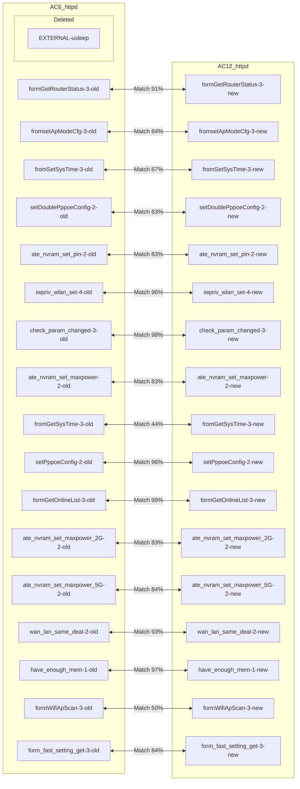
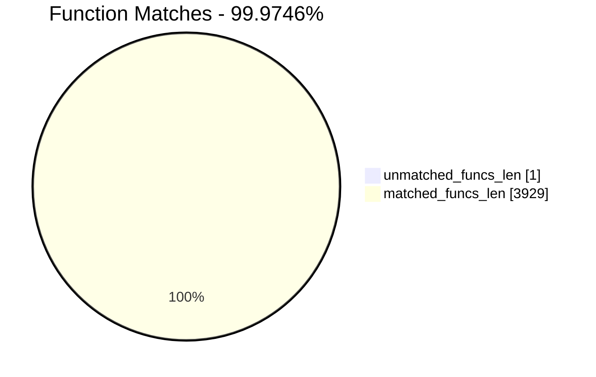
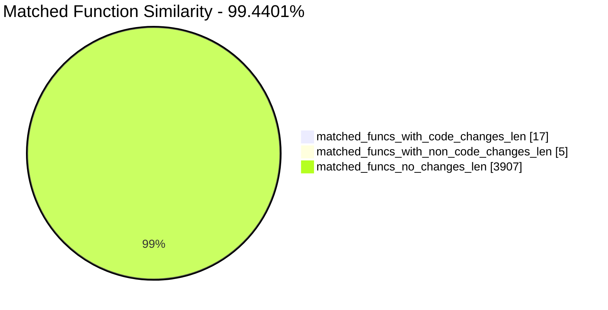
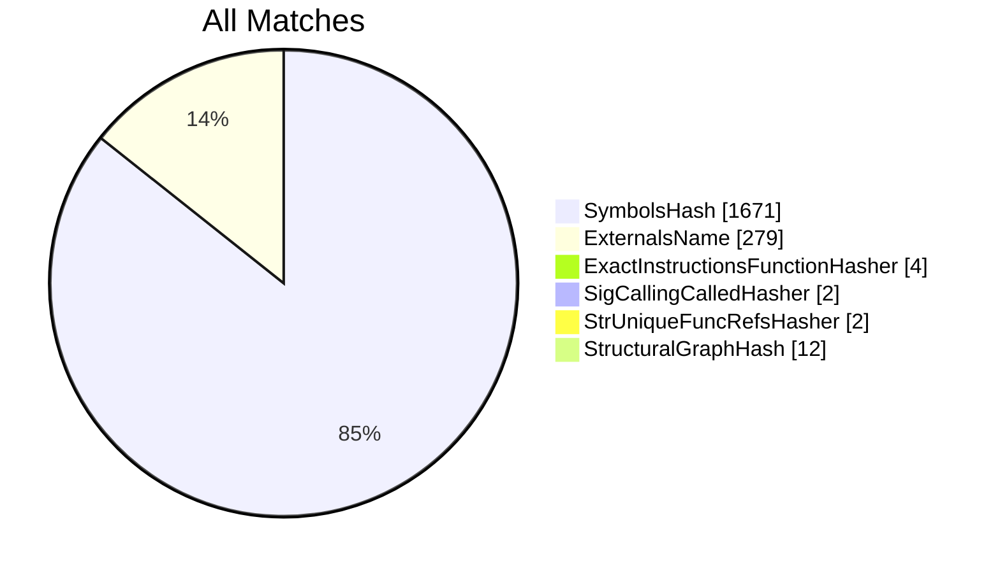
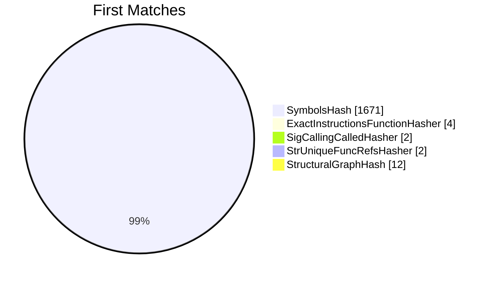
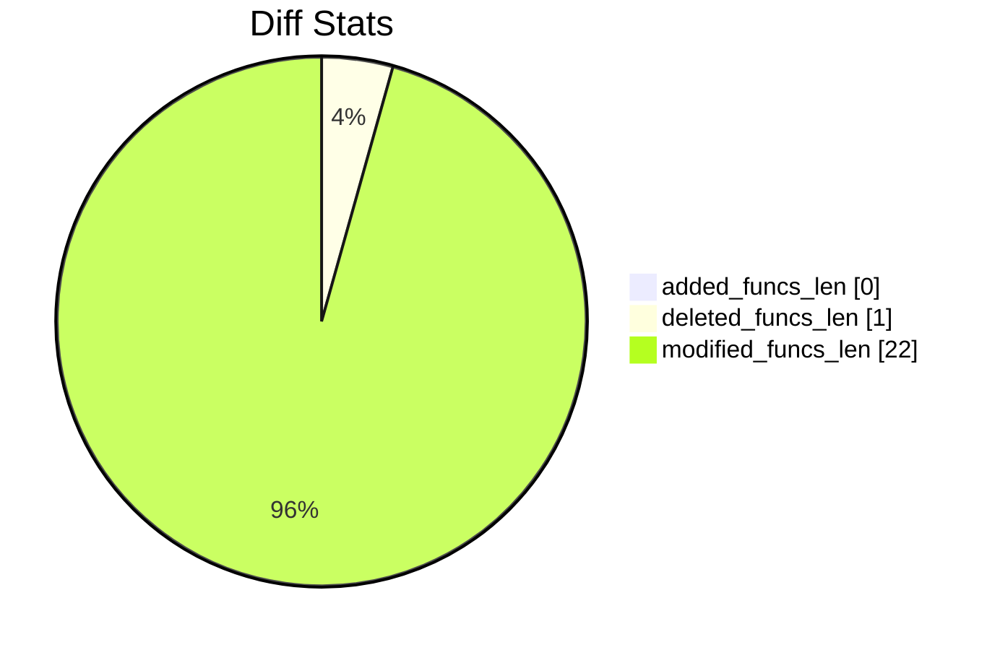
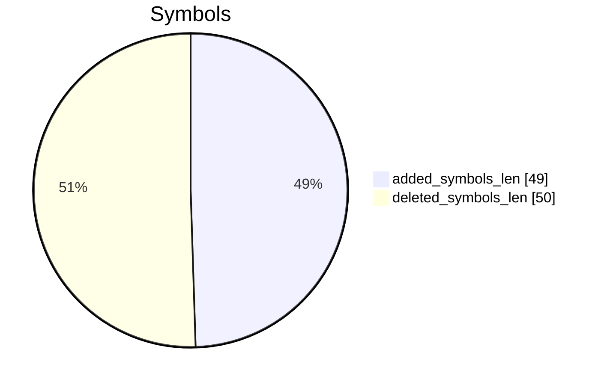
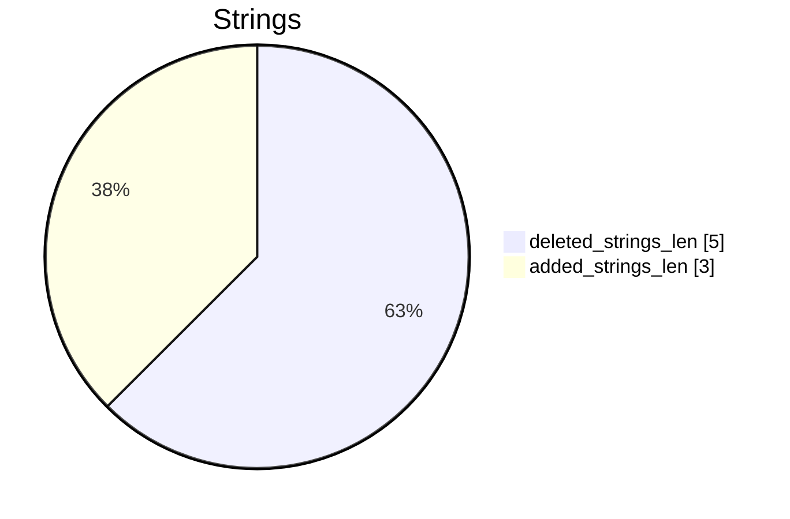

# AC6_httpd-AC12_httpd Diff

# TOC

* [Visual Chart Diff](#visual-chart-diff)
* [Metadata](#metadata)
	* [Ghidra Diff Engine](#ghidra-diff-engine)
		* [Command Line](#command-line)
	* [Binary Metadata Diff](#binary-metadata-diff)
	* [Program Options](#program-options)
	* [Diff Stats](#diff-stats)
	* [Strings](#strings)
* [Deleted](#deleted)
	* [<EXTERNAL>::usleep](#externalusleep)
* [Added](#added)
* [Modified](#modified)
	* [formGetRouterStatus](#formgetrouterstatus)
	* [fromsetApModeCfg](#fromsetapmodecfg)
	* [fromSetSysTime](#fromsetsystime)
	* [setDoublePppoeConfig](#setdoublepppoeconfig)
	* [ate_nvram_set_pin](#ate_nvram_set_pin)
	* [iwpriv_wlan_set](#iwpriv_wlan_set)
	* [check_param_changed](#check_param_changed)
	* [ate_nvram_set_maxpower](#ate_nvram_set_maxpower)
	* [fromGetSysTime](#fromgetsystime)
	* [setPppoeConfig](#setpppoeconfig)
	* [formGetOnlineList](#formgetonlinelist)
	* [ate_nvram_set_maxpower_2G](#ate_nvram_set_maxpower_2g)
	* [ate_nvram_set_maxpower_5G](#ate_nvram_set_maxpower_5g)
	* [wan_lan_same_deal](#wan_lan_same_deal)
	* [have_enough_mem](#have_enough_mem)
	* [formWifiApScan](#formwifiapscan)
	* [form_fast_setting_get](#form_fast_setting_get)
* [Modified (No Code Changes)](#modified-no-code-changes)
	* [set_cfm_mib](#set_cfm_mib)
	* [cJSON_AddItemToObject](#cjson_additemtoobject)
	* [setWanValue](#setwanvalue)
	* [cJSON_CreateString](#cjson_createstring)

# Visual Chart Diff










# Metadata

## Ghidra Diff Engine

### Command Line

#### Captured Command Line


```
ghidriff --project-location ghidra_projects --project-name ghidriff --symbols-path symbols --threaded --log-level INFO --file-log-level INFO --log-path ghidriff.log --min-func-len 10 --gdt [] --bsim --max-ram-percent 60.0 --max-section-funcs 200 AC6_httpd AC12_httpd
```


#### Verbose Args


<details>

```
--old ['./AC6_httpd'] --new [['./AC9_httpd', './AC12_httpd']] --engine VersionTrackingDiff --output-path ./diff_mulit --summary True --project-location ghidra_projects --project-name ghidriff --symbols-path symbols --threaded True --force-analysis False --force-diff False --no-symbols False --log-level INFO --file-log-level INFO --log-path ghidriff.log --va False --min-func-len 10 --use-calling-counts False --gdt [] --bsim True --bsim-full False --max-ram-percent 60.0 --print-flags False --jvm-args None --side-by-side False --max-section-funcs 200 --md-title None
```


</details>

## Binary Metadata Diff


```diff
--- AC6_httpd Meta
+++ AC12_httpd Meta
@@ -1,177 +1,177 @@
-Program Name: AC6_httpd
+Program Name: AC12_httpd
 Language ID: MIPS:LE:32:default (1.8)
 Compiler ID: default
 Processor: MIPS
 Endian: Little
 Address Size: 32
-Minimum Address: 003ff000
+Minimum Address: 00400000
 Maximum Address: _elfSectionHeaders::00000757
-# of Bytes: 2129469
-# of Memory Blocks: 50
-# of Instructions: 254926
-# of Defined Data: 17323
-# of Functions: 1966
-# of Symbols: 19610
-# of Data Types: 2115
+# of Bytes: 2121791
+# of Memory Blocks: 48
+# of Instructions: 254274
+# of Defined Data: 17306
+# of Functions: 1964
+# of Symbols: 19595
+# of Data Types: 2113
 # of Data Type Categories: 202
 Analyzed: true
 Created With Ghidra Version: 11.3.2
 DWARF Loaded: true
-Date Created: Thu Apr 24 15:14:09 CST 2025
+Date Created: Thu Apr 24 15:14:11 CST 2025
 ELF File Type: executable
-ELF Original Image Base: 0x3ff000
+ELF Original Image Base: 0x400000
 ELF Prelinked: false
 ELF Source File [   0]: initfini.c
 ELF Source File [   1]: crtstuff.c
 ELF Source File [   2]: crtstuff.c
 ELF Source File [   3]: initfini.c
 ELF Source File [   4]: asp.c
 ELF Source File [   5]: balloc.c
 ELF Source File [   6]: base64.c
 ELF Source File [   7]: cgi.c
 ELF Source File [   8]: default.c
 ELF Source File [   9]: ejlex.c
 ELF Source File [  10]: ejparse.c
 ELF Source File [  11]: form.c
 ELF Source File [  12]: h.c
 ELF Source File [  13]: handler.c
 ELF Source File [  14]: uemf.h
 ELF Source File [  15]: misc.c
 ELF Source File [  16]: page.c
 ELF Source File [  17]: ringq.c
 ELF Source File [  18]: sock.c
 ELF Source File [  19]: sockGen.c
 ELF Source File [  20]: sslSocket.c
 ELF Source File [  21]: matrix_ssl.c
 ELF Source File [  22]: security.c
 ELF Source File [  23]: sym.c
 ELF Source File [  24]: uemf.c
 ELF Source File [  25]: url.c
 ELF Source File [  26]: value.c
 ELF Source File [  27]: md5c.c
 ELF Source File [  28]: um.c
 ELF Source File [  29]: umui.c
 ELF Source File [  30]: websda.c
 ELF Source File [  31]: emfdb.c
 ELF Source File [  32]: webs.c
 ELF Source File [  33]: websuemf.c
 ELF Source File [  34]: main.c
 ELF Source File [  35]: ../../../../infra/pal/list.h
 ELF Source File [  36]: /home/work/workspace/AC6V2.0/prod/httpd/11ac/cgi/sysCurrentInfor.c
 ELF Source File [  37]: /home/work/workspace/AC6V2.0/prod/httpd/11ac/cgi/controlCfm.c
 ELF Source File [  38]: /home/work/workspace/AC6V2.0/prod/httpd/11ac/cgi/networkCfm.c
 ELF Source File [  39]: /home/work/workspace/AC6V2.0/prod/httpd/11ac/cgi/sysSafe.c
 ELF Source File [  40]: /home/work/workspace/AC6V2.0/prod/httpd/11ac/cgi/Dhcp.c
 ELF Source File [  41]: /home/work/workspace/AC6V2.0/prod/httpd/11ac/cgi/upload.c
 ELF Source File [  42]: /home/work/workspace/AC6V2.0/prod/httpd/11ac/cgi/cJSON.c
 ELF Source File [  43]: /home/work/workspace/AC6V2.0/prod/httpd/11ac/cgi/Form_define.c
 ELF Source File [  44]: /home/work/workspace/AC6V2.0/prod/httpd/11ac/cgi/system_reboot.c
 ELF Source File [  45]: /home/work/workspace/AC6V2.0/prod/httpd/11ac/cgi/mtenda.c
 ELF Source File [  46]: /home/work/workspace/AC6V2.0/prod/httpd/11ac/cgi/Form_public.c
 ELF Source File [  47]: /home/work/workspace/AC6V2.0/prod/httpd/11ac/cgi/index.c
 ELF Source File [  48]: /home/work/workspace/AC6V2.0/prod/httpd/11ac/cgi/wizard.c
 ELF Source File [  49]: /home/work/workspace/AC6V2.0/prod/httpd/11ac/cgi/lan.c
 ELF Source File [  50]: /home/work/workspace/AC6V2.0/prod/httpd/11ac/cgi/../../../../infra/pal/list.h
 ELF Source File [  51]: /home/work/workspace/AC6V2.0/prod/httpd/11ac/cgi/fast_setting.c
 ELF Source File [  52]: /home/work/workspace/AC6V2.0/prod/httpd/11ac/cgi/usb_cgi.c
 ELF Source File [  53]: /home/work/workspace/AC6V2.0/infra/pal/list.h
 ELF Source File [  54]: /home/work/workspace/AC6V2.0/prod/httpd/11ac/cgi/webip_lan.c
 ELF Source File [  55]: /home/work/workspace/AC6V2.0/prod/httpd/11ac/cgi/wan_policy.c
 ELF Source File [  56]: /home/work/workspace/AC6V2.0/prod/httpd/11ac/cgi/multiWan_setting.c
 ELF Source File [  57]: /home/work/workspace/AC6V2.0/prod/httpd/11ac/cgi/webip_wan.c
 ELF Source File [  58]: /home/work/workspace/AC6V2.0/prod/httpd/11ac/cgi/nat_dmz.c
 ELF Source File [  59]: /home/work/workspace/AC6V2.0/prod/httpd/11ac/cgi/arp.c
 ELF Source File [  60]: /home/work/workspace/AC6V2.0/prod/httpd/11ac/cgi/nat_virtualser.c
 ELF Source File [  61]: /home/work/workspace/AC6V2.0/prod/httpd/11ac/cgi/nat_static.c
 ELF Source File [  62]: /home/work/workspace/AC6V2.0/prod/httpd/11ac/cgi/nat_set.c
 ELF Source File [  63]: /home/work/workspace/AC6V2.0/prod/httpd/11ac/cgi/ddns_config.c
 ELF Source File [  64]: /home/work/workspace/AC6V2.0/prod/httpd/11ac/cgi/routing_table.c
 ELF Source File [  65]: /home/work/workspace/AC6V2.0/prod/httpd/11ac/cgi/routing_static.c
 ELF Source File [  66]: /home/work/workspace/AC6V2.0/prod/httpd/11ac/cgi/system_log.c
 ELF Source File [  67]: /home/work/workspace/AC6V2.0/prod/httpd/11ac/cgi/log_addsetting.c
 ELF Source File [  68]: /home/work/workspace/AC6V2.0/prod/httpd/11ac/cgi/system_restore.c
 ELF Source File [  69]: /home/work/workspace/AC6V2.0/prod/httpd/11ac/cgi/system_password.c
 ELF Source File [  70]: /home/work/workspace/AC6V2.0/prod/httpd/11ac/cgi/system_baseuser.c
 ELF Source File [  71]: /home/work/workspace/AC6V2.0/prod/httpd/11ac/cgi/system_upgrade.c
 ELF Source File [  72]: /home/work/workspace/AC6V2.0/prod/httpd/11ac/cgi/cmd.c
 ELF Source File [  73]: /home/work/workspace/AC6V2.0/prod/httpd/11ac/cgi/utf_gbl_encode.c
 ELF Source File [  74]: /home/work/workspace/AC6V2.0/prod/httpd/11ac/cgi/qos_rule.c
 ELF Source File [  75]: /home/work/workspace/AC6V2.0/prod/httpd/11ac/cgi/auto_qos_cgi.c
 ELF Source File [  76]: /home/work/workspace/AC6V2.0/prod/httpd/11ac/cgi/cgi_utils.c
 ELF Source File [  77]: /home/work/workspace/AC6V2.0/prod/httpd/11ac/cgi/pacontrol.c
 ELF Source File [  78]: /home/work/workspace/AC6V2.0/prod/httpd/11ac/cgi/upnp_config.c
 ELF Source File [  79]: /home/work/workspace/AC6V2.0/prod/httpd/11ac/cgi/lan_dhcps.c
 ELF Source File [  80]: /home/work/workspace/AC6V2.0/prod/httpd/11ac/cgi/lan_dhcp_clients.c
 ELF Source File [  81]: /home/work/workspace/AC6V2.0/prod/httpd/11ac/cgi/system_hostname.c
 ELF Source File [  82]: /home/work/workspace/AC6V2.0/prod/httpd/11ac/cgi/dns_safesecond.c
 ELF Source File [  83]: /home/work/workspace/AC6V2.0/prod/httpd/11ac/cgi/sched_wifi_check.c
 ELF Source File [  84]: /home/work/workspace/AC6V2.0/prod/httpd/11ac/cgi/sched_led_check.c
 ELF Source File [  85]: /home/work/workspace/AC6V2.0/prod/httpd/11ac/cgi/electronic_bulletin.c
 ELF Source File [  86]: /home/work/workspace/AC6V2.0/prod/httpd/11ac/cgi/switch_portVLAN.c
 ELF Source File [  87]: /home/work/workspace/AC6V2.0/prod/httpd/11ac/cgi/wifi.c
 ELF Source File [  88]: /home/work/workspace/AC6V2.0/prod/httpd/11ac/cgi/behaviormanager_demo.c
 ELF Source File [  89]: /home/work/workspace/AC6V2.0/prod/httpd/11ac/cgi/safe_demo.c
 ELF Source File [  90]: /home/work/workspace/AC6V2.0/prod/httpd/11ac/cgi/ucloud_v2.c
 ELF Source File [  91]: /home/work/workspace/AC6V2.0/prod/httpd/11ac/cgi/alischedule.c
 ELF Source File [  92]: /home/work/workspace/AC6V2.0/prod/httpd/11ac/cgi/apclient.c
 ELF Source File [  93]: /home/work/workspace/AC6V2.0/prod/httpd/11ac/cgi/iptv.c
 ELF Source File [  94]: /home/work/workspace/AC6V2.0/prod/httpd/11ac/cgi/reboot_timer.c
 ELF Source File [  95]: /home/work/workspace/AC6V2.0/prod/httpd/11ac/cgi/smart_power_management_cgi.c
 ELF Source File [  96]: /home/work/workspace/AC6V2.0/prod/httpd/11ac/cgi/guest_ip_confilct.c
 ELF Source File [  97]: /home/work/workspace/AC6V2.0/prod/httpd/11ac/cgi/vpn.c
 ELF Source File [  98]: /home/work/workspace/AC6V2.0/prod/httpd/11ac/cgi/wan_err_info.c
 ELF Source File [  99]: /home/work/workspace/AC6V2.0/prod/httpd/11ac/cgi/cgi_common.c
 ELF Source File [ 100]: /home/work/workspace/AC6V2.0/prod/httpd/11ac/cgi/cgi_mac_filter.c
 ELF Source File [ 101]: /home/work/workspace/AC6V2.0/prod/httpd/11ac/cgi/cgi_advertisement.c
 ELF Source File [ 102]: matrixSsl.c
 ELF Source File [ 103]: sslDecode.c
 ELF Source File [ 104]: sslEncode.c
 ELF Source File [ 105]: sslv3.c
 ELF Source File [ 106]: linux.c
 ELF Source File [ 107]: md5.c
 ELF Source File [ 108]: mpi.c
 ELF Source File [ 109]: sha1.c
 ELF Source File [ 110]: rsaPki.c
 ELF Source File [ 111]: x509.c
 ELF Source File [ 112]: cipherSuite.c
 ELF Source File [ 113]: arc4.c
 ELF Source File [ 114]: base64.c
 ELF Source File [ 115]: des3.c
 ELF Source File [ 116]: rsa.c
 ELF Source File [ 117]: asn1.c
 ELF Source File [ 118]: libgcc2.c
 ELF Source File [ 119]: adddf3.c
 ELF Source File [ 120]: divdf3.c
 ELF Source File [ 121]: gedf2.c
 ELF Source File [ 122]: ledf2.c
 ELF Source File [ 123]: muldf3.c
 ELF Source File [ 124]: subdf3.c
 ELF Source File [ 125]: fixdfsi.c
 ELF Source File [ 126]: floatsidf.c
 ELF Source File [ 127]: floatunsidf.c
 ELF Source File [ 128]: extendsfdf2.c
 ELF Source File [ 129]: 
 Elf Comment[0]: GCC: (GNU) 3.3.2
 Elf Comment[1]: GCC: (Realtek MSDK-4.4.7 Build 2001) 4.4.7
 Executable Format: Executable and Linking Format (ELF)
-Executable Location: /root/FHFuzz/diff/Tenda_httpd/AC6_httpd
-Executable MD5: 6bbbe9d79eed77c2b21108d6bc60e46a
-Executable SHA256: 2b6bbc43b4a718af5533ea75e177ee6f9f8fb265beabaa95973faf474b3ce869
-FSRL: file:///root/FHFuzz/diff/Tenda_httpd/AC6_httpd?MD5=6bbbe9d79eed77c2b21108d6bc60e46a
+Executable Location: /root/FHFuzz/diff/Tenda_httpd/AC12_httpd
+Executable MD5: eef92bf72be49feab9e4fff22bbf86cf
+Executable SHA256: 5c6330ab898620f25009d1dc5fa4046e2ca7c3beacf3cdbbf9b12a4e028b5661
+FSRL: file:///root/FHFuzz/diff/Tenda_httpd/AC12_httpd?MD5=eef92bf72be49feab9e4fff22bbf86cf
 GNU DebugLink: httpd.debug
 Preferred Root Namespace Category: 
 Relocatable: false
 Required Library [    0]: libCfm.so
 Required Library [    1]: libcommon.so
 Required Library [    2]: libChipApi.so
 Required Library [    3]: libvos_util.so
 Required Library [    4]: libz.so
 Required Library [    5]: libpthread.so.0
 Required Library [    6]: libapmib.so
 Required Library [    7]: librtlWifiSrc.so
 Required Library [    8]: libtpi.so
 Required Library [    9]: libm.so.0
 Required Library [   10]: libucapi.so
 Required Library [   11]: libgcc_s.so.1
 Required Library [   12]: libc.so.0
 Should Ask To Analyze: false

```


## Program Options


<details>
<summary>Ghidra AC6_httpd Decompiler Options</summary>


|Decompiler Option|Value|
| :---: | :---: |
|Prototype Evaluation|__stdcall|

</details>


<details>
<summary>Ghidra AC6_httpd Specification extensions Options</summary>


|Specification extensions Option|Value|
| :---: | :---: |
|FormatVersion|0|
|VersionCounter|0|

</details>


<details>
<summary>Ghidra AC6_httpd Analyzers Options</summary>


|Analyzers Option|Value|
| :---: | :---: |
|ASCII Strings|true|
|ASCII Strings.Create Strings Containing Existing Strings|true|
|ASCII Strings.Create Strings Containing References|true|
|ASCII Strings.Force Model Reload|false|
|ASCII Strings.Minimum String Length|LEN_5|
|ASCII Strings.Model File|StringModel.sng|
|ASCII Strings.Require Null Termination for String|true|
|ASCII Strings.Search Only in Accessible Memory Blocks|true|
|ASCII Strings.String Start Alignment|ALIGN_1|
|ASCII Strings.String end alignment|4|
|Aggressive Instruction Finder|false|
|Aggressive Instruction Finder.Create Analysis Bookmarks|true|
|Apply Data Archives|true|
|Apply Data Archives.Archive Chooser|[Auto-Detect]|
|Apply Data Archives.Create Analysis Bookmarks|true|
|Apply Data Archives.GDT User File Archive Path|None|
|Apply Data Archives.User Project Archive Path|None|
|Call Convention ID|true|
|Call Convention ID.Analysis Decompiler Timeout (sec)|60|
|Call-Fixup Installer|true|
|Condense Filler Bytes|false|
|Condense Filler Bytes.Filler Value|Auto|
|Condense Filler Bytes.Minimum number of sequential bytes|1|
|Create Address Tables|true|
|Create Address Tables.Allow Offcut References|false|
|Create Address Tables.Auto Label Table|false|
|Create Address Tables.Create Analysis Bookmarks|true|
|Create Address Tables.Maxmimum Pointer Distance|16777215|
|Create Address Tables.Minimum Pointer Address|4132|
|Create Address Tables.Minimum Table Size|3|
|Create Address Tables.Pointer Alignment|1|
|Create Address Tables.Relocation Table Guide|true|
|Create Address Tables.Table Alignment|4|
|DWARF|true|
|DWARF.Add Inlined Functions Comments|false|
|DWARF.Add Lexical Block Comments|false|
|DWARF.Create Function Signatures|true|
|DWARF.Default Calling Convention||
|DWARF.Ignore Parameter Storage Info|false|
|DWARF.Import Data Types|true|
|DWARF.Import Functions|true|
|DWARF.Import Local Variable Info|true|
|DWARF.Import Source Line Info|true|
|DWARF.Maximum Source Map Entry Length|2000|
|DWARF.Output DWARF DIE Info|false|
|DWARF.Output Source Info|false|
|DWARF.Try To Pack Structs|true|
|Data Reference|true|
|Data Reference.Address Table Alignment|1|
|Data Reference.Address Table Minimum Size|3|
|Data Reference.Align End of Strings|false|
|Data Reference.Ascii String References|true|
|Data Reference.Create Address Tables|false|
|Data Reference.Minimum String Length|5|
|Data Reference.References to Pointers|true|
|Data Reference.Relocation Table Guide|true|
|Data Reference.Respect Execute Flag|true|
|Data Reference.Subroutine References|true|
|Data Reference.Switch Table References|false|
|Data Reference.Unicode String References|true|
|Decompiler Parameter ID|true|
|Decompiler Parameter ID.Analysis Clear Level|ANALYSIS|
|Decompiler Parameter ID.Analysis Decompiler Timeout (sec)|60|
|Decompiler Parameter ID.Commit Data Types|true|
|Decompiler Parameter ID.Commit Void Return Values|false|
|Decompiler Parameter ID.Prototype Evaluation|__stdcall|
|Decompiler Switch Analysis|true|
|Decompiler Switch Analysis.Analysis Decompiler Timeout (sec)|60|
|Demangler GNU|true|
|Demangler GNU.Apply Function Calling Conventions|true|
|Demangler GNU.Apply Function Signatures|true|
|Demangler GNU.Demangle Only Known Mangled Symbols|false|
|Demangler GNU.Demangler Format|AUTO|
|Demangler GNU.Use Deprecated Demangler|false|
|Demangler GNU.Use Standard Text Replacements|true|
|Disassemble Entry Points|true|
|Disassemble Entry Points.Respect Execute Flag|true|
|ELF Scalar Operand References|false|
|ELF Scalar Operand References.Relocation Table Guide|true|
|Embedded Media|true|
|Embedded Media.Create Analysis Bookmarks|true|
|External Entry References|true|
|External Symbol Resolver|true|
|Function Start Search|true|
|Function Start Search.Bookmark Functions|false|
|Function Start Search.Search Data Blocks|false|
|GCC Exception Handlers|true|
|GCC Exception Handlers.Create Try Catch Comments|true|
|MIPS Constant Reference Analyzer|true|
|MIPS Constant Reference Analyzer.Assume T9 set to Function entry|true|
|MIPS Constant Reference Analyzer.Attempt to recover switch tables|false|
|MIPS Constant Reference Analyzer.Create Data from pointer|false|
|MIPS Constant Reference Analyzer.Function parameter/return Pointer analysis|true|
|MIPS Constant Reference Analyzer.Mark dual instruction references|false|
|MIPS Constant Reference Analyzer.Max Threads|2|
|MIPS Constant Reference Analyzer.Min absolute reference|4|
|MIPS Constant Reference Analyzer.Recover global GP register writes|true|
|MIPS Constant Reference Analyzer.Require pointer param data type|false|
|MIPS Constant Reference Analyzer.Speculative reference max|256|
|MIPS Constant Reference Analyzer.Speculative reference min|1024|
|MIPS Constant Reference Analyzer.Stored Value Pointer analysis|true|
|MIPS Constant Reference Analyzer.Trust values read from writable memory|true|
|MIPS Symbol|true|
|MIPS UnAlligned Instruction Fix|true|
|Non-Returning Functions - Discovered|true|
|Non-Returning Functions - Discovered.Create Analysis Bookmarks|true|
|Non-Returning Functions - Discovered.Function Non-return Threshold|3|
|Non-Returning Functions - Discovered.Repair Flow Damage|true|
|Non-Returning Functions - Known|true|
|Non-Returning Functions - Known.Create Analysis Bookmarks|true|
|Reference|true|
|Reference.Address Table Alignment|1|
|Reference.Address Table Minimum Size|3|
|Reference.Align End of Strings|false|
|Reference.Ascii String References|true|
|Reference.Create Address Tables|false|
|Reference.Minimum String Length|5|
|Reference.References to Pointers|true|
|Reference.Relocation Table Guide|true|
|Reference.Respect Execute Flag|true|
|Reference.Subroutine References|true|
|Reference.Switch Table References|false|
|Reference.Unicode String References|true|
|Shared Return Calls|true|
|Shared Return Calls.Allow Conditional Jumps|false|
|Shared Return Calls.Assume Contiguous Functions Only|false|
|Stack|true|
|Stack.Create Local Variables|true|
|Stack.Create Param Variables|false|
|Stack.useNewFunctionStackAnalysis|true|
|Subroutine References|true|
|Subroutine References.Create Thunks Early|true|
|Variadic Function Signature Override|false|
|Variadic Function Signature Override.Create Analysis Bookmarks|false|

</details>


<details>
<summary>Ghidra AC12_httpd Decompiler Options</summary>


|Decompiler Option|Value|
| :---: | :---: |
|Prototype Evaluation|__stdcall|

</details>


<details>
<summary>Ghidra AC12_httpd Specification extensions Options</summary>


|Specification extensions Option|Value|
| :---: | :---: |
|FormatVersion|0|
|VersionCounter|0|

</details>


<details>
<summary>Ghidra AC12_httpd Analyzers Options</summary>


|Analyzers Option|Value|
| :---: | :---: |
|ASCII Strings|true|
|ASCII Strings.Create Strings Containing Existing Strings|true|
|ASCII Strings.Create Strings Containing References|true|
|ASCII Strings.Force Model Reload|false|
|ASCII Strings.Minimum String Length|LEN_5|
|ASCII Strings.Model File|StringModel.sng|
|ASCII Strings.Require Null Termination for String|true|
|ASCII Strings.Search Only in Accessible Memory Blocks|true|
|ASCII Strings.String Start Alignment|ALIGN_1|
|ASCII Strings.String end alignment|4|
|Aggressive Instruction Finder|false|
|Aggressive Instruction Finder.Create Analysis Bookmarks|true|
|Apply Data Archives|true|
|Apply Data Archives.Archive Chooser|[Auto-Detect]|
|Apply Data Archives.Create Analysis Bookmarks|true|
|Apply Data Archives.GDT User File Archive Path|None|
|Apply Data Archives.User Project Archive Path|None|
|Call Convention ID|true|
|Call Convention ID.Analysis Decompiler Timeout (sec)|60|
|Call-Fixup Installer|true|
|Condense Filler Bytes|false|
|Condense Filler Bytes.Filler Value|Auto|
|Condense Filler Bytes.Minimum number of sequential bytes|1|
|Create Address Tables|true|
|Create Address Tables.Allow Offcut References|false|
|Create Address Tables.Auto Label Table|false|
|Create Address Tables.Create Analysis Bookmarks|true|
|Create Address Tables.Maxmimum Pointer Distance|16777215|
|Create Address Tables.Minimum Pointer Address|4132|
|Create Address Tables.Minimum Table Size|3|
|Create Address Tables.Pointer Alignment|1|
|Create Address Tables.Relocation Table Guide|true|
|Create Address Tables.Table Alignment|4|
|DWARF|true|
|DWARF.Add Inlined Functions Comments|false|
|DWARF.Add Lexical Block Comments|false|
|DWARF.Create Function Signatures|true|
|DWARF.Default Calling Convention||
|DWARF.Ignore Parameter Storage Info|false|
|DWARF.Import Data Types|true|
|DWARF.Import Functions|true|
|DWARF.Import Local Variable Info|true|
|DWARF.Import Source Line Info|true|
|DWARF.Maximum Source Map Entry Length|2000|
|DWARF.Output DWARF DIE Info|false|
|DWARF.Output Source Info|false|
|DWARF.Try To Pack Structs|true|
|Data Reference|true|
|Data Reference.Address Table Alignment|1|
|Data Reference.Address Table Minimum Size|3|
|Data Reference.Align End of Strings|false|
|Data Reference.Ascii String References|true|
|Data Reference.Create Address Tables|false|
|Data Reference.Minimum String Length|5|
|Data Reference.References to Pointers|true|
|Data Reference.Relocation Table Guide|true|
|Data Reference.Respect Execute Flag|true|
|Data Reference.Subroutine References|true|
|Data Reference.Switch Table References|false|
|Data Reference.Unicode String References|true|
|Decompiler Parameter ID|true|
|Decompiler Parameter ID.Analysis Clear Level|ANALYSIS|
|Decompiler Parameter ID.Analysis Decompiler Timeout (sec)|60|
|Decompiler Parameter ID.Commit Data Types|true|
|Decompiler Parameter ID.Commit Void Return Values|false|
|Decompiler Parameter ID.Prototype Evaluation|__stdcall|
|Decompiler Switch Analysis|true|
|Decompiler Switch Analysis.Analysis Decompiler Timeout (sec)|60|
|Demangler GNU|true|
|Demangler GNU.Apply Function Calling Conventions|true|
|Demangler GNU.Apply Function Signatures|true|
|Demangler GNU.Demangle Only Known Mangled Symbols|false|
|Demangler GNU.Demangler Format|AUTO|
|Demangler GNU.Use Deprecated Demangler|false|
|Demangler GNU.Use Standard Text Replacements|true|
|Disassemble Entry Points|true|
|Disassemble Entry Points.Respect Execute Flag|true|
|ELF Scalar Operand References|false|
|ELF Scalar Operand References.Relocation Table Guide|true|
|Embedded Media|true|
|Embedded Media.Create Analysis Bookmarks|true|
|External Entry References|true|
|External Symbol Resolver|true|
|Function Start Search|true|
|Function Start Search.Bookmark Functions|false|
|Function Start Search.Search Data Blocks|false|
|GCC Exception Handlers|true|
|GCC Exception Handlers.Create Try Catch Comments|true|
|MIPS Constant Reference Analyzer|true|
|MIPS Constant Reference Analyzer.Assume T9 set to Function entry|true|
|MIPS Constant Reference Analyzer.Attempt to recover switch tables|false|
|MIPS Constant Reference Analyzer.Create Data from pointer|false|
|MIPS Constant Reference Analyzer.Function parameter/return Pointer analysis|true|
|MIPS Constant Reference Analyzer.Mark dual instruction references|false|
|MIPS Constant Reference Analyzer.Max Threads|2|
|MIPS Constant Reference Analyzer.Min absolute reference|4|
|MIPS Constant Reference Analyzer.Recover global GP register writes|true|
|MIPS Constant Reference Analyzer.Require pointer param data type|false|
|MIPS Constant Reference Analyzer.Speculative reference max|256|
|MIPS Constant Reference Analyzer.Speculative reference min|1024|
|MIPS Constant Reference Analyzer.Stored Value Pointer analysis|true|
|MIPS Constant Reference Analyzer.Trust values read from writable memory|true|
|MIPS Symbol|true|
|MIPS UnAlligned Instruction Fix|true|
|Non-Returning Functions - Discovered|true|
|Non-Returning Functions - Discovered.Create Analysis Bookmarks|true|
|Non-Returning Functions - Discovered.Function Non-return Threshold|3|
|Non-Returning Functions - Discovered.Repair Flow Damage|true|
|Non-Returning Functions - Known|true|
|Non-Returning Functions - Known.Create Analysis Bookmarks|true|
|Reference|true|
|Reference.Address Table Alignment|1|
|Reference.Address Table Minimum Size|3|
|Reference.Align End of Strings|false|
|Reference.Ascii String References|true|
|Reference.Create Address Tables|false|
|Reference.Minimum String Length|5|
|Reference.References to Pointers|true|
|Reference.Relocation Table Guide|true|
|Reference.Respect Execute Flag|true|
|Reference.Subroutine References|true|
|Reference.Switch Table References|false|
|Reference.Unicode String References|true|
|Shared Return Calls|true|
|Shared Return Calls.Allow Conditional Jumps|false|
|Shared Return Calls.Assume Contiguous Functions Only|false|
|Stack|true|
|Stack.Create Local Variables|true|
|Stack.Create Param Variables|false|
|Stack.useNewFunctionStackAnalysis|true|
|Subroutine References|true|
|Subroutine References.Create Thunks Early|true|
|Variadic Function Signature Override|false|
|Variadic Function Signature Override.Create Analysis Bookmarks|false|

</details>

## Diff Stats


|Stat|Value|
| :---: | :---: |
|added_funcs_len|0|
|deleted_funcs_len|1|
|modified_funcs_len|22|
|added_symbols_len|49|
|deleted_symbols_len|50|
|diff_time|22.34683084487915|
|deleted_strings_len|5|
|added_strings_len|3|
|match_types|Counter({'SymbolsHash': 1671, 'ExternalsName': 279, 'StructuralGraphHash': 12, 'ExactInstructionsFunctionHasher': 4, 'SigCallingCalledHasher': 2, 'StrUniqueFuncRefsHasher': 2})|
|items_to_process|122|
|diff_types|Counter({'address': 22, 'length': 18, 'code': 17, 'called': 8, 'refcount': 4, 'calling': 1})|
|unmatched_funcs_len|1|
|total_funcs_len|3930|
|matched_funcs_len|3929|
|matched_funcs_with_code_changes_len|17|
|matched_funcs_with_non_code_changes_len|5|
|matched_funcs_no_changes_len|3907|
|match_func_similarity_percent|99.4401%|
|func_match_overall_percent|99.9746%|
|first_matches|Counter({'SymbolsHash': 1671, 'StructuralGraphHash': 12, 'ExactInstructionsFunctionHasher': 4, 'SigCallingCalledHasher': 2, 'StrUniqueFuncRefsHasher': 2})|













## Strings




### Strings Diff


```diff
--- deleted strings
+++ added strings
@@ -1,5 +1,3 @@
-s_/js/macro_config.js
-s_11:10:31
-s_Aug
-s_nextzone_=_%s
-s_rm_-rf_/tmp/core-*
+s_18:06:41
+s_Sep
+s_check

```


### String References

#### Old


|String|Ref Count|Ref Func|
| :---: | :---: | :---: |
|s_rm_-rf_/tmp/core-*_00509590|1|have_enough_mem|
|s_nextzone_=_%s_0051a5f8|1|fromGetSysTime|
|s_Aug_9_2018_0050c11c|1|aspTendaGetStatus|
|s_/js/macro_config.js_00507d5c|1|R7WebsSecurityHandler|
|s_11:10:31_0050813c|1|get_compile_date_time|

#### New


|String|Ref Count|Ref Func|
| :---: | :---: | :---: |
|s_Sep_6_2017_0050b68c|1|aspTendaGetStatus|
|s_18:06:41_005076bc|1|get_compile_date_time|
|s_check_0050f21c|2||

# Deleted

## <EXTERNAL>::usleep

### Function Meta


|Key|AC6_httpd|
| :---: | :---: |
|name|usleep|
|fullname|<EXTERNAL>::usleep|
|refcount|1|
|length|0|
|called||
|calling||
|paramcount|1|
|address|EXTERNAL:0000000f|
|sig|int usleep(__useconds_t __useconds)|
|sym_type|Function|
|sym_source|IMPORTED|
|external|True|


*No code available for <EXTERNAL>::usleep*
# Added

# Modified


*Modified functions contain code changes*
## formGetRouterStatus

### Match Info


|Key|AC6_httpd - AC12_httpd|
| :---: | :---: |
|diff_type|code,length,address|
|ratio|0.88|
|i_ratio|0.45|
|m_ratio|0.98|
|b_ratio|0.91|
|match_types|SymbolsHash|

### Function Meta Diff


|Key|AC6_httpd|AC12_httpd|
| :---: | :---: | :---: |
|name|formGetRouterStatus|formGetRouterStatus|
|fullname|formGetRouterStatus|formGetRouterStatus|
|refcount|3|3|
|`length`|6248|5984|
|called|<details><summary>Expand for full list:<br><EXTERNAL>::GetValue<br><EXTERNAL>::atoi<br><EXTERNAL>::free<br><EXTERNAL>::getIfIp<br><EXTERNAL>::getLanIfName<br><EXTERNAL>::malloc<br><EXTERNAL>::memcpy<br><EXTERNAL>::memset<br><EXTERNAL>::ntohl<br><EXTERNAL>::printf<br><EXTERNAL>::sprintf</summary><EXTERNAL>::strcat<br><EXTERNAL>::strcmp<br><EXTERNAL>::strlen<br><EXTERNAL>::tpi_get_online_mac_info<br>__floatsidf<br>cJSON_AddItemToObject<br>cJSON_CreateNumber<br>cJSON_CreateObject<br>cJSON_CreateString<br>cJSON_Delete<br>cJSON_Print<br>check_all_phy_link<br>check_mac_in_blacklist<br>getIfMac<br>get_black_num<br>get_device_info<br>get_work_mode<br>is_lan_host<br>strtoupper<br>wanErrGetInfo<br>websDone<br>websTransfer<br>websWrite<br>write_online_upgrade_info<br>write_wan_infos</details>|<details><summary>Expand for full list:<br><EXTERNAL>::GetValue<br><EXTERNAL>::atoi<br><EXTERNAL>::free<br><EXTERNAL>::getIfIp<br><EXTERNAL>::getLanIfName<br><EXTERNAL>::malloc<br><EXTERNAL>::memcpy<br><EXTERNAL>::memset<br><EXTERNAL>::ntohl<br><EXTERNAL>::printf<br><EXTERNAL>::sprintf</summary><EXTERNAL>::strcat<br><EXTERNAL>::strcmp<br><EXTERNAL>::strlen<br><EXTERNAL>::tpi_get_online_mac_info<br>__floatsidf<br>cJSON_AddItemToObject<br>cJSON_CreateNumber<br>cJSON_CreateObject<br>cJSON_CreateString<br>cJSON_Delete<br>cJSON_Print<br>check_all_phy_link<br>check_mac_in_blacklist<br>getIfMac<br>get_black_num<br>get_device_info<br>get_work_mode<br>is_lan_host<br>strtoupper<br>wanErrGetInfo<br>websDone<br>websTransfer<br>websWrite<br>write_online_upgrade_info<br>write_wan_infos</details>|
|calling|||
|paramcount|3|3|
|`address`|0046ca14|0046c9a4|
|sig|void formGetRouterStatus(webs_t wp, char_t * path, char_t * query)|void formGetRouterStatus(webs_t wp, char_t * path, char_t * query)|
|sym_type|Function|Function|
|sym_source|IMPORTED|IMPORTED|
|external|False|False|

### formGetRouterStatus Diff


```diff
--- formGetRouterStatus
+++ formGetRouterStatus
@@ -1,559 +1,551 @@
 
 /* WARNING: Unknown calling convention */
 
 void formGetRouterStatus(webs_t wp,char_t *path,char_t *query)
 
 {
   client_mac_info *__ptr;
   uint32_t uVar1;
   int iVar2;
   WANERRINFO WVar3;
   int iVar4;
   uint uVar5;
   undefined4 uVar6;
   size_t sVar7;
   char *__ptr_00;
   webs_t in_a0;
-  webs_t in_stack_fffff678;
-  device_info *in_stack_fffff67c;
-  cJSON *in_stack_fffff680;
+  webs_t in_stack_fffff778;
+  device_info *in_stack_fffff77c;
+  cJSON *in_stack_fffff780;
   uchar level_4;
   uchar level_3;
   uchar level_2;
   uchar level_1;
   uchar level;
   int host_type;
   int wan_id;
   int lan_phy_status;
   int err_check;
   int blackEn;
   int wan_status;
   int err_code;
   client_mac_info *info_ptr;
   client_mac_info *client_mac_info;
   list_head *pos;
   int j;
   int i;
   int arr_num;
   uint ip_count;
   ulonglong now;
   ulonglong last_time;
   int client_num;
   int black_num;
   char *client_mac_buf;
   int index;
   char *out;
   cJSON *root;
   char mib_name [128];
   char mib_value [1024];
-  char mib_country_value [256];
   int list_num;
   int client_mac_count;
   device_info dev_info;
   char ret_buf [32];
   char name_temp [256];
   char err_check_buf [16];
   char phy_status [4];
   char all_phy_status [16];
   char lan_name [16];
   char lan_mac [32];
   char work_mode [16];
   char ipaddr_buf [32];
   uint ip_addr;
   char wl_enable [4];
   char wl_enable_5g [4];
   char wl_ssid [32];
   char wl_sec [16];
   char usb_num [4];
   char wans_flag [4];
   char cgi_debug [16];
   char cgi_debug_1 [16];
   char cgi_debug_2 [16];
   char cgi_debug_3 [16];
   char cgi_debug_4 [16];
   
   memset(mib_name,0,0x80);
   memset(mib_value,0,0x400);
-  memset(mib_country_value,0,0x100);
   client_num = 0;
   client_mac_count = 0;
   client_mac_info = (client_mac_info *)0x0;
   ret_buf[0] = '\0';
   ret_buf[1] = '\0';
   ret_buf[2] = '\0';
   ret_buf[3] = '\0';
   ret_buf[4] = '\0';
   ret_buf[5] = '\0';
   ret_buf[6] = '\0';
   ret_buf[7] = '\0';
   ret_buf[8] = '\0';
   ret_buf[9] = '\0';
   ret_buf[10] = '\0';
   ret_buf[0xb] = '\0';
   ret_buf[0xc] = '\0';
   ret_buf[0xd] = '\0';
   ret_buf[0xe] = '\0';
   ret_buf[0xf] = '\0';
   ret_buf[0x10] = '\0';
   ret_buf[0x11] = '\0';
   ret_buf[0x12] = '\0';
   ret_buf[0x13] = '\0';
   ret_buf[0x14] = '\0';
   ret_buf[0x15] = '\0';
   ret_buf[0x16] = '\0';
   ret_buf[0x17] = '\0';
   ret_buf[0x18] = '\0';
   ret_buf[0x19] = '\0';
   ret_buf[0x1a] = '\0';
   ret_buf[0x1b] = '\0';
   ret_buf[0x1c] = '\0';
   ret_buf[0x1d] = '\0';
   ret_buf[0x1e] = '\0';
   ret_buf[0x1f] = '\0';
   memset(name_temp,0,0x100);
   err_check_buf[0] = '\0';
   err_check_buf[1] = '\0';
   err_check_buf[2] = '\0';
   err_check_buf[3] = '\0';
   err_check_buf[4] = '\0';
   err_check_buf[5] = '\0';
   err_check_buf[6] = '\0';
   err_check_buf[7] = '\0';
   err_check_buf[8] = '\0';
   err_check_buf[9] = '\0';
   err_check_buf[10] = '\0';
   err_check_buf[0xb] = '\0';
   err_check_buf[0xc] = '\0';
   err_check_buf[0xd] = '\0';
   err_check_buf[0xe] = '\0';
   err_check_buf[0xf] = '\0';
   phy_status[0] = '\0';
   phy_status[1] = '\0';
   phy_status[2] = '\0';
   phy_status[3] = '\0';
   all_phy_status[0] = '\0';
   all_phy_status[1] = '\0';
   all_phy_status[2] = '\0';
   all_phy_status[3] = '\0';
   all_phy_status[4] = '\0';
   all_phy_status[5] = '\0';
   all_phy_status[6] = '\0';
   all_phy_status[7] = '\0';
   all_phy_status[8] = '\0';
   all_phy_status[9] = '\0';
   all_phy_status[10] = '\0';
   all_phy_status[0xb] = '\0';
   all_phy_status[0xc] = '\0';
   all_phy_status[0xd] = '\0';
   all_phy_status[0xe] = '\0';
   all_phy_status[0xf] = '\0';
   lan_mac[0] = '\0';
   lan_mac[1] = '\0';
   lan_mac[2] = '\0';
   lan_mac[3] = '\0';
   lan_mac[4] = '\0';
   lan_mac[5] = '\0';
   lan_mac[6] = '\0';
   lan_mac[7] = '\0';
   lan_mac[8] = '\0';
   lan_mac[9] = '\0';
   lan_mac[10] = '\0';
   lan_mac[0xb] = '\0';
   lan_mac[0xc] = '\0';
   lan_mac[0xd] = '\0';
   lan_mac[0xe] = '\0';
   lan_mac[0xf] = '\0';
   lan_mac[0x10] = '\0';
   lan_mac[0x11] = '\0';
   lan_mac[0x12] = '\0';
   lan_mac[0x13] = '\0';
   lan_mac[0x14] = '\0';
   lan_mac[0x15] = '\0';
   lan_mac[0x16] = '\0';
   lan_mac[0x17] = '\0';
   lan_mac[0x18] = '\0';
   lan_mac[0x19] = '\0';
   lan_mac[0x1a] = '\0';
   lan_mac[0x1b] = '\0';
   lan_mac[0x1c] = '\0';
   lan_mac[0x1d] = '\0';
   lan_mac[0x1e] = '\0';
   lan_mac[0x1f] = '\0';
   work_mode[0] = '\0';
   work_mode[1] = '\0';
   work_mode[2] = '\0';
   work_mode[3] = '\0';
   work_mode[4] = '\0';
   work_mode[5] = '\0';
   work_mode[6] = '\0';
   work_mode[7] = '\0';
   work_mode[8] = '\0';
   work_mode[9] = '\0';
   work_mode[10] = '\0';
   work_mode[0xb] = '\0';
   work_mode[0xc] = '\0';
   work_mode[0xd] = '\0';
   work_mode[0xe] = '\0';
   work_mode[0xf] = '\0';
   ipaddr_buf[0] = '\0';
   ipaddr_buf[1] = '\0';
   ipaddr_buf[2] = '\0';
   ipaddr_buf[3] = '\0';
   ipaddr_buf[4] = '\0';
   ipaddr_buf[5] = '\0';
   ipaddr_buf[6] = '\0';
   ipaddr_buf[7] = '\0';
   ipaddr_buf[8] = '\0';
   ipaddr_buf[9] = '\0';
   ipaddr_buf[10] = '\0';
   ipaddr_buf[0xb] = '\0';
   ipaddr_buf[0xc] = '\0';
   ipaddr_buf[0xd] = '\0';
   ipaddr_buf[0xe] = '\0';
   ipaddr_buf[0xf] = '\0';
   ipaddr_buf[0x10] = '\0';
   ipaddr_buf[0x11] = '\0';
   ipaddr_buf[0x12] = '\0';
   ipaddr_buf[0x13] = '\0';
   ipaddr_buf[0x14] = '\0';
   ipaddr_buf[0x15] = '\0';
   ipaddr_buf[0x16] = '\0';
   ipaddr_buf[0x17] = '\0';
   ipaddr_buf[0x18] = '\0';
   ipaddr_buf[0x19] = '\0';
   ipaddr_buf[0x1a] = '\0';
   ipaddr_buf[0x1b] = '\0';
   ipaddr_buf[0x1c] = '\0';
   ipaddr_buf[0x1d] = '\0';
   ipaddr_buf[0x1e] = '\0';
   ipaddr_buf[0x1f] = '\0';
   wl_enable[0] = '\0';
   wl_enable[1] = '\0';
   wl_enable[2] = '\0';
   wl_enable[3] = '\0';
   wl_enable_5g[0] = '\0';
   wl_enable_5g[1] = '\0';
   wl_enable_5g[2] = '\0';
   wl_enable_5g[3] = '\0';
   wl_ssid[0] = '\0';
   wl_ssid[1] = '\0';
   wl_ssid[2] = '\0';
   wl_ssid[3] = '\0';
   wl_ssid[4] = '\0';
   wl_ssid[5] = '\0';
   wl_ssid[6] = '\0';
   wl_ssid[7] = '\0';
   wl_ssid[8] = '\0';
   wl_ssid[9] = '\0';
   wl_ssid[10] = '\0';
   wl_ssid[0xb] = '\0';
   wl_ssid[0xc] = '\0';
   wl_ssid[0xd] = '\0';
   wl_ssid[0xe] = '\0';
   wl_ssid[0xf] = '\0';
   wl_ssid[0x10] = '\0';
   wl_ssid[0x11] = '\0';
   wl_ssid[0x12] = '\0';
   wl_ssid[0x13] = '\0';
   wl_ssid[0x14] = '\0';
   wl_ssid[0x15] = '\0';
   wl_ssid[0x16] = '\0';
   wl_ssid[0x17] = '\0';
   wl_ssid[0x18] = '\0';
   wl_ssid[0x19] = '\0';
   wl_ssid[0x1a] = '\0';
   wl_ssid[0x1b] = '\0';
   wl_ssid[0x1c] = '\0';
   wl_ssid[0x1d] = '\0';
   wl_ssid[0x1e] = '\0';
   wl_ssid[0x1f] = '\0';
   wl_sec[0] = '\0';
   wl_sec[1] = '\0';
   wl_sec[2] = '\0';
   wl_sec[3] = '\0';
   wl_sec[4] = '\0';
   wl_sec[5] = '\0';
   wl_sec[6] = '\0';
   wl_sec[7] = '\0';
   wl_sec[8] = '\0';
   wl_sec[9] = '\0';
   wl_sec[10] = '\0';
   wl_sec[0xb] = '\0';
   wl_sec[0xc] = '\0';
   wl_sec[0xd] = '\0';
   wl_sec[0xe] = '\0';
   wl_sec[0xf] = '\0';
   __ptr = (client_mac_info *)malloc(0x5000);
   if (__ptr == (client_mac_info *)0x0) {
     sprintf(ret_buf,"{\"errCode\":%d}",1);
-    websTransfer(in_stack_fffff678,in_stack_fffff67c->name);
+    websTransfer(in_stack_fffff778,in_stack_fffff77c->name);
   }
   else {
     tpi_get_online_mac_info(__ptr,0x5000,&client_mac_count);
     if (0 < client_mac_count) {
       client_mac_info = __ptr;
     }
-    get_work_mode((char *)in_stack_fffff678);
+    get_work_mode((char *)in_stack_fffff778);
     if (client_mac_count != 0) {
       for (i = 0; i < client_mac_count; i = i + 1) {
         uVar1 = ntohl(client_mac_info[i].client_ip);
         sprintf(ipaddr_buf,"%u.%u.%u.%u",uVar1 & 0xff,uVar1 >> 8 & 0xff,uVar1 >> 0x10 & 0xff,
                 uVar1 >> 0x18);
         cgi_debug[0] = '\0';
         cgi_debug[1] = '\0';
         cgi_debug[2] = '\0';
         cgi_debug[3] = '\0';
         cgi_debug[4] = '\0';
         cgi_debug[5] = '\0';
         cgi_debug[6] = '\0';
         cgi_debug[7] = '\0';
         cgi_debug[8] = '\0';
         cgi_debug[9] = '\0';
         cgi_debug[10] = '\0';
         cgi_debug[0xb] = '\0';
         cgi_debug[0xc] = '\0';
         cgi_debug[0xd] = '\0';
         cgi_debug[0xe] = '\0';
         cgi_debug[0xf] = '\0';
         iVar4 = GetValue("cgi_debug",cgi_debug);
         if ((iVar4 != 0) && (iVar4 = strcmp("on",cgi_debug), iVar4 == 0)) {
           printf("%s[%s:%s:%d] %s___ip is: %s___\n\x1b[0m",debug_color[3],&DAT_0,
-                 "formGetRouterStatus",0x8c8,debug_color[1],ipaddr_buf);
+                 "formGetRouterStatus",0x8c7,debug_color[1],ipaddr_buf);
         }
-        iVar4 = is_lan_host((uint)in_stack_fffff678);
+        iVar4 = is_lan_host((uint)in_stack_fffff778);
         cgi_debug_1[0] = '\0';
         cgi_debug_1[1] = '\0';
         cgi_debug_1[2] = '\0';
         cgi_debug_1[3] = '\0';
         cgi_debug_1[4] = '\0';
         cgi_debug_1[5] = '\0';
         cgi_debug_1[6] = '\0';
         cgi_debug_1[7] = '\0';
         cgi_debug_1[8] = '\0';
         cgi_debug_1[9] = '\0';
         cgi_debug_1[10] = '\0';
         cgi_debug_1[0xb] = '\0';
         cgi_debug_1[0xc] = '\0';
         cgi_debug_1[0xd] = '\0';
         cgi_debug_1[0xe] = '\0';
         cgi_debug_1[0xf] = '\0';
         iVar2 = GetValue("cgi_debug",cgi_debug_1);
         if ((iVar2 != 0) && (iVar2 = strcmp("on",cgi_debug_1), iVar2 == 0)) {
           printf("%s[%s:%s:%d] %s___ip is: %s___\n\x1b[0m",debug_color[3],&DAT_0,
-                 "formGetRouterStatus",0x8ca,debug_color[1],ipaddr_buf);
+                 "formGetRouterStatus",0x8c9,debug_color[1],ipaddr_buf);
         }
         iVar2 = strcmp(work_mode,"ap");
         if (((iVar2 != 0) || (iVar2 = strcmp(in_a0->ipaddr,ipaddr_buf), iVar2 == 0)) ||
            (client_mac_info[i].access_type == '\x02')) {
           cgi_debug_2[0] = '\0';
           cgi_debug_2[1] = '\0';
           cgi_debug_2[2] = '\0';
           cgi_debug_2[3] = '\0';
           cgi_debug_2[4] = '\0';
           cgi_debug_2[5] = '\0';
           cgi_debug_2[6] = '\0';
           cgi_debug_2[7] = '\0';
           cgi_debug_2[8] = '\0';
           cgi_debug_2[9] = '\0';
           cgi_debug_2[10] = '\0';
           cgi_debug_2[0xb] = '\0';
           cgi_debug_2[0xc] = '\0';
           cgi_debug_2[0xd] = '\0';
           cgi_debug_2[0xe] = '\0';
           cgi_debug_2[0xf] = '\0';
           iVar2 = GetValue("cgi_debug",cgi_debug_2);
           if ((iVar2 != 0) && (iVar2 = strcmp("on",cgi_debug_2), iVar2 == 0)) {
             printf("%s[%s:%s:%d] %s___ip is: %s___\n\x1b[0m",debug_color[3],&DAT_0,
-                   "formGetRouterStatus",0x8d0,debug_color[1],ipaddr_buf);
+                   "formGetRouterStatus",0x8cf,debug_color[1],ipaddr_buf);
           }
           if ((iVar4 != 1) ||
-             (iVar2 = check_mac_in_blacklist((char *)in_stack_fffff678), iVar2 == 0)) {
+             (iVar2 = check_mac_in_blacklist((char *)in_stack_fffff778), iVar2 == 0)) {
             cgi_debug_3[0] = '\0';
             cgi_debug_3[1] = '\0';
             cgi_debug_3[2] = '\0';
             cgi_debug_3[3] = '\0';
             cgi_debug_3[4] = '\0';
             cgi_debug_3[5] = '\0';
             cgi_debug_3[6] = '\0';
             cgi_debug_3[7] = '\0';
             cgi_debug_3[8] = '\0';
             cgi_debug_3[9] = '\0';
             cgi_debug_3[10] = '\0';
             cgi_debug_3[0xb] = '\0';
             cgi_debug_3[0xc] = '\0';
             cgi_debug_3[0xd] = '\0';
             cgi_debug_3[0xe] = '\0';
             cgi_debug_3[0xf] = '\0';
             iVar2 = GetValue("cgi_debug",cgi_debug_3);
             if ((iVar2 != 0) && (iVar2 = strcmp("on",cgi_debug_3), iVar2 == 0)) {
               printf("%s[%s:%s:%d] %s___ip is: %s___\n\x1b[0m",debug_color[3],&DAT_0,
-                     "formGetRouterStatus",0x8d7,debug_color[1],ipaddr_buf);
+                     "formGetRouterStatus",0x8d6,debug_color[1],ipaddr_buf);
             }
             iVar2 = strcmp(work_mode,"ap");
             if (((iVar2 == 0) || (iVar4 != 2)) || (client_mac_info[i].client_ip == 0)) {
               cgi_debug_4[0] = '\0';
               cgi_debug_4[1] = '\0';
               cgi_debug_4[2] = '\0';
               cgi_debug_4[3] = '\0';
               cgi_debug_4[4] = '\0';
               cgi_debug_4[5] = '\0';
               cgi_debug_4[6] = '\0';
               cgi_debug_4[7] = '\0';
               cgi_debug_4[8] = '\0';
               cgi_debug_4[9] = '\0';
               cgi_debug_4[10] = '\0';
               cgi_debug_4[0xb] = '\0';
               cgi_debug_4[0xc] = '\0';
               cgi_debug_4[0xd] = '\0';
               cgi_debug_4[0xe] = '\0';
               cgi_debug_4[0xf] = '\0';
-              iVar2 = GetValue("cgi_debug",cgi_debug_4);
-              if ((iVar2 != 0) && (iVar2 = strcmp("on",cgi_debug_4), iVar2 == 0)) {
+              iVar4 = GetValue("cgi_debug",cgi_debug_4);
+              if ((iVar4 != 0) && (iVar4 = strcmp("on",cgi_debug_4), iVar4 == 0)) {
                 printf("%s[%s:%s:%d] %s___ip is: %s___\n\x1b[0m",debug_color[3],&DAT_0,
-                       "formGetRouterStatus",0x8e0,debug_color[1],ipaddr_buf);
+                       "formGetRouterStatus",0x8df,debug_color[1],ipaddr_buf);
               }
-              if ((iVar4 != 0) || (client_mac_info[i].access_type == '\x02')) {
-                client_num = client_num + 1;
-              }
+              client_num = client_num + 1;
             }
           }
         }
       }
     }
     cJSON_CreateObject();
     wans_flag[0] = '\0';
     wans_flag[1] = '\0';
     wans_flag[2] = '\0';
     wans_flag[3] = '\0';
     GetValue("wans.flag",wans_flag);
     atoi(wans_flag);
-    WVar3 = wanErrGetInfo((int)in_stack_fffff678);
+    WVar3 = wanErrGetInfo((int)in_stack_fffff778);
     GetValue("wl2g.public.enable",wl_enable);
     GetValue("wl5g.public.enable",wl_enable_5g);
     iVar4 = atoi(wl_enable_5g);
     if (iVar4 == 0) {
-      cJSON_CreateString((char *)in_stack_fffff678);
-      cJSON_AddItemToObject((cJSON *)in_stack_fffff678,in_stack_fffff67c->name,in_stack_fffff680);
-      cJSON_CreateString((char *)in_stack_fffff678);
-      cJSON_AddItemToObject((cJSON *)in_stack_fffff678,in_stack_fffff67c->name,in_stack_fffff680);
+      cJSON_CreateString((char *)in_stack_fffff778);
+      cJSON_AddItemToObject((cJSON *)in_stack_fffff778,in_stack_fffff77c->name,in_stack_fffff780);
+      cJSON_CreateString((char *)in_stack_fffff778);
+      cJSON_AddItemToObject((cJSON *)in_stack_fffff778,in_stack_fffff77c->name,in_stack_fffff780);
     }
     else {
       memset(wl_ssid,0,0x20);
       memset(wl_sec,0,0x10);
       GetValue("wl5g.ssid0.ssid",wl_ssid);
       GetValue("wl5g.ssid0.security",wl_sec);
       iVar4 = strcmp(wl_sec,"none");
       if (iVar4 == 0) {
         memcpy(wl_sec,&DAT_1,2);
       }
       else {
         memcpy(wl_sec,&DAT_2,2);
       }
-      cJSON_CreateString((char *)in_stack_fffff678);
-      cJSON_AddItemToObject((cJSON *)in_stack_fffff678,in_stack_fffff67c->name,in_stack_fffff680);
-      cJSON_CreateString((char *)in_stack_fffff678);
-      cJSON_AddItemToObject((cJSON *)in_stack_fffff678,in_stack_fffff67c->name,in_stack_fffff680);
+      cJSON_CreateString((char *)in_stack_fffff778);
+      cJSON_AddItemToObject((cJSON *)in_stack_fffff778,in_stack_fffff77c->name,in_stack_fffff780);
+      cJSON_CreateString((char *)in_stack_fffff778);
+      cJSON_AddItemToObject((cJSON *)in_stack_fffff778,in_stack_fffff77c->name,in_stack_fffff780);
     }
     iVar4 = atoi(wl_enable);
     if (iVar4 == 0) {
-      cJSON_CreateString((char *)in_stack_fffff678);
-      cJSON_AddItemToObject((cJSON *)in_stack_fffff678,in_stack_fffff67c->name,in_stack_fffff680);
-      cJSON_CreateString((char *)in_stack_fffff678);
-      cJSON_AddItemToObject((cJSON *)in_stack_fffff678,in_stack_fffff67c->name,in_stack_fffff680);
+      cJSON_CreateString((char *)in_stack_fffff778);
+      cJSON_AddItemToObject((cJSON *)in_stack_fffff778,in_stack_fffff77c->name,in_stack_fffff780);
+      cJSON_CreateString((char *)in_stack_fffff778);
+      cJSON_AddItemToObject((cJSON *)in_stack_fffff778,in_stack_fffff77c->name,in_stack_fffff780);
     }
     else {
       memset(wl_ssid,0,0x20);
       memset(wl_sec,0,0x10);
       GetValue("wl2g.ssid0.ssid",wl_ssid);
       GetValue("wl2g.ssid0.security",wl_sec);
       iVar4 = strcmp(wl_sec,"none");
       if (iVar4 == 0) {
         memcpy(wl_sec,&DAT_1,2);
       }
       else {
         memcpy(wl_sec,&DAT_2,2);
       }
-      cJSON_CreateString((char *)in_stack_fffff678);
-      cJSON_AddItemToObject((cJSON *)in_stack_fffff678,in_stack_fffff67c->name,in_stack_fffff680);
-      cJSON_CreateString((char *)in_stack_fffff678);
-      cJSON_AddItemToObject((cJSON *)in_stack_fffff678,in_stack_fffff67c->name,in_stack_fffff680);
+      cJSON_CreateString((char *)in_stack_fffff778);
+      cJSON_AddItemToObject((cJSON *)in_stack_fffff778,in_stack_fffff77c->name,in_stack_fffff780);
+      cJSON_CreateString((char *)in_stack_fffff778);
+      cJSON_AddItemToObject((cJSON *)in_stack_fffff778,in_stack_fffff77c->name,in_stack_fffff780);
     }
     for (i = 0; i < 5; i = i + 1) {
-      iVar4 = check_all_phy_link((ulong)in_stack_fffff678);
+      iVar4 = check_all_phy_link((ulong)in_stack_fffff778);
       if (i == 0) {
         sprintf(phy_status,"%d",iVar4);
 LAB_3:
         strcat(all_phy_status,phy_status);
       }
       else if (i != 1) {
         sprintf(phy_status,"|%d",iVar4);
         goto LAB_3;
       }
     }
-    cJSON_CreateString((char *)in_stack_fffff678);
-    cJSON_AddItemToObject((cJSON *)in_stack_fffff678,in_stack_fffff67c->name,in_stack_fffff680);
+    cJSON_CreateString((char *)in_stack_fffff778);
+    cJSON_AddItemToObject((cJSON *)in_stack_fffff778,in_stack_fffff77c->name,in_stack_fffff780);
     __floatsidf(client_num);
-    cJSON_CreateNumber((double)CONCAT44(in_stack_fffff67c,in_stack_fffff678));
-    cJSON_AddItemToObject((cJSON *)in_stack_fffff678,in_stack_fffff67c->name,in_stack_fffff680);
-    uVar5 = get_black_num((int *)in_stack_fffff678);
+    cJSON_CreateNumber((double)CONCAT44(in_stack_fffff77c,in_stack_fffff778));
+    cJSON_AddItemToObject((cJSON *)in_stack_fffff778,in_stack_fffff77c->name,in_stack_fffff780);
+    uVar5 = get_black_num((int *)in_stack_fffff778);
     __floatsidf(uVar5);
-    cJSON_CreateNumber((double)CONCAT44(in_stack_fffff67c,in_stack_fffff678));
-    cJSON_AddItemToObject((cJSON *)in_stack_fffff678,in_stack_fffff67c->name,in_stack_fffff680);
+    cJSON_CreateNumber((double)CONCAT44(in_stack_fffff77c,in_stack_fffff778));
+    cJSON_AddItemToObject((cJSON *)in_stack_fffff778,in_stack_fffff77c->name,in_stack_fffff780);
     __floatsidf(0);
-    cJSON_CreateNumber((double)CONCAT44(in_stack_fffff67c,in_stack_fffff678));
-    cJSON_AddItemToObject((cJSON *)in_stack_fffff678,in_stack_fffff67c->name,in_stack_fffff680);
+    cJSON_CreateNumber((double)CONCAT44(in_stack_fffff77c,in_stack_fffff778));
+    cJSON_AddItemToObject((cJSON *)in_stack_fffff778,in_stack_fffff77c->name,in_stack_fffff780);
     memset(&dev_info,0,0x124);
-    get_device_info(in_stack_fffff678,in_stack_fffff67c);
-    cJSON_CreateString((char *)in_stack_fffff678);
-    cJSON_AddItemToObject((cJSON *)in_stack_fffff678,in_stack_fffff67c->name,in_stack_fffff680);
+    get_device_info(in_stack_fffff778,in_stack_fffff77c);
+    cJSON_CreateString((char *)in_stack_fffff778);
+    cJSON_AddItemToObject((cJSON *)in_stack_fffff778,in_stack_fffff77c->name,in_stack_fffff780);
     memset(mib_value,0,0x400);
     uVar6 = getLanIfName();
     iVar4 = getIfIp(uVar6,mib_value);
     if (iVar4 < 0) {
-      cJSON_CreateString((char *)in_stack_fffff678);
-      cJSON_AddItemToObject((cJSON *)in_stack_fffff678,in_stack_fffff67c->name,in_stack_fffff680);
+      cJSON_CreateString((char *)in_stack_fffff778);
+      cJSON_AddItemToObject((cJSON *)in_stack_fffff778,in_stack_fffff77c->name,in_stack_fffff780);
     }
     else {
-      cJSON_CreateString((char *)in_stack_fffff678);
-      cJSON_AddItemToObject((cJSON *)in_stack_fffff678,in_stack_fffff67c->name,in_stack_fffff680);
+      cJSON_CreateString((char *)in_stack_fffff778);
+      cJSON_AddItemToObject((cJSON *)in_stack_fffff778,in_stack_fffff77c->name,in_stack_fffff780);
     }
     memset(mib_value,0,0x400);
     iVar4 = GetValue("lan.macaddr",mib_value);
     if ((iVar4 == 0) || (sVar7 = strlen(mib_value), sVar7 < 6)) {
       memset(mib_value,0,0x400);
       getLanIfName();
-      iVar4 = getIfMac((char *)in_stack_fffff678,in_stack_fffff67c->name);
+      iVar4 = getIfMac((char *)in_stack_fffff778,in_stack_fffff77c->name);
       if (iVar4 == 0) {
-        strtoupper((char *)in_stack_fffff678,in_stack_fffff67c->name);
+        strtoupper((char *)in_stack_fffff778,in_stack_fffff77c->name);
       }
       else {
         memcpy(lan_mac,"00:00:00:00:00:00",0x12);
       }
     }
     else {
-      strtoupper((char *)in_stack_fffff678,in_stack_fffff67c->name);
-    }
-    cJSON_CreateString((char *)in_stack_fffff678);
-    cJSON_AddItemToObject((cJSON *)in_stack_fffff678,in_stack_fffff67c->name,in_stack_fffff680);
-    cJSON_CreateString((char *)in_stack_fffff678);
-    cJSON_AddItemToObject((cJSON *)in_stack_fffff678,in_stack_fffff67c->name,in_stack_fffff680);
+      strtoupper((char *)in_stack_fffff778,in_stack_fffff77c->name);
+    }
+    cJSON_CreateString((char *)in_stack_fffff778);
+    cJSON_AddItemToObject((cJSON *)in_stack_fffff778,in_stack_fffff77c->name,in_stack_fffff780);
+    cJSON_CreateString((char *)in_stack_fffff778);
+    cJSON_AddItemToObject((cJSON *)in_stack_fffff778,in_stack_fffff77c->name,in_stack_fffff780);
     sprintf(err_check_buf,"%d",WVar3);
-    cJSON_CreateString((char *)in_stack_fffff678);
-    cJSON_AddItemToObject((cJSON *)in_stack_fffff678,in_stack_fffff67c->name,in_stack_fffff680);
-    memset(mib_country_value,0,0x100);
-    GetValue("wl5g.public.country",mib_country_value);
-    cJSON_CreateString((char *)in_stack_fffff678);
-    cJSON_AddItemToObject((cJSON *)in_stack_fffff678,in_stack_fffff67c->name,in_stack_fffff680);
-    write_wan_infos((cJSON **)in_stack_fffff678);
-    write_online_upgrade_info((cJSON_conflict **)in_stack_fffff678,(WANERRINFO)in_stack_fffff67c);
-    __ptr_00 = cJSON_Print((cJSON *)in_stack_fffff678);
-    cJSON_Delete((cJSON *)in_stack_fffff678);
+    cJSON_CreateString((char *)in_stack_fffff778);
+    cJSON_AddItemToObject((cJSON *)in_stack_fffff778,in_stack_fffff77c->name,in_stack_fffff780);
+    write_wan_infos((cJSON **)in_stack_fffff778);
+    write_online_upgrade_info((cJSON_conflict **)in_stack_fffff778,(WANERRINFO)in_stack_fffff77c);
+    __ptr_00 = cJSON_Print((cJSON *)in_stack_fffff778);
+    cJSON_Delete((cJSON *)in_stack_fffff778);
     websWrite(in_a0,"HTTP/1.0 200 OK\r\n\r\n");
     websWrite(in_a0,"%s",__ptr_00);
     free(__ptr_00);
     free(__ptr);
-    websDone(in_stack_fffff678,(int)in_stack_fffff67c);
+    websDone(in_stack_fffff778,(int)in_stack_fffff77c);
   }
   return;
 }
 

```


## fromsetApModeCfg

### Match Info


|Key|AC6_httpd - AC12_httpd|
| :---: | :---: |
|diff_type|code,length,address|
|ratio|1.0|
|i_ratio|0.3|
|m_ratio|0.99|
|b_ratio|0.84|
|match_types|SymbolsHash|

### Function Meta Diff


|Key|AC6_httpd|AC12_httpd|
| :---: | :---: | :---: |
|name|fromsetApModeCfg|fromsetApModeCfg|
|fullname|fromsetApModeCfg|fromsetApModeCfg|
|refcount|3|3|
|`length`|1452|1416|
|called|<EXTERNAL>::CommitSyncCfm<br><EXTERNAL>::GetValue<br><EXTERNAL>::SetValue<br><EXTERNAL>::memcpy<br><EXTERNAL>::memset<br><EXTERNAL>::sprintf<br><EXTERNAL>::strcmp<br><EXTERNAL>::tpi_systool_reboot<br>websGetVar<br>websTransfer|<EXTERNAL>::CommitSyncCfm<br><EXTERNAL>::GetValue<br><EXTERNAL>::SetValue<br><EXTERNAL>::memcpy<br><EXTERNAL>::memset<br><EXTERNAL>::sprintf<br><EXTERNAL>::strcmp<br><EXTERNAL>::tpi_systool_reboot<br>websGetVar<br>websTransfer|
|calling|||
|paramcount|3|3|
|`address`|004c20fc|004c16fc|
|sig|void fromsetApModeCfg(webs_t wp, char_t * path, char_t * query)|void fromsetApModeCfg(webs_t wp, char_t * path, char_t * query)|
|sym_type|Function|Function|
|sym_source|IMPORTED|IMPORTED|
|external|False|False|

### fromsetApModeCfg Diff


```diff
--- fromsetApModeCfg
+++ fromsetApModeCfg
@@ -1,107 +1,106 @@
 
 /* WARNING: Unknown calling convention */
 /* WARNING: Struct "sym_t": ignoring overlapping field "content" */
 
 void fromsetApModeCfg(webs_t wp,char_t *path,char_t *query)
 
 {
   char_t *__s1;
   int iVar1;
   webs_t in_stack_fffffdb8;
   char *in_stack_fffffdbc;
   char_t *in_stack_fffffdc0;
   cgi_msg errCode;
   char *workmode;
   char pre_workmode [16];
   char cur_workmode [16];
   char msg_buf [256];
   char tmp [256];
   
   pre_workmode[0] = '\0';
   pre_workmode[1] = '\0';
   pre_workmode[2] = '\0';
   pre_workmode[3] = '\0';
   pre_workmode[4] = '\0';
   pre_workmode[5] = '\0';
   pre_workmode[6] = '\0';
   pre_workmode[7] = '\0';
   pre_workmode[8] = '\0';
   pre_workmode[9] = '\0';
   pre_workmode[10] = '\0';
   pre_workmode[0xb] = '\0';
   pre_workmode[0xc] = '\0';
   pre_workmode[0xd] = '\0';
   pre_workmode[0xe] = '\0';
   pre_workmode[0xf] = '\0';
   cur_workmode[0] = '\0';
   cur_workmode[1] = '\0';
   cur_workmode[2] = '\0';
   cur_workmode[3] = '\0';
   cur_workmode[4] = '\0';
   cur_workmode[5] = '\0';
   cur_workmode[6] = '\0';
   cur_workmode[7] = '\0';
   cur_workmode[8] = '\0';
   cur_workmode[9] = '\0';
   cur_workmode[10] = '\0';
   cur_workmode[0xb] = '\0';
   cur_workmode[0xc] = '\0';
   cur_workmode[0xd] = '\0';
   cur_workmode[0xe] = '\0';
   cur_workmode[0xf] = '\0';
   memset(msg_buf,0,0x100);
   errCode = CGI_ERROR;
   memset(tmp,0,0x100);
   __s1 = websGetVar(in_stack_fffffdb8,in_stack_fffffdbc,in_stack_fffffdc0);
   GetValue("sys.workmode",pre_workmode);
   iVar1 = strcmp(__s1,"true");
   if (iVar1 == 0) {
     memcpy(cur_workmode,&DAT_0,3);
   }
   else {
     iVar1 = strcmp(__s1,"false");
     if (iVar1 == 0) {
       memcpy(cur_workmode,"router",7);
     }
   }
   iVar1 = strcmp(pre_workmode,cur_workmode);
   if (iVar1 != 0) {
     iVar1 = strcmp(__s1,"true");
     if (iVar1 == 0) {
       SetValue("wans.location","0 0 0 0 0");
       SetValue("sys.workmode",&DAT_0);
       SetValue("wl2g.public.mode",&DAT_0);
       SetValue("wl5g.public.mode",&DAT_0);
-      SetValue("dhcps.en",&DAT_1);
       SetValue("wans.flag",&DAT_1);
       SetValue("iptv.enable",&DAT_2);
       SetValue("iptv.stb.enable",&DAT_2);
       SetValue("igmp.enable",&DAT_2);
       SetValue("wl.guest.dhcps_enable",&DAT_2);
       SetValue("wl5g.ssid1.enable",&DAT_2);
       SetValue("wl2g.ssid1.enable",&DAT_2);
       SetValue("wl2g.ssid1.guest_enable",&DAT_2);
       SetValue("wl5g.ssid1.guest_enable",&DAT_2);
     }
     else {
       iVar1 = strcmp(__s1,"false");
       if (iVar1 == 0) {
         SetValue("wans.location","1 0 0 0 0");
         SetValue("sys.workmode","router");
         SetValue("dhcps.en",&DAT_1);
         SetValue("vpn.ser.pptpwanid",&DAT_1);
         SetValue("vpn.cli.pptpwanid",&DAT_1);
         SetValue("vpn.cli.l2tpwanid",&DAT_1);
       }
     }
     iVar1 = CommitSyncCfm();
     errCode = (cgi_msg)(iVar1 == 0);
     if (errCode == CGI_OK) {
       tpi_systool_reboot();
     }
   }
   sprintf(tmp,"{\"errCode\":%d}",errCode);
   websTransfer(in_stack_fffffdb8,in_stack_fffffdbc);
   return;
 }
 

```


## fromSetSysTime

### Match Info


|Key|AC6_httpd - AC12_httpd|
| :---: | :---: |
|diff_type|code,length,address,called|
|ratio|0.77|
|i_ratio|0.24|
|m_ratio|0.92|
|b_ratio|0.67|
|match_types|SymbolsHash|

### Function Meta Diff


|Key|AC6_httpd|AC12_httpd|
| :---: | :---: | :---: |
|name|fromSetSysTime|fromSetSysTime|
|fullname|fromSetSysTime|fromSetSysTime|
|refcount|3|3|
|`length`|2120|1820|
|`called`|<details><summary>Expand for full list:<br><EXTERNAL>::CommitCfm<br><EXTERNAL>::GetValue<br><EXTERNAL>::SetValue<br><EXTERNAL>::atoi<br><EXTERNAL>::memcpy<br><EXTERNAL>::memset<br><EXTERNAL>::mktime<br><EXTERNAL>::puts<br><EXTERNAL>::send_msg_to_netctrl<br><EXTERNAL>::settimeofday<br><EXTERNAL>::sprintf</summary><EXTERNAL>::sscanf<br><EXTERNAL>::strchr<br><EXTERNAL>::strcmp<br><EXTERNAL>::strcpy<br>websGetVar<br>websTransfer</details>|<details><summary>Expand for full list:<br><EXTERNAL>::CommitCfm<br><EXTERNAL>::GetValue<br><EXTERNAL>::SetValue<br><EXTERNAL>::atoi<br><EXTERNAL>::memset<br><EXTERNAL>::mktime<br><EXTERNAL>::puts<br><EXTERNAL>::send_msg_to_netctrl<br><EXTERNAL>::settimeofday<br><EXTERNAL>::sprintf<br><EXTERNAL>::sscanf</summary><EXTERNAL>::strcmp<br><EXTERNAL>::strcpy<br>websGetVar<br>websTransfer</details>|
|calling|||
|paramcount|3|3|
|`address`|004a8514|004a7e24|
|sig|void fromSetSysTime(webs_t wp, char_t * path, char_t * query)|void fromSetSysTime(webs_t wp, char_t * path, char_t * query)|
|sym_type|Function|Function|
|sym_source|IMPORTED|IMPORTED|
|external|False|False|

### fromSetSysTime Called Diff


```diff
--- fromSetSysTime called
+++ fromSetSysTime called
@@ -5 +4,0 @@
-<EXTERNAL>::memcpy
@@ -13 +11,0 @@
-<EXTERNAL>::strchr
```


### fromSetSysTime Diff


```diff
--- fromSetSysTime
+++ fromSetSysTime
@@ -1,202 +1,157 @@
 
 /* WARNING: Unknown calling convention */
 /* WARNING: Struct "sym_t": ignoring overlapping field "content" */
 
 void fromSetSysTime(webs_t wp,char_t *path,char_t *query)
 
 {
   char_t *pcVar1;
   int iVar2;
   char_t *__nptr;
   char_t *__src;
-  char *pcVar3;
-  time_t tVar4;
-  webs_t in_stack_fffffcd8;
-  char *in_stack_fffffcdc;
-  char_t *in_stack_fffffce0;
+  time_t tVar3;
+  webs_t in_stack_fffffd00;
+  char *in_stack_fffffd04;
+  char_t *in_stack_fffffd08;
   time_t timep;
   char_t *tmpstr;
-  char *p;
   char_t *timentpserver;
   char_t *timeper;
   char_t *timezone;
   cgi_msg errCode;
   char_t *mode;
   char tmp [256];
   char par [16];
   TPI_SNTP_CFG cfg;
-  char_t timezone_buf [16];
-  char_t timezone_min_buf [16];
   char timeen [8];
   char par_1 [16];
   char year [10];
   char month [10];
   char day [10];
   char hour [10];
   char min [10];
   char sec [10];
   timeval tv;
   tm tm_t;
   
   errCode = CGI_OK;
   memset(tmp,0,0x100);
   par[0] = '\0';
   par[1] = '\0';
   par[2] = '\0';
   par[3] = '\0';
   par[4] = '\0';
   par[5] = '\0';
   par[6] = '\0';
   par[7] = '\0';
   par[8] = '\0';
   par[9] = '\0';
   par[10] = '\0';
   par[0xb] = '\0';
   par[0xc] = '\0';
   par[0xd] = '\0';
   par[0xe] = '\0';
   par[0xf] = '\0';
   memset(&cfg,0,0x110);
-  pcVar1 = websGetVar(in_stack_fffffcd8,in_stack_fffffcdc,in_stack_fffffce0);
+  pcVar1 = websGetVar(in_stack_fffffd00,in_stack_fffffd04,in_stack_fffffd08);
   iVar2 = strcmp(pcVar1,"sync");
   if (iVar2 == 0) {
-    timezone_buf[0] = '0';
-    timezone_buf[1] = '\0';
-    timezone_buf[2] = '\0';
-    timezone_buf[3] = '\0';
-    timezone_buf[4] = '\0';
-    timezone_buf[5] = '\0';
-    timezone_buf[6] = '\0';
-    timezone_buf[7] = '\0';
-    timezone_buf[8] = '\0';
-    timezone_buf[9] = '\0';
-    timezone_buf[10] = '\0';
-    timezone_buf[0xb] = '\0';
-    timezone_buf[0xc] = '\0';
-    timezone_buf[0xd] = '\0';
-    timezone_buf[0xe] = '\0';
-    timezone_buf[0xf] = '\0';
-    timezone_min_buf[0] = '0';
-    timezone_min_buf[1] = '\0';
-    timezone_min_buf[2] = '\0';
-    timezone_min_buf[3] = '\0';
-    timezone_min_buf[4] = '\0';
-    timezone_min_buf[5] = '\0';
-    timezone_min_buf[6] = '\0';
-    timezone_min_buf[7] = '\0';
-    timezone_min_buf[8] = '\0';
-    timezone_min_buf[9] = '\0';
-    timezone_min_buf[10] = '\0';
-    timezone_min_buf[0xb] = '\0';
-    timezone_min_buf[0xc] = '\0';
-    timezone_min_buf[0xd] = '\0';
-    timezone_min_buf[0xe] = '\0';
-    timezone_min_buf[0xf] = '\0';
     timeen[0] = '\0';
     timeen[1] = '\0';
     timeen[2] = '\0';
     timeen[3] = '\0';
     timeen[4] = '\0';
     timeen[5] = '\0';
     timeen[6] = '\0';
     timeen[7] = '\0';
     par_1[0] = '\0';
     par_1[1] = '\0';
     par_1[2] = '\0';
     par_1[3] = '\0';
     par_1[4] = '\0';
     par_1[5] = '\0';
     par_1[6] = '\0';
     par_1[7] = '\0';
     par_1[8] = '\0';
     par_1[9] = '\0';
     par_1[10] = '\0';
     par_1[0xb] = '\0';
     par_1[0xc] = '\0';
     par_1[0xd] = '\0';
     par_1[0xe] = '\0';
     par_1[0xf] = '\0';
-    pcVar1 = websGetVar(in_stack_fffffcd8,in_stack_fffffcdc,in_stack_fffffce0);
-    __nptr = websGetVar(in_stack_fffffcd8,in_stack_fffffcdc,in_stack_fffffce0);
-    __src = websGetVar(in_stack_fffffcd8,in_stack_fffffcdc,in_stack_fffffce0);
-    pcVar3 = strchr(pcVar1,0x3a);
-    if (pcVar3 == (char *)0x0) {
-      strcpy(timezone_buf,pcVar1);
-      memcpy(timezone_min_buf,&DAT_0,2);
-    }
-    else {
-      sscanf(pcVar1,"%[^:]:%s",timezone_buf,timezone_min_buf);
-    }
-    SetValue("sys.timesyn",&DAT_1);
-    SetValue("sys.timemode",&DAT_2);
-    SetValue("sys.timezone",timezone_buf);
-    SetValue("sys.timenextzone",timezone_min_buf);
+    pcVar1 = websGetVar(in_stack_fffffd00,in_stack_fffffd04,in_stack_fffffd08);
+    __nptr = websGetVar(in_stack_fffffd00,in_stack_fffffd04,in_stack_fffffd08);
+    __src = websGetVar(in_stack_fffffd00,in_stack_fffffd04,in_stack_fffffd08);
+    SetValue("sys.timesyn",&DAT_0);
+    SetValue("sys.timemode",&DAT_1);
+    SetValue("sys.timezone",pcVar1);
+    SetValue("sys.timenextzone",&DAT_2);
     SetValue("sys.timefixper",__nptr);
     SetValue("sys.timentpserver",__src);
     iVar2 = CommitCfm();
     if (iVar2 == 0) {
       errCode = CGI_ERROR;
     }
     else {
       GetValue("sys.timesyn",timeen);
       iVar2 = atoi(timeen);
       if (iVar2 == 1) {
         cfg.sntp_en = atoi(timeen);
         cfg.time_zone = atoi(pcVar1);
-        cfg.time_next_zone = atoi(timezone_min_buf);
         cfg.check_time = atoi(__nptr);
         strcpy(cfg.sntp_server,__src);
         sprintf(par_1,"op=%d",3);
         send_msg_to_netctrl(0x18,par_1);
       }
       else {
         sprintf(par_1,"op=%d",2);
         send_msg_to_netctrl(0x18,par_1);
       }
     }
   }
   else {
     iVar2 = strcmp(pcVar1,"manual");
     if (iVar2 == 0) {
-      pcVar1 = websGetVar(in_stack_fffffcd8,in_stack_fffffcdc,in_stack_fffffce0);
+      pcVar1 = websGetVar(in_stack_fffffd00,in_stack_fffffd04,in_stack_fffffd08);
       sscanf(pcVar1,"%[^-]-%[^-]-%[^ ] %[^:]:%[^:]:%s",year,month,day,hour,min,sec);
       iVar2 = atoi(year);
       tm_t.tm_year = iVar2 + -0x76c;
       iVar2 = atoi(month);
       tm_t.tm_mon = iVar2 + -1;
       tm_t.tm_mday = atoi(day);
       tm_t.tm_hour = atoi(hour);
       tm_t.tm_min = atoi(min);
       tm_t.tm_sec = atoi(sec);
-      tVar4 = mktime((tm *)&tm_t);
-      if (tVar4 < 0xb) {
+      tVar3 = mktime((tm *)&tm_t);
+      if (tVar3 < 0xb) {
         errCode = CGI_ERROR;
       }
       else {
         tv.tv_usec = 0;
-        tv.tv_sec = tVar4;
+        tv.tv_sec = tVar3;
         iVar2 = settimeofday((timeval *)&tv,(timezone *)0x0);
         if (iVar2 < 0) {
           puts("Set   system   datatime   error!");
           errCode = CGI_ERROR;
         }
         else {
-          SetValue("sys.timesyn",&DAT_0);
+          SetValue("sys.timesyn",&DAT_2);
           SetValue("sys.timemode",&DAT_3);
           iVar2 = CommitCfm();
           if (iVar2 == 0) {
             errCode = CGI_ERROR;
           }
           else {
             sprintf(par,"op=%d",2);
             send_msg_to_netctrl(0x18,par);
           }
         }
       }
     }
   }
   sprintf(tmp,"{\"errCode\":%d}",errCode);
-  websTransfer(in_stack_fffffcd8,in_stack_fffffcdc);
+  websTransfer(in_stack_fffffd00,in_stack_fffffd04);
   return;
 }
 

```


## setDoublePppoeConfig

### Match Info


|Key|AC6_httpd - AC12_httpd|
| :---: | :---: |
|diff_type|code,length,address,called|
|ratio|0.31|
|i_ratio|0.37|
|m_ratio|0.88|
|b_ratio|0.63|
|match_types|SymbolsHash|

### Function Meta Diff


|Key|AC6_httpd|AC12_httpd|
| :---: | :---: | :---: |
|name|setDoublePppoeConfig|setDoublePppoeConfig|
|fullname|setDoublePppoeConfig|setDoublePppoeConfig|
|refcount|5|5|
|`length`|2092|1652|
|`called`|<EXTERNAL>::GetValue<br><EXTERNAL>::memset<br><EXTERNAL>::sprintf<br><EXTERNAL>::strcmp<br><EXTERNAL>::strlen<br><EXTERNAL>::strncmp<br>guest_ip_check<br>setWanValue<br>websGetVar|<EXTERNAL>::memset<br><EXTERNAL>::strcmp<br><EXTERNAL>::strlen<br>guest_ip_check<br>setWanValue<br>websGetVar|
|calling|formWanInfoSet<br>form_fast_setting_internet_set|formWanInfoSet<br>form_fast_setting_internet_set|
|paramcount|2|2|
|`address`|004844f0|00483fd8|
|sig|void setDoublePppoeConfig(webs_t wp, int wan_id)|void setDoublePppoeConfig(webs_t wp, int wan_id)|
|sym_type|Function|Function|
|sym_source|IMPORTED|IMPORTED|
|external|False|False|

### setDoublePppoeConfig Called Diff


```diff
--- setDoublePppoeConfig called
+++ setDoublePppoeConfig called
@@ -1 +0,0 @@
-<EXTERNAL>::GetValue
@@ -3 +1,0 @@
-<EXTERNAL>::sprintf
@@ -6 +3,0 @@
-<EXTERNAL>::strncmp
```


### setDoublePppoeConfig Diff


```diff
--- setDoublePppoeConfig
+++ setDoublePppoeConfig
@@ -1,94 +1,77 @@
 
 /* WARNING: Unknown calling convention */
 /* WARNING: Struct "sym_t": ignoring overlapping field "content" */
 
 void setDoublePppoeConfig(webs_t wp,int wan_id)
 
 {
-  char_t *__s2;
-  char_t *__s2_00;
   char_t *__s1;
   char_t *__s;
   char_t *__s_00;
-  int iVar1;
-  size_t sVar2;
-  undefined4 in_a1;
-  webs_t in_stack_fffffcb8;
-  char *in_stack_fffffcbc;
-  char *in_stack_fffffcc0;
+  size_t sVar1;
+  int iVar2;
+  webs_t in_stack_fffffeb8;
+  char *in_stack_fffffebc;
+  char *in_stack_fffffec0;
   char_t *wan_dns_auto;
   char_t *wan_dns2;
   char_t *wan_dns1;
   char_t *wan_gw;
   char_t *wan_mask;
   char_t *wan_ip;
   char_t *pppoe_pwd;
   char_t *pppoe_user;
   char_t *pppoe_mod;
   char_t *pppoe_server;
   char_t mib_name [256];
-  char_t pppoe_name [256];
-  char_t pppoe_passwd [256];
   
   memset(mib_name,0,0x100);
-  memset(pppoe_name,0,0x100);
-  memset(pppoe_passwd,0,0x100);
-  __s2 = websGetVar(in_stack_fffffcb8,in_stack_fffffcbc,in_stack_fffffcc0);
-  __s2_00 = websGetVar(in_stack_fffffcb8,in_stack_fffffcbc,in_stack_fffffcc0);
-  __s1 = websGetVar(in_stack_fffffcb8,in_stack_fffffcbc,in_stack_fffffcc0);
-  websGetVar(in_stack_fffffcb8,in_stack_fffffcbc,in_stack_fffffcc0);
-  websGetVar(in_stack_fffffcb8,in_stack_fffffcbc,in_stack_fffffcc0);
-  websGetVar(in_stack_fffffcb8,in_stack_fffffcbc,in_stack_fffffcc0);
-  websGetVar(in_stack_fffffcb8,in_stack_fffffcbc,in_stack_fffffcc0);
-  websGetVar(in_stack_fffffcb8,in_stack_fffffcbc,in_stack_fffffcc0);
-  __s = websGetVar(in_stack_fffffcb8,in_stack_fffffcbc,in_stack_fffffcc0);
-  __s_00 = websGetVar(in_stack_fffffcb8,in_stack_fffffcbc,in_stack_fffffcc0);
-  memset(mib_name,0,0x100);
-  sprintf(mib_name,"wan%d.ppoe.userid",in_a1);
-  GetValue(mib_name,pppoe_name);
-  memset(mib_name,0,0x100);
-  sprintf(mib_name,"wan%d.ppoe.pwd",in_a1);
-  GetValue(mib_name,pppoe_passwd);
-  iVar1 = strncmp(pppoe_name,__s2,0x100);
-  if ((iVar1 != 0) || (iVar1 = strncmp(pppoe_passwd,__s2_00,0x100), iVar1 != 0)) {
-    setWanValue((int)in_stack_fffffcb8,in_stack_fffffcbc,in_stack_fffffcc0);
-    setWanValue((int)in_stack_fffffcb8,in_stack_fffffcbc,in_stack_fffffcc0);
+  websGetVar(in_stack_fffffeb8,in_stack_fffffebc,in_stack_fffffec0);
+  websGetVar(in_stack_fffffeb8,in_stack_fffffebc,in_stack_fffffec0);
+  __s1 = websGetVar(in_stack_fffffeb8,in_stack_fffffebc,in_stack_fffffec0);
+  websGetVar(in_stack_fffffeb8,in_stack_fffffebc,in_stack_fffffec0);
+  websGetVar(in_stack_fffffeb8,in_stack_fffffebc,in_stack_fffffec0);
+  websGetVar(in_stack_fffffeb8,in_stack_fffffebc,in_stack_fffffec0);
+  websGetVar(in_stack_fffffeb8,in_stack_fffffebc,in_stack_fffffec0);
+  websGetVar(in_stack_fffffeb8,in_stack_fffffebc,in_stack_fffffec0);
+  __s = websGetVar(in_stack_fffffeb8,in_stack_fffffebc,in_stack_fffffec0);
+  __s_00 = websGetVar(in_stack_fffffeb8,in_stack_fffffebc,in_stack_fffffec0);
+  setWanValue((int)in_stack_fffffeb8,in_stack_fffffebc,in_stack_fffffec0);
+  setWanValue((int)in_stack_fffffeb8,in_stack_fffffebc,in_stack_fffffec0);
+  setWanValue((int)in_stack_fffffeb8,in_stack_fffffebc,in_stack_fffffec0);
+  setWanValue((int)in_stack_fffffeb8,in_stack_fffffebc,in_stack_fffffec0);
+  setWanValue((int)in_stack_fffffeb8,in_stack_fffffebc,in_stack_fffffec0);
+  setWanValue((int)in_stack_fffffeb8,in_stack_fffffebc,in_stack_fffffec0);
+  setWanValue((int)in_stack_fffffeb8,in_stack_fffffebc,in_stack_fffffec0);
+  setWanValue((int)in_stack_fffffeb8,in_stack_fffffebc,in_stack_fffffec0);
+  setWanValue((int)in_stack_fffffeb8,in_stack_fffffebc,in_stack_fffffec0);
+  setWanValue((int)in_stack_fffffeb8,in_stack_fffffebc,in_stack_fffffec0);
+  setWanValue((int)in_stack_fffffeb8,in_stack_fffffebc,in_stack_fffffec0);
+  setWanValue((int)in_stack_fffffeb8,in_stack_fffffebc,in_stack_fffffec0);
+  sVar1 = strlen(__s);
+  if (sVar1 < 7) {
+    sVar1 = strlen(__s_00);
+    if (sVar1 < 7) goto LAB_0;
   }
-  setWanValue((int)in_stack_fffffcb8,in_stack_fffffcbc,in_stack_fffffcc0);
-  setWanValue((int)in_stack_fffffcb8,in_stack_fffffcbc,in_stack_fffffcc0);
-  setWanValue((int)in_stack_fffffcb8,in_stack_fffffcbc,in_stack_fffffcc0);
-  setWanValue((int)in_stack_fffffcb8,in_stack_fffffcbc,in_stack_fffffcc0);
-  setWanValue((int)in_stack_fffffcb8,in_stack_fffffcbc,in_stack_fffffcc0);
-  setWanValue((int)in_stack_fffffcb8,in_stack_fffffcbc,in_stack_fffffcc0);
-  setWanValue((int)in_stack_fffffcb8,in_stack_fffffcbc,in_stack_fffffcc0);
-  setWanValue((int)in_stack_fffffcb8,in_stack_fffffcbc,in_stack_fffffcc0);
-  setWanValue((int)in_stack_fffffcb8,in_stack_fffffcbc,in_stack_fffffcc0);
-  setWanValue((int)in_stack_fffffcb8,in_stack_fffffcbc,in_stack_fffffcc0);
-  setWanValue((int)in_stack_fffffcb8,in_stack_fffffcbc,in_stack_fffffcc0);
-  sVar2 = strlen(__s);
-  if (sVar2 < 7) {
-    sVar2 = strlen(__s_00);
-    if (sVar2 < 7) goto LAB_0;
-  }
-  setWanValue((int)in_stack_fffffcb8,in_stack_fffffcbc,in_stack_fffffcc0);
-  setWanValue((int)in_stack_fffffcb8,in_stack_fffffcbc,in_stack_fffffcc0);
+  setWanValue((int)in_stack_fffffeb8,in_stack_fffffebc,in_stack_fffffec0);
+  setWanValue((int)in_stack_fffffeb8,in_stack_fffffebc,in_stack_fffffec0);
 LAB_0:
-  iVar1 = strcmp(__s1,"0");
-  if (iVar1 == 0) {
-    setWanValue((int)in_stack_fffffcb8,in_stack_fffffcbc,in_stack_fffffcc0);
-    setWanValue((int)in_stack_fffffcb8,in_stack_fffffcbc,in_stack_fffffcc0);
-    setWanValue((int)in_stack_fffffcb8,in_stack_fffffcbc,in_stack_fffffcc0);
-    setWanValue((int)in_stack_fffffcb8,in_stack_fffffcbc,in_stack_fffffcc0);
-    setWanValue((int)in_stack_fffffcb8,in_stack_fffffcbc,in_stack_fffffcc0);
-    guest_ip_check((char *)in_stack_fffffcb8,in_stack_fffffcbc,(int)in_stack_fffffcc0);
+  iVar2 = strcmp(__s1,"0");
+  if (iVar2 == 0) {
+    setWanValue((int)in_stack_fffffeb8,in_stack_fffffebc,in_stack_fffffec0);
+    setWanValue((int)in_stack_fffffeb8,in_stack_fffffebc,in_stack_fffffec0);
+    setWanValue((int)in_stack_fffffeb8,in_stack_fffffebc,in_stack_fffffec0);
+    setWanValue((int)in_stack_fffffeb8,in_stack_fffffebc,in_stack_fffffec0);
+    setWanValue((int)in_stack_fffffeb8,in_stack_fffffebc,in_stack_fffffec0);
+    guest_ip_check((char *)in_stack_fffffeb8,in_stack_fffffebc,(int)in_stack_fffffec0);
   }
   else {
-    setWanValue((int)in_stack_fffffcb8,in_stack_fffffcbc,in_stack_fffffcc0);
-    setWanValue((int)in_stack_fffffcb8,in_stack_fffffcbc,in_stack_fffffcc0);
-    setWanValue((int)in_stack_fffffcb8,in_stack_fffffcbc,in_stack_fffffcc0);
-    setWanValue((int)in_stack_fffffcb8,in_stack_fffffcbc,in_stack_fffffcc0);
-    setWanValue((int)in_stack_fffffcb8,in_stack_fffffcbc,in_stack_fffffcc0);
+    setWanValue((int)in_stack_fffffeb8,in_stack_fffffebc,in_stack_fffffec0);
+    setWanValue((int)in_stack_fffffeb8,in_stack_fffffebc,in_stack_fffffec0);
+    setWanValue((int)in_stack_fffffeb8,in_stack_fffffebc,in_stack_fffffec0);
+    setWanValue((int)in_stack_fffffeb8,in_stack_fffffebc,in_stack_fffffec0);
+    setWanValue((int)in_stack_fffffeb8,in_stack_fffffebc,in_stack_fffffec0);
   }
   return;
 }
 

```


## ate_nvram_set_pin

### Match Info


|Key|AC6_httpd - AC12_httpd|
| :---: | :---: |
|diff_type|code,length,address|
|ratio|0.6|
|i_ratio|0.71|
|m_ratio|0.96|
|b_ratio|0.83|
|match_types|SymbolsHash|

### Function Meta Diff


|Key|AC6_httpd|AC12_httpd|
| :---: | :---: | :---: |
|name|ate_nvram_set_pin|ate_nvram_set_pin|
|fullname|ate_nvram_set_pin|ate_nvram_set_pin|
|refcount|3|3|
|`length`|216|200|
|called|<EXTERNAL>::printf<br>ate_envram_set_common|<EXTERNAL>::printf<br>ate_envram_set_common|
|calling|||
|paramcount|2|2|
|`address`|0047a584|0047a324|
|sig|rtn_type ate_nvram_set_pin(char * arg, char * rtn)|rtn_type ate_nvram_set_pin(char * arg, char * rtn)|
|sym_type|Function|Function|
|sym_source|IMPORTED|IMPORTED|
|external|False|False|

### ate_nvram_set_pin Diff


```diff
--- ate_nvram_set_pin
+++ ate_nvram_set_pin
@@ -1,23 +1,17 @@
 
 /* WARNING: Unknown calling convention */
 
 rtn_type ate_nvram_set_pin(char *arg,char *rtn)
 
 {
   rtn_type rVar1;
-  char *in_a0;
+  undefined4 in_a0;
   char *in_stack_ffffffe0;
   char *in_stack_ffffffe4;
   
   printf("%s : %d\n","ate_nvram_set_pin",0x261);
   printf("PIN=%s\n",in_a0);
-  if ((*in_a0 == '\0') ||
-     (rVar1 = ate_envram_set_common(in_stack_ffffffe0,in_stack_ffffffe4), rVar1 == RTN_SUCCESS)) {
-    rVar1 = RTN_SUCCESS;
-  }
-  else {
-    rVar1 = RTN_FAILED;
-  }
-  return rVar1;
+  rVar1 = ate_envram_set_common(in_stack_ffffffe0,in_stack_ffffffe4);
+  return (uint)(rVar1 != RTN_SUCCESS);
 }
 

```


## iwpriv_wlan_set

### Match Info


|Key|AC6_httpd - AC12_httpd|
| :---: | :---: |
|diff_type|code,length,address,called|
|ratio|0.63|
|i_ratio|0.59|
|m_ratio|0.99|
|b_ratio|0.96|
|match_types|SymbolsHash|

### Function Meta Diff


|Key|AC6_httpd|AC12_httpd|
| :---: | :---: | :---: |
|name|iwpriv_wlan_set|iwpriv_wlan_set|
|fullname|iwpriv_wlan_set|iwpriv_wlan_set|
|refcount|3|3|
|`length`|952|928|
|`called`|<EXTERNAL>::doSystemCmd<br><EXTERNAL>::printf<br><EXTERNAL>::strcpy<br><EXTERNAL>::strlen<br><EXTERNAL>::strstr<br><EXTERNAL>::usleep<br>MP_get_ext|<EXTERNAL>::doSystemCmd<br><EXTERNAL>::printf<br><EXTERNAL>::strcmp<br><EXTERNAL>::strcpy<br><EXTERNAL>::strlen<br><EXTERNAL>::strstr<br>MP_get_ext|
|calling|ate_iwpriv_set|ate_iwpriv_set|
|paramcount|4|4|
|`address`|00480658|00480174|
|sig|rtn_type iwpriv_wlan_set(int i, char * cmd_type, char * cmd_buf, char * mp_buf)|rtn_type iwpriv_wlan_set(int i, char * cmd_type, char * cmd_buf, char * mp_buf)|
|sym_type|Function|Function|
|sym_source|IMPORTED|IMPORTED|
|external|False|False|

### iwpriv_wlan_set Called Diff


```diff
--- iwpriv_wlan_set called
+++ iwpriv_wlan_set called
@@ -2,0 +3 @@
+<EXTERNAL>::strcmp
@@ -6 +6,0 @@
-<EXTERNAL>::usleep
```


### iwpriv_wlan_set Diff


```diff
--- iwpriv_wlan_set
+++ iwpriv_wlan_set
@@ -1,64 +1,63 @@
 
 /* WARNING: Unknown calling convention */
 
 rtn_type iwpriv_wlan_set(int i,char *cmd_type,char *cmd_buf,char *mp_buf)
 
 {
   rtn_type rVar1;
   char *pcVar2;
   size_t sVar3;
-  char *pcVar4;
+  int iVar4;
   char *in_a1;
   char *in_a2;
   char *in_a3;
   char *in_stack_ffffff88;
   char *in_stack_ffffff8c;
   uint in_stack_ffffff90;
   char *p;
   char wlan [2] [16];
   char temp_buf [48];
   
   if (in_a2 == (char *)0x0) {
     rVar1 = RTN_FAILED;
   }
   else {
     pcVar2 = strstr(in_a2,in_a1);
     if (pcVar2 == (char *)0x0) {
-      printf("[%s:%d]Don\'t find iwpriv wlan!\n","iwpriv_wlan_set",0x86f);
+      printf("[%s:%d]Don\'t find iwpriv wlan!\n","iwpriv_wlan_set",0x84f);
       rVar1 = RTN_FAILED;
     }
     else {
       sVar3 = strlen(in_a1);
       pcVar2 = pcVar2 + sVar3 + 1;
-      pcVar4 = strstr(pcVar2,"mp_query");
-      if (pcVar4 == (char *)0x0) {
-        pcVar4 = strstr(pcVar2,"mp_ther");
-        if (pcVar4 == (char *)0x0) {
-          pcVar2 = strstr(pcVar2,"mp_tssi");
-          if (pcVar2 == (char *)0x0) {
-            doSystemCmd(in_a2);
-            usleep(2000);
-          }
-          else {
+      iVar4 = strcmp(pcVar2,"mp_query");
+      if (iVar4 == 0) {
+        MP_get_ext(in_stack_ffffff88,in_stack_ffffff8c,in_stack_ffffff90);
+        printf("---mp_query=%s\n",in_a2);
+        strcpy(in_a3,in_a2);
+      }
+      else {
+        iVar4 = strcmp(pcVar2,"mp_ther");
+        if (iVar4 == 0) {
+          MP_get_ext(in_stack_ffffff88,in_stack_ffffff8c,in_stack_ffffff90);
+          printf("---mp_ther=%s\n",in_a2);
+          strcpy(in_a3,in_a2);
+        }
+        else {
+          iVar4 = strcmp(pcVar2,"mp_tssi");
+          if (iVar4 == 0) {
             MP_get_ext(in_stack_ffffff88,in_stack_ffffff8c,in_stack_ffffff90);
             printf("---mp_tssi=%s\n",in_a2);
             strcpy(in_a3,in_a2);
           }
+          else {
+            doSystemCmd(in_a2);
+          }
         }
-        else {
-          MP_get_ext(in_stack_ffffff88,in_stack_ffffff8c,in_stack_ffffff90);
-          printf("---mp_ther=%s\n",in_a2);
-          strcpy(in_a3,in_a2);
-        }
-      }
-      else {
-        MP_get_ext(in_stack_ffffff88,in_stack_ffffff8c,in_stack_ffffff90);
-        printf("---mp_query=%s\n",in_a2);
-        strcpy(in_a3,in_a2);
       }
       rVar1 = RTN_SUCCESS;
     }
   }
   return rVar1;
 }
 

```


## check_param_changed

### Match Info


|Key|AC6_httpd - AC12_httpd|
| :---: | :---: |
|diff_type|code,length,address|
|ratio|0.8|
|i_ratio|0.21|
|m_ratio|1.0|
|b_ratio|0.98|
|match_types|SymbolsHash|

### Function Meta Diff


|Key|AC6_httpd|AC12_httpd|
| :---: | :---: | :---: |
|name|check_param_changed|check_param_changed|
|fullname|check_param_changed|check_param_changed|
|refcount|2|2|
|`length`|3372|3348|
|called|<EXTERNAL>::GetValue<br><EXTERNAL>::atoi<br><EXTERNAL>::memset<br><EXTERNAL>::printf<br><EXTERNAL>::sprintf<br><EXTERNAL>::strcpy<br><EXTERNAL>::strncmp<br>getIpMac<br>websGetVar|<EXTERNAL>::GetValue<br><EXTERNAL>::atoi<br><EXTERNAL>::memset<br><EXTERNAL>::printf<br><EXTERNAL>::sprintf<br><EXTERNAL>::strcpy<br><EXTERNAL>::strncmp<br>getIpMac<br>websGetVar|
|calling|fromAdvSetMacMtuWan|fromAdvSetMacMtuWan|
|paramcount|3|3|
|`address`|0048b520|0048ae50|
|sig|int check_param_changed(webs_t wp, int wan_id, WAN_ARGUMENT * wan_param)|int check_param_changed(webs_t wp, int wan_id, WAN_ARGUMENT * wan_param)|
|sym_type|Function|Function|
|sym_source|IMPORTED|IMPORTED|
|external|False|False|

### check_param_changed Diff


```diff
--- check_param_changed
+++ check_param_changed
@@ -1,203 +1,218 @@
 
 /* WARNING: Unknown calling convention */
 /* WARNING: Struct "sym_t": ignoring overlapping field "content" */
 
 int check_param_changed(webs_t wp,int wan_id,WAN_ARGUMENT *wan_param)
 
 {
   int iVar1;
   char_t *pcVar2;
   int in_a1;
   char *in_a2;
-  webs_t in_stack_fffffea0;
-  char *in_stack_fffffea4;
-  char_t *in_stack_fffffea8;
+  webs_t in_stack_ffffff90;
+  char *in_stack_ffffff94;
+  char_t *in_stack_ffffff98;
   int wan_connect_type;
   int change_flag;
   char mib_name [32];
-  char mib_value [256];
+  char mib_value [16];
   char clone_type [16];
   
   mib_name[0] = '\0';
   mib_name[1] = '\0';
   mib_name[2] = '\0';
   mib_name[3] = '\0';
   mib_name[4] = '\0';
   mib_name[5] = '\0';
   mib_name[6] = '\0';
   mib_name[7] = '\0';
   mib_name[8] = '\0';
   mib_name[9] = '\0';
   mib_name[10] = '\0';
   mib_name[0xb] = '\0';
   mib_name[0xc] = '\0';
   mib_name[0xd] = '\0';
   mib_name[0xe] = '\0';
   mib_name[0xf] = '\0';
   mib_name[0x10] = '\0';
   mib_name[0x11] = '\0';
   mib_name[0x12] = '\0';
   mib_name[0x13] = '\0';
   mib_name[0x14] = '\0';
   mib_name[0x15] = '\0';
   mib_name[0x16] = '\0';
   mib_name[0x17] = '\0';
   mib_name[0x18] = '\0';
   mib_name[0x19] = '\0';
   mib_name[0x1a] = '\0';
   mib_name[0x1b] = '\0';
   mib_name[0x1c] = '\0';
   mib_name[0x1d] = '\0';
   mib_name[0x1e] = '\0';
   mib_name[0x1f] = '\0';
-  memset(mib_value,0,0x100);
+  mib_value[0] = '\0';
+  mib_value[1] = '\0';
+  mib_value[2] = '\0';
+  mib_value[3] = '\0';
+  mib_value[4] = '\0';
+  mib_value[5] = '\0';
+  mib_value[6] = '\0';
+  mib_value[7] = '\0';
+  mib_value[8] = '\0';
+  mib_value[9] = '\0';
+  mib_value[10] = '\0';
+  mib_value[0xb] = '\0';
+  mib_value[0xc] = '\0';
+  mib_value[0xd] = '\0';
+  mib_value[0xe] = '\0';
+  mib_value[0xf] = '\0';
   clone_type[0] = '\0';
   clone_type[1] = '\0';
   clone_type[2] = '\0';
   clone_type[3] = '\0';
   clone_type[4] = '\0';
   clone_type[5] = '\0';
   clone_type[6] = '\0';
   clone_type[7] = '\0';
   clone_type[8] = '\0';
   clone_type[9] = '\0';
   clone_type[10] = '\0';
   clone_type[0xb] = '\0';
   clone_type[0xc] = '\0';
   clone_type[0xd] = '\0';
   clone_type[0xe] = '\0';
   clone_type[0xf] = '\0';
   change_flag = 0;
   sprintf(mib_name,"wan%d.connecttype",in_a1);
   GetValue(mib_name,in_a2);
   iVar1 = atoi(in_a2);
   if (in_a2 == (char *)0x0) {
-    printf("[%s---%d]: wan_param is null!\n","check_param_changed",0x6f9);
+    printf("[%s---%d]: wan_param is null!\n","check_param_changed",0x6e2);
     change_flag = 0;
   }
   else {
     if (in_a1 == 1) {
-      pcVar2 = websGetVar(in_stack_fffffea0,in_stack_fffffea4,in_stack_fffffea8);
+      pcVar2 = websGetVar(in_stack_ffffff90,in_stack_ffffff94,in_stack_ffffff98);
       strcpy(in_a2 + 0x10,pcVar2);
-      pcVar2 = websGetVar(in_stack_fffffea0,in_stack_fffffea4,in_stack_fffffea8);
+      pcVar2 = websGetVar(in_stack_ffffff90,in_stack_ffffff94,in_stack_ffffff98);
       strcpy(in_a2 + 0x18,pcVar2);
-      pcVar2 = websGetVar(in_stack_fffffea0,in_stack_fffffea4,in_stack_fffffea8);
+      pcVar2 = websGetVar(in_stack_ffffff90,in_stack_ffffff94,in_stack_ffffff98);
       strcpy(in_a2 + 0x20,pcVar2);
-      pcVar2 = websGetVar(in_stack_fffffea0,in_stack_fffffea4,in_stack_fffffea8);
+      pcVar2 = websGetVar(in_stack_ffffff90,in_stack_ffffff94,in_stack_ffffff98);
       strcpy(in_a2 + 0x4c,pcVar2);
     }
     else {
-      pcVar2 = websGetVar(in_stack_fffffea0,in_stack_fffffea4,in_stack_fffffea8);
+      pcVar2 = websGetVar(in_stack_ffffff90,in_stack_ffffff94,in_stack_ffffff98);
       strcpy(in_a2 + 0x10,pcVar2);
-      pcVar2 = websGetVar(in_stack_fffffea0,in_stack_fffffea4,in_stack_fffffea8);
+      pcVar2 = websGetVar(in_stack_ffffff90,in_stack_ffffff94,in_stack_ffffff98);
       strcpy(in_a2 + 0x18,pcVar2);
-      pcVar2 = websGetVar(in_stack_fffffea0,in_stack_fffffea4,in_stack_fffffea8);
+      pcVar2 = websGetVar(in_stack_ffffff90,in_stack_ffffff94,in_stack_ffffff98);
       strcpy(in_a2 + 0x20,pcVar2);
-      pcVar2 = websGetVar(in_stack_fffffea0,in_stack_fffffea4,in_stack_fffffea8);
+      pcVar2 = websGetVar(in_stack_ffffff90,in_stack_ffffff94,in_stack_ffffff98);
       strcpy(in_a2 + 0x4c,pcVar2);
     }
     switch(iVar1) {
     case 0:
       memset(mib_name,0,0x20);
-      memset(mib_value,0,0x100);
+      memset(mib_value,0,0x10);
       sprintf(mib_name,"wan%d.dynamicMTU",in_a1);
       GetValue(mib_name,mib_value);
-      iVar1 = strncmp(mib_value,in_a2 + 0x10,0x100);
+      iVar1 = strncmp(mib_value,in_a2 + 0x10,0x10);
       if (iVar1 != 0) {
         change_flag = 1;
       }
       break;
     case 1:
       memset(mib_name,0,0x20);
-      memset(mib_value,0,0x100);
+      memset(mib_value,0,0x10);
       sprintf(mib_name,"wan%d.staticMTU",in_a1);
       GetValue(mib_name,mib_value);
-      iVar1 = strncmp(mib_value,in_a2 + 0x10,0x100);
+      iVar1 = strncmp(mib_value,in_a2 + 0x10,0x10);
       if (iVar1 != 0) {
         change_flag = 1;
       }
       break;
     case 2:
       memset(mib_name,0,0x20);
-      memset(mib_value,0,0x100);
+      memset(mib_value,0,0x10);
       sprintf(mib_name,"wan%d.ppoe.mtu",in_a1);
       GetValue(mib_name,mib_value);
-      iVar1 = strncmp(mib_value,in_a2 + 0x10,0x100);
+      iVar1 = strncmp(mib_value,in_a2 + 0x10,0x10);
       if (iVar1 != 0) {
         change_flag = 1;
       }
       break;
     case 3:
       memset(mib_name,0,0x20);
-      memset(mib_value,0,0x100);
+      memset(mib_value,0,0x10);
       sprintf(mib_name,"wan%d.pptp.mtu",in_a1);
       GetValue(mib_name,mib_value);
-      iVar1 = strncmp(mib_value,in_a2 + 0x10,0x100);
+      iVar1 = strncmp(mib_value,in_a2 + 0x10,0x10);
       if (iVar1 != 0) {
         change_flag = 1;
       }
       break;
     case 4:
       memset(mib_name,0,0x20);
-      memset(mib_value,0,0x100);
+      memset(mib_value,0,0x10);
       sprintf(mib_name,"wan%d.l2tp.mtu",in_a1);
       GetValue(mib_name,mib_value);
-      iVar1 = strncmp(mib_value,in_a2 + 0x10,0x100);
+      iVar1 = strncmp(mib_value,in_a2 + 0x10,0x10);
       if (iVar1 != 0) {
         change_flag = 1;
       }
       break;
     case 5:
       memset(mib_name,0,0x20);
-      memset(mib_value,0,0x100);
+      memset(mib_value,0,0x10);
       sprintf(mib_name,"wan%d.ppoe.mtu",in_a1);
       GetValue(mib_name,mib_value);
-      iVar1 = strncmp(mib_value,in_a2 + 0x10,0x100);
+      iVar1 = strncmp(mib_value,in_a2 + 0x10,0x10);
       if (iVar1 != 0) {
         change_flag = 1;
       }
     }
     memset(mib_name,0,0x20);
-    memset(mib_value,0,0x100);
+    memset(mib_value,0,0x10);
     sprintf(mib_name,"wan%d.param",in_a1);
     GetValue(mib_name,mib_value);
-    iVar1 = strncmp(mib_value,in_a2 + 0x18,0x100);
+    iVar1 = strncmp(mib_value,in_a2 + 0x18,0x10);
     if (iVar1 != 0) {
       change_flag = 1;
     }
     memset(mib_name,0,0x20);
     sprintf(mib_name,"wan%d.mac.clone.type",in_a1);
     GetValue(mib_name,clone_type);
     iVar1 = strncmp(clone_type,in_a2 + 0x20,0x10);
     if (iVar1 != 0) {
       change_flag = 1;
     }
     iVar1 = strncmp(clone_type,"1",0x10);
     if (iVar1 == 0) {
-      getIpMac((char *)in_stack_fffffea0,in_stack_fffffea4);
-      memset(mib_name,0,0x20);
-      memset(mib_value,0,0x100);
+      getIpMac((char *)in_stack_ffffff90,in_stack_ffffff94);
+      memset(mib_name,0,0x20);
+      memset(mib_value,0,0x10);
       sprintf(mib_name,"wan%d.macaddr",in_a1);
       GetValue(mib_name,mib_value);
-      iVar1 = strncmp(mib_value,in_a2 + 0x3a,0x100);
+      iVar1 = strncmp(mib_value,in_a2 + 0x3a,0x10);
       if (iVar1 != 0) {
         change_flag = 1;
       }
     }
     else {
       iVar1 = strncmp(clone_type,"2",0x10);
       if (iVar1 == 0) {
         memset(mib_name,0,0x20);
-        memset(mib_value,0,0x100);
+        memset(mib_value,0,0x10);
         sprintf(mib_name,"wan%d.macaddr",in_a1);
         GetValue(mib_name,mib_value);
-        iVar1 = strncmp(mib_value,in_a2 + 0x4c,0x100);
+        iVar1 = strncmp(mib_value,in_a2 + 0x4c,0x10);
         if (iVar1 != 0) {
           change_flag = 1;
         }
       }
     }
   }
   return change_flag;
 }
 

```


## ate_nvram_set_maxpower

### Match Info


|Key|AC6_httpd - AC12_httpd|
| :---: | :---: |
|diff_type|code,length,address,called|
|ratio|0.83|
|i_ratio|0.42|
|m_ratio|0.83|
|b_ratio|0.83|
|match_types|SymbolsHash|

### Function Meta Diff


|Key|AC6_httpd|AC12_httpd|
| :---: | :---: | :---: |
|name|ate_nvram_set_maxpower|ate_nvram_set_maxpower|
|fullname|ate_nvram_set_maxpower|ate_nvram_set_maxpower|
|refcount|3|3|
|`length`|872|616|
|`called`|<EXTERNAL>::memcpy<br><EXTERNAL>::memset<br><EXTERNAL>::printf<br><EXTERNAL>::puts<br><EXTERNAL>::strcmp<br>ate_envram_set_common<br>set_cfm_mib|<EXTERNAL>::printf<br><EXTERNAL>::puts<br><EXTERNAL>::strcmp<br>ate_envram_set_common|
|calling|||
|paramcount|2|2|
|`address`|0047b034|0047adc4|
|sig|rtn_type ate_nvram_set_maxpower(char * arg, char * rtn)|rtn_type ate_nvram_set_maxpower(char * arg, char * rtn)|
|sym_type|Function|Function|
|sym_source|IMPORTED|IMPORTED|
|external|False|False|

### ate_nvram_set_maxpower Called Diff


```diff
--- ate_nvram_set_maxpower called
+++ ate_nvram_set_maxpower called
@@ -1,2 +0,0 @@
-<EXTERNAL>::memcpy
-<EXTERNAL>::memset
@@ -7 +4,0 @@
-set_cfm_mib
```


### ate_nvram_set_maxpower Diff


```diff
--- ate_nvram_set_maxpower
+++ ate_nvram_set_maxpower
@@ -1,66 +1,57 @@
 
 /* WARNING: Unknown calling convention */
 
 rtn_type ate_nvram_set_maxpower(char *arg,char *rtn)
 
 {
   bool bVar1;
   rtn_type rVar2;
   int iVar3;
   char *in_a0;
-  char *in_stack_ffffefd8;
-  char *in_stack_ffffefdc;
+  char *in_stack_ffffffd8;
+  char *in_stack_ffffffdc;
   char set_flag_5G;
-  char value [4096];
   
-  printf("%s : %d\n","ate_nvram_set_maxpower",0x315);
+  printf("%s : %d\n","ate_nvram_set_maxpower",0x313);
   bVar1 = true;
-  memset(value,0,0x1000);
   if (*in_a0 == '\0') {
     rVar2 = RTN_SUCCESS;
   }
   else {
     iVar3 = strcmp(in_a0,"0");
     if (iVar3 == 0) {
-      memcpy(value,&DAT_0,4);
       puts("low power");
     }
     else {
       iVar3 = strcmp(in_a0,"1");
       if (iVar3 == 0) {
-        memcpy(value,"middle",7);
         bVar1 = false;
         puts("middle power");
       }
       else {
         iVar3 = strcmp(in_a0,"2");
         if (iVar3 != 0) {
           printf("error maxpower %s \n",in_a0);
           return RTN_FAILED;
         }
-        memcpy(value,&DAT_1,5);
         puts("high power");
       }
     }
-    rVar2 = ate_envram_set_common(in_stack_ffffefd8,in_stack_ffffefdc);
+    rVar2 = ate_envram_set_common(in_stack_ffffffd8,in_stack_ffffffdc);
     if (rVar2 == RTN_SUCCESS) {
       if ((bVar1) &&
-         (rVar2 = ate_envram_set_common(in_stack_ffffefd8,in_stack_ffffefdc), rVar2 != RTN_SUCCESS))
+         (rVar2 = ate_envram_set_common(in_stack_ffffffd8,in_stack_ffffffdc), rVar2 != RTN_SUCCESS))
       {
         printf("5G modified failed! [maxpower=%s]\n",in_a0);
         return RTN_FAILED;
-      }
-      set_cfm_mib(in_stack_ffffefd8,in_stack_ffffefdc);
-      if (bVar1) {
-        set_cfm_mib(in_stack_ffffefd8,in_stack_ffffefdc);
       }
       rVar2 = RTN_SUCCESS;
     }
     else {
       printf("2.4G modified failed! [maxpower=%s]\n",in_a0);
       rVar2 = RTN_FAILED;
     }
   }
   return rVar2;
 }
 

```


## fromGetSysTime

### Match Info


|Key|AC6_httpd - AC12_httpd|
| :---: | :---: |
|diff_type|code,length,address,called|
|ratio|0.66|
|i_ratio|0.56|
|m_ratio|0.89|
|b_ratio|0.44|
|match_types|SymbolsHash|

### Function Meta Diff


|Key|AC6_httpd|AC12_httpd|
| :---: | :---: | :---: |
|name|fromGetSysTime|fromGetSysTime|
|fullname|fromGetSysTime|fromGetSysTime|
|refcount|3|3|
|`length`|1588|1272|
|`called`|<details><summary>Expand for full list:<br><EXTERNAL>::GetValue<br><EXTERNAL>::free<br><EXTERNAL>::localtime<br><EXTERNAL>::memcpy<br><EXTERNAL>::memset<br><EXTERNAL>::printf<br><EXTERNAL>::sprintf<br><EXTERNAL>::strcmp<br><EXTERNAL>::strcpy<br><EXTERNAL>::time<br>cJSON_AddItemToObject</summary>cJSON_CreateObject<br>cJSON_CreateString<br>cJSON_Delete<br>cJSON_Print<br>websDone<br>websWrite</details>|<details><summary>Expand for full list:<br><EXTERNAL>::GetValue<br><EXTERNAL>::free<br><EXTERNAL>::localtime<br><EXTERNAL>::memset<br><EXTERNAL>::sprintf<br><EXTERNAL>::strcmp<br><EXTERNAL>::strcpy<br><EXTERNAL>::time<br>cJSON_AddItemToObject<br>cJSON_CreateObject<br>cJSON_CreateString</summary>cJSON_Delete<br>cJSON_Print<br>websDone<br>websWrite</details>|
|calling|||
|paramcount|3|3|
|`address`|004a8d5c|004a8540|
|sig|void fromGetSysTime(webs_t wp, char_t * path, char_t * query)|void fromGetSysTime(webs_t wp, char_t * path, char_t * query)|
|sym_type|Function|Function|
|sym_source|IMPORTED|IMPORTED|
|external|False|False|

### fromGetSysTime Called Diff


```diff
--- fromGetSysTime called
+++ fromGetSysTime called
@@ -4 +3,0 @@
-<EXTERNAL>::memcpy
@@ -6 +4,0 @@
-<EXTERNAL>::printf
```


### fromGetSysTime Diff


```diff
--- fromGetSysTime
+++ fromGetSysTime
@@ -1,177 +1,132 @@
 
 /* WARNING: Unknown calling convention */
 
 void fromGetSysTime(webs_t wp,char_t *path,char_t *query)
 
 {
-  int iVar1;
-  tm *ptVar2;
+  tm *ptVar1;
+  int iVar2;
   char *pcVar3;
   webs_t in_a0;
-  webs_t in_stack_fffffe60;
-  char *in_stack_fffffe64;
-  cJSON *in_stack_fffffe68;
+  webs_t in_stack_fffffe80;
+  char *in_stack_fffffe84;
+  cJSON *in_stack_fffffe88;
   cJSON_conflict *root;
   char *out;
   tm *p;
   char mode [16];
   time_t time_now;
   char value [16];
   char timezone [16];
   char timeper [16];
   char timentpserver [256];
-  char timezone_str [16];
-  char nextzone [16];
   
   mode[0] = '\0';
   mode[1] = '\0';
   mode[2] = '\0';
   mode[3] = '\0';
   mode[4] = '\0';
   mode[5] = '\0';
   mode[6] = '\0';
   mode[7] = '\0';
   mode[8] = '\0';
   mode[9] = '\0';
   mode[10] = '\0';
   mode[0xb] = '\0';
   mode[0xc] = '\0';
   mode[0xd] = '\0';
   mode[0xe] = '\0';
   mode[0xf] = '\0';
   value[0] = '\0';
   value[1] = '\0';
   value[2] = '\0';
   value[3] = '\0';
   value[4] = '\0';
   value[5] = '\0';
   value[6] = '\0';
   value[7] = '\0';
   value[8] = '\0';
   value[9] = '\0';
   value[10] = '\0';
   value[0xb] = '\0';
   value[0xc] = '\0';
   value[0xd] = '\0';
   value[0xe] = '\0';
   value[0xf] = '\0';
   timezone[0] = '\0';
   timezone[1] = '\0';
   timezone[2] = '\0';
   timezone[3] = '\0';
   timezone[4] = '\0';
   timezone[5] = '\0';
   timezone[6] = '\0';
   timezone[7] = '\0';
   timezone[8] = '\0';
   timezone[9] = '\0';
   timezone[10] = '\0';
   timezone[0xb] = '\0';
   timezone[0xc] = '\0';
   timezone[0xd] = '\0';
   timezone[0xe] = '\0';
   timezone[0xf] = '\0';
   timeper[0] = '\0';
   timeper[1] = '\0';
   timeper[2] = '\0';
   timeper[3] = '\0';
   timeper[4] = '\0';
   timeper[5] = '\0';
   timeper[6] = '\0';
   timeper[7] = '\0';
   timeper[8] = '\0';
   timeper[9] = '\0';
   timeper[10] = '\0';
   timeper[0xb] = '\0';
   timeper[0xc] = '\0';
   timeper[0xd] = '\0';
   timeper[0xe] = '\0';
   timeper[0xf] = '\0';
   memset(timentpserver,0,0x100);
-  timezone_str[0] = '\0';
-  timezone_str[1] = '\0';
-  timezone_str[2] = '\0';
-  timezone_str[3] = '\0';
-  timezone_str[4] = '\0';
-  timezone_str[5] = '\0';
-  timezone_str[6] = '\0';
-  timezone_str[7] = '\0';
-  timezone_str[8] = '\0';
-  timezone_str[9] = '\0';
-  timezone_str[10] = '\0';
-  timezone_str[0xb] = '\0';
-  timezone_str[0xc] = '\0';
-  timezone_str[0xd] = '\0';
-  timezone_str[0xe] = '\0';
-  timezone_str[0xf] = '\0';
-  nextzone[0] = '\0';
-  nextzone[1] = '\0';
-  nextzone[2] = '\0';
-  nextzone[3] = '\0';
-  nextzone[4] = '\0';
-  nextzone[5] = '\0';
-  nextzone[6] = '\0';
-  nextzone[7] = '\0';
-  nextzone[8] = '\0';
-  nextzone[9] = '\0';
-  nextzone[10] = '\0';
-  nextzone[0xb] = '\0';
-  nextzone[0xc] = '\0';
-  nextzone[0xd] = '\0';
-  nextzone[0xe] = '\0';
-  nextzone[0xf] = '\0';
-  GetValue("sys.timezone",timezone);
-  GetValue("sys.timenextzone",nextzone);
   time(&time_now);
-  iVar1 = strcmp(nextzone,"10");
-  if (iVar1 == 0) {
-    time_now = time_now + -600;
-    printf("nextzone = %s \n",nextzone);
-  }
-  ptVar2 = localtime(&time_now);
+  ptVar1 = localtime(&time_now);
   GetValue("sys.timemode",mode);
   cJSON_CreateObject();
-  iVar1 = strcmp(mode,"hand");
-  if (iVar1 == 0) {
-    cJSON_CreateString((char *)in_stack_fffffe60);
-    cJSON_AddItemToObject((cJSON *)in_stack_fffffe60,in_stack_fffffe64,in_stack_fffffe68);
+  iVar2 = strcmp(mode,"hand");
+  if (iVar2 == 0) {
+    cJSON_CreateString((char *)in_stack_fffffe80);
+    cJSON_AddItemToObject((cJSON *)in_stack_fffffe80,in_stack_fffffe84,in_stack_fffffe88);
   }
   else {
-    cJSON_CreateString((char *)in_stack_fffffe60);
-    cJSON_AddItemToObject((cJSON *)in_stack_fffffe60,in_stack_fffffe64,in_stack_fffffe68);
+    cJSON_CreateString((char *)in_stack_fffffe80);
+    cJSON_AddItemToObject((cJSON *)in_stack_fffffe80,in_stack_fffffe84,in_stack_fffffe88);
   }
-  iVar1 = strcmp(nextzone,"0");
-  if ((iVar1 == 0) || (nextzone[0] == '\0')) {
-    memcpy(nextzone,&DAT_0,3);
-  }
-  sprintf(timezone_str,"%s:%s",timezone,nextzone);
-  cJSON_CreateString((char *)in_stack_fffffe60);
-  cJSON_AddItemToObject((cJSON *)in_stack_fffffe60,in_stack_fffffe64,in_stack_fffffe68);
+  GetValue("sys.timezone",timezone);
+  cJSON_CreateString((char *)in_stack_fffffe80);
+  cJSON_AddItemToObject((cJSON *)in_stack_fffffe80,in_stack_fffffe84,in_stack_fffffe88);
   GetValue("sys.timefixper",timeper);
-  cJSON_CreateString((char *)in_stack_fffffe60);
-  cJSON_AddItemToObject((cJSON *)in_stack_fffffe60,in_stack_fffffe64,in_stack_fffffe68);
+  cJSON_CreateString((char *)in_stack_fffffe80);
+  cJSON_AddItemToObject((cJSON *)in_stack_fffffe80,in_stack_fffffe84,in_stack_fffffe88);
   GetValue("sys.timentpserver",timentpserver);
-  cJSON_CreateString((char *)in_stack_fffffe60);
-  cJSON_AddItemToObject((cJSON *)in_stack_fffffe60,in_stack_fffffe64,in_stack_fffffe68);
-  sprintf(value,"%d-%02d-%02d %02d:%02d:%02d",ptVar2->tm_year + 0x76c,ptVar2->tm_mon + 1,
-          ptVar2->tm_mday,ptVar2->tm_hour,ptVar2->tm_min,ptVar2->tm_sec);
-  cJSON_CreateString((char *)in_stack_fffffe60);
-  cJSON_AddItemToObject((cJSON *)in_stack_fffffe60,in_stack_fffffe64,in_stack_fffffe68);
-  if (ptVar2->tm_year + 0x76c < 0x7d1) {
+  cJSON_CreateString((char *)in_stack_fffffe80);
+  cJSON_AddItemToObject((cJSON *)in_stack_fffffe80,in_stack_fffffe84,in_stack_fffffe88);
+  sprintf(value,"%d-%02d-%02d %02d:%02d:%02d",ptVar1->tm_year + 0x76c,ptVar1->tm_mon + 1,
+          ptVar1->tm_mday,ptVar1->tm_hour,ptVar1->tm_min,ptVar1->tm_sec);
+  cJSON_CreateString((char *)in_stack_fffffe80);
+  cJSON_AddItemToObject((cJSON *)in_stack_fffffe80,in_stack_fffffe84,in_stack_fffffe88);
+  if (ptVar1->tm_year + 0x76c < 0x7d1) {
     pcVar3 = "false";
   }
   else {
     pcVar3 = "true";
   }
   strcpy(value,pcVar3);
-  cJSON_CreateString((char *)in_stack_fffffe60);
-  cJSON_AddItemToObject((cJSON *)in_stack_fffffe60,in_stack_fffffe64,in_stack_fffffe68);
-  pcVar3 = cJSON_Print((cJSON *)in_stack_fffffe60);
-  cJSON_Delete((cJSON *)in_stack_fffffe60);
+  cJSON_CreateString((char *)in_stack_fffffe80);
+  cJSON_AddItemToObject((cJSON *)in_stack_fffffe80,in_stack_fffffe84,in_stack_fffffe88);
+  pcVar3 = cJSON_Print((cJSON *)in_stack_fffffe80);
+  cJSON_Delete((cJSON *)in_stack_fffffe80);
   websWrite(in_a0,"HTTP/1.0 200 OK\r\n\r\n");
   websWrite(in_a0,"%s",pcVar3);
   free(pcVar3);
-  websDone(in_stack_fffffe60,(int)in_stack_fffffe64);
+  websDone(in_stack_fffffe80,(int)in_stack_fffffe84);
   return;
 }
 

```


## setPppoeConfig

### Match Info


|Key|AC6_httpd - AC12_httpd|
| :---: | :---: |
|diff_type|code,length,address|
|ratio|0.99|
|i_ratio|0.41|
|m_ratio|0.99|
|b_ratio|0.96|
|match_types|SymbolsHash|

### Function Meta Diff


|Key|AC6_httpd|AC12_httpd|
| :---: | :---: | :---: |
|name|setPppoeConfig|setPppoeConfig|
|fullname|setPppoeConfig|setPppoeConfig|
|refcount|5|5|
|`length`|2292|2252|
|called|<EXTERNAL>::GetValue<br><EXTERNAL>::SetValue<br><EXTERNAL>::UnSetValue<br><EXTERNAL>::memset<br><EXTERNAL>::sprintf<br><EXTERNAL>::strlen<br><EXTERNAL>::strncmp<br>setWanValue<br>websGetVar|<EXTERNAL>::GetValue<br><EXTERNAL>::SetValue<br><EXTERNAL>::UnSetValue<br><EXTERNAL>::memset<br><EXTERNAL>::sprintf<br><EXTERNAL>::strlen<br><EXTERNAL>::strncmp<br>setWanValue<br>websGetVar|
|calling|formWanInfoSet<br>form_fast_setting_internet_set|formWanInfoSet<br>form_fast_setting_internet_set|
|paramcount|2|2|
|`address`|00483bfc|0048370c|
|sig|void setPppoeConfig(webs_t wp, int wan_id)|void setPppoeConfig(webs_t wp, int wan_id)|
|sym_type|Function|Function|
|sym_source|IMPORTED|IMPORTED|
|external|False|False|

### setPppoeConfig Diff


```diff
--- setPppoeConfig
+++ setPppoeConfig
@@ -1,93 +1,92 @@
 
 /* WARNING: Unknown calling convention */
 /* WARNING: Struct "sym_t": ignoring overlapping field "content" */
 
 void setPppoeConfig(webs_t wp,int wan_id)
 
 {
   char_t *pcVar1;
   char_t *pcVar2;
   int iVar3;
   size_t sVar4;
   int in_a1;
   webs_t in_stack_fffffcc8;
   char *in_stack_fffffccc;
   char *in_stack_fffffcd0;
   char_t *hand_dns2;
   char_t *hand_dns1;
   char_t *wan_dns_auto;
   char_t *pppoe_pwd;
   char_t *pppoe_name;
   char_t mib_name [256];
   char_t pppoename [256];
   char_t pppoepwd [256];
   
   hand_dns1 = (char_t *)0x0;
   hand_dns2 = (char_t *)0x0;
   memset(mib_name,0,0x100);
   memset(pppoename,0,0x100);
   memset(pppoepwd,0,0x100);
   if (in_a1 == 1) {
     pcVar1 = websGetVar(in_stack_fffffcc8,in_stack_fffffccc,in_stack_fffffcd0);
     pcVar2 = websGetVar(in_stack_fffffcc8,in_stack_fffffccc,in_stack_fffffcd0);
     websGetVar(in_stack_fffffcc8,in_stack_fffffccc,in_stack_fffffcd0);
     hand_dns1 = websGetVar(in_stack_fffffcc8,in_stack_fffffccc,in_stack_fffffcd0);
     hand_dns2 = websGetVar(in_stack_fffffcc8,in_stack_fffffccc,in_stack_fffffcd0);
     memset(mib_name,0,0x100);
     sprintf(mib_name,"wan%d.ppoe.userid",1);
     GetValue(mib_name,pppoename);
     memset(mib_name,0,0x100);
     sprintf(mib_name,"wan%d.ppoe.pwd",1);
     GetValue(mib_name,pppoepwd);
     iVar3 = strncmp(pppoename,pcVar1,0x100);
     if ((iVar3 == 0) && (iVar3 = strncmp(pppoepwd,pcVar2,0x100), iVar3 == 0)) {
       setWanValue((int)in_stack_fffffcc8,in_stack_fffffccc,in_stack_fffffcd0);
     }
     else {
       memset(mib_name,0,0x100);
       sprintf(mib_name,"wan%d.pppoe.encrypt.type",1);
       UnSetValue(mib_name);
       setWanValue((int)in_stack_fffffcc8,in_stack_fffffccc,in_stack_fffffcd0);
       setWanValue((int)in_stack_fffffcc8,in_stack_fffffccc,in_stack_fffffcd0);
-      setWanValue((int)in_stack_fffffcc8,in_stack_fffffccc,in_stack_fffffcd0);
     }
     SetValue("wl.wisp.access_mode","pppoe");
     SetValue("wl.wisp.ip",&DAT_0);
     SetValue("wl.wisp.mask",&DAT_0);
     SetValue("wl.wisp.gateway",&DAT_0);
     SetValue("wl.wisp.dns1",&DAT_0);
     SetValue("wl.wisp.dns2",&DAT_0);
     memset(mib_name,0,0x100);
     sprintf(mib_name,"wan%d.ppoe.double.access",1);
     SetValue(mib_name,&DAT_1);
   }
   else if (in_a1 == 2) {
     pcVar1 = websGetVar(in_stack_fffffcc8,in_stack_fffffccc,in_stack_fffffcd0);
     pcVar2 = websGetVar(in_stack_fffffcc8,in_stack_fffffccc,in_stack_fffffcd0);
     websGetVar(in_stack_fffffcc8,in_stack_fffffccc,in_stack_fffffcd0);
     hand_dns1 = websGetVar(in_stack_fffffcc8,in_stack_fffffccc,in_stack_fffffcd0);
     hand_dns2 = websGetVar(in_stack_fffffcc8,in_stack_fffffccc,in_stack_fffffcd0);
     memset(mib_name,0,0x100);
     sprintf(mib_name,"wan%d.ppoe.userid",2);
     GetValue(mib_name,pppoename);
     memset(mib_name,0,0x100);
     sprintf(mib_name,"wan%d.ppoe.pwd",2);
     GetValue(mib_name,pppoepwd);
     iVar3 = strncmp(pppoename,pcVar1,0x100);
     if ((iVar3 != 0) || (iVar3 = strncmp(pppoepwd,pcVar2,0x100), iVar3 != 0)) {
       memset(mib_name,0,0x100);
       sprintf(mib_name,"wan%d.pppoe.encrypt.type",2);
       UnSetValue(mib_name);
     }
   }
   setWanValue((int)in_stack_fffffcc8,in_stack_fffffccc,in_stack_fffffcd0);
   setWanValue((int)in_stack_fffffcc8,in_stack_fffffccc,in_stack_fffffcd0);
   setWanValue((int)in_stack_fffffcc8,in_stack_fffffccc,in_stack_fffffcd0);
   sVar4 = strlen(hand_dns1);
   if ((6 < sVar4) || (sVar4 = strlen(hand_dns2), 6 < sVar4)) {
     setWanValue((int)in_stack_fffffcc8,in_stack_fffffccc,in_stack_fffffcd0);
     setWanValue((int)in_stack_fffffcc8,in_stack_fffffccc,in_stack_fffffcd0);
   }
   return;
 }
 

```


## formGetOnlineList

### Match Info


|Key|AC6_httpd - AC12_httpd|
| :---: | :---: |
|diff_type|code,length,address|
|ratio|0.98|
|i_ratio|0.59|
|m_ratio|0.99|
|b_ratio|0.99|
|match_types|SymbolsHash|

### Function Meta Diff


|Key|AC6_httpd|AC12_httpd|
| :---: | :---: | :---: |
|name|formGetOnlineList|formGetOnlineList|
|fullname|formGetOnlineList|formGetOnlineList|
|refcount|3|3|
|`length`|5792|5708|
|called|<details><summary>Expand for full list:<br><EXTERNAL>::GetValue<br><EXTERNAL>::free<br><EXTERNAL>::get_statistic_info<br><EXTERNAL>::hw_nat_config<br><EXTERNAL>::malloc<br><EXTERNAL>::memset<br><EXTERNAL>::ntohl<br><EXTERNAL>::printf<br><EXTERNAL>::sprintf<br><EXTERNAL>::strcmp<br><EXTERNAL>::strcpy</summary><EXTERNAL>::tpi_get_online_mac_info<br>__floatsidf<br>cJSON_AddItemToArray<br>cJSON_AddItemToObject<br>cJSON_CreateArray<br>cJSON_CreateNumber<br>cJSON_CreateObject<br>cJSON_CreateString<br>cJSON_Delete<br>cJSON_Print<br>check_mac_in_blacklist<br>clac_client_rate<br>find_onlineip_client<br>get_black_num<br>get_macfilter_mode<br>get_work_mode<br>is_lan_host<br>websDone<br>websTransfer<br>websWrite</details>|<details><summary>Expand for full list:<br><EXTERNAL>::GetValue<br><EXTERNAL>::free<br><EXTERNAL>::get_statistic_info<br><EXTERNAL>::hw_nat_config<br><EXTERNAL>::malloc<br><EXTERNAL>::memset<br><EXTERNAL>::ntohl<br><EXTERNAL>::printf<br><EXTERNAL>::sprintf<br><EXTERNAL>::strcmp<br><EXTERNAL>::strcpy</summary><EXTERNAL>::tpi_get_online_mac_info<br>__floatsidf<br>cJSON_AddItemToArray<br>cJSON_AddItemToObject<br>cJSON_CreateArray<br>cJSON_CreateNumber<br>cJSON_CreateObject<br>cJSON_CreateString<br>cJSON_Delete<br>cJSON_Print<br>check_mac_in_blacklist<br>clac_client_rate<br>find_onlineip_client<br>get_black_num<br>get_macfilter_mode<br>get_work_mode<br>is_lan_host<br>websDone<br>websTransfer<br>websWrite</details>|
|calling|||
|paramcount|3|3|
|`address`|0046e27c|0046e104|
|sig|void formGetOnlineList(webs_t wp, char_t * path, char_t * query)|void formGetOnlineList(webs_t wp, char_t * path, char_t * query)|
|sym_type|Function|Function|
|sym_source|IMPORTED|IMPORTED|
|external|False|False|

### formGetOnlineList Diff


```diff
--- formGetOnlineList
+++ formGetOnlineList
@@ -1,494 +1,493 @@
 
 /* WARNING: Unknown calling convention */
 
 void formGetOnlineList(webs_t wp,char_t *path,char_t *query)
 
 {
   client_mac_info *__ptr;
   uint32_t uVar1;
   int iVar2;
   int iVar3;
   uint uVar4;
   char *__ptr_00;
   webs_t in_a0;
   webs_t in_stack_fffff510;
   cJSON *in_stack_fffff514;
   cJSON *in_stack_fffff518;
   uchar level_4;
   uchar level_3;
   uchar level_2;
   uchar level_1;
   uchar level;
   int host_type;
   int err_code;
   client_mac_info *info_ptr;
   client_mac_info *client_mac_info;
   list_head *pos;
   int t_mac_en;
   int pc_index;
   int pc_mac_en;
   int pc_count;
   int is_guest;
   int parentEn;
   int blackEn;
   int enable;
   int time_id;
   int index;
   int j;
   int i;
   int client_num;
   char *client_mac_buf;
   char *out;
   cJSON *root1;
   cJSON *root;
   cJSON *array;
   char mac [32];
   uint client_mac_count;
   uint ip_count;
   char ipaddr_buf [32];
   uint ip_addr;
   ulonglong last_time;
   ulonglong now;
   int arr_num;
   int list_num;
   char mib_name [128];
   char mib_value [1024];
   char name [64];
   char work_mode [16];
   char mac_buf [32];
   char vendor [128];
   char down_rate [16];
   char up_rate [16];
   uint drate;
   uint urate;
   int gid_list [30];
   char pc_value [512];
   char pc_name [32];
   char t_mac [32];
   device_info dev_info;
   char ret_buf [32];
   char macfilter_mode [16];
   char cgi_debug [16];
   char cgi_debug_1 [16];
   char cgi_debug_2 [16];
   char cgi_debug_3 [16];
   char cgi_debug_4 [16];
   
   mac[0] = '\0';
   mac[1] = '\0';
   mac[2] = '\0';
   mac[3] = '\0';
   mac[4] = '\0';
   mac[5] = '\0';
   mac[6] = '\0';
   mac[7] = '\0';
   mac[8] = '\0';
   mac[9] = '\0';
   mac[10] = '\0';
   mac[0xb] = '\0';
   mac[0xc] = '\0';
   mac[0xd] = '\0';
   mac[0xe] = '\0';
   mac[0xf] = '\0';
   mac[0x10] = '\0';
   mac[0x11] = '\0';
   mac[0x12] = '\0';
   mac[0x13] = '\0';
   mac[0x14] = '\0';
   mac[0x15] = '\0';
   mac[0x16] = '\0';
   mac[0x17] = '\0';
   mac[0x18] = '\0';
   mac[0x19] = '\0';
   mac[0x1a] = '\0';
   mac[0x1b] = '\0';
   mac[0x1c] = '\0';
   mac[0x1d] = '\0';
   mac[0x1e] = '\0';
   mac[0x1f] = '\0';
   client_mac_count = 0;
   ip_count = 0;
   ipaddr_buf[0] = '\0';
   ipaddr_buf[1] = '\0';
   ipaddr_buf[2] = '\0';
   ipaddr_buf[3] = '\0';
   ipaddr_buf[4] = '\0';
   ipaddr_buf[5] = '\0';
   ipaddr_buf[6] = '\0';
   ipaddr_buf[7] = '\0';
   ipaddr_buf[8] = '\0';
   ipaddr_buf[9] = '\0';
   ipaddr_buf[10] = '\0';
   ipaddr_buf[0xb] = '\0';
   ipaddr_buf[0xc] = '\0';
   ipaddr_buf[0xd] = '\0';
   ipaddr_buf[0xe] = '\0';
   ipaddr_buf[0xf] = '\0';
   ipaddr_buf[0x10] = '\0';
   ipaddr_buf[0x11] = '\0';
   ipaddr_buf[0x12] = '\0';
   ipaddr_buf[0x13] = '\0';
   ipaddr_buf[0x14] = '\0';
   ipaddr_buf[0x15] = '\0';
   ipaddr_buf[0x16] = '\0';
   ipaddr_buf[0x17] = '\0';
   ipaddr_buf[0x18] = '\0';
   ipaddr_buf[0x19] = '\0';
   ipaddr_buf[0x1a] = '\0';
   ipaddr_buf[0x1b] = '\0';
   ipaddr_buf[0x1c] = '\0';
   ipaddr_buf[0x1d] = '\0';
   ipaddr_buf[0x1e] = '\0';
   ipaddr_buf[0x1f] = '\0';
   last_time._0_4_ = 0;
   last_time._4_4_ = 0;
   now._0_4_ = 0;
   now._4_4_ = 0;
   arr_num = 0;
   memset(mib_name,0,0x80);
   memset(mib_value,0,0x400);
   memset(name,0,0x40);
   work_mode[0] = '\0';
   work_mode[1] = '\0';
   work_mode[2] = '\0';
   work_mode[3] = '\0';
   work_mode[4] = '\0';
   work_mode[5] = '\0';
   work_mode[6] = '\0';
   work_mode[7] = '\0';
   work_mode[8] = '\0';
   work_mode[9] = '\0';
   work_mode[10] = '\0';
   work_mode[0xb] = '\0';
   work_mode[0xc] = '\0';
   work_mode[0xd] = '\0';
   work_mode[0xe] = '\0';
   work_mode[0xf] = '\0';
   memset(vendor,0,0x80);
   down_rate[0] = '\0';
   down_rate[1] = '\0';
   down_rate[2] = '\0';
   down_rate[3] = '\0';
   down_rate[4] = '\0';
   down_rate[5] = '\0';
   down_rate[6] = '\0';
   down_rate[7] = '\0';
   down_rate[8] = '\0';
   down_rate[9] = '\0';
   down_rate[10] = '\0';
   down_rate[0xb] = '\0';
   down_rate[0xc] = '\0';
   down_rate[0xd] = '\0';
   down_rate[0xe] = '\0';
   down_rate[0xf] = '\0';
   up_rate[0] = '\0';
   up_rate[1] = '\0';
   up_rate[2] = '\0';
   up_rate[3] = '\0';
   up_rate[4] = '\0';
   up_rate[5] = '\0';
   up_rate[6] = '\0';
   up_rate[7] = '\0';
   up_rate[8] = '\0';
   up_rate[9] = '\0';
   up_rate[10] = '\0';
   up_rate[0xb] = '\0';
   up_rate[0xc] = '\0';
   up_rate[0xd] = '\0';
   up_rate[0xe] = '\0';
   up_rate[0xf] = '\0';
   memset(gid_list,0,0x78);
   memset(pc_value,0,0x200);
   client_mac_info = (client_mac_info *)0x0;
   ret_buf[0] = '\0';
   ret_buf[1] = '\0';
   ret_buf[2] = '\0';
   ret_buf[3] = '\0';
   ret_buf[4] = '\0';
   ret_buf[5] = '\0';
   ret_buf[6] = '\0';
   ret_buf[7] = '\0';
   ret_buf[8] = '\0';
   ret_buf[9] = '\0';
   ret_buf[10] = '\0';
   ret_buf[0xb] = '\0';
   ret_buf[0xc] = '\0';
   ret_buf[0xd] = '\0';
   ret_buf[0xe] = '\0';
   ret_buf[0xf] = '\0';
   ret_buf[0x10] = '\0';
   ret_buf[0x11] = '\0';
   ret_buf[0x12] = '\0';
   ret_buf[0x13] = '\0';
   ret_buf[0x14] = '\0';
   ret_buf[0x15] = '\0';
   ret_buf[0x16] = '\0';
   ret_buf[0x17] = '\0';
   ret_buf[0x18] = '\0';
   ret_buf[0x19] = '\0';
   ret_buf[0x1a] = '\0';
   ret_buf[0x1b] = '\0';
   ret_buf[0x1c] = '\0';
   ret_buf[0x1d] = '\0';
   ret_buf[0x1e] = '\0';
   ret_buf[0x1f] = '\0';
   hw_nat_config(0);
   __ptr = (client_mac_info *)malloc(0x5000);
   if (__ptr == (client_mac_info *)0x0) {
     sprintf(ret_buf,"{\"errCode\":%d}",1);
     websTransfer(in_stack_fffff510,(char *)in_stack_fffff514);
   }
   else {
     cJSON_CreateArray();
     get_black_num((int *)in_stack_fffff510);
     cJSON_CreateObject();
     cJSON_AddItemToArray((cJSON *)in_stack_fffff510,in_stack_fffff514);
     __floatsidf(list_num);
     cJSON_CreateNumber((double)CONCAT44(in_stack_fffff514,in_stack_fffff510));
     cJSON_AddItemToObject((cJSON *)in_stack_fffff510,(char *)in_stack_fffff514,in_stack_fffff518);
     get_macfilter_mode((char *)in_stack_fffff510);
     cJSON_CreateString((char *)in_stack_fffff510);
     cJSON_AddItemToObject((cJSON *)in_stack_fffff510,(char *)in_stack_fffff514,in_stack_fffff518);
     cJSON_CreateString((char *)in_stack_fffff510);
     cJSON_AddItemToObject((cJSON *)in_stack_fffff510,(char *)in_stack_fffff514,in_stack_fffff518);
     tpi_get_online_mac_info(__ptr,0x5000,&client_mac_count);
     if (client_mac_count != 0) {
       client_mac_info = __ptr;
     }
     get_statistic_info(&last_time,&now,&ip_count);
     get_work_mode((char *)in_stack_fffff510);
     if (client_mac_count != 0) {
       for (i = 0; (uint)i < client_mac_count; i = i + 1) {
         uVar1 = ntohl(client_mac_info[i].client_ip);
         sprintf(ipaddr_buf,"%u.%u.%u.%u",uVar1 & 0xff,uVar1 >> 8 & 0xff,uVar1 >> 0x10 & 0xff,
                 uVar1 >> 0x18);
         cgi_debug[0] = '\0';
         cgi_debug[1] = '\0';
         cgi_debug[2] = '\0';
         cgi_debug[3] = '\0';
         cgi_debug[4] = '\0';
         cgi_debug[5] = '\0';
         cgi_debug[6] = '\0';
         cgi_debug[7] = '\0';
         cgi_debug[8] = '\0';
         cgi_debug[9] = '\0';
         cgi_debug[10] = '\0';
         cgi_debug[0xb] = '\0';
         cgi_debug[0xc] = '\0';
         cgi_debug[0xd] = '\0';
         cgi_debug[0xe] = '\0';
         cgi_debug[0xf] = '\0';
         iVar2 = GetValue("cgi_debug",cgi_debug);
         if ((iVar2 != 0) && (iVar2 = strcmp("on",cgi_debug), iVar2 == 0)) {
           printf("%s[%s:%s:%d] %s___ip is: %s___\n\x1b[0m",debug_color[3],&DAT_0,
-                 "formGetOnlineList",0x9e9,debug_color[1],ipaddr_buf);
+                 "formGetOnlineList",0x9df,debug_color[1],ipaddr_buf);
         }
         iVar2 = is_lan_host((uint)in_stack_fffff510);
         cgi_debug_1[0] = '\0';
         cgi_debug_1[1] = '\0';
         cgi_debug_1[2] = '\0';
         cgi_debug_1[3] = '\0';
         cgi_debug_1[4] = '\0';
         cgi_debug_1[5] = '\0';
         cgi_debug_1[6] = '\0';
         cgi_debug_1[7] = '\0';
         cgi_debug_1[8] = '\0';
         cgi_debug_1[9] = '\0';
         cgi_debug_1[10] = '\0';
         cgi_debug_1[0xb] = '\0';
         cgi_debug_1[0xc] = '\0';
         cgi_debug_1[0xd] = '\0';
         cgi_debug_1[0xe] = '\0';
         cgi_debug_1[0xf] = '\0';
         iVar3 = GetValue("cgi_debug",cgi_debug_1);
         if ((iVar3 != 0) && (iVar3 = strcmp("on",cgi_debug_1), iVar3 == 0)) {
           printf("%s[%s:%s:%d] %s___ip is: %s___\n\x1b[0m",debug_color[3],&DAT_0,
-                 "formGetOnlineList",0x9eb,debug_color[1],ipaddr_buf);
+                 "formGetOnlineList",0x9e1,debug_color[1],ipaddr_buf);
         }
         iVar3 = strcmp(work_mode,"ap");
         if (((iVar3 != 0) || (iVar3 = strcmp(in_a0->ipaddr,ipaddr_buf), iVar3 == 0)) ||
            (client_mac_info[i].access_type == '\x02')) {
           cgi_debug_2[0] = '\0';
           cgi_debug_2[1] = '\0';
           cgi_debug_2[2] = '\0';
           cgi_debug_2[3] = '\0';
           cgi_debug_2[4] = '\0';
           cgi_debug_2[5] = '\0';
           cgi_debug_2[6] = '\0';
           cgi_debug_2[7] = '\0';
           cgi_debug_2[8] = '\0';
           cgi_debug_2[9] = '\0';
           cgi_debug_2[10] = '\0';
           cgi_debug_2[0xb] = '\0';
           cgi_debug_2[0xc] = '\0';
           cgi_debug_2[0xd] = '\0';
           cgi_debug_2[0xe] = '\0';
           cgi_debug_2[0xf] = '\0';
           iVar3 = GetValue("cgi_debug",cgi_debug_2);
           if ((iVar3 != 0) && (iVar3 = strcmp("on",cgi_debug_2), iVar3 == 0)) {
             printf("%s[%s:%s:%d] %s___ip is: %s___\n\x1b[0m",debug_color[3],&DAT_0,
-                   "formGetOnlineList",0x9f1,debug_color[1],ipaddr_buf);
+                   "formGetOnlineList",0x9e7,debug_color[1],ipaddr_buf);
           }
-          if (((iVar2 != 1) ||
-              (iVar3 = check_mac_in_blacklist((char *)in_stack_fffff510), iVar3 == 0)) &&
-             ((iVar2 != 0 || (client_mac_info[i].access_type == '\x02')))) {
+          if ((iVar2 != 1) ||
+             (iVar3 = check_mac_in_blacklist((char *)in_stack_fffff510), iVar3 == 0)) {
             cgi_debug_3[0] = '\0';
             cgi_debug_3[1] = '\0';
             cgi_debug_3[2] = '\0';
             cgi_debug_3[3] = '\0';
             cgi_debug_3[4] = '\0';
             cgi_debug_3[5] = '\0';
             cgi_debug_3[6] = '\0';
             cgi_debug_3[7] = '\0';
             cgi_debug_3[8] = '\0';
             cgi_debug_3[9] = '\0';
             cgi_debug_3[10] = '\0';
             cgi_debug_3[0xb] = '\0';
             cgi_debug_3[0xc] = '\0';
             cgi_debug_3[0xd] = '\0';
             cgi_debug_3[0xe] = '\0';
             cgi_debug_3[0xf] = '\0';
             iVar3 = GetValue("cgi_debug",cgi_debug_3);
             if ((iVar3 != 0) && (iVar3 = strcmp("on",cgi_debug_3), iVar3 == 0)) {
               printf("%s[%s:%s:%d] %s___ip is: %s___\n\x1b[0m",debug_color[3],&DAT_0,
-                     "formGetOnlineList",0x9fd,debug_color[1],ipaddr_buf);
+                     "formGetOnlineList",0x9ee,debug_color[1],ipaddr_buf);
             }
             iVar3 = strcmp(work_mode,"ap");
             if (((iVar3 == 0) || (iVar2 != 2)) || (client_mac_info[i].client_ip == 0)) {
               cgi_debug_4[0] = '\0';
               cgi_debug_4[1] = '\0';
               cgi_debug_4[2] = '\0';
               cgi_debug_4[3] = '\0';
               cgi_debug_4[4] = '\0';
               cgi_debug_4[5] = '\0';
               cgi_debug_4[6] = '\0';
               cgi_debug_4[7] = '\0';
               cgi_debug_4[8] = '\0';
               cgi_debug_4[9] = '\0';
               cgi_debug_4[10] = '\0';
               cgi_debug_4[0xb] = '\0';
               cgi_debug_4[0xc] = '\0';
               cgi_debug_4[0xd] = '\0';
               cgi_debug_4[0xe] = '\0';
               cgi_debug_4[0xf] = '\0';
               iVar2 = GetValue("cgi_debug",cgi_debug_4);
               if ((iVar2 != 0) && (iVar2 = strcmp("on",cgi_debug_4), iVar2 == 0)) {
                 printf("%s[%s:%s:%d] %s___ip is: %s___\n\x1b[0m",debug_color[3],&DAT_0,
-                       "formGetOnlineList",0xa06,debug_color[1],ipaddr_buf);
+                       "formGetOnlineList",0x9f7,debug_color[1],ipaddr_buf);
               }
               strcpy(mac,client_mac_info[i].client_mac);
               cJSON_CreateObject();
               cJSON_AddItemToArray((cJSON *)in_stack_fffff510,in_stack_fffff514);
               cJSON_CreateString((char *)in_stack_fffff510);
               cJSON_AddItemToObject
                         ((cJSON *)in_stack_fffff510,(char *)in_stack_fffff514,in_stack_fffff518);
               cJSON_CreateString((char *)in_stack_fffff510);
               cJSON_AddItemToObject
                         ((cJSON *)in_stack_fffff510,(char *)in_stack_fffff514,in_stack_fffff518);
               iVar2 = strcmp(in_a0->ipaddr,ipaddr_buf);
               if (iVar2 == 0) {
                 cJSON_CreateString((char *)in_stack_fffff510);
                 cJSON_AddItemToObject
                           ((cJSON *)in_stack_fffff510,(char *)in_stack_fffff514,in_stack_fffff518);
                 cJSON_CreateString((char *)in_stack_fffff510);
                 cJSON_AddItemToObject
                           ((cJSON *)in_stack_fffff510,(char *)in_stack_fffff514,in_stack_fffff518);
               }
               cJSON_CreateString((char *)in_stack_fffff510);
               cJSON_AddItemToObject
                         ((cJSON *)in_stack_fffff510,(char *)in_stack_fffff514,in_stack_fffff518);
               if (client_mac_info[i].access_type == '\x02') {
                 cJSON_CreateString((char *)in_stack_fffff510);
                 cJSON_AddItemToObject
                           ((cJSON *)in_stack_fffff510,(char *)in_stack_fffff514,in_stack_fffff518);
                 if (client_mac_info[i].band_type == '\x01') {
                   cJSON_CreateString((char *)in_stack_fffff510);
                   cJSON_AddItemToObject
                             ((cJSON *)in_stack_fffff510,(char *)in_stack_fffff514,in_stack_fffff518)
                   ;
                 }
                 else {
                   cJSON_CreateString((char *)in_stack_fffff510);
                   cJSON_AddItemToObject
                             ((cJSON *)in_stack_fffff510,(char *)in_stack_fffff514,in_stack_fffff518)
                   ;
                 }
               }
               else {
                 cJSON_CreateString((char *)in_stack_fffff510);
                 cJSON_AddItemToObject
                           ((cJSON *)in_stack_fffff510,(char *)in_stack_fffff514,in_stack_fffff518);
                 cJSON_CreateString((char *)in_stack_fffff510);
                 cJSON_AddItemToObject
                           ((cJSON *)in_stack_fffff510,(char *)in_stack_fffff514,in_stack_fffff518);
               }
               iVar2 = find_onlineip_client
                                 ((int)in_stack_fffff510,(int *)in_stack_fffff514,
                                  (char *)in_stack_fffff518);
               if ((iVar2 == 0) || (ip_count <= (uint)arr_num)) {
                 cJSON_CreateString((char *)in_stack_fffff510);
                 cJSON_AddItemToObject
                           ((cJSON *)in_stack_fffff510,(char *)in_stack_fffff514,in_stack_fffff518);
                 cJSON_CreateString((char *)in_stack_fffff510);
                 cJSON_AddItemToObject
                           ((cJSON *)in_stack_fffff510,(char *)in_stack_fffff514,in_stack_fffff518);
               }
               else {
                 clac_client_rate((u32 *)in_stack_fffff510,(u32 *)in_stack_fffff514,
                                  (int)in_stack_fffff518,
                                  CONCAT44(last_time._4_4_,(undefined4)last_time),
                                  CONCAT44(now._4_4_,(undefined4)now));
                 sprintf(up_rate,"%d",0);
                 sprintf(down_rate,"%d",0);
                 cJSON_CreateString((char *)in_stack_fffff510);
                 cJSON_AddItemToObject
                           ((cJSON *)in_stack_fffff510,(char *)in_stack_fffff514,in_stack_fffff518);
                 cJSON_CreateString((char *)in_stack_fffff510);
                 cJSON_AddItemToObject
                           ((cJSON *)in_stack_fffff510,(char *)in_stack_fffff514,in_stack_fffff518);
               }
               cJSON_CreateString((char *)in_stack_fffff510);
               cJSON_AddItemToObject
                         ((cJSON *)in_stack_fffff510,(char *)in_stack_fffff514,in_stack_fffff518);
               uVar4 = check_mac_in_blacklist((char *)in_stack_fffff510);
               __floatsidf(uVar4);
               cJSON_CreateNumber((double)CONCAT44(in_stack_fffff514,in_stack_fffff510));
               cJSON_AddItemToObject
                         ((cJSON *)in_stack_fffff510,(char *)in_stack_fffff514,in_stack_fffff518);
               iVar2 = is_lan_host((uint)in_stack_fffff510);
               iVar3 = strcmp(work_mode,"ap");
               if ((iVar3 == 0) || (iVar3 = strcmp(work_mode,"client+ap"), iVar3 == 0)) {
                 cJSON_CreateString((char *)in_stack_fffff510);
                 cJSON_AddItemToObject
                           ((cJSON *)in_stack_fffff510,(char *)in_stack_fffff514,in_stack_fffff518);
               }
               else if (iVar2 == 0) {
                 cJSON_CreateString((char *)in_stack_fffff510);
                 cJSON_AddItemToObject
                           ((cJSON *)in_stack_fffff510,(char *)in_stack_fffff514,in_stack_fffff518);
               }
               else {
                 cJSON_CreateString((char *)in_stack_fffff510);
                 cJSON_AddItemToObject
                           ((cJSON *)in_stack_fffff510,(char *)in_stack_fffff514,in_stack_fffff518);
               }
             }
           }
         }
       }
     }
     if (ip_info != (users_info *)0x0) {
       free(ip_info);
       ip_info = (users_info *)0x0;
     }
     __ptr_00 = cJSON_Print((cJSON *)in_stack_fffff510);
     cJSON_Delete((cJSON *)in_stack_fffff510);
     websWrite(in_a0,"HTTP/1.0 200 OK\r\n\r\n");
     websWrite(in_a0,"%s",__ptr_00);
     free(__ptr_00);
     free(__ptr);
     websDone(in_stack_fffff510,(int)in_stack_fffff514);
   }
   return;
 }
 

```


## ate_nvram_set_maxpower_2G

### Match Info


|Key|AC6_httpd - AC12_httpd|
| :---: | :---: |
|diff_type|code,length,address,called|
|ratio|0.84|
|i_ratio|0.41|
|m_ratio|0.83|
|b_ratio|0.83|
|match_types|SymbolsHash|

### Function Meta Diff


|Key|AC6_httpd|AC12_httpd|
| :---: | :---: | :---: |
|name|ate_nvram_set_maxpower_2G|ate_nvram_set_maxpower_2G|
|fullname|ate_nvram_set_maxpower_2G|ate_nvram_set_maxpower_2G|
|refcount|3|3|
|`length`|712|504|
|`called`|<EXTERNAL>::memcpy<br><EXTERNAL>::memset<br><EXTERNAL>::printf<br><EXTERNAL>::puts<br><EXTERNAL>::strcmp<br>ate_envram_set_common<br>set_cfm_mib|<EXTERNAL>::printf<br><EXTERNAL>::puts<br><EXTERNAL>::strcmp<br>ate_envram_set_common|
|calling|||
|paramcount|2|2|
|`address`|0047b39c|0047b02c|
|sig|rtn_type ate_nvram_set_maxpower_2G(char * arg, char * rtn)|rtn_type ate_nvram_set_maxpower_2G(char * arg, char * rtn)|
|sym_type|Function|Function|
|sym_source|IMPORTED|IMPORTED|
|external|False|False|

### ate_nvram_set_maxpower_2G Called Diff


```diff
--- ate_nvram_set_maxpower_2G called
+++ ate_nvram_set_maxpower_2G called
@@ -1,2 +0,0 @@
-<EXTERNAL>::memcpy
-<EXTERNAL>::memset
@@ -7 +4,0 @@
-set_cfm_mib
```


### ate_nvram_set_maxpower_2G Diff


```diff
--- ate_nvram_set_maxpower_2G
+++ ate_nvram_set_maxpower_2G
@@ -1,53 +1,47 @@
 
 /* WARNING: Unknown calling convention */
 
 rtn_type ate_nvram_set_maxpower_2G(char *arg,char *rtn)
 
 {
   rtn_type rVar1;
   int iVar2;
   char *in_a0;
-  char *in_stack_ffffefe0;
-  char *in_stack_ffffefe4;
-  char value [4096];
+  char *in_stack_ffffffe0;
+  char *in_stack_ffffffe4;
   
-  printf("%s : %d\n","ate_nvram_set_maxpower_2G",0x34a);
-  memset(value,0,0x1000);
+  printf("%s : %d\n","ate_nvram_set_maxpower_2G",0x33f);
   if (*in_a0 == '\0') {
     rVar1 = RTN_SUCCESS;
   }
   else {
     iVar2 = strcmp(in_a0,"0");
     if (iVar2 == 0) {
-      memcpy(value,&DAT_0,4);
       puts("low power");
     }
     else {
       iVar2 = strcmp(in_a0,"1");
       if (iVar2 == 0) {
-        memcpy(value,"middle",7);
         puts("middle power");
       }
       else {
         iVar2 = strcmp(in_a0,"2");
         if (iVar2 != 0) {
           printf("error maxpower %s \n",in_a0);
           return RTN_FAILED;
         }
-        memcpy(value,&DAT_1,5);
         puts("high power");
       }
     }
-    rVar1 = ate_envram_set_common(in_stack_ffffefe0,in_stack_ffffefe4);
+    rVar1 = ate_envram_set_common(in_stack_ffffffe0,in_stack_ffffffe4);
     if (rVar1 == RTN_SUCCESS) {
-      set_cfm_mib(in_stack_ffffefe0,in_stack_ffffefe4);
       rVar1 = RTN_SUCCESS;
     }
     else {
       printf("2.4G modified failed! [maxpower=%s]\n",in_a0);
       rVar1 = RTN_FAILED;
     }
   }
   return rVar1;
 }
 

```


## ate_nvram_set_maxpower_5G

### Match Info


|Key|AC6_httpd - AC12_httpd|
| :---: | :---: |
|diff_type|code,length,address,called|
|ratio|0.83|
|i_ratio|0.41|
|m_ratio|0.84|
|b_ratio|0.84|
|match_types|SymbolsHash|

### Function Meta Diff


|Key|AC6_httpd|AC12_httpd|
| :---: | :---: | :---: |
|name|ate_nvram_set_maxpower_5G|ate_nvram_set_maxpower_5G|
|fullname|ate_nvram_set_maxpower_5G|ate_nvram_set_maxpower_5G|
|refcount|3|3|
|`length`|592|428|
|`called`|<EXTERNAL>::memcpy<br><EXTERNAL>::memset<br><EXTERNAL>::printf<br><EXTERNAL>::puts<br><EXTERNAL>::strcmp<br>ate_envram_set_common<br>set_cfm_mib|<EXTERNAL>::printf<br><EXTERNAL>::puts<br><EXTERNAL>::strcmp<br>ate_envram_set_common|
|calling|||
|paramcount|2|2|
|`address`|0047b664|0047b224|
|sig|rtn_type ate_nvram_set_maxpower_5G(char * arg, char * rtn)|rtn_type ate_nvram_set_maxpower_5G(char * arg, char * rtn)|
|sym_type|Function|Function|
|sym_source|IMPORTED|IMPORTED|
|external|False|False|

### ate_nvram_set_maxpower_5G Called Diff


```diff
--- ate_nvram_set_maxpower_5G called
+++ ate_nvram_set_maxpower_5G called
@@ -1,2 +0,0 @@
-<EXTERNAL>::memcpy
-<EXTERNAL>::memset
@@ -7 +4,0 @@
-set_cfm_mib
```


### ate_nvram_set_maxpower_5G Diff


```diff
--- ate_nvram_set_maxpower_5G
+++ ate_nvram_set_maxpower_5G
@@ -1,46 +1,41 @@
 
 /* WARNING: Unknown calling convention */
 
 rtn_type ate_nvram_set_maxpower_5G(char *arg,char *rtn)
 
 {
   rtn_type rVar1;
   int iVar2;
   char *in_a0;
-  char *in_stack_ffffefe0;
-  char *in_stack_ffffefe4;
-  char value [4096];
+  char *in_stack_ffffffe0;
+  char *in_stack_ffffffe4;
   
-  printf("%s : %d\n","ate_nvram_set_maxpower_5G",0x374);
-  memset(value,0,0x1000);
+  printf("%s : %d\n","ate_nvram_set_maxpower_5G",0x362);
   if (*in_a0 == '\0') {
     rVar1 = RTN_SUCCESS;
   }
   else {
     iVar2 = strcmp(in_a0,"0");
     if (iVar2 == 0) {
-      memcpy(value,&DAT_0,4);
       puts("low power");
     }
     else {
       iVar2 = strcmp(in_a0,"2");
       if (iVar2 != 0) {
         printf("error maxpower %s \n",in_a0);
         return RTN_FAILED;
       }
-      memcpy(value,&DAT_1,5);
       puts("high power");
     }
-    rVar1 = ate_envram_set_common(in_stack_ffffefe0,in_stack_ffffefe4);
+    rVar1 = ate_envram_set_common(in_stack_ffffffe0,in_stack_ffffffe4);
     if (rVar1 == RTN_SUCCESS) {
-      set_cfm_mib(in_stack_ffffefe0,in_stack_ffffefe4);
       rVar1 = RTN_SUCCESS;
     }
     else {
       printf("5G modified failed! [maxpower=%s]\n",in_a0);
       rVar1 = RTN_FAILED;
     }
   }
   return rVar1;
 }
 

```


## wan_lan_same_deal

### Match Info


|Key|AC6_httpd - AC12_httpd|
| :---: | :---: |
|diff_type|code,length,address,called|
|ratio|1.0|
|i_ratio|0.73|
|m_ratio|0.99|
|b_ratio|0.93|
|match_types|SymbolsHash|

### Function Meta Diff


|Key|AC6_httpd|AC12_httpd|
| :---: | :---: | :---: |
|name|wan_lan_same_deal|wan_lan_same_deal|
|fullname|wan_lan_same_deal|wan_lan_same_deal|
|refcount|4|4|
|`length`|1764|1728|
|`called`|<details><summary>Expand for full list:<br><EXTERNAL>::CommitCfm<br><EXTERNAL>::GetValue<br><EXTERNAL>::SetValue<br><EXTERNAL>::doSystemCmd<br><EXTERNAL>::memset<br><EXTERNAL>::printf<br><EXTERNAL>::send_msg_to_netctrl<br><EXTERNAL>::sprintf<br><EXTERNAL>::sscanf<br><EXTERNAL>::strcmp<br><EXTERNAL>::strcpy</summary>check_ip_conflict<br>set_wl_guest_qos_list</details>|<details><summary>Expand for full list:<br><EXTERNAL>::CommitCfm<br><EXTERNAL>::GetValue<br><EXTERNAL>::SetValue<br><EXTERNAL>::memset<br><EXTERNAL>::printf<br><EXTERNAL>::send_msg_to_netctrl<br><EXTERNAL>::sprintf<br><EXTERNAL>::sscanf<br><EXTERNAL>::strcmp<br><EXTERNAL>::strcpy<br>check_ip_conflict</summary>set_wl_guest_qos_list</details>|
|calling|guest_ip_check|guest_ip_check|
|paramcount|2|2|
|`address`|004d8af0|004d80c0|
|sig|int wan_lan_same_deal(PIPADDRINFO ipaddr, int type)|int wan_lan_same_deal(PIPADDRINFO ipaddr, int type)|
|sym_type|Function|Function|
|sym_source|IMPORTED|IMPORTED|
|external|False|False|

### wan_lan_same_deal Called Diff


```diff
--- wan_lan_same_deal called
+++ wan_lan_same_deal called
@@ -4 +3,0 @@
-<EXTERNAL>::doSystemCmd
```


### wan_lan_same_deal Diff


```diff
--- wan_lan_same_deal
+++ wan_lan_same_deal
@@ -1,338 +1,337 @@
 
 /* WARNING: Unknown calling convention */
 
 int wan_lan_same_deal(PIPADDRINFO ipaddr,int type)
 
 {
   bool bVar1;
   int iVar2;
   int in_a0;
   int in_a1;
   PIPADDRINFO in_stack_fffffdd0;
   char *in_stack_fffffdd4;
   int in_stack_fffffdd8;
   int is_change;
   int i;
   int list_num;
   char change_ip [32];
   char start_guest_ip [32];
   char end_guest_ip [32];
   char before_start_guest_ip [32];
   char before_end_guest_ip [32];
   char each_change_ip [4] [5];
   char each_start_ip [4] [5];
   char each_end_ip [4] [5];
   char guest_down_speed [32];
   char param_str [256];
   
   change_ip[0] = '\0';
   change_ip[1] = '\0';
   change_ip[2] = '\0';
   change_ip[3] = '\0';
   change_ip[4] = '\0';
   change_ip[5] = '\0';
   change_ip[6] = '\0';
   change_ip[7] = '\0';
   change_ip[8] = '\0';
   change_ip[9] = '\0';
   change_ip[10] = '\0';
   change_ip[0xb] = '\0';
   change_ip[0xc] = '\0';
   change_ip[0xd] = '\0';
   change_ip[0xe] = '\0';
   change_ip[0xf] = '\0';
   change_ip[0x10] = '\0';
   change_ip[0x11] = '\0';
   change_ip[0x12] = '\0';
   change_ip[0x13] = '\0';
   change_ip[0x14] = '\0';
   change_ip[0x15] = '\0';
   change_ip[0x16] = '\0';
   change_ip[0x17] = '\0';
   change_ip[0x18] = '\0';
   change_ip[0x19] = '\0';
   change_ip[0x1a] = '\0';
   change_ip[0x1b] = '\0';
   change_ip[0x1c] = '\0';
   change_ip[0x1d] = '\0';
   change_ip[0x1e] = '\0';
   change_ip[0x1f] = '\0';
   bVar1 = false;
   start_guest_ip[0] = '\0';
   start_guest_ip[1] = '\0';
   start_guest_ip[2] = '\0';
   start_guest_ip[3] = '\0';
   start_guest_ip[4] = '\0';
   start_guest_ip[5] = '\0';
   start_guest_ip[6] = '\0';
   start_guest_ip[7] = '\0';
   start_guest_ip[8] = '\0';
   start_guest_ip[9] = '\0';
   start_guest_ip[10] = '\0';
   start_guest_ip[0xb] = '\0';
   start_guest_ip[0xc] = '\0';
   start_guest_ip[0xd] = '\0';
   start_guest_ip[0xe] = '\0';
   start_guest_ip[0xf] = '\0';
   start_guest_ip[0x10] = '\0';
   start_guest_ip[0x11] = '\0';
   start_guest_ip[0x12] = '\0';
   start_guest_ip[0x13] = '\0';
   start_guest_ip[0x14] = '\0';
   start_guest_ip[0x15] = '\0';
   start_guest_ip[0x16] = '\0';
   start_guest_ip[0x17] = '\0';
   start_guest_ip[0x18] = '\0';
   start_guest_ip[0x19] = '\0';
   start_guest_ip[0x1a] = '\0';
   start_guest_ip[0x1b] = '\0';
   start_guest_ip[0x1c] = '\0';
   start_guest_ip[0x1d] = '\0';
   start_guest_ip[0x1e] = '\0';
   start_guest_ip[0x1f] = '\0';
   end_guest_ip[0] = '\0';
   end_guest_ip[1] = '\0';
   end_guest_ip[2] = '\0';
   end_guest_ip[3] = '\0';
   end_guest_ip[4] = '\0';
   end_guest_ip[5] = '\0';
   end_guest_ip[6] = '\0';
   end_guest_ip[7] = '\0';
   end_guest_ip[8] = '\0';
   end_guest_ip[9] = '\0';
   end_guest_ip[10] = '\0';
   end_guest_ip[0xb] = '\0';
   end_guest_ip[0xc] = '\0';
   end_guest_ip[0xd] = '\0';
   end_guest_ip[0xe] = '\0';
   end_guest_ip[0xf] = '\0';
   end_guest_ip[0x10] = '\0';
   end_guest_ip[0x11] = '\0';
   end_guest_ip[0x12] = '\0';
   end_guest_ip[0x13] = '\0';
   end_guest_ip[0x14] = '\0';
   end_guest_ip[0x15] = '\0';
   end_guest_ip[0x16] = '\0';
   end_guest_ip[0x17] = '\0';
   end_guest_ip[0x18] = '\0';
   end_guest_ip[0x19] = '\0';
   end_guest_ip[0x1a] = '\0';
   end_guest_ip[0x1b] = '\0';
   end_guest_ip[0x1c] = '\0';
   end_guest_ip[0x1d] = '\0';
   end_guest_ip[0x1e] = '\0';
   end_guest_ip[0x1f] = '\0';
   before_start_guest_ip[0] = '\0';
   before_start_guest_ip[1] = '\0';
   before_start_guest_ip[2] = '\0';
   before_start_guest_ip[3] = '\0';
   before_start_guest_ip[4] = '\0';
   before_start_guest_ip[5] = '\0';
   before_start_guest_ip[6] = '\0';
   before_start_guest_ip[7] = '\0';
   before_start_guest_ip[8] = '\0';
   before_start_guest_ip[9] = '\0';
   before_start_guest_ip[10] = '\0';
   before_start_guest_ip[0xb] = '\0';
   before_start_guest_ip[0xc] = '\0';
   before_start_guest_ip[0xd] = '\0';
   before_start_guest_ip[0xe] = '\0';
   before_start_guest_ip[0xf] = '\0';
   before_start_guest_ip[0x10] = '\0';
   before_start_guest_ip[0x11] = '\0';
   before_start_guest_ip[0x12] = '\0';
   before_start_guest_ip[0x13] = '\0';
   before_start_guest_ip[0x14] = '\0';
   before_start_guest_ip[0x15] = '\0';
   before_start_guest_ip[0x16] = '\0';
   before_start_guest_ip[0x17] = '\0';
   before_start_guest_ip[0x18] = '\0';
   before_start_guest_ip[0x19] = '\0';
   before_start_guest_ip[0x1a] = '\0';
   before_start_guest_ip[0x1b] = '\0';
   before_start_guest_ip[0x1c] = '\0';
   before_start_guest_ip[0x1d] = '\0';
   before_start_guest_ip[0x1e] = '\0';
   before_start_guest_ip[0x1f] = '\0';
   before_end_guest_ip[0] = '\0';
   before_end_guest_ip[1] = '\0';
   before_end_guest_ip[2] = '\0';
   before_end_guest_ip[3] = '\0';
   before_end_guest_ip[4] = '\0';
   before_end_guest_ip[5] = '\0';
   before_end_guest_ip[6] = '\0';
   before_end_guest_ip[7] = '\0';
   before_end_guest_ip[8] = '\0';
   before_end_guest_ip[9] = '\0';
   before_end_guest_ip[10] = '\0';
   before_end_guest_ip[0xb] = '\0';
   before_end_guest_ip[0xc] = '\0';
   before_end_guest_ip[0xd] = '\0';
   before_end_guest_ip[0xe] = '\0';
   before_end_guest_ip[0xf] = '\0';
   before_end_guest_ip[0x10] = '\0';
   before_end_guest_ip[0x11] = '\0';
   before_end_guest_ip[0x12] = '\0';
   before_end_guest_ip[0x13] = '\0';
   before_end_guest_ip[0x14] = '\0';
   before_end_guest_ip[0x15] = '\0';
   before_end_guest_ip[0x16] = '\0';
   before_end_guest_ip[0x17] = '\0';
   before_end_guest_ip[0x18] = '\0';
   before_end_guest_ip[0x19] = '\0';
   before_end_guest_ip[0x1a] = '\0';
   before_end_guest_ip[0x1b] = '\0';
   before_end_guest_ip[0x1c] = '\0';
   before_end_guest_ip[0x1d] = '\0';
   before_end_guest_ip[0x1e] = '\0';
   before_end_guest_ip[0x1f] = '\0';
   each_change_ip[0][0] = '\0';
   each_change_ip[0][1] = '\0';
   each_change_ip[0][2] = '\0';
   each_change_ip[0][3] = '\0';
   each_change_ip[0][4] = '\0';
   each_change_ip[1][0] = '\0';
   each_change_ip[1][1] = '\0';
   each_change_ip[1][2] = '\0';
   each_change_ip[1][3] = '\0';
   each_change_ip[1][4] = '\0';
   each_change_ip[2][0] = '\0';
   each_change_ip[2][1] = '\0';
   each_change_ip[2][2] = '\0';
   each_change_ip[2][3] = '\0';
   each_change_ip[2][4] = '\0';
   each_change_ip[3][0] = '\0';
   each_change_ip[3][1] = '\0';
   each_change_ip[3][2] = '\0';
   each_change_ip[3][3] = '\0';
   each_change_ip[3][4] = '\0';
   each_start_ip[0][0] = '\0';
   each_start_ip[0][1] = '\0';
   each_start_ip[0][2] = '\0';
   each_start_ip[0][3] = '\0';
   each_start_ip[0][4] = '\0';
   each_start_ip[1][0] = '\0';
   each_start_ip[1][1] = '\0';
   each_start_ip[1][2] = '\0';
   each_start_ip[1][3] = '\0';
   each_start_ip[1][4] = '\0';
   each_start_ip[2][0] = '\0';
   each_start_ip[2][1] = '\0';
   each_start_ip[2][2] = '\0';
   each_start_ip[2][3] = '\0';
   each_start_ip[2][4] = '\0';
   each_start_ip[3][0] = '\0';
   each_start_ip[3][1] = '\0';
   each_start_ip[3][2] = '\0';
   each_start_ip[3][3] = '\0';
   each_start_ip[3][4] = '\0';
   each_end_ip[0][0] = '\0';
   each_end_ip[0][1] = '\0';
   each_end_ip[0][2] = '\0';
   each_end_ip[0][3] = '\0';
   each_end_ip[0][4] = '\0';
   each_end_ip[1][0] = '\0';
   each_end_ip[1][1] = '\0';
   each_end_ip[1][2] = '\0';
   each_end_ip[1][3] = '\0';
   each_end_ip[1][4] = '\0';
   each_end_ip[2][0] = '\0';
   each_end_ip[2][1] = '\0';
   each_end_ip[2][2] = '\0';
   each_end_ip[2][3] = '\0';
   each_end_ip[2][4] = '\0';
   each_end_ip[3][0] = '\0';
   each_end_ip[3][1] = '\0';
   each_end_ip[3][2] = '\0';
   each_end_ip[3][3] = '\0';
   each_end_ip[3][4] = '\0';
   guest_down_speed[0] = '\0';
   guest_down_speed[1] = '\0';
   guest_down_speed[2] = '\0';
   guest_down_speed[3] = '\0';
   guest_down_speed[4] = '\0';
   guest_down_speed[5] = '\0';
   guest_down_speed[6] = '\0';
   guest_down_speed[7] = '\0';
   guest_down_speed[8] = '\0';
   guest_down_speed[9] = '\0';
   guest_down_speed[10] = '\0';
   guest_down_speed[0xb] = '\0';
   guest_down_speed[0xc] = '\0';
   guest_down_speed[0xd] = '\0';
   guest_down_speed[0xe] = '\0';
   guest_down_speed[0xf] = '\0';
   guest_down_speed[0x10] = '\0';
   guest_down_speed[0x11] = '\0';
   guest_down_speed[0x12] = '\0';
   guest_down_speed[0x13] = '\0';
   guest_down_speed[0x14] = '\0';
   guest_down_speed[0x15] = '\0';
   guest_down_speed[0x16] = '\0';
   guest_down_speed[0x17] = '\0';
   guest_down_speed[0x18] = '\0';
   guest_down_speed[0x19] = '\0';
   guest_down_speed[0x1a] = '\0';
   guest_down_speed[0x1b] = '\0';
   guest_down_speed[0x1c] = '\0';
   guest_down_speed[0x1d] = '\0';
   guest_down_speed[0x1e] = '\0';
   guest_down_speed[0x1f] = '\0';
   memset(param_str,0,0x100);
   if (((in_a0 == 0) || (in_a1 < 0)) || (5 < in_a1)) {
     iVar2 = 0;
   }
   else {
     for (i = 0; i < 6; i = i + 1) {
       memset(change_ip,0,0x20);
       iVar2 = check_ip_conflict(in_stack_fffffdd0,in_stack_fffffdd4,in_stack_fffffdd8);
       if (iVar2 == 2) {
         sscanf(change_ip,"%[^.].%[^.].%[^.].%s",each_change_ip,each_change_ip + 1,each_change_ip + 2
                ,each_change_ip + 3);
         GetValue("wl.guest.dhcps_ipstart",before_start_guest_ip);
         sscanf(before_start_guest_ip,"%[^.].%[^.].%[^.].%s",each_start_ip,each_start_ip + 1,
                each_start_ip + 2,each_start_ip + 3);
         GetValue("wl.guest.dhcps_ipend",before_end_guest_ip);
         sscanf(before_end_guest_ip,"%[^.].%[^.].%[^.].%s",each_end_ip,each_end_ip + 1,
                each_end_ip + 2,each_end_ip + 3);
         sprintf(start_guest_ip,"%s.%s.%s.%s",each_change_ip,each_change_ip + 1,each_change_ip + 2,
                 each_start_ip + 3);
         sprintf(end_guest_ip,"%s.%s.%s.%s",each_change_ip,each_change_ip + 1,each_change_ip + 2,
                 each_end_ip + 3);
         SetValue("wl.guest.dhcps_ip",change_ip);
         SetValue("wl.guest.dhcps_dns1",change_ip);
         SetValue("wl.guest.dhcps_ipstart",start_guest_ip);
         SetValue("wl.guest.dhcps_ipend",end_guest_ip);
         GetValue("wl.guest.down_speed",guest_down_speed);
         set_wl_guest_qos_list((char *)in_stack_fffffdd0,in_stack_fffffdd4);
         printf("[GUEST_IP_CONFILCT_DEBUG]:%s,%d--guest_ip=%s!\n","wan_lan_same_deal",0x29a,change_ip
               );
         strcpy((char *)(in_a0 + 0x13a),change_ip);
         iVar2 = strcmp((char *)(in_a0 + 0x138),"1");
         if (iVar2 == 0) {
-          doSystemCmd("cfm Post netctrl %d?op=%d",0xf,6);
           sprintf(param_str,"op=%d, wl_rate=%d",3,0x1d);
           send_msg_to_netctrl(0x13,param_str);
           sprintf(param_str,"op=%d",9);
           send_msg_to_netctrl(0x13,param_str);
         }
         bVar1 = true;
       }
       else if (iVar2 == 5) {
         SetValue("d.lan.ip",change_ip);
         sprintf(param_str,"op=%d",3);
         send_msg_to_netctrl(0x35,param_str);
         bVar1 = true;
       }
     }
     if (bVar1) {
       CommitCfm();
       iVar2 = 1;
     }
     else {
       iVar2 = 0;
     }
   }
   return iVar2;
 }
 

```


## have_enough_mem

### Match Info


|Key|AC6_httpd - AC12_httpd|
| :---: | :---: |
|diff_type|code,length,address|
|ratio|0.93|
|i_ratio|0.7|
|m_ratio|0.97|
|b_ratio|0.97|
|match_types|SymbolsHash|

### Function Meta Diff


|Key|AC6_httpd|AC12_httpd|
| :---: | :---: | :---: |
|name|have_enough_mem|have_enough_mem|
|fullname|have_enough_mem|have_enough_mem|
|refcount|4|4|
|`length`|488|460|
|called|<EXTERNAL>::doSystemCmd<br><EXTERNAL>::memset<br><EXTERNAL>::printf<br><EXTERNAL>::sleep<br><EXTERNAL>::sysinfo|<EXTERNAL>::doSystemCmd<br><EXTERNAL>::memset<br><EXTERNAL>::printf<br><EXTERNAL>::sleep<br><EXTERNAL>::sysinfo|
|calling|webCgiGetUploadFile|webCgiGetUploadFile|
|paramcount|1|1|
|`address`|004445b4|00444564|
|sig|int have_enough_mem(int size)|int have_enough_mem(int size)|
|sym_type|Function|Function|
|sym_source|IMPORTED|IMPORTED|
|external|False|False|

### have_enough_mem Diff


```diff
--- have_enough_mem
+++ have_enough_mem
@@ -1,26 +1,25 @@
 
 /* WARNING: Unknown calling convention */
 
 int have_enough_mem(int size)
 
 {
   int in_a0;
   long upgrade_need_min_memory;
   long result;
   sysinfo si;
   
   memset(&si,0,0x40);
-  doSystemCmd("rm -rf /tmp/core-*");
   doSystemCmd("killall -9 smbd");
   doSystemCmd("killall -9 nmbd");
   doSystemCmd("killall -9 stupid-ftpd");
   doSystemCmd("killall -9 minidlna");
   doSystemCmd(&DAT_0);
   doSystemCmd("echo 3 > /proc/sys/vm/drop_caches");
   doSystemCmd("echo 1024 > /proc/sys/vm/min_free_kbytes");
   sleep(1);
   sysinfo((sysinfo *)&si);
-  printf("%s %d: current remain memory is %ld\n","have_enough_mem",0x288,si.freeram);
+  printf("%s %d: current remain memory is %ld\n","have_enough_mem",0x287,si.freeram);
   return (uint)(in_a0 + 0x300000 < (int)si.freeram);
 }
 

```


## formWifiApScan

### Match Info


|Key|AC6_httpd - AC12_httpd|
| :---: | :---: |
|diff_type|code,length,address|
|ratio|0.73|
|i_ratio|0.31|
|m_ratio|0.98|
|b_ratio|0.5|
|match_types|SymbolsHash|

### Function Meta Diff


|Key|AC6_httpd|AC12_httpd|
| :---: | :---: | :---: |
|name|formWifiApScan|formWifiApScan|
|fullname|formWifiApScan|formWifiApScan|
|refcount|3|3|
|`length`|3776|3600|
|called|<details><summary>Expand for full list:<br><EXTERNAL>::GetValue<br><EXTERNAL>::doSystemCmd<br><EXTERNAL>::free<br><EXTERNAL>::get_eth_name<br><EXTERNAL>::memcpy<br><EXTERNAL>::memset<br><EXTERNAL>::strcmp<br><EXTERNAL>::strcpy<br><EXTERNAL>::strlen<br><EXTERNAL>::tpi_do_scan<br>cJSON_AddItemToArray</summary>cJSON_AddItemToObject<br>cJSON_CreateArray<br>cJSON_CreateObject<br>cJSON_CreateString<br>cJSON_Object_2String_apscan<br>is_now_channles_in_country<br>websDone<br>websLongWrite<br>websWrite</details>|<details><summary>Expand for full list:<br><EXTERNAL>::GetValue<br><EXTERNAL>::doSystemCmd<br><EXTERNAL>::free<br><EXTERNAL>::get_eth_name<br><EXTERNAL>::memcpy<br><EXTERNAL>::memset<br><EXTERNAL>::strcmp<br><EXTERNAL>::strcpy<br><EXTERNAL>::strlen<br><EXTERNAL>::tpi_do_scan<br>cJSON_AddItemToArray</summary>cJSON_AddItemToObject<br>cJSON_CreateArray<br>cJSON_CreateObject<br>cJSON_CreateString<br>cJSON_Object_2String_apscan<br>is_now_channles_in_country<br>websDone<br>websLongWrite<br>websWrite</details>|
|calling|||
|paramcount|3|3|
|`address`|004b1914|004b0fc4|
|sig|void formWifiApScan(webs_t wp, char_t * path, char_t * query)|void formWifiApScan(webs_t wp, char_t * path, char_t * query)|
|sym_type|Function|Function|
|sym_source|IMPORTED|IMPORTED|
|external|False|False|

### formWifiApScan Diff


```diff
--- formWifiApScan
+++ formWifiApScan
@@ -1,257 +1,257 @@
 
 /* WARNING: Unknown calling convention */
 
 void formWifiApScan(webs_t wp,char_t *path,char_t *query)
 
 {
   bool bVar1;
   char *pcVar2;
   int iVar3;
   size_t sVar4;
   webs_t in_a0;
-  webs_t in_stack_ffff5440;
-  cJSON *in_stack_ffff5444;
-  cJSON *in_stack_ffff5448;
+  webs_t in_stack_ffff6440;
+  cJSON *in_stack_ffff6444;
+  cJSON *in_stack_ffff6448;
   cJSON_conflict *fld;
   char *pp;
   char *out;
   cJSON_conflict *root;
   int j;
   int has_data_5g;
   int k;
   int i;
   int has_data;
   char ifname [16];
   char nctrlsb [8];
   int len;
   TPI_AP_SCAN_LIST ap_list_entity [128];
   char ifname_5g [16];
   char nctrlsb_5g [8];
   int len_5g;
   TPI_AP_SCAN_LIST ap_list_entity_5g [128];
   char country_code [16];
   char country_code_5g [16];
   char wl2g_enable [16];
   char wl5g_enable [16];
   
   bVar1 = false;
   ifname[0] = '\0';
   ifname[1] = '\0';
   ifname[2] = '\0';
   ifname[3] = '\0';
   ifname[4] = '\0';
   ifname[5] = '\0';
   ifname[6] = '\0';
   ifname[7] = '\0';
   ifname[8] = '\0';
   ifname[9] = '\0';
   ifname[10] = '\0';
   ifname[0xb] = '\0';
   ifname[0xc] = '\0';
   ifname[0xd] = '\0';
   ifname[0xe] = '\0';
   ifname[0xf] = '\0';
   len = 0;
-  memset(ap_list_entity,0,0x5580);
+  memset(ap_list_entity,0,0x4d80);
   ifname_5g[0] = '\0';
   ifname_5g[1] = '\0';
   ifname_5g[2] = '\0';
   ifname_5g[3] = '\0';
   ifname_5g[4] = '\0';
   ifname_5g[5] = '\0';
   ifname_5g[6] = '\0';
   ifname_5g[7] = '\0';
   ifname_5g[8] = '\0';
   ifname_5g[9] = '\0';
   ifname_5g[10] = '\0';
   ifname_5g[0xb] = '\0';
   ifname_5g[0xc] = '\0';
   ifname_5g[0xd] = '\0';
   ifname_5g[0xe] = '\0';
   ifname_5g[0xf] = '\0';
   len_5g = 0;
-  memset(ap_list_entity_5g,0,0x5580);
+  memset(ap_list_entity_5g,0,0x4d80);
   country_code[0] = '\0';
   country_code[1] = '\0';
   country_code[2] = '\0';
   country_code[3] = '\0';
   country_code[4] = '\0';
   country_code[5] = '\0';
   country_code[6] = '\0';
   country_code[7] = '\0';
   country_code[8] = '\0';
   country_code[9] = '\0';
   country_code[10] = '\0';
   country_code[0xb] = '\0';
   country_code[0xc] = '\0';
   country_code[0xd] = '\0';
   country_code[0xe] = '\0';
   country_code[0xf] = '\0';
   country_code_5g[0] = '\0';
   country_code_5g[1] = '\0';
   country_code_5g[2] = '\0';
   country_code_5g[3] = '\0';
   country_code_5g[4] = '\0';
   country_code_5g[5] = '\0';
   country_code_5g[6] = '\0';
   country_code_5g[7] = '\0';
   country_code_5g[8] = '\0';
   country_code_5g[9] = '\0';
   country_code_5g[10] = '\0';
   country_code_5g[0xb] = '\0';
   country_code_5g[0xc] = '\0';
   country_code_5g[0xd] = '\0';
   country_code_5g[0xe] = '\0';
   country_code_5g[0xf] = '\0';
   GetValue("wl2g.public.country",country_code);
   GetValue("wl5g.public.country",country_code_5g);
   pcVar2 = (char *)get_eth_name(0x17);
   strcpy(ifname,pcVar2);
   pcVar2 = (char *)get_eth_name(0x1b);
   strcpy(ifname_5g,pcVar2);
   wl2g_enable[0] = '\0';
   wl2g_enable[1] = '\0';
   wl2g_enable[2] = '\0';
   wl2g_enable[3] = '\0';
   wl2g_enable[4] = '\0';
   wl2g_enable[5] = '\0';
   wl2g_enable[6] = '\0';
   wl2g_enable[7] = '\0';
   wl2g_enable[8] = '\0';
   wl2g_enable[9] = '\0';
   wl2g_enable[10] = '\0';
   wl2g_enable[0xb] = '\0';
   wl2g_enable[0xc] = '\0';
   wl2g_enable[0xd] = '\0';
   wl2g_enable[0xe] = '\0';
   wl2g_enable[0xf] = '\0';
   wl5g_enable[0] = '\0';
   wl5g_enable[1] = '\0';
   wl5g_enable[2] = '\0';
   wl5g_enable[3] = '\0';
   wl5g_enable[4] = '\0';
   wl5g_enable[5] = '\0';
   wl5g_enable[6] = '\0';
   wl5g_enable[7] = '\0';
   wl5g_enable[8] = '\0';
   wl5g_enable[9] = '\0';
   wl5g_enable[10] = '\0';
   wl5g_enable[0xb] = '\0';
   wl5g_enable[0xc] = '\0';
   wl5g_enable[0xd] = '\0';
   wl5g_enable[0xe] = '\0';
   wl5g_enable[0xf] = '\0';
   GetValue("wl2g.public.enable",wl2g_enable);
   GetValue("wl5g.public.enable",wl5g_enable);
   doSystemCmd("rm %s","/var/sta_encode_ssid_cache");
   iVar3 = strcmp(wl2g_enable,"1");
   if (iVar3 == 0) {
     tpi_do_scan(ifname,&len,ap_list_entity,0x80);
   }
   iVar3 = strcmp(wl5g_enable,"1");
   if (iVar3 == 0) {
     tpi_do_scan(ifname_5g,&len_5g,ap_list_entity_5g,0x80);
   }
   cJSON_CreateArray();
   for (i = 0; i < len; i = i + 1) {
     bVar1 = true;
     iVar3 = strcmp(ap_list_entity[i].security,"wep");
     if (iVar3 != 0) {
       iVar3 = strcmp(ap_list_entity[i].security,"unkown");
       if (iVar3 != 0) {
         iVar3 = is_now_channles_in_country
-                          ((char *)in_stack_ffff5440,(int)in_stack_ffff5444,
-                           (char *)in_stack_ffff5448);
+                          ((char *)in_stack_ffff6440,(int)in_stack_ffff6444,
+                           (char *)in_stack_ffff6448);
         if (iVar3 != 0) {
           cJSON_CreateObject();
-          cJSON_AddItemToArray((cJSON *)in_stack_ffff5440,in_stack_ffff5444);
-          cJSON_CreateString((char *)in_stack_ffff5440);
-          cJSON_AddItemToObject
-                    ((cJSON *)in_stack_ffff5440,(char *)in_stack_ffff5444,in_stack_ffff5448);
-          cJSON_CreateString((char *)in_stack_ffff5440);
-          cJSON_AddItemToObject
-                    ((cJSON *)in_stack_ffff5440,(char *)in_stack_ffff5444,in_stack_ffff5448);
-          cJSON_CreateString((char *)in_stack_ffff5440);
-          cJSON_AddItemToObject
-                    ((cJSON *)in_stack_ffff5440,(char *)in_stack_ffff5444,in_stack_ffff5448);
-          cJSON_CreateString((char *)in_stack_ffff5440);
-          cJSON_AddItemToObject
-                    ((cJSON *)in_stack_ffff5440,(char *)in_stack_ffff5444,in_stack_ffff5448);
-          cJSON_CreateString((char *)in_stack_ffff5440);
-          cJSON_AddItemToObject
-                    ((cJSON *)in_stack_ffff5440,(char *)in_stack_ffff5444,in_stack_ffff5448);
-          cJSON_CreateString((char *)in_stack_ffff5440);
-          cJSON_AddItemToObject
-                    ((cJSON *)in_stack_ffff5440,(char *)in_stack_ffff5444,in_stack_ffff5448);
-          cJSON_CreateString((char *)in_stack_ffff5440);
-          cJSON_AddItemToObject
-                    ((cJSON *)in_stack_ffff5440,(char *)in_stack_ffff5444,in_stack_ffff5448);
-          cJSON_CreateString((char *)in_stack_ffff5440);
-          cJSON_AddItemToObject
-                    ((cJSON *)in_stack_ffff5440,(char *)in_stack_ffff5444,in_stack_ffff5448);
-          cJSON_CreateString((char *)in_stack_ffff5440);
-          cJSON_AddItemToObject
-                    ((cJSON *)in_stack_ffff5440,(char *)in_stack_ffff5444,in_stack_ffff5448);
+          cJSON_AddItemToArray((cJSON *)in_stack_ffff6440,in_stack_ffff6444);
+          cJSON_CreateString((char *)in_stack_ffff6440);
+          cJSON_AddItemToObject
+                    ((cJSON *)in_stack_ffff6440,(char *)in_stack_ffff6444,in_stack_ffff6448);
+          cJSON_CreateString((char *)in_stack_ffff6440);
+          cJSON_AddItemToObject
+                    ((cJSON *)in_stack_ffff6440,(char *)in_stack_ffff6444,in_stack_ffff6448);
+          cJSON_CreateString((char *)in_stack_ffff6440);
+          cJSON_AddItemToObject
+                    ((cJSON *)in_stack_ffff6440,(char *)in_stack_ffff6444,in_stack_ffff6448);
+          cJSON_CreateString((char *)in_stack_ffff6440);
+          cJSON_AddItemToObject
+                    ((cJSON *)in_stack_ffff6440,(char *)in_stack_ffff6444,in_stack_ffff6448);
+          cJSON_CreateString((char *)in_stack_ffff6440);
+          cJSON_AddItemToObject
+                    ((cJSON *)in_stack_ffff6440,(char *)in_stack_ffff6444,in_stack_ffff6448);
+          cJSON_CreateString((char *)in_stack_ffff6440);
+          cJSON_AddItemToObject
+                    ((cJSON *)in_stack_ffff6440,(char *)in_stack_ffff6444,in_stack_ffff6448);
+          cJSON_CreateString((char *)in_stack_ffff6440);
+          cJSON_AddItemToObject
+                    ((cJSON *)in_stack_ffff6440,(char *)in_stack_ffff6444,in_stack_ffff6448);
+          cJSON_CreateString((char *)in_stack_ffff6440);
+          cJSON_AddItemToObject
+                    ((cJSON *)in_stack_ffff6440,(char *)in_stack_ffff6444,in_stack_ffff6448);
+          cJSON_CreateString((char *)in_stack_ffff6440);
+          cJSON_AddItemToObject
+                    ((cJSON *)in_stack_ffff6440,(char *)in_stack_ffff6444,in_stack_ffff6448);
         }
       }
     }
   }
   for (j = 0; j < len_5g; j = j + 1) {
     bVar1 = true;
     iVar3 = strcmp(ap_list_entity_5g[j].security,"wep");
     if (iVar3 != 0) {
       iVar3 = strcmp(ap_list_entity_5g[j].security,"unkown");
       if (iVar3 != 0) {
         iVar3 = is_now_channles_in_country
-                          ((char *)in_stack_ffff5440,(int)in_stack_ffff5444,
-                           (char *)in_stack_ffff5448);
+                          ((char *)in_stack_ffff6440,(int)in_stack_ffff6444,
+                           (char *)in_stack_ffff6448);
         if (iVar3 != 0) {
           cJSON_CreateObject();
-          cJSON_AddItemToArray((cJSON *)in_stack_ffff5440,in_stack_ffff5444);
-          cJSON_CreateString((char *)in_stack_ffff5440);
-          cJSON_AddItemToObject
-                    ((cJSON *)in_stack_ffff5440,(char *)in_stack_ffff5444,in_stack_ffff5448);
-          cJSON_CreateString((char *)in_stack_ffff5440);
-          cJSON_AddItemToObject
-                    ((cJSON *)in_stack_ffff5440,(char *)in_stack_ffff5444,in_stack_ffff5448);
-          cJSON_CreateString((char *)in_stack_ffff5440);
-          cJSON_AddItemToObject
-                    ((cJSON *)in_stack_ffff5440,(char *)in_stack_ffff5444,in_stack_ffff5448);
-          cJSON_CreateString((char *)in_stack_ffff5440);
-          cJSON_AddItemToObject
-                    ((cJSON *)in_stack_ffff5440,(char *)in_stack_ffff5444,in_stack_ffff5448);
-          cJSON_CreateString((char *)in_stack_ffff5440);
-          cJSON_AddItemToObject
-                    ((cJSON *)in_stack_ffff5440,(char *)in_stack_ffff5444,in_stack_ffff5448);
-          cJSON_CreateString((char *)in_stack_ffff5440);
-          cJSON_AddItemToObject
-                    ((cJSON *)in_stack_ffff5440,(char *)in_stack_ffff5444,in_stack_ffff5448);
-          cJSON_CreateString((char *)in_stack_ffff5440);
-          cJSON_AddItemToObject
-                    ((cJSON *)in_stack_ffff5440,(char *)in_stack_ffff5444,in_stack_ffff5448);
-          cJSON_CreateString((char *)in_stack_ffff5440);
-          cJSON_AddItemToObject
-                    ((cJSON *)in_stack_ffff5440,(char *)in_stack_ffff5444,in_stack_ffff5448);
-          cJSON_CreateString((char *)in_stack_ffff5440);
-          cJSON_AddItemToObject
-                    ((cJSON *)in_stack_ffff5440,(char *)in_stack_ffff5444,in_stack_ffff5448);
+          cJSON_AddItemToArray((cJSON *)in_stack_ffff6440,in_stack_ffff6444);
+          cJSON_CreateString((char *)in_stack_ffff6440);
+          cJSON_AddItemToObject
+                    ((cJSON *)in_stack_ffff6440,(char *)in_stack_ffff6444,in_stack_ffff6448);
+          cJSON_CreateString((char *)in_stack_ffff6440);
+          cJSON_AddItemToObject
+                    ((cJSON *)in_stack_ffff6440,(char *)in_stack_ffff6444,in_stack_ffff6448);
+          cJSON_CreateString((char *)in_stack_ffff6440);
+          cJSON_AddItemToObject
+                    ((cJSON *)in_stack_ffff6440,(char *)in_stack_ffff6444,in_stack_ffff6448);
+          cJSON_CreateString((char *)in_stack_ffff6440);
+          cJSON_AddItemToObject
+                    ((cJSON *)in_stack_ffff6440,(char *)in_stack_ffff6444,in_stack_ffff6448);
+          cJSON_CreateString((char *)in_stack_ffff6440);
+          cJSON_AddItemToObject
+                    ((cJSON *)in_stack_ffff6440,(char *)in_stack_ffff6444,in_stack_ffff6448);
+          cJSON_CreateString((char *)in_stack_ffff6440);
+          cJSON_AddItemToObject
+                    ((cJSON *)in_stack_ffff6440,(char *)in_stack_ffff6444,in_stack_ffff6448);
+          cJSON_CreateString((char *)in_stack_ffff6440);
+          cJSON_AddItemToObject
+                    ((cJSON *)in_stack_ffff6440,(char *)in_stack_ffff6444,in_stack_ffff6448);
+          cJSON_CreateString((char *)in_stack_ffff6440);
+          cJSON_AddItemToObject
+                    ((cJSON *)in_stack_ffff6440,(char *)in_stack_ffff6444,in_stack_ffff6448);
+          cJSON_CreateString((char *)in_stack_ffff6440);
+          cJSON_AddItemToObject
+                    ((cJSON *)in_stack_ffff6440,(char *)in_stack_ffff6444,in_stack_ffff6448);
         }
       }
     }
   }
-  pcVar2 = cJSON_Object_2String_apscan((cJSON_conflict *)in_stack_ffff5440);
+  pcVar2 = cJSON_Object_2String_apscan((cJSON_conflict *)in_stack_ffff6440);
   if (!bVar1) {
     memcpy(pcVar2,&DAT_0,1);
   }
   sVar4 = strlen(pcVar2);
   websWrite(in_a0,
             "HTTP/1.1 200 OK\r\nContent-Length:%d\r\nContent-type: text/plain; charset=utf-8\r\nPragma: no-cache\r\nCache-Control: no-cache\r\n\r\n"
             ,sVar4);
-  websLongWrite(in_stack_ffff5440,(char *)in_stack_ffff5444);
-  websDone(in_stack_ffff5440,(int)in_stack_ffff5444);
+  websLongWrite(in_stack_ffff6440,(char *)in_stack_ffff6444);
+  websDone(in_stack_ffff6440,(int)in_stack_ffff6444);
   if (pcVar2 != (char *)0x0) {
     free(pcVar2);
   }
   return;
 }
 

```


## form_fast_setting_get

### Match Info


|Key|AC6_httpd - AC12_httpd|
| :---: | :---: |
|diff_type|code,length,address|
|ratio|0.99|
|i_ratio|0.36|
|m_ratio|0.98|
|b_ratio|0.84|
|match_types|SymbolsHash|

### Function Meta Diff


|Key|AC6_httpd|AC12_httpd|
| :---: | :---: | :---: |
|name|form_fast_setting_get|form_fast_setting_get|
|fullname|form_fast_setting_get|form_fast_setting_get|
|refcount|3|3|
|`length`|3740|3604|
|called|<details><summary>Expand for full list:<br><EXTERNAL>::GetValue<br><EXTERNAL>::__GetPortLink<br><EXTERNAL>::free<br><EXTERNAL>::get_uptime<br><EXTERNAL>::memset<br><EXTERNAL>::printf<br><EXTERNAL>::puts<br><EXTERNAL>::sleep<br><EXTERNAL>::strcmp<br><EXTERNAL>::wanid_to_sw_port<br>GetEthFacMac</summary>__floatsidf<br>cJSON_AddItemToObject<br>cJSON_CreateNumber<br>cJSON_CreateObject<br>cJSON_CreateString<br>cJSON_Delete<br>cJSON_Print<br>check_wan_type<br>getIpMac<br>websTransfer</details>|<details><summary>Expand for full list:<br><EXTERNAL>::GetValue<br><EXTERNAL>::__GetPortLink<br><EXTERNAL>::free<br><EXTERNAL>::get_uptime<br><EXTERNAL>::memset<br><EXTERNAL>::printf<br><EXTERNAL>::puts<br><EXTERNAL>::sleep<br><EXTERNAL>::strcmp<br><EXTERNAL>::wanid_to_sw_port<br>GetEthFacMac</summary>__floatsidf<br>cJSON_AddItemToObject<br>cJSON_CreateNumber<br>cJSON_CreateObject<br>cJSON_CreateString<br>cJSON_Delete<br>cJSON_Print<br>check_wan_type<br>getIpMac<br>websTransfer</details>|
|calling|||
|paramcount|3|3|
|`address`|00475c48|00475a78|
|sig|void form_fast_setting_get(webs_t wp, char_t * path, char_t * query)|void form_fast_setting_get(webs_t wp, char_t * path, char_t * query)|
|sym_type|Function|Function|
|sym_source|IMPORTED|IMPORTED|
|external|False|False|

### form_fast_setting_get Diff


```diff
--- form_fast_setting_get
+++ form_fast_setting_get
@@ -1,182 +1,178 @@
 
 /* WARNING: Unknown calling convention */
 
 void form_fast_setting_get(webs_t wp,char_t *path,char_t *query)
 
 {
   undefined4 uVar1;
   int iVar2;
   uint uVar3;
   char *__ptr;
   webs_t in_stack_fffffe68;
   char *in_stack_fffffe6c;
   cJSON *in_stack_fffffe70;
   time_t sysTime;
   int line;
   char *out;
   cJSON_conflict *root;
   char mib_value [256];
   char country_code [32];
   char cloneType [8];
   char wan_mac [32];
   char hw_addr [32];
   
   memset(mib_value,0,0x100);
   country_code[0] = '\0';
   country_code[1] = '\0';
   country_code[2] = '\0';
   country_code[3] = '\0';
   country_code[4] = '\0';
   country_code[5] = '\0';
   country_code[6] = '\0';
   country_code[7] = '\0';
   country_code[8] = '\0';
   country_code[9] = '\0';
   country_code[10] = '\0';
   country_code[0xb] = '\0';
   country_code[0xc] = '\0';
   country_code[0xd] = '\0';
   country_code[0xe] = '\0';
   country_code[0xf] = '\0';
   country_code[0x10] = '\0';
   country_code[0x11] = '\0';
   country_code[0x12] = '\0';
   country_code[0x13] = '\0';
   country_code[0x14] = '\0';
   country_code[0x15] = '\0';
   country_code[0x16] = '\0';
   country_code[0x17] = '\0';
   country_code[0x18] = '\0';
   country_code[0x19] = '\0';
   country_code[0x1a] = '\0';
   country_code[0x1b] = '\0';
   country_code[0x1c] = '\0';
   country_code[0x1d] = '\0';
   country_code[0x1e] = '\0';
   country_code[0x1f] = '\0';
   sysTime = 0;
   cJSON_CreateObject();
   uVar1 = wanid_to_sw_port(1);
   iVar2 = __GetPortLink(uVar1);
   if (iVar2 == 0) {
     form_fast_setting_get::fistTime = 0;
     sleep(1);
   }
   else {
     sysTime = get_uptime();
     if (form_fast_setting_get::fistTime == 0) {
       form_fast_setting_get::fistTime = sysTime;
     }
   }
   wanType = check_wan_type();
   if (wanType != -1) {
     net = 1;
   }
   uVar1 = wanid_to_sw_port(1);
   uVar3 = __GetPortLink(uVar1);
   __floatsidf(uVar3);
   cJSON_CreateNumber((double)CONCAT44(in_stack_fffffe6c,in_stack_fffffe68));
   cJSON_AddItemToObject((cJSON *)in_stack_fffffe68,in_stack_fffffe6c,in_stack_fffffe70);
   GetValue("wl2g.public.country",country_code);
   printf("sysTime:%d fistTime:%d  net:%d\n",sysTime,form_fast_setting_get::fistTime,net);
   iVar2 = strcmp(country_code,"RU");
   if (iVar2 == 0) {
     puts("++++++++++RU++++++++++");
     cJSON_CreateNumber((double)CONCAT44(in_stack_fffffe6c,in_stack_fffffe68));
     cJSON_AddItemToObject((cJSON *)in_stack_fffffe68,in_stack_fffffe6c,in_stack_fffffe70);
     cJSON_CreateNumber((double)CONCAT44(in_stack_fffffe6c,in_stack_fffffe68));
     cJSON_AddItemToObject((cJSON *)in_stack_fffffe68,in_stack_fffffe6c,in_stack_fffffe70);
     cJSON_CreateNumber((double)CONCAT44(in_stack_fffffe6c,in_stack_fffffe68));
     cJSON_AddItemToObject((cJSON *)in_stack_fffffe68,in_stack_fffffe6c,in_stack_fffffe70);
     cJSON_CreateString((char *)in_stack_fffffe68);
     cJSON_AddItemToObject((cJSON *)in_stack_fffffe68,in_stack_fffffe6c,in_stack_fffffe70);
   }
   else if ((net == 1) || (sysTime - form_fast_setting_get::fistTime < 0x1e)) {
     puts("##########check ok or not timeout ##########");
     __floatsidf(wanType);
     cJSON_CreateNumber((double)CONCAT44(in_stack_fffffe6c,in_stack_fffffe68));
     cJSON_AddItemToObject((cJSON *)in_stack_fffffe68,in_stack_fffffe6c,in_stack_fffffe70);
     __floatsidf(net);
     cJSON_CreateNumber((double)CONCAT44(in_stack_fffffe6c,in_stack_fffffe68));
     cJSON_AddItemToObject((cJSON *)in_stack_fffffe68,in_stack_fffffe6c,in_stack_fffffe70);
     cJSON_CreateNumber((double)CONCAT44(in_stack_fffffe6c,in_stack_fffffe68));
     cJSON_AddItemToObject((cJSON *)in_stack_fffffe68,in_stack_fffffe6c,in_stack_fffffe70);
     cJSON_CreateString((char *)in_stack_fffffe68);
     cJSON_AddItemToObject((cJSON *)in_stack_fffffe68,in_stack_fffffe6c,in_stack_fffffe70);
   }
   else {
     puts("~~~~~~~~~~ check time out ~~~~~~~~~~");
     cJSON_CreateNumber((double)CONCAT44(in_stack_fffffe6c,in_stack_fffffe68));
     cJSON_AddItemToObject((cJSON *)in_stack_fffffe68,in_stack_fffffe6c,in_stack_fffffe70);
     cJSON_CreateNumber((double)CONCAT44(in_stack_fffffe6c,in_stack_fffffe68));
     cJSON_AddItemToObject((cJSON *)in_stack_fffffe68,in_stack_fffffe6c,in_stack_fffffe70);
     cJSON_CreateNumber((double)CONCAT44(in_stack_fffffe6c,in_stack_fffffe68));
     cJSON_AddItemToObject((cJSON *)in_stack_fffffe68,in_stack_fffffe6c,in_stack_fffffe70);
     cJSON_CreateString((char *)in_stack_fffffe68);
     cJSON_AddItemToObject((cJSON *)in_stack_fffffe68,in_stack_fffffe6c,in_stack_fffffe70);
   }
   memset(mib_value,0,0x100);
   GetValue("lan.ip",mib_value);
   cJSON_CreateString((char *)in_stack_fffffe68);
   cJSON_AddItemToObject((cJSON *)in_stack_fffffe68,in_stack_fffffe6c,in_stack_fffffe70);
   memset(mib_value,0,0x100);
   GetValue("lan.mask",mib_value);
   cJSON_CreateString((char *)in_stack_fffffe68);
   cJSON_AddItemToObject((cJSON *)in_stack_fffffe68,in_stack_fffffe6c,in_stack_fffffe70);
   memset(mib_value,0,0x100);
   GetValue("wan1.ppoe.userid",mib_value);
   cJSON_CreateString((char *)in_stack_fffffe68);
   cJSON_AddItemToObject((cJSON *)in_stack_fffffe68,in_stack_fffffe6c,in_stack_fffffe70);
   memset(mib_value,0,0x100);
   GetValue("wan1.ppoe.pwd",mib_value);
   cJSON_CreateString((char *)in_stack_fffffe68);
   cJSON_AddItemToObject((cJSON *)in_stack_fffffe68,in_stack_fffffe6c,in_stack_fffffe70);
   memset(mib_value,0,0x100);
   GetValue("wl2g.ssid0.ssid",mib_value);
   cJSON_CreateString((char *)in_stack_fffffe68);
   cJSON_AddItemToObject((cJSON *)in_stack_fffffe68,in_stack_fffffe6c,in_stack_fffffe70);
   memset(mib_value,0,0x100);
   GetValue("wl2g.ssid0.wpapsk_psk",mib_value);
   cJSON_CreateString((char *)in_stack_fffffe68);
   cJSON_AddItemToObject((cJSON *)in_stack_fffffe68,in_stack_fffffe6c,in_stack_fffffe70);
   cJSON_CreateString((char *)in_stack_fffffe68);
   cJSON_AddItemToObject((cJSON *)in_stack_fffffe68,in_stack_fffffe6c,in_stack_fffffe70);
   memset(mib_value,0,0x100);
   GetValue("wl2g.public.power",mib_value);
   iVar2 = strcmp(mib_value,"high");
   if (iVar2 == 0) {
     cJSON_CreateString((char *)in_stack_fffffe68);
     cJSON_AddItemToObject((cJSON *)in_stack_fffffe68,in_stack_fffffe6c,in_stack_fffffe70);
   }
   else {
     cJSON_CreateString((char *)in_stack_fffffe68);
     cJSON_AddItemToObject((cJSON *)in_stack_fffffe68,in_stack_fffffe6c,in_stack_fffffe70);
   }
   memset(mib_value,0,0x100);
   GetValue("wan1.mac.clone.type",mib_value);
   cJSON_CreateString((char *)in_stack_fffffe68);
   cJSON_AddItemToObject((cJSON *)in_stack_fffffe68,in_stack_fffffe6c,in_stack_fffffe70);
   memset(mib_value,0,0x100);
   GetValue("wan1.macaddr",mib_value);
   cJSON_CreateString((char *)in_stack_fffffe68);
   cJSON_AddItemToObject((cJSON *)in_stack_fffffe68,in_stack_fffffe6c,in_stack_fffffe70);
   memset(mib_value,0,0x100);
   getIpMac((char *)in_stack_fffffe68,in_stack_fffffe6c);
   cJSON_CreateString((char *)in_stack_fffffe68);
   cJSON_AddItemToObject((cJSON *)in_stack_fffffe68,in_stack_fffffe6c,in_stack_fffffe70);
   memset(mib_value,0,0x100);
   GetEthFacMac((int)in_stack_fffffe68,in_stack_fffffe6c);
   cJSON_CreateString((char *)in_stack_fffffe68);
   cJSON_AddItemToObject((cJSON *)in_stack_fffffe68,in_stack_fffffe6c,in_stack_fffffe70);
-  memset(mib_value,0,0x100);
-  GetValue("wl5g.public.country",mib_value);
-  cJSON_CreateString((char *)in_stack_fffffe68);
-  cJSON_AddItemToObject((cJSON *)in_stack_fffffe68,in_stack_fffffe6c,in_stack_fffffe70);
   __ptr = cJSON_Print((cJSON *)in_stack_fffffe68);
   cJSON_Delete((cJSON *)in_stack_fffffe68);
   websTransfer(in_stack_fffffe68,in_stack_fffffe6c);
   printf("json string: %s \n\n",__ptr);
   free(__ptr);
   return;
 }
 

```


# Modified (No Code Changes)


*Slightly modified functions have no code changes, rather differnces in:*
- refcount
- length
- called
- calling
- name
- fullname

## set_cfm_mib

### Match Info


|Key|AC6_httpd - AC12_httpd|
| :---: | :---: |
|diff_type|refcount,address,calling|
|ratio|1.0|
|i_ratio|0.87|
|m_ratio|1.0|
|b_ratio|1.0|
|match_types|SymbolsHash|

### Function Meta Diff


|Key|AC6_httpd|AC12_httpd|
| :---: | :---: | :---: |
|name|set_cfm_mib|set_cfm_mib|
|fullname|set_cfm_mib|set_cfm_mib|
|`refcount`|8|4|
|length|120|120|
|called|<EXTERNAL>::SetValue|<EXTERNAL>::SetValue|
|`calling`|ate_nvram_set_maxpower<br>ate_nvram_set_maxpower_2G<br>ate_nvram_set_maxpower_5G<br>rtl_ate_set_apmib|rtl_ate_set_apmib|
|paramcount|2|2|
|`address`|00479d90|00479b30|
|sig|rtn_type set_cfm_mib(char * name, char * value)|rtn_type set_cfm_mib(char * name, char * value)|
|sym_type|Function|Function|
|sym_source|IMPORTED|IMPORTED|
|external|False|False|

### set_cfm_mib Calling Diff


```diff
--- set_cfm_mib calling
+++ set_cfm_mib calling
@@ -1,3 +0,0 @@
-ate_nvram_set_maxpower
-ate_nvram_set_maxpower_2G
-ate_nvram_set_maxpower_5G
```


## cJSON_AddItemToObject

### Match Info


|Key|AC6_httpd - AC12_httpd|
| :---: | :---: |
|diff_type|refcount,address|
|ratio|1.0|
|i_ratio|0.89|
|m_ratio|1.0|
|b_ratio|1.0|
|match_types|SymbolsHash|

### Function Meta Diff


|Key|AC6_httpd|AC12_httpd|
| :---: | :---: | :---: |
|name|cJSON_AddItemToObject|cJSON_AddItemToObject|
|fullname|cJSON_AddItemToObject|cJSON_AddItemToObject|
|`refcount`|774|772|
|length|212|212|
|called|<EXTERNAL>::free<br>cJSON_AddItemToArray<br>cJSON_strdup|<EXTERNAL>::free<br>cJSON_AddItemToArray<br>cJSON_strdup|
|calling|<details><summary>Expand for full list:<br>GetParentControlInfo<br>assembleChannelList2JsonArray<br>cJSON_AddItemReferenceToObject<br>formAdvGetLanIp<br>formGetAdvanceStatus<br>formGetAutoQosInfo<br>formGetBandWidthSpeed<br>formGetBlackAllInfo<br>formGetDdosDefenceList<br>formGetDeviceDetail<br>formGetDhcpServer</summary>formGetFirewallCfg<br>formGetHomeLink<br>formGetIptv<br>formGetMacFilterCfg<br>formGetMacfilterRuleList<br>formGetOnlineList<br>formGetPPTPClient<br>formGetPPTPServer<br>formGetParentCtrlList<br>formGetPortStatus<br>formGetQosBand<br>formGetRebootTimer<br>formGetRouteStatic<br>formGetRouterStatus<br>formGetSafeWanWebMan<br>formGetSchedLed<br>formGetSysInfo<br>formGetSysLog<br>formGetSysStatus<br>formGetSysToolDDNS<br>formGetSystemSet<br>formGetSystemStatus<br>formGetUpnpLists<br>formGetVirtualSer<br>formGetVpnStatus<br>formGetWanConnectStatus<br>formGetWanParameter<br>formGetWanStatistic<br>formGetWifiWps<br>formWifiAntijamGet<br>formWifiApScan<br>formWifiBasicGet<br>formWifiBeamformingGet<br>formWifiDhcpGuestLists<br>formWifiMacFilterGet<br>formWifiMultiSsid<br>formWifiPowerGet<br>formWifiRadioGet<br>formWifiStatistic<br>formWifiStatus<br>formWifiWpsGet<br>form_SyncAccount_get<br>form_fast_setting_get<br>form_fast_setting_pppoe_get<br>form_usb_get<br>formgetPptpOnlineClient<br>fromAdvGetMacMtuWan<br>fromGetIpMacBind<br>fromGetSysTime<br>fromGetWifiGusetBasic<br>fromGetWirelessRepeat<br>fromGetWrlStatus<br>fromSysToolGetUpgrade<br>fromgetApModeCfg<br>getAdvanceStatus<br>getDnsCheck<br>getParentControlAllInfo<br>getRebootStatus<br>getSchedWifi<br>getSmartPowerManagement<br>get_client_list<br>get_index_mib_2cJSONString<br>get_mib_2cJSONString<br>get_sta_info_2cJSONArray<br>initWifiMacFilter<br>mDMZGetCfg<br>prod_new_ack<br>prod_new_up_ack<br>prod_new_ver_ack<br>queryaccount<br>querybasic<br>setaccount<br>setbasic<br>write_online_upgrade_info<br>write_wan_infos</details>|<details><summary>Expand for full list:<br>GetParentControlInfo<br>assembleChannelList2JsonArray<br>cJSON_AddItemReferenceToObject<br>formAdvGetLanIp<br>formGetAdvanceStatus<br>formGetAutoQosInfo<br>formGetBandWidthSpeed<br>formGetBlackAllInfo<br>formGetDdosDefenceList<br>formGetDeviceDetail<br>formGetDhcpServer</summary>formGetFirewallCfg<br>formGetHomeLink<br>formGetIptv<br>formGetMacFilterCfg<br>formGetMacfilterRuleList<br>formGetOnlineList<br>formGetPPTPClient<br>formGetPPTPServer<br>formGetParentCtrlList<br>formGetPortStatus<br>formGetQosBand<br>formGetRebootTimer<br>formGetRouteStatic<br>formGetRouterStatus<br>formGetSafeWanWebMan<br>formGetSchedLed<br>formGetSysInfo<br>formGetSysLog<br>formGetSysStatus<br>formGetSysToolDDNS<br>formGetSystemSet<br>formGetSystemStatus<br>formGetUpnpLists<br>formGetVirtualSer<br>formGetVpnStatus<br>formGetWanConnectStatus<br>formGetWanParameter<br>formGetWanStatistic<br>formGetWifiWps<br>formWifiAntijamGet<br>formWifiApScan<br>formWifiBasicGet<br>formWifiBeamformingGet<br>formWifiDhcpGuestLists<br>formWifiMacFilterGet<br>formWifiMultiSsid<br>formWifiPowerGet<br>formWifiRadioGet<br>formWifiStatistic<br>formWifiStatus<br>formWifiWpsGet<br>form_SyncAccount_get<br>form_fast_setting_get<br>form_fast_setting_pppoe_get<br>form_usb_get<br>formgetPptpOnlineClient<br>fromAdvGetMacMtuWan<br>fromGetIpMacBind<br>fromGetSysTime<br>fromGetWifiGusetBasic<br>fromGetWirelessRepeat<br>fromGetWrlStatus<br>fromSysToolGetUpgrade<br>fromgetApModeCfg<br>getAdvanceStatus<br>getDnsCheck<br>getParentControlAllInfo<br>getRebootStatus<br>getSchedWifi<br>getSmartPowerManagement<br>get_client_list<br>get_index_mib_2cJSONString<br>get_mib_2cJSONString<br>get_sta_info_2cJSONArray<br>initWifiMacFilter<br>mDMZGetCfg<br>prod_new_ack<br>prod_new_up_ack<br>prod_new_ver_ack<br>queryaccount<br>querybasic<br>setaccount<br>setbasic<br>write_online_upgrade_info<br>write_wan_infos</details>|
|paramcount|3|3|
|`address`|0044c584|0044c514|
|sig|void cJSON_AddItemToObject(cJSON * object, char * string, cJSON * item)|void cJSON_AddItemToObject(cJSON * object, char * string, cJSON * item)|
|sym_type|Function|Function|
|sym_source|IMPORTED|IMPORTED|
|external|False|False|

## setWanValue

### Match Info


|Key|AC6_httpd - AC12_httpd|
| :---: | :---: |
|diff_type|refcount,address|
|ratio|1.0|
|i_ratio|0.85|
|m_ratio|1.0|
|b_ratio|1.0|
|match_types|SymbolsHash|

### Function Meta Diff


|Key|AC6_httpd|AC12_httpd|
| :---: | :---: | :---: |
|name|setWanValue|setWanValue|
|fullname|setWanValue|setWanValue|
|`refcount`|105|103|
|length|264|264|
|called|<EXTERNAL>::SetValue<br><EXTERNAL>::memset<br><EXTERNAL>::sprintf|<EXTERNAL>::SetValue<br><EXTERNAL>::memset<br><EXTERNAL>::sprintf|
|calling|formWanInfoSet<br>form_fast_setting_internet_set<br>setDhcpConfig<br>setDoubleL2tpConfig<br>setDoublePppoeConfig<br>setDoublePptpConfig<br>setPppoeConfig<br>setStaticConfig<br>setWanDownrate|formWanInfoSet<br>form_fast_setting_internet_set<br>setDhcpConfig<br>setDoubleL2tpConfig<br>setDoublePppoeConfig<br>setDoublePptpConfig<br>setPppoeConfig<br>setStaticConfig<br>setWanDownrate|
|paramcount|3|3|
|`address`|004832e8|00482df8|
|sig|int setWanValue(int wan_id, char * name, char * value)|int setWanValue(int wan_id, char * name, char * value)|
|sym_type|Function|Function|
|sym_source|IMPORTED|IMPORTED|
|external|False|False|

## cJSON_CreateString

### Match Info


|Key|AC6_httpd - AC12_httpd|
| :---: | :---: |
|diff_type|refcount,address|
|ratio|1.0|
|i_ratio|0.9|
|m_ratio|1.0|
|b_ratio|1.0|
|match_types|SymbolsHash|

### Function Meta Diff


|Key|AC6_httpd|AC12_httpd|
| :---: | :---: | :---: |
|name|cJSON_CreateString|cJSON_CreateString|
|fullname|cJSON_CreateString|cJSON_CreateString|
|`refcount`|676|674|
|length|156|156|
|called|cJSON_New_Item<br>cJSON_strdup|cJSON_New_Item<br>cJSON_strdup|
|calling|<details><summary>Expand for full list:<br>GetParentControlInfo<br>cJSON_CreateStringArray<br>formAdvGetLanIp<br>formGetAdvanceStatus<br>formGetAutoQosInfo<br>formGetBandWidthSpeed<br>formGetBlackAllInfo<br>formGetDdosDefenceList<br>formGetDeviceDetail<br>formGetDhcpServer<br>formGetFirewallCfg</summary>formGetHomeLink<br>formGetIptv<br>formGetMacFilterCfg<br>formGetMacfilterRuleList<br>formGetOnlineList<br>formGetPPTPClient<br>formGetPPTPServer<br>formGetParentCtrlList<br>formGetPortStatus<br>formGetQosBand<br>formGetRebootTimer<br>formGetRouteStatic<br>formGetRouterStatus<br>formGetSafeWanWebMan<br>formGetSchedLed<br>formGetSysInfo<br>formGetSysLog<br>formGetSysStatus<br>formGetSysToolDDNS<br>formGetSystemSet<br>formGetSystemStatus<br>formGetUpnpLists<br>formGetVirtualSer<br>formGetVpnStatus<br>formGetWanParameter<br>formGetWanStatistic<br>formGetWifiWps<br>formWifiAntijamGet<br>formWifiApScan<br>formWifiBasicGet<br>formWifiBeamformingGet<br>formWifiDhcpGuestLists<br>formWifiMacFilterGet<br>formWifiMultiSsid<br>formWifiPowerGet<br>formWifiStatistic<br>formWifiStatus<br>formWifiWpsGet<br>form_SyncAccount_get<br>form_fast_setting_get<br>formgetPptpOnlineClient<br>fromAdvGetMacMtuWan<br>fromGetIpMacBind<br>fromGetSysTime<br>fromGetWifiGusetBasic<br>fromGetWirelessRepeat<br>fromGetWrlStatus<br>fromSysToolGetUpgrade<br>fromgetApModeCfg<br>getAdvanceStatus<br>getDnsCheck<br>getParentControlAllInfo<br>getRebootStatus<br>getSchedWifi<br>getSmartPowerManagement<br>get_client_list<br>get_index_mib_2cJSONString<br>get_mib_2cJSONString<br>get_sta_info_2cJSONArray<br>initWifiMacFilter<br>mDMZGetCfg<br>queryaccount<br>querybasic<br>write_online_upgrade_info<br>write_wan_infos</details>|<details><summary>Expand for full list:<br>GetParentControlInfo<br>cJSON_CreateStringArray<br>formAdvGetLanIp<br>formGetAdvanceStatus<br>formGetAutoQosInfo<br>formGetBandWidthSpeed<br>formGetBlackAllInfo<br>formGetDdosDefenceList<br>formGetDeviceDetail<br>formGetDhcpServer<br>formGetFirewallCfg</summary>formGetHomeLink<br>formGetIptv<br>formGetMacFilterCfg<br>formGetMacfilterRuleList<br>formGetOnlineList<br>formGetPPTPClient<br>formGetPPTPServer<br>formGetParentCtrlList<br>formGetPortStatus<br>formGetQosBand<br>formGetRebootTimer<br>formGetRouteStatic<br>formGetRouterStatus<br>formGetSafeWanWebMan<br>formGetSchedLed<br>formGetSysInfo<br>formGetSysLog<br>formGetSysStatus<br>formGetSysToolDDNS<br>formGetSystemSet<br>formGetSystemStatus<br>formGetUpnpLists<br>formGetVirtualSer<br>formGetVpnStatus<br>formGetWanParameter<br>formGetWanStatistic<br>formGetWifiWps<br>formWifiAntijamGet<br>formWifiApScan<br>formWifiBasicGet<br>formWifiBeamformingGet<br>formWifiDhcpGuestLists<br>formWifiMacFilterGet<br>formWifiMultiSsid<br>formWifiPowerGet<br>formWifiStatistic<br>formWifiStatus<br>formWifiWpsGet<br>form_SyncAccount_get<br>form_fast_setting_get<br>formgetPptpOnlineClient<br>fromAdvGetMacMtuWan<br>fromGetIpMacBind<br>fromGetSysTime<br>fromGetWifiGusetBasic<br>fromGetWirelessRepeat<br>fromGetWrlStatus<br>fromSysToolGetUpgrade<br>fromgetApModeCfg<br>getAdvanceStatus<br>getDnsCheck<br>getParentControlAllInfo<br>getRebootStatus<br>getSchedWifi<br>getSmartPowerManagement<br>get_client_list<br>get_index_mib_2cJSONString<br>get_mib_2cJSONString<br>get_sta_info_2cJSONArray<br>initWifiMacFilter<br>mDMZGetCfg<br>queryaccount<br>querybasic<br>write_online_upgrade_info<br>write_wan_infos</details>|
|paramcount|1|1|
|`address`|0044cee8|0044ce78|
|sig|cJSON * cJSON_CreateString(char * string)|cJSON * cJSON_CreateString(char * string)|
|sym_type|Function|Function|
|sym_source|IMPORTED|IMPORTED|
|external|False|False|


<sub>Generated with `ghidriff` version: 0.8.0 on 2025-04-24T15:16:26</sub>