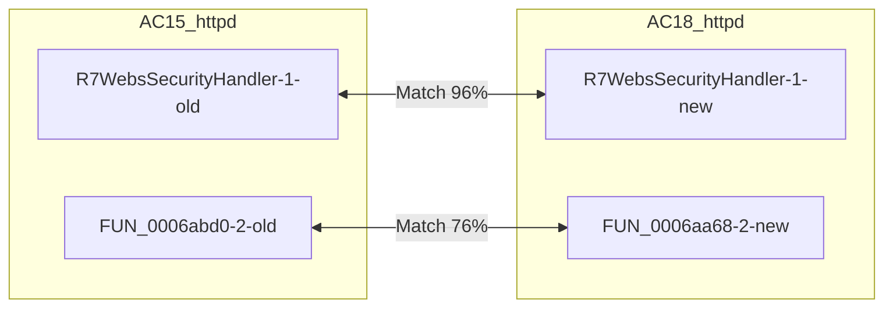
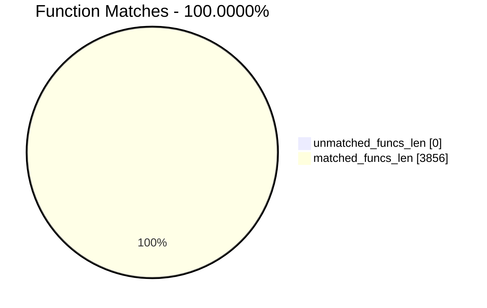
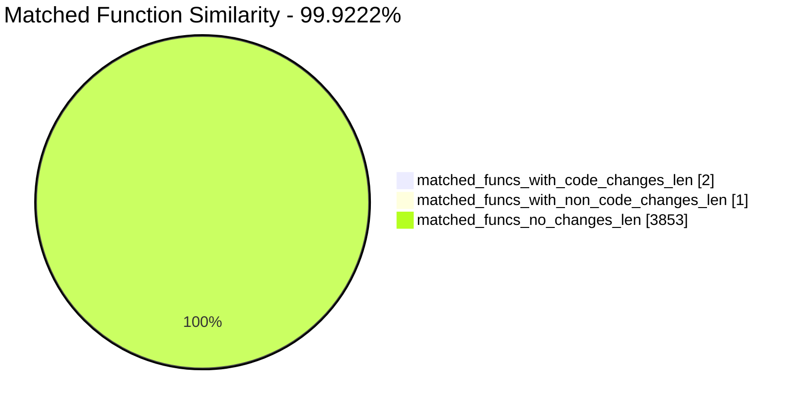
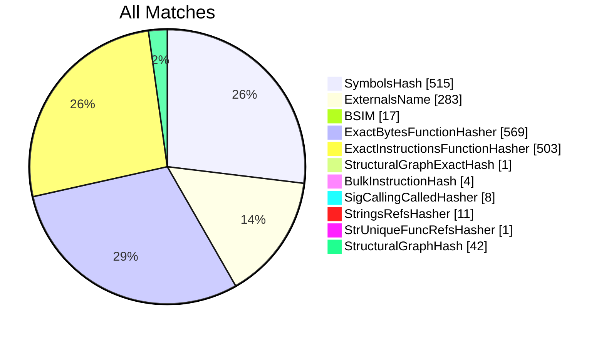
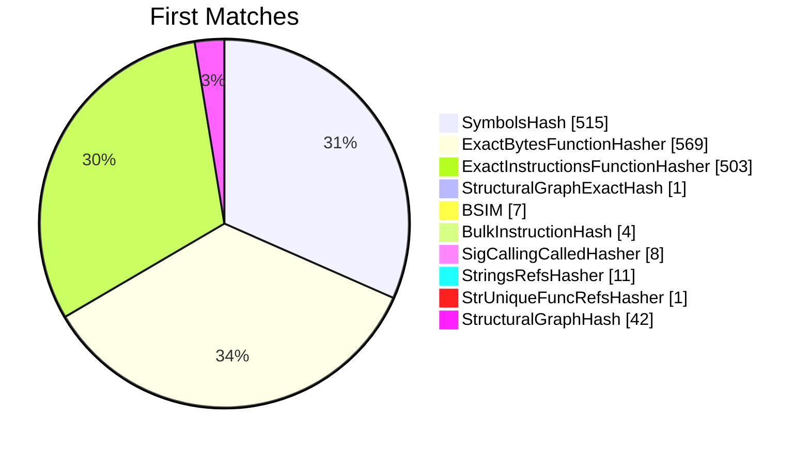
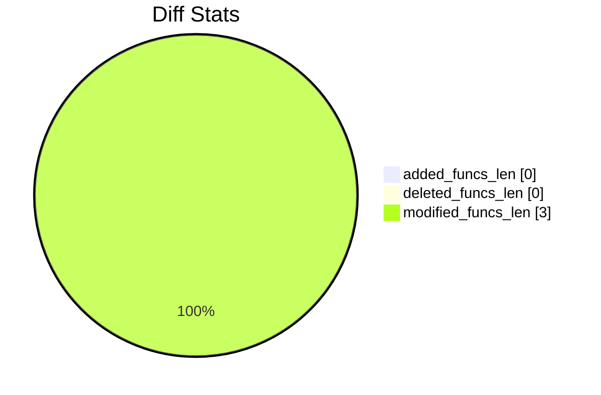
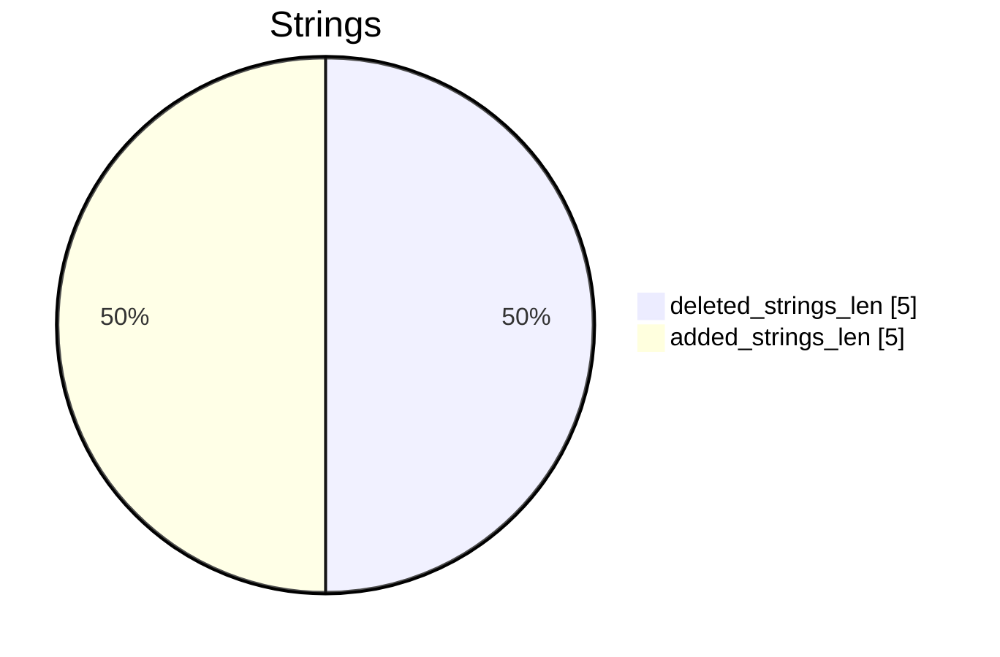

# AC15_httpd-AC18_httpd Diff

# TOC

* [Visual Chart Diff](#visual-chart-diff)
* [Metadata](#metadata)
	* [Ghidra Diff Engine](#ghidra-diff-engine)
		* [Command Line](#command-line)
	* [Binary Metadata Diff](#binary-metadata-diff)
	* [Program Options](#program-options)
	* [Diff Stats](#diff-stats)
	* [Strings](#strings)
* [Deleted](#deleted)
* [Added](#added)
* [Modified](#modified)
	* [R7WebsSecurityHandler](#r7webssecurityhandler)
	* [FUN_0006abd0](#fun_0006abd0)
* [Modified (No Code Changes)](#modified-no-code-changes)
	* [FUN_0002efa4](#fun_0002efa4)

# Visual Chart Diff










# Metadata

## Ghidra Diff Engine

### Command Line

#### Captured Command Line


```
ghidriff --project-location ghidra_projects --project-name ghidriff --symbols-path symbols --threaded --log-level INFO --file-log-level INFO --log-path ghidriff.log --min-func-len 10 --gdt [] --bsim --max-ram-percent 60.0 --max-section-funcs 200 AC15_httpd AC18_httpd
```


#### Verbose Args


<details>

```
--old ['./AC15_httpd'] --new [['./AC18_httpd']] --engine VersionTrackingDiff --output-path ./diff_result --summary False --project-location ghidra_projects --project-name ghidriff --symbols-path symbols --threaded True --force-analysis False --force-diff False --no-symbols False --log-level INFO --file-log-level INFO --log-path ghidriff.log --va False --min-func-len 10 --use-calling-counts False --gdt [] --bsim True --bsim-full False --max-ram-percent 60.0 --print-flags False --jvm-args None --side-by-side False --max-section-funcs 200 --md-title None
```


</details>

## Binary Metadata Diff


```diff
--- AC15_httpd Meta
+++ AC18_httpd Meta
@@ -1,46 +1,46 @@
-Program Name: AC15_httpd
+Program Name: AC18_httpd
 Language ID: ARM:LE:32:v8 (1.107)
 Compiler ID: default
 Processor: ARM
 Endian: Little
 Address Size: 32
 Minimum Address: 00008000
 Maximum Address: _elfSectionHeaders::0000045f
-# of Bytes: 1054326
+# of Bytes: 1053862
 # of Memory Blocks: 30
-# of Instructions: 198645
+# of Instructions: 198539
 # of Defined Data: 15161
 # of Functions: 1928
-# of Symbols: 17654
+# of Symbols: 17645
 # of Data Types: 173
 # of Data Type Categories: 27
 Analyzed: true
 Created With Ghidra Version: 11.3.2
-Date Created: Wed Apr 23 21:41:17 CST 2025
+Date Created: Wed Apr 23 21:41:18 CST 2025
 ELF File Type: executable
 ELF Original Image Base: 0x8000
 ELF Prelinked: false
 Elf Comment[0]: GCC: (GNU) 3.3.2 20031005 (Debian prerelease)
 Elf Comment[1]: GCC: (Buildroot 2012.02) 4.5.3
 Executable Format: Executable and Linking Format (ELF)
-Executable Location: /root/FHFuzz/diff/Tenda_httpd/AC15_httpd
-Executable MD5: 2d40f37630b5a46c27254c06dee90580
-Executable SHA256: e9d1b92527c57f24d141fa10a7377237de66a9c4f9c1b83223adfa8f1f1db11d
-FSRL: file:///root/FHFuzz/diff/Tenda_httpd/AC15_httpd?MD5=2d40f37630b5a46c27254c06dee90580
+Executable Location: /root/FHFuzz/diff/Tenda_httpd/AC18_httpd
+Executable MD5: d269834479e53d21111b401558040a6e
+Executable SHA256: addecb1e2d5e7befe200b75d925c52d84f3d60db5f18c1071136648e0f70d388
+FSRL: file:///root/FHFuzz/diff/Tenda_httpd/AC18_httpd?MD5=d269834479e53d21111b401558040a6e
 GNU DebugLink: httpd.debug
 Preferred Root Namespace Category: 
 Relocatable: false
 Required Library [    0]: libCfm.so
 Required Library [    1]: libcommon.so
 Required Library [    2]: libChipApi.so
 Required Library [    3]: libvos_util.so
 Required Library [    4]: libz.so
 Required Library [    5]: libpthread.so.0
 Required Library [    6]: libnvram.so
 Required Library [    7]: libshared.so
 Required Library [    8]: libtpi.so
 Required Library [    9]: libm.so.0
 Required Library [   10]: libucapi.so
 Required Library [   11]: libgcc_s.so.1
 Required Library [   12]: libc.so.0
 Should Ask To Analyze: false

```


## Program Options


<details>
<summary>Ghidra AC15_httpd Decompiler Options</summary>


|Decompiler Option|Value|
| :---: | :---: |
|Prototype Evaluation|__stdcall|

</details>


<details>
<summary>Ghidra AC15_httpd Specification extensions Options</summary>


|Specification extensions Option|Value|
| :---: | :---: |
|FormatVersion|0|
|VersionCounter|0|

</details>


<details>
<summary>Ghidra AC15_httpd Analyzers Options</summary>


|Analyzers Option|Value|
| :---: | :---: |
|ARM Aggressive Instruction Finder|false|
|ARM Constant Reference Analyzer|true|
|ARM Constant Reference Analyzer.Create Data from pointer|false|
|ARM Constant Reference Analyzer.Function parameter/return Pointer analysis|true|
|ARM Constant Reference Analyzer.Max Threads|2|
|ARM Constant Reference Analyzer.Min absolute reference|4|
|ARM Constant Reference Analyzer.Require pointer param data type|false|
|ARM Constant Reference Analyzer.Speculative reference max|256|
|ARM Constant Reference Analyzer.Speculative reference min|1024|
|ARM Constant Reference Analyzer.Stored Value Pointer analysis|true|
|ARM Constant Reference Analyzer.Switch Table Recovery|false|
|ARM Constant Reference Analyzer.Trust values read from writable memory|true|
|ARM Symbol|true|
|ASCII Strings|true|
|ASCII Strings.Create Strings Containing Existing Strings|true|
|ASCII Strings.Create Strings Containing References|true|
|ASCII Strings.Force Model Reload|false|
|ASCII Strings.Minimum String Length|LEN_5|
|ASCII Strings.Model File|StringModel.sng|
|ASCII Strings.Require Null Termination for String|true|
|ASCII Strings.Search Only in Accessible Memory Blocks|true|
|ASCII Strings.String Start Alignment|ALIGN_1|
|ASCII Strings.String end alignment|4|
|Aggressive Instruction Finder|false|
|Aggressive Instruction Finder.Create Analysis Bookmarks|true|
|Apply Data Archives|true|
|Apply Data Archives.Archive Chooser|[Auto-Detect]|
|Apply Data Archives.Create Analysis Bookmarks|true|
|Apply Data Archives.GDT User File Archive Path|None|
|Apply Data Archives.User Project Archive Path|None|
|Call Convention ID|true|
|Call Convention ID.Analysis Decompiler Timeout (sec)|60|
|Call-Fixup Installer|true|
|Condense Filler Bytes|false|
|Condense Filler Bytes.Filler Value|Auto|
|Condense Filler Bytes.Minimum number of sequential bytes|1|
|Create Address Tables|true|
|Create Address Tables.Allow Offcut References|false|
|Create Address Tables.Auto Label Table|false|
|Create Address Tables.Create Analysis Bookmarks|true|
|Create Address Tables.Maxmimum Pointer Distance|16777215|
|Create Address Tables.Minimum Pointer Address|4132|
|Create Address Tables.Minimum Table Size|3|
|Create Address Tables.Pointer Alignment|1|
|Create Address Tables.Relocation Table Guide|true|
|Create Address Tables.Table Alignment|4|
|DWARF|true|
|DWARF.Add Inlined Functions Comments|false|
|DWARF.Add Lexical Block Comments|false|
|DWARF.Create Function Signatures|true|
|DWARF.Default Calling Convention||
|DWARF.Ignore Parameter Storage Info|false|
|DWARF.Import Data Types|true|
|DWARF.Import Functions|true|
|DWARF.Import Local Variable Info|true|
|DWARF.Import Source Line Info|true|
|DWARF.Maximum Source Map Entry Length|2000|
|DWARF.Output DWARF DIE Info|false|
|DWARF.Output Source Info|false|
|DWARF.Try To Pack Structs|true|
|Data Reference|true|
|Data Reference.Address Table Alignment|1|
|Data Reference.Address Table Minimum Size|3|
|Data Reference.Align End of Strings|false|
|Data Reference.Ascii String References|true|
|Data Reference.Create Address Tables|false|
|Data Reference.Minimum String Length|5|
|Data Reference.References to Pointers|false|
|Data Reference.Relocation Table Guide|true|
|Data Reference.Respect Execute Flag|true|
|Data Reference.Subroutine References|true|
|Data Reference.Switch Table References|false|
|Data Reference.Unicode String References|true|
|Decompiler Parameter ID|true|
|Decompiler Parameter ID.Analysis Clear Level|ANALYSIS|
|Decompiler Parameter ID.Analysis Decompiler Timeout (sec)|60|
|Decompiler Parameter ID.Commit Data Types|true|
|Decompiler Parameter ID.Commit Void Return Values|false|
|Decompiler Parameter ID.Prototype Evaluation|__stdcall|
|Decompiler Switch Analysis|true|
|Decompiler Switch Analysis.Analysis Decompiler Timeout (sec)|60|
|Demangler GNU|true|
|Demangler GNU.Apply Function Calling Conventions|true|
|Demangler GNU.Apply Function Signatures|true|
|Demangler GNU.Demangle Only Known Mangled Symbols|false|
|Demangler GNU.Demangler Format|AUTO|
|Demangler GNU.Use Deprecated Demangler|false|
|Demangler GNU.Use Standard Text Replacements|true|
|Disassemble Entry Points|true|
|Disassemble Entry Points.Respect Execute Flag|true|
|ELF Scalar Operand References|false|
|ELF Scalar Operand References.Relocation Table Guide|true|
|Embedded Media|true|
|Embedded Media.Create Analysis Bookmarks|true|
|External Entry References|true|
|External Symbol Resolver|true|
|Function Start Pre Search|true|
|Function Start Pre Search.Bookmark Functions|false|
|Function Start Pre Search.Search Data Blocks|false|
|Function Start Search|true|
|Function Start Search After Code|true|
|Function Start Search After Code.Bookmark Functions|false|
|Function Start Search After Code.Search Data Blocks|false|
|Function Start Search After Data|true|
|Function Start Search After Data.Bookmark Functions|false|
|Function Start Search After Data.Search Data Blocks|false|
|Function Start Search.Bookmark Functions|false|
|Function Start Search.Search Data Blocks|false|
|GCC Exception Handlers|true|
|GCC Exception Handlers.Create Try Catch Comments|true|
|Non-Returning Functions - Discovered|true|
|Non-Returning Functions - Discovered.Create Analysis Bookmarks|true|
|Non-Returning Functions - Discovered.Function Non-return Threshold|3|
|Non-Returning Functions - Discovered.Repair Flow Damage|true|
|Non-Returning Functions - Known|true|
|Non-Returning Functions - Known.Create Analysis Bookmarks|true|
|Reference|true|
|Reference.Address Table Alignment|1|
|Reference.Address Table Minimum Size|3|
|Reference.Align End of Strings|false|
|Reference.Ascii String References|true|
|Reference.Create Address Tables|false|
|Reference.Minimum String Length|5|
|Reference.References to Pointers|false|
|Reference.Relocation Table Guide|true|
|Reference.Respect Execute Flag|true|
|Reference.Subroutine References|true|
|Reference.Switch Table References|false|
|Reference.Unicode String References|true|
|Shared Return Calls|true|
|Shared Return Calls.Allow Conditional Jumps|false|
|Shared Return Calls.Assume Contiguous Functions Only|false|
|Stack|true|
|Stack.Create Local Variables|true|
|Stack.Create Param Variables|false|
|Stack.useNewFunctionStackAnalysis|true|
|Subroutine References|true|
|Subroutine References.Create Thunks Early|true|
|Variadic Function Signature Override|false|
|Variadic Function Signature Override.Create Analysis Bookmarks|false|

</details>


<details>
<summary>Ghidra AC18_httpd Decompiler Options</summary>


|Decompiler Option|Value|
| :---: | :---: |
|Prototype Evaluation|__stdcall|

</details>


<details>
<summary>Ghidra AC18_httpd Specification extensions Options</summary>


|Specification extensions Option|Value|
| :---: | :---: |
|FormatVersion|0|
|VersionCounter|0|

</details>


<details>
<summary>Ghidra AC18_httpd Analyzers Options</summary>


|Analyzers Option|Value|
| :---: | :---: |
|ARM Aggressive Instruction Finder|false|
|ARM Constant Reference Analyzer|true|
|ARM Constant Reference Analyzer.Create Data from pointer|false|
|ARM Constant Reference Analyzer.Function parameter/return Pointer analysis|true|
|ARM Constant Reference Analyzer.Max Threads|2|
|ARM Constant Reference Analyzer.Min absolute reference|4|
|ARM Constant Reference Analyzer.Require pointer param data type|false|
|ARM Constant Reference Analyzer.Speculative reference max|256|
|ARM Constant Reference Analyzer.Speculative reference min|1024|
|ARM Constant Reference Analyzer.Stored Value Pointer analysis|true|
|ARM Constant Reference Analyzer.Switch Table Recovery|false|
|ARM Constant Reference Analyzer.Trust values read from writable memory|true|
|ARM Symbol|true|
|ASCII Strings|true|
|ASCII Strings.Create Strings Containing Existing Strings|true|
|ASCII Strings.Create Strings Containing References|true|
|ASCII Strings.Force Model Reload|false|
|ASCII Strings.Minimum String Length|LEN_5|
|ASCII Strings.Model File|StringModel.sng|
|ASCII Strings.Require Null Termination for String|true|
|ASCII Strings.Search Only in Accessible Memory Blocks|true|
|ASCII Strings.String Start Alignment|ALIGN_1|
|ASCII Strings.String end alignment|4|
|Aggressive Instruction Finder|false|
|Aggressive Instruction Finder.Create Analysis Bookmarks|true|
|Apply Data Archives|true|
|Apply Data Archives.Archive Chooser|[Auto-Detect]|
|Apply Data Archives.Create Analysis Bookmarks|true|
|Apply Data Archives.GDT User File Archive Path|None|
|Apply Data Archives.User Project Archive Path|None|
|Call Convention ID|true|
|Call Convention ID.Analysis Decompiler Timeout (sec)|60|
|Call-Fixup Installer|true|
|Condense Filler Bytes|false|
|Condense Filler Bytes.Filler Value|Auto|
|Condense Filler Bytes.Minimum number of sequential bytes|1|
|Create Address Tables|true|
|Create Address Tables.Allow Offcut References|false|
|Create Address Tables.Auto Label Table|false|
|Create Address Tables.Create Analysis Bookmarks|true|
|Create Address Tables.Maxmimum Pointer Distance|16777215|
|Create Address Tables.Minimum Pointer Address|4132|
|Create Address Tables.Minimum Table Size|3|
|Create Address Tables.Pointer Alignment|1|
|Create Address Tables.Relocation Table Guide|true|
|Create Address Tables.Table Alignment|4|
|DWARF|true|
|DWARF.Add Inlined Functions Comments|false|
|DWARF.Add Lexical Block Comments|false|
|DWARF.Create Function Signatures|true|
|DWARF.Default Calling Convention||
|DWARF.Ignore Parameter Storage Info|false|
|DWARF.Import Data Types|true|
|DWARF.Import Functions|true|
|DWARF.Import Local Variable Info|true|
|DWARF.Import Source Line Info|true|
|DWARF.Maximum Source Map Entry Length|2000|
|DWARF.Output DWARF DIE Info|false|
|DWARF.Output Source Info|false|
|DWARF.Try To Pack Structs|true|
|Data Reference|true|
|Data Reference.Address Table Alignment|1|
|Data Reference.Address Table Minimum Size|3|
|Data Reference.Align End of Strings|false|
|Data Reference.Ascii String References|true|
|Data Reference.Create Address Tables|false|
|Data Reference.Minimum String Length|5|
|Data Reference.References to Pointers|false|
|Data Reference.Relocation Table Guide|true|
|Data Reference.Respect Execute Flag|true|
|Data Reference.Subroutine References|true|
|Data Reference.Switch Table References|false|
|Data Reference.Unicode String References|true|
|Decompiler Parameter ID|true|
|Decompiler Parameter ID.Analysis Clear Level|ANALYSIS|
|Decompiler Parameter ID.Analysis Decompiler Timeout (sec)|60|
|Decompiler Parameter ID.Commit Data Types|true|
|Decompiler Parameter ID.Commit Void Return Values|false|
|Decompiler Parameter ID.Prototype Evaluation|__stdcall|
|Decompiler Switch Analysis|true|
|Decompiler Switch Analysis.Analysis Decompiler Timeout (sec)|60|
|Demangler GNU|true|
|Demangler GNU.Apply Function Calling Conventions|true|
|Demangler GNU.Apply Function Signatures|true|
|Demangler GNU.Demangle Only Known Mangled Symbols|false|
|Demangler GNU.Demangler Format|AUTO|
|Demangler GNU.Use Deprecated Demangler|false|
|Demangler GNU.Use Standard Text Replacements|true|
|Disassemble Entry Points|true|
|Disassemble Entry Points.Respect Execute Flag|true|
|ELF Scalar Operand References|false|
|ELF Scalar Operand References.Relocation Table Guide|true|
|Embedded Media|true|
|Embedded Media.Create Analysis Bookmarks|true|
|External Entry References|true|
|External Symbol Resolver|true|
|Function Start Pre Search|true|
|Function Start Pre Search.Bookmark Functions|false|
|Function Start Pre Search.Search Data Blocks|false|
|Function Start Search|true|
|Function Start Search After Code|true|
|Function Start Search After Code.Bookmark Functions|false|
|Function Start Search After Code.Search Data Blocks|false|
|Function Start Search After Data|true|
|Function Start Search After Data.Bookmark Functions|false|
|Function Start Search After Data.Search Data Blocks|false|
|Function Start Search.Bookmark Functions|false|
|Function Start Search.Search Data Blocks|false|
|GCC Exception Handlers|true|
|GCC Exception Handlers.Create Try Catch Comments|true|
|Non-Returning Functions - Discovered|true|
|Non-Returning Functions - Discovered.Create Analysis Bookmarks|true|
|Non-Returning Functions - Discovered.Function Non-return Threshold|3|
|Non-Returning Functions - Discovered.Repair Flow Damage|true|
|Non-Returning Functions - Known|true|
|Non-Returning Functions - Known.Create Analysis Bookmarks|true|
|Reference|true|
|Reference.Address Table Alignment|1|
|Reference.Address Table Minimum Size|3|
|Reference.Align End of Strings|false|
|Reference.Ascii String References|true|
|Reference.Create Address Tables|false|
|Reference.Minimum String Length|5|
|Reference.References to Pointers|false|
|Reference.Relocation Table Guide|true|
|Reference.Respect Execute Flag|true|
|Reference.Subroutine References|true|
|Reference.Switch Table References|false|
|Reference.Unicode String References|true|
|Shared Return Calls|true|
|Shared Return Calls.Allow Conditional Jumps|false|
|Shared Return Calls.Assume Contiguous Functions Only|false|
|Stack|true|
|Stack.Create Local Variables|true|
|Stack.Create Param Variables|false|
|Stack.useNewFunctionStackAnalysis|true|
|Subroutine References|true|
|Subroutine References.Create Thunks Early|true|
|Variadic Function Signature Override|false|
|Variadic Function Signature Override.Create Analysis Bookmarks|false|

</details>

## Diff Stats


|Stat|Value|
| :---: | :---: |
|added_funcs_len|0|
|deleted_funcs_len|0|
|modified_funcs_len|3|
|added_symbols_len|0|
|deleted_symbols_len|0|
|diff_time|22.127716064453125|
|deleted_strings_len|5|
|added_strings_len|5|
|match_types|Counter({'ExactBytesFunctionHasher': 569, 'SymbolsHash': 515, 'ExactInstructionsFunctionHasher': 503, 'ExternalsName': 283, 'StructuralGraphHash': 42, 'BSIM': 17, 'StringsRefsHasher': 11, 'SigCallingCalledHasher': 8, 'BulkInstructionHash': 4, 'StructuralGraphExactHash': 1, 'StrUniqueFuncRefsHasher': 1})|
|items_to_process|3|
|diff_types|Counter({'code': 2, 'length': 2, 'called': 2, 'refcount': 1, 'calling': 1, 'name': 1, 'fullname': 1, 'sig': 1, 'address': 1})|
|unmatched_funcs_len|0|
|total_funcs_len|3856|
|matched_funcs_len|3856|
|matched_funcs_with_code_changes_len|2|
|matched_funcs_with_non_code_changes_len|1|
|matched_funcs_no_changes_len|3853|
|match_func_similarity_percent|99.9222%|
|func_match_overall_percent|100.0000%|
|first_matches|Counter({'ExactBytesFunctionHasher': 569, 'SymbolsHash': 515, 'ExactInstructionsFunctionHasher': 503, 'StructuralGraphHash': 42, 'StringsRefsHasher': 11, 'SigCallingCalledHasher': 8, 'BSIM': 7, 'BulkInstructionHash': 4, 'StructuralGraphExactHash': 1, 'StrUniqueFuncRefsHasher': 1})|











```mermaid
pie showData
    title Symbols
"added_symbols_len" : 0
"deleted_symbols_len" : 0
```

## Strings




### Strings Diff


```diff
--- deleted strings
+++ added strings
@@ -1,5 +1,5 @@
 s
-s_/home/suse/Project/5.0_UGW/ac15
-s_10:02:42
-s_1_0_1_0_-1
+s_/mnt/sdb1/11AC_work/opt_AC9/deve
+s_1_1_0_0_-1
+s_20:14:26
 s_May

```


### String References

#### Old


|String|Ref Count|Ref Func|
| :---: | :---: | :---: |
|s_10:02:42_000dce28|2|FUN_00031578|
|s_May_26_2017_000e0d64|2|aspTendaGetStatus|
|s_/home/suse/Project/5.0_UGW/ac15__000f2800|2|FUN_000a9174|
|s_1_0_1_0_-1_000f3678|2|FUN_000b00fc|
|s_1_0_1_0_0_000f376c|2|FUN_000b02e8|

#### New


|String|Ref Count|Ref Func|
| :---: | :---: | :---: |
|s_May_18_2017_000e0bb4|2|aspTendaGetStatus|
|s_20:14:26_000dcc80|2|FUN_00031410|
|s_1_1_0_0_0_000f359c|2|FUN_000b0140|
|s_/mnt/sdb1/11AC_work/opt_AC9/deve_000f2638|2|FUN_000a8fcc|
|s_1_1_0_0_-1_000f34a8|2|FUN_000aff54|

# Deleted

# Added

# Modified


*Modified functions contain code changes*
## R7WebsSecurityHandler

### Match Info


|Key|AC15_httpd - AC18_httpd|
| :---: | :---: |
|diff_type|code,length,called|
|ratio|0.7|
|i_ratio|0.79|
|m_ratio|0.96|
|b_ratio|0.96|
|match_types|SymbolsHash|

### Function Meta Diff


|Key|AC15_httpd|AC18_httpd|
| :---: | :---: | :---: |
|name|R7WebsSecurityHandler|R7WebsSecurityHandler|
|fullname|R7WebsSecurityHandler|R7WebsSecurityHandler|
|refcount|3|3|
|`length`|5140|4780|
|`called`|<details><summary>Expand for full list:<br><EXTERNAL>::SetValue<br><EXTERNAL>::atoi<br><EXTERNAL>::get_uptime<br><EXTERNAL>::inet_addr<br><EXTERNAL>::memcmp<br><EXTERNAL>::memcpy<br><EXTERNAL>::memset<br><EXTERNAL>::rand<br><EXTERNAL>::sprintf<br><EXTERNAL>::srand<br><EXTERNAL>::stat</summary><EXTERNAL>::strchr<br><EXTERNAL>::strcmp<br><EXTERNAL>::strcpy<br><EXTERNAL>::strlen<br><EXTERNAL>::strncmp<br><EXTERNAL>::strncpy<br><EXTERNAL>::strrchr<br><EXTERNAL>::strstr<br><EXTERNAL>::time<br>FUN_0002ba8c<br>FUN_0002be4c<br>FUN_0002c40c<br>FUN_0002c954<br>FUN_0002da7c<br>FUN_0002efa4<br>FUN_0002f164<br>FUN_0002f1e0</details>|<details><summary>Expand for full list:<br><EXTERNAL>::SetValue<br><EXTERNAL>::atoi<br><EXTERNAL>::get_uptime<br><EXTERNAL>::inet_addr<br><EXTERNAL>::memcmp<br><EXTERNAL>::memcpy<br><EXTERNAL>::memset<br><EXTERNAL>::rand<br><EXTERNAL>::sprintf<br><EXTERNAL>::srand<br><EXTERNAL>::stat</summary><EXTERNAL>::strchr<br><EXTERNAL>::strcmp<br><EXTERNAL>::strcpy<br><EXTERNAL>::strlen<br><EXTERNAL>::strncmp<br><EXTERNAL>::strncpy<br><EXTERNAL>::strrchr<br><EXTERNAL>::strstr<br><EXTERNAL>::time<br>FUN_0002ba8c<br>FUN_0002be4c<br>FUN_0002c40c<br>FUN_0002c954<br>FUN_0002da7c<br>FUN_0002f164<br>FUN_0002f1e0</details>|
|calling|||
|paramcount|1|1|
|address|0002f240|0002f240|
|sig|undefined4 __stdcall R7WebsSecurityHandler(int * param_1)|undefined4 __stdcall R7WebsSecurityHandler(int * param_1)|
|sym_type|Function|Function|
|sym_source|IMPORTED|IMPORTED|
|external|False|False|

### R7WebsSecurityHandler Called Diff


```diff
--- R7WebsSecurityHandler called
+++ R7WebsSecurityHandler called
@@ -26 +25,0 @@
-FUN_0002efa4
```


### R7WebsSecurityHandler Diff


```diff
--- R7WebsSecurityHandler
+++ R7WebsSecurityHandler
@@ -1,418 +1,375 @@
 
 undefined4 R7WebsSecurityHandler(int *param_1)
 
 {
   bool bVar1;
   int iVar2;
   char *pcVar3;
   size_t sVar4;
   in_addr_t iVar5;
   undefined4 uVar6;
   uint __seed;
   undefined1 *puVar7;
   char *in_stack_00000000;
-  char local_478 [256];
+  char acStack_478 [256];
   char local_378 [4];
   char acStack_374 [4];
   undefined2 local_370;
   undefined1 auStack_36e [54];
   stat sStack_338;
   char acStack_2e0 [256];
   undefined4 local_1e0;
   undefined4 local_1dc;
   undefined4 local_1d8;
   undefined4 local_1d4;
   undefined4 local_1d0;
   undefined4 local_1cc;
   char acStack_1c8 [128];
   char local_148 [256];
   int local_48;
   char *local_44;
   char *local_40;
   char *local_3c;
   char *local_38;
   int local_34;
   char *local_30;
   undefined4 local_2c;
   char *local_28;
   undefined4 local_24;
   char *local_20;
   int local_1c;
   
   local_24 = 0;
   local_28 = (char *)0x0;
   memset(local_148,0,0x100);
   memset(acStack_1c8,0,0x80);
   local_1d0 = 0;
   local_1cc = 0;
   local_1d8 = 0;
   local_1d4 = 0;
   local_1e0 = 0;
   local_1dc = 0;
   local_1c = 0;
   local_2c = 0;
   local_20 = (char *)0x0;
   memset(acStack_2e0,0,0x100);
   local_1c = 0;
   while ((local_1c < 3 &&
          (iVar2 = strcmp(loginUserInfo + local_1c * 0x24,(char *)(param_1 + 0xc)), iVar2 != 0))) {
     local_1c = local_1c + 1;
   }
   strncpy(local_148,in_stack_00000000,0xff);
   local_30 = strchr(local_148,0x3f);
   if (local_30 != (char *)0x0) {
     *local_30 = '\0';
   }
   iVar2 = strncmp(in_stack_00000000,"/public/",8);
   if (iVar2 == 0) {
     return 0;
   }
   iVar2 = strncmp(in_stack_00000000,"/lang/",6);
   if (iVar2 == 0) {
     return 0;
   }
   pcVar3 = strstr(in_stack_00000000,"img/main-logo.png");
   if (pcVar3 != (char *)0x0) {
     return 0;
   }
   pcVar3 = strstr(in_stack_00000000,"reasy-ui-1.0.3.js");
   if (pcVar3 != (char *)0x0) {
     return 0;
   }
   iVar2 = strncmp(in_stack_00000000,"/favicon.ico",0xc);
   if (iVar2 == 0) {
     return 0;
   }
   if (param_1[0x26] == 0) {
     return 0;
   }
   iVar2 = strncmp(in_stack_00000000,"/kns-query",10);
   if (iVar2 == 0) {
     return 0;
   }
   iVar2 = strncmp(in_stack_00000000,"/wdinfo.php",0xb);
   if (iVar2 == 0) {
     return 0;
   }
   sVar4 = strlen(in_stack_00000000);
   if ((sVar4 == 1) && (*in_stack_00000000 == '/')) {
     return 0;
   }
   iVar2 = strncmp(in_stack_00000000,"/redirect.html",0xe);
   if (iVar2 == 0) {
     return 0;
   }
   if ((2 < local_1c) && (iVar2 = strncmp(in_stack_00000000,"/loginerr.html",0xe), iVar2 == 0)) {
     return 0;
   }
   sVar4 = strlen(local_148);
   if ((3 < sVar4) && (local_28 = strchr(local_148,0x2e), local_28 != (char *)0x0)) {
     local_28 = local_28 + 1;
     iVar2 = memcmp(local_28,&DAT_0,3);
     if (iVar2 == 0) {
       return 0;
     }
     iVar2 = memcmp(local_28,&DAT_1,3);
     if (iVar2 == 0) {
       return 0;
     }
     iVar2 = memcmp(local_28,&DAT_2,2);
     if (iVar2 == 0) {
       return 0;
     }
     iVar2 = memcmp(local_28,&DAT_3,3);
     if (iVar2 == 0) {
       return 0;
     }
     iVar2 = memcmp(local_28,&DAT_4,3);
     if (iVar2 == 0) {
       return 0;
     }
     iVar2 = memcmp(local_28,&DAT_5,3);
     if (iVar2 == 0) {
       return 0;
     }
   }
   iVar2 = strncmp(in_stack_00000000,"/goform/telnet",0xe);
   if (((iVar2 == 0) || (iVar2 = strncmp(in_stack_00000000,"/goform/ate",0xb), iVar2 == 0)) &&
      (g_Pass[0] == '\0')) {
     return 0;
   }
   if (local_1c < 3) {
     if ((param_1[0x2e] != 0) &&
        (local_20 = strstr((char *)param_1[0x2e],"password="), local_20 != (char *)0x0)) {
       local_20 = local_20 + 9;
     }
     if (param_1 == (int *)0xffffffd0) {
       strcpy(acStack_2e0,g_Pass);
     }
     else {
       pcVar3 = strrchr((char *)(param_1 + 0xc),0x2e);
       local_34 = atoi(pcVar3 + 1);
       iVar2 = local_34 * 4;
       iVar5 = inet_addr((char *)(param_1 + 0xc));
       sprintf(acStack_2e0,"%s%s%s",g_Pass,expired_cookie_option + iVar2,
               cookie_suffix + (iVar5 % 0x50) * 4);
     }
     if (local_20 != (char *)0x0) {
       sVar4 = strlen(acStack_2e0);
       iVar2 = strncmp(local_20,acStack_2e0,sVar4);
       if (iVar2 != 0) {
         sVar4 = strlen(&DAT_6);
         iVar2 = strncmp(local_20,&DAT_6,sVar4);
         if (iVar2 != 0) goto LAB_7;
       }
       sVar4 = strlen(acStack_2e0);
       iVar2 = strncmp(local_20,acStack_2e0,sVar4);
       if (iVar2 == 0) {
         local_24 = 1;
       }
       else {
         local_24 = 2;
       }
       iVar2 = memcmp(local_148,"/login.html",10);
-      if ((((iVar2 == 0) || (iVar2 = memcmp(local_148,"/login.asp",10), iVar2 == 0)) ||
-          ((iVar2 = memcmp(local_148,"/loginerr.html",0xe), iVar2 == 0 ||
-           (iVar2 = memcmp(local_148,"/login/Auth",0xb), iVar2 == 0)))) ||
-         ((sVar4 = strlen(local_148), sVar4 == 1 && (local_148[0] == '/')))) goto LAB_8;
-      iVar2 = memcmp(local_148,"/logout/Auth",0xc);
-      if (iVar2 != 0) {
-        iVar2 = strncmp(local_148,"/goform/GetRouterStatus",0x17);
-        if (iVar2 == 0) {
+      if (((((iVar2 != 0) && (iVar2 = memcmp(local_148,"/login.asp",10), iVar2 != 0)) &&
+           (iVar2 = memcmp(local_148,"/loginerr.html",0xe), iVar2 != 0)) &&
+          (iVar2 = memcmp(local_148,"/login/Auth",0xb), iVar2 != 0)) &&
+         ((sVar4 = strlen(local_148), sVar4 != 1 || (local_148[0] != '/')))) {
+        iVar2 = memcmp(local_148,"/logout/Auth",0xc);
+        if (iVar2 != 0) {
+          iVar2 = strncmp(local_148,"/goform/GetRouterStatus",0x17);
+          if (iVar2 == 0) {
+            return 0;
+          }
+          iVar2 = strncmp(local_148,"/goform/getWanParameters",0x18);
+          if (iVar2 == 0) {
+            return 0;
+          }
+          iVar2 = strncmp(local_148,"/goform/GetUSBStatus",0x14);
+          if (iVar2 == 0) {
+            return 0;
+          }
+          uVar6 = get_uptime();
+          *(undefined4 *)(loginUserInfo + local_1c * 0x24 + 0x20) = uVar6;
+          bVar1 = FUN_0002f1e0(local_148);
+          if (!bVar1) {
+            return 0;
+          }
+          bVar1 = FUN_0002f164();
+          if (!bVar1) {
+            return 0;
+          }
+          iVar2 = strcmp("/index.html",local_148);
+          if (iVar2 == 0) {
+            return 0;
+          }
+          FUN_0002be4c(param_1,"index.html");
           return 0;
         }
-        iVar2 = strncmp(local_148,"/goform/getWanParameters",0x18);
-        if (iVar2 == 0) {
-          return 0;
+        memset(loginUserInfo + local_1c * 0x24,0,4);
+        puVar7 = (undefined *)0x0;
+        *(undefined4 *)(loginUserInfo + local_1c * 0x24 + 0x20) = 0;
+LAB_8:
+        pcVar3 = strstr(in_stack_00000000,"/goform/WifiApScan");
+        if (pcVar3 == (char *)0x0) {
+          if (g_Pass[0] == '\0') {
+            FUN_0002be4c(param_1,"/");
+          }
+          else {
+            FUN_0002be4c(param_1,"login.html");
+          }
         }
-        iVar2 = strncmp(local_148,"/goform/GetUSBStatus",0x14);
-        if (iVar2 == 0) {
-          return 0;
+        else {
+          FUN_0002c40c((int)param_1,(byte *)"HTTP/1.0 200 OK\r\n\r\n",(uint)puVar7,
+                       "HTTP/1.0 200 OK\r\n\r\n");
+          FUN_0002c40c((int)param_1,(byte *)"{\"errCode\":%s}",0xdc9b0,&DAT_9);
+          FUN_0002c954(param_1,200);
         }
-        uVar6 = get_uptime();
-        *(undefined4 *)(loginUserInfo + local_1c * 0x24 + 0x20) = uVar6;
-        bVar1 = FUN_0002f1e0(local_148);
-        if (!bVar1) {
-          return 0;
-        }
-        bVar1 = FUN_0002f164();
-        if (!bVar1) {
-          return 0;
-        }
-        iVar2 = strcmp("/index.html",local_148);
-        if (iVar2 == 0) {
-          return 0;
-        }
-        FUN_0002be4c(param_1,"index.html");
-        return 0;
-      }
-      memset(loginUserInfo + local_1c * 0x24,0,4);
-      puVar7 = (undefined *)0x0;
-      *(undefined4 *)(loginUserInfo + local_1c * 0x24 + 0x20) = 0;
-      goto LAB_9;
+        return 0;
+      }
+      goto LAB_10;
     }
 LAB_7:
     if (g_Pass[0] != '\0') {
       memset(loginUserInfo + local_1c * 0x24,0,4);
       puVar7 = (undefined *)0x0;
       *(undefined4 *)(loginUserInfo + local_1c * 0x24 + 0x20) = 0;
-      goto LAB_9;
+      goto LAB_8;
     }
   }
   else {
     for (local_1c = 0; (local_1c < 3 && (loginUserInfo[local_1c * 0x24] != '\0'));
         local_1c = local_1c + 1) {
     }
     if (local_1c == 3) {
-      memset(local_478,0,0x100);
-      sprintf(local_478,"loginerr.html?%d",3);
-      FUN_0002be4c(param_1,local_478);
+      memset(acStack_478,0,0x100);
+      sprintf(acStack_478,"loginerr.html?%d",3);
+      FUN_0002be4c(param_1,acStack_478);
       return 0;
     }
     if (g_Pass[0] != '\0') {
       iVar2 = memcmp(local_148,"/login.html",10);
       if (iVar2 == 0) {
         return 0;
       }
       iVar2 = memcmp(local_148,"/login.asp",10);
       if (iVar2 == 0) {
         return 0;
       }
       iVar2 = memcmp(local_148,"/loginerr.html",0xe);
       if (iVar2 == 0) {
         return 0;
       }
       sVar4 = strlen(local_148);
       if ((sVar4 == 1) && (local_148[0] == '/')) {
         FUN_0002be4c(param_1,"login.html");
         return 0;
       }
       puVar7 = (undefined *)0xb;
       iVar2 = memcmp(local_148,"/login/Auth",0xb);
-      if (iVar2 != 0) goto LAB_9;
-      local_38 = FUN_0002ba8c((int)param_1,(byte *)"password",&DAT_10);
-      puVar7 = &DAT_10;
-      local_3c = FUN_0002ba8c((int)param_1,(byte *)"username",&DAT_10);
-      if ((local_3c == (char *)0x0) || (local_38 == (char *)0x0)) goto LAB_9;
-      local_478[0] = '\0';
-      local_478[1] = '\0';
-      local_478[2] = '\0';
-      local_478[3] = '\0';
-      local_478[4] = '\0';
-      local_478[5] = '\0';
-      local_478[6] = '\0';
-      local_478[7] = '\0';
-      local_478[8] = '\0';
-      local_478[9] = '\0';
-      local_478[10] = '\0';
-      local_478[0xb] = '\0';
-      local_478[0xc] = '\0';
-      local_478[0xd] = '\0';
-      local_478[0xe] = '\0';
-      local_478[0xf] = '\0';
-      local_478[0x10] = '\0';
-      local_478[0x11] = '\0';
-      local_478[0x12] = '\0';
-      local_478[0x13] = '\0';
-      local_478[0x14] = '\0';
-      local_478[0x15] = '\0';
-      local_478[0x16] = '\0';
-      local_478[0x17] = '\0';
-      local_478[0x18] = '\0';
-      local_478[0x19] = '\0';
-      local_478[0x1a] = '\0';
-      local_478[0x1b] = '\0';
-      local_478[0x1c] = '\0';
-      local_478[0x1d] = '\0';
-      local_478[0x1e] = '\0';
-      local_478[0x1f] = '\0';
-      puVar7 = (undefined *)0x0;
-      local_478[0x20] = 0;
-      iVar2 = strcmp(local_3c,g_User);
-      if ((iVar2 == 0) && (iVar2 = strcmp(local_38,g_Pass), iVar2 == 0)) {
-LAB_11:
-        iVar2 = strcmp(local_3c,g_User);
-        if (((iVar2 != 0) || (iVar2 = strcmp(local_38,g_Pass), iVar2 != 0)) &&
-           ((iVar2 = strcmp(local_3c,&DAT_12), iVar2 != 0 ||
-            (iVar2 = strcmp(local_38,&DAT_6), iVar2 != 0)))) {
-          FUN_0002c40c((int)param_1,(byte *)"HTTP/1.0 200 OK\r\n\r\n",(uint)puVar7,
-                       "HTTP/1.0 200 OK\r\n\r\n");
-          FUN_0002c40c((int)param_1,&DAT_13,0xdc6c0,&DAT_000dc6c0);
-          FUN_0002c954(param_1,200);
-          return 0;
+      if (iVar2 == 0) {
+        local_38 = FUN_0002ba8c((int)param_1,(byte *)"password",&DAT_11);
+        puVar7 = &DAT_11;
+        local_3c = FUN_0002ba8c((int)param_1,(byte *)"username",&DAT_11);
+        if ((local_3c != (char *)0x0) && (local_38 != (char *)0x0)) {
+          iVar2 = strcmp(local_3c,g_User);
+          if (((iVar2 != 0) || (iVar2 = strcmp(local_38,g_Pass), iVar2 != 0)) &&
+             ((iVar2 = strcmp(local_3c,&DAT_12), iVar2 != 0 ||
+              (iVar2 = strcmp(local_38,&DAT_6), iVar2 != 0)))) {
+            FUN_0002c40c((int)param_1,(byte *)"HTTP/1.0 200 OK\r\n\r\n",(uint)puVar7,
+                         "HTTP/1.0 200 OK\r\n\r\n");
+            FUN_0002c40c((int)param_1,&DAT_13,0xdc518,&DAT_000dc518);
+            FUN_0002c954(param_1,200);
+            return 0;
+          }
+          SetValue("sys.userpass",g_Pass);
+          for (local_1c = 0; local_1c < 3; local_1c = local_1c + 1) {
+            puVar7 = loginUserInfo;
+            if (loginUserInfo[local_1c * 0x24] == '\0') {
+              memcpy(loginUserInfo + local_1c * 0x24,param_1 + 0xc,0x20);
+              uVar6 = get_uptime();
+              *(undefined4 *)(loginUserInfo + local_1c * 0x24 + 0x20) = uVar6;
+              strcpy(acStack_1c8,local_38);
+              goto LAB_10;
+            }
+          }
+          if (local_1c == 3) {
+            memset(acStack_478,0,0x100);
+            sprintf(acStack_478,"loginerr.html?%d",3);
+            FUN_0002be4c(param_1,acStack_478);
+            return 0;
+          }
         }
       }
-      else {
-        FUN_0002efa4(local_478);
-        iVar2 = strcmp(local_3c,g_User);
-        if (((iVar2 != 0) || (iVar2 = strcmp(local_38,local_478), iVar2 != 0)) &&
-           ((iVar2 = strcmp(local_3c,&DAT_12), iVar2 != 0 ||
-            (iVar2 = strcmp(local_38,&DAT_6), iVar2 != 0)))) goto LAB_0002ff60;
-        puVar7 = (undefined *)0x40;
-        strncpy(g_Pass,local_478,0x40);
-      }
-      SetValue("sys.userpass",g_Pass);
-      for (local_1c = 0; local_1c < 3; local_1c = local_1c + 1) {
-        puVar7 = loginUserInfo;
-        if (loginUserInfo[local_1c * 0x24] == '\0') {
-          memcpy(loginUserInfo + local_1c * 0x24,param_1 + 0xc,0x20);
-          uVar6 = get_uptime();
-          *(undefined4 *)(loginUserInfo + local_1c * 0x24 + 0x20) = uVar6;
-          strcpy(acStack_1c8,local_38);
-          goto LAB_8;
-        }
-      }
-      if (local_1c == 3) {
-        memset(local_478,0,0x100);
-        sprintf(local_478,"loginerr.html?%d",3);
-        FUN_0002be4c(param_1,local_478);
-        return 0;
-      }
-LAB_9:
-      pcVar3 = strstr(in_stack_00000000,"/goform/WifiApScan");
-      if (pcVar3 == (char *)0x0) {
-        if (g_Pass[0] == '\0') {
-          FUN_0002be4c(param_1,"/");
-        }
-        else {
-          FUN_0002be4c(param_1,"login.html");
-        }
-      }
-      else {
-        FUN_0002c40c((int)param_1,(byte *)"HTTP/1.0 200 OK\r\n\r\n",(uint)puVar7,
-                     "HTTP/1.0 200 OK\r\n\r\n");
-        FUN_0002c40c((int)param_1,(byte *)"{\"errCode\":%s}",0xdcb58,&DAT_14);
-        FUN_0002c954(param_1,200);
-      }
-      return 0;
+      goto LAB_8;
     }
     iVar2 = memcmp(local_148,"/error.asp",10);
     if (iVar2 == 0) {
       return 0;
     }
   }
   for (local_1c = 0; local_1c < 3; local_1c = local_1c + 1) {
     iVar2 = strcmp(loginUserInfo + local_1c * 0x24,(char *)(param_1 + 0xc));
     if (iVar2 == 0) {
       uVar6 = get_uptime();
       *(undefined4 *)(loginUserInfo + local_1c * 0x24 + 0x20) = uVar6;
       FUN_0002da7c(param_1,in_stack_00000000,g_Pass,1);
       return 0;
     }
   }
   if (local_1c != 3) {
     return 0;
   }
   local_1c = 0;
   while( true ) {
     if (2 < local_1c) {
       if (local_1c != 3) {
         return 0;
       }
-      memset(local_478,0,0x100);
-      sprintf(local_478,"loginerr.html?%d",3);
-      FUN_0002be4c(param_1,local_478);
+      memset(acStack_478,0,0x100);
+      sprintf(acStack_478,"loginerr.html?%d",3);
+      FUN_0002be4c(param_1,acStack_478);
       return 0;
     }
     if (loginUserInfo[local_1c * 0x24] == '\0') break;
     local_1c = local_1c + 1;
   }
   memcpy(loginUserInfo + local_1c * 0x24,param_1 + 0xc,0x20);
   uVar6 = get_uptime();
   *(undefined4 *)(loginUserInfo + local_1c * 0x24 + 0x20) = uVar6;
-LAB_8:
-  DAT_15 = get_uptime();
+LAB_10:
+  DAT_14 = get_uptime();
   local_378[0] = 'm';
   local_378[1] = 'a';
   local_378[2] = 'i';
   local_378[3] = 'n';
   acStack_374[0] = '.';
   acStack_374[1] = 'h';
   acStack_374[2] = 't';
   acStack_374[3] = 'm';
   local_370 = 0x6c;
   memset(auStack_36e,0,0x36);
   local_40 = "/webroot/main.html";
   local_44 = "simple_upgrade.asp";
   bVar1 = FUN_0002f164();
   if (bVar1) {
     memcpy(local_378,"index.html",0xb);
   }
   iVar2 = stat(local_40,&sStack_338);
   if (iVar2 == -1) {
     strcpy(local_378,local_44);
   }
   __seed = time((time_t *)0x0);
   srand(__seed);
   pcVar3 = strrchr((char *)(param_1 + 0xc),0x2e);
   local_48 = atoi(pcVar3 + 1);
   iVar2 = rand();
   expired_cookie_option[local_48 * 4] = (char)iVar2 + (char)(iVar2 / 0x1a) * -0x1a + 'a';
   iVar2 = rand();
   expired_cookie_option[local_48 * 4 + 1] = (char)iVar2 + (char)(iVar2 / 0x1a) * -0x1a + 'a';
   iVar2 = rand();
   expired_cookie_option[local_48 * 4 + 2] = (char)iVar2 + (char)(iVar2 / 0x1a) * -0x1a + 'a';
   FUN_0002da7c(param_1,local_378,acStack_1c8,1);
   return 0;
 }
 

```


## FUN_0006abd0

### Match Info


|Key|AC15_httpd - AC18_httpd|
| :---: | :---: |
|diff_type|code,name,fullname,length,sig,address,called|
|ratio|0.92|
|i_ratio|0.72|
|m_ratio|0.99|
|b_ratio|0.76|
|match_types|BSIM|

### Function Meta Diff


|Key|AC15_httpd|AC18_httpd|
| :---: | :---: | :---: |
|`name`|FUN_0006abd0|FUN_0006aa68|
|`fullname`|FUN_0006abd0|FUN_0006aa68|
|refcount|0|0|
|`length`|2832|2768|
|`called`|<EXTERNAL>::get_eth_status<br><EXTERNAL>::lanx_to_sw_port<br><EXTERNAL>::memcpy<br><EXTERNAL>::memset<br><EXTERNAL>::printf<br><EXTERNAL>::sprintf<br><EXTERNAL>::strncpy<br><EXTERNAL>::wanid_to_sw_port<br>FUN_0006ab34|<EXTERNAL>::get_eth_status<br><EXTERNAL>::lanx_to_sw_port<br><EXTERNAL>::memcpy<br><EXTERNAL>::memset<br><EXTERNAL>::printf<br><EXTERNAL>::sprintf<br><EXTERNAL>::strncpy<br><EXTERNAL>::wanid_to_sw_port<br>FUN_0006a9cc|
|calling|||
|paramcount|2|2|
|`address`|0006abd0|0006aa68|
|`sig`|undefined4 __stdcall FUN_0006abd0(undefined4 param_1, char * param_2)|undefined4 __stdcall FUN_0006aa68(undefined4 param_1, char * param_2)|
|sym_type|Function|Function|
|sym_source|DEFAULT|DEFAULT|
|external|False|False|

### FUN_0006abd0 Called Diff


```diff
--- FUN_0006abd0 called
+++ FUN_0006aa68 called
@@ -9 +9 @@
-FUN_0006ab34
+FUN_0006a9cc
```


### FUN_0006abd0 Diff


```diff
--- FUN_0006abd0
+++ FUN_0006aa68
@@ -1,184 +1,180 @@
 
-undefined4 FUN_0006abd0(undefined4 param_1,char *param_2)
+undefined4 FUN_0006aa68(undefined4 param_1,char *param_2)
 
 {
   bool bVar1;
   int iVar2;
   char acStack_1310 [1024];
   char acStack_f10 [1204];
   char acStack_a5c [640];
   int local_7dc [6];
   char acStack_7c4 [640];
   int local_544 [6];
   char acStack_52c [128];
   undefined1 auStack_4ac [128];
   undefined1 auStack_42c [128];
   undefined1 auStack_3ac [256];
   char acStack_2ac [128];
   undefined1 auStack_22c [128];
   undefined1 auStack_1ac [384];
   int local_2c;
   int local_28;
   int local_24;
   undefined4 local_20;
   int local_1c;
   int local_18;
   int local_14;
   
   local_20 = 0;
   memset(acStack_2ac,0,0x280);
   memset(acStack_52c,0,0x280);
   local_544[0] = 0;
   local_544[1] = 0;
   local_544[2] = 0;
   local_544[3] = 0;
   local_544[4] = 0;
   local_544[5] = 0;
   memset(acStack_7c4,0,0x280);
   local_7dc[0] = 0;
   local_7dc[1] = 0;
   local_7dc[2] = 0;
   local_7dc[3] = 0;
   local_7dc[4] = 0;
   local_7dc[5] = 0;
   memset(acStack_a5c,0,0x280);
   local_24 = 0;
   local_14 = 0;
   local_18 = 0;
   local_1c = 0;
   printf("%s : %d\n","ate_Tenda_mfg_LanWanInfo",0x45a);
   for (local_14 = 0; local_14 < 5; local_14 = local_14 + 1) {
     local_28 = wanid_to_sw_port(local_14 + 1);
     if (local_28 < 0) {
       local_18 = local_14;
       break;
     }
     printf("wanIndex:%d\n",local_28);
     local_24 = get_eth_status(local_28,local_544 + local_14,local_7dc + local_14);
-    bVar1 = FUN_0006ab34(local_28);
+    bVar1 = FUN_0006a9cc(local_28);
     if (bVar1) {
       if (local_24 == 0) {
         iVar2 = local_544[local_14];
         if (iVar2 == 1) {
           strncpy(acStack_7c4 + local_14 * 0x80,"100M",0x80);
         }
         else if (iVar2 == 2) {
           strncpy(acStack_7c4 + local_14 * 0x80,"1000M",0x80);
         }
         else if (iVar2 == 0) {
           strncpy(acStack_7c4 + local_14 * 0x80,"10M",0x80);
         }
         if (local_7dc[local_14] == 0) {
-          iVar2 = -0x1b2a8;
+          iVar2 = -0x1af70;
         }
         else {
-          iVar2 = -0x1b2a0;
+          iVar2 = -0x1af68;
         }
         strncpy(acStack_a5c + local_14 * 0x80,(char *)((int)&__DT_PLTGOT + iVar2),0x7f);
         sprintf(acStack_2ac + local_14 * 0x80,"UP_%s_%s",acStack_7c4 + local_14 * 0x80,
                 acStack_a5c + local_14 * 0x80);
       }
       else {
         printf("get wanport[%d] info fail\n",local_14);
         strncpy(acStack_2ac + local_14 * 0x80,"error",0x80);
         local_20 = 1;
       }
     }
     else {
       strncpy(acStack_2ac + local_14 * 0x80,"DOWN",0x80);
     }
   }
   local_14 = 0;
   do {
     if (4 < local_14) {
 LAB_0:
       memset(acStack_f10,0,0x4b4);
       memset(acStack_1310,0,0x400);
       switch(local_18) {
       case 0:
         memcpy(acStack_f10,"Wan1=;Wan2=;Wan3=;",0x13);
         break;
       case 1:
         sprintf(acStack_f10,"Wan1=%s;Wan2=;Wan3=;",acStack_2ac);
         break;
       case 2:
         sprintf(acStack_f10,"Wan1=%s;Wan2=%s;Wan3=;",acStack_2ac,auStack_22c);
         break;
       case 3:
         sprintf(acStack_f10,"Wan1=%s;Wan2=%s;Wan3=%s;",acStack_2ac,auStack_22c,auStack_1ac);
         break;
       default:
         sprintf(acStack_f10,"Wan1=%s;Wan2=;Wan3=;",acStack_2ac);
       }
       switch(local_1c) {
       case 0:
         memcpy(acStack_1310,"Lan1=;Lan2=;Lan3=;Lan4=;Lan5=;Lan6=;END",0x28);
         break;
       case 1:
         sprintf(acStack_1310,"Lan1=%s;Lan2=;Lan3=;Lan4=;Lan5=;Lan6=;END",acStack_52c);
         break;
       case 2:
         sprintf(acStack_1310,"Lan1=%s;Lan2=%s;Lan3=;Lan4=;Lan5=;Lan6=;END",acStack_52c,auStack_4ac);
         break;
       case 3:
         sprintf(acStack_1310,"Lan1=%s;Lan2=%s;Lan3=%s;Lan4=;Lan5=;Lan6=;END",acStack_52c,auStack_4ac
                 ,auStack_42c);
         break;
       case 4:
         sprintf(acStack_1310,"Lan1=%s;Lan2=%s;Lan3=%s;Lan4=%s;Lan5=;Lan6=;END",acStack_52c,
                 auStack_4ac,auStack_42c,auStack_3ac);
         break;
       default:
         sprintf(acStack_1310,"Lan1=%s;Lan2=%s;Lan3=%s;Lan4=%s;Lan5=;Lan6=;END",acStack_52c,
                 auStack_4ac,auStack_42c,auStack_3ac);
       }
       sprintf(param_2,"WanNum=%d;LanNum=%d;%s%s",local_18,local_1c,acStack_f10,acStack_1310);
       printf("rtn:%s\n",param_2);
       return 2;
     }
     local_2c = lanx_to_sw_port(local_14 + 1);
     if (local_2c < 0) {
-      local_1c = local_14 + -1;
+      local_1c = local_14;
       goto LAB_0;
     }
     local_24 = get_eth_status(local_2c,local_544 + local_14,local_7dc + local_14);
-    bVar1 = FUN_0006ab34(local_2c);
+    bVar1 = FUN_0006a9cc(local_2c);
     if (bVar1) {
       if (local_24 == 0) {
         iVar2 = local_544[local_14];
         if (iVar2 == 1) {
           strncpy(acStack_7c4 + local_14 * 0x80,"100M",0x80);
         }
         else if (iVar2 == 2) {
           strncpy(acStack_7c4 + local_14 * 0x80,"1000M",0x80);
         }
         else if (iVar2 == 0) {
           strncpy(acStack_7c4 + local_14 * 0x80,"10M",0x80);
         }
         if (local_7dc[local_14] == 0) {
-          iVar2 = -0x1b2a8;
+          iVar2 = -0x1af70;
         }
         else {
-          iVar2 = -0x1b2a0;
+          iVar2 = -0x1af68;
         }
         strncpy(acStack_a5c + local_14 * 0x80,(char *)((int)&__DT_PLTGOT + iVar2),0x7f);
-        if (0 < local_14) {
-          sprintf(acStack_52c + (local_14 + -1) * 0x80,"UP_%s_%s",acStack_7c4 + local_14 * 0x80,
-                  acStack_a5c + local_14 * 0x80);
-        }
+        sprintf(acStack_52c + local_14 * 0x80,"UP_%s_%s",acStack_7c4 + local_14 * 0x80,
+                acStack_a5c + local_14 * 0x80);
       }
       else {
-        if (0 < local_14) {
-          printf("get lanport[%d] info fail\n",local_14 + -1);
-          strncpy(acStack_52c + (local_14 + -1) * 0x80,"error",0x80);
-        }
+        printf("get lanport[%d] info fail\n",local_14);
+        strncpy(acStack_52c + local_14 * 0x80,"error",0x80);
         local_20 = 1;
       }
     }
-    else if (0 < local_14) {
-      strncpy(acStack_52c + (local_14 + -1) * 0x80,"DOWN",0x80);
+    else {
+      strncpy(acStack_52c + local_14 * 0x80,"DOWN",0x80);
     }
     local_14 = local_14 + 1;
   } while( true );
 }
 

```


# Modified (No Code Changes)


*Slightly modified functions have no code changes, rather differnces in:*
- refcount
- length
- called
- calling
- name
- fullname

## FUN_0002efa4

### Match Info


|Key|AC15_httpd - AC18_httpd|
| :---: | :---: |
|diff_type|refcount,calling|
|ratio|1.0|
|i_ratio|1.0|
|m_ratio|1.0|
|b_ratio|1.0|
|match_types|ExactBytesFunctionHasher|

### Function Meta Diff


|Key|AC15_httpd|AC18_httpd|
| :---: | :---: | :---: |
|name|FUN_0002efa4|FUN_0002efa4|
|fullname|FUN_0002efa4|FUN_0002efa4|
|`refcount`|1|0|
|length|436|436|
|called|<EXTERNAL>::memset<br><EXTERNAL>::sprintf<br><EXTERNAL>::strlen<br>FUN_00010b9c<br>FUN_000212c4<br>FUN_0002133c<br>FUN_000214bc|<EXTERNAL>::memset<br><EXTERNAL>::sprintf<br><EXTERNAL>::strlen<br>FUN_00010b9c<br>FUN_000212c4<br>FUN_0002133c<br>FUN_000214bc|
|`calling`|R7WebsSecurityHandler||
|paramcount|1|1|
|address|0002efa4|0002efa4|
|sig|undefined __stdcall FUN_0002efa4(char * param_1)|undefined __stdcall FUN_0002efa4(char * param_1)|
|sym_type|Function|Function|
|sym_source|DEFAULT|DEFAULT|
|external|False|False|

### FUN_0002efa4 Calling Diff


```diff
--- FUN_0002efa4 calling
+++ FUN_0002efa4 calling
@@ -1 +0,0 @@
-R7WebsSecurityHandler
```


<sub>Generated with `ghidriff` version: 0.8.0 on 2025-04-23T21:42:15</sub>